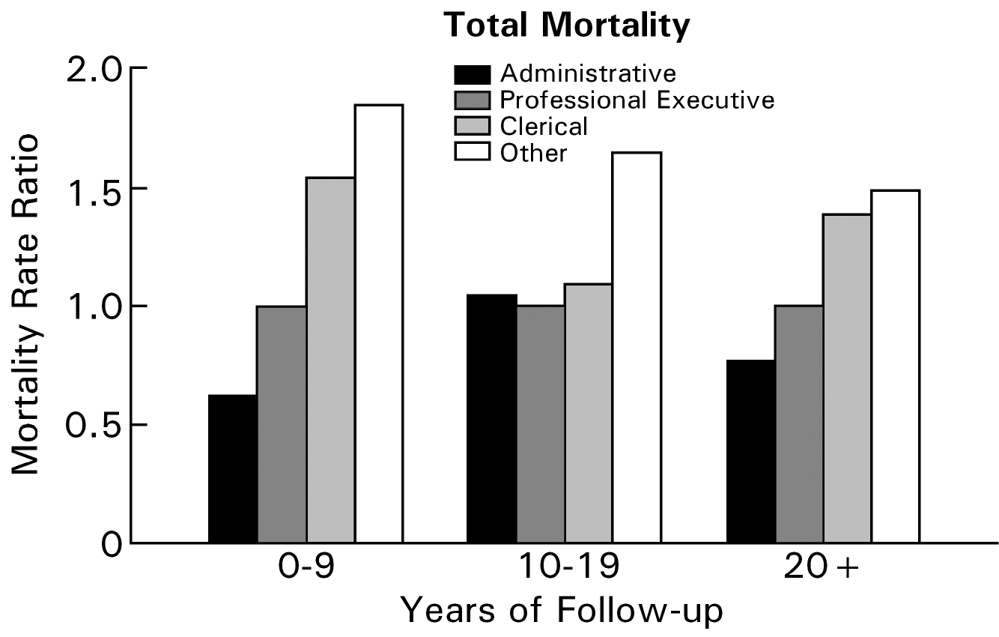
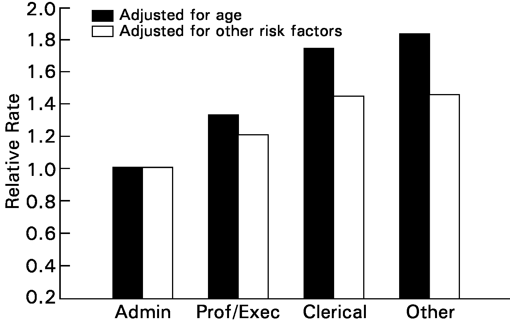

# Justice, Inequality, and Health
**First published Tue Dec 23, 2008; substantive revision Mon Nov 1, 2021**

*MacKay, Douglas, Sreenivasan, Gopal*

Among American men, there is a 14.6 year difference in life expectancy between the top 1% and the bottom 1% of the income distribution (Chetty et al. 2016)[^chetty-2016]. Among American women, the corresponding difference is 10.1 years. In a recent survey, 38.2% of U.S. respondents in the bottom third of the income distribution reported fair or poor health, compared to 21.4% of respondents in the middle third, and 12.3% of respondents in the top third (Hero, Zaslavsky, & Blendon 2017). These disparities were reduced but not eliminated by adjustment for health insurance status.

Americans also experience health disparities along racial and ethnic lines. In 2019, the life expectancy at birth for Hispanic Americans was 81.8 years, while it was 78.8 years for non-Hispanic white Americans, and 74.7 years for non-Hispanic Black Americans (Arias, Tejada-Vera, & Ahmad 2021). A recent study estimates that the COVID-19 pandemic disproportionately reduced the life expectancy (at birth) for Hispanic and non-Hispanic Black Americans from 2018 to 2020: 3.88 years for Hispanic Americans, 3.25 years for non-Hispanic Black Americans, compared to 1.36 years for non-Hispanic white Americans (Woolf, Masters, and Aron 2021).

If one turns to the international context, significant inequalities in life expectancy can be observed between people in low-income and high-income countries. In 2016, life expectancy in low-income countries was 62.7 years, compared to 80.8 years in high-income countries, a gap of 18.1 years (WHO 2020)[^who-2020].

On the face of it, these inequalities in life expectancy and self-reported health are seriously unjust. But whether the appearances of injustice here will withstand close scrutiny is a separate question. Not all inequalities in life expectancy seem unjust. For example, in 2018, life expectancy for all American women was 81.2 years, whereas for all American men it was only 76.2 years (Xu et al. 2020). Presumably, little (if any) of this 5 year inequality in life expectancy represents an injustice. However, if some inequalities in health are not unjust, then inequalities in health are not unjust *per se*.

So what makes a health inequality an injustice, when it is one? Do *health* inequalities have some significance in justice that differs from other important inequalities? Or is the injustice of an unjust inequality in health simply due to the application of general principles of equality and justice to the case of health?

To answer these questions, one has to examine two rather different literatures. On the one hand, there is an empirical literature concerning the underlying determinants of health; on the other hand, there is a philosophical literature concerned with the ethics of population health. The former literature is considerably more extensive and developed than the latter. Even there, however, the answers on offer are hardly complete or fully established.

## 1. Introduction

One possible explanation for health disparities among the rich and poor is that the rich can afford better health care. Were this explanation correct, questions regarding the justice of health inequalities could be answered by resolving familiar debates about access to health care.

While unequal access to health care certainly contributes to health inequalities, epidemiologists argue that the principal causes of these inequalities lie outside of the health care system. These inequalities are largely due to the “social determinants of health”, which we will understand as the socially controllable factors outside the traditional health care system that are independent partial causes of an individual’s health status. Candidate examples of the social determinants of health include income, education, occupational rank, racism, and social class (for a brief corrective against the natural tendency to reserve a privileged position for health care here, see Marmot 2005)[^marmot-2005][^marmot-2005-2].

In this entry, we provide an overview of the empirical literature regarding the social determinants of health, and the philosophical literature concerning the justice of health inequalities. Although the health care system is itself a determinant of health, we largely set aside questions regarding access to health care for it is covered elsewhere (see entry on justice and access to health care). We begin with a discussion of the social gradient in health, proposed social determinants of health, and possible causal pathways by which these socially controllable factors could affect people’s health. We also discuss the normative question of whether health inequalities should be understood and measured as differences among *social groups* or differences among *individuals*.

We then address the central question of this entry: what makes a health inequality unjust, when it is unjust? We first focus on the justice of domestic health inequalities, providing an overview of prominent theoretical approaches to this question. Since many propose that health inequalities are not unjust when due to the voluntary choices of individuals, we next explore the issue of individual responsibility for health and its implications for health policy. We conclude with a discussion of the justice of global health inequalities.

## 2. A Social Gradient in Health

The empirical literature’s most significant and powerful reported finding can actually be replicated with *a number of the* listed candidate social determinants of health, including income, education, occupational rank, and social class. This is the existence, within a given society, of a *social gradient* in health. The most significant evidence on the relation between a socially controllable factor and health comes from the Whitehall studies, conducted in England by Michael Marmot and his colleagues (1978). In these studies, the candidate social determinant of health is occupational rank.

Between 1967 and 1969, Marmot examined some 18,000 male civil servants aged between 40 and 69 years old. By placing a flag on their records at the National Health Service (NHS) Central Registry, Marmot was able to track the cause and date of death for each subject who later died. His data are unusually good data. To begin with, they are generated from data-points on specific individuals. Each datum reports the relation between the occupational rank of a particular person and the life-span (and cause of death) of the very same person. By contrast, almost every other study begins from aggregate data. In addition, a number of important background factors are held constant for this study population. Notably, all the subjects in this study are stably employed, they live in the same region (greater London), and all have free access to health care provided by the NHS.

*Figure 1.*

Figure 1. Social gradient in total mortality, Whitehall 25 year follow-up. (van Rossum et al. 2000: 181)[^rossum-2000] [An extended description of figure 1 is in the supplement.]

Figure 1 presents the Whitehall data after 25 years of follow-up. It reports age adjusted all-cause mortality rate ratios by employment grade, for three periods of follow-up. A mortality rate ratio reports the proportion of deaths in a given group divided by the proportion of deaths in the reference group. There are four grades in the British Civil Service employment hierarchy: administrative (highest), professional/executive, clerical, and “other” (lowest). The professional/executive grade has been used as the reference group, so its mortality rate ratio is 1.0 by definition.

*Figure 2.*

Figure 2. Risk factor adjusted social gradient in CHD mortality, Whitehall 25 year follow-up. (Marmot 2000: 363, fig. 10)[^marmot-2000] [An extended description of figure 2 is in the supplement.]

The striking and important feature of these data is that the relationship between employment grade and mortality exhibits a marked *gradient*. It is natural to think that, below some threshold of deprivation, there will be disproportionate ill-health. Yet, in this study population, there is no deprivation, not even in the lowest grade (where everyone is still a government employee with free access to health care). Furthermore, and notably, there is no threshold. Rather, there is a *step-wise* improvement in health outcomes as one climbs the employment grade ladder. In addition, these gradients persist even after the mortality rates have been adjusted for standard risk factors. For example, coronary heart disease (CHD) accounted for 43 percent of the deaths in the Whitehall study at 10 years of follow-up (Marmot, Shipley, & Rose 1984: 1003). Standard risk factors for CHD include smoking, blood pressure, cholesterol and blood sugar levels, and height. Figure 2 presents the Whitehall data on mortality from CHD after 25 years of follow-up. It reports relative rates of death from CHD by employment grade, with administrators having a rate of 1.0 by definition. The left bar in each pair displays the relative rate adjusted for age alone, while the right bar adjusts it for all the standard risk factors. Correcting for standard risk factors does explain some of the gradient in CHD mortality, but no more than a third. The remaining gradient is still marked.

## 3. Other Social Determinants of Health

The existence of a social gradient in health certainly suggests that *something* in addition to health care exercises a powerful influence on an individual’s health—something, moreover, that at least correlates with a social variable. However, it is not clear exactly what this something is. To begin with, similar domestic gradients in individual life expectancy can be found when the social variable is *income* (Chetty et al. 2016; Case, Lubotsky, & Paxson 2002; McDonough et al. 1997)[^chetty-2016][^mcdonough-1997]; when it is *education* (Mackenbach et al. 2008; Huisman et al. 2005; Crimmins & Saito 2001; Elo & Preston 1996; Kunst & Mackenbach 1994)[^crimmins-2001][^elo-1996][^huisman-2005][^kunst-1994][^mackenbach-2008]; when it is *social class* (Wilkinson & Marmot 2003)[^wilkinson-2003]; and, in the U.S. context, when it is *race* (Arias 2016; Braveman, Cubbin, et al. 2010)[^arias-2016].

By itself, therefore, the surface fact of a social gradient in health is compatible with quite different accounts of the underlying causal influences on individual health. Each distinct social variable might function as a “marker” for a different underlying causal factor, different social variables might function instead as alternative markers for the same underlying causal factor, or there may be some mixture of both. It is also possible that some social variables—e.g., education (see Cutler, Lleras-Muney, & Vogl 2011)—function as a relatively direct causal factor.

Furthermore, it is not clear how much of the correlation between health and a given social variable is properly causal in the first place. In some cases, there is clearly some “reverse causation” between health and a social variable, notably from poor health to lower income (Bleakley 2010; J. Smith 2009; Deaton 2002)[^bleakley-2010][^deaton-2002][^smith-2009] and from poor health to less education and lower occupational rank (Case, Fertig, & Paxson 2005). Similarly, there is evidence of a bidirectional relationship between income and mental illness (Ridley et al. 2020)[^ridley-2020]. In addition, there is plainly some causation among social variables, notably from education both to higher income and to higher occupational status. Similarly, while there is evidence that racism contributes directly to poorer health outcomes among racial and ethnic minorities, for example, by means of racism-related stress, it also contributes to racial and ethnic minorities having lower incomes, worse educational outcomes, and lower occupational status (Williams, Lawrence, & Davis 2019).

The choice of the social variable in terms of which to describe some social gradient in health can be made on a number of different grounds. One obvious ground would be to choose the variable(s) that came closest to conveying the operative causal mechanism(s). Another ground would be to choose the variable(s) that have independent moral and/or political significance, such as race and gender. These grounds need not exclude each other and there may be a case for choosing the same variable on both grounds. The second ground acquires a special relevance if health inequalities suffered by individuals who also suffer, for example, from racial discrimination are more unjust than health inequalities (of the same magnitude) suffered in the absence of racial discrimination. If one injustice can compound another, then the choice of social variable may affect the *kind* of inequality in health at issue, and not simply its magnitude.

When the social variable is *income*, there is an important further definitional dispute to consider. Income appears to have a significant effect on life expectancy, even controlling for education (Backlund, Sorlie, & Johnson 1999). However, there is an on-going debate about which definition of “income” is adequate to capture the contribution individual income makes to individual life expectancy (see the sample of articles collected in Kawachi, Kennedy, & Wilkinson 1999). According to the *absolute income hypothesis*, the contribution income makes to individual life expectancy is entirely a function of the individual’s non-comparative income. By contrast, the *relative income hypothesis* holds, roughly, that an individual’s life expectancy is also a function of the *relative* level of her income—that is, its level compared to others’ income in her society—and not simply of its non-comparative level (Wilkinson 1996)[^wilkinson-1996]. To make this second hypothesis precise requires one, among other things, to specify the reference group to which the individual’s income is compared and also the nature of the comparison (for examples, see Deaton 2003)[^deaton-2003]. For an overview of this debate and the state of evidence, see Sreenivasan (2009a) and Pickett and Wilkinson (2015).

## 4. Groups or Individuals?

Our discussion thus far has implicitly proceeded on the assumption that inequalities in health are defined in terms of membership in some social *group* or other. An “inequality” in health, so defined, is a difference between the health status of two groups, with the identity of the group following from the choice of the social variable with which health is correlated. For example, we note above that in 2019, the life expectancy was 78.8 years for non-Hispanic white Americans, and 74.7 years for non-Hispanic Black Americans. While this is how most of the discussion in the literature on health inequalities is actually structured, the definition is controversial. Notably, Murray, Gakidou, and Frenk (1999: 537) argue in favor of an alternative methodology, in which “health inequality” refers to “the variation in health status across individuals in a population”, rather than to a difference in health status between social groups.

Stimulated in large part by their article and the reaction to it, another lively debate considers the basic conceptual question of how health inequalities should be defined in the first place (for a nice overview, see Asada 2013)[^asada-2013]. Should they be defined across social groups? Or across individuals instead? It helps to consider this question on two separate levels. Let us call the first one the “fundamental moral level” and let us assume that, on this level, the individual is the basic unit of concern. The question at this first level asks whether it is health inequalities across individuals or health inequalities across groups which matter from the standpoint of justice.

Now it may seem as if the assumption that individuals are the basic units of moral concern compels us to define “health inequality” across individuals as well, i.e., to reject the conventional definition at the fundamental moral level, but that is a mistake. Daniel Hausman’s (2007, 2013) position in the debate illustrates this point well. Despite affirming that the individual is the fundamental unit of moral concern and taking as his starting point the claim that what matters most for egalitarians like him is inequalities in welfare or standing among individuals, he still opposes defining inequalities in health across individuals. Hausman’s (2013: 95) central claim is that “[individual] health inequalities are not themselves pro tanto injustices”.

For ease of exposition, let us follow Hausman in assuming, more specifically, that what is of fundamental concern to justice is individual *well-being*. Hausman’s main point can then be formulated as follows: Even though health is both an important component and cause of well-being, if two individuals are unequal in health, it does not follow that they are unequal in well-being. For obviously, the same two individuals may also be unequal in some other component of well-being, and the individual who is less healthy may not have less well-being overall. For example, *A* may be healthier than *B*, but *B* may have more friends or be more accomplished than *A* (or both), and the latter inequality may have a greater magnitude than the former (or a greater importance to well-being), so that the less healthy *B* may still be better off overall than *A* (cf. Hausman 2007: 52)[^hausman-2007]. The health inequality between *A* and *B* is therefore fully consistent with there being no fundamental complaint of justice about their comparative situation (at least, not on behalf of the less healthy *B*). Hence, if permission to infer that an injustice obtains is built into the classification “inequality”, as Hausman at least implicitly supposes, we should not classify any health difference between *A* and *B* (or, more generally, between individuals) as an inequality. While Hausman focuses on well-being moreover, this point generalizes to many non-welfarist egalitarian views of justice too, for example, a resourcist view which understands health to be one among a number of resources.

Of course, even on its own terms, the logic of this argument admits of an important exception: anytime an inequality in health between individuals is such that it *cannot* be counter-balanced by any complementary inequality in (one or more) other components of well-being—for example, because it is too large (Hausman 2007: 54)[^hausman-2007]—then that inequality in health does permit us to infer that the less healthy individual also has less well-being overall. Hausman calls these special health inequalities “incompensable” and he accepts that they are immune to his objection:

> Data concerning incompensable health inequalities do permit inferences concerning inequalities in welfare or standing, and they thus provide relevant information for egalitarians. (Hausman 2013: 98)[^hausman-2013]

Accordingly, he restricts the scope of his official argument, so that it only concerns *compensable* health inequalities between individuals.

By contrast to (compensable) health inequalities between individuals, health inequalities between social *groups* typically do, in Hausman’s view, permit inferences about inequalities in overall well-being. Since that is his argument for defining “health inequality” across social groups, it actually relies on the assumption that individual well-being is the fundamental unit of moral concern.

> Information about social group health differences will thus often be relevant to conclusions about justice, not because group differences matter and individual differences don’t, but because information about differences in QALYs between well-studied social groups will often license conclusions about the fundamental inequalities that egalitarians care about. (Hausman 2007: 50)[^hausman-2007]

An important implication of Hausman’s argument, which we shall see independent reason to affirm later, is that it is artificial and over-simple to put very much weight on mono-factor normative principles, such as “equality of health-by-itself”.

Iris Marion Young (2001) provides a more direct reason for focusing on inequalities across groups at the fundamental moral level. She agrees with Hausman that individuals are the basic unit of moral concern, but argues that when claims of justice concern equality, the appropriate focus is inequalities across groups. The cause of morally troublesome inequalities, she argues, lies with social structures, where structures

> refer to the relation of basic social positions that fundamentally condition the opportunities and life prospects of the persons located in those positions. (Young 2001: 14)[^young-2001]

Since structures constitute and relate to individuals as members of social groups, group-conscious practices of assessing inequalities are necessary to identify *structural inequalities*: inequalities in people’s freedom or wellbeing that are the cumulative effect of social institutions, policies, and the decisions of officials (Young 2001: 15)[^young-2001]. The social groups to focus on, Young (2001: 15) argues, are those

> which we already know have broad implications for how people relate to one another—class, race, ethnicity, age, gender, occupation, ability, religion, case, citizenship status, and so on.

Such structural inequalities are unjust since societies should not structure their social institutions and policies in ways that disadvantage people in the exercise of their freedom or flourishing on the basis of factors beyond their control (Young 2001: 16)[^young-2001].

Young does not focus exclusively on health but Paula A. Braveman, Kumanyika, et al. (2011) provide an account of unjust health inequalities that is structural in nature. While we use the concept of *health disparities* above as a stand-in for *health differences*, Braveman et al. (2011: S150) understand health disparities as those health differences among groups that are systematically tied to their social disadvantage (Braveman et al. 2011: S150)[^braveman-2011]:

> Health disparities are systematic, plausibly avoidable health differences according to race/ethnicity, skin color, religion, or nationality; socioeconomic resources or position (reflected by, e.g., income, wealth, education, or occupation); gender, sexual orientation, gender identity; age, geography, disability, illness, political or other affiliation; or other characteristics associated with discrimination or marginalization…Health disparities do not refer generically to all health differences, or even to all health differences warranting focused attention. They are a specific subset of health differences of particular relevance to social justice because they may arise from intentional or unintentional discrimination or marginalization and, in any case, are likely to reinforce social disadvantage and vulnerability.

To put this in Young’s terms, health disparities are *structural health inequalities*: health differences due to social institutions and policies (see also Goldberg 2012; Powers & Faden 2006, 61)[^goldberg-2012][^powers-2006].

On the other side of the debate, Kasper Lippert-Rasmussen (2013) argues that we should define “health inequality” across individuals at the fundamental moral level. He first raises two related objections to social group definitions which together advance the point that any group definition will be inherently arbitrary. Lippert-Rasmussen’s first objection is the “intra-group inequality” challenge, according to which there is no reason to treat health inequalities between groups as being any more unjust than health inequalities *within* groups. Yet,

> for any selection of groups such that [health] inequalities between two groups matter, intragroup [health] inequalities may exist. (2013: 57)

Lippert-Rasmussen’s second objection is the “group-identification” challenge. There are any number of ways to sub-divide a given population into groups. Holding the underlying health facts fixed, different choices of group definition will correspond to different inequalities in health (of different magnitudes) inhering in the same population. Some explanation is called for, then, of the significance in justice of the particular character of one’s favored group definition. What is the relevance to justice, for example, of the apparently artificial boundary demarcating the top 1% of the income distribution in the U.S. from the bottom 1% (our opening illustration of an inequality in health)?

Now, as Young (2001) and Braveman, Kumanyika, et al. (2011) illustrate, one obvious option for discharging this explanatory burden, which Lippert-Rasmussen (2013: 58) also recognizes, is to define the groups so that they “echo the major social causes of health equality”. He rejects this response however on the grounds that there is likely to be a mismatch between “groups identified by the social causes of health” and “groups among whom there are morally relevant health inequalities” (Lippert-Rasmussen 2013: 58)[^lippert-rasmussen-2013]. A focus on the former will therefore fail to recognize some number of unjust group health inequalities.

Lippert-Rasmussen (2013: 58) also attacks a central premise that he takes to underlie arguments for group measures of health inequalities, namely, that

> only health inequalities that are the causal result of social factors are unjust, and only group-based measures of health inequality fit unjust health inequalities.

In contrast to this view, Lippert-Rasmussen argues that there is such a thing as natural injustice, for example, health inequalities due to biological processes for which no one is responsible, and individual measures of health inequalities are necessary to capture them. We discuss this point in more detail below.

Nir Eyal (2018) rejects many of the arguments in support of focusing on health inequalities among groups. However, he offers a number of moral reasons to identify and address “status group inequalities”, that is, health inequalities “between groups that are defined along lines of social advantage and disadvantage” (Eyal 2018: 150)[^eyal-2018]. He takes these reasons to be compatible with, if not supported by, Lippert-Rasmussen’s inter-individual egalitarianism. We discuss two here. First, although status group inequalities are not inherently unfair, they are often “rough indicators” of underlying moral problems, including injustices such as racial discrimination or failures of social solidarity (Eyal 2018: 159)[^eyal-2018]. Eyal argues, second, that status group inequalities may sometimes function as a proxy for luck egalitarian injustices. Where status group inequalities exist, for example, inequality in life expectancy between low-income and high-income groups, it is likely that members of the disadvantaged group are subject to circumstances that lessen their responsibility for the outcomes in question (Eyal 2018: 161–162)[^eyal-2018]. Since luck egalitarians hold that inequalities due to unchosen circumstance are unjust, status-group inequalities may often function as proxies for luck egalitarian injustice.

Earlier we said that it was helpful to consider the question of defining health inequalities on two levels, where the first level is the fundamental moral level. The main point behind distinguishing levels here is simply to clarify that the fundamental moral level is separate from other levels at which the question can be considered and also more basic than them. In the first instance, then, it does not matter much how exactly we describe the second level. We need only describe it as “not the fundamental moral level”. How the other level(s) should be described more specifically will depend on one’s purposes. For example, Yukiko Asada (2013) describes a “policy” level and Lippert-Rasmussen (2013) describes a level of “principles of regulation”.

At the level of policy-making, Asada (2013: 40–41) reviews two considerations that favor defining health inequalities across individuals and one that favors defining them across social groups. She also proposes a novel approach that attempts to combine the merits of both. A definition across individuals is favored by the fact that data collected on that basis lends itself easily to international comparisons (see also Murray, Gakidou, & Frenk 1999), whereas data on health inequalities defined across groups can only be compared between two countries if both countries have conceived and operationalized the relevant groups in the same way (which they often have not). Furthermore, defining health inequalities across individuals does not require any balancing or summary operation in order to yield conclusions about overall inequalities in health, whereas a definition across groups only yields conclusions about overall inequalities when combined with data from other relevant groups (e.g., when health inequalities across income groups are combined with health inequalities across educational groups). On the other hand, a definition across groups is favored by the fact that the social variable defining the group (e.g., income or education) often naturally suggests a target for policy intervention, whereas a definition across individuals suggests no such target and is thus “one step removed from policy” (Asada 2013: 41)[^asada-2013].

## 5. Causal Pathways

The strategy of aligning the social groups used to define inequalities in health with the major social causes of health evidently presupposes that one knows what those causes are. To determine whether any of the previously discussed correlations between individual life expectancy and a social variable is causal, one needs some account of the *causal pathways* between candidate social determinants and specific mortality risk factors. Unfortunately, these pathways are not well understood (Mackenbach 2019: 49–55; Adler & Newman 2002; Adler & Ostrove 1999; R. Evans, Hodge, & Pless 1994)[^adler-2002][^adler-1999][^mackenbach-2019]. While research in this area remains preliminary, it may be useful to describe some of the possibilities.

Johan Mackenbach (2019: 62–73) helpfully identifies three groups of causal pathways between social determinants and health outcomes. The first is childhood environment. Socioeconomically disadvantaged mothers are more likely to have impaired health, have greater psychosocial stress, and to engage in unhealthy behaviors during pregnancy (Mackenbach 2019: 66)[^mackenbach-2019]. Their children are therefore more likely to experience impaired fetal growth, low birth weight, and premature birth. Children with disadvantaged parents are also more likely to be exposed to unfavorable conditions after birth, including inadequate nutrition and harmful levels of air pollution, which may explain why they have worse health outcomes compared to children of high-income parents (Currie 2009; Case, Lubotsky, & Paxson 2002)[^currie-2009].

A second group of causal pathways is lifelong material living conditions (Mackenbach 2019: 68)[^mackenbach-2019]. Certain conditions of absolute material deprivation constitute well-recognized risks for ill health and mortality, including inadequate nutrition, lack of clean water and sanitation, and poor housing. A very plausible causal pathway runs from low levels of non-comparative individual income through these material risk factors to poor health outcomes (Aldabe et al. 2011)[^aldabe-2011]. Low-income people are also more likely to work physically demanding jobs which expose them to dangerous chemicals (Clougherty, Souza, & Cullen 2010), and reside in neighborhoods featuring poor access to amenities and increased exposure to environmental risks such as air pollution and toxic waste sites (Brulle & Pellow 2006; Pickett & Pearl 2001)[^brulle-2006][^pickett-2001].

A third group of causal pathways between social determinants and health outcomes is social and psychological factors (Mackenbach 2019: 72; Marmot 2004)[^mackenbach-2019][^marmot-2004]. This group is important for it can explain the above cited social gradients in life expectancy which were mainly observed in highly developed societies, where the prevalence of absolute material deprivation is fairly low. In particular, a significant social gradient was observed in the Whitehall studies, where the occupants of even the lowest occupational rank were nevertheless all stably employed civil servants with free access to health care.

One of the most prominent specific risk factors envisaged as the terminus for a psychosocial pathway is (the effects of) *stress*. As Eric Brunner and Michael Marmot (2006) explain, the long-term effects of stress differ importantly from its short-term effects. In the short-term, an individual’s fight-or-flight response to external stressors is beneficial insofar as it enables them to cope with threats and challenges. Among other things, this acute stress response involves the activation of neuroendocrine pathways, along which adrenaline and cortisol (e.g.) are released into the bloodstream. These hormones stimulate psychological arousal (e.g., vigilance) and mobilize energy, while simultaneously inhibiting functions irrelevant to immediate survival (e.g., digestion, growth, and repair). An optimal reactivity pattern is characterized by a sharp increase in levels of circulating adrenaline (and later, cortisol), followed by a rapid return to baseline once the challenge has passed. Sub-optimal patterns are characterized by elevated baseline levels and slower returns to baseline.

By contrast, the long-term effects of stress—either from over frequent provocation of acute stress or from chronic stress—can be physiologically harmful (Brunner & Marmot 2006). Stress-induced damage is mediated, among other things, by prolonged elevation of adrenaline and cortisol levels in the blood. Elevated cortisol can lead to the accumulation of cholesterol (e.g., by raising glucose levels even during inactivity); and elevated adrenaline increases the blood’s tendency to clot, which can add to the formation of arterial plaques and thereby lead to increased risk of heart disease and stroke. Other risks that may be increased by stress-induced damage include risks for cancer, diabetes, infection, and cognitive decline.

A psychosocial pathway running from stress-induced damage—or “allostatic load” (B. McEwen 1998)[^mcewen-1998]—has next to be traced to some social factor, preferably one amenable to policy manipulation. Four factors that have attracted considerable attention are “social rank”, “job control”, “racial discrimination”, and “poverty”.

The most specific evidence on the role of *social rank* in producing stress-induced damage comes from studies of non-human primates (Brunner & Marmot 2006; R. Evans, Hodge, & Pless 1994). In various primate species, social life is organized in terms of clear and stable dominance hierarchies. Robert Sapolsky and Glen Mott (1987) found that hierarchies of free-ranging male baboons exhibit an inverse social gradient both in cortisol elevations and in adverse cholesterol ratios. Manipulating the dominance hierarchy of captive female macaque monkeys, Carol Shively and Thomas Clarkson (1994) similarly found that dominant monkeys who became subordinate had a five-fold excess of coronary plaques as compared to those who remained dominant. (Part of this excess was due to the stress associated simply with a *change* in social rank [as distinct from a demotion], since subordinate monkeys who became dominant also had more atherosclerosis [albeit, only twice as much] compared to those who remained subordinate).

Evidence on the role of *low job control* in producing stress-induced damage comes from the Whitehall II study (Marmot, Bosma, et al. 1997). “Job control” refers to an individual’s level of task control in the workplace, operationalized here in terms of a questionnaire concerning decision authority and skill discretion. One of the principal diseases for which stress-induced damage increases the risk is coronary heart disease (CHD). In Whitehall II, there was an inverse social gradient in age-adjusted CHD incidence: Compared to their high grade counterparts, intermediate grade male civil servants were 1.25 times more likely to develop a new case of CHD in a five year interval, while low grade men were 1.5 times more likely. For women, the odds ratios were 1.12 and 1.47. Marmot and his colleagues also found an inverse social gradient in low job control. Among men, 8.7 percent of high, 26.6 percent of intermediate, and 77.8 percent of low grade civil servants reported low job control; for women, the percentages were 10.1, 34.8, and 75.3. But their key finding was that a substantial part of the gradient in CHD incidence could be attributed to the differences in job control. Controlling for low job control reduced the low grade (e.g.) men’s odds ratio for new CHD from 1.5 to 1.18 and the women’s from 1.47 to 1.23. By comparison, known CHD risk factors only reduced the same ratios from 1.5 to 1.3 and from 1.47 to 1.35, respectively.

There is also evidence that experiences of *racial discrimination* may contribute to racial disparities in health. While some racial health disparities are explainable by appeal to the lower average socioeconomic status of racial minorities, racial health disparities persist at every level of socioeconomic status (Braveman, Cubbin, et al. 2010). There is increasing evidence that such residual disparities may in part be the result of experiences of individual-level racial discrimination which produce stress-induced damage (Williams et al. 2019; Colen et al. 2018)[^colen-2018][^williams-2019]. Indeed, a recent study suggests a causal pathway between these factors, finding an independent association between discrimination exposure and higher levels of spontaneous amygdala activity and connectivity—processes linked to higher levels of stress, physiological arousal, vigilance, and negative health outcomes (Clark, Miller, & Hegde 2018).

Finally, there is increasing evidence that children raised in *poverty* are often exposed to adversities that produce “toxic stress”. Such stress “involves the frequent or sustained activation of the biological stress system” and is often the result of adverse events that are more likely to exist in low-income households, including maternal depression, child abuse and neglect, and spousal violence (C. McEwen & B. McEwen 2017: 448)[^mcewen-2017]. Toxic stress in turn negatively affects children’s early physical and cognitive development, with likely negative consequences for their later health, educational, and occupational outcomes (C. McEwen & B. McEwen 2017; Boyce, Sokolowski, & Robinson 2012)[^mcewen-2017].

In sum, there is a reasonable case to be made that many health inequalities are caused by a number of socially controllable factors outside of the traditional health care system. Such social determinants of health may include income, occupational rank, education, social status, and racial discrimination. We would caution, however, that more evidence is needed to establish the proposed causal pathways, and that some of the evidence we discuss is contentious. For example, Anne Case and Christina Paxson (2011: F185) argue that much of the gradient Marmot, Bosma, et al. (1997) attribute to job control in Whitehall II can be explained by participants’ early life health and socioeconomic status, suggesting that “occupational grade may be more of a marker of poorer health than a cause of poorer health”.

In addition, while the above evidence regarding causal pathways is arguably sufficient for normative theorizing, things may be different for the purposes of *designing policy* remedies. As Angus Deaton (2002: 15) puts it, “policy cannot be intelligently conducted without an understanding of mechanisms; correlations are not enough”. It is not clear that our existing understanding of the causal pathways between socially controllable factors and specific mortality and morbidity risks is sufficiently well-developed to underwrite concrete policy proposals. Moreover, even if it were, it would still be a further step to *license implementation* of some such proposal. Among other things, a license of this kind requires an account of the comparative effectiveness of a proposed reform in relation to salient alternatives.

## 6. Justice and Domestic Health Inequalities

We turn now to a discussion of the normative dimension of health inequalities. We begin in this section with a look at health inequalities among residents of the same state. We first examine the concept of *health equity* which is often employed as a normative standard in the public health literature for evaluating such inequalities. We then turn to the philosophical literature, providing an overview of the most prominent accounts of the justice of health inequalities. In the two remaining sections of this entry, we first discuss the relevance of individual responsibility for health justice before concluding with a discussion of the justice of global health inequalities.

### 6.1 Health Equity

The concept of *health equity* is often used to refer to just distributions of health, where health inequities are understood to be differences or disparities in health that are avoidable, unnecessary, and unfair (Whitehead 1992)[^whitehead-1992]. Health *inequalities* are therefore in principle observable differences in the health among individuals and groups. Health *inequities* are health inequalities that are unjust. (For discussion of the ways in which health inequality metrics may themselves be value-laden see King 2016; see Asada 2019 for a good discussion of challenges in measuring health inequities)[^asada-2019][^king-2016].

While the concept of health equity is frequently invoked as a normative standard by scholars, policymakers, and public health practitioners, there is a good deal of disagreement regarding its meaning. There is disagreement, first, on which health differences are *avoidable*. Some suggest that health differences are avoidable only if they are caused by social processes rather than natural or biological processes (Chang 2002; Whitehead 1992)[^chang-2002][^whitehead-1992]. Others argue that this understanding is too constrained (Preda & Voigt 2015; Wilson 2011)[^preda-2015][^voigt-2015][^wilson-2011]. Even if health differences caused by natural processes are not avoidable in the sense of being preventable, these critics suggest, they may be avoidable in the sense of being treatable. Moreover, if inequalities in health are inequitable in part because they are unchosen, as luck egalitarians claim, then it makes sense to identify avoidable health inequalities as those that are amenable to intervention (Preda & Voigt 2015: 30)[^preda-2015][^voigt-2015].

There is also disagreement regarding whether avoidability is a distinct and necessary condition of unjust health inequalities. Sudhir Anand and Fabienne Peter (2000) suggest that unfairness entails avoidability and so is not really separate from it. But avoidability is cleanly separable (in the other direction) from unfairness, and that can be an analytic advantage. For example, it allows the justice of inevitable inequalities in health to be decided without having to engage the issue of fairness at all. Others question whether health differences must be avoidable if they are to count as unjust (Lippert-Rasmussen 2013: 59–60; Wilson 2011: 216)[^lippert-rasmussen-2013][^wilson-2011]. For luck egalitarians, health differences due to natural processes can be unjust regardless of whether they can be prevented or treated. Even if person *A* has lesser mobility compared to person *B* due to a genetic condition that is neither preventable nor treatable, the difference between *A* and *B* is unjust and *A* has a claim on society to rectify it, for example, through the provision of a mobility aid or the restructuring of the social environment. Such inequalities are examples of *natural* injustices—injustices caused by natural processes—rather than *social* injustices—injustices caused by social processes (Lippert-Rasmussen 2013: 59–60)[^lippert-rasmussen-2013]. (For a contrary view, see Wester 2018)[^wester-2018].

One way to save the avoidability condition—understood as amenability to intervention—is to stipulate that the concept of health equity is only concerned with *social* injustices (Sreenivasan 2015: 54)[^sreenivasan-2015]. But, while luck egalitarianism is controversial, James Wilson (2011: 216) cautions that it would be a mistake to define the concept of health equity in a way that presupposes its falsity. Wilson (2011: 217) therefore concludes that health inequities are simply those health differences that are unjust (for an excellent overview of these and other debates regarding the concept of health equity, see M. Smith 2015)[^smith-2015].

While these debates regarding the avoidability condition implicitly raise questions of justice, the fairness condition does so explicitly. If the concept of health equity is to function as a defensible normative standard, we need an account of justice in the distribution of health.

### 6.2 Free-Standing Approaches

We can distinguish two fundamentally different approaches to bringing verdicts of fairness or justice to bear on a given health inequality. On the *free-standing approach*, the injustice of an unjust health inequality is the primary injustice, although a verdict of injustice can also be spread *backwards* from this primary injustice to its causes. By contrast, on the *derivative approach*, the injustice of an unjust health inequality is not the primary injustice. Rather, the primary injustice is some unjust cause of a health inequality, although a verdict of injustice can also be spread *forwards* from this primary injustice to the health inequality itself. In this way, the injustice of an unjust health inequality derives from the primary injustice of its cause(s). (This distinction between free-standing and derivative approaches closely matches Peter’s [2004: 94–95] distinction between direct and indirect approaches). Suppose, for example, that part of the difference in life expectancy between white and Black men in the United States is caused by racial discrimination. On the derivative approach, this part of that inequality in health is unjust because its *cause* is unjust, and this verdict holds even if inequalities in health are not otherwise unjust (e.g., even if no valid principle of equality applies directly to health). On a free-standing approach, by contrast, this difference in life expectancy may itself be unjust, regardless of its cause. We discuss each approach in turn.

The simplest example of the free-standing approach applies a general principle of equality directly to the case of health. (For general discussion of the grounds of egalitarianism, as well as of the character of different versions, see the entry on egalitarianism.) With some qualifications, the resultant requirement of “equality of health” is affirmed, for example, by Anthony Culyer and Adam Wagstaff (1993). This implies that *any* avoidable inequality in health is unfair or unjust.

Luck egalitarians object to the strict equality view on the grounds that inequalities are not unjust if they are the result of voluntary and informed choices (Segall 2010; Le Grand 1987)[^segall-2010]. While it is unjust for one person to be worse off than another because of *brute* luck—i.e., factors beyond a person’s control such as their natural or social circumstances—inequalities due to *option* luck—i.e., factors within a person’s control—are just. For luck egalitarians therefore, not all health inequalities are unjust, only those due to unchosen circumstances (Voorhoeve 2019; Albertsen & Knight 2015; Temkin 2013; Segall 2010: 99)[^albertsen-2015][^segall-2010][^temkin-2013].

A problem for both strict and luck egalitarian views, however, is that they are subject to the leveling down objection, for unjust inequalities in health may be addressed either by improving the health of those who are unfairly worse off or leveling down the health of those who are unfairly better off (Segall 2010)[^segall-2010]. If *A*’s life expectancy is 10 years shorter than *B*’s due to cancer, this inequality may be addressed either by treating *A*’s cancer or damaging *B*’s health. Similarly, if one holds that health inequalities between social groups are unjust, one may be committed to the conclusion that deteriorations in the health of members of advantaged social groups are good—at least in one respect—when they reduce such inequalities. For example, one may be committed to the questionable claim that the rise of “deaths of despair” among white Americans in the twenty-first century (see Case & Deaton 2015, 2020)[^case-2015] is in one respect good since it reduced inequalities in life expectancy among white Americans and Black Americans (for a thoughtful discussion of this issue, see Blacksher 2018)[^blacksher-2018].

Eyal (2013) offers the most promising response to the leveling down objection in this context, pointing to a number of cases where it is plausible to prefer outcomes that are more equal, even if less equal alternatives are available where some are better off and no one is worse off. Luck egalitarians also soften the force of this objection by adopting pluralist views, arguing that comparative fairness is not the only relevant value (see Voorhoeve 2019; Temkin 2013)[^temkin-2013].

Segall (2010) opts instead for a luck prioritarian account, *prioritizing the opportunity for health of the worse off*. According to this principle,

> Fairness requires giving priority to improving the health of an individual if she has invested more rather than less effort in looking after her health, and of any two individuals who have invested equal amounts of effort, giving priority to those who are worse off (health-wise). (Segall 2010: 112)[^segall-2010]

On Segall’s (2010: 119), view therefore, justice demands, first, that we improve the health of those who have been most prudent in taking care of their health, that is, whose health deficits are most due to brute luck. For individuals who have exercised equal prudence regarding their health, justice demands, second, that priority be given to those whose health deficit is greatest—i.e., are worse off (Segall 2010: 119)[^segall-2010]. In contrast to a luck egalitarian view, Segall’s (2010: 120) luck prioritarian view is not concerned with realizing equality in health, but rather with “prioritizing the opportunity for health of the worse off”.

Some scholars avoid the leveling down objection by opting for social or relational egalitarian alternatives to luck egalitarianism. On this view, health inequalities are unjust if they undermine citizens’ ability to interact with each other as equals (see Voorhoeve 2019; Kelleher 2016; Voigt & Wester 2015; Hausman 2012; Pogge 2004)[^hausman-2012][^kelleher-2016][^pogge-2004][^voigt-2015]. For example, Alex Voorhoeve (2019) suggests that social egalitarians have special reason to be concerned with health deficits that make people vulnerable to domination or exploitation in private life as well as domination or marginalization in public life. Proponents of this view argue that it addresses a significant problem with luck egalitarian approaches since it holds that health inequalities due to people’s voluntary and informed choices are nonetheless unjust if they undermine their standing as equals. A challenge to social or relational egalitarian views, however, is that they are vague on which health inequalities undermine equal relations among citizens (Hausman 2019; Voigt & Wester 2015)[^hausman-2019][^voigt-2015].

In contrast to those who see luck egalitarian and relational approaches as competing views, Voorhoeve (2019) argues that each has a compelling basis and may be combined in a complementary way. Social or relational egalitarianism recognizes that there is “reason to be averse to choice-based inequalities that threaten people’s status as equal citizens” while the luck egalitarian approach offers a reasonable interpretation of the vague relational requirement of the principle of equal consideration (Voorhoeve 2019: 154–155).

Others avoid the leveling down objection by defending sufficientarian approaches to health justice (for comprehensive discussions of sufficientarian approaches, see Fourie 2016; Rid 2016)[^fourie-2016][^fourie-2016-2][^rid-2016]. Madison Powers and Ruth Faden (2006: 15–29) argue that social justice requires that people be secured a sufficient level of wellbeing where wellbeing is understood to have six essential dimensions: health, personal security, reasoning, respect, attachment, and self-determination. Justice does not therefore demand equality in health outcomes, but rather that people have “enough health over a long enough life span to live a decent life” (Powers & Faden 2006: 95)[^powers-2006]. Jennifer Prah Ruger (2010) similarly develops a capabilities approach to health justice, according to which people are entitled to a threshold level of certain core health capabilities, that is, abilities to be healthy. The focus of public policy, Prah Ruger (2010: 88–90) argues, should be to reduce “shortfall” inequalities—i.e., to bring people as close to the requisite threshold as is possible.

While these sufficientarian approaches avoid the leveling down objection, they nonetheless face two significant challenges. First, should governments be indifferent regarding health disparities above the threshold identified by sufficientarian views (Arneson 2002)[^arneson-2002]? If the threshold is set too low, such a view may regard significant disparities in morbidity and mortality as not unjust. Second, among those who fall below the threshold, who should be prioritized (Fourie 2016)[^fourie-2016][^fourie-2016-2]? Should policymakers focus on maximizing the number of people who meet the threshold, even if this means helping those who are better off? Or should they prioritize the worse off, even if this means using significant resources to only marginally improve their health? (For a discussion of possible solutions to these problems, see Shields 2016)[^shields-2016].

Some commentators criticize free-standing views’ tendency to focus on or prioritize *health* inequalities to the exclusion of other normative considerations. Hausman (2007, 2013, 2019) argues that health inequalities among individuals are not pro tanto unjust since such inequalities (among individuals) do not permit inferences regarding inequalities in wellbeing or moral standing which are of real moral concern. Daniel Weinstock (2015: 438) cautions against “health consequentialism”, the view that all social determinants of health should be arranged to achieve some preferred distribution of health—e.g., health equality. He argues instead in favor of pluralistic approaches to distributive justice which recognize that the distribution of many of the social determinants of health—e.g., income and education—should also be governed by additional, non-health related principles of justice (see also Wester 2018)[^wester-2018]. Powers and Faden’s (2006) view avoids these problems by positing six dimensions of wellbeing, though this approach faces the challenge of how conflicts among these dimensions ought to be adjudicated.

### 6.3 Derivative Approaches

In contrast to free-standing approaches to the justice of health inequalities, derivative approaches locate the injustice of unjust health inequalities with their unjust causes. Norman Daniels (2008) offers the most prominent example of this approach (see also Daniels, Kennedy, & Kawachi 2000; and Peter 2004)[^peter-2004]. His central claim is that, by a happy coincidence, John Rawls’ principles of justice regulate all of the principal social determinants of health (Daniels 2008: 82 and 97)[^daniels-2008]. Compliance with these principles, Daniels (2008: 82) claims, “will consequently flatten the socioeconomic gradient of health as much as we can reasonably demand” with the result that “*social justice in general is good for population health and its fair distribution*”.

To begin with, *income* and *workplace organization* are regulated by the difference principle: inequalities in income and hierarchies in the workplace are permitted only to the extent that they work to the greatest benefit of the least well off. *Education* is regulated by the principle of fair equality of opportunity, which requires “equitable public education” as well as “developmentally appropriate day care and early childhood interventions” (Daniels 2008: 96)[^daniels-2008]. *Political participation*, which Daniels (2008: 95–6) regards as a social determinant of health, is regulated by the principle of equal basic liberty: among other things, this principle safeguards the fair value of the right to participate politically. Finally, reaffirming his earlier work (1985), Daniels maintains that fair equality of opportunity also requires universal access to comprehensive *health care* (broadly construed to include public health).

To the extent that these social variables are causal determinants of health, and to the extent that their distribution in society *fails* to conform to the corresponding principle of Rawlsian justice, the resultant health inequalities will be unjust and unjust because their causes are unjust. The flip-side of this point is that the implementation of Rawls’ principles will tend—again, insofar as the relevant determinants are causal—to reduce existing inequalities in health (Daniels 2008: 82)[^daniels-2008].

As Daniels notices, observing Rawlsian justice may flatten the social gradient in health without eliminating it altogether. For example, the difference principle may permit certain inequalities of income, which are nevertheless *possible* to eliminate. If income is a causal determinant of health, these permissible income inequalities will (continue to) generate health inequalities if they are left in place. (This scenario is actually only coherent if the *relative* income hypothesis is the correct account of the causal mechanism. For the explanation, see Sreenivasan 2009b)[^sreenivasan-2009b]. Daniels holds that the persistence of avoidable health inequalities does not give us reason in justice, independently of the difference principle, to eliminate their underlying cause. In his view, justice permits some avoidable inequalities in health:

> The residual inequalities that emerge with conformance to [Rawls’] principles are not a compromise with what justice ideally requires; they are acceptable as just. (2008: 99)

Anand and Peter (2000) criticize Daniels’ account on the grounds that there is a tension between two different uses Daniels makes of Rawls’ second principle of justice. On the one hand, they argue, Daniels treats its two parts as simply regulating certain specific social determinants of health—the fair equality of opportunity principle regulates education (e.g.), while the difference principle regulates income. On the other hand, his account of health care treats the fair equality of opportunity principle as regulating *health* itself directly. But the latter employment of fair equality of opportunity, which Anand and Peter actually prefer (2000: 52), threatens to contradict Daniels’ treatment of residual health inequalities. If fair equality of opportunity requires (some kind of) egalitarianism about health, then residual health inequalities that remain after the difference principle is fully implemented may still fall within *its* scope. In that case, Rawlsian justice may well command their reduction.

To avoid this problem of inconsistency, Jayna Fishman and Douglas MacKay (2019) and Johannes Kniess (2019) rework Rawls’s theory of justice, developing a Rawlsian conception of the social determinants of health—the *social bases of health*—and arguing that it should be considered a social primary good. Fishman and MacKay (2019) and Kniess (2019) disagree however on which Rawlsian principle should govern the distribution of this good. Fishman and MacKay (2019) argue that the parties to the original position would choose an additional principle of justice to govern the distribution of the social bases of health and assign it lexical priority over fair equality of opportunity and the difference principle. According to this principle, the

> social bases of health are to be arranged so as to have the greatest positive impact on the health status of those least advantaged on the social health gradient. (Fishman & MacKay 2019: 616)[^fishman-2019]

The social bases of health deserve this priority, Fishman and MacKay (2019: 615) suggest, since health is necessary if people are to realize their highest order interests in developing and exercising their two moral powers. Inequalities in the distribution of the social bases of health, and so inequalities in health status resulting from such a distribution, are just if the least advantaged on the social health gradient have a higher expected health status than they would under an equal distribution (Fishman & MacKay 2019: 616)[^fishman-2019]. Kniess (2019: 418), by contrast, argues that the social bases of health should be governed by the difference principle, though he concedes that this complicates the indexing problem, namely, that there is no obvious way to rank different distributions of income and wealth, the powers and prerogatives of offices and positions of responsibility, and the social bases of health. Kniess (2019: 420) concludes that such tradeoffs must be decided through the democratic process. While Fishman and MacKay (2019) avoid this problem by prioritizing the social bases of health, as Kniess argues (2019: 418–420), his approach may be preferable since it permits tradeoffs between health and income and also leaves more room for political communities to set priorities.

One remaining problem with Fishman and MacKay (2019) and Kniess’s (2019) reworking of Daniels’ (2008) approach is that they too are silent on the justice of residual health inequalities. This question is important, for while we have presented the free-standing and derivative approaches as alternatives, it is possible for the two approaches to be combined. Holding that inequalities in health are unjust because of their unjust causes does not preclude holding that they are unjust simply qua inequalities.

## 7. Individual Responsibility and Health Behaviors

In section 5, we identified three groups of possible causal pathways between social determinants and health outcomes: childhood environment, material living conditions, and social and psychological factors. A central contributing factor to poor health outcomes, however, has an ambiguous relation to social determinants. There is strong evidence that *health behaviors*, including smoking, excessive alcohol consumption, poor nutrition, and lack of physical exercise are key contributors to morbidity and mortality (Petrovic et al. 2018)[^petrovic-2018]. Some find, moreover, that health behaviors explain much of the social health gradient in high-income countries, since harmful health behaviors are more prevalent in groups with lower socioeconomic status (Petrovic et al. 2018)[^petrovic-2018]. For example, Silvia Stringhini, Sabia, et al. (2010) argue that when superior measures of health behaviors are employed, much of the health gradient identified in the Whitehall II study can be explained by a social gradient in harmful health behaviors (though Stringhini, Dugravot, et al. [2011] did not replicate this finding in a study of employees of the French national gas and electric company, suggesting that whether health behaviors contribute to the social gradient may depend on social context).

When harmful health behaviors are more prevalent among people with lower socioeconomic status, one might argue that the consequent health inequalities are simply the result of social factors over which one has no control—i.e., as akin to one’s childhood environment. This is too quick, however, for people *decide*—at least in some sense—to smoke, to drink alcohol excessively, or to eat a poor diet, and such decisions may not always be determined by social factors—e.g., material constraints on access to healthy food. This matters for evaluations of justice, since, as we saw above, some argue that health inequalities are not unjust if they are the result of voluntary choices. If decisions to engage in harmful health behaviors meet the appropriate threshold of voluntariness, therefore, one may plausibly argue that there is nothing unjust about that portion of the social gradient in health that is due to them.

The question of individual responsibility is also relevant for a number of areas of health policy. If individuals are responsible for the downstream consequences of their harmful health behaviors, policymakers may be justified in withholding care or assigning such patients lesser priority in the allocation of scarce resources (see Voigt 2013)[^voigt-2013]. Policymakers may also be justified in designing public health strategies that encourage people to make better choices regarding diet and physical exercise as opposed to addressing the structural circumstances within which people make choices.

To begin, luck egalitarians would seem to be committed to the view that health inequalities due to voluntarily chosen health behaviors are not unjust. While luck egalitarians hold it is unjust for one person to be worse off than another because of brute luck, inequalities due to option luck—i.e., factors within a person’s control—are just. Applied to health and health care, luck egalitarianism would seem to imply that people should be compensated for inequalities in health due to brute luck—e.g., genetic factors and the social determinants of health—but held responsible for health outcomes due to option luck—e.g., voluntary decisions to drink excessively or eat a poor diet (see, e.g., Le Grand 1987, Segall 2010, and Cavallero 2011)[^cavallero-2011][^segall-2010].

For example, if someone has a treatable case of lung cancer, we might ordinarily reasonably presume that it would be unjust to deny him medical care. However, if his cancer is due to a heavy, life-long smoking habit, the question arises of whether the ordinary presumption is defeated or diminished in strength. For instance, if there is a choice to be made (say, because of resource scarcity) between treating him and treating another lung cancer patient who is in no way responsible for her lung cancer, does justice require preferring the second patient? A simple application of luck egalitarianism would hold that it is just to deny treatment to the smoker, as long as his “decision to smoke” qualifies as a “voluntary choice” according to some suitable criteria.

Many find this implication of luck egalitarianism to be objectionable, with Elizabeth Anderson (1999: 296) calling it “the problem of *abandonment of negligent victims*”. Some luck egalitarians respond that their view, properly understood, is not committed to this implication. For example, Alexander Cappelen and Ole Norheim (2005) and Julian Le Grand (2013) suggest that differences in option luck—i.e., differences in how the voluntary choices of people play out—are themselves unjust, and so policies should be implemented to ensure that the lucky help the unlucky, such as taxes on cigarettes with the revenues used to provide care to smokers who develop lung cancer. Eric Cavallero (2011: 393–396) takes a stronger line, arguing that luck egalitarianism provides no support for holding individuals accountable for the outcomes of health behaviors. Cavallero (2011: 393) distinguishes between socially detectable and socially undetectable risky behaviors, with smoking an example of the former and poor stress management an example of the latter. He argues that it is not necessarily more fair, by luck egalitarian lights, to only hold people responsible for the former behaviors than to simply refrain from holding people responsible for their choices (Cavallero 2011: 395)[^cavallero-2011].

Segall (2010), by contrast, accepts that luck egalitarians cannot avoid the abandonment objection by appeal to egalitarian considerations, but can do so if they appeal to moral considerations unrelated to distributive justice—e.g., meeting people’s basic needs. Voorhoeve (2019: 155) similarly adopts a pluralistic view, arguing that a luck egalitarian approach should be combined with a social egalitarian approach since the latter

> specifies that one has reason to be averse to choice-based inequalities that threaten people’s status as equal citizens and social cohesion.

Others address the question of harmful health behaviors by developing Rawls’s (1982) concept of the *social division of responsibility*. According to Rawls (1982 [1999: 371]), society is responsible for securing people’s basic liberties and providing each with a fair share of opportunities and income and wealth, while individuals are responsible for setting goals and projects in light of the legitimate claims they may make on social institutions. Applying this concept to health inequalities, Kniess (2019: 115) argues that people are responsible for the health outcomes of choices made under conditions of social justice, but not those outcomes due to choices made under conditions of social disadvantage. As Kniess puts it,

> where there is no justice, there is no (substantive) responsibility…the disadvantaged in an unjust society are therefore let off the hook, so to speak, no matter what they do or don’t do to look after their health. (2019: 116)

Even if people’s choices to drink excessively, eat an unhealthy diet, or fail to exercise are voluntary, on this view, if such choices are made under conditions of unjust social disadvantage, people are not responsible for the downstream consequences. Daniels (2011) develops a similar Rawlsian view, but emphasizes that even under conditions of social justice, policymakers should be wary of holding individuals accountable for the costs of their health behaviors. We all have an interest, Daniels argues, in having the freedom to make choices regarding sport, sex, and diet without the fear of social sanction when our choices turn out to be “bad” ones (see also Fleck 2012)[^fleck-2012].

Ben Davies and Julian Savulescu (2019) provide an alternative argument for holding individuals responsible for the health behaviors. They argue that where healthcare systems are grounded in solidarity, people have obligations to fellow members of the system to protect their health and may be held responsible for some or all of the costs of treatment that result from a failure to do so. Solidarity, Davies and Savulescu (2019: 135) argue, is a two-way street, meaning that members of a system founded in solidarity not only have claims on other members of the system, but also obligations to them. These obligations include a duty not to impose *unreasonable* costs on members of the system, with such costs being the result of refusals of “Golden Opportunities”, that is, refusals to make realistically adoptable, health promoting behavioral changes, which are performed under conditions conducive to responsible choice (Davies & Savulescu 2019: 139–140)[^davies-2019]. Davies and Savulescu (2019, 141) caution however, that it is only permissible to hold people responsible for refusals of Golden Opportunities if solidarity is practiced in the broader social system, meaning that all people are held responsible for failures of solidarity—e.g., including the rich for tax avoidance.

In sum, although the claim that inequalities due to voluntary chosen health behaviors are not unjust is prima facie plausible, few are willing to endorse it and/or its policy implications without significant qualification. Luck egalitarians either reject it by appealing to further egalitarian considerations or opt for a pluralistic view that enables them to avoid its counter-intuitive policy implications. Similarly, those who adopt either Rawlsian or solidaristic approaches hold that people are only responsible for the outcomes of their voluntarily chosen health behaviors in the context of a just society.

Others reject the idea that people are responsible for health outcomes due to harmful health behaviors. Daniel Wikler (2004) offers a sustained critique of the unmodified luck egalitarian view, pressing the abandonment objection but also raising a number of practical problems regarding the view’s applications, including the difficulty of identifying voluntary actions and the arbitrariness of finding fault with some choices but not others (see also Fleck 2012)[^fleck-2012]. He concludes that personal responsibility should only be employed in health policy as an ideal in health promotion campaigns to motivate and encourage people to take an active role in living healthy lives.

Neil Levy (2019) similarly rejects the idea of personal responsibility for health by focusing on the greater prevalence of harmful health behaviors among people with low socioeconomic status. The explanation for this disparity, Levy (2019: 106–107) argues, is that such people, due to their circumstances, have reduced agential capacities, lower education, and make choices under the stressful conditions of poverty. For many, these challenges are significant enough to render them non-responsible for the behaviors that contribute to ill health. Since most people who are causally responsible for their ill health are morally non-responsible in this way, Levy argues (2019: 109), health policy should not be designed on the premise that people are responsible for their ill health. Instead, since the distribution of agential capacities and the circumstances of choice is the result of public policy and the actions of large corporations, it is these latter actors who bear responsibility for the health outcomes in question (Levy 2019: 110)[^levy-2019].

Others are skeptical of this line of argument. Ben Schwan (2021) cautions that the mere fact that people’s choices are influenced by the social determinants of health does not mean that they are not responsible for them—some social determinants of health are “responsibility-preserving”. Cavallero (2019) argues similarly that the health-related choices of people with low socio-economic status satisfy widely accepted criteria of responsible choice, namely, that they are made in the context of reasonable alternatives and are not coerced. He argues further that questioning the autonomy and responsibility of people of low socioeconomic status is incompatible with the liberal ideal that all competent adults are deserving of equal respect and opens the door to paternalistic restrictions of people’s liberty (Cavallero 2019)[^cavallero-2019]. This does not imply, however, that society is not *also* responsible for the disparate health outcomes of low SES individuals. Cavallero (2019: 378) agrees that the pattern Levy (2019) identifies is morally troubling and argues that governments have an obligation to ensure that people do

> not face unequal health opportunities simply in virtue of their socioeconomic status of origin if those inequalities are remediable through reasonable public interventions.

Finally, others argue that the focus on personal responsibility in debates regarding priority setting and health promotion is misplaced or even fundamentally mistaken. Phoebe Friesen (2018: 56) makes a strong case that the behaviors policymakers wish to hold people responsible for—e.g., excessive drinking, smoking, and poor eating habits—are stigmatized. She challenges proponents of considering personal responsibility in health policy to either explain their focus on socially undesirable behaviors, or to extend their arguments to include behaviors that contribute to ill health, are known to be risky, and that are under people’s control—e.g., living in a city with high levels of air pollution, engaging in a dangerous sport, or spending too much time in the sun (Friesen 2018: 56)[^friesen-2018]. Others worry that a focus on individual responsibility may distract policymakers from the more urgent need to address the social determinants of health and may also stigmatize people who act “irresponsibly” (Voigt 2013; Goldberg 2012)[^goldberg-2012][^voigt-2013]. Since socio-economic conditions are the principal determinants of health outcomes, these critics argue, such structural factors ought to be the focus of public policy.

## 8. Justice and Global Health Inequalities

Discussions of justice and health inequality often focus on inequalities among members of the same polity. However, scholars have also addressed the justice of international health disparities, which, depending on the countries of comparison, can be drastic. As we note above, life expectancy in low-income countries in 2016 was 62.7 years, compared to 80.8 years in high-income countries, a gap of 18.1 years (WHO 2020)[^who-2020]. These disparities are no doubt driven by the wide income differences among these countries, and so questions regarding their justice are tightly connected to questions of global distributive justice (see entries on international distributive justice and global justice). However, global health inequalities are also driven by war, climate change, healthcare worker migration, and the funding decisions of sponsors of medical research, among other factors. Positions regarding the justice of global health disparities may therefore have far-reaching implications for a diverse set of policy spheres.

Given the tight connection between global health justice and global distributive justice, it is no surprise that approaches to the former piggy-back on approaches to the latter. Briefly, *cosmopolitans* start from the premise that all humans are moral equals and argue on this basis that high-income states have robust distributive obligations to people regardless of their nationality or relation to them. Some cosmopolitans defend a sufficientarian position (Brock 2009)[^brock-2009], while others argue that global justice demands equality since national membership is a morally arbitrary factor on the basis of which people should not be disadvantaged (Caney 2005)[^caney-2005]. *Institutionalists* do not reject the claim that all humans are moral equals but argue that robust distributive obligations—as opposed to a duty of assistance—are contingent on the existence of certain types of institutions, whether a coercive legal system (Nagel 2005; Blake 2001)[^blake-2001][^nagel-2005] or institutions establishing substantial economic interdependence (Sangiovanni 2007; J. Cohen & Sabel 2006)[^cohen-2006][^sangiovanni-2007].

Turning to theories of global health justice, a number of scholars defend sufficientarian accounts, according to which all people are entitled to some minimum level of health or opportunity to be healthy. Sridhar Venkatapuram (2011: 224) defends a cosmopolitan account of global health justice according to which all people have an entitlement to the capability to be healthy, secured at a threshold sufficient to ensure their equal human dignity. Jennifer Prah Ruger (2018: 82) defends an institutionalist sufficientarian approach, “provincial globalism”, according to which states and the broader global community have an obligation to ensure that all people enjoy a threshold level of central health capabilities. Others defend the human right to health, understood as a right to “protection against ‘standard threats’ to health” (Wolff 2012: 27)[^wolff-2012], or as a right to those things necessary for a basic minimum of health and so for a minimally good life (Hassoun 2020; see also Powers & Faden 2006: 85)[^hassoun-2020][^powers-2006].

Segall (2010) defends a cosmopolitan luck prioritarian account of global health justice. National membership is a morally arbitrary feature of one’s identity, Segall argues, and so disadvantages in people’s opportunities for health that are due to national membership should be addressed, with priority given to those who are worse off. While luck egalitarian or prioritarian positions often permit deficits in health due to voluntary choices in the domestic context, Segall (2010) rejects appeals to national responsibility to justify global health disparities on the grounds that not all residents of a polity can be held responsible for national policies. Even in an ideal world of democratic countries operating in the context of a just global economic order, policy decisions will be made on behalf of children and against the wishes of dissenters.

Hausman (2012) criticizes luck egalitarian and prioritarian accounts on the grounds that they may imply policies that exacerbate international inequalities in income or opportunity. Since citizens of some low-income countries experience better health than citizens of some middle- and high-income countries, policies aimed at addressing the poor health outcomes of the latter may exacerbate income inequalities among these countries. Luck egalitarian and prioritarian views therefore face difficult questions regarding the prioritization of health equality over equality of income or equality of opportunity. As an alternative to these accounts, Hausman (2012: 45) proposes a relational egalitarian account of global health justice, positing that some health inequalities across borders may be drastic enough to

> render individuals in one nation vulnerable to domination by other nations and diminish their voice in international co-operation.

Although Hausman’s proposal is more of a sketch than an account of global health justice, it faces the above-mentioned problem with domestic relational egalitarian approaches, namely, identifying the health inequalities which in fact undermine equal relations. For example, when are the difference in life expectancy among citizens of two countries large enough to imply that they do not have equal status when representatives negotiate a trade deal?

Daniels (2008) develops an institutionalist approach to global health justice. He rejects the cosmopolitan idea that national membership is morally arbitrary on the grounds that co-nationals stand in a morally relevant set of institutionally mediated relationships which establish sustainable claims of egalitarian justice. Co-nationals are subject to the same coercively enforced rules of social cooperation of which they are the putative co-authors (see Nagel 2005)[^nagel-2005]. While Daniels (2008) rejects Segall’s claim that global inequalities due to national membership are unjust, he follows Joshua Cohen and Charles Sabel (2006) in arguing that international organizations and agreements establish morally relevant relationships and so must be designed in accordance with principles of justice. Thus, Daniels (2008) argues, the World Health Organization must show equal concern to all in its distribution of public health expertise and technology, and international property rights regimes must be designed to better address the global burden of disease.

Gopal Sreenivasan (2007b: 221) side steps the above-mentioned debates in global distributive justice, and instead offers a non-ideal account of global health justice, one which anticipates the “minimum requirements that *any plausible and complete* ideal theory of justice will include”. He argues that the richest nations have an obligation to transfer 1% of GDP to the poorest nations with priority given to spending it on the determinants of health, including health care and public health, income and nutrition support, and education. This transfer is neither too demanding, nor, if spent on the determinants of health, too minimal for it promises to substantially improve the life expectancy of the world’s poorest people (Sreenivasan 2007b)[^sreenivasan-2007b].

## References（引用注释）

> 原文参考文献已转为脚注引用：文内“作者-年份”引用组后附 [^key] 标记，完整条目见本文末脚注定义。

## Academic Tools

> |   | [How to cite this entry](https://plato.stanford.edu/cgi-bin/encyclopedia/archinfo.cgi?entry=justice-inequality-health). |
> | --- | --- |
> |   | [Preview the PDF version of this entry](https://leibniz.stanford.edu/friends/preview/justice-inequality-health/) at the [Friends of the SEP Society](https://leibniz.stanford.edu/friends/). |
> |   | [Look up topics and thinkers related to this entry](https://www.inphoproject.org/entity?sep=justice-inequality-health&redirect=True) at the Internet Philosophy Ontology Project (InPhO). |
> |   | [Enhanced bibliography for this entry](https://philpapers.org/sep/justice-inequality-health/) at [PhilPapers](https://philpapers.org/), with links to its database. |

## Other Internet Resources

- [World Health Organization Commission on Social Determinants of Health](https://www.who.int/teams/social-determinants-of-health)

## Related Entries

beneficence, principle of | civil rights | economics [normative] and economic justice | egalitarianism | equality | equality: of opportunity | ethics, biomedical: justice and access to health care | exploitation | feminist philosophy | feminist philosophy, interventions: bioethics | health | human genome project | justice: as a virtue | justice: distributive | justice: intergenerational | justice: international distributive | luck: justice and bad luck | race | Rawls, John | social minimum [basic income]

### Acknowledgments

As of the 2021 update of this entry, Douglas MacKay has taken responsibility for updating and maintaining this entry.

[^adler-2002]: Adler, Nancy E. and Katherine Newman, 2002, “Socioeconomic Disparities In Health: Pathways And Policies”, *Health Affairs*, 21(2): 60–76. doi:10.1377/hlthaff.21.2.60

[^adler-1999]: Adler, Nancy E. and Joan M. Ostrove, 1999, “Socioeconomic Status and Health: What We Know and What We Don’t”, *Socioeconomic Status and Health in Industrial Nations: Social, Psychological, and Biological Pathways*, volume title of *Annals of the New York Academy of Sciences*, 896: 3–15. doi:10.1111/j.1749-6632.1999.tb08101.x

[^albertsen-2015]: Albertsen, Andreas and Carl Knight, 2015, “A Framework for Luck Egalitarianism in Health and Healthcare”, *Journal of Medical Ethics*, 41(2): 165–169. doi:10.1136/medethics-2013-101666

[^aldabe-2011]: Aldabe, B., R. Anderson, M. Lyly-Yrjanainen, A. Parent-Thirion, G. Vermeylen, C. C. Kelleher, and I. Niedhammer, 2011, “Contribution of Material, Occupational, and Psychosocial Factors in the Explanation of Social Inequalities in Health in 28 Countries in Europe”, *Journal of Epidemiology & Community Health*, 65(12): 1123–1131. doi:10.1136/jech.2009.102517

[^anand-2004]: Anand, Sudhir, 2004, “The Concern for Equity in Health”, in Anand, Peter, and Sen 2004: 15–20.

[^anand-2000]: Anand, Sudhir and Fabienne Peter, 2000, “Equal Opportunity”, in J. Cohen and Rogers 2000: 48–52.

[^anand-2004-2]: Anand, Sudhir, Fabienne Peter, and Amartya Sen (eds.), 2004, *Public Health, Ethics, and Equity*, New York: Oxford University Press.

[^anand-2001]: Anand, Sudhir, Finn Diderichsen, Timothy Evans, Vladimir M. Shkolnikov, and Meg Wirth, 2001, “Measuring Disparities in Health: Methods and Indicators”, in T. Evans et al. 2001: 49–67.

[^anderson-1999]: Anderson, Elizabeth S., 1999, “What Is the Point of Equality?”, *Ethics*, 109(2): 287–337. doi:10.1086/233897

[^arias-2016]: Arias, Elizabeth, 2016, “Changes in Life Expectancy by Race and Hispanic Origin in the United States, 2013–2014”, NCHS Data Brief 244, Hyattsville, MD: National Center for Health Statistics. [[Arias 2016 available online](https://www.cdc.gov/nchs/products/databriefs/db244.htm)]

[^arias-2021]: Arias, Elizabeth, Betzaida Tejada-Vera, and Farida Ahmad, 2021, “Provisional Life Expectancy Estimates for January through June, 2020”, *Vital Statistics Rapid Release* 10, Hyattsville, MD: National Center for Health Statistics. [[Arias et al. 2021 available online](https://depts.washington.edu/pandemicalliance/2021/02/19/provisional-life-expectancy-estimates-for-january-through-june-2020/)]

[^arneson-2002]: Arneson, Richard J., 2002, “Why Justice Requires Transfers to Offset Income and Wealth Inequalities”, *Social Philosophy and Policy*, 19(1): 172–200. doi:10.1017/S0265052502191084

[^asada-2013]: Asada, Yukiko, 2013, “A Summary Measure of Health Inequalities”, in Eyal et al. 2013: 37–51. doi:10.1093/acprof:oso/9780199931392.003.0004

[^asada-2019]: –––, 2019, “Measuring Health Inequity: A Public Health Ethics Inquiry”, in Mastroianni et al. 2019: 301–311. doi:10.1093/oxfordhb/9780190245191.013.23

[^backlund-1999]: Backlund, Eric, Paul D. Sorlie, and Norman J. Johnson, 1999, “A Comparison of the Relationships of Education and Income with Mortality: The National Longitudinal Mortality Study”, *Social Science & Medicine*, 49(10): 1373–1384. doi:10.1016/S0277-9536(99)00209-9

[^blacksher-2018]: Blacksher, Erika, 2018, “Shrinking Poor White Life Spans: Class, Race, and Health Justice”, *The American Journal of Bioethics*, 18(10): 3–14. doi:10.1080/15265161.2018.1513585

[^blake-2001]: Blake, Michael, 2001, “Distributive Justice, State Coercion, and Autonomy”, *Philosophy & Public Affairs*, 30(3): 257–296. doi:10.1111/j.1088-4963.2001.00257.x

[^bleakley-2010]: Bleakley, Hoyt, 2010, “Malaria Eradication in the Americas: A Retrospective Analysis of Childhood Exposure”, *American Economic Journal: Applied Economics*, 2(2): 1–45. doi:10.1257/app.2.2.1

[^boyce-2012]: Boyce, W. Thomas, Marla B. Sokolowski, and Gene E. Robinson, 2012, “Toward a New Biology of Social Adversity”, *Proceedings of the National Academy of Sciences*, 109(Supplement 2): 17143–17148. doi:10.1073/pnas.1121264109

[^braveman-2010]: Braveman, Paula A., Catherine Cubbin, Susan Egerter, David R. Williams, and Elsie Pamuk, 2010, “Socioeconomic Disparities in Health in the United States: What the Patterns Tell Us”, *American Journal of Public Health*, 100(S1): S186–S196. doi:10.2105/AJPH.2009.166082

[^braveman-2011]: Braveman, Paula A., Shiriki Kumanyika, Jonathan Fielding, Thomas LaVeist, Luisa N. Borrell, Ron Manderscheid, and Adewale Troutman, 2011, “Health Disparities and Health Equity: The Issue Is Justice”, *American Journal of Public Health*, 101(S1): S149–S155. doi:10.2105/AJPH.2010.300062

[^brock-2009]: Brock, Gillian, 2009, *Global Justice: A Cosmopolitan Account*, New York: Oxford University Press. doi:10.1093/acprof:oso/9780199230938.001.0001

[^brulle-2006]: Brulle, Robert J. and David N. Pellow, 2006, “Environmental Justice: Human Health and Environmental Inequalities”, *Annual Review of Public Health*, 27: 103–124. doi:10.1146/annurev.publhealth.27.021405.102124

[^brunner-2005]: Brunner, Eric and Marmot, Michael, 2005, “Social Organization, Stress, and Health”, in Marmot and Wilkinson 2005: 6–28. doi:10.1093/acprof:oso/9780198565895.001.0001

[^buchbinder-2016]: Buchbinder, Mara, Michele R. Rivkin-Fish, and Rebecca L. Walker (eds.), 2016, *Understanding Health Inequalities and Justice: New Conversations across the Disciplines*, (Studies in Social Medicine), Chapel Hill, NC: The University of North Carolina Press.

[^caney-2005]: Caney, Simon, 2005, *Justice Beyond Borders: A Global Political Theory*, Oxford: Oxford University Press. doi:10.1093/019829350X.001.0001

[^cappelen-2005]: Cappelen, A. W. and O. F. Norheim, 2005, “Responsibility in Health Care: A Liberal Egalitarian Approach”, *Journal of Medical Ethics*, 31(8): 476–480. doi:10.1136/jme.2004.010421

[^case-2015]: Case, Anne and Angus Deaton, 2015, “Rising Morbidity and Mortality in Midlife among White Non-Hispanic Americans in the 21st Century”, *Proceedings of the National Academy of Sciences*, 112(49): 15078–15083. doi:10.1073/pnas.1518393112

[^case-2020]: –––, 2020, *Deaths of Despair and the Future of Capitalism*, Princeton, NJ: Princeton University Press.

[^case-2005]: Case, Anne, Angela Fertig, and Christina Paxson, 2005, “The Lasting Impact of Childhood Health and Circumstance”, *Journal of Health Economics*, 24(2): 365–389. doi:10.1016/j.jhealeco.2004.09.008

[^case-2002]: Case, Anne, Darren Lubotsky, and Christina Paxson, 2002, “Economic Status and Health in Childhood: The Origins of the Gradient”, *American Economic Review*, 92(5): 1308–1334. doi:10.1257/000282802762024520

[^case-2011]: Case, Anne and Christina Paxson, 2011, “The Long Reach of Childhood Health and Circumstance: Evidence from the Whitehall II Study”, *The Economic Journal*, 121(554): F183–F204. doi:10.1111/j.1468-0297.2011.02447.x

[^cavallero-2011]: Cavallero, Eric, 2011, “Health, Luck and Moral Fallacies of the Second Best”, *The Journal of Ethics*, 15(4): 387–403. doi:10.1007/s10892-011-9109-z

[^cavallero-2019]: –––, 2019, “Opportunity and Responsibility for Health”, *The Journal of Ethics*, 23(4): 369–386. doi:10.1007/s10892-019-09300-7

[^chang-2002]: Chang, W, 2002, “The Meaning and Goals of Equity in Health”, *Journal of Epidemiology & Community Health*, 56(7): 488–491. doi:10.1136/jech.56.7.488

[^chetty-2016]: Chetty, Raj, Michael Stepner, Sarah Abraham, Shelby Lin, Benjamin Scuderi, Nicholas Turner, Augustin Bergeron, and David Cutler, 2016, “The Association Between Income and Life Expectancy in the United States, 2001-2014”, *Journal of the American Medical Association*, 315(16): 1750–1766. doi:10.1001/jama.2016.4226

[^clark-2018]: Clark, Uraina S., Evan R. Miller, and Rachal R. Hegde, 2018, “Experiences of Discrimination Are Associated With Greater Resting Amygdala Activity and Functional Connectivity”, *Biological Psychiatry: Cognitive Neuroscience and Neuroimaging*, 3(4): 367–378. doi:10.1016/j.bpsc.2017.11.011

[^clougherty-2010]: Clougherty, Jane E., Kerry Souza, and Mark R. Cullen, 2010, “Work and Its Role in Shaping the Social Gradient in Health”, *The Biology of Disadvantage: Socioeconomic Status and Health*, volume title of *Annals of the New York Academy of Sciences*, 1186: 102–124. doi:10.1111/j.1749-6632.2009.05338.x

[^cohen-2000]: Cohen, Joshua and Joel Rogers (eds.), 2000, *Is Inequality Bad for Our Health?*, (New Democratic Forum Series), Boston, MA: Beacon Press.

[^cohen-2006]: Cohen, Joshua and Charles Sabel, 2006, “Extra Rempublicam Nulla Justitia?”, *Philosophy & Public Affairs*, 34(2): 147–175. doi:10.1111/j.1088-4963.2006.00060.x

[^cohen-1997]: Cohen, Sheldon, Scott Line, Stephen B. Manuck, Bruce S. Rabin, Eugene R. Heise, and Jay R. Kaplan, 1997, “Chronic Social Stress, Social Status, and Susceptibility to Upper Respiratory Infections in Nonhuman Primates”, *Psychosomatic Medicine*, 59(3): 213–221. doi:10.1097/00006842-199705000-00001

[^colen-2018]: Colen, Cynthia G., David M. Ramey, Elizabeth C. Cooksey, and David R. Williams, 2018, “Racial Disparities in Health among Nonpoor African Americans and Hispanics: The Role of Acute and Chronic Discrimination”, *Social Science & Medicine*, 199: 167–180. doi:10.1016/j.socscimed.2017.04.051

[^crimmins-2001]: Crimmins, Eileen M. and Yasuhiko Saito, 2001, “Trends in Healthy Life Expectancy in the United States, 1970–1990: Gender, Racial, and Educational Differences”, *Social Science & Medicine*, 52(11): 1629–1641. doi:10.1016/S0277-9536(00)00273-2

[^culyer-1993]: Culyer, A. J. and Adam Wagstaff, 1993, “Equity and Equality in Health and Health Care”, *Journal of Health Economics*, 12(4): 431–457. doi:10.1016/0167-6296(93)90004-X

[^currie-2009]: Currie, Janet, 2009, “Healthy, Wealthy, and Wise: Socioeconomic Status, Poor Health in Childhood, and Human Capital Development”, *Journal of Economic Literature*, 47(1): 87–122. doi:10.1257/jel.47.1.87

[^cutler-2011]: Cutler, David M., Adriana Lleras-Muney, and Tom Vogl, 2011, “Socioeconomic Status and Health: Dimensions and Mechanisms”, in *The Oxford Handbook of Health Economics*, Sherry Glied and Peter C. Smith (eds.), Oxford: Oxford University Press, 123–163. doi:10.1093/oxfordhb/9780199238828.013.0007

[^daniels-1985]: Daniels, Norman, 1985, *Just Health Care*, New York: Cambridge University Press. doi:10.1017/CBO9780511624971

[^daniels-2008]: –––, 2008, *Just Health: Meeting Health Needs Fairly*, Cambridge: Cambridge University Press. doi:10.1017/CBO9780511809514

[^daniels-2011]: –––, 2011, “Individual and Social Responsibility for Health”, in Knight and Stemplowska 2011: 266–286. doi:10.1093/acprof:oso/9780199565801.003.0014

[^daniels-2000]: Daniels, Norman, Bruce Kennedy, and Ichiro Kawachi, 2000, “Why Justice is Good for our Health”, in J. Cohen and Rogers 2000: 3–33.

[^davies-2019]: Davies, Ben and Julian Savulescu, 2019, “Solidarity and Responsibility in Health Care”, *Public Health Ethics*, 12(2): 133–144. doi:10.1093/phe/phz008

[^dawson-2011]: Dawson, Angus (ed.), 2011, *Public Health Ethics: Key Concepts and Issues in Policy and Practice*, Cambridge: Cambridge University Press. doi:10.1017/CBO9780511862670

[^deaton-2002]: Deaton, Angus, 2002, “Policy Implications Of The Gradient Of Health And Wealth”, *Health Affairs*, 21(2): 13–30. doi:10.1377/hlthaff.21.2.13

[^deaton-2003]: –––, 2003, “Health, Inequality, and Economic Development”, *Journal of Economic Literature*, 41(1): 113–158. doi:10.1257/jel.41.1.113

[^deaton-2013]: –––, 2013, “What Does the Empirical Evidence Tell Us About the Injustice of Health Inequalities?”, in Eyal et al. 2013: 263–281. doi:10.1093/acprof:oso/9780199931392.003.0018

[^elo-1996]: Elo, Irma T. and Samuel H. Preston, 1996, “Educational Differentials in Mortality: United States, 1979–1985”, *Social Science & Medicine*, 42(1): 47–57. doi:10.1016/0277-9536(95)00062-3

[^evans-1994]: Evans, Robert G., M. Hodge, and I. B. Pless, 1994, “If Not Genetics, Then What? Biological Pathways and Population Health”, in *Why Are Some People Healthy and Others Not? The Determinants of Health Populations*, Robert G. Evans, Morris L. Barer, and Theodore R. Marmor (eds.), New York: De Gruyter, 161–188. doi:10.1515/9783112421628-008

[^evans-2001]: Evans, Timothy, Margaret Whitehead, Finn Diderichsen, Abbas Bhuiya, and Meg Wirth, 2001, *Challenging Inequities in Health: From Ethics to Action*, Oxford: Oxford University Press. doi:10.1093/acprof:oso/9780195137408.001.0001

[^eyal-2013]: Eyal, Nir, 2013, “Leveling Down Health”, in Eyal et al. 2013: 197–213. doi:10.1093/acprof:oso/9780199931392.003.0014

[^eyal-2018]: –––, 2018, “Inequality in Political Philosophy and in Epidemiology: A Remarriage: Inequality in Political Philosophy and in Epidemiology”, *Journal of Applied Philosophy*, 35(1): 149–167. doi:10.1111/japp.12150

[^eyal-2013-2]: Eyal, Nir, Samia A. Hurst, Ole F. Norheim, and Dan Wikler (eds.), 2013, *Inequalities in Health: Concepts, Measures, and Ethics*, Oxford: Oxford University Press. doi:10.1093/acprof:oso/9780199931392.001.0001

[^fishman-2019]: Fishman, Jayna and Douglas MacKay, 2019, “Rawlsian Justice and the Social Determinants of Health”, *Journal of Applied Philosophy*, 36(4): 608–625. doi:10.1111/japp.12339

[^fleck-2012]: Fleck, Leonard M., 2012, “Whoopie Pies, Supersized Fries: ‘Just’ Snacking? ‘Just’ Des(s)Erts?”, *Cambridge Quarterly of Healthcare Ethics*, 21(1): 5–19. doi:10.1017/S0963180111000454

[^fourie-2016]: Fourie, Carina, 2016, “The Sufficiency View: A Primer”, in Fourie and Rid 2016: 11–29. doi:10.1093/acprof:oso/9780199385263.003.0002

[^fourie-2016-2]: Fourie, Carina and Annette Rid (eds.), 2016, *What Is Enough? Sufficiency, Justice, and Health*, New York: Oxford University Press. doi:10.1093/acprof:oso/9780199385263.001.0001

[^friesen-2018]: Friesen, Phoebe, 2018, “Personal Responsibility within Health Policy: Unethical and Ineffective”, *Journal of Medical Ethics*, 44(1): 53–58. doi:10.1136/medethics-2016-103478

[^goldberg-2012]: Goldberg, D. S., 2012, “Social Justice, Health Inequalities and Methodological Individualism in US Health Promotion”, *Public Health Ethics*, 5(2): 104–115. doi:10.1093/phe/phs013

[^hassoun-2020]: Hassoun, Nicole, 2020, *Global Health Impact: Extending Access to Essential Medicines*, New York: Oxford University Press. doi:10.1093/oso/9780197514993.001.0001

[^hausman-2007]: Hausman, Daniel M., 2007, “What’s Wrong with Health Inequalities?”, *Journal of Political Philosophy*, 15(1): 46–66. doi:10.1111/j.1467-9760.2007.00270.x

[^hausman-2012]: –––, 2012, “What’s Wrong with Global Health Inequalities?” in Lenard and Straehle 2012: 34–51.

[^hausman-2013]: –––, 2013, “Egalitarian Critiques of Health Inequalities”, in Eyal et al. 2013: 95–112. doi:10.1093/acprof:oso/9780199931392.003.0008

[^hausman-2019]: –––, 2019, “Some Remarks on Equality in Health and Health Care”, *Social Justice Research*, 32(2): 137–154. doi:10.1007/s11211-018-0320-y

[^hero-2017]: Hero, Joachim O., Alan M. Zaslavsky, and Robert J. Blendon, 2017, “The United States Leads Other Nations In Differences By Income In Perceptions Of Health And Health Care”, *Health Affairs*, 36(6): 1032–1040. doi:10.1377/hlthaff.2017.0006

[^huisman-2005]: Huisman, Martijn, Anton E. Kunst, Matthias Bopp, Jens-Kristian Borgan, Carme Borrell, Giuseppe Costa, Patrick Deboosere, Sylvie Gadeyne, Myer Glickman, Chiara Marinacci, Christoph Minder, Enrique Regidor, Tapani Valkonen, and Johan P. Mackenbach, 2005, “Educational Inequalities in Cause-Specific Mortality in Middle-Aged and Older Men and Women in Eight Western European Populations”, *The Lancet*, 365(9458): 493–500. doi:10.1016/S0140-6736(05)17867-2

[^kawachi-1999]: Kawachi, Ichiro, Bruce P. Kennedy, and Richard G. Wilkinson (eds.), 1999, *Income Inequality and Health: A Reader*, New York: New Press.

[^kelleher-2016]: Kelleher, J. Paul, 2016, “Health Inequalities and Relational Egalitarianism”, in Buchbinder et al. 2016: 88–111.

[^king-2016]: King, Nicholas B., 2016, “Justice, Evidence, and Interdisciplinary Health Inequalities Research”, in Buchbinder et al. 2016: 213–234.

[^kniess-2018]: Kniess, Johannes, 2018, “A Social Division of Responsibility for Health”, *Les ateliers de l’éthique* (*The Ethics Forum*), 13(3): 105–122. doi:10.7202/1061221ar

[^kniess-2019]: –––, 2019, “Justice in the Social Distribution of Health”, *Social Theory and Practice*, 45(3): 397–425. doi:10.5840/soctheorpract201992665

[^knight-2011]: Knight, Carl and Zofia Stemplowska (eds.), 2011, *Responsibility and Distributive Justice*, New York: Oxford University Press. doi:10.1093/acprof:oso/9780199565801.001.0001

[^kunst-1994]: Kunst, A. E. and J. P. Mackenbach, 1994, “The Size of Mortality Differences Associated with Educational Level in Nine Industrialized Countries”, *American Journal of Public Health*, 84(6): 932–937. doi:10.2105/AJPH.84.6.932

[^le-1987]: Le Grand, Julian, 1987, “Equity, Health, and Health Care”, *Social Justice Research*, 1(3): 257–274. doi:10.1007/BF01047663

[^le-2013]: –––, 2013, “Individual Responsibility, Health, and Health Care”, in Eyal et al. 2013: 299–306. doi:10.1093/acprof:oso/9780199931392.003.0020

[^lenard-2012]: Lenard, Patti Tamara and Christine Straehle (eds.), 2012, *Health Inequalities and Global Justice*, Edinburgh: Edinburgh University Press.

[^leon-2001]: Leon, David and Gill Walt, 2001, *Poverty, Inequality, and Health: An International Perspective*, Oxford: Oxford University Press. doi:10.1093/acprof:oso/9780192631961.001.0001

[^levy-2019]: Levy, Neil, 2019, “Taking Responsibility for Responsibility”, *Public Health Ethics*, 12(2): 103–113. doi:10.1093/phe/phz001

[^lippert-rasmussen-2013]: Lippert-Rasmussen, Kasper, 2013, “When Group Measures of Health Should Matter”, in Eyal et al. 2013: 52–65. doi:10.1093/acprof:oso/9780199931392.003.0005

[^mackenbach-2019]: Mackenbach, Johan P., 2019, *Health Inequalities: Persistence and Change in Modern Welfare States*, New York: Oxford University Press. doi:10.1093/oso/9780198831419.001.0001

[^mackenbach-2008]: Mackenbach, Johan P., Irina Stirbu, Albert-Jan R. Roskam, Maartje M. Schaap, Gwenn Menvielle, Mall Leinsalu, and Anton E. Kunst, 2008, “Socioeconomic Inequalities in Health in 22 European Countries”, *New England Journal of Medicine*, 358(23): 2468–2481. doi:10.1056/NEJMsa0707519

[^marmot-2000]: Marmot, Michael, 2000, “Multilevel Approaches to Understanding Social Determinants”, in *Social Epidemiology*, Lisa F. Berkman and Ichiro Kawachi (eds.), Oxford: Oxford University Press, 349–367.

[^marmot-2001]: –––, 2001, “Inequalities in Health”, *New England Journal of Medicine*, 345(2): 134–136. doi:10.1056/NEJM200107123450210

[^marmot-2004]: –––, 2004, *The Status Syndrome: How Social Standing Affects Our Health and Longevity*, New York: Times Books/Henry Holt.

[^marmot-2005]: –––, 2005, “Introduction”, in Marmot and Wilkinson (eds) 2005: 1–5.

[^marmot-1997]: Marmot, M. G., H. Bosma, H. Hemingway, E. Brunner, and S. Stansfeld, 1997, “Contribution of Job Control and Other Risk Factors to Social Variations in Coronary Heart Disease Incidence”, *The Lancet*, 350(9073): 235–239. doi:10.1016/S0140-6736(97)04244-X

[^marmot-1978]: Marmot, M. G., G. Rose, M. Shipley, and P. J. Hamilton, 1978, “Employment Grade and Coronary Heart Disease in British Civil Servants”, *Journal of Epidemiology & Community Health*, 32(4): 244–249. doi:10.1136/jech.32.4.244

[^marmot-1984]: Marmot, M. G., M. J. Shipley, and Geoffrey Rose, 1984, “Inequalities in Death—Specific Explanations of a General Pattern?”, *The Lancet*, 323(8384): 1003–1006. doi:10.1016/S0140-6736(84)92337-7

[^marmot-2005-2]: Marmot, Michael and Richard G. Wilkinson (eds.), 2005, *Social Determinants of Health*, second edition, Oxford: Oxford University Press. doi:10.1093/acprof:oso/9780198565895.001.0001

[^mastroianni-2019]: Mastroianni, Anna C., Jeffrey P. Kahn, and Nancy E. Kass (eds.), 2019, *The Oxford Handbook of Public Health Ethics*, Oxford: Oxford University Press. doi:10.1093/oxfordhb/9780190245191.001.0001

[^mcdonough-1997]: McDonough, P., G. J. Duncan, D. Williams, and J. House, 1997, “Income Dynamics and Adult Mortality in the United States, 1972 through 1989”, *American Journal of Public Health*, 87(9): 1476–1483. doi:10.2105/AJPH.87.9.1476

[^mcewen-1998]: McEwen, Bruce S., 1998, “Protective and Damaging Effects of Stress Mediators”, *New England Journal of Medicine*, 338(3): 171–179. doi:10.1056/NEJM199801153380307

[^mcewen-2017]: McEwen, Craig A. and Bruce S. McEwen, 2017, “Social Structure, Adversity, Toxic Stress, and Intergenerational Poverty: An Early Childhood Model”, *Annual Review of Sociology*, 43: 445–472. doi:10.1146/annurev-soc-060116-053252

[^murray-1999]: Murray, C. J., E. E. Gakidou, and J. Frenk, 1999, “Health Inequalities and Social Group Differences: What Should We Measure?”, *Bulletin of the World Health Organization*, 77(7): 537–543.

[^nagel-2005]: Nagel, Thomas, 2005, “The Problem of Global Justice”, *Philosophy & Public Affairs*, 33(2): 113–147. doi:10.1111/j.1088-4963.2005.00027.x

[^norheim-2019]: Norheim, Ole F., Ezekiel J. Emanuel, and Joseph Millum (eds.), 2019, *Global Health Priority-Setting: Beyond Cost-Effectiveness*, New York: Oxford University Press. doi:10.1093/oso/9780190912765.001.0001

[^peter-2004]: Peter, Fabienne, 2004, “Health Equity and Social Justice”, in Anand, Peter, and Sen 2004: 93–105.

[^petrovic-2018]: Petrovic, Dusan, Carlos de Mestral, Murielle Bochud, Mel Bartley, Mika Kivimäki, Paolo Vineis, Johan Mackenbach, and Silvia Stringhini, 2018, “The Contribution of Health Behaviors to Socioeconomic Inequalities in Health: A Systematic Review”, *Preventive Medicine*, 113: 15–31. doi:10.1016/j.ypmed.2018.05.003

[^pickett-2001]: Pickett, Kate E. and M. Pearl, 2001, “Multilevel Analyses of Neighbourhood Socioeconomic Context and Health Outcomes: A Critical Review”, *Journal of Epidemiology & Community Health*, 55(2): 111–122. doi:10.1136/jech.55.2.111

[^pickett-2015]: Pickett, Kate E. and Richard G. Wilkinson, 2015, “Income Inequality and Health: A Causal Review”, *Social Science & Medicine*, 128: 316–326. doi:10.1016/j.socscimed.2014.12.031

[^pogge-2004]: Pogge, Thomas W., 2004, “Relational Conceptions of Justice: Responsibilities for Health Outcomes”, in Anand, Peter, and Sen 2004: 135–161.

[^powers-2006]: Powers, Madison and Ruth R. Faden, 2006, *Social Justice: The Moral Foundations of Public Health and Health Policy*, (Issues in Biomedical Ethics), New York: Oxford University Press.

[^prah-2010]: Prah Ruger, Jennifer, 2010, *Health and Social Justice*, New York: Oxford University Press. doi:10.1093/acprof:oso/9780199559978.001.0001

[^prah-2018]: –––, 2018, *Global Health Justice and Governance*, New York: Oxford University Press. doi:10.1093/oso/9780199694631.001.0001

[^preda-2015]: Preda, Adina and Kristin Voigt, 2015, “The Social Determinants of Health: Why Should We Care?”, *The American Journal of Bioethics*, 15(3): 25–36. doi:10.1080/15265161.2014.998374

[^rawls-1971]: Rawls, John, 1971, *A Theory of Justice*, Cambridge, MA: Harvard University Press.

[^rawls-1982]: –––, 1982 [1999], “Social Unity and Primary Goods”, in *Utilitarianism and Beyond*, Amartya Sen and Bernard Williams (eds.), Cambridge: Cambridge University Press, 159–186. Reprinted in Rawls 1999: 359–387. doi:10.1017/CBO9780511611964.010

[^rawls-1999]: –––, 1999, *John Rawls: Collected Papers*, Samuel Freeman (ed.), Cambridge, MA: Harvard University Press.

[^rid-2016]: Rid, Annette, 2016, “Sufficiency, Health, and Health Care Justice: The State of the Debate”, in Fourie and Rid 2016: 30–48. doi:10.1093/acprof:oso/9780199385263.003.0003

[^ridley-2020]: Ridley, Matthew, Gautam Rao, Frank Schilbach, and Vikram Patel, 2020, “Poverty, Depression, and Anxiety: Causal Evidence and Mechanisms”, *Science*, 370(6522): eaay0214. doi:10.1126/science.aay0214

[^sangiovanni-2007]: Sangiovanni, Andrea, 2007, “Global Justice, Reciprocity, and the State”, *Philosophy & Public Affairs*, 35(1): 3–39. doi:10.1111/j.1088-4963.2007.00097.x

[^sapolsky-1987]: Sapolsky, Robert M. and Glen E. Mott, 1987, “Social Subordinance in Wild Baboons Is Associated with Suppressed High Density Lipoprotein-Cholesterol Concentrations: The Possible Role of Chronic Social Stress*”, *Endocrinology*, 121(5): 1605–1610. doi:10.1210/endo-121-5-1605

[^schwan-2021]: Schwan, Ben, 2021, “Responsibility amid the Social Determinants of Health”, *Bioethics*, 35(1): 6–14. doi:10.1111/bioe.12782

[^segall-2010]: Segall, Shlomi, 2010, *Health, Luck, and Justice*, Princeton, NJ: Princeton University Press.

[^shields-2016]: Shields, Liam, 2016, “Some Questions (and Answers) for Sufficientarians”, in Fourie and Rid 2016: 85–100. doi:10.1093/acprof:oso/9780199385263.003.0006

[^shively-1994]: Shively, C. A. and T. B. Clarkson, 1994, “Social Status and Coronary Artery Atherosclerosis in Female Monkeys”, *Arteriosclerosis and Thrombosis: A Journal of Vascular Biology*, 14(5): 721–726. doi:10.1161/01.ATV.14.5.721

[^smith-2009]: Smith, James P., 2009, “The Impact of Childhood Health on Adult Labor Market Outcomes”, *Review of Economics and Statistics*, 91(3): 478–489. doi:10.1162/rest.91.3.478

[^smith-2015]: Smith, Maxwell J., 2015, “Health Equity in Public Health: Clarifying Our Commitment”, *Public Health Ethics*, 8(2): 173–184. doi:10.1093/phe/phu042

[^sreenivasan-2001]: Sreenivasan, Gopal, 2001, “Opportunity Is Not the Key”, *American Journal of Bioethics*, 1(2): 1b–2b. doi:10.1162/152651601300168997

[^sreenivasan-2007a]: –––, 2007a, “Health Care and Equality of Opportunity”, *The Hastings Center Report*, 37(2): 21–31.

[^sreenivasan-2007b]: –––, 2007b, “Health and Justice in Our Non-Ideal World”, *Politics, Philosophy & Economics*, 6(2): 218–236. doi:10.1177/1470594X07077273

[^sreenivasan-2009a]: –––, 2009a, “Ethics and Epidemiology: The Income Debate”, *Public Health Ethics*, 2(1): 45–52. doi:10.1093/phe/php004

[^sreenivasan-2009b]: –––, 2009b, “Ethics and Epidemiology: Residual Health Inequalities”, *Public Health Ethics*, 2(3): 244–249. doi:10.1093/phe/php030

[^sreenivasan-2015]: –––, 2015, “HESC and Equitable Residues”, *The American Journal of Bioethics*, 15(3): 54–55. doi:10.1080/15265161.2014.998388

[^stringhini-2011]: Stringhini, Silvia, Aline Dugravot, Martin Shipley, Marcel Goldberg, Marie Zins, Mika Kivimäki, Michael Marmot, Séverine Sabia, and Archana Singh-Manoux, 2011, “Health Behaviours, Socioeconomic Status, and Mortality: Further Analyses of the British Whitehall II and the French GAZEL Prospective Cohorts”, *PLoS Medicine*, 8(2): e1000419. doi:10.1371/journal.pmed.1000419

[^stringhini-2010]: Stringhini, Silvia, Séverine Sabia, Martin Shipley, Eric Brunner, Hermann Nabi, Mika Kivimäki, and Archana Singh-Manoux, 2010, “Association of Socioeconomic Position With Health Behaviors and Mortality”, *JAMA*, 303(12): 1159–1166. doi:10.1001/jama.2010.297

[^temkin-2013]: Temkin, Larry S., 2013, “Inequality and Health”, in Eyal et al. 2013: 13–26. doi:10.1093/acprof:oso/9780199931392.003.0002

[^rossum-2000]: van Rossum, Caroline T. M., Martin J. Shipley, Hendrike van de Mheen, Diederick E. Grobbee, and Michael G. Marmot, 2000, “Employment Grade Differences in Cause Specific Mortality. A 25 Year Follow up of Civil Servants from the First Whitehall Study”, *Journal of Epidemiology & Community Health*, 54(3): 178–184. doi:10.1136/jech.54.3.178

[^venkatapuram-2011]: Venkatapuram, Sridhar, 2011, *Health Justice: An Argument from the Capabilities Approach*, Cambridge: Polity Press.

[^voigt-2013]: Voigt, Kristin, 2013, “Appeals to Individual Responsibility for Health: Reconsidering the Luck Egalitarian Perspective”, *Cambridge Quarterly of Healthcare Ethics*, 22(2): 146–158. doi:10.1017/S0963180112000527

[^voigt-2015]: Voigt, Kristin and Gry Wester, 2015, “Relational Equality and Health”, *Social Philosophy and Policy*, 31(2): 204–229. doi:10.1017/S0265052514000326

[^voorhoeve-2020]: Voorhoeve, Alex, 2020, “Why Health-Related Inequalities Matter and Which Ones Do”, in Norheim et al. 2019: 145–162. doi:10.1093/oso/9780190912765.003.0009

[^weinstock-2015]: Weinstock, Daniel M., 2015, “Health Justice after the Social Determinants of Health Revolution”, *Social Theory & Health*, 13(3–4): 437–453. doi:10.1057/sth.2015.11

[^wester-2018]: Wester, Gry, 2018, “When Are Health Inequalities Unfair?”, *Public Health Ethics*, 11(3): 346–355. doi:10.1093/phe/phy004

[^whitehead-1992]: Whitehead, Margaret, 1992, “The Concepts and Principles of Equity and Health”, *International Journal of Health Services*, 22(3): 429–445. doi:10.2190/986L-LHQ6-2VTE-YRRN

[^wikler-2004]: Wikler, Daniel, 2004, “Personal and Social Responsibility for Health”, in Anand, Peter, and Sen 2004: 109–134.

[^wilkinson-1996]: Wilkinson, Richard G., 1996, *Unhealthy Societies: The Afflictions of Inequality*, London: Routledge. doi:10.4324/9780203421680

[^wilkinson-2003]: Wilkinson, Richard G. and Michael Marmot (eds.), 2003, *Social Determinants of Health: The Solid Facts*, second edition, Copenhagen: World Health Organization. [[Wilkinson and Marmot 2003 available online](https://apps.who.int/iris/handle/10665/326568)]

[^williams-2019]: Williams, David R., Jourdyn A. Lawrence, and Brigette A. Davis, 2019, “Racism and Health: Evidence and Needed Research”, *Annual Review of Public Health*, 40: 105–125. doi:10.1146/annurev-publhealth-040218-043750

[^wilson-2011]: Wilson, James, 2011, “Health Inequities”, in Dawson 2011: 211–230. doi:10.1017/CBO9780511862670.013

[^who-2020]: WHO (World Health Organization), 2020, *World Health Statistics 2020: Monitoring Health for the SDGs, Sustainable Development Goals*, Geneva: World Health Organization. [[WHO 2020 available online](https://apps.who.int/iris/handle/10665/332070)]

[^wolff-2012]: Wolff, Jonathan, 2012, *The Human Right to Health*, New York: W.W. Norton & Company.

[^woolf-2021]: Woolf, Steven H., Ryan K. Masters, and Laudan Y. Aron, 2021, “Effect of the Covid-19 Pandemic in 2020 on Life Expectancy Across Populations in the USA and Other High Income Countries: Simulations of Provisional Mortality Data”, *BMJ,* 373: n1343. doi:10.1136/bmj.n1343

[^xu-2020]: Xu, Jiaquan, Sherry L. Murphy, Kenneth D. Kochanek, and Elizabeth Arias, 2020, “Mortality in the United States, 2018”, *NCHS Data Brief* 355, Hyattsville, MD: National Center for Health Statistics. [[Xu et al. 2020 available online](https://www.cdc.gov/nchs/products/databriefs/db355.htm)]

[^young-2001]: Young, Iris Marion, 2001, “Equality of Whom? Social Groups and Judgments of Injustice”, *Journal of Political Philosophy*, 9(1): 1–18. doi:10.1111/1467-9760.00115
