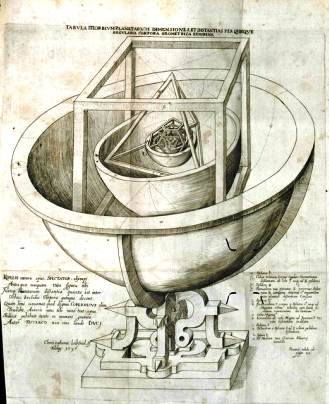
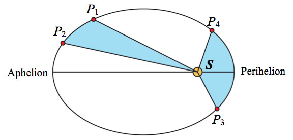

# Johannes Kepler
**First published Mon May 2, 2011; substantive revision Sun Sep 14, 2025**

*Di Liscia, Daniel A.*

Johannes Kepler (1571–1630) is one of the most significant representatives of the so-called Scientific Revolution of the 16ᵗʰ and 17ᵗʰ centuries. Although he received only the basic training of a “magister” and was professionally oriented towards theology at the beginning of his career, he rapidly became known for his mathematical skills and theoretical creativity. As a convinced Copernican, Kepler was able to defend the new system on different fronts: against the old astronomers who still sustained the system of Ptolemy, against the Aristotelian natural philosophers, against the followers of the new “mixed system” of Tycho Brahe—whom Kepler succeeded as Imperial Mathematician in Prague—and even against the standard Copernican position according to which the new system was to be considered merely as a computational device and not necessarily a physical reality. Kepler’s complete corpus can be hardly summarized as a “system” of ideas like scholastic philosophy or the new Cartesian systems which arose in the second half of the 17th century. Nevertheless, it is possible to identify two main tendencies, one linked to Platonism and giving priority to the role of geometry in the structure of the world, the other connected with the Aristotelian tradition and accentuating the role of experience and causality in epistemology. While he attained immortal fame in astronomy because of his three planetary laws, Kepler also made fundamental contributions in the fields of optics and mathematics. To the little-known facts regarding Kepler’s indefatigable scientific activity belong his efforts to develop different technical devices, for instance, a water pump, which he tried to patent and apply in different practical contexts (for the documents, see KGW 21.2.2., pp. 509–57 and 667–691). To his contemporaries he was also a famous mathematician and astrologer; for his own part, he wanted to be considered a philosopher who investigated the innermost structure of the cosmos scientifically.

## 1. Life and Works

Johannes Kepler was born on December 27, 1571 in Weil der Stadt, a little town near Stuttgart in Württemberg in southwestern Germany. Unlike his father Heinrich, who was a soldier and mercenary, his mother Katharina was able to foster Kepler’s intellectual interests. He was educated in Swabia; firstly, at the schools Leonberg (1576), Adelberg (1584) and Maulbronn (1586); later, thanks to support for a place in the famous *Tübinger Stift*, at the University of Tübingen. Here, Kepler became *Magister Artium* (1591) before he began his studies in the Theological Faculty. At Tübingen, where he received a solid education in languages and in science, he met Michael Maestlin, who introduced him to the new world system of Copernicus (see *Mysterium Cosmographicum*, trans. Duncan, p. 63, and KGW 20.1, VI, pp. 144–180).

Before concluding his theology studies at Tübingen, in March/April 1594 Kepler accepted an offer to teach mathematics as the successor to Georg Stadius at the Protestant school in Graz (in Styria, Austria). During this period (1594–1600), he composed many official calendars and prognostications and published his first significant work, the *Mysterium Cosmographicum* (= MC), which catapulted him to fame overnight. On April 27, 1597 Kepler married his first wife, Barbara Müller von Mühleck. As a consequence of the anti-Protestant atmosphere in Graz and thanks also to the positive impact of his MC on the scientific community, he abandoned Graz and moved to Prague in 1600, to work under the supervision of the great Danish astronomer Tycho Brahe (1546–1601). His first contact with Tycho was, however, extremely traumatic, particularly because of the Ursus affair (see below Section 4.1). After Tycho’s unexpected death on October 1601 Kepler succeeded him as Imperial Mathematician. During his time in Prague, Kepler was particularly productive. He completed his most important optical works, *Astronomiae pars* *optica* (=APO) and *Dioptrice* (=D), published several treatises on astrology (*De fundamentis astrologiae certioribus*, *Antwort auf Roeslini Diskurs; Tertius interveniens*), discussed Galileo’s telescopic discoveries (*Dissertatio cum nuncio sidereo*), and composed his most significant astronomical work, the *Astronomia nova* (=AN), which contains his first two laws of planetary motion.

On August 3, 1611 Kepler’s wife, Barbara Müller, died. In 1612 he moved to Linz, in Upper Austria, and became a professor at the *Landschaftsschule*. There, he served as Mathematician of the Upper Austrian Estates from 1612 to 1628. In 1613, he married Susanne Reuttinger, with whom he had six children. In 1615, he completed the mathematical works *Stereometria doliorum* and *Messekunst Archimedis*. At the end of 1617 Kepler successfully defended his mother, who had been accused of witchcraft. In 1619 he published his principal philosophical work, the *Harmonice mundi* (=HM), and wrote, partially at the same time, the *Epitome astronomiae copernicanae* (=EAC). In 1624 Kepler continued his investigations on mathematics, publishing his work on logarithms (*Chilias logarithmorum*…).

In pursuit of an accurate printer for the *Tabulae Rudolphinae*, he moved to Ulm near the end of 1626 and remained there until the end of 1627. In July 1628 he went to Sagan to enter the service of Albrecht von Wallenstein (1583–1634). He died on November 15, 1630 at Regensburg, where he was to present his financial claims before the imperial authorities (for Kepler’s life, Caspar’s biography (1993) is still the best work. KGW 19 contains biographically relevant documents. For a brief overview of Kepler’s ideas and achievements in a broadly biographical context, see Osterhage 2020).

## 2. Philosophy, theology, cosmology

There is probably no such thing as “Kepler’s philosophy” in any pure form. Nevertheless, many attempts to deal with the “philosophy of Kepler” have been made, all of which are very valuable in their own way. Some studies have concentrated on a particular text (see, for instance, Jardine 1988, for the *Defense of Tycho against Ursus*)[^jardine-1988], or have followed some particular ideas of Kepler over a longer period of his life and scientific career (see, for instance, Martens 2000, on Kepler’s theory of the archetypes)[^martens-2000]. Others have tried to determine from a philosophical point of view his place in the development of the astronomical revolution from the 15ᵗʰ to the 17ᵗʰ centuries (Koyré 1957 and 1961)[^koyré-1957][^koyré-1961] or in the more general context of the scientific movement of the 17ᵗʰ century (Hall, 1963 and especially Burtt, 1924)[^burtt-1924][^hall-1963]. Still others have discussed a long list of philosophical principles operating in Kepler’s scientific world, and have claimed to have found, by means of such an analysis, compelling evidence for the interaction between science, philosophy, and religion (Kozhamthadam, 1994)[^kozhamthadam-1994]. If, in the particular case of Kepler, philosophy is immediately related to astronomy, mathematics and, finally, “cosmology” (a notion which arises much later), the core of these speculations is to be sought in the spectrum of problems with which he dealt in his *Mysterium Cosmographicum* and *Harmonice Mundi* (on this topic, Field 1988 is one of the most representative works on Kepler)[^field-1988]. In addition, because of the particular circumstances of his life and his fascinating personality and genius, the literature on Kepler is extremely wide-ranging, covering a spectrum from literary pieces like Max Brod’s *Tycho Brahes Weg zu Gott* (1915)—though still not free from mistakes concerning Kepler—to general introductions in the genre of historical novels, and even fictional stories and charlatanry on astrology or, running for some years now, portraying him as the assassin of Tycho Brahe. However, according to recent reports, it is still a matter of controversy whether Tycho was assassinated at all (see the [report at phys.org](https://phys.org/news/2012-11-mercury-poisoning-tycho-brahe-death.html)).

Kepler mastered, like the best scientists, the most complicated technical issues, especially in astronomy, but he always emphasized his philosophical, even theological, approach to the questions he dealt with: God manifests himself not only in the words of the Scriptures but also in the wonderful arrangement of the universe and in its conformity with the human intellect. Thus, astronomy represents for Kepler, if done philosophically, the best path to God (see Hübner 1975; Methuen 1998 and 2009; Jardine 2009, Kirby 2019)[^hübner-1975][^jardine-2009][^kirby-2019][^methuen-1998][^methuen-2009]. As Kepler at the core of his greatest astronomical work confesses (AN, Part II, chap. 7, KGW 6, p. 108, Engl. trans., p. 183), at the beginning of his career he “was able to taste the sweetness of philosophy … with no special interest whatsoever in astronomy.” And, even in his later work, after having calculated many ephemerides and different astronomical data, Kepler writes in a letter of February 17, 1619 to V. Bianchi: “I also ask you, my friends, that you do not condemn me to the treadmill of mathematical calculations; allow me time for philosophical speculation, my only delight!” (KGW 17, let. N° 827, p. 327, lin. 249– 51).

Especially where Kepler deals with the geometrical structure of the cosmos, he always returns to his Platonic and Neoplatonic framework of thought (Michalik, J., 2019, Rudenko and Lastovets, 2023)[^michalik-2019][^rudenko-2023]. Thus, the polyhedral hypothesis (see Section 3 below) he postulated for the first time in his MC represents a kind of “formal cause” constituting the foundational structure of the universe. In addition, an “efficient cause,” which realizes this structure in the corporeal world, is also needed. This is, of course, God the Creator, who accomplished His work according to the model of the five regular polyhedra. Kepler reinterprets the traditional statements about the Creation as an image of the Creator giving to the ancient ideas a more systematic and a quantitative character. Even the doctrine of the Trinity could be geometrically represented, taking the center for the Father, the spherical surface for the Son, and the intermediate space, which is mathematically expressed in the regularity of the relationship between the point and the surface, for the Holy Spirit. In Kepler’s model, we have to be able to reduce all appearances to straightness and curvature as providing the foundation for the geometrical structure of the world’s creation. The very first category, through which God produced a fundamental similitude of the created World to Himself, is that of quantity (see MC, chapter 2, KGW pp. 23–26). Furthermore, quantity was also introduced into the human soul for the specific purpose that this fundamental symmetry could be apprehended and known scientifically.

This kind of speculation also belongs to the basic principles of Kepler’s philosophical optics. In Chapter 1 of APO (“On the Nature of Light”), Kepler gives a new account of this “Trinitarian Cosmogony.” As he admits in a letter to Thomas Harriot (1560–1621), his approach here is more theological than optical (KGW 15, let. 394, p. 348, lin. 18). Similar to his speculations in MC, Kepler explains again the symmetry between God and the Creation, but now he goes slightly beyond the limits of a theologico-geometrical reflection. Firstly, he seems to assume that the bodies of the world were provided in the Creation with some powers which enable them to exceed their geometrical limits and to act on other bodies (magnetic power is a good example of this). Secondly, the principle of symmetry introduced into matter constitutes “the most excellent thing in the whole corporeal world, the matrix of the animate faculties, and the chain linking the corporeal and spiritual world” (APO, Engl. trans., p. 19). Thirdly, as expressed by Kepler in a wonderful, long Latin sentence, with multiple subordinations, this principle “has passed over into the same laws (*in leges easdem*) by which the world was to be furnished” (ibid., p. 20; the original passage is in KGW 2, p. 19: the marginal note in the edition is “*lucis encomium*”). Finally, these reflections are concluded with a remark, in which—as with Copernicus, Marsilio Ficino, and others—the central position of the Sun is legitimated because of its function in spreading light and, indirectly, life. Similar speculations are still present in EAC (KGW 7, pp. 47–48 and 267). It is also worth noting that these speculations are of vital importance to the special way in which Kepler conceived of astrology (see, for instance, *De fundamentis astrologiae certioribus* with Engl. trans. and commentary in Field 1984)[^field-1984].

## 3. The five regular solids

Philosophical, geometrical and even theological speculations related to the five regular polyhedra, the cube or hexahedron, the tetrahedron, the octahedron, the icosahedron and the dodecahedron, were known at least from the time of the ancient Pythagoreans. Since Plato’s *Timaeus*, these five geometrical solids played a leading role, and for the later tradition they became known as the “five Platonic solids”.

*Figure 1.*

Figure 1. Table 3 in *Mysterium Cosmographicum*, with Kepler’s model illustrating the intercalation of the five regular solids between the imaginary spheres of the planets (cf. KGW 1, pp. 26–27).

Plato establishes at the physical and chemical level a correspondence between them and the five elements—earth, water, air, fire and ether—and tries to provide this correspondence with geometrical grounds. A further source of historically decisive importance is the fact that the five regular polyhedra are treated in Euclid’s *Elements of Geometry*, a work that for Kepler, especially in the Platonic approach of Proclus, has a central position (Claessens 2011)[^claessens-2011]. At the very beginning of HM Kepler complains about the fact that the modern philosophical and mathematical school of Peter Ramus (1515–1572) had not been able to understand the architectonic structure of the *Elements*, which are crowned with the treatment of the five regular polyhedra. In addition, a revival of Platonic philosophy was taking place in Kepler’s time and inspired not only philosophers and mathematicians but also architects, artists and illustrators (see Field 1997)[^field-1997].

Amidst this general interest in the regular polyhedra during the Renaissance, Kepler was specifically concerned with their application in the resolution of a cosmological problem, namely the reality of the Copernican system (see Section 5 below). To achieve this goal, he introduced his polyhedral hypothesis already in MC, where he looked for an “a priori” foundation of the Copernican system (see Aiton 1977, Di Liscia 2009)[^aiton-1977][^di-2009]. The background for such an approach seems to be that the “a posteriori” way, which according to Kepler was taken over by Copernicus himself, cannot lead to a necessary affirmation of the reality of the new world system, but only to a probable, and hence to an “instrumental”, representation of it as a computational device. This is the “Osiander” or “Wittenberg Interpretation” of Copernicus which Kepler directly attacked not only in his MC but also later in his AN (see Westman 1972, 1975 and 2011)[^westman-2011][^westman-1972][^westman-1975]. In MC, he claimed to have found an answer to the following three main questions: 1) the number of the planets; 2) the size of the orbits, i.e., the distances; 3) the velocities of the planets in their orbits. By referring to the polyhedral hypothesis (see Figure 1), Kepler found a definitive and simple answer to the first question. By intercalating the polyhedra between the spheres which carry the planets, one must inevitably finish with the sphere of Saturn surrounding the cube—there are no more polyhedra to be intercalated and, as remains the standard case for Renaissance and modern astronomy, there are no more planets to be carried by the spheres. It is absolutely decisive for the consistency of the argument that the necessity of the hypothesis is guaranteed by the fact that it already exists as a mathematical demonstration (by Euclid, *Elements XIII*, prop. 18, schol.), according to which there are only five regular (“Platonic” for the tradition) polyhedra. For the second and third questions the answer is, of course, not as evident as for the first one. However, Kepler was able to show that distances which are derived from the geometrical model of the five regular bodies fit much better with the Copernican system than with that of Ptolemy. The answer to the third question needs, in addition, the introduction of a notion of power that emanates from the Sun and extends to the outer limit of the universe (see Stephenson 1987, pp. 9–20)[^stephenson-1987].

In HM, Kepler continues his investigations of the polyhedra at a cosmological as well as a mathematical level. In the second book, dealing with “congruence” (which here does not mean, as it does today, “the same size and shape”, but the property of figures filling the surface together with other regular polygons – on the plane—or, to build closed geometric solids – hence, in space), Kepler made new mathematical discoveries working with tessellations. He discovered two new solids, the so-called “small and great stellated dodecahedrons”.

The treatment of the regular polyhedra constitutes one of the two principal pillars of HM, Book 5 (chapters 1–2), where the third law is formulated (see Caspar in KGW 6, Nachbericht, p. 497, and Engl. trans. p. xxxiii). Following his approach from MC and complementing it with occasional references to his EAC, Kepler makes use again of the Platonic solids to determine the number of the planets and their distances from the Sun. Meanwhile, he has learned that the application of his old polyhedral hypothesis has limits. As he tells us in a footnote in the second edition of his MC from 1621, he was earlier convinced of the possibility of explaining the eccentricities of the planetary orbits by values derived “a priori” from this hypothesis (MC, Engl. trans., p. 189). Now, with access to the observational data of Tycho, Kepler had to exclude this explanation and look for another. And this is one of the most significant achievements of his basic harmonies (which in turn are derived from the regular polygons), constituting the second great pillar of Book 5.

## 4. Epistemology and philosophy of sciences

Almost all of Kepler’s scientific investigations reflect a philosophical background, and many of his philosophical questions find their final answer, even if they are of scientific interest, in the realm of theology. From a very modern point of view, one could highlight Kepler’s epistemological thought in terms of four different items: realism; causality; his philosophy of mathematics; and his—own particular—empiricism.

### 4.1 Realism

Realism is a constant and integral part of Kepler’s thought, and one which appears in sophisticated form from the outset. The reason for this is that his realism always runs parallel to his defense of the Copernican worldview, which appeared from his first public pronouncements and publications.

Many of Kepler’s thoughts about epistemology can be found in his *Defense of Tycho against Ursus* or *Contra Ursum* (=CU), a work which emerged from a polemical framework, the plagiarism conflict between Nicolaus Raimarus Ursus (1551–1600) and Tycho Brahe: causality and physicalization of astronomical theories, the concept and status of astronomical hypotheses, the polemic “realism-instrumentalism”, his criticism of skepticism in general, the epistemological role of history, etc. It is one of the most significant works ever written on this subject and is sometimes compared with Bacon’s *Novum organum* and Descartes’ *Discourse on Method* (Jardine 1988, p. 5; for an excellent new edition and complete study of this work see Jardine / Segonds 2008)[^jardine-1988][^jardine-2008].

The focus of the epistemological issues could be ranked *mutatis mutandi* with modern discussion surrounding the scientific status of astronomical theories (however, as Jardine has pointed out, it would be sounder to read Kepler’s CU more as a work against skepticism than in the context of the modern realism/instrumentalism polemic). For Pierre Duhem (1861–1916), for instance, the position of Andreas Osiander, which was adopted by Ursus and which was, according to Duhem, naively criticized by Kepler in his MC, represents the modern approach known as “instrumentalism”. According to this epistemological position, held by Duhem himself, scientific theories are not to be closely linked to the concepts of truth and falsehood. Hypotheses and scientific laws are nothing more than “instruments” for describing and predicting phenomena (seldom for explaining them). The aim of physical theories is not to offer a causal explanation or to study the causes of phenomena, but simply to represent them. In the best-case scenario, theories are able to order and classify what is decisive for their predictive capacity (Duhem 1908, 1914)[^duhem-1908][^duhem-1914].

Contrary to Tycho and Kepler, Ursus held a fictionalist position in astronomy. Yet in the very beginning of his work *De hypothesibus*, Ursus makes a clear declaration about the nature of astronomical theories, which is very similar to the approach suggested by Osiander in his forward to Copernicus’ *De revolutionibus*: a hypothesis is a “fictitious supposition”, introduced just for the sake of “saving the motions of the heavenly bodies” and to “calculate them” (trans. Jardine 1988, p. 41)[^jardine-1988]

Following his approach in MC and anticipating the opening pages of his later AN (see particularly AN, II.21: “Why, and to what extent, may a false hypothesis yield the truth?” Engl. trans., pp. 294–301), Kepler addresses the question of Copernicanism and its reception by thinkers such as Osiander, who emphasized that the truth of astronomical hypotheses cannot necessarily be deduced from the correct prediction of astronomical facts. According to this interpretation, Copernican hypotheses are not necessarily true even if they are able to save the phenomena, otherwise one would commit a *fallacia affirmationis consequentis*. However, according to Kepler, “this happens only by chance and not always, but only when the error in the one proposition meets another proposition, whether true or false, appropriate for eliciting the truth” (trans. Jardine, p. 140). To be noted is that, as Jardine (2005, p. 137) has pointed out, the modern scientific realist departs from a real independent world, while Kepler’s notion of truth presupposes that neither nature nor the human mind are independent of God’s mind (Jardine 2005, p. 137)[^jardine-2005].

### 4.2 Causality

The reality of astronomical hypotheses—and hence the superiority of the Copernican world system—implied a physicalization of astronomical theories and, in turn, an accentuation of causality. Despite Kepler’s criticism of Aristotle, this aspect can actually be considered the realization in the field of astronomy of the old Aristotelian ideal of knowledge: “knowledge” means to grasp the causes of the phenomena.

Thus, on the one hand, “causality” is a notion implying the most general idea of “actual scientific knowledge” which guides and stimulates each investigation. In this sense, Kepler already embarked in his MC on a causal investigation by asking for the *cause* of the number, the sizes and the “motions” (= the speeds) of the heavenly spheres (see Section 3 above).

On the other hand, “causality” implies in Kepler, according to the Aristotelian conception of physical science, the concrete “physical cause”, the efficient cause which produces a motion or is responsible for keeping the body in motion. Original to Kepler, however, and typical of his approach is the resoluteness with which he was convinced that the problem of equipollence of the astronomical hypotheses can be resolved and the consequent introduction of the concept of causality into astronomy – traditionally a mathematical science. This approach is already present in his MC, where he, for instance, relates for the first time the distances of the planets to a *power* *which emerges from the Sun* and decreases in proportion to the distance of each planet, up to the sphere of the fixed stars (see Stephenson 1987, pp. 9–10)[^stephenson-1987].

One of Kepler’s decisive innovations in his MC is that he replaced the “mean Sun” of Copernicus with the real Sun, which was no longer merely a geometrical point but a body capable of physically influencing the surrounding planets. In addition, in notes to the 1621 edition of MC Kepler strongly criticizes the notion of “soul” (*anima*) as a dynamical factor in planetary motion and proposes to substitute “force” (*vis*) for it (see KGW 8, p. 113, Engl. trans. p. 203, note 3).

One of the most important philosophical aspects of Kepler’s *Astronomia Nova* from 1609 (=AN) is its methodological approach and its causal foundation (see Mittelstrass 1972)[^mittelstrass-1972]. Kepler was sufficiently conscious of the change of perspective he was introducing into astronomy. Hence, he decided to announce this in the full title of the work: *Astronomia Nova, Aitiologetos, seu physica coelestis, tradita commentariis de motibus stellae Martis. Ex observationibus G. V. Tychonis Brahe*: *New Astronomy Based upon Causes or Celestial Physics Treated by Means of Commentaries on the Motions of the Star Mars from the observations of Tycho Brahe* … (trans. Donahue). In the introduction to AN Kepler insists on his radical change of view: his work is about physics, not pure kinematical or geometrical astronomy. “Physics”, as in the traditional, Aristotelian understanding of the discipline, deals with the causes of phenomena, and for Kepler that constitutes his ultimate approach to deciding between rival hypotheses (AN, Engl. trans., p. 48; see Krafft 1991)[^krafft-1991]. On the other hand, since his celestial physics uses not only geometrical axioms but also other, non-mathematical axioms, the knowledge obtained often has a kernel of guesswork.

In the third part of AN, chapters 22–40, Kepler deals with the path of the Earth and intends to offer a physical account of the Copernican theory. By so doing he includes the idea that a certain notion of power should be made responsible for the regulation of the differences in velocities of the planets, which in turn have to be established in relation to the planets’ distances. Now, the Copernican planetary theory departs from the general principle that the Earth moves regularly on an eccentric circle. For Kepler, on the contrary, the planets are moved irregularly, and the slower they are moved, the greater their distance is from the center of power, the Sun. Addressing the physical aspects of his new astronomy, he deals in chapters 32–40, perhaps the most idiosyncratic of the work, with his notion of motive power. Here, he combines different approaches and sources, sometimes producing—for the purpose of simplifying the whole geometrical construction of geometrical astronomy by introducing a power causing motions—a new confusion at the dynamical level. To begin with, it is not always absolutely clear what kind of power Kepler has in mind. He inclines, above all, to the idea of a magnetic power residing in the Sun, but he also mentions light and, at least indirectly, gravity (which he does not bring into operation in the central chapters of the AN but which is to a certain extent implied in his explanations using the model of the balance and which he surely accepts as true for the Sun-Moon system, as he explains in the general introduction). Secondly, it is not always clear what this power is and how it acts, especially when he is speaking merely analogically, “as if” (particularly in the case of light). Essentially, Kepler breaks down the motions of the planets into two components. On the one hand, the planets move around the Sun—at this state of the discussion—circularly. On the other hand, they exhibit a libration on the Sun-planet vector. The rotation of the Sun is responsible for the motion of the planets. Irradiating from the rotating Sun is a power which spreads at the ecliptic plain. This power diminishes with distance to the source of the power, that is, to the Sun. A decisive work for Kepler’s development in his physical astronomy is William Gilbert’s (1544–1603) *De magnete* (London, 1600), a work which also intends to offer a new physics for the new Copernican cosmology and which surely influenced Kepler’s thoughts about this power. One of the main problems was, of course, how to apply the general principles of magnetism to planetary motion, first to explain the difference in velocity on a circular path, and later to give an account of the motion on an ellipse. Kepler conceives of a model with parallel magnetic fibers which links the Sun with the planets in such a way that the rotation of the Sun causes the motion of the planets around it. The fibers are born in the planets parallel and perpendicular to the lines of apsides by a kind of “animal power”. The planets themselves are polarized, that is, with one pole they are attracted to the Sun, with the other pole they are pushed away from it. This explains very well the direction of planetary motion: the planets all move in one direction *because* the Sun rotates in that direction. Nevertheless, a further problem still seems to remain unresolved: according to Kepler’s explication, the planets should move around the Sun as fast as the Sun itself rotates, which is not the case. This phenomenon can be explained by referring to a property of matter, which for Kepler has an axiomatic character: the *inclinatio ad quietem*, that is, the tendency to rest (see especially AN, chap. 39; KGW 3, p. 256). As a consequence, the planets are moved around the Sun slower than they would be if the power of the Sun were at work alone.

Kepler’s causal approach is above all present in his *Epitome*, a voluminous work which exercised a considerable influence on the later development of astronomy. In the second part of Book 4, he deals with the motion of the world’s parts. Not the two first laws but rather the third law, which he had recently announced in his HM, is Kepler’s starting point; for this law, rather than a calculational device for the path of one planet, represents a general cosmological statement, and thus it is more convenient for his approach here. At the same time, it should be pointed out that the third law is not necessarily the best point of departure for a dynamical, causal approach to motion, as Kepler intends here; for, in comparison with the previous causal approaches, the question of the location of the cause of power responsible for the production of motion remains relevant. The spheres, which in the traditional view transported the planets, had been abolished since the time of Tycho. Furthermore, Kepler is clearly against the “moving intelligences” of the Aristotelian tradition. The fact that the orbits are elliptical and not circular, shows that the motions are not caused by a spiritual power but rather by a natural one, which is internal to the composition of matter. The planets themselves are provided with “*inertia*”, a property, as Kepler understood it, that inhibits motion and represents an impediment to it. The motive power (*vix motrix*) comes indeed from the Sun, which sends its rays of light and power in all directions. These rays are captured by the planets. Kepler, however, tries to explain this behavior of the planets less through astrology and much more through magnetism (a physical phenomenon which was by no means clearly understood in his time). Firstly, the Sun rotates and, by so doing, sets in motion the planets around it. Secondly, since the planets are poles of magnets and the Sun itself acts with magnetic power, the planets are, at different parts of their orbits, either attracted or repelled; in this way the elliptical path is causally produced. Kepler partially gives up the mechanical approach by postulating a soul in the Sun which is responsible for its regular motion of rotation, a motion on which, finally, the entire system depends. In fact, the planets are also supposed by Kepler to rotate and are therefore provided with “a sort of soul” or some such principle which produces the rotation.

In addition to astronomy and cosmology Kepler expanded his causal approach to include the fields of optics (see Section 6 below) and harmonics (Section 7 below).

### 4.3 Philosophy of mathematics

Beyond his own original talent, it is clear that Kepler was trained in mathematics from his earliest studies at Tübingen. At least officially, his positions at Graz, Prague, Linz, Ulm and Sagan can be characterized as the typical professional occupations of a mathematician in the broadest sense, i.e., including astrology and astronomy, theoretical mechanics and pneumatics, metrology, and every topic that could in some way be related to mathematics. Besides the field of astronomy and optics, where mathematics is ordinarily applied in different ways, Kepler produced original contributions to the theory of logarithms and above all within his favorite field, geometry (especially with his stereometrical investigations. For the medieval proportions theory as a background for Kepler’s logarithms, see Rommevaux-Tani, 2018)[^rommevaux-tani-2018]. Thus, on account of his natural predilection and talent and the importance of mathematics, particularly of geometry, for his thought, it is not surprising to find many different passages in his works where he articulated his philosophy of mathematics. However, Kepler’s principal exposition on this topic is to be found in his HM, a work in which the first two books are purely mathematical in content. As he himself declares, in HM he played the role “not of a geometer in philosophy but of a philosopher in this part of geometry” (KGW 6, p. 20, Engl. trans., p. 14).

While in philosophical questions related to mathematics, Proclus and Plato were Kepler’s most important inspirational sources, he did not always see Plato and Aristotle as completely opposed, for the latter—in Kepler’s interpretation—also accepted “a certain existence of the mathematical entities” (KGW 14, let. N° 226, p. 265; see Peters, p. 130). To a great extent Kepler understood his mathematical investigations of HM as a continuation of Euclid’s *Elements*, especially of the analysis of irrationalities in Book 10. The central notion that he works out here is that of “constructability”. According to Kepler, each branch of knowledge must, in principle, be reducible to geometry if it is to be accepted as knowledge in the strong sense (although, in the case of the physics, this condition is, as the AN emphasizes, only a necessary and not a sufficient condition). Thus, the new principles he was elaborating over the years in astrology were geometrical ones. A similar case occurs with the basic notions of harmony, which, after Kepler, could be reduced to geometry. Of course, not every geometrical statement is equally relevant and equally fundamental. For Kepler, the geometrical entities, principles and propositions which are especially fundamental are those that can be constructed in the classical sense, i.e., using only ruler (without measurement units) and compass. On this are based further notions according to different degrees of “knowability” (*scibilitas*), which begins with the circle and its diameter. Once again, Kepler understood this within the framework of his cosmological and theological philosophy: geometry, and especially geometrically constructible entities, have a higher meaning than other kinds of knowledge because God has used them to delineate and to create this perfect harmonic world. From this point of view, it is clear that Kepler defends a Platonist conception of mathematics, that he cannot assume the Aristotelian theory of abstraction and that he is not able to accept algebra, at least in the way he understood it. So, for instance, there are figures that cannot be constructed “geometrically”, although they are often assumed as safe geometrical knowledge. The best example of this is perhaps the heptagon. This figure cannot be described outside of the circle, and in the circle its sides have, of course, a determinate magnitude, but this is not knowable. Kepler himself says that this is important because here he finds the explanation for why God did not use such figures to structure the world. Consequently, he devotes many pages to discussing the issue (KGW 6, Prop. 45, pp. 47–56, see also KGW 9, p. 147). Certainly for a geometer like Kepler, approximations constitute – as *mathematical* theory—a painful and precarious way to progress. The philosophical background for his rejection of algebra seems to be, at least partially, Aristotelian in some of its basic suppositions: geometrical quantities are continuous quantities which therefore cannot be treated with numbers that are, in the inverse, discrete quantities. But the difference from the Aristotelian ideal of science remains an important one: for Aristotle, a crossover between arithmetic and geometry is allowed only in the case of the “middle sciences”, while for Kepler all knowledge must be reduced to its geometrical foundations. Recent research has tried to show that Kepler has followed the criteria of a “Pythagorean methodology” when studying the phenomena of light refraction. This would be evident in Kepler’s application of the principle of “sameness is knowable by sameness” and, additionally, in his tendency to avoid the infinite or, rather, to set limits to infinite magnitudes (Cardona Suárez 2016)[^cardona-2016].

### 4.4 Empiricism

A general presentation of Kepler’s philosophical attitude and principles is not complete without reference to his link to the world of experience. For, despite his mainly theoretical approach in the natural sciences, Kepler often emphasized the significance of experience and, in general, of empirical data. In his correspondence there are many remarks about the significance of observation and experience, as for instance in a letter to Herwart von Hohenburg from 1598 (KGW 13, let. N° 91, lines 150–152) or from 1603 to Fabricius (KGW 14, let. N° 262, p. 191, lines 129–130), to mention only two of his most important correspondents. Looking for empirical support for the Copernican system, Kepler compares different astronomical tables in his MC, and in AN he makes extensive use of Tycho’s observational treasure trove. In MC (chapter 18) he quotes a long passage from Rheticus for the sake of rhetorical support when, as was the case here, the data of the tables he used did not fit perfectly with the calculated values from the polyhedral hypothesis. In this passage, the reader learns that the great Copernicus, whose world system Kepler defends in MC, said one day to Rheticus that it made no sense to insist on absolute agreement with the data, because these themselves were surely not perfect. After all, it is questionable whether Kepler, using for instance the *Prutenic Tables* (1551) of Erasmus Reinhold (1511–1553), had access to complete and correct empirical information to confirm the Copernican hypothesis in grand style, as he claimed (for an analysis of Reihold’s tables and their influence see Gingerich 1993, pp. 205–255)[^gingerich-1993].

The situation changed completely when Kepler came into contact at Prague with Tycho’s observations (which, as Kepler often reports, were seldom at his disposal). However, a change of attitude is evident in AN, where he used Tycho’s observations without restriction (which is something he makes clear in the work’s title). In part 2 (chap. 7–21), he presents the “vicarious hypothesis”, which in the end he refutes. This hypothesis represents the best result which can be reached within the limits of traditional astronomy. This works with circular orbits and with the supposition that the motion of a planet appears regular from a point on the lines of apsides. Against the traditional method, here, Kepler does not cut the eccentricity into equal parts but leaves the partition open. To check his hypothesis, he needs observations of Mars in opposition, where Mars, the Earth, and the Sun are at midnight on the same line. From Tycho, he “inherited” ten such observations between the years 1580 and 1600, and to them he added another two for 1602 and 1604. In chapters 17–21, Kepler carries out an observational and computational check of his vicarious hypothesis. On the one hand, he points out that this hypothesis is good enough, since the variations of the calculated positions from the observed positions fall within the limits of acceptability (2 minutes of arc). In fact, Kepler presents this hypothesis as the best hypothesis which can be proposed within the framework of a “traditional astronomy”, as opposed to his new astronomy, which he will offer in the following parts of the work. On the other hand, this hypothesis can be falsified if one takes the observations of the latitudes into consideration. Further calculations with these observations produce a difference of eight minutes, something that cannot be assumed because the observations of Tycho are reliable enough. Kepler’s famous sentence runs: “these eight minutes alone will have led the way to the reformation of all of astronomy” (AN, KGW 3, p. 286; Engl. trans., p. 286). There seems to be agreement that Kepler’s AN contains the first explicit consideration of the problem of observational error (for this question see Hon 1987 and Field 2005)[^field-2005][^hon-1987].

Kepler also gave an important place to experience in the field of optics. As a matter of fact, he began his research on optics because of a disagreement between theory and observation, and he made use of scientific instruments he had designed himself (see, for instance, KGW 21.1, p. 244). Recent research on the problem of the *camera obscura* and the “images in the air” shows, however, the limits of a traditional approach to Kepler’s optics following the main current of the history of physics. Rather, his notion of *experimentum* needs to be contextualized within the social practices and epistemological commitments of his time (see Dupré 2008)[^dupré-2008].

Finally, it should be mentioned that a similar significance is assigned to experience and empirical data in Kepler’s harmonic-musical and astrological theories, two fields which are subordinated to his greater cosmological project of HM. For astrology, he uses meteorological data, which he recorded for many years, as confirmation material. This material shows that the Earth, as a whole living being, reacts to the aspects which occur regularly in the heavens (see Boner 2013, pp. 69–99)[^boner-2013]. In his musical theory Kepler was a modern thinker, especially because of the role he gave to experience. As has been noted (Walker, 1978, p. 48)[^walker-1978], Kepler made acoustic experiments with a monochord long before he wrote his HM. In a letter to Herwart von Hohenburg (KGW 15, ep. 424, p. 450), he describes how he checked the sound of a string at different lengths, establishing in which cases the ear judges the sound to be pleasurable. Kepler does not accept that this limitation is founded on arithmetical speculations, even if this was already assumed by Plato, whom he often follows, and by the Pythagoreans. On the basis of his experiments, Kepler found that there are other divisions of the string that the ear perceives as consonant, i.e., thirds and sixths.

If cosmology is the main framework of Kepler’s interest, there is no doubt that, as Field has pointed out, he “felt the need to seek observational support for his model of the Universe” (Field 1988, p. 28; see also Field 1982)[^field-1982][^field-1988].

## 5. Copernicanism reformed and the three planetary laws

Today Kepler is remembered in the history of sciences above all for his three planetary laws, which he produced in very specific contexts and at different times. While it is questionable whether he would have understood these scientific statements as “laws”—and it is even arguable that he used this term with a different meaning than we do today—it seems to be clear that all three laws (as a linguistic convention, we may continue to use the term) suppose some fundamentals of Kepler’s philosophy: (a) realism, (b) causality, (c) the geometric structure of the cosmos. Besides this, it should be remarked that the common denominator of all three laws is Kepler’s defense of the Copernican worldview, a cosmological system which he was not able to defend without reforming it radically (see Goldstein and Hon, 2005)[^goldstein-2005]. It took, of course, more than ten years of sustained work to establish the new astronomy on a physical basis, as Kepler had always intended. However, he was convinced early on of the central, both positional and physical, role that must be attributed to the Sun (see Granada 2022)[^granada-2022]. It is noteworthy that already at the very beginning of his career Kepler vehemently defended the reality of the Copernican worldview in a way that he characterized, taking over the terminology from the standard Aristotelian epistemology, as “a priori” (see above Section 3 above and Di Liscia 2009)[^di-2009].

*Figure 2.*

Figure 2. Kepler’s first law of ellipse and second law of areas (modern representation with greatly exaggerated eccentricity).

The first two laws were published initially in AN (1609), although it is known that Kepler had arrived at these results much earlier. His first law establishes that the orbit of a planet is an ellipse with the Sun in one of the foci (see Figure 2). According to the second law, the radius vector from the Sun to a planet P sweeps out equal areas, for instance $SP_1P_2$ and $SP_3P_4$, in equal times. The planet *P* is therefore faster at perihelion, where it is closer to the Sun, and slower at aphelion, where it is farther from the Sun. In accordance with his dynamical approach, Kepler first found the second law and, then, as a further result because of the effect produced by the supposed force, the elliptical path of the planets (for the two first planetary laws see especially Aiton 1973, 1975a, Davis 1992a–e, and 1998a; Donahue 1994; Wilson 1968 and 1972; for Kepler’s system of conics in connection with his optics see the recent study by Del Centina, 2016)[^aiton-1973][^aiton-1975a][^davis-1992a][^davis-1998a][^del-2016][^donahue-1994][^wilson-1968][^wilson-1972].

Perhaps the most significant impact of Kepler’s two laws can be found by considering their cosmological consequences. The first law abolishes the old axiom of the circular orbits of the planets, an axiom which was still valid not only for pre-Copernican astronomy and cosmology but also for Copernicus himself, and for Tycho and Galileo. The second law breaks with another axiom of traditional astronomy, according to which the motion of the planets is uniform in swiftness. The Ptolemaic tradition in astronomy was, of course, aware of this difficulty and applied a particularly effective device for saving the “appearance” of acceleration: the equant. Copernicus, for his own part, insisted on the necessity of the axiom of uniform circular motion. Ptolemy’s equant was understood by Copernicus as a technical device based on the violation of this axiom. Kepler, on the contrary, affirms the reality of changes in the velocities of the planetary motions and provides a physical account for them. After struggling strenuously with established ideas which were located not only in the tradition before him but also in his own thinking, Kepler abandoned the circular path of planetary motion and in this way initiated a more empirical approach to cosmology (though see Brackenridge 1982)[^brackenridge-1982].

Kepler published the third law, the so-called “harmonic law”, for the first time in his *Harmonice mundi* (1619), i.e., ten years later. In his *Epitome*, he provided a more systematic approach to all three laws, their grounds and implications (see Davis 2003; Stephenson 1987)[^davis-2003][^stephenson-1987]. In Book 5, chapter 3, as point 8 of 13 (KGW 6, p. 302; Engl. trans., pp. 411–12), Kepler expresses, almost accidentally, his fundamental relationship connecting elapsed times with distances, which in modern notation could be expressed as:

$$ \left(\frac{T_1}{T_2}\right)^2 = \left(\frac{a_1}{a_2}\right)^3 $$

with $T_1$ and $T_2$ representing the periodic times of two planets and $a_1$ and $a_2$ the length of their semi-major axes. A further formulation of this relationship, which is often found in the literature, is: $a^3/T^2 = K$, which expresses with $K$ that the relationship between the third power of the distances and the square of the times is a constant (however, see Davis 2005, pp. 171–172; for the third planetary law see especially Stephenson 1987)[^davis-2005][^stephenson-1987]. As a consequence of the third law, the time a planet takes to travel around the Sun will significantly increase the farther away it is or the longer the radius of its orbit. Thus, for instance, Saturn’s sidereal period is almost 30 years, while Mercury needs fewer than 88 days to go around the Sun. For the history of cosmology, it is important to make clear that the third law fulfils Kepler’s search for a *systematic* representation and defense of the Copernican worldview, in which planets are not absolutely independent of each other but integrated in a harmonic world system.

## 6. Optics and metaphysics of light

Kepler contributed to the special field of optics with two seminal works, the *Ad* *Vitellionem paralipomena* (=APO) and the *Dioptrice* (=DI), the latter motivated in large part by the publication in 1610 of Galileo’s *Sidereal Messenger* (*Sidereus Nuncius*). In his *Conversation with the Sidereal Messenger* (*Dissertatio cum Nuncio Sidereo* … *a Galillaeo Galilaeo*, KGW 4, pp. 281–311), he supported the factual information given by Galileo, indicating at the same time the necessity of giving an account of the causes of the observed phenomena. The background for his investigation into optics was undoubtedly the different particular questions of astronomical optics (see Straker 1971). In this context he concentrated his efforts on an explanation of the phenomena of eclipses, of the apparent size of the Moon and of atmospheric refraction. Kepler investigated the theory of the *camera obscura* very early and recorded its general principles (see commentary by M. Hammer in KGW 2, pp. 400–1 and Straker 1981)[^straker-1981]. In addition, he worked intensively on the theory of the telescope and invented the refracting astronomical or ‘Keplerian’ telescope, which involved a considerable improvement over the Galilean telescope (see especially DI, Problem 86, KGW 4, pp. 387–88). Besides these impressive contributions, Kepler expanded his research program to embrace mathematics as well as anatomy, discussing for instance conic sections and explaining the process of vision (see Crombie 1991 and especially Lindberg 1976b)[^crombie-1991][^lindberg-1976b].

In Chapter 1 of APO (“On the Nature of Light”), Kepler expounds 38 propositions concerning different properties of light: light flows in all directions from every point of a body’s surface; it has no matter, weight, or resistance. Following—but also inverting—the Aristotelian argument for the temporality of motion, he affirms that the motion of light takes place not in time but in an instant (*in momento*). Light is propagated by straight lines (rays), which are not light itself but its motion. It is important to note that although light travels from one body to another, it is not a body but a two-dimensional entity which tends to expand to a curved surface. The two-dimensionality of light is probably the main reason why it is incorporeal. Motion in general plays a significant role in Kepler’s philosophy of light. For Straker, the supposed link between optics and physics (especially in Prop. 20, where the mechanical analyses are introduced) “reveals the full extent of his commitment to a mechanical physics of light” (Straker 1971, p. 509).

Two questions are intensively discussed by modern specialists. Firstly, to what extent is the attribution of a mechanistic approach to Kepler justified? Secondly, how should one determine his place in the history of sciences, especially in the field of optics: do the main lines of thought in Kepler’s optics indicate a *continuity* or rather a *rupture* with tradition? There are well–grounded arguments for different positions on both questions. For Crombie (1967, 1991) and Straker, Kepler develops a mechanical approach, which can be particularly appreciated in his explanation of vision using the model of the *camera obscura*. Besides this, Straker stresses that Kepler’s basic mechanicism is also powerfully assisted by his conception of light as a non-active, passive entity. In addition, the concept of motion and the explanations using the model of the balance are indicative of a commitment to mechanicism (Straker 1970, pp. 502–3)[^straker-1970]. On the contrary, Lindberg (1976a), who supports the “continuity side” of the dispute, has quite convincingly showed that, for Kepler, light has a constructive and active function in the universe, not only in optics but also in astrology, astronomy, and natural philosophy (for Kepler’s criticism of the medieval tradition see also Chen-Morris / Unguru, 2001)[^chen-morris-2001].

## 7. Harmony and Soul

From a philosophical point of view, Kepler considered the HM to be his main work and the one he most cherished. Containing his third planetary law, this work represents definitively a seminal contribution to the history of astronomy. But he did not reduce his long prepared project to an astronomical investigation—his first thoughts on the notion of “harmony” arose already in 1599, although he did not publish his work until 1619—but instead extensively discussed its mathematical foundations and its philosophical implications, including astrology, natural philosophy and psychology. Thus, Kepler’s third planetary law appears in a context which goes far beyond astronomy and to a great extent takes up again the perspective of his youthful MC. When talking about “harmony” in Kepler, one needs to keep in mind that the background giving its full significance to this notion goes far beyond music theory. Of course, music is involved and plays a determining role – and along with it the corresponding mathematical concepts stemming from the Pythagorean tradition. However, in Kepler “harmony” represents the most general idea, the very core of the world as an ordered whole and, therefore, the ultimate goal to be pursued in his philosophical investigations. Social and political aspects are also included. It is surely not a minor detail that Kepler, on the threshold of the Thirty Years’ War, dedicated his HM to King James I of England “the man whom Kepler believed was best suited to apply its lessons to the most pressing harmony of all: the harmony of church and state” (Rothman 2017, p. 6)[^rothman-2017].

According to Kepler, it is necessary to distinguish “sensible” from “pure” harmony. The first is to be found among natural, sensible entities, like sounds in music or rays of light; both could be in proportion to one another and hence in harmony. He resolves this matter by combining three of the Aristotelian categories: quantity, relation and, finally, quality. Through the function of the category of relation Kepler passes over to the active function of the mind (or soul). It turns out that two things can be characterized as harmonic if they can be compared according to the category of quantity. But the fact that at least two things are needed shows that the property of “being harmonic” is not a property of an isolated thing. Furthermore, the relationship between the things cannot be found in the things themselves either; rather, it is produced by the mind: “in general every relation is nothing without mind apart from the things which it relates, because they do not have the relation which they are said to have unless the presence of some mind is assumed, to relate one to another” (KGW 6, p. 212; Engl. trans., p. 291). This process takes place through the comparison of different sensible things with an archetype (*archetypus*) present in the mind.

The next central question directly concerns gnoseology, for Kepler gives a psychological account of the path followed by sensible things into the mind. He resumes the scholastic species theory: immaterial species radiate from the sensible things and affect the sense organs by acting firstly on the “forecourts” and then on the internal functions (for the notion of ‘species’ in Kepler see Rabin 2005, which has found both favorable and critical reception in the literature)[^rabin-2005]. They arrive at the imagination and from there go over to the *sensus communis*, so that, according to the traditional teaching, the sensible information received is now able to be processed and used in statements. From here onwards, the sensible things are “preserved in the memory, brought forth by recollection, [and] distinguished by the higher faculty of the soul” (Caspar 1993, p. 269, cf. KGW 6, p. 214, lines 18–23; Engl. trans., p. 293)[^caspar-1993]. While harmony arises as an activity of the soul/mind consisting in relating quantitatively, Kepler adds, taking over the Aristotelian doctrine of categories, that harmony is a “qualitative relation” as well, involving the “quality of shape, being formed from the regular figures”, which provides the grounds for comparison (KGW 6, p. 216, lines 37–41; Engl. trans., p. 296). If this is how “things”, i.e., sensible entities, find their way into the soul in order to be compared, it by no means represents—as Kepler admitted—a sufficient explanation of how non-sensible things, i.e., mathematical entities, find their way into the mind. How do they come into the soul? Kepler accepted Aristotle’s criticism of Pythagorean philosophy concerning numbers: both Kepler and Aristotle are convinced that numbers constitute ontologically a lower class within mathematical entities (for Kepler, they are derived from geometrical entities). Nevertheless, Aristotle’s philosophy is insufficient to grasp the essence of mathematics. By aligning himself with Proclus, from whom he quotes a long passage of his *Commentary on Euclides*, Kepler defends Plato’s theory of *anamnêsis* against Aristotle’s doctrine of the *tabula rasa*. His discussion lies at the origin of the classical debate between empiricism and rationalism which was to dominate the philosophical scene for generations to come. A connection with idealism is, of course, apparent (see, for instance, Caspar 1993, Engl. trans., p. 269)[^caspar-1993], and it is a fact that Kepler was positively received within German Idealism of the 19ᵗʰ century (Schwaetzer 2016, esp. 217–19)[^schwaetzer-2016]. Historically, however, it seems to be more accurate to link his position with the philosophical tradition of St. Augustine.

Besides psychology and gnoseology, the other main spectrum of questions Kepler deals with in Book 4 is his theory of “aspects”, i.e., astrology (HM, IV, Cap. 4–7), a further field of application of his psychology and further evidence of the role of geometry in his philosophy. The “aspects”, i.e., the angles between the planets, Moon and Sun, are all he wishes to save from the old astrology, which he harshly criticizes; for the aspects are or can be reduced to geometrical structures, the archetypes, which can be recognized by the soul. According to Kepler, there is no ‘mechanical influence’ of the heavens: stars and constellations are not relevant in his astrology. Nevertheless, Kepler devoted considerable effort to determining the size of the stars and their role within his Copernican astronomy (see Graney 2019)[^graney-2019], while maintaining, however, that the astrological configuration of the planets influences events on Earth and human life. Rather, both the Earth and human beings, ultimately, like all other living entities, are provided with a soul in which the geometrical archetypes are present. By the formation of an aspect in the heavens, symmetry arises and stimulates the soul of the Earth or of human beings. “The Earth,” Kepler writes, responds to “what the aspects whistle” (KGW 11.2, p. 48; for his astrology see especially Field 1984 and Rabin 1997, Boner 2005 and 2006)[^boner-2005][^boner-2006][^field-1984][^field-1997][^field-2005][^rabin-1997][^rabin-2005].

## References（引用注释）

> 原文参考文献已转为脚注引用：文内“作者-年份”引用组后附 [^key] 标记，完整条目见本文末脚注定义。

### A. Primary Sources

#### Complete Editions

#### Selected English Translations of Individual Works

### B. Secondary Literature

## Academic Tools

> |   | [How to cite this entry](https://plato.stanford.edu/cgi-bin/encyclopedia/archinfo.cgi?entry=kepler). |
> | --- | --- |
> |   | [Preview the PDF version of this entry](https://leibniz.stanford.edu/friends/preview/kepler/) at the [Friends of the SEP Society](https://leibniz.stanford.edu/friends/). |
> |   | [Look up topics and thinkers related to this entry](https://www.inphoproject.org/entity?sep=kepler&redirect=True) at the Internet Philosophy Ontology Project (InPhO). |
> |   | [Enhanced bibliography for this entry](https://philpapers.org/sep/kepler/) at [PhilPapers](https://philpapers.org/), with links to its database. |

## Other Internet Resources

- [Kepler Biography](https://mathshistory.st-andrews.ac.uk/Biographies/Kepler/), MacTutor, University of St. Andrews.
- [Biography of Johannes Kepler](http://galileo.rice.edu/sci/kepler.html), The Galileo Project, Rice University.
- [Kepler’s Planetary Laws](https://mathshistory.st-andrews.ac.uk/HistTopics/Keplers_laws/), by A.E.L. Davis (Imperial College London), in Historical Topics at MacTutor, University of St. Andrews.
- [Planetary Motion Tackled Kinematically](http://web.archive.org/web/20160515234447/http://www-history.mcs.st-andrews.ac.uk/Extras/Kepler_planetary_motion.html), by A.E.L. Davis (Imperial College London), at MacTutor, University of St. Andrews.

## Related Entries

Aristotle | Copernicus, Nicolaus | cosmology: and theology | Galileo Galilei | Pythagoreanism

### Acknowledgments

Support from the Université de Versailles-Saint-Quentin en Yvelines (ESR Moyen âge/Temps modernes, Prof. Emmanuel Bury), where the author was a Prof. Invité from February 1, 2010 to May 30, 2010, made it possible for him to complete this entry. The author also wishes to thank David T. McAuliffe, and his colleague Patrick J. Boner for their suggestions as to how to improve the text linguistically. The editors of the SEP wish to thank Sheila Rabin and Jill Kraye, respectively, for their outstanding efforts in refereeing and editing this work.

[^joannis-1858]: *Joannis Kepleri Astronomi Opera omnia*, ed. Ch. Frisch, vols. 1–8, 2; Frankfurt a.M. and Erlangen: Heyder & Zimmer, 1858–1872.

[^johannes-1937]: *Johannes Kepler Gesammelte Werke*, herausgegeben im Auftrag der *Deutschen Forschungsgemeinschaft* und der *Bayerischen Akademie der Wissenschaften*, unter der Leitung von Walther von Dyck und Max Caspar, Bd. 1–21.2.2; München: C.H. Beck’sche Verlagsbuchandlung, 1937–2009 (apparently finished) [ = KGW]. The last volumes include a selection of the manuscripts, mostly with only brief commentaries by the editors. Several hundred folia by Kepler (often in his own hand) still remain unedited.

[^mysterium-1981]: *Mysterium cosmographicum*: Trans. A. M. Duncan, *The secret of the universe* Translation by A.M. Duncan / Introduction and commentary by E. J. Aiton, New York: Abaris, 1981.

[^apologia-1984]: *Apologia Tychonis contra Ursum*: Trans. N. Jardine, *The Birth of History and Philosophy and Science: Kepler’s Defense of Tycho against Ursus with Essays on its Provenance and Significance*, Cambridge: Cambridge University Press, 1984 (with corrections 1988).

[^ad-2000]: *Ad Vitellionem paralipomena. Astronomiae pars optica*: Trans. W. H. Donahue, *Johannes Kepler. Optics: Paralipomena to Witelo & Optical Part of Astronomy*, trans. William H. Donahue, New Mexico: Green Lion Press, 2000.

[^dissertatio-1965]: *Dissertatio cum Nuncio Sidereo* and *Narratio de Observatis Jovis Satellitibus*: Trans. E. Rosen, *Kepler’s Conversation with Galileo’s Sideral Messenger*, New York and London: Johnson Reprint Corporation, 1965.

[^de-1984]: *De fundamentis astrologiae certioribus*: = *On Giving Astrology Sounder Foundations*: Trans. J.V. Field, “A Lutheran Astrologer: Johannes Kepler”, *Archive for History of Exact Sciences*, 31(3) (1984): 189–272.

[^astronomia-1992]: *Astronomia nova*: Trans. W. H. Donahue, *New Astronomy*, Cambridge, New York: University Press, 1992; and *Selections from Kepler’s* Astronomia Nova: *A Science Classics Module for Humanities Studies*, trans. W. H. Donahue, Santa Fe, NM: Green Lion Press, 2005; revised version 2015.

[^harmonices-1997]: *Harmonices mundi libri V*: Trans. E. J. Aiton, A. M. Duncan, J.V. Field, *The Harmony of the World*. Philadelphia: American Philosophical Society (Memoirs of the American Philosophical Society), 1997.

[^epitome-1952]: *Epitome astronomiae copernicanae*: Partial trans. C. G. Wallis, *Epitome of Copernican Astronomy: IV and V*, Chicago, London: Encyclopaedia Britannica (Great Books of the Western World, Volume 16], 1952, pp. 839–1004.

[^strena-1966]: *Strena seu de nive sexangula*: Trans. C. Hardie, *The Six-Cornered Snowflake*, Oxford: Clarendon Press, 1966.

[^somnium-1967]: *Somnium seu de astronomia lunari*: Trans. E. Rosen, *Kepler’s Somnium: The Dream, or Posthumous Work on Lunar Astronomy*, Madison: University of Wisconsin Press, 1967.

[^letters-1951]: *Letters* (selection): Trans. C. Baumgardt; introd. A. Einstein: *Johannes Kepler: Life and Letters*, New York: Philosophical Library, 1951.

[^aiton-1973]: Aiton, E.J., 1973, “Infinitesimals and the Area Law”, in F. Krafft, K. Meyer, and B. Sticker (eds.), 1973: *Internationales Kepler-Symposium Weil der Stadt 1971*, Hildesheim: Gerstenberg, 285–305.

[^aiton-1975a]: –––, 1975a, “How Kepler discovered the elliptical orbit”, *Mathematical Gazette*, 59(410): 250–260.

[^aiton-1975b]: –––, 1975b, “Johannes Kepler and the astronomy without hypotheses”, *Japanese Studies in the History of Science*, 14: 49–71.

[^aiton-1977]: –––, 1977, “Kepler and the *Mysterium Cosmographicum*”, *Sudhoffs Archiv*, 61(2): 173–194.

[^aiton-1978]: –––, 1978, “Kepler’s path to the construction and rejection of his first oval orbit for Mars”, *Annals of Science*, 35(2): 173–190.

[^barker-1994]: Barker, P., and B.R. Goldstein, 1994, “Distance and Velocity in Kepler‘s Astronomy”, *Annals of Science*, 51: 59–73.

[^barker-1998]: –––, 1998, “Realism and Instrumentalism in Sixteenth Century Astronomy: A Reappraisal”, *Perspective on Sciences*, 6(3): 232–258.

[^barker-2001]: –––, 2001, “Theological Foundations of Kepler’s Astronomy”, *Osiris*, 16: 88–113.

[^bialas-1990]: Bialas, V., 1990, “Keplers komplizierter Weg zur Wahrheit: von neuen Schwierigkeiten, die ‘Astronomia Nova’ zu lesen”, *Berichte zur Wissensschaftsgeschichte*, 13(3): 167–176.

[^beer-1975]: Beer, A., and P. Beer (eds.), 1975, *Kepler Four Hundred Years*, Oxford: Pergamon Press.

[^bennett-1998]: Bennett, B, 1998, “Kepler’s Response to the Mystery: A New Cosmographical Epistemology”, in J. Folta (ed.), *Mysterium Cosmographicum 1596–1956*, Prague, pp. 49–64.

[^boockmann-2005]: Boockmann, F., D.A. Di Liscia, and H. Kothmann (eds.), 2005: *Miscellanea Kepleriana*, [Algorismus 47], Augsburg: Erwin Rauner Verlag.

[^boner-2005]: Boner, P.J., 2005, “Soul-searching with Kepler: An analysis of *Anima*, in his astrology”, *Journal for the History of Astronomy*, 36(1): 7–20.

[^boner-2006]: –––, 2006, “Kepler’s Living Cosmology: Bridging the Celestial and Terrestrial Realms”, *Centaurus*, 48: 32–39.

[^boner-2013]: –––, 2013, *Kepler’s Cosmological Synthesis: Astrology, Mechanism and the Soul*, Leiden: Brill.

[^brackenridge-1982]: Brackenridge, J.B., 1982, “Kepler, elliptical orbits, and celestial circularity: a study in the persistence of metaphysical commitment. I”, *Annals of Science*, 39(2): 117–143, and II in *Annals of Science*, 39(3): 265–295.

[^buchdahl-1972]: Buchdahl, G., 1972, “Methodological aspects of Kepler’s theory of refraction”, *Studies in History and Philosophy of Science*, 3: 265–298.

[^burtt-1924]: Burtt, E. A., 1924, *The Metaphysical Foundations of Modern Physical Science*, New York: Kegan Paul; 2nd rev. ed., 1954, Garden City, NY: Doubleday, reprinted 2003, New York: Dover Publications.

[^cardona-2016]: Cardona Suárez, C. A., 2016, “Kepler: Analogies in the Search for the Law of Refraction”, *Studies in History and Philosophy of Science*, 59: 22– 35.

[^caspar-1993]: Caspar, M., 1993, *Johannes Kepler*, New York: Dover Publications.

[^chen-morris-2001]: Chen-Morris, R.D., and Unguru, Sabetai, 2001, “Kepler’s Critique of the Medieval Perspectivist Tradition”, in Simon & Débarbat 2001, pp. 83–92.

[^claessens-2011]: Claessens, G., 2011, “Imagination as Self-knowledge: Kepler on Proclus’ Commentary on the first book of Euclid’s *Elements*”, *Early science and Medicine*, 16(3): 179-199

[^crombie-1967]: Crombie, J.A., 1967, “The *Mechanistic Hypothesis*, and the Study of Vision: Some Optical Ideas as a Background to the Invention of the Microscope”, in S. Bradbury and G.L.E. Turner (eds.), *Historical Aspects of Microscopy*, Cambridge: Heffer (for the Royal Microscopical Society), 3–112.

[^crombie-1991]: –––, 1991, “Expectation, modelling and assent in the history of optics. II, Kepler and Descartes”, *Studies in History and Philosophy of Science*, 22(1): 89–115.

[^crombie-1985]: –––, Cohen, B., 1985, *The Birth of a New Physics*, New York and London: W.W. Norton.

[^davis-1975]: Davis, A.E.L., 1975, “Systems of Conics in Kepler’s Work”, *Vistas in Astronomy*, 18: 673–685.

[^davis-1992a]: –––, 1992a, “Kepler’s resolution of individual planetary motion”, *Centaurus*, 35(2): 97–102.

[^davis-1992b]: –––, 1992b, “Kepler’s ‘distance law’ – myth not reality”, *Centaurus*, 35(2): 103–120.

[^davis-1992c]: –––, 1992c, “Grading the eggs (Kepler’s sizing-procedure for the planetary orbit)”, *Centaurus*, 35(2): 121–142.

[^davis-1992d]: –––, 1992d, “Kepler’s road to Damascus”, *Centaurus*, 35(2): 143–164.

[^davis-1992e]: –––, 1992e, “Kepler’s physical framework for planetary motion”, *Centaurus*, 35(2): 165–191.

[^davis-1998a]: –––, 1998a, “Kepler’s unintentional ellipse—a celestial detective story”, *The Mathematical Gazette*, 82(493): 37–43.

[^davis-1998b]: –––, 1998b, “Kepler, the ultimate Aristotelian”, *Acta historiae rerum naturalium necnon technicarum*, 2: 65–73.

[^davis-2003]: –––, 2003, “The Mathematics of the Area Law: Kepler’s successful proof in *Epitome Astronomiae Copernicanae*, (1621)”, *Archive for History of Exact Sciences*, 57(5): 355–393.

[^davis-2005]: –––, 2005, “Kepler’s Angular Measure of Uniformity: how it provided a potential proof of his Third Law”, in F. Boockmann, D.A. Di Liscia, and H. Kothmann (eds.), pp. 157–173.

[^davis-2010]: –––, 2010, “Kepler’s Astronomia Nova: a geometrical success story,” in A. Hadravová, T.J. Mahoney and P. Hadrava (eds.), *Kepler’s Heritage in the Space Age*, (*Acta historiae rerum naturalium necnon technicarum*, Volume 10), Prague: National Technical Museum.

[^del-2016]: Del Centina, A., 2016, “On Kepler’s System of Conics in Astronomiae Pars Optica” , *Archive for History of Exact Sciences*, 70(6): 567– 589.

[^di-2009]: Di Liscia, D. A., 2009, “Kepler’s *A Priori* Copernicanism in his *Mysterium Cosmographicum*,” in M.A. Granada and E. Mehl (eds.), pp. 283–317.

[^donahue-1994]: Donahue, W., 1994, “Kepler’s invention of the second planetary law”, *British Journal for the History of Science*, 27(92): 89–102.

[^dreyer-1963]: Dreyer, J.L.E., 1963, *Tycho Brahe*, *A Picture of Scientific Life and Work in the Sixteenth Century*, New York: Dover Publications.

[^duhem-1908]: Duhem, P., 1908, *SOZEIN TA*, *FAINOMENA: Essai sur la notion de théorie physique de Platon à Galilée*, Paris: A. Hermann.

[^duhem-1914]: –––, 1914, *La théorie physique, son objet et sa structure*, Paris: Chevalier et Rivière.

[^dupré-2008]: Dupré, S., 2008, “Inside the Camera Obscura: Kepler’s Experiment and Theory of Optical Imagery”, *Early Science and Medicine*, 13: 219–244.

[^field-1982]: Field, J.V., 1982, “Kepler’s Cosmological Theories: their agreement with observation”, *Quarterly Journal of the Royal Astronomical Society*, 23: 556–568.

[^field-1983]: –––, 1983, “Cosmology in the work of Kepler and Galileo”, P. Galluzzi (ed.) *Novità celesti e crisi del sapere*, [Supplement volume to Annali del Istituto e Museo di Storia della Scienza di Firenze], Florence: Giunti Barbèra, pp. 207–215

[^field-1984]: –––, 1984, “A Lutheran Astrologer: Johannes Kepler”, *Archive for History of Exact Science*, 31: 189–272.

[^field-1988]: –––, 1988, *Kepler’s Geometrical Cosmology*, London and Chicago: Athlone and University of Chicago Press.

[^field-1997]: –––, 1997, “Rediscovering the Archimedean polyhedra: Piero della Francesca, Luca Pacioli, Leonardo da Vinci, Albrecht Dürer, Daniele Barbaro, and Johannes Kepler”, *Archive for History of Exact Sciences*, 50(3–4): 241–289.

[^field-1998]: –––, 1998, “Kepler’s mathematization of cosmology”, *Acta historiae rerum naturalium necnon technicarum*, 2: 27–48.

[^field-2005]: –––, 2005, “Tycho Brahe, Johannes Kepler and the concept of error”, in F. Boockmann, D.A. Di Liscia, and H. Kothmann (eds.), pp. 143–155.

[^field-2009]: –––, 2009, “Kepler’s Harmony of the World”, in Richard L. Kremer and Jarosław Włodarczyk (eds.), *Johannes Kepler: From Tübingen to Zagan* (Proceedings of a conference held in Zielona Gora in June 2008), *Studia Copernicana*, 42: 11–28.

[^folta-1998]: Folta, J. (ed.), 1998, *Mysterium cosmographicum 1596–1996*, Prague [*Acta Historiae rerum naturalium necnon technicarum*, New Series, Vol. 2].

[^gingerich-1993]: Gingerich, O., 1993, *The Eye of Heaven. Ptolemy, Copernicus, Kepler*, New York: American Institute of Physics.

[^goldstein-2005]: Goldstein, B. R. and G. Hon, 2005, “Kepler’s Move from *Orbs* to *Orbits*: Documenting a Revolutionary Scientific Concept”, *Perspectives on Science*, 13(1): 74–111.

[^granada-2008]: Granada, M.A., 2008, “Kepler and Bruno on the Infinity of the Universe and of Solar Systems”, *Journal for the History of Astronomy*, 39: 1–27.

[^granada-2022]: –––, 2022, “Johannes Kepler. The Sun as the Heart of the World”, *Journal for the History of Astronomy*, 53(2): 133–140.

[^granada-2009]: Granada, M.A., and E. Mehl (eds.), 2009, *Nouveau ciel, nouvelle terre / La révolution copernicienne en Allemagne 1530–1630*, Paris: Belles Lettres.

[^graney-2019]: Graney, Chr. M., 2019, “The Starry Universe of Johannes Kepler”, *Journal for the History of Astronomy*, 50(2): 155–173.

[^hall-1963]: Hall, R., 1963, *From Galileo to Newton 1630–1720*, New York: Collins.

[^holton-1956]: Holton, G., 1956, “Johannes Kepler’s universe: its physics and metaphysics”, *American Journal of Physics*, 24: 340–351.

[^hübner-1975]: Hübner, J., 1975, *Die Theologie Johannes Keplers zwischen Orthodoxie und Naturwissenschaft*, Tübingen: J.C.B. Mohr.

[^hon-1987]: Hon, G., 1987, “On Kepler’s awareness of the problem of experimental error”, *Annals of Science*, 44(6), 545–591.

[^itokazu-2009]: Itokazu, A.G., 2009, “On the Equivalence of the Hypotheses in Part 1 of Johannes Kepler’s New Astronomy”, *Journal for the History of Astronomy*, 50: 173–190.

[^jardine-1988]: Jardine, N., 1988, *The Birth of History and Philosophy and Science: Kepler’s Defense of Tycho against Ursus with Essays on its Provenance and Significance*, Cambridge: Cambridge University Press, 1984 (with corrections 1988).

[^jardine-2005]: –––, 2005, “The Many Significances of Kepler’s Contra Ursum”, in F. Boockmann, D.A. Di Liscia, and H. Kothmann (eds.), pp. 129–142.

[^jardine-2009]: –––, 2009, “Kepler, God, and the Virtues of Copernican Hypotheses”, in M. A. Granada and E. Mehl (eds.), pp. 269–277.

[^jardine-1999]: Jardine, N., and A. Segonds, 1999, “Kepler as Reader and Translator of Aristotle”, in C. Blackwell and S. Kusukawa, eds., *Philosophy in the Sixteenth and Seventeenth Centuries: Conversations with Aristotle*, Aldershot: Ashgate, pp. 206–233.

[^jardine-2001]: Jardine, N., and A. Segonds, 2001, “A Challenge to the Reader: Ramus on *Astrologia*, without Hypotheses”, in M. Feingold, J.S. Freedman, and W. Rother (eds.), *The Influence of Petrus Ramus. Studies in Sixteenth and Seventeenth Century Philosophy and Sciences*, Basel: Schwabe, pp. 248–266.

[^jardine-2008]: Jardine, N., and A. Segonds, 2008, *La Guerre des Astronomes: La querelle au sujet de l’origine du système géo-hèliocentrique à la fin du XVIᵉ siècle* (Science et humanisme, 9–10), Paris: Belles Lettres, 2 volumes.

[^kirby-2019]: Kirby, T., 2019, “The ‘Cosmographic Mystery’: Johannes Kepler’s Conversion of Astronomy”, *Laval Théologique et Philosophique*, 75(1): 59– 74.

[^koyré-1957]: Koyré, A., 1957, *From the Closed World to the Infinite Universe*, Baltimore, MD: Johns Hopkins Press.

[^koyré-1961]: –––, 1961, *La révolution astronomique. Copernic – Kepler – Borelli*, [Histoire de la Pensée III. École Pratique des Hautes Études. Sorbonne], Paris: Hermann.

[^kozhamthadam-1994]: Kozhamthadam, J., 1994, *The Discovery of Kepler’s Laws.*, *The Interaction of Science, Philosophy and Religion*, Notre Dame and London: University of Notre Dame Press.

[^krafft-1991]: Krafft, F., 1991, “The New Celestial Physics of Johannes Kepler”, in S. Unguru (ed.), pp. 185–227.

[^launert-1999]: Launert, D., 1999, *Nicolaus Reimers (Raimarus Ursus). Günstling Rantzaus – Brahes Feind Leben und Werk*, Munich (Dr. Rauner Verlag) [Algoritmus N° 29].

[^lindberg-1976a]: Lindberg, D. C., 1976a, “The Genesis of Kepler’s Theory of Light: Light Metaphysics from Plotinus to Kepler”, *Osiris* (New Series), 2: 5–42.

[^lindberg-1976b]: –––, 1976b, *Theories of Vision from Al-Kindi to Kepler*, Chicago and London: University of Chicago Press.

[^lindberg-1991]: –––, 1991, “Kepler and the incorporeality of light”, in S. Unguru (ed.) 1991, pp. 229–250.

[^martens-1998]: Martens, R., 1998, “Kepler’s use of Archetypes in his Defense against Aristotelian Scepticism”, in J. Folta (ed.), *Mysterium cosmographicum 1596–1996*, Prague 1998 [Acta historiae rerum naturalium necnon technicarum 2], pp. 74–89.

[^martens-2000]: –––, 2000, *Kepler’s Philosophy and the New Astronomy*, Princeton, NJ: Princeton University Press.

[^methuen-1998]: Methuen, C., 1998, *Kepler’s*, *Tübingen: Stimulus to a Theological Mathematics* (St. Andrews Studies in Reformation History), Aldershot: Ashgate.

[^methuen-2009]: –––, 2009, “De la *sola scriptura*, à l’*Astronomia nova*: Principe d’autorité, principe d’accommodation et réforme de l’astronomie dans l’oeuvre de Jean Kepler”, in M.A. Granada and E. Mehl (eds.), pp. 319–334.

[^michalik-2019]: Michalik, J., 2019, “Johannes Kepler and his Neoplatonic Sources. Platonism and its Legacy”, J. F. Finamore and T. Nejeschleba (eds.), *Selected Papers from the Fifteenth Annual Conference of the International Society for Neoplatonic Studies*, Sydney: The Prometheus Trust, 297–318.

[^mittelstrass-1972]: Mittelstrass, J., 1972, “Methodological Aspects of Keplerian Astronomy”, *Studies in History and Philosophy of Science*, 3: 213–32.

[^osterhage-2020]: Osterhage, W. W., 2020, *Johannes Kepler: The Order of Things*, Cham: Springer.

[^peters-1941]: Peters, T., 1941–42, “Über Näherungskonstruktionen und Mechanismen im ersten Buch der Harmonik Keplers und seine Forderung nach Beschränkung der Konstruktionsmittel allein auf Zirkel und Lineal”, *Deutsche Mathematik*, 6(1): 118–132.

[^rabin-1997]: Rabin, S., 1997, “Kepler’s Attitude toward Pico and the Anti-astrology Polemic”, *Renaissance Quatterly*, 50: 750–770.

[^rabin-2005]: –––, 2005, “Was Kepler’s *Species Immateriata* Substantial?”, *Journal for the History of Astronomy*, 36(1): 49–56.

[^rommevaux-tani-2018]: Rommevaux-Tani, S., 2018, “Une théorie de la mesure des rapports dans le Chilias Logarithmorum de Kepler (1624)”, *Revue d’histoire des mathématiques*, 24(2): 107–206.

[^rothman-2017]: Rothman, A., 2017, *The Pursuit of Harmony: Kepler on Cosmos, Confession, and Community*, Chicago: University of Chicago Press.

[^rosen-1986]: Rosen, E., 1986, *Three Imperial Mathematicians: Kepler Trapped Between Tycho Brahe and Ursus*, New York: Abaris Books.

[^rudenko-2023]: Rudenko, S. and M. Latovets, 2023, “Cosmological Ideas of Johannes Kepler in Their Relation to Antiquity Based on the Treatise *Harmonices Mundi*”, *Philosophy and Cosmology*, 31: 108–115.

[^schwaetzer-2016]: Schwaetzer, H., 2016, “Die höchste Einheit der Wahrheit und Schönheit: Schelling, Kepler, Cusanus”, *Allgemeine Zeitschrift für Philosophie*, 41(2): 199–220.

[^schofield-1981]: Schofield, C.J., 1981, *Tychonic and Semi-Tychonic World Systems*, New York: Arno Presse.

[^simon-1979]: Simon, G., 1979, *Kepler astronome astrologue*, Paris: Gallimard.

[^simon-2001]: Simon, G., and S. Débarbat (eds.), 2001, *Optics and Astronomy. Proceedings of the XXth International Congress of History of Science* (Liège, 20–26 July 1997), Turnhout: Brepols.

[^stephenson-1987]: Stephenson, B., 1987, *Kepler’s Physical Astronomy* [Studies in the History of Mathematics and Physical Sciences 13] New York, Berlin: Springer Verlag.

[^stephenson-1994]: –––, 1994, *The Music of the Heavens: Kepler’s Harmonic Astronomy*, Princeton, NJ: Princeton University Press.

[^straker-1970]: Straker, S.M., 1970, *Kepler‘s Optics: A Study in the Development of Seventeenth-Century Natural Philosophy*, Ph.D Dissertation, Indiana University.

[^straker-1981]: –––, 1981, “Kepler, Tycho, and the ‘Optical Part of Astronomy’: the genesis of Kepler’s theory of pinhole images”, *Archive for History of Exact Sciences*, 24(4): 267–293.

[^unguru-1991]: Unguru, S. (ed.), 1991, *Physics, Cosmology and Astronomy, 1300–1700: Tension and Accommodation* (Boston Studies in the Philosophy of Science 126), Dordrecht, Boston, and London: Kluwer Academinc Publishers.

[^voelkel-1999]: Voelkel, James R., 1999, *Johannes*, *Kepler and the New Astronomy*, New York and Oxford: Oxford University Press.

[^voelkel-2001]: –––, 2001, *The Composition of Kepler’s*, Astronomia Nova, Princeton, NJ: Princeton University Press.

[^walker-1967]: Walker, Daniel P., 1967, “Kepler’s Celestial Music”, *Journal of the Warburg and Courtauld Institutes*, 30: 228–250.

[^walker-1978]: –––, 1978, *Studies in Musical Science in the Late Renaissance*, London: Warburg Institute.

[^westman-2011]: Westman, Robert, 2011, *The Copernican Question: Prognostication, Skepticism, and Celestial Order*, Berkeley: University of California Press.

[^whiteside-1974]: Whiteside, D.T., 1974, “Keplerian Planetary Eggs, Laid and Unlaid, 1600–1605”, *Journal for the History of Astronomy*, 5: 1–21.

[^wilson-1968]: Wilson, C., 1968, “Kepler’s Derivation of the Elliptical Path”, *Isis*: 59: 5–25; reprinted in Wilson 1989.

[^wilson-1972]: –––, 1972, “How did Kepler Discover His First Two Laws?”, *Scientific American*, 226: 93–106; reprinted in Wilson 1989.

[^wilson-1974]: –––, 1974, “Newton and Some Philosophers on Kepler’s Laws”, *Journal for the History of Ideas*, 35: 231–58.

[^wilson-1978]: –––, 1978, “Horrocks, Harmonies, and the Exactitude of Kepler’s Third Law”, *Science and History: Studies in Honor of Edward Rosen*, [Studia Copernicana 16] Wrocław (Ossolineum), pp. 235–59.

[^wilson-1989]: –––, 1989, *Astronomy from Kepler to Newton: Historical Essays*, Aldershot: Variorum Reprints.

[^westman-1972]: Westman, R. S., 1972, “Kepler’s theory of hypothesis and the ‘Realist Dilemma’”, *Studies in History and Philosophy of Science*, 3: 233–264.

[^westman-1975]: –––, 1975, “The Melanchthon Circle, Rheticus, and the Wittenberg Interpretation of the Copernican Theory”, *Isis*, 66: 164–193.

[^zik-2006]: Zik, Yaakov, 2006, “Mathematical Instruments: The Technological Infrastructure of Seventeenth-Century Science”, in M. Folkerts (ed.), *Astronomy as a Model for the Sciences in Early Modern Times*, Augsburg: Rauner, pp. 355–368.
