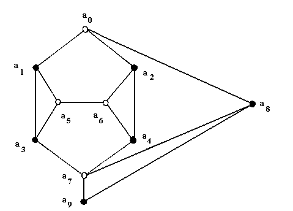

# kochen-specker — step1（supplement）

> （《kochen-specker》词条补充材料，源：plato.stanford.edu/entries/kochen-specker/step1.html）

#### Supplement to The Kochen-Specker Theorem

## Proof of Step 1

A given point a₀ on the unit sphere E uniquely picks out a unit vector from the origin to a₀ which in turn uniquely picks out a ray in R3 through the origin and a₀. We here work with unit vectors, since this involves no loss of generality. We write a₀, a₁, … for points and u(a₀), u(a₁), … for the corresponding unit vectors. We call a KS diagram realizable on E, if there is a 1:1 mapping of points of E, and thus of vectors in R3, to vertices of the diagram such that the orthogonality relations in the diagram — namely, vertices joined by a straight line represent mutually orthogonal points — are satisfied by the corresponding vectors.

We now show (see Kochen and Specker 1967: , Redhead 1987: 126):

> If vectors u(a₀) and u(a₉), corresponding to points a₀ and a₉ of the following ten-point KS graph Γ₁ are separated by an angle θ with 0 ≤ θ ≤ sin^{−1}(1/3), then Γ₁ is realizable.
>
>  Figure 4: Ten-point KS graph Γ₁

Suppose that θ, the angle between u(a₀) and u(a₉), is any acute angle. Since u(a₈) is orthogonal to u(a₀) and u(a₉), and u(a₇) also is orthogonal to u(a₉), u(a₇) must lie in the plane defined by u(a₀) and u(a₉). Moreover, the direction of u(a₇) can be chosen such that, if φ is the angle between u(a₀) and u(a₇), then φ = π/2 − θ.

Now, let u(a₅) = **i** and u(a₆) = **k** and choose a third vector **j** such that **i**, **j**, **k** form a complete set of orthonormal vectors. Then u(a₁), being orthogonal to **i**, may be written as:

> u(a₁) = (**j** + *x***k**) (1 + *x*²)^{−½}

for a suitable real number *x*, and similarly u(a₂), being orthogonal to **k**, may be written as:

> u(a₂) = (**i** + *y***j**) (1 + *y*²)^{−½}

for a suitable real number *y*. But now the orthogonality relations in the diagram yield:

> u(a₃) = u(a₅) × u(a₁) = (-*x***j** + **k**) (1 + *x*²)^{−½}
>
> u(a₄) = u(a₂) × u(a₆) = (*y***i** − **j**) (1 + *y*²)^{−½}

Now, u(a₀) is orthogonal to u(a₁) and u(a₂), so:

> u(a₀) = u(a₁) × u(a₂) / ( | u(a₁) × u(a₂) | ) = (-*x**y***i** + *x***j** − **k**) (1 + *x*² + *x*² *y*²)^{−½}

Similarly, u(a₇) is orthogonal to u(a₃) and u(a₄), so:

> u(a₇) = u(a₄) × u(a₃) / ( | u(a₄) × u(a₃) | ) = (-**i** − *y***j** − *xy***k**) (1 + *y*² + *x*² *y*²)^{−½}

Recalling now that the inner product of two unit vectors just equals the cosine of the angle between them, we get:

> u(a₀) u(a₇) = cos φ = *xy*[(1 + *x*² + *x*² *y*²) (1 + *y*² + *x*² *y*²)]^{−½}

Thus:

> sin θ = *xy*[(1 + *x*² + *x*² *y*²) (1 + *y*² + *x*² *y*²)]^{−½}

This expression achieves a maxium value of 1/3 for *x* = *y* = ±1. Hence, the diagram is realizable, if 0 ≤ θ ≤ sin^{−1}(1/3), or, equivalently if 0 ≤ sin θ ≤ 1/3.

Return to The Kochen-Specker Theorem
