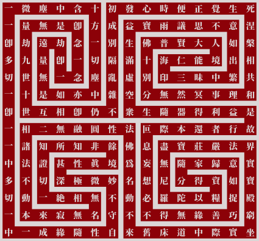

# Korean Philosophy
**First published Fri Jan 14, 2022**

*Kim, Halla*

Korean philosophy presents basic and sweeping insights about the nature of human beings and their ways of communal life in society as well as the constitution of reality. Over the past two thousand years or so it has been gradually developing on the Korean peninsula and its adjacent areas sandwiched by the Chinese landmass mainly to the north and the Japanese archipelago mainly to the south. For Korean philosophers, philosophy and its actual practice in communal life typically go hand in hand. In his “Theses on Feuerbach” (1845), Karl Marx famously complained that philosophers have only interpreted the world without altering it. Marx’s criticism, however, would be pointless if directed against Korean philosophy. For the latter has always been preoccupied with altering reality with its practice in the concrete daily context beyond “theories” (from the Greek verb, “*theorein*”). Korean Buddhism, Confucianism and other philosophies are, by their very nature, at bottom, practically oriented, regardless of any shortcomings they are occasionally perceived to have. Thus, Korean philosophy steadily emphasized self-cultivation, character building, and leadership in a community for the sake of promoting public good. In the familiar division of philosophy influenced by Western approaches, we commonly conceive it as being composed of three parts: metaphysics, ethics and epistemology. For Korean philosophy, this would be insufficient. For it does not do justice to the most essential part of it—the art of self-cultivation (or as we can put it, “sage learning”) is the most important part of philosophy proper. Just like metaphysics, epistemology, and ethics, the art of self-cultivation surely has theoretical components but the most essential component of it is its practical part. One who studies it must not only possess a theoretical understanding of it but also internalize it and actively practice it in his or her concrete relations with others. The practical orientation as a general trend in Korean philosophy stems from the close relation of philosophy with religion in their joint effort to set human beings free from their existential predicaments and shortcomings (Cawley 2019)[^cawley-2019]. While religion pursued the liberation through the experience of the unity with the ultimate reality, philosophy tried to help achieve this goal by making sense of the unity, in other words, by giving a conceptual justification of the relation between the ultimate reality and its conditioned manifestations. From the oldest form of Buddhism in Korea in the dawn of the philosophical tradition to the Korean native philosophy of *Tonghak* (Eastern Learning, see below) as well as the North Korean state philosophy of *chuch’e* (self-reliance, see below), we witness this general character. All the major philosophical movements in Korea thus developed within, or its close association with, the religious or quasi-religious practices either as the foundations or ramifications.

Korean philosophy is also characterized as the view that relations are more important than the entities that enter into them. It is not entities that make relations possible, but the other way around. In other words, relations are more primitive and real. It is this kind of position that would see the active development of relation-oriented ontology such as the paradigm of *ch’e* (體 Essence)-*yong* (用 Function) paradigm, *mu* (無 Nothing) as the matrix of the universe, and the concept of harmony as a reciprocal concept linking *i* (理 Principle) and *ki* (氣 Vital Force), *inter alia* (see below for details). Thus, the basic conceptual tools in Korean philosophy cannot be understood from the perspective of the most typical Western substance-property ontology (H. Kim 2020)[^kim-2020]. An upshot of this is that Korean philosophy is inclined to be monistic. This does not deny the apparent independent existence of the myriad entities—rather it means they are “organic” consequences of fundamental relations. So, the kind of monism one sees in Korean philosophy is not a reductive monism but an organic one in which the myriad things are modalities or manifestations of the basic relations (Jung-Yeup Kim 2015)[^kim-2015][^kim-2015-2].

In what follows, I first introduce the philosophical framework against the background of the native belief of shamanism before the Three Kingdoms Period (57 BCE–668 CE; see section 1). This will be followed by a discussion of Buddhist philosophy (section 2) during the Unified Silla dynasty (668–918) and the Koryŏ dynasty (918–1392). I then move on to a systematic presentation/examination of philosophy developed by Neo-Confucianism in the Chosŏn dynasty (1392–1910; see section 3). The last section discusses modern philosophy in Korea (section 4).

## 1. “Before Philosophy”: The Shamanistic World-View

Koreans have had a family of distinctive native folk beliefs, which can be called “*mugyo* (or *musok*)” or, more generally, “shamanism”. Originally thought to have descended from the Siberian-Manchurian tradition, Korean shamanism is a cosmological insight that is associated with the native and most ancient world-view in Korea and also its religious ritualist practice. This native folk belief is a form of animism that worships nature and believes in spirits. In other words, this native world-view in Korea pledges alliance with spirits residing in many objects, and there is a medium (*mudang*) that connects the humans to such spirits. Accordingly, there are spirits who inhabit natural things such as rocks, trees, mountains, as well as heavenly spirits, earthly spirits, etc. The most well-known spirits include the Mountain Spirit (*Sansin* who is usually depicted as an old man with a tiger at his feet), *Toksŏng*, or the Recluse, and *Ch’ilsŏng* (the spirit of the seven stars, the Big Dipper). These spirits are believed to have the power to influence or to change the fortunes of living people and animals as well as their environment. But without exception, they are all rooted in a nomadic world-view, and they emphasized a more universal idea of Heaven, which Koreans sometimes identified as their ancestor-god; this was later transformed into a tool for consolidating political power and its ideology. Thus, Iryŏn (1206–1289), the Buddhist author of a medieval history text speaks of the Korean foundation-king of Tangun, who is believed to have been a shaman (P. Lee 1993: 6)[^lee-1993]. In general, shamans are not ordained institutionally, but receive ordination directly from Heaven itself. This suggests that the world is divided into two different realms, the conditioned world and the yonder world. The two worlds or realms are mediated by shamans as medium. The supreme God, “Lord of Heaven” (*Hanullim* or *Hwanin*) plays an important function in all the myths regarding shamans. To be sure, shamanism is not philosophy per se but it certainly provided a first preliminary conceptual venue for developing abstract thinking apt for a Koreanized form of philosophical ideas. For example, the view that there must be a cause for events or phenomena that affect human life. It also suggests a rudimentary form of panpsychism, the view that everything in nature is living and has a soul or animating spirit. Finally, it shows a form of cosmogony with an anthropomorphic agent, which is another form of causal explanation of the universe.

## 2. The Development of Buddhism in Korea

### 2.1 The Conceptual Background to Korean Buddhism

In the late fourteenth century, Chŏng Tojŏn (鄭道傳 1342–1398), a Confucian literatus and philosopher, found it necessary to launch extensive criticisms of Korean Buddhism as he tried to help found the new Dynasty of Chosŏn in accordance with a Neo-Confucian vision. As he saw it, Korean Buddhism was hopelessly defective and corrupt in many ways. Most unfortunate of all, Chŏng argued, it was based on the concept of *mu* (無 Nothing) and thus necessarily led to nihilism, which undermined social morality and disrupted the political order (Chŏng, “An Array of Critiques of Buddhism” in Muller 2015, 54-81)[^muller-2015]. This criticism is clearly far-fetched, as can be seen from the response (see below) of the Buddhist critic Hamhŏ Kihwa (涵虛己和 1376–1431), a contemporary of his. Nevertheless, it shows a remarkable insight on the part of Chŏng in regarding *mu* as the founding notion of Korean Buddhism whose philosophy is deeply rooted in the paradigm of emptiness (*śūnyatā*) as an expression of inter-dependent co-origination of things. What I call “*mu*” may have been referred to in many ways in the past, e.g., emptiness (*kong* 空 *śūnyatā*), vacuity (*hŏ* 虛) or “*wuji*” (無極 infinite supreme), etc., but, in this work, “*mu*” roughly refers to the original dynamic yet serene dimension that is not induced by anything ephemeral in the world. It is a self-originating source of the world. A part of an active process, it also forms the momentum of a limitless dialectical movement. Historically speaking, this paradigm has a distinctive structure that serves as the basic conceptual framework for all major Korean intellectual traditions.

Korean Mahāyāna Buddhism grew out of the original form of Buddhism in the Indian subcontinent and the Chinese variant but it gradually developed its characteristics in Korea. Among its distinctive metaphysical claims about the nature of reality, it puts great emphasis on the priority of *mu* over being, which, however, is not a separate and isolated entity but a manifestation of the former. Further, the view holds that while reality is not two or divided, it can be expressed in different ways. This view is prominently presented in the doctrine of One Mind/Two Gates as well as the doctrine of two truths (the absolute truth and conventional truth) or a version therefor (see below for details). Eventually, this strain of Buddhism culminates in the doctrine that *nirvāṇa* (the enlightened state of liberation from sufferings) is metaphysically identical with *saṃsāra* (the infinite cycle of rebirth and thus sufferings), as suggested in the East Asian Classic *Heart Sutra*.

Further, strong eclectic tendencies in thought dominate Korean Buddhism within the broader field of East Asian Buddhism, resulting in a highly syncretic discourse. Korean Buddhist monks throughout history have demonstrated a marked tendency in their works to focus on disagreements between various sects within Buddhism or between Buddhism and other religions (Muller forthcoming). Just as Hegel did much later on the other side of the world, they all skillfully exercised their own form of dialectical thinking in resolving the various conflicts, e.g., emptiness vs. being, doctrine vs. meditation, innate evil nature vs. universal Buddha-nature, etc.

In the Buddhist tradition, the relation of reality and its manifestation has been characterized in many ways, e.g., emptiness (*kong* 空) and form (*saek* 色), *prajñā* (*chihye* 智慧) and skillful means (*pangp’yŏn* 方便), and principle (*i* 理) and phenomena (*sa* 事), as well as Buddha-nature (*pulsŏng* 佛性) and sentient beings (*chungsaeng* 衆生). But its most important application, seen in Korean Buddhism (and also Korean Neo-Confucianism), is that of Essence (體) and Function (用) where Essence refers to the innermost, fundamental dimension of the human mind, for example, the Buddha-mind as the pure, innate mind in and of itself, and Function refers to the manifested activity of such a mind in the world. In this context, Essence refers to the underlying nature of the mind, and Function to the expressed state, feeling or behavior of the person; and that state, feeling or behavior may belong to an ordinary unenlightened person (Muller 1995)[^muller-1995].

In addition to the emphasis on emptiness of all things as well as the Essence-Function paradigm, the Korean Buddhism also pledged allegiance to the doctrine of the womb (or embryo) of Buddhahood (*tathāgatagarbha*). This view holds that even deluded ordinary beings possess in their very make up the capacity to achieve enlightenment. The mind is intrinsically luminous but simultaneously dulled by adventitious defilements. Thus, the mind is not intrinsically ignorant but only contingently yet universally so. This capacity within the mind is called *tathāgatagarbha* (see, e.g., *Suramgama Sutra*).

### 2.2 The Historical Development of Korean Buddhism

Officially the origin of Buddhism in Korea is traced back to the fourth century in the early Three Kingdoms Period when it was transmitted to Korea by a monk from Former Qin dynasty in China. However, it is Wŏnhyo 元曉 (617–680) of Silla Kingdom (traditionally dated 57 BCE–935 CE), who is regarded as the first prominent and most seminal Buddhist thinker in the Korean Buddhist tradition. Widely known for his synoptic vision, he holds that the most fundamental Buddhist doctrines are to be understood from the logic of interfusion (*wŏnyung* 圓融), enabling him to embrace and harmonize different strands of Buddhism without forsaking what is unique to each of them.

When Buddhism first arrived in Korea, it was transmitted from China as part of a whole cultural package together with all its diverse Sutras. Ancient Koreans were genuinely puzzled by the sheer diversity of the family of doctrines under the common rubric “Buddhism” and the seeming contradictions among them. While most of his East Asian contemporaries subscribed to doctrinal classification (*p’angyo*, C. *panjiao* 判敎), Wŏnhyo resorted to “harmonization of disputes” (*hwajaeng* 和諍), which consists in taking the differing positions of various schools as expressing partial views of the whole reality, seen from their respective perspectives. In this way, different views can be understood better from their own perspectives and contributed to the body of Mahāyāna Buddhist system seen as an integrated whole. With this approach, Wŏnhyo made it clear that they are all connected, self-consistent parts of the one integrated whole. The breadth of his thought embraced not only Buddhism but the whole spectrum of Tang-era East Asian philosophy, referencing not only major Mahāyāna scriptures, but those outside Buddhism, such as the Daoists Laozi and Zhuangzi, as well.

Central to Wŏnhyo’s thought is the concept of “One Mind” (*ilsim* 一心) with its metaphysical and soteriological implications. One Mind is identified not only with the minds of all sentient beings, but also with the fundamental ground from which those minds manifest. While appearing externally as impure and ephemeral, this One Mind is posited as intrinsically pure and unchanging. In this way, the One Mind forms the metaphysical ground of Wŏnhyo’s Buddhist systems and the explication of the various doctrines. The One Mind, however, is not univocal but has two aspects (“gates”), which are different from each other yet complimentary to each other as well. First, the One Mind has an absolute, ultimate aspect, the aspect of true thusness. The absolute aspect of the One Mind is the true reality in and of itself but when it is immanent in the conditioned, it is called “*tathāgatagarbha*”. The latter, as tainted thusness, is the absolute mind in the conditioned. This *tathāgatagarbha* can be active in that it can help the minds of sentient beings attain enlightenment. It can also be passive in that it can be concealed by the defilements. In the One Mind, there is also a conventional, “production-and-extinction” aspect. It is thus in *saṃsāra*, the realm of existence that is subject to continual birth and death. This conventional aspect of the One Mind leads to the *ālāyavijñāna* (or storehouse consciousness, see below), which serves to store the tainted seeds and proclivities produced by past actions. In this respect, the storehouse consciousness expresses the defiled mind. But the same consciousness can be purified and thus unified with the *tathāgatagarbha*, which lays bare the untainted original enlightenment (*pongak* 本覺) in each of us (S. Lee 2019)[^lee-2019]. The pure part of the *ālāyavijñāna* then is not really different from the *tathāgatagarbha*, Wŏnhyo suggests. All in all, our ordinary mind is simultaneously deluded and yet enlightened (Wŏnhyo, *Commentary on the Awakening of Mahayana Faith*, HPC 01.0701b24-c05). Sentient beings could be originally enlightened and yet still have to progress through a temporal process of acquiring (or temporal) enlightenment (Buswell, 2007: Part I: Study, 6).

It is because of the One Mind that the prospect of enlightenment is something innate to the mind itself and inherently accessible to all living creatures. Since this prospect is ubiquitous, even the common people can obtain enlightenment by way of purifying their mind. In the East Asian Classic *The Awakening of Mahāyāna Faith* (大乘起信論) it is called “the original enlightenment (*pongak*)”. Indeed, for Wŏnhyo, the whole universe in and of itself, being an expression of such an enlightenment, is in the continual process of self-realization (Rhi 1971)[^rhi-1971]. This true reality, however, is not separated from the common, banal mind. As a matter of fact, the common mind has a seed by which it can reach the ultimate. The ultimate reality is *eo ipso* the ultimate mind. So, even though the true reality is not literally in our ordinary mind, we can reach for it. This developing state of mind, in which enlightenment is partially and gradually exemplified, Wŏnhyo calls “acquired (or actualized) enlightenment (*sigak* 始覺)”. It is an enlightenment in its actual, temporal realization in the ordinary realm. As a seed becomes a tree, the mind is on the way to the final end, the fruit, of the original enlightenment. Since the enlightenment is indeed originally deposited in the mind as Tathāgatagarbha, when the seed is discovered, the whole reality is also completely revealed in its totality. At the very moment of enlightenment, one realizes that the acquired enlightenment is in fact the same as the original enlightenment that has been deposited in the mind all along.

Wŏnhyo’s various writings show the first major systematic inquiry into the fundamental metaphysical reality of the world on the Korean peninsula. His work *Treatise on the Ten Ways of Resolving Controversies* (*Simmun hwajaeng non* 十門和諍論 in Muller and Ngyyen 2012)[^muller-2012] not only influenced Fazang and Cheng-gwan among the Chinese masters but also Gyōnen, Zenshū, and Joto in Japan.

Ŭisang 義湘 (625–702), a younger contemporary of Wŏnhyo and also from Silla, is the founder of Korean Hwaŏm (C. Huayan) school. His view is presented in his *Ocean Seal Diagram* (*haeindo* 海印圖) where Hwaŏm philosophy’s vision of reality and an all-embracing worldview is most perspicuously symbolized. Differences and distinctions are overcome in this work and shown to be integral parts of a transcendent whole. The nature and characteristics of this transcendent and cohesive vision of reality, however, were not easy for all Buddhists to understand. What we call “the universe” was simultaneously empty of duality and self-nature and yet still able to comprehensively integrate all things. Although proponents of the Hwaŏm school employ several terms to describe aspects of this reality, the most general and all-inclusive descriptive term is “perfect interfusion” (*wŏnyung*).

How does Ŭisang communicate his understanding of the concept of “perfect interfusion” in his writings? Although the following is not exhaustive, he explicates this idea by crafting a powerful and instructive visual image, and articulated an all-embracing concept of the universal dharma understanding of “perfect interfusion”. Originally titled, *Diagram of the Dharmadhātu of the One Vehicle of Hwaŏm* (*Hwaŏm ilsŭng pŏpgyedo* 華嚴一乘法界圖), the *Ocean Seal Diagram* (*Sāgaramudrā Maṇḍala*), is arranged like a wavelike form, which symbolizes the Dharma Realm together with the Hwaŏm teaching of the “six marks” (*yuksang*): universality mark (*ch’ongsang* 總相) and particularity mark (*pyŏlgsang* 別相); sameness (identity) mark (*tongsang* 同相) and difference mark (*yisang* 異相); formation (integration) mark (*sŏngsang* 成相) and disintegration mark (*kwoesang* 壞相). In other words, awakening to the reality of one’s existence is explained here through one’s awakening to the simultaneity of contrasting marks. One is thus awakened to the simultaneous existence of the universal in the particular, or the noumenon in the phenomenon. Thus, *saṃsāra* and *nirvāṇa* are always harmonized together. Particular Phenomena (*sa* 事) and universal Principle (*i* 理) are completely merged without distinction (Ŭisang *Hwaŏm ilsŭng pŏpgye to*; see also P. Lee 1993: 161–3)[^lee-1993].

Ocean Seal Diagram *Sāgaramudrā Maṇḍala*

Indeed, in this Ocean Seal Diagram, the ontological doctrine of “dependent co-arising of the Dharma-Realm”, central to the Hwaŏm School, is depicted as if engraved on a rectangular seal (stamp), in the form of a poem in 30 stanzas with seven characters on each line (210 characters in sum), in a continuous maze-like line with 51 angles, suggesting that all phenomena, since they do not attach to self-nature but follow the conditions, are interconnected and unified in the dharma-nature; the fact that this line ends at the same place where it began (the Sino-Korean character “法 (Dharma)” in the middle) illustrates the cardinal Hwaŏm doctrine of interpenetration as well as the central Buddhist doctrine of the Middle Way. The whole and parts of the diagram interpenetrate harmoniously without any obstructions. Hence, the diagram serves as a comprehensive summary of all the teachings found in the *Avataṃsaka Sūtra* (Flower Garland Sutra).

The next major trend of thought of Korean Buddhism, Yogācāra (Consciousness-Only) Buddhism, would not have been possible without the Chinese master Xuanzang (602–664). Wŏnchŭk 圓測 (613–696), originally from Silla but who was active and died in Tang China, was a member of his inner circle but their relation might have eroded as time passed. But in view of the fact that Wŏnchŭk thoroughly subscribed to Xuanzang’s translated *Cheng weishi lun* (成唯識論), it is hard to see his position as fundamentally in conflict with Xuanzang or for that matter the latter’s Chinese disciple Kuiji (窺基). The most important contribution on the part of Xuanzang was the introduction of the doctrine of five distinct [spiritual] lineages (C. *wuzhong xing* 五種性, S. *pañcagotra*) of sentient beings, which was entailed by his view of *ālayavijñāna* as his new translations amply showed. Unfortunately this doctrine was regarded as contradictory to the *tathāgatagarbha* theory because virtually everybody assumed that the *tathāgatagarbha* theory necessarily entails that the Buddha-nature is universally innate in all sentient beings. Given this controversial implication, Wŏnchŭk was determined to reconcile the two seemingly contradictory positions. How did Wŏnchŭk accept both *tathāgatagarbha* as well as five different lineages including *icchantikas*, the lineage of beings who are beyond the possibility of salvation and lose forever the capacity to achieve *nirvāṇa*? First, for him, the Buddha-nature belongs to the level of principle while the five different lineages belong to the level of practice with their own Buddha-nature. This has the consequence that the indeterminate lineages can pursue enlightenment (other than *pratyekabuddhas* (the self-enlightened), *śrāvaka* (the voice-hearer) and *bodhisattvas*). But unfortunately this does not apply to the fifth lineages, i.e., *icchantikas*. Instead, Wŏnchŭk tried to interfuse the Buddha-nature at the level of principle and the Buddha-nature at the practical level, thus giving rise to the resolution that both are right at their own level. The Buddha-nature should be acknowledged at the level of principle, to be sure. And he can accept the view of *tathāgatagarbha*. But at the level of practice, we have to acknowledge the existential reality of evil and allow the possibility not only of indeterminate lineages but also *icchantikas*. *Icchantikas* are incapable of enlightenment outright but still they are viewed as pursuing upgrading their status into the human status or heavenly status if and when they practice five precepts and ten good conducts, etc. Thus Wŏnchŭk could hold that, because of our *tathāgatagarbha* working for our salvation, we all are able to obtain salvation by way of the distinction between the Buddha-nature in practice and that in principle (S. Lee forthcoming).

Wŏnchŭk’s view thus could proceed coherently without forsaking his allegiance to the doctrine of the Yogācāra school, according to which all conditioned existence is dependent on consciousness. Consciousness is the basis of all activities from birth to attaining enlightenment. In addition to the five sensory consciousnesses as well as two conceptual consciousnesses, there is the eighth consciousness, which is called “storehouse consciousness (*ālayavijñāna*)”. This is the principal part of consciousness which is the basis of the seven other consciousnesses. Everything in the world is composed of dharmas where dharmas are the basic interdependent patterns within the overall nature of reality. Each dharma is a mental-construct with a specific process that consists of a stream of momentary events (Wŏnchŭk *Commentary on the Samdhinirmocana-sutra*). Later Wŏnchŭk’s Yogācāra vision was transmitted to Korea by the way of his students such as Tochŭng 道證 (ca. eighth century), and Taehyŏn 大賢 (ca. eighth century).

No discussion of Korean Buddhism, however, would be complete without discussing Chinul 知訥 (1158–1210, Dharma name: Pojo), a Buddhist monk of the Koryŏ dynasty and the founder of Sŏn (禪 C. *Chan*, J. *Zen*) Buddhism, which is the leading school of Buddhist thought in Korea.

A scholiast and a meditation master, he dedicated his energies to creating harmony between two conflicting sectarian positions, those who emphasized meditation, on the one hand, and those who were dedicated to textual studies (*kyo* 敎) on the other. He started his career as a tireless reformer. This was achieved by way of introducing and regulating meditative practices to the existing sangha that later became the integral part of Sŏn and, eventually, all of Korean Buddhism. A key innovation of his within Sŏn was his introduction and elaboration of *kong’an* (公案 the public case records) or rather the practice of its key component called “*hwadu* (話頭)” (Park 2005)[^park-2005].

“*Hwadu*” literally means “head of speech” or “the limit of speech”. Since speech presupposes the discriminating mode of the mind, the *hwadu* works as a mechanism of transcending the discriminations of the discursive mind and thought. In “Resolving Doubts about Observing the Hwadu,” Chinul suggests that *hwadu* produces the “cleansing knowledge and vision” (Chinul-CW, 244). He then approvingly gives the quintessential *hwadu*:

> A monk asked Zhaozhou, “Does a dog have the Buddha-nature or not?” Zhaozhou replied, “*Mu*! [Nothing 無!]” (op. cit., 245).

It is common sense in Mahāyāna Buddhism that all living beings have Buddha-nature. So, why is the monk asking what is an obvious and absurd question, and why is Zhaozhou giving a paradoxical answer? In discussing this *hwadu* and instructing his students how to work with it, Chinul suggests that *Mu* is “the weapon which destroys wrong knowledge and wrong understanding”. Zhaozhou’s “*Mu*” here does not mean an affirmative answer nor a negative one. The student of Sŏn here then should not consider it in relation to a doctrinal theory—one only needs to “be concerned about keeping this question before [one] and [one’s] attention always focused”. In this way, when the student of Sŏn follows the tortuous yet fruitful path of *hwadu* patiently,

> unexpectedly, in an instant, the student activates one moment of realization in regard to the tasteless, elusive *hwadu*, and the *dharmadhātu* of the one mind becomes utterly evident and clear. (Op. cit. 246)

The *hwadu* method then enables the students to realize the true inner nature of the mind—the intrinsic emptiness of Buddhahood—and to enter into the realm of *nirvāṇa* (H. Kim 2014)[^kim-2014][^kim-2014-2].

Let us now examine the difference between the Sŏn tradition and the doctrinal schools in Korean Buddhism, and Chinul’s way of synthesizing them. The Sŏn school is most distinctively oriented to practice. Sŏn here primarily refers to the conjoined practice of *samādhi* (concentration) and *prajñā* (wisdom) (Keel 1984)[^keel-1984]. Already in the early work such as *Encouragement to Practice* and *Secrets on Cultivating the Mind,* Chinul emphasizes the need to “cultivate concentration and wisdom in tandem”. Concentration means a mental absorption. As the student of Buddhism turns his or her attention away from the world of sensible things and brings it to bear on what is internal, he or she engages in meditation to obtain unmovable peace within himself or herself. In the process, the student exercises pure mental focus with a resulting state of calmness. This is concentration. Furthermore, as this concentration naturally creates the energy of mental penetration, the mind is now directed to make inquiries into the nature of the world and that of the self, thereby generating insight into reality. This is wisdom—it is transcendental understanding of the nature of the world and the self in it, with a resulting state of alertness. The Sŏn then combines the merits of both concentration and wisdom that eventually leads to the discovery of the source of all sentient beings, indeed, the whole world.

So, what is the nature of the ultimate reality of the world? Chinul typically calls the unconditioned reality of the world “True Mind (*chinsim* 眞心)”. This is the same as Buddha-nature. “True” here means the absolute lack of any illusion, or in his words, “to leave behind the false”. “Mind” means the source of reality that is the numinous mirror. In particular, it is not used as the mental faculty of an individual human being. As such, the True Mind is not properly describable. It can only be symbolized. For example, it is symbolized by *dharmadhātu* in the *Avataṃsaka Sūtra*. Following the *Sutra*, Chinul holds that the phenomena of the world are formed because of the works of the mind. There is no separate world outside the mind. Chinul thus speaks of mind *sive* Buddha. The mind makes the Buddhas.

Is our ordinary mind then also the True Mind? No, our daily minds—discrete, empirical, limited, individual, separate minds—are mere phenomena, appearances, manifestations of the True Mind. For there is no cause or effect for the True Mind. It is neither in space nor in time. It has no beginning and end. Again inspired by the *Avataṃsaka Sūtra*, Chinul claims that all phenomena are mutually interdependent and interpenetrating. For him, then, in the mirror of one’s mind, there is

> the perfectly bright and self-reliant functions of the dharmadhātu which remain, including the unimpeded interpenetration of all phenomena ..., are never separate from the pure enlightened nature (the *dharmadhātu*). (Chinul-CW “Complete and Sudden Attainment of Buddhahood,” 216–217)

How, then, do we realize this true nature of the mind within the confines of our finite embodied conditions? In the *Secrets of Cultivating the Mind*, Chinul suggests that we start with a sudden enlightenment (initial awakening) by way of the method of the *hwadu*. This leads to the vision that “I am a Buddha” (142). But what should we then do from that point on? In his mature period, Chinul suggests that a sudden enlightenment should be followed by gradual cultivation (144). The awakening to the true nature of the mind is sudden and immediate. Despite our awakening to true reality by way of the successful execution of the *hwadu* method, we have to control old habits and cultivate various character traits gradually. This is the gradual process of cultivation. Finally, we have to understand and conduct in perfect unison (Keel 1984)[^keel-1984].

In sum, the understanding of the nondual nature of the mind is obtained suddenly but the complete eradication of practical evils is achieved only gradually. Chinul also developed his scheme of Sudden Enlightenment to our true nature under the guise of emptiness followed by a Gradual Cultivation. Chinul, as a good Korean Buddhist monk, thus shows a nice syncretistic attitude toward the controversy known as Tonjŏm (頓漸) debate, suggesting a moderate position of *tono chŏmsu* 頓悟漸修 (gradualism, i.e., sudden enlightenment followed by gradual cultivation) (Chinul-CW, “Secrets on Cultivating the Mind”, 143) in contrast to, e.g., *tono tonsu* 頓悟頓修 (subitism, i.e., sudden enlightenment followed by sudden cultivation) (Peter H. Lee 1993, Vol. I, 418–419)[^lee-1993].

## 3. Confucianism

### 3.1 The Conceptual Background to Confucianism in Korea

The next philosophical tradition we will consider is Confucianism, which was gradually transmitted from Han China as part of the cultural package during the earliest kingdoms in Korea. The Classical Confucianism of Pre-Qin and Han dynasties massively contributed to the Korean culture, society and literature but philosophically and politically it was Neo-Confucianism which arose much later in the medieval Song-Ming-Yuan dynasties that influenced Korea most. Confucius was no doubt the founder of Confucianism with the central concept of benevolence (仁) but traditionally Koreans enthusiastically subscribed to the Mencius’ idea of moral foundations in good human nature (in particular the idea of Four Sprouts, i.e., the heart/mind of sympathy, the heart/mind of shame, the heart/mind of deference, and the heart/mind of right/wrong; see Mengzi 2A:6) and also the practical/metaphysical ramification and development of these ideas in Neo-Confucianism in China. Also important for the rise of the Korean Neo-Confucianism was Koreans’ perception about their existential weakness and limitedness *vis-à-vis* the world’s moral evil along the path of self-cultivation, and they subjected the emotional aspects of this vulnerability and its resolution to sharp analyses and unusual recipes for self-improvement.

One of the most important conceptual and ontological frameworks found in Korean Neo-Confucianism is the paired concepts of Essence (*ch’e*) and Function (*yong*.) As in the Buddhist tradition, the Essence-Function structure permeates the entire view of reality among Korean Neo-Confucians when they connect the inner structure of phenomena with its external expressions. Thus, for those Neo-Confucians, all things, processes, and complexes in the universe can be considered in terms of two aspects, i.e., Essence and Function. Just as in Buddhism, “Essence” refers to the underlying structure of something that provides the ground or pattern for its activities or changes within the world. “Function” then refers to what is manifested by what is hidden or invisible. Neo-Confucians applied the Essence-Function paradigm to the most important parts of their philosophical edifice, i.e., cosmology, moral psychology, the process of self-cultivation in sage learning, etc. It is important to keep in mind that “Essence (*ch’e* 體)”, which literally means “body”, does not refer to a reified entity, as in the Western metaphysical concept of substance. “Essence” and “Function” refer to two different ways or aspects of what is fundamentally one and the same. In this sense, the Essence of something is not separate from its Function. They mutually embrace each other in a seamless way. But there is definitely an order or hierarchy between them. Essence is always thought to take precedence over Function. In this sense, it is prior to, or more fundamental than, Function. Neo-Confucianism, for example, repeatedly emphasizes that human nature (*sŏng* 性) in its unaroused state (*mibal* 未發), i.e., before entering into the realm of activity, is the Essence, and the feelings expressed in everyday life are its Function. In this context, “Essence” refers to the heart/mind of the sage (sometimes called “*tosim* (C. *daoxin*, the heart/mind of the Dao)”, and Function to the behavior of an ordinary person or *insim* (C. *renxin*, the heart/mind of an ordinary person). The idea then is that what is underlying as a fundamental principle can be pulled in all directions in the manifest world. There is no doubt that this Essence-Function paradigm is importantly related to what is known as “Correlative Thinking”, according to which the world is an interconnected web where everything or every phenomenon is situated in a dynamic cycle of relations both productive and anti-productive to some others (Needham 1954)[^needham-1954].

Neo-Confucians also took up the Buddhists concepts of noumena-phenomena (*i-sa*) and transformed it into the *i-ki* 理氣 (Principle and Vital Force) framework, which is then used to explicate the nature (*sŏng* 性) and feelings (情) of human beings. It is in Chosŏn Korea where the most advanced discussion of the relationship between the original human nature and the emotions took place in the form of the so-called “Four-Seven Debate” (see below), and it is the originator of the Four-Seven Debate, Yi Hwang 李滉 (1501–1570 pen name: T’oegye 退溪), who provides what is probably the most detailed examination of the Essence-Function paradigm in the entire East Asian tradition (Muller forthcoming).

Before we go on, a brief explanation of Principle (理) and Vital Force (氣) is in order. First, Principle refers to the universal order of the world and, for this reason, it is the intangible and abstract yet active and dynamic source of all things. It is not only the principle of being of all things in the world but also their normative source, i.e., the source of good in the world. Thus, Principle is good intrinsically yet also transcendentally, going well beyond the confines of the manifested, phenomenal world. What is more, human nature is none other than this very same Principle concretely exemplified in humans. So, in this respect, human nature is innately good. A person has a heart/mind (*sim*, C. *xin* 心) whose nature (性) is endowed by Heaven. Since human nature is nothing other than Principle, which is in the heart/mind of a person, the heart/mind must innately point to Principle. Note that Principle itself does not move but it sets the limits on what can move in the phenomenal world. This is because Principle itself is the organizing source of reality that, while not visible, provides the structure and pattern for all phenomena. When the fullness of Principle as the fountainhead of all beings is brought to relief, Principle is called “Supreme Ultimate (*t’aegŭk*, C. *taiji* 太極)”. Supreme Ultimate thus refers to the ultimate metaphysical ground of the development of things in the world, which it generates by way of its polarity (i.e., yin and yang forces).

On the other hand, Vital Force (*gi*, C. *qi* 氣) is a psycho-physical force or energy that can serve as the vehicle of Principle. As concretizing force, it is the primordial stuff out of which everything in the universe is made. Following Zhu Xi in Song China, the Neo-Confucians at the time typically believed that Principle can manifest itself in the world only by means of Vital Force. When Principle is manifested in the spatiotemporal world by Vital Force, it becomes material (*chil* 質). The material then refers to the state of Vital Force’s becoming thick and dense. Thus, Principle is the same everywhere but Vital Force is exemplified in different modes or qualities. For example, Vital Force freely moves when it is refined, but it is inert when it is coarse.

### 3.2 The Rise of the Four-Seven Debate

The new dynasty of Chosŏn, which emerged after toppling the Buddhist Koryŏ dynasty, was strongly supported by the leading Confucian literati of the time. As I mentioned above, Chŏng Tojŏn in his *Array of Critiques against Buddhism* (*Pulssi chapbyŏn* 佛氏雜辨, 1398) launched the most extensive criticisms against Buddhism. But his contribution was not confined to a purely negative polemic. He was also an ideological architect of Neo-Confucian worldview with a full commitment to the order of universal principle in the world dominated by the *ki* force. But it should be mentioned that Chŏng’s diatribe against Buddhism did not go unanswered and was impressively answered by his Buddhist contemporary Kihwa in the *Exposition of Orthodoxy* (*Hyŏnchŏng non* 顯正論) where the latter offers alternative, Buddhist interpretations of the project of self-cultivation. Kihwa shows that the question of how most appropriately to cultivate one’s life can be safely answered from a Buddhist perspective in the context of issues of the reproduction of ethical life and established forms of social relationships, the moral psychology of the emotions, and questions of the meaning of suffering and evil. In other words, one can be a Buddhist without forsaking the moral value of benevolence or for that matter filial piety. His response shows a remarkably syncretic, inter-cultural, and ecumenical solution to the abstract problem raised by Chŏng. Buddhism is not nihilism.

While Kihwa’s noble effort and his elegant solutions were praiseworthy, it was not meant to buck the decisive trend of the age and it was too isolated to contain the massive wave of Neo-Confucianism, which was the leading *Zeitgeist* at the time. Succeeding Chŏng, who perished untimely due to a political conflict, Kwŏn Kŭn 權近 (1352–1409) and others such as Yi Onjŏk 李彦迪 (1491–1553) seamlessly propelled Neo-Confucianism to the status of philosophical orthodoxy. While not fully prepared to be explosive in its creativity and imagination, this phase of Korean Confucianism clearly ushered in a new era of appropriation that nicely prepared the next phase of full development. Among others, Kwŏn was the one of the earliest who systematically developed the metaphysics of Principle and Vital Force, suggesting that the heart/mind in us must have its own nature, which is none other than the heavenly principle (*chŏnli* 天理). In other words, the heart/mind is Principle in terms of its Essence, but, in respect of Function, because it is mixed with Vital Force, issues feelings (*chŏng* 情) or intentions (*ŭi* 意). Unbeknownst to him, Kwŏn served as the catalyst for what is known as the “Four-Seven Debate (see below)” (Kim 2016b)[^kim-2016b]. But it is in the middle of the sixteenth century that Korean Neo-Confucians were ready to go beyond the stage of mere appropriation and began making rich, dynamic and lively contributions to the in-depth understanding of the central Neo-Confucian ideas. They even brought about new themes not prevalent in the original form of Neo-Confucianism. It is well-known that, with the “Four-Seven Debate”, which originated in the mid-sixteenth century, the Korean Neo-Confucians made a remarkably lively and impressive contribution to the importance of emotions in our examined life. The debate originally took place between T’oegye and Ki Taesŭng (1527–1572 pen name: Kobong) when they began exchanging letters in the spring of 1559. As “the most important intellectual event in the entire history of Korean Confucian thought” (Kalton et al. 1994)[^kalton-1994], the debate was *prima facie* over the origin of Four Sprouts and Seven Emotions (such as joy, anger, love, fear, sorrow, hatred, desire). But when you examine it carefully, you can see that it is about (1) the feasibility of a metaphysics of Principle (*i*) and Vital Force (*ki*) in terms of their causal efficacy and normativity and (2) its moral and psychological philosophy of mind, human nature, and feelings, and, most importantly, (3) how best to achieve sagehood despite our emotions in our examined life with bodies.

At the start of the debate, T’oegye suggested that

> the issuance of the Four Sprouts involves pure *i* and, therefore involves nothing but good; the issuance of the Seven Emotions includes *ki* and therefore involves mixture of both good and evil. (The First letter to Kobong, A1a, 1559 Spring, in Yi Hwang [T’oegye] CW, Vol. 1, Book 16, 402a; Kalton et al. 1994, 1)[^kalton-1994].

Let’s call this the thesis of separate issuance. T’oegye’s basic insight here is fundamentally oriented by his profound interest in, and experience of, self-cultivation in what he calls “Sage Learning” (see his *The Ten Diagrams of Sage Learning* in Kalton 1988)[^kalton-1988]. T’oegye argued that making an appeal to the multiplicity of the roles played by univocal notion of feelings in the social context did not do any good. The strategy on the part of T’oegye was then to ground the Four Sprouts (and the Heart-mind of the Dao) on the active Principle on the one hand and to ground the Seven Emotions (and the Heart-mind of an ordinary person) on Vital Force, thus drastically bifurcating the feelings in their disparity. In particular, he most cautiously wanted to make sure that the potentially wayward feelings arising from our bodily nature do not undermine the fundamental dynamism towards appropriateness of the Mencian Four Sprouts (Ivanhoe 2015)[^ivanhoe-2015].

Now, in his replies, Kobong criticized the obvious dualism implied by the thesis of separate issuance on the part of T’oegye. He said that both the Four Sprouts and the Seven Emotions are all basic human feelings of one and the same stripe. In his first letter to T’oegye, Kobong audaciously suggests that the Four are a good side to the Seven. Let’s call this the thesis of the continuum between the Four and the Seven. According to Kobong, then T’oegye’s fallacy stemmed ultimately from the latter’s assumption that the Four and the Seven are two separate kinds of feelings and accordingly there are two kinds of good feelings—the ones in the Seven and the ones in the Four. It was also wrong to view Principle and Vital Force as being independent from each other.

Later, the forcible reply on the part of Kobong led T’oegye to concede that both Principle and Vital Force are actually present in the origination of all feelings when the heart-mind is activated, and his attempt to differentiate them in terms of stimulus had to be revised. As part of his response, T’oegye came up with a formula that recognized the interdependent roles of Principle and Vital Force but weighed them differently: in the case of the Seven Emotions, Vital Force gives issue and Principle follows it; in the case of the Four Sprouts, Principle gives issue and Vital Force accords with it (Yi Hwang [T’oegye] CW, Vol. 1, Book 16, 417b). Thus, instead of the original “separate issuance” theory, T’oegye now proposed a theory of “alternate issuance” (*hobal* 互發) by which Principle would be the one to issue in the case of the Four Sprouts, even though, traditionally, Principle was not considered a self-issuing agent within the Principle-Vital Force relationship (Chung 1995: 73)[^chung-1995]. T’oegye at this point acknowledged that the Four and the Seven are all basic human feelings and that both involve Principle and Vital Force simultaneously when they issue. As he puts it,

> Principle and Vital Force need, and depend on, each other: one being an Essence (*ch’e*) and the other a Function (*yon* 用). (Yi Hwang [T’oegye] CW, Vol. 1, Book 16, 405a)

However, he still insisted that they are different things because they originate from the different sources. According to him, the Four are related to original human nature because they are, as informed by the heavenly principle, inborn and innately good, while the Seven are related to the physical endowment because they arise from contacts with external objects and can be good or evil. The Seven are not genuine moral feelings. From a Mencian perspective, self-cultivation requires the nourishment of the Four and the exercise of emotional control over the Seven. So, for T’oeyge, the Four together with Principle always maintain its transcendent, independent status regardless of the concrete course of events and also preserves its causal efficacy in initiating the desirable patterns of behavior. As he variously puts it in his works such as “the Four-Seven Letters” as well as “Critique on the Position that the Heart/Mind does not have Essence and Function”, “Principle issues (理發)”, “Principle moves (理動)” and “Principle comes into being of itself (理自到)” (Yi Hwang [T’oegye] CW, Vol. 1, Book 16, 464-465a).

It is clear that T’oegye stressed the role of Principle in the path to self-cultivation because of its autonomous character. He prescribed that self-cultivation could be attained only by redirecting the blind orientations of Vital Force and nourishing human nature via the practice of “Reverent Mindfulness” (*kyŏng* 敬). In the *Ten Diagrams of Sage Learning*, T’oegye suggests that “Reverent Mindfulness is the beginning and the completion of the sage learning” (Yi Hwang [T’oegye] CW, Vol. 1, Book 7, 203a). This has two aspects, external and internal: Externally, Reverent Mindfulness is always informed and constrained by the Confucian ideal of good behavior conforming to the strict adherence of the rules of propriety (Chung 1995: 134)[^chung-1995]. Thus, Reverent Mindfulness involves being “cautious and watchful in the hidden, secluded places” as well as being “properly ordered and controlled, grave and quiet”. Internally, the practice of Reverent Mindfulness also involves preserving one’s internal refined state. Already in his Four-Seven debate with Kobong, T’oegye suggested that Reverent Mindfulness is achieved when the original state of heart/mind is maintained by “concentrating on one thing without departing from it” and also by “regulating the exterior to nourish the interior” (Yi Hwang [T’oegye] CW, Vol. 1, Book 7, 203b; Kalton 1988, 85–87)[^kalton-1988].

A few years after T’oegye’s death, a new Four-Seven debate was ignited, this time between Yi I (pen name: Yulgok) and his friend Sŏng Hon (pen name: Ugye), when the latter sent a letter to the former in 1572. Ugye was an enthusiastic follower of T’oegye’s understanding of the Four-Seven relationship, and thus one can safely assume that Ugye vicariously debated the matter with Yulgok. Following T’oegye, Ugye suggests that the Four Sprouts and Seven Emotions come from Principle and Vital Force respectively. In a famous analogy, Ugye then compares Principle and Vital Force to a rider controlling his horse, just like T’oegye did to explain his alternate issuance theory.

In response to Ugye, Yulgok insists:

> the Four Sprouts are the good side of the Seven Emotions. The Seven Emotions comprehend the Four Sprouts. (Kalton et al. 1994: 131)[^kalton-1994]

Thus, on Yulgok, the Four and the Seven are not separate, but the former are rather a proper subset of the latter. Yulgok’s view is important because it pushes us deeper into the nature of aroused feelings. In the presence of good and bad feelings, what makes it possible to say that good feelings are preferable to bad feelings? Yulgok suggests that no real progress can be made if one separates the works of Principle and Vital Force in the relevant situations in life. As for the nature of Principle, Yulgok forcibly denies its transcendent and independent existence as well as its causal efficacy. While Principle “pervades” (*itong* 理通) and Vital Force “delimits” (*kiguk* 局), Principle is in and of itself causally impotent and acquires its agency only when it follows Vital Force (Yi I [Yulgok] CW, 10.26a). However, it does not follow that Principle and Vital Force are for this reason independent from each other. Despite Principle’s role as the universal order structuring norms, Vital Force is the only particularizing power that moves things on the model of Principle. Yulgok thus claims:

> In general, Principle is the master of Vital Force, and Vital Force is what Principle mounts upon…. They are not two [separate] things, but again they are not a single thing. They are not a single thing, therefore they are one and yet two; they are not two things, therefore they are two and yet one. (Yi I, [Yulgok] CW, 10.2b)

On the front of self-cultivation, Yulgok proposes a model of Integrity (*sŏng* 誠) for achieving sagehood (Ro 1989). Integrity is the foundation of self-cultivation because it enables one to nourish one’s own Vital Force, and the heart/mind can be made the master of one’s body and the commander of human nature and feelings through its agency. But Integrity as the source of transforming Vital Force within us does its works exactly because it is the real principle of heaven and the original essence of the mind/heart. The heart/mind then originally possesses Integrity as its inherent moral quality.

The Four-Seven Debate continued in one form or other down to the beginning of the twentieth century. T’oegye and Yulgok and their opposed strategies for dealing with this challenge tower over the history of Korean Neo-Confucian thought. As a matter of fact, the Four-Seven Debate later spilled over to another debate (“*Horak* 湖洛 Debate”) where Han Wŏnjin (1681–1751) and Yi Kan (1677–1727) had a lengthy discussion over whether there is any difference between human nature and sub-human nature, and also over what, and how much, shelter human nature can provide from evil in the context of moral community (R. Kim 2015)[^kim-2015][^kim-2015-2]. It also ignited the Heart/mind (*Simsŏl* 心說) Debate from the middle of the nineteenth century well into the twentieth century.

### 3.3 The Challenge of the New Trends of Thoughts

Chŏson Korea was completely devastated by the Japanese invasion during the Imjin War (1592–1598), the largest conflict of the sixteenth-century world, involving almost half a million combatants from Korea, Japan, and China, and also by the Manchu-Qing invasions (1627 & 1637). As a result, the classical Korean Neo-Confucianism in its original form began disintegrating. This was shown by a renewed, now more positive interest in the nature of the heart/mind from the perspective of the Yangming Learning, e.g., by Chŏng Chedu 鄭齊斗 (1649–1736). We also see the activities of some Korean women Confucians philosophers, e.g., Im Yunjidang 任允摯堂 (1721–1793) and Kang Chŏngildang 姜靜一堂 (1772–1832) (Ivanhoe & Wang forthcoming). But, more prominently, in the eighteenth century, a group of philosophers more perceptive about the socio-political reality in Korea began rejecting the metaphysically oriented framework which the Four-Seven Debate presupposed, and supplied instead highly naturalistic principles of cosmology and Sage Learning in what is called “Practical Learning (實學)” today. These philosophers include Yu Hyŏngwon 柳馨遠 (1622–1673) and Yi Ik 李瀷 (1681–1763) *inter alia*. Among them were also members of the school called “Northern Learning” (*Pukhakpa* 北學派) with an intense interest in the new ideas and technology from Qing China. These scholars included Hong Taeyong 洪大容 (1731–1783: pen name: Tamhŏn 湛軒), Pak Chiwon 朴趾源 (1737–1805), and Pak Cheka 朴齊家 (1750–1850). All these were reformist thinkers who aspired to renovate what they viewed as outdated ideas and forms of life of the scholars and society of their times. In particular, Practical Learning scholars shared a general emphasis on utility and the enhancement of the well-being of the human experience.

But it was Chŏng Yagyong 丁若鏞 (1762–1836, pen name: Tasan 茶山) who offered the most extensive criticisms of the tradition and constructed a new system, sometimes even borrowing from the Jesuit writings to create a new form of Neo-Confucianism. Above all, he clearly de-constructed Neo-Confucian Principle-Vital Force paradigm and shifted it into a new paradigm by (partially) integrating Western theories (without denouncing the core elements of Confucianism). He rejects the Principle-Vital Force structure because there is no room for emotion in Principle and Vital Force and they do not incorporate the volitional activities of the agent (Baker 2010)[^baker-2010]. As you recall, the Classical Neo-Confucianism holds that the heart/mind has transcendent nature as its Essence (*ch’e*). In term of its endowment, i.e., Essence, the heart/mind is basically its Heaven-imparted nature. But in terms of its function, the human heart/mind consists in its variegated feelings. Tasan does not deny that the heart/mind has nature but he does deny that Principle (*i*) is the essence of the heart/mind in the way the traditional Neo-Confucianism suggests, i.e., in its transcendental character. What is most striking in Tasan’s philosophy of the human person is the view that the human nature is the integral aspect of the heart/mind that exclusively lies in its inclination (嗜好 *kiho*), i.e., liking what is good and disliking what is evil. This inclination is thoroughly spontaneous and automatic without any addition or admixture from without, and is thus innate. Human nature is merely a moment or a character of the heart/mind. While readily acknowledging that the heart/mind and its inborn inclination “form a unified human character”, Tasan makes clear that the nature here, instead of expressing any transcendental value, must refer to the spontaneous liking inherent in the heart/mind. So we cannot be praised or for that matter blamed just for having it. Our nature is innately inclined to the moral good just as the bees are innately inclined to protect their queen. In this sense, this nature is fixed. The full characteristics and merits of the heart/mind then cannot be exhausted by its nature (Ivanhoe 2016)[^ivanhoe-2016].

Is the nature of the human heart/mind then originally good? Tasan does not discuss this question directly, but we can infer that his answer must be two-fold. Understood as the inborn inclination in favor of what is good, it must be originally good. However, in terms of its actual execution, the heart/mind is a mere potentiality of good and evil. In other words, the heart/mind as the core of moral responsibility is widely open to options. This suggests that the heart/mind also has other components. For example, the human heart/mind has the power of autonomy (自主之權) or balance (權衡) (*The Essential Teachings of the Mencius* in *The Complete Works of Yŏyudang Chŏng Yagyong* II, 5:33b). This is the ability by which one is able to do what is good or evil without being determined by anything external or its internal nature. It is clear that this power resides in the heart/mind. When the heart/mind with the power of autonomy finally issues an action, then it will be evaluated as praiseworthy or blameworthy. But in order to issue an action, the heart/mind must first engage in the exquisite power of intelligence (靈明). This is the practical capacity for deliberating and valuing. It also holds the power of implementation, the ability to carry out what is determined to be valuable even against the stimulations of the exterior. With the doctrine of the power of autonomy, Tasan turns out to be the first philosopher in all of East Asia who explicitly advocated the philosophy of freedom at the foundation of human agency and morality. Thus we can see a sort of Catholic (Thomist)-Confucian synthesis working in his philosophy. Tasan cautiously and selectively embraces Thomistic philosophy transmitted to him by the Jesuit Matteo Ricci and makes a paradigm shift into a whole new unique system of Confucianism (Baker 2002)[^baker-2002].

There is no denying that, even for Tasan, Vital Force is what is responsible for individuality in the world. But he flatly rejects the view that this Vital Force is ultimately derived from Principle. In particular, he rejects the classical view of Supreme Ultimate (C. *Taiji*) according to which all is derived from the polarity of yin and yang. What then could be the ultimate source of being in the world? In order to answer this question, we now have to turn to Tasan’s view of Heaven. For Tasan, “Heaven” typically means the absolute personal being. In this regard, he frequently calls it “Lord on High (*sangje* C. *shangdi*)”. Supreme Ultimate surely is the beginning process of the world that is governed by Lord on High, but the former is not itself the dynamic principle and the origin of all things. Indeed, Lord on High is a personal God who is the governor of the universe and the source of its moral order (*Lectures on Zhongyong* in *The Complete Works of Yŏyudang Chŏng Yagyong* I, 8:30; *Self-Admonition on Zhongyong* in *The Complete Works of Yŏyudang Chŏng Yagyong* II, 3:5). Lord on High is also providential, i.e., he cares for his creatures. It is now clear that Tasan rejects the orthodox conception of Principle or Supreme Ultimate as the ultimate ground of morality because an impersonal principle cannot justify morality. Supreme Ultimate as the metaphysical principle cannot provide any mechanism for praise or blame. In other words, given the orthodox view of Principle, it is not clear how the morally depraved would be sanctioned while the morally virtuous would be rewarded in the mechanistic, impersonal scheme of orthodox Supreme Ultimate. In being the ruler and providential power of the world, Lord on High is clearly different from the myriad creatures. For this reason, Tasan regards Lord on High as the spiritual being *par excellence*, i.e., *kwisin* (C. *guishen*). For this reason spiritual beings are the invisible entities that ought to be the objects of worship in sacrificial rites (H. Kim 2019b)[^kim-2019b].

Let us now pause for a moment and reflect on the way the philosophical spirit developed in Chosŏn Korea; the Chosŏn thought started with a strong Principle-Vital Force dualism but, as it progressed further, many ended up embracing a Vital Force-inclined view. For example, Sŏ Kyŏngdok (1489–1546: pen name: Hwadam) was the first major philosopher who advocated the philosophy based on Vital Force.

Hwadam’s philosophy of Vital Force is designed to promote a unified view of the world and life by way of overcoming divisive ways of thinking and living. With the notion of Vital Force, he presents an interpretation of reality that negates any essential separation among the diverse entities of this world. For him, we can promote the vitality of life by overcoming divisions when we harmonize among ourselves and with nature (J. Kim 2015: 95)[^kim-2015][^kim-2015-2]. As a Confucian, he thus offers the value of communal life integrated by Vital Force. Far from what he conceives to be the externally existing Buddhist emptiness, Hwadam advocates the internal vacuity (*hŏ* 虛) of dynamic energy which inheres in Vital Force (Sŏ 2004: 196).

This *ki*-oriented trend not only influenced the philosophy of Yulgok, as we observed above, but it also intensified after the two great wars and culminated in the philosophies of Hong Taeyong, Ch’oe Hangi (1803–1879 pen name: Hyegang) as well as Ch’oe Che-u (1824–1864). To begin with, Hong advocated a highly idiosyncratic Vital Force-oriented vision of the world that is neither absolutist nor relativist. Influenced by Zhang Zai, Daoism and Western ideas in his development of Vital Force, Hong argued that Vital Force is not only the metaphysical basis but also explanatory foundation of the nature of the myriad entities of the universe. Indeed, for him, there is nothing that is not permeated by Vital Force. As he puts it, Vital Force has no “inside or outside or beginning or end” (Hong *Uisanmundap* [2011: 39–40]). Further, macroscopic objects in the world are generated by means of the “transformation of Vital Force (*kihwa* 氣化)”. For Hong, then, all entities, including humans, which are created naturally through the process of the transformation of Vital Force, arise from an ideal state, which he calls “a vastly harmonious world (*t’aehwachisae* 太和之世)”. From this general starting point, Hong moves on to an axiological suggestion that all things are on an equal footing as they all possess the power of living together in their own respective ways (*Uisanmundap* [2011: 34–36]). Clearly opposing the anthropocentric view, he advocates the view that all things are equal in value. Thus, we may say that he holds a holistic view of the world in which various things are organically and harmoniously integrated (Hong *Simsŏngmun* [2008: 148–9]).

This pattern of thought is further strengthened by Hyegang. In various works, he finally dispenses with Principle for good and promotes Vital Force alone as the ultimate source of reality of the world. He also emphasizes the pragmatic-experimental spirit in our investigation of nature. For Hyegang, Vital Force fills the heaven and earth, i.e., the whole universe. No matter whether it aggregates and disperses, there is nothing that is not Vital Force (*Penetration of Spirit and Vital Force* (*singit’ong* 神氣通) Book 1, Sec. 1 in Ch’oe Han’gi *Expanded Work*, Volume 1). Thus, because of Vital Force that composes it, the whole world is alive and active. However, the most interesting aspect of his idea is that the concept of Principle (*i* 理) is entirely reduced to Vital Force. For him, Principle means the coherent logical principle (條理) of Vital Force. When Vital Force is invoked, Principle already resides in Vital Force. When Principle is mentioned, Vital Force follows Principle. For this reason, the statement that Principle is one and its manifestations are many (理一分殊), which is one of the common Neo-Confucian interpretations of Principle, is now replaced by the dictum that Vital Force is one and its manifestations are many (氣一分殊).

In his later work, *Kihak* (氣學 Learning of Vital Force), he incorporates the concept of *unhwa* 運化 (circling/movement and transformation/change) to describe the idea of Vital Force. Here he invokes two kinds of Vital Force of *hyŏgjil* (形質之氣 Vital Force of form and tangible quality) and Vital Force of *unhwa* (運化之氣). The earth, moon, sun, star, and all other substantial, thus, tangible, bodies are Vital Force of form and tangible quality, while the more basic phenomena such as rain, sunlight, wind, snow, coldness, hotness, dryness, humidity are Vital Force of circling/transformation. We can say that Vital Force of form and tangible quality supervenes on the aggregation of Vital Force of circling/transformation (*Learning of Vital Force*, 氣學, Book 1. Sec. 6, Ch’oe Han’gi *Expanded Work*, Volume 1).

Toward the end of the nineteenth century amid the onset of the foreign/Western influences, Ch’oe Che-u invented the first indigenous system of philosophy/religion (called “*Tonghak* (Eastern Learning)” with an emphasis on the internalized conception of Heaven in humans. As the creator of the revolutionary movement, Ch’oe calls the ultimate reality “Supreme Vital Force” (*chiki* 至氣). Thus, Vital Force plays a decisive role in his *Weltanschauung*. However, it is not the same notion of Vital Force found in the traditional Neo-Confucian Principle-Vital Force scheme of things. For, in *Tonghak*, “Vital Force” here means “dynamic, creative energy” instead of the material force that can be the cause of moral evil. Further, Ch’oe does not think that Vital Force here is subject to regulation by the unifying and controlling norm of Principle. The Vital Force in *Tonghak* is the energy or spirit that permeates all things in the world. Human beings are no exception. This is the reason why humans can be united with Supreme Vital Force. In this sense Vital Force is a spiritual energy guarding the heart-mind (守心正氣) (Choe, “nonhakmun,” *Tongkyŏng Taechŏn*). Human beings, like everything else in the universe, is an expression of the Supreme Vital Force (Ch’oe Che-u, “incantation,” *Tongkyŏng Taechŏn*).

Thus, Ch’oe seems to hold a strong Vital Force monism (without any metaphysical transcendent Principle, forms, etc.) (混元一氣). The conception of Vital Force is rather heavily colored by the Korean native shamanism (*musok* or *mugyo*). Indeed Ch’oe’s *Tonghak* has a lot of shamanistic elements including the 21-syllable mantra. It also has a Daoist component such as the idea of transformation by doing nothing (無爲而化). Also, Supreme Vital Force not only represents the ultimate reality but also describes the nature of the ultimate reality *Chŏnju* or *Hanullim* (God). For this reason, Vital Force goes beyond a personal spiritual aspect and refers to the cosmological character of all things. It is also found in inanimate beings. In this respect, nature as a whole is one. The ultimate reality is found in all things. Ch’oe’s view is panentheism, we may say. The concept of God (*hanullim*) is certainly personal in that it has an infinite will and power (造化) but it is also a universal concept of the ultimate reality (Ch’oe, *Tongkyong Taejeon*).

## 4. Modern Korean Philosophy

Since the turn of the twentieth century, Korean philosophers have been paying close attention to Western philosophical traditions, first, continental philosophy such as German Idealism, Marxism, phenomenology and existentialism, and more recently, analytic philosophy. However, hardly any of these took root in Korea and developed a distinctively Koreanized form of thought as a school. The situation is different with more traditional philosophy, such as Buddhism, and especially Confucianism. For example, in the early to mid-twentieth century, under the influence of newly arrived Christianity, a highly self-conscious group of Korean Confucians developed a distinctive form of indigenized philosophical vision by identifying God with *mu* (Nothing), thus effecting a synthesis of Western thoughts with East Asian traditions. Yu Yŏng-Mo (1890–1981 pen name: Tasŏk), and Ham Sŏkhŏn (1901–1989) are among those who developed this syncretism. Indeed, Tasŏk developed an interesting tripartite theory of the self. First, we have the bodily self (*mom-na*). But this is not significant for the meaning of life because it is also found in lowly animals. We also have the mental self (*mam-na*). But this can be extremely selfish. Most important for us is the spiritual self (*ŏl-na*). It is this last one that needs to be elevated to be in a union with the ultimate reality which he calls “*Hananim* (God)” and he goes on to identify the latter with *mu* or Nothing. It is from this primordial Nothing that all things arise (H. Kim 2019c)[^kim-2019c]. His student Ham Sŏk-hŏn develops a unique philosophy of history in which the motive force of history is not the upper class but the nameless people he calls “*Ssi-al*”, following Tasŏk. Since *Ssi-al* is the dynamic source of life in its development, Ham goes on to identify it with God as the spiritual telos of the history. It is thus both the origin and goal of life. This goal, however, is not supernatural but natural and earthly, and it can be achieved only through suffering in history as its necessary moment. *Ssi-al* as spiritual move can overcome itself only in suffering and realize its true nature in the concrete historical process (H. Kim 2016a)[^kim-2016a].

As for the Buddhist camp, modern Korean Buddhists envisioned Buddhism as a potential source to bring about social changes. We often find them emphasizing the notion of “equality” as a fundamental Buddhist teaching and endorsing mental and spiritual training as a part of social life. The social, historical, and political situations in Korea were directly related to their proposals. For example, colonial reality and the influx of the modern world were their main concern during the early twentieth century. In the second half of the twentieth century, they were devoted to the problems of military dictatorship, the rapid economic development of Korea, and the emergence of a modern consumer society as well as women’s awakening to gender equality. One of the earliest pioneers, Han Yong-un 韓龍雲 (1879–1944, pen name: Manhae) criticized the anachronistic isolationist policy of the traditional Buddhism in Korea and its incongruence with the then contemporary reality, thereby sending alarming tremors through the intellectual world. In his works, he promulgated the principle of equality, self-discovery, the potential for Buddhism for safeguarding the world and progress. His development as an activist and thinker resulted from his adherence to these very principles. This is later developed into *Minjung* (grassroots) Buddhism. Another important pioneer is Paek Sŏnguk 白性郁 (1897–1981), who demonstrated how modern Korean thinkers could deal with traditional Buddhist philosophy. He sees himself as engaging in *Abhidharma*, not as the body of texts exposing the Buddha’s thoughts, but as the highest discipline to investigate the nature of reality, i.e., as Buddhist metaphysics (Paek, forthcoming (originally 1924)). Buddhist metaphysics can contain theoretical discourse, but the most important part, for Paek, was the practical one. A pure, theoretical understanding of the truth of the universe is important, but a personal experience, which he calls “direct practice” (*Chikchŏp silsŭp* 直接實習), is pivotal because it can lead the practitioner to awaken to reality. In other words, Buddhist philosophy, for Paek, is not merely knowledge. Rather, it is wisdom that opens the path of awakening to actual reality. And this is what matters most to the soteriological goal of Buddhism.

For Paek, the essence of Buddhism consists in its non-dual, non-substantial understanding of reality, which he carefully illustrates by means of the concept of equality. Everybody nominally accepts and promotes equality, but they also choose and practice inequality in the actual workings of life, community, and nation. “Equality is the mother of inequality and inequality is the mother of equality”, as he puts it (ibid.). The two are formally opposites of each other, but in actual reality, they presuppose each other. Both are needed. Thus, his Buddhist logic demands that binary concepts must be rejected in favor of embracing their non-duality. In other words, for the purpose of capturing the true nature of reality as non-substantial, Paek presents Buddhism as having developed its own logic that is different from the formal logic typical to the Western tradition. The Buddhist logic is known as the four-cornered logic (*catuṣkoṭi*), comprised of affirmation, negation, negation of affirmation, and negation of negation. An important corollary of this logic is that the subject of knowledge and its object are interconnected and therefore attain their identities mutually.

The final modern Buddhist figure we consider is the Buddhist nun Kim Iryŏp (1896–1971) and her feminist and Buddhist philosophy. As a leader of the feminist “new woman (*sinyŏsŏng*)”, she actively pursued engagement with cultural and social issues, and promoted women’s self-awareness, freedom (including sexual freedom), and rights in the context of the complex intersection of traditional Korean Confucian society, Westernization and modernization, and Japanese colonial domination. In her vision, we find Buddhist and religious training make an important contribution to the construction of a virtuous human society (Kim Iryŏp 2014; Park 2017)[^kim-2014][^kim-2014-2][^park-2017].

Korean philosophy today is in its unique, particularized situation in the politically divided Korean peninsula and it can be best illuminated when we historically revisit the socio-political-economic-intellectual development up to now since 1945. Korea was freed from the Japanese colonial rule (1910–1945) with the end of the Second World War. At that time, there were fierce ideological disputes between socialists and liberals. Since then, North Korea has followed Marxism-Leninism, especially the *chuch’e* (主體 self-reliance) philosophy of its communist founder Kim Il-sŏng (1912–1994), while South Korea has experimented with various theories of philosophy under liberalism. Thus the South Korean philosophy in the 1950s and 60s leaned toward German Idealism and Existentialism. Right after the Korean War (1950–1953), the leading ideology in the South was one-nation-ism (一民主義) that Koreans are one ethnic race speaking one language (Kim Suk-Soo 2008)[^kim-2008]. Such a strong nationalism quickly led to staunch anti-communism. This anti-communism was combined with the nation theory of Fichte and Hegel. The combination of nationalism and anti-communism remained unchanged until the pro-democratic resistance movement in June of 1987 occurred, following an active pursuit of the social critical theory of Frankfurt School in the 1970s and a perilous experimentation with Marxism-Leninism and North Korean ideology of self-reliance in the 1980s. 1990s saw the rise of Neo-rationalism, Post-Marxism, and Post-structuralism. Finally, the issue of environmental value and welfarism came to the fore in the 2000s. South Korean philosophers made continual efforts at democratization as well. The Korean society has now reached a critical juncture where its tradition has come into conflict with modernity and postmodernity. As a matter of fact, its modernization was not achieved voluntarily, i.e., not by the revolution from below but by the order imposed from above (Kim Suk-Soo 2008)[^kim-2008]. In a word, the Korean society was modernized in the pre-modern way. Strictly speaking, Korean society was not modernized until the pro-democratic resistance movement in June of 1987 took place. Now we also see an attempt to solve the problem of modernization not only from the standpoint of Western liberalism but also from the perspective of Post-Marxism as well as from Confucianism. Philosophers inclined toward communitarianism contend that Koreans should not naively accept the liberalism of the West. On this view, the liberalism is not suitable in Korea because the Korean way of life is essentially based on Confucianism. Since South Korean society is now more individualistic and egoistic than ever, these philosophers argue that Korea must develop a Confucian communitarianism in order to solve this problem. Thus, there is a strong demand to recreate the Confucian value in the economic sphere as well as in the political sphere for the purpose of realizing the truly East Asian value that is compatible with a global value.

## References（引用注释）

> 原文参考文献已转为脚注引用：文内“作者-年份”引用组后附 [^key] 标记，完整条目见本文末脚注定义。

## Academic Tools

> |   | [How to cite this entry](https://plato.stanford.edu/cgi-bin/encyclopedia/archinfo.cgi?entry=korean-philosophy). |
> | --- | --- |
> |   | [Preview the PDF version of this entry](https://leibniz.stanford.edu/friends/preview/korean-philosophy/) at the [Friends of the SEP Society](https://leibniz.stanford.edu/friends/). |
> |   | [Look up this entry topic](https://www.inphoproject.org/entity?sep=korean-philosophy&redirect=True) at the [Internet Philosophy Ontology Project](https://www.inphoproject.org/) (InPhO). |
> |   | [Enhanced bibliography for this entry](https://philpapers.org/sep/korean-philosophy/) at [PhilPapers](https://philpapers.org/), with links to its database. |

## Other Internet Resources

[Please contact the author with suggestions.]

## Related Entries

Abhidharma | Buddha | Chinese Philosophy: Song-Ming Confucianism | Korean Philosophy: Confucianism | Mencius

### Acknowledgments

The author would like to express his deepest gratitude to Don Baker, In Bang, Robert E. Buswell, Jr., P.J. Ivanhoe, A. Charles Muller, Sumi Lee as well as the anonymous referees for their comments on an early draft of this article.

[^back-2016]: Back, Youngsun and Philip J. Ivanhoe (eds.), 2016, *Traditional Korean Philosophy: Problems and Debates*, (East Asian Comparative Ethics, Politics and Philosophy of Law), London/New York: Rowman & Littlefield International.

[^bang-2013]: Bang, In, 2013, *Tasan Chŏng Yagyongŭi chuyŏksajŏn, kihohakŭro ilda* (A Semiotic Investigation into Chŏng Yag-yong’s System of Yi), Seoul: Yemunsŏwŏn.

[^baker-2002]: Baker, Don, 2002, “Rebels within Tradition: Thomas Aquinas and Tasan Chong Yagyong”, *Tasan Hakbo* [Journal of Tasan Studies], 3: 32–69.

[^baker-2010]: –––, 2010, “Practical Ethics and Practical Learning: Tasan’s Approach to Moral Cultivation”, *Acta Koreana*, 13(2): 47–61. doi:10.18399/ACTA.2010.13.2.005

[^burton-1999]: Burton, David F., 1999, *Emptiness Appraised: A Critical Study of Nagarjuna’s Philosophy*, London: Routledge. doi:10.4324/9781315787343

[^buswell-1989]: Buswell, Robert E. Jr., 1989, *The Formation of Ch’an Ideology in China and Korea: The Vajrasamādhi-Sūtra, a Buddhist Apocryphon*, Princeton, NJ: Princeton University Press.

[^buswell-2007]: –––, 2007, *Cultivating Original Enlightenment: Wŏnhyo’s Exposition of the Vajrasamādhi-sūtra* (*Kŭmgang sammaegyŏng non*), Honolulu, HI: University of Hawai’i Press.

[^buswell-2016]: –––, 2016, *Numinous Awareness Is Never Dark: The Korean Buddhist Master Chinul’s Excerpts on Zen Practice*, (Korean Classics Library. Philosophy and Religion), Honolulu, HI: University of Hawaiʻi Press.

[^cawley-2019]: Cawley, Kevin N., 2019, *Religious and Philosophical Traditions of Korea*, London: Routledge. doi:10.4324/9781315639369

[^chinul-cw-1983]: [Chinul-CW] Chinul, *The Korean Approach to Zen: The Collected Works of Chinul*, Robert E. Buswell (trans.), Honolulu, HI: University of Hawaii Press, 1983.

[^chinul-cw-nd]: –––, *Encouragement to Practice*, in Chinul-CW: pp. 96-134.

[^chinul-nd]: Chinul, *Secrets on Cultivating the Mind*, in Chinul-CW: pp. 140-159.

[^chinul-nd-2]: –––, *Straight Talk on the True Mind*, in Chinul-CW: pp. 160-190.

[^chinul-nd-3]: –––, *Dharma Collection*, in Chinul-CW: pp. 262-274

[^ch’oe-2007]: Ch’oe Che-u, *Tongkyŏng Taechŏn*. Translated to English as *Chondogyo Scripture: Donggyeong Daejeon (Great Scripture of Eastern Learning)*, Yong Choon Kim and Suk San Yoon (trans.), Lanham, MD: University Press of America, 2007.

[^ch’oe-2002]: Ch’oe Han’gi [Hyegang], *Chŭngbo Myŏngnaru Ch’ongsŏ* (Expanded Collection of Ch’oe Hangi‘ Writing), 5 volumes, Seoul: Sungkyunkwan University Press, 2002.

[^choi-2019]: Choi, Suk G. and Jung-Yeup Kim (eds.), 2019, *The Idea of Qi/Gi: East Asian and Comparative Philosophical Perspectives*, Lanham, MD: Lexington Books.

[^chŏng-2015]: Chŏng, Tojŏn, *An Array of Critiques of Buddhism* (Pulssi chappyŏn), in Muller 2015.

[^chŏng-2001]: Chŏng, Yagyong [Tasan], *Yŏyudang chŏnsŏ* (The Complete Works of Yŏyudang Chŏng Yagyong), 6 volumes, Seoul: Tasan Haksul Munhwa Chaedan, 2001.

[^chŏng-2012]: –––, *Ch’ŏngbon Yŏyudang Chŏnsŏ* (The Definitive Version of the Complete Works of Yŏyudang Chŏng Yagyong), Seoul: Tasan Haksul Munhwa Chaedan, 2012.

[^chŏng-2010]: –––, 2010, *Admonitions on Governing the People: Manual for All Administrators*, Byonghyon Choi (trans.), Berkeley and Los Angeles, CA: University of California Press.

[^chŏng-2016]: –––, 2016, *The Analects of Dasan: A Korean Syncretic Reading*, Volumes I–IV, Hongkyung Kim (trans.), New York: Oxford University Press.

[^chung-1995]: Chung, Edward Y. J., 1995, *The Korean Neo-Confucianism of Yi T’oegye and Yi Yulgok: A Reappraisal of the “Four-Seven Thesis” and Its Practical Implications for Self-Cultivation*, Albany, NY: State University of New York Press.

[^deuchler-1992]: Deuchler, Martina, 1992, *The Confucian Transformation of Korea. A Study of Society and Ideology* (Harvard-Yenching Institute Monograph, No. 36), Cambridge, MA: Council on East Asian Publications, Harvard University.

[^ham-1985]: Ham Sok Hon (Sŏk-hŏn), 1985, *Queen of Suffering: A Spiritual History of Korea*, E. Sang Yu (trans.), London: Friends World Committee for Consultation. [[Ham 1985 available online](https://web.archive.org/web/20070209130952/http:/www2.gol.com/users/quakers/queen_of_suffering.htm)]

[^hong-2008]: Hong Taeyong [Tamhŏn], 2008, *Simsŏngmun* (Inquiry concerning Human nature and the Heart-mind), in *Tamhŏnsŏ* (Collected Works of Tamhŏn), Inner Chapters, Volume 1, Hyomin, Seoul: Jimanji Publishing Company.

[^hong-2011]: –––, 2011, *Uisanmundap* (Dialogues at Ui mountain), Kim Taejun and Kim Hyomin (trans.), Seoul: Jimanji Publishing Company.

[^hpc-1979]: [HPC] Committee on Korean Buddhism (eds), 1979–2004, *Han’guk Pulgyo Chŏnsŏ* (韓國佛教 全書 The Complete Works of Korean Buddhism), 14 volumes, Seoul: Dongguk University Press.

[^iryŏn-1993]: Iryŏn, 1281, *Memorabilia of the Three Kingdoms*, translated in P. H. Lee 1993, Vol. I, 5–6.

[^ivanhoe-1998]: Ivanhoe, Phillip J., 1998, “Neo-Confucian Philosophy”, in *Routledge Encyclopedia of Philosophy*, London: Routledge. doi:10.4324/9780415249126-G004-1

[^ivanhoe-2015]: –––, 2015, “The Historical Significance and Contemporary Relevance of the Four-Seven Debate”, *Philosophy East and West*, 65(2): 401–429. doi:10.1353/pew.2015.0029

[^ivanhoe-2016]: –––, 2016, *Three Streams: Confucian Reflections on Learning and the Moral Heart-Mind in China, Korea, and Japan*, New York: Oxford University Press. doi:10.1093/acprof:oso/9780190492014.001.0001

[^ivanhoe-2020]: –––, 2020, “Toegye Yi Hwang’s ‘Refutation of Wang Yangmyeong’s Record for Practice’”, *Journal of Confucian Philosophy and Culture*, 34: 73–103. doi:10.22916/JCPC.2020..34.73

[^ivanhoe-nd]: Ivanhoe, Philip J. and Hwayeong Wang (trans), forthcoming, *Korean Women Philosophers and the Idea of a Female Sage: The Essential Writings of Im Yunjidang and Gang Jeongildang*, New York: Oxford University Press.

[^jokb-2010]: [JOKB] Jogye Order of Korean Buddhism (eds), 2010, *The Collected Works of Korean Buddhism*, 12 volumes, Seoul: Jogye Order of Korean Buddhism. [[some of JOKB 2010 available online](http://www.acmuller.net/kor-bud/collected_works.html)]

[^kallander-2013]: Kallander, George, 2013, *Salvation through Dissent: Tonghak Heterodoxy and Early Modern Korean*, Honolulu, HI: University of Hawaii Press.

[^kalton-1988]: Kalton, Michael, 1988, *To Become a Sage: The Ten Diagrams of Sage Learning*, New York: Columbia University Press.

[^kalton-2015]: –––, 2015, “The Four-Seven Debate: Framing a Naturalistic Ethics for Life in a Twenty-First-Century Evolving Universe”, *Acta Koreana*, 18(1): 119–143. doi:10.18399/ACTA.2015.18.1.004

[^kalton-1994]: Kalton, Michael C., Oaksook Chun Kim, Sung Bae Park, Youngchan Ro, Tu Wei-ming, and Samuel Yamashita (eds/trans), 1994, *The Four-Seven Debate: An Annotated Translation of the Most Famous Controversy in Korean Neo-Confucian Thought*, (SUNY Series in Korean Studies), Albany, NY: State University of New York Press.

[^keel-1984]: Keel, Hee-Sung, 1984, *Chinul, the Founder of the Korean Sŏn Tradition*, Fremont, CA: Jain Pub. Co.

[^kim-2014]: Kim, Halla, 2014, “Nothingness in Korean Buddhism: The Struggle against Nihilism”, in *Nothingness in Asian Philosophy*, JeeLoo Liu and Douglas L. Berger (eds.), London: Routledge, chap. 16.

[^kim-2016a]: –––, 2016a, “Ham Sŏkhŏn and the Rise of the Dynamistic Philosophy of History in Korea”, *Journal of Korean Religions*, 7(2): 149–178.

[^kim-2016b]: –––, 2016b, “From Structure to Action: The Concepts of *Che* (體) and *Yong* (用) in Gwon Geun”, in Back and Ivanhoe 2016: ch. 1.

[^kim-2017]: –––, 2017, “Existential Dimensions of Korean Neo-Confucianism: The Status of Emotions in the Four-Seven Debate”, *Frontiers of Philosophy in China*, 12(4): 591–611.

[^kim-2018]: –––, 2018, “Ideals, Institutions and the Possibility of Confucian Democracy”, *Chŏrak Yŏngu* (philosophical studies), 148: 49–72.

[^kim-2019a]: –––, 2019a, “Confucianism Before Confucius: The Yijing and the Rectification of Names”, *Journal of Chinese Philosophy*, 46(3–4): 161–181. doi:10.1111/1540-6253.12384

[^kim-2019b]: –––, 2019b, “Gwon Geun and Dasan on the Nature of the Mind/Heart”, in Choi and Kim 2019: ch. 5.

[^kim-2019c]: –––, 2019c, “Tasŏk Yu Yŏngmo on God as Nothingness”, *Acta Koreana*, 22(2): 267–286. doi:10.18399/ACTA.2019.22.2.004

[^kim-2020]: –––, 2020, “Ostasiatische Ontologien”, in *Handbuch Ontologie*, Jan Urbich and Jörg Zimmer (eds.), Stuttgart: J.B. Metzler, 287–301. doi:10.1007/978-3-476-04638-3_37.

[^kim-2014-2]: Kim, Iryŏp, 2014, *Reflections of a Zen Buddhist Nun: Essays by Zen Master Kim Iryŏp*, Jin Y. Park (trans.), Honolulu, HI: University of Hawaii Press.

[^kim-2015]: Kim, Jung-Yeup, 2015, *Zhang Zai’s Philosophy of Qi: A Practical Understanding*, Lanham, MD: Lexington Books.

[^kim-2019]: –––, 2019, “An Investigation of Hong Daeyong’s Gi Worldview”, in Choi and Kim 2019: ch. 8, 115–126.

[^kim-2015-2]: Kim, Richard T., 2015, “Human Nature and Animal Nature: The Horak Debate and Its Philosophical Significance”, *International Philosophical Quarterly*, 55(4): 437–456. doi:10.5840/ipq201592345

[^kim-2008]: Kim Suk-Soo, 2008, *Hankuk hyŏndae silc’hŏn ch’ŏrak* (Contemporary Practical Philosophy in Korea), Seoul: Tolbeigei.

[^knc-1983]: [KNC] Korean National Commission for UNESCO (eds), 1983, *Main Currents of Korean Thoughts*, Seoul: Si-sa-yong-o-sa.

[^kwŏn-1990]: Kwŏn, Kŭn, 1990, *Iphakdosol* (A Diagrammatical Introduction to Learning), Kwŏn, Dŏkju (trans.), Seoul: Ŭlyumunhwasa.

[^lee-1993]: Lee, Peter H. (ed.), 1993, *Sourcebook of Korean Civilization*, Vol. 1: From Early Times to the Sixteenth Century, New York: Columbia University Press.

[^lee-1996]: –––, 1996, *Sourcebook of Korean Civilization*, Vol. 2: From the Seventeenth Century to the Modern Period, New York: Columbia University Press.

[^lee-2019]: Lee, Sumi, 2019, “On the *Ālayavijñāna* in the *Awakening of Faith*: Comparing and Contrasting Wŏnhyo and Fazang’s Views on *Tathāgatagarbha* and *Ālayavijñāna*”, *Religions*, 10(9): art. 536. doi:10.3390/rel10090536

[^marx-1976]: Marx, Karl, 1976, “Thesen über Feuerbach” (Theses on Feuerbach), in *The German Ideaology* in *Karl Marx and Frederick Engels Collected Works*, Vol. 5, New York: International Publishers. Originally written 1845.

[^mengzi-2008]: Mengzi (Mencius), *The Mengzi*, Bryan W. Van Norden (trans.), Indianapolis, IN: Hackett, 2008.

[^muller-2015]: Muller, A. Charles (ed./trans), 2015, *Korea’s Great Buddhist-Confucian Debate: The Treatises of Chŏng Tojŏn (Sambong) and Hamhŏo Tŭktong (Kihwa)* (Korean Classics Library: Philosophy and Religion), Honolulu, HI: University of Hawaiʻi Press.

[^muller-1995]: –––, 1995, “The Key Operative Concepts in Korean Buddhist Syncretic Philosophy: Interpenetration (通達) and Essence-Function (體用) in Wŏnhyo, Chinul, and Kihwa” in *Bulletin of Tokyo Gakuen University*, No. 3, (March), 33–38.

[^muller-2012]: Muller, A. Charles and Cuong Tu Nguyen (eds.), 2012, *Wŏnhyo’s Philosophy of Mind*, (International Association of Wŏnhyo Studies’ Collected Works of Wŏnhyo 2), Honolulu, HI: University of Hawaiʻi Press. Contains the translation of Wonhyo’s *Treatise on the Ten Ways of Resolving Controversies.*.

[^needham-1954]: Needham, Joseph, 1954, *Science and Civilization in China*, volume 1, New York: Cambridge University Press.

[^odin-1982]: Odin, Steve, 1982, *Process Metaphysics and Hua-Yen Buddhism: A Critical Study of Cumulative vs Interpenetration*, Albany, NY: State University of New York Press.

[^paek-2021]: Paek, Sŏng-uk, 2021, “ Pulgyo Sunjŏn Ch’orak [Buddhist Metaphysics] in his Collected Works, Volume 4 (originally published in Pulgyo (1924), vol. 7–15.)

[^park-2005]: Park, Jin Y., 2005, ”Zen Language in Our Time: The Case of Pojo Chinul’s Huatou Meditation“, *Philosophy East and West*, 55(1): 80–98. doi:10.1353/pew.2004.0047

[^park-2010]: –––, 2010, *The Makers of Modern Buddhism*, Albany, NY: State University of New York Press.

[^park-2017]: –––, 2017, *Women and Buddhist Philosophy: Engaging Zen Master Kim Iryŏp*, Honolulu, HI: University of Hawaii Press.

[^rhi-1971]: Rhi, Ki-yong (Yi Kiyőng), 1971, ”Wőnhyo and his Thought,“ Korea Journal, 1(1): 4–9, 14.

[^ro-1989]: Ro, Young-chan, 1989, *The Korean Neo-Confucianism of Yi Yulgok*, Albany, NY: State University of New York Press.

[^seok-2019]: Seok, Bong-Rae, Toegye’s and Gobong’s Li-Qi Metaphysics and the Four-Seven Debate, in Choi and Kim 2019: ch. 6, 75–94.

[^sŏ-2004]: Sŏ Kyŏngdok [Hwadam], 2004, *Yŏkjuhwdamjip* (Translated and Annotated Works of Hwadam), Hwang Gwangul (trans.), Seoul: Shinsanmunhwa.

[^hwaŏm-1982]: Ŭisang, *Hwaŏm ilsŭng pŏpgye to* (Diagram of the Avataṃsaka Single Vehicle Dharmadhātu) (華嚴一乘法界圖), in Odin 1982, xix-xx.

[^wŏnchŭk-1996]: Wŏnchŭk, *Commentary on the Samdhinirmocana-sutra*, translated in P. H. Lee 1996.

[^wŏnhyo-sw-2010]: [Wŏnhyo-SW] Wŏnhyo, *Wŏnhyo: Selected Works*, A. Charles Muller, Jin Y. Park, and Sem Vermeersch (trans), A. Charles Muller (ed.), JOKB 2010, volume 1, 元堯. [[Wŏnhyo-SW available online](http://www.acmuller.net/kor-bud/01_wonhyo.pdf)]

[^wŏnhyo-sw-1979]: –––, *Commentary on the Awakening of Mahayana Faith* (起信論疏) in HPC, vol. 23. For an English translation, see Sung Bae Park’s translation in *Wonhyo’s Commentaries on the ”Awakening of Faith in Mahayana“*, PhD thesis, UC Berkeley, 1979, pp. 120–185.

[^wŏnhyo-sw-nd]: –––, *Expository Notes on the Awakening of Mahayana Faith* (大乘起信論別記), in HPC, vol. 47.

[^wŏnhyo-sw-2007]: –––, *Commentary on the Adamantine Absorption Sūtra* (金剛三昧經論), in HPC, vol. 20. For English translation, see Buswell 2007.

[^t’oegye-cw-1958]: [T’oegye-CW] Yi Hwang [T’oegye], *T’oegye Chŏnsŏ* (Complete Works of T’oegye), Seoul: Sungkyunkwan University Press, 1958, 2 volumes.

[^t’oegye-cw-2016]: –––, 2016, *A Korean Confucian Way of Life and Thought: The Chasŏngnok (Record of Self-Reflection)*, Edward Y. J. Chung (trans.), Honolulu, HI: University of Hawaii Press.

[^yulgok-cw-1956]: [Yulgok-CW] Yi I [Yulgok], *Yulgok Chŏnsŏ* (Complete Works of Yulgok), Seoul: Sungkyunkwan University Press, 1956, 2 volumes.

[^xuanzang-2019]: Xuanzang, Cheng wei xi lun, Johnson, Peter Lunde (trans.), *On Realizing There is Only The Virtual Nature of Consciousness*, An Lac Publications, 2019.
