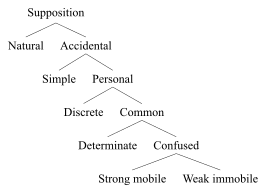

# Lambert of Auxerre
**First published Wed Apr 3, 2024**

*Uckelman, Sara L.*

Lambert of Auxerre (?) (Lambertus, Lambert, Lambert of Lagny, Lambert of Ligny) was a thirteenth century French logician whose treatise, *Summa Lamberti*, was one of the “Big Four” logic textbooks written between 1240 and 1270 which represent the culmination of the Terminist period of medieval logic (c 1175–1270).

## 1. *Summa Lamberti* and its dating

Lambert was the author of a comprehensive textbook on logic, the *Logica* or *Summa Lamberti*. The text was first identified by Carl Prantl in 1867, but it wasn’t until 1971 when an edition of the complete Latin text was produced, by Franco Alessio. (Alain de Libera edited a portion of the text, on appellation, in 1981)[^libera-1981]. In 1988, Eleonore Stump and Norman Kretzmann translated the portion of the *Summa* on the properties of terms, but a complete English translation of the entire work wasn’t available until the translation of Thomas S. Maloney in 2015. In this entry, all English quotations are taken from Maloney, and referenced by paragraph number; nevertheless, it must be noted that both Alessio’s Latin edition and Maloney’s translation should be used with care (Read 2017)[^read-2017], with the latter cross-checked against the former and the former cross-checked against the original manuscripts, many of which are now available online, in cases of any unclarity or confusion in the content.

The *Summa* survives in at least 15 manuscripts (Maloney 2015: xv)[^maloney-2015], one of which, (Padua, *Biblioteca Universitaria* Cod. 647, dating to the 14th century) contains a colophon informing the reader that the text was written by one *Lambert*, who produced it while he was the teacher of the king of Navarra, and edited it while working in Paris (de Rijk 1969: 160–161)[^rijk-1969]. From this, de Rijk concludes that the likely student-king was Theobald II, who was born in 1240, succeeded his father in 1253, and crowned in 1257, and derives a date of composition of the *Summa* of between 1253 and 1257. The work was most likely composed originally in either Troyes or Pamplona, and then published in Paris after being edited, most likely around 1260 (de Rijk 1969: 161)[^rijk-1969]. Alessio argues, from the same evidence, for a composition date between 1247 and 1256, on the assumption Lambert began teaching Theobald before the death of his father (Maloney 2015: xix)[^maloney-2015]. On such a dating, the *Summa* is either contemporaneous to or slightly earlier than Peter of Spain’s *Summary of Logic* and William of Sherwood’s *Introduction to Logic* (Alessio 1971: xxxi)[^alessio-1971]. De Libera agrees with both the “king of Navarra” referenced in the colophon was Theobald II, and argues for a composition date between 1250 and 1255, in Pamplona (de Libera 1981; Maloney 2015: xx)[^libera-1981][^maloney-2015]. Brumberg-Chaumont gives c.1250 as the composition date (2013: fn.10), while Lagerlund says that the date has been established as “1250–1260”, placing it contemporary with or shortly after Roger Bacon’s *Summulae,* which is dated to 1250–55 (Lagerlund 2000: 21)[^lagerlund-2000]. While a more precise date than these ranges is unlikely to be given, the evidence is sufficient to reject the dating of earlier historians who placed the text c.1240, such a dating is now currently deprecated (Ashworth 2002: 313)[^ashworth-2002].

According to de Rijk, the *Summa* consists of eleven chapters: (1) Introduction; (2) Predicables; (3) Syllogistic argumentation; (4) Dialectical topics; (5) Sophistical topics; (6) Supposition; (7) Appellation; (8) Restriction; (9) Ampliation; (10) Distribution; and (11) Relation. He notes that some of the later manuscripts also contain a chapter on Predicaments, but that

> this is certainly an interpolation consisting of the text of Peter of Spain’s tract of the same title together with interspersed comments. (1969: 160)

Maloney’s translation, following Alessio’s edition (Maloney 2015: xlvii)[^maloney-2015], consists of eight chapters: (1) Propositions; (2) Predicables; (3) Categories; (4) Remarks After the Categories; (5) Syllogism; (6) Topics; (7) Sophistical Topics; and (8) Properties of Terms, with chapter 8 containing the material of chapters (6–11) of de Rijk’s list. This final section was translated into English by Norman Kretzmann and Eleonore Stump in 1988.

The content of the *Summa* as expressed by these chapter topics exemplifies the core aspects of the new developments in logic in the middle of thirteenth century, what is known as “terminist logic” because of its emphasis on terms and their properties, and how these two things combine into propositions and thence into syllogisms, or arguments more generally. The text is comparable to the other summary treatises written by Lambert’s rough contemporaries, William of Sherwood, Roger Bacon, and Peter of Spain (Maloney 2015: xliii)[^maloney-2015]: Together, these four authors and their textbooks represent the first relatively complete articulations of the terminist developments of the so-called *logica modernorum* (that is the “logic of the moderns”, to be contrasted with the older logic based in Aristotle, the *logica vetus* (Kann 2016: 220)[^kann-2016]. Each of these four treatises provides a slightly different viewpoint on what was, at the time, still a developing theoretical discipline. Peter of Spain’s book went on to become one of the most reprinted textbooks before modern times, and Bacon’s work had significant influence on later philosophers, not just logicians. Sherwood’s text seems to have been one of Lambert’s sources (Kretzmann 1966: 4)[^kretzmann-1966]. While Sherwood’s treatise is often the preferable of the four because of its clarity and concision, Lambert’s lengthier treatise is a result of the fact that he “seems to be at pains to give a slightly fuller explanation than the others” (Maloney 2015: xliii)[^maloney-2015] without necessarily falling into the level of pedantry that Peter’s treatise sometimes embraces.

No other works, logical or otherwise, by this author have been identified.

## 2. Name and identification

The identity of the author of the text *Summa Lamberti* is uncertain, beyond that he was named Lambert (this attribution occurs in at least four of the manuscripts, and was repeated by later chroniclers and historians, Maloney 2015: xvi)[^maloney-2015]. Three of the manuscripts differ on the further differentiation they give (de Libera 1981: 229)[^libera-1981]:

- In MS Troyes 2402, f. 88v, he is called *magistri Lamberti di Liniaco castro,* “Master Lambert of Ligny-le-Châtel”.
- In MS Cambridge 210, f. 47rb, he is called *magistri Lamberti fratris de Sancto Victore sive Sancti Victoris*, “Master Lambert, brother of Saint-Victor”.
- In MS Padova 647, f. 131v, he is called *fratre de ordine Predicatorum qui vocatus fuerat Lambertus*, “a brother of the Order of the Preachers, who was called Lambert”.

Medieval historians from the fifteenth century onwards identified the author as a canon of Auxerre, and a member of the Dominican order (Maloney 2015: xvii; Pignon 1936: 31)[^maloney-2015][^pignon-1936]; Alessio in his edition of the *Summa* identified the brother of Auxerre with the Lambert from Ligny (Maloney 2015: xvi)[^maloney-2015]. Assuming this identification is correct, there are two competing biographies of Lambert that have been offered:

1. Lambert of Auxerre: Born in Ligny-le-Châtel, and educated in Paris, this Lambert was a master of arts and a canon at the cathedral school in Auxerre. When a Dominican chapter was founded in Auxerre in 1241, Lambert joined. He taught Dominicans novices during the period 1247 to 1256, in addition to teaching the soon-to-be king of Navarre, and drafted the *Summa* then, for those novices. Afterwards, he revised and edited the book in Paris, and it entered circulation amongst wider Dominican teaching. He was buried in the Dominican convent of St. James in Paris (Maloney 2015: xvi)[^maloney-2015].
2. Lambert of Lagny: Born in Lagny, and a secular clerk in Meaux, this Lambert taught Theobald II between 1250 and 1255 in Pamplona, and composed the *Summa* then. He then edited the text and circulated between 1263 and 1265, when he was in Paris administering Theobald’s holdings. It was only after this that he became a Dominican (Maloney 2015: xx–xxi)[^maloney-2015].

Tracing the evidence for each of these biographies, and variations in the dates ascribed for each, and mapping how this evidence matches on to what we know, or surmise, of the author of the *Summa’s* life, is enormously complex and it is not a question that can be settled here; the most comprehensive summary of the evidence and arguments to date can be found in Maloney (2015: xvi–xl). Nevertheless, we are left with the question of what to call the author, and this question is complicated by how he has been treated in secondary literature in recent decades. The tendency has been for earlier attributions to call him “of Auxerre” (following Alessio) and later ones “of Lagny” (following de Libera), but the compass has to some extent swung back to “of Auxerre” in the last decade. Kretzmann and Stump when translating the treatise on the “Properties of Terms” subscribe to the view that Lambert was a member of the Dominican house in Auxerre (in Lambert 1988: 102)[^lambert-1988]. Ashworth in her early work calls him “of Auxerre” (Ashworth 1991)[^ashworth-1991], but later thinks he’s of Lagny (Ashworth 2002, 2007)[^ashworth-2002][^ashworth-2007]. Cesalli calls him “of Lagny” (2013), as does Murè (2013)[^murè-2013], and Fitzgerald refers to “the thirteenth century *Summulist* … Lambert of Lagny” (2016: 368). In the “of Auxerre” camp we have Lagerlund (2000: fn. 15), Mendelsohn (2017)[^mendelsohn-2017], and Read (2017)[^read-2017], and splitting the difference is Crimi, who refers to him as “Lambert of Lagny (formerly identified as Lambert of Auxerre)” (2014: fn. 57), but his source for this was Uckelman (2013)[^uckelman-2013], who was simply relying, uncritically, on de Libera (1981)[^libera-1981]. Many scholars simply avoid the question: Ebbesen calls him “Lambert of Lagny, Ligny or Auxerre” (Ebbesen 2013: 65)[^ebbesen-2013], while Dutilh Novaes calls him “Lambert of Auxerre/Lagny” (Dutilh Novaes 2008: fn. 12, pp. 237, 246)[^dutilh-2008] and Kann conflates the two: “Lambert of Lagny – otherwise known as Lambert d’Auxerre” (Kann 2016: 223)[^kann-2016]. In the introduction to his translation, Maloney notes that while he had earlier concluded that “there is insufficient reliable historical data to identify the author of the *Summa Lamberti* as a Dominican of Auxerre in the 1240s” (Maloney 2009: 106)[^maloney-2009] leading him to favor the Lagny Lambert, “I now think it considerably more probable that the author of the *Summa Lamberti* was Lambert of Ligny-le-Châtel than Lambert of Lagny” (2015: xxxix), that is, Lambert of Auxerre.

There simply is no consensus at this point, and unless new evidence emerges, there is unlikely to be consensus in the future. As a result, in the remainder of this article we will refer to the author as “Lambert”, rather than “Auxerre”, “Lagny”, or “Ligny”, in order to avoid having to take a stand.

## 3. Comparison with contemporary views

### 3.1 Supposition and Appellation

Lambert’s theory of supposition is perhaps one of the most interesting and distinctive parts of his work, representing the importance of the new terministic developments in his treatise.

There are four different ways that the term “supposition” can be used (Logica/Maloney ¶1239; cf. Braakhuis 1977; 134–136; Mendelsohn 2017: 113)[^braakhuis-1977][^mendelsohn-2017]:

1. “the substantive designation or signification of a thing.”
2. “the acceptance of a proposition as true and proven, as it is often found in disputations.”
3. “the locational arrangement of a part of an expression in the role of something of which something else is said, as supposition is said to be in a name with respect to a verb, for a name supposits relative to a verb and a verb is said of a name.”
4. “the acceptance of a term for itself or for its [signified] thing, or for some suppositum [logically] contained under its [signified] thing, or for more than one suppositum contained under its [signified] thing.”

According to Lambert, from a logical point of view, it is the fourth way of using the term that matters, because this is the only way that “supposition” is a logical property of terms, whereas the second way doesn’t concern him because it is a property of a proposition rather than of a term. Similarly, the first is not an instance of a property of a term, but rather “a special kind of signification of a term”; in this, Lambert is firmly within the Parisian, as opposed to Oxonian, tradition of supposition theory (Marmo 1989: 172; cf. also Kann 2016: 241)[^kann-2016][^marmo-1989]. The third can be a property of a term or of a larger phrase in an expression, but Lambert says this use of “supposition” is of interest to the grammarian rather than the logician (¶1240).

However, a parenthetical note that he adds to the third way is noteworthy

> (Appellation corresponds to this kind of supposition, and appellation can be said to be the locational arrangement of that which is said of something else). (¶1239)

When Lambert discusses appellation later on in the same chapter (¶¶1267ff), his account is more nuanced, identifying again four ways in which “appellation” can be used (¶1269–1272):

1. “proper naming or the proper name of any person.”
2. “the assertion of a common nature containing more than one suppositum under it.”
3. “the acceptance of a term for a suppositum or supposita contained under its signified thing whether or not those supposita are existing things. And ‘appellation’ taken in this way belongs to terms having supposita under them actually or potentially, and also to names of imaginary things.”
4. “the acceptance of a term for a suppositum or supposita existing actually.”

Again, it is the fourth way which expresses the proper, logical sense of the term (¶1272).

What Lambert says reflects developments in the thirteenth century whereby “appellation”, originally a term of grammatical origin and used in a quite wide and flexible way, including in some earlier authors as a synonym for “supposition”, came to have a narrower, more technical definition in logical contexts (Braakhuis 1977: 120; Ebbesen 2013: 66–67)[^braakhuis-1977][^ebbesen-2013].

Lambert, in keeping with other terminist discussions of supposition, notes that supposition is posterior to signification; a significative term can signify in isolation from any other term, but it is only in the context of a phrase or a sentence that a term can have supposition. He provides a classification of supposition into the following types (¶¶1249–1266):

Figure: [An extended description of the figure is in the supplement.]

A detailed discussion of the definitions and applications of these divisions can be found in Uckelman 2013. Here, we focus on the ways in which Lambert’s supposition theory shows interesting divergences and connections with other thirteenth century authors.

One of these ways is how he deals with natural supposition (cf. de Rijk 1971)[^rijk-1971], which he defines as

> what a term has of its own and from its nature. A term is said to have this when it is uttered by itself, that is, when it is adjoined to no other. (Logica/Maloney ¶1250)

This makes natural supposition at odds with other types of supposition, which words cannot have in isolation, but only in combination with other words. Braakhuis explains this via Lambert’s distinction between the first and fourth ways in which “supposition” can be used; because Lambert can distinguish between supposition as a kind of signification and supposition as a property of a term, he is able to identify a property which corresponds to the signification of the term, and this property is natural supposition (Braakhuis 1977: 136; cf. also Brumberg-Chaumont 2013: fn. 72)[^braakhuis-1977][^brumberg-chaumont-2013]. A similar approach to natural supposition is taken by Peter of Spain (de Rijk 1971: 97)[^rijk-1971] John Page, and Cesalli argues that their views underpin some of the rules concerning appellation that later medieval authors, such as Richard Brinkley, offer (Cesalli 2013: 285)[^cesalli-2013].

A second distinctive feature of his theory is his approach to discrete supposition, which, as we can see from the tree above, is a type of personal supposition for Lambert. The ways that contemporary authors handled discrete supposition can be categorized into four categories: (1) not mentioning it, (2) mentioning it but ultimately excluding it (a position held by Peter of Spain), (3) making discrete supposition a genuine mode of supposition in its own right, distinct from common supposition and falling under personal supposition, and (4) allowing that discrete terms have either simple or personal supposition depending on how they are used (Brumberg-Chaumont 2013: 173–174; Brumberg-Chaumont describes this last position as “rare”, but attributes it to both William of Sherwood and William Arnaud, a commentator on Peter of Spain.)[^brumberg-chaumont-2013] Lambert’s definition of discrete supposition, as a form of personal supposition, is as follows:

> Discrete supposition is what a term has in itself, as in ‘Socrates runs,’ or in something equivalent, e.g., “when a common term is taken with a demonstrative pronoun, as in ‘This man runs”. (¶1257)

Thus, Lambert falls under the third category (in fact, he actually thinks discrete supposition is both accidental *and* personal, (Brumberg-Chaumont 2013: fn. 10)[^brumberg-chaumont-2013]), a category which Brumberg-Chaumont characterizes as “incoherent and inconsistent” (2013: 174).

### 3.2 Restriction

The range of the supposition of a term can be modified in two ways: It can be ampliated (stand for more than it would ordinarily have stood for) or restricted (stand for less than it would ordinarily have stood for). While both of these notions are common amongst the Terminist logicians, Lambert’s approach to restriction diverges from some of his contemporaries.

Lambert identifies two types of restriction: *natural* (*naturalis*) restriction and *use-based* or *use-governed* (*usualis*) restriction (Uckelman 2013: 493; de Rijk 1971: 100–101)[^rijk-1971][^uckelman-2013]. Natural restriction occurs

> by means of something added to the restricted term, because the term is restricted in accord with the nature of what is added to it; (Logica/Maloney ¶1349)

an example of natural restriction is when we restrict the term “cat”, which would ordinarily stand for all (presently living) cats, with the term “calico”, so that its supposition is now restricted to only calico cats. Use-based restriction arises not from any other term added to the sentence, but from the context of use, such as

> when one says “The king is coming”: the term “king” is restricted to suppositing for the king of the country in which the sentence is uttered. (¶1349)

This second, use-based, type, is not found in either William of Sherwood (Kretzmann 1966: 123–127)[^kretzmann-1966] or Peter of Spain (Copenhaver 2014: ch. 11; Kann 2016: 233)[^copenhaver-2014][^kann-2016].

### 3.3 Modality

Lambert, in common with his contemporaries such as Robert Kilwardby, Albert the Great, and Roger Bacon (Lagerlund 2000: 23)[^lagerlund-2000], considers only the six basic alethic modalities: truth, falsity, necessity, impossibility, possibility, and contingency (Logica/Maloney ¶176). He sometimes treats possibility and contingency as equivalent (¶194), but sometimes distinguishes between the two (¶¶231–235), in particular when he discusses contingency *ad utrumlibet*, that is contingency which is both not necessary and not impossible (Lagerlund 2000: 24; Logica/Maloney ¶234)[^lagerlund-2000].

For the most part, what Lambert has to say about modality is quite basic, and does not extend significantly beyond the traditional Aristotelian topics of conversion of modal principles. As a result, Lagerlund argues that “it is difficult to say anything about their [Lambert and Roger Bacon’s] systematic relation to Kilwardby”, in contradistinction to de Libera who thinks that Kilwardby’s influence on both authors is clear (Lagerlund 2000: 21)[^lagerlund-2000]. One interesting exception, where Lambert’s discussion goes into more depth than some of his contemporaries, is in the conversion rules for contingent propositions, particular in the discussion of how to convert negative contingent propositions when the contingency is taken as *ad utrumlibet* (Lagerlund 2000: 44; Logica/Maloney ¶¶258–274)[^lagerlund-2000].

### 3.4 Relations

Relations make up the final topic of the final chapter of the *Summa*. The word ‘relation’ is used as a label of many different things, Lambert says, the first of which is “a reciprocal connection of certain things that have a mutual dependence on one another” (Logica/Maloney ¶1393). This reciprocal connection can be of one of three kinds: superiority, subordination, or quality (¶1394) and in this sense it is one of Aristotle’s predicaments (¶1393). This is not the primary sense of relation that Lambert focuses on; instead, he is interested in the use of ‘relation’ or ‘relative’ in which it is “said to be a calling to mind of a thing that has gone before” (¶1395); this is done via particular vocabulary or syntactic constructions, and hence this type of relation is the one that is a proper subject of study for the logician. Lambert’s definition of relation mirrors Peter of Spain’s (Kneepkens 1977: fn. 10)[^kneepkens-1977], as Peter also distinguishes between relatives “whose being it is to be disposed in some manner to something else”, that is, the Aristotelian predicament, and relatives which are “recollective of a thing brought in before it” (Copenhaver 2015: ch. 8, ¶1; cf. also Kann 2016: 235–236)[^kann-2016].

## 4. Influence on future views

Determining Lambert’s influence on future work is contingent upon determining the precise date of his treatise, so to some extent these questions will remain only partially answered. Nevertheless, while there is uncertainty about, e.g., whether Thomas Aquinas knew of Lambert’s work (Goris 2002: 307)[^goris-2002], we do know that Lambert’s *Summa* was widely known by the end of the thirteenth century (Lagerlund 2000: fn. 15)[^lagerlund-2000]. One manuscript copy of the *Summa* from 1280 (MS Médiathèque du Grand Troyes, 2402) was donated by Peter of Limoges (d. 1306) on his death to the Sorbonne (Read 2017: 363)[^read-2017], and it was used as a textbook at the Sorbonne until at least 1334 (Maloney 2015: xliii)[^maloney-2015].

Sinkler argues that Lambert’s discussion of composition and division influenced Roger Bacon’s discussion of the same, in his *Summule dialectices*, with the latter being “his attempt to improve on Lambert’s account of the nature of the compounded/divided ambiguity in more detail” (Sinkler 1985: 146)[^sinkler-1985]. Likewise Grabmann has identified an anonymous late-thirteenth century text in which he sees the influence of not only Lambert but also William of Sherwood and Peter of Spain (Grabmann 1916: 40–41)[^grabmann-1916]. Marmo identifies Lambert’s “enlarged notion of *suppositio*” within Duns Scotus’s *Ars Vetus*, without going as far as to say that Lambert was the source for Scotus’s views on this matter (Marmo 1989: 172)[^marmo-1989], and Buckner and Zupko have provided substantial indirect evidence that Duns Scotus was quite familiar with Lambert’s work (Bucker & Zupko 2014).

On the other hand, there appears to be no influence, in either direction, between Lambert’s work and Peter of Spain’s *Summary of Logic* (Maloney 2015: xvi–xvii; Copenhaver in the introduction to his translation of the *Summary* mentions Lambert only once, 2014: 13; cf. also de Rijk 1971: 72)[^maloney-2015][^rijk-1971]. Alessio concludes that both of these texts instead rely “on an (unnamed) common [Parisian] source” (Maloney 2015: xvii)[^maloney-2015], and Braakhuis notes that:

> According to him [Maierù], the position of Peter of Spain and Lambert of Auxerre is to be regarded as a combination arising from on one side the view of the *Dialectica Monacensis*, the *Tractatus de proprietatibus sermonum* and the *Summe Metenses* (and William of Sherwood) … In my opinion therefore, there is not so much difference between Peter and Lambert and the *Dialectica Monacensis* etc. (Braakhuis 1977: 120)[^braakhuis-1977]

These twelfth-century and earlier thirteenth-century sources may be responsible for those places where Lambert’s and Peter’s views coincide, such as their definitions of “relation” (cf. above) and their views about ampliation (Lagerlund 2000: fn. 90)[^lagerlund-2000].

## References（引用注释）

> 原文参考文献已转为脚注引用：文内“作者-年份”引用组后附 [^key] 标记，完整条目见本文末脚注定义。

### Primary Sources

### Secondary Sources

## Academic Tools

> |   | [How to cite this entry](https://plato.stanford.edu/cgi-bin/encyclopedia/archinfo.cgi?entry=lambert-auxerre). |
> | --- | --- |
> |   | [Preview the PDF version of this entry](https://leibniz.stanford.edu/friends/preview/lambert-auxerre/) at the [Friends of the SEP Society](https://leibniz.stanford.edu/friends/). |
> |   | [Look up topics and thinkers related to this entry](https://www.inphoproject.org/entity?sep=lambert-auxerre&redirect=True) at the Internet Philosophy Ontology Project (InPhO). |
> |   | [Enhanced bibliography for this entry](https://philpapers.org/sep/lambert-auxerre/) at [PhilPapers](https://philpapers.org/), with links to its database. |

## Other Internet Resources

- [Logic Museum: Lambert of Lagny](https://www.logicmuseum.com/wiki/Lambert_of_Lagny)

## Related Entries

Albert the Great [= Albertus Magnus] | Bacon, Roger | Kilwardby, Robert | Peter of Spain [= Petrus Hispanus] | terms, properties of: medieval theories of | William of Sherwood

[^lambert-1971]: Lambert, [Logica/Alessio] *Logica (Summa Lamberti)* (Pubblicazioni della Facoltà di lettere e filosofia dell’Università di Milano, 59; Sezione a cura dell’Istituto di storia della filosofia. [Pubblicaziono] 19), Franco Alessio (ed.), Firenze: La nuova Italia, 1971.

[^lambert-2015]: ––– [Logica/Maloney], *Logica, or Summa Lamberti*, Thomas S. Maloney (trans.), Notre Dame, IN: University of Notre Dame Press, 2015.

[^lambert-1988]: –––, “Properties of Terms”, Norman Kretzmann and Eleonore Stump (trans) in *The Cambridge Translations of Medieval Philosophical Texts, Volume 1: Logic and the Philosophy of Language* (Cambridge: Cambridge University Press), Norman Kretzmann and Eleonore Stump (eds), 1988, 102–162.

[^alessio-1971]: Alessio, Franco, 1971, “Introduzione” to [Logica/Alessio], pp. xiii–xxxii.

[^ashworth-1991]: Ashworth, E. Jennifer, 1991, “A Thirteenth-Century Interpretation of Aristotle on Equivocation and Analogy”, *Canadian Journal of Philosophy Supplementary Volume*, 17: 85–101. doi:10.1080/00455091.1991.10717263

[^ashworth-2002]: –––, 2002, “Review of Egbert Bos and Stephen Read, *Concepts. The Treatises of Thomas of Cleves and Paul of Gelria. An Edition of the Texts with a Systematic Introduction*. Éditions de l’Institut Supérieur de Philosophie, Louvain-la-Neuve; Éditions Peeters, Louvain-Paris 2001, pp. xii + 147. ISBN 90 429 0901 3 (Philosophes médiévaux, t. XLII)”, *Vivarium*, 40(2): 312–313.

[^ashworth-2007]: –––, 2007, “Metaphor and the Logicians from Aristotle to Cajetan”, *Vivarium*, 45(2): 311–327. doi:10.1163/156853407X217795

[^braakhuis-1977]: Braakhuis, H.A.G., 1977, “The Views of William of Sherwood on Some Semantical Topics and Their Relation to Those of Roger Bacon”, *Vivarium*, 15(2): 111–142. doi:10.1163/156853477X00077

[^brumberg-chaumont-2013]: Brumberg-Chaumont, Julie, 2013, “The Role of Discrete Terms in the Theory of the Properties of Terms”, *Vivarium*, 51(1–4): 169–204. doi:10.1163/15685349-12341246

[^buckner-2014]: Buckner, Edward and Jack Zupko, 2014, *Duns Scotus on Time and Existence: The Questions on Aristotle’s “De interpretatione”*, translated, with an introduction and commentary, Washington, D.C.: The Catholic University of America.

[^cesalli-2013]: Cesalli, Laurent, 2013, “Richard Brinkley on Supposition”, *Vivarium*, 51(1–4): 275–303. doi:10.1163/15685349-12341250

[^copenhaver-2014]: Copenhaver, Brian P. (ed./trans.), 2014, *Peter of Spain: Summaries of Logic, Text, Translation, Introduction, and Notes*, with Calvin Normore and Terence Parsons, Oxford: Oxford University Press.

[^crimi-2014]: Crimi, Milo, 2014, “Significative Supposition and Ockham’s Rule”, *Vivarium*, 52(1–2): 72–101. doi:10.1163/15685349-12341272

[^dutilh-2008]: Dutilh Novaes, C., 2008, “A Comparative Taxonomy of Medieval and Modern Approaches to Liar Sentences”, *History and Philosophy of Logic*, 29(3): 227–261. doi:10.1080/01445340701614464

[^ebbesen-2013]: Ebbesen, Sten, 2013, “Early Supposition Theory II”, *Vivarium*, 51(1–4): 60–78. doi:10.1163/15685349-12341266

[^fitzgerald-2016]: Fitzgerald, Michael Joseph, 2016, “Albert of Saxony’s View of Complex Terms in Categorical Propositions and the ‘English-Rule’”, *History and Philosophy of Logic*, 37(4): 347–374. doi:10.1080/01445340.2016.1158444

[^goris-2002]: Goris, Harm, 2002, “Review of Seung-Chan Park, *Die Rezeption der mittelalterlichen Sprachphilosophie in der Theologie des Thomas von Aquin. Mit besonderer Berücksichtigung der Analogie*. Brill, Leiden-New York-Köln 1999 (Studien und Texte zur Geistesgeschichte des Mittelalters, Bd. 65) ISBN 90 04 11272 3”, *Vivarium*, 40(2): 306–309.

[^grabmann-1916]: Grabmann, Martin, 1916, “Forschungen über die lateinischen Aristotelesübersetzungen des XIII. Jahrhunderts”, *Beiträge zur Geschichte der Philosophie und Theologie des Mittelalters*, XVII(5–6), Münster i.W.: Aschendorff. [[Grabmann 1916 available online](https://archive.org/details/forschungenber00grab/page/n13/mode/2up)]

[^kann-2016]: Kann, Christoph, 2016, “Supposition and Properties of Terms”, in *The Cambridge Companion to Medieval Logic* (Cambridge Companions to Philosophy), Catarina Dutilh Novaes and Stephen Read (eds), Cambridge: Cambridge University Press, 220–244 (ch. 9). doi:10.1017/CBO9781107449862.010

[^kneepkens-1977]: Kneepkens, C.H., 1977, “The *Relatio simplex* in the Grammatical Tracts of the Late Twelfth and Early Thirteenth Century”, *Vivarium*, 15(1): 1–30. doi:10.1163/156853477X00013

[^kretzmann-1966]: Kretzmann, Norman (trans.), 1966, William of Sherwood’s Introduction to Logic, Translated with an Introduction and Notes, Minneapolis, MN: University of Minnesota Press.

[^lagerlund-2000]: Lagerlund, Henrik, 2000, *Modal Syllogistics in the Middle Ages* (Studien und Texte zur Geistesgeschichte des Mittelalters, 70), Leiden/Boston: Brill.

[^libera-1981]: de Libera, Alain, 1981, “Le traité *De appellatione* de Lambert de Lagny (Lambert d’Auxerre)”, *Archives d’Histoire Doctrinale et Litéraire du Moyen Âge*, 48: 227–285.

[^maloney-2009]: Maloney, Thomas S., 2009, “Who Is the Author of the *Summa Lamberti*?”:, *International Philosophical Quarterly*, 49(1): 89–106. doi:10.5840/ipq20094917

[^maloney-2015]: –––, 2015, “Introduction” to [Logica/Maloney], pp. xv–xlix.

[^marmo-1989]: Marmo, Costantino, 1989. “Ontology and Semantics in the Logic of Duns Scotus”, in *On the Medieval Theory of Signs* (Foundations of Semiotics, 21), Umberto Eco and Costantino Marmo (eds), Philadelphia/Amsterdam: John Benjamins, 143–193 (ch. 8).

[^mendelsohn-2017]: Mendelsohn, Joshua, 2017, “Term Kinds and the Formality of Aristotelian Modal Logic”, *History and Philosophy of Logic*, 38(2): 99–126. doi:10.1080/01445340.2016.1247321

[^murè-2013]: Murè, Dafne, 2013, “Suppositum between Logic and Metaphysics: Simon of Faversham and His Contemporaries(1270–1290)”, *Vivarium*, 51(1–4): 205–229. doi:10.1163/15685349-12341247

[^pignon-1936]: Pignon, Larentii, 1936, *Catalogi et Chronica* (Monumenta Ordinis Fratrum Praedicatorum Historica 18), Rome: Institutum Historicum Fratrum Praedicatorum.

[^prantl-1867]: Prantl, Carl, 1867, *Geschichte der Logik im Abendlande*, volume 3, B, Leipzig: S. Hirzel.

[^read-2017]: Read, Stephen, 2017, “Review of *Logica or Summa Lamberti, with Notes and Introduction*, by Lambert of Auxerre, Thomas S. Maloney (trans.)”, *Vivarium*, 55(4): 361–365. doi:10.1163/15685349-12341347

[^rijk-1969]: de Rijk, L. M., 1969, “On the Genuine Text of Peter of Spain’s *Summule logicales*: IV. The *lectura tractatuum* by Guillelmus Arnaldi, Master of Arts at Toulouse (1235–1244). With a Note on the Date of Lambertus of Auxerre’s *Summule*”, *Vivarium*, 7: 120–162. doi:10.1163/156853469X00085

[^rijk-1971]: –––, 1971, “The Development of *Suppositio naturalis* in Mediaeval Logic”, *Vivarium*, 9: 71–107. doi:10.1163/156853471X00073

[^sinkler-1985]: Sinkler, Georgette, 1985. “Roger Bacon on the Compounded and Divided Sense”, in *The Rise of British Logic: Acts of the Sixth European Symposium on Medieval Logic and Semantics, Balliol College, Oxford, 19–24 June 1983* (Papers in Medieval Studies 7), P. Osmund Lewry (ed.), Toronto: Pontifical Institute for Medieval Studies, 145–171.

[^uckelman-2013]: Uckelman, Sara L., 2013, “A Quantified Temporal Logic for Ampliation and Restriction”, *Vivarium*, 51(1–4): 485–510. doi:10.1163/15685349-12341259
