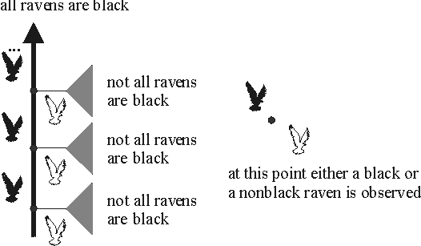
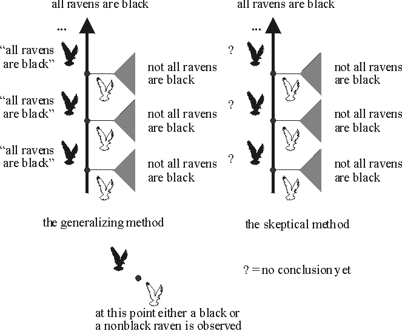
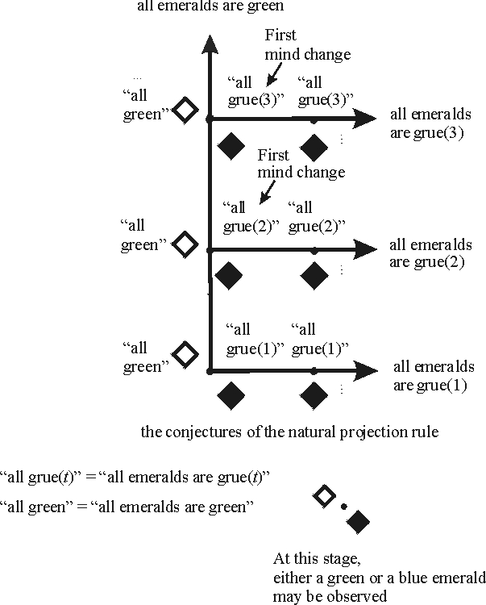
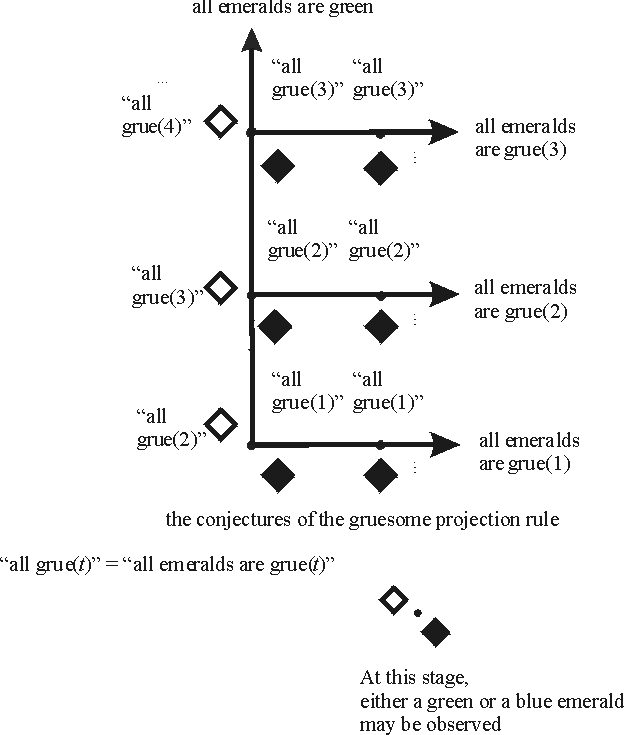
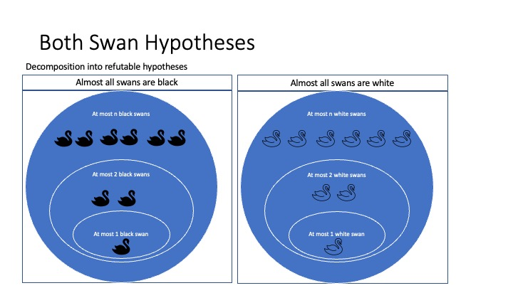
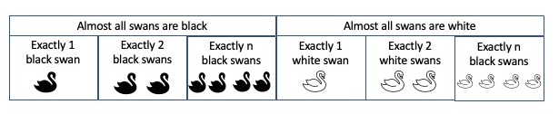
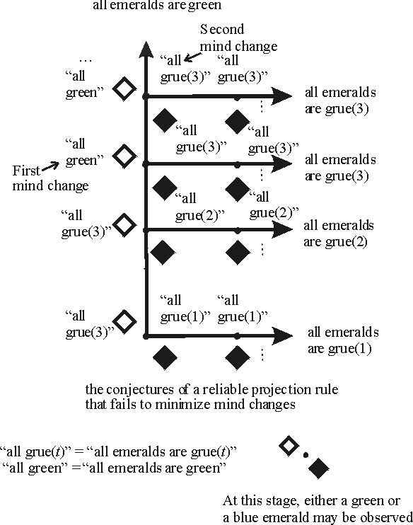
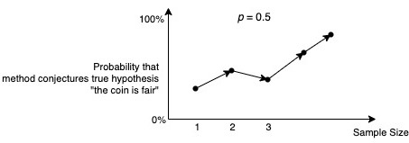

# Formal Learning Theory
**First published Sat Feb 2, 2002; substantive revision Wed Jun 3, 2026**

*Schulte, Oliver*

Formal learning theory is the mathematical embodiment of a normative epistemology. It deals with the question of how an agent should use observations about her environment to arrive at correct and informative conclusions. Philosophers such as Putnam, Glymour and Kelly have developed learning theory as a normative framework for scientific reasoning and inductive inference.

*Terminology*. Cognitive science and related fields typically use the term “learning” for the process of gaining information through observation— hence the name “learning theory”. To most cognitive scientists, the term “learning theory” suggests the empirical study of human and animal learning stemming from the behaviourist paradigm in psychology. The epithet “formal” distinguishes the subject of this entry from behaviourist learning theory. Philosophical terms for learning-theoretic epistemology include “logical reliability” (Kelly [1996], Glymour [1991]) and “means-ends epistemology” (Schulte [1999]).

Because many developments in, and applications of, formal learning theory come from computer science, the term “computational learning theory” is also common. Many results on learning theory in computer science are concerned with Valiant’s and Vapnik’s notion of learning generalizations that are probably approximately correct (PAC learning) (Valiant [1984]). This notion of empirical success was introduced to philosophers by Gilbert Harman in his Nicod lectures, and elaborated in a subsequent book [Harman and Kulkarni 2007][^harman-2007]. Valiant himself provides an accessible account of PAC learning and its relationship to the problem of induction in a recent book (Valiant [2013, Ch. 5]). The present article describes a nonstatistical tradition of learning theory stemming from the seminal work of Hilary Putnam [1963] and Mark E. Gold [1967]. Recent research has extended the reliabilist means-ends approach to a statistical setting where inductive methods assign probabilities to statistical hypotheses from random samples. The new statistical framework is described at the end of this entry, in the Section on Reliable Statistical Inquiry.

*Philosophical characteristics*. In contrast to other philosophical approaches to inductive inference, learning theory does not aim to describe a universal inductive method or explicate general axioms of inductive rationality. Rather, learning theory pursues a context-dependent means-ends analysis [Steele 2010][^steel-2010]: For a given empirical problem and a set of cognitive goals, what is the best method for achieving the goals? Most of learning theory examines *which investigative strategies reliably and efficiently lead to correct beliefs about the world.*

*Article Overview*. Compared to traditional philosphical discussions of inductive inference, learning theory provides a radically new way of thinking about induction and scientific method. The main aim of this article is explain the main concepts of the theory through examples. Running examples are repeated throughout the entry; at the same time, the sections are meant to be as independent of each other as possible. We use the examples to illustrate some theorems of philosophical interest, and to highlight the key philosophical ideas and insights behind learning theory.

Readers interested in the mathematical substance of learning theory will find some references in the Bibliography, and a summary of the basic definitions in the [Supplementary Document](learning-formal.supplement.md). A text by Jain et al. collects many of the main definitions and theorems [1999]. New results appear in proceedings of annual conferences, such as the Conferences on Learning Theory (COLT) and Algorithmic Learning Theory (ALT). The philosophical issues and motivation pertaining to learning-theoretic epistemology are discussed extensively in the works of philosophers such as Putnam, Glymour and Kelly (Putnam [1963], Glymour [1991], Glymour and Kelly [1992], Kelly [1996]).

## 1. Convergence to the Truth and Nothing But the Truth

Learning-theoretic analysis assesses dispositions for forming beliefs. Several terms for belief acquisition processes are in common use in philosophy; I will use “inductive strategy”, “inference method” and most frequently “inductive method” to mean the same thing. The best way to understand how learning theory evaluates inductive methods is to work through some examples. The following presentation begins with some very simple inductive problems and moves on to more complicated and more realistic settings.

### 1.1 Simple Universal Generalization

Let’s revisit the classic question of whether all ravens are black. Imagine an ornithologist who tackles this problem by examining one raven after another. There is exactly one observation sequence in which only black ravens are found; all others feature at least one nonblack raven. The figure below illustrates the possible observation sequences. Dots in the figure denote points at which an observation may be made. A black bird to the left of a dot indicates that at this stage, a black raven is observed. Similarly, a white bird to the right of a dot indicates that a nonblack raven is observed. Given a *complete sequence* of observations, either all observed ravens are black or nonblack; the figure labels complete observation sequences with the statement that is true of them. The gray fan indicates that after the observation of a white raven, the claim that not all ravens are black holds on all observation sequences resulting from further observations.

*Figure 1*

Figure 1 [An extended description of figure 1 is in a supplement.]

If the world is such that only black ravens are found, we would like the ornithologist to settle on this generalization. (It may be possible that some nonblack ravens remain forever hidden from sight, but even then the generalization “all ravens are black” at least gets the observations right.) If the world is such that eventually a nonblack raven is found, then we would like the ornithologist to arrive at the conclusion that not all ravens are black. This specifies a set of goals of inquiry. For any given inductive method that might represent the ornithologist’s disposition to adopt conjectures in the light of the evidence, we can ask whether that method measures up to these goals or not. There are infinitely many possible methods to consider; we’ll look at just two, a skeptical one and one that boldly generalizes. The *bold method* conjectures that all ravens are black after seeing that the first raven is black. It hangs on to this conjecture unless some nonblack raven appears. The skeptical method does not go beyond what is entailed by the evidence. So if a nonblack raven is found, the skeptical method concludes that not all ravens are black, but otherwise the method does not make a conjecture one way or another. The figure below illustrates both the bold and the skeptical method.

*Figure 2*

Figure 2 [An extended description of figure 2 is in a supplement.]

Do these methods attain the goals we set out? Consider the bold method. There are two possibilities: either all observed ravens are black, or some nonblack raven is found. In the first case, the method conjectures that all ravens are black and *never abandons this conjecture*. In the second case, the method concludes that not all ravens are black as soon as the first nonblack raven is found. Hence *no matter how* the evidence comes in, eventually the method gives the right answer as to whether all ravens are black and *sticks* with this answer. Learning theorists call such methods *reliable* because they settle on the right answer no matter what observations the world provides.

The skeptical method does not measure up so well. If a nonblack raven appears, then the method does arrive at the correct conclusion that not all ravens are black. But if all ravens are black, the skeptic never takes an “inductive leap” to adopt this generalization. So in that case, the skeptic fails to provide the right answer to the question of whether all ravens are black.

This illustrates how means-ends analysis can evaluate methods: the bold method meets the goal of reliably arriving at the right answer, whereas the skeptical method does not. Note the character of this argument against the skeptic: The problem, in this view, is not that the skeptic violates some canon of rationality, or fails to appreciate the “ uniformity of nature”. The learning-theoretic analysis concedes to the skeptic that no matter how many black ravens have been observed in the past, the next one could be white. The issue is that if all observed ravens are indeed black, then the skeptic *never answers* the question “are all ravens black?”. Getting the right answer to that question requires generalizing from the evidence *even though* the generalization could be wrong.

As for the bold method, it’s important to be clear on what it does and does not achieve. The method will eventually settle on the right answer—but it (or we) may never *be certain* that it has done so. As William James put it, “no bell tolls” when science has found the right answer. We are certain that the method will eventually settle on the right answer; but we may never be certain that the current answer is the right one. This is a subtle point; the next example illustrates it further.

### 1.2 The New Riddle of Induction

Nelson Goodman posed a famous puzzle about inductive inference known as the (New) Riddle of Induction ([Goodman 1983])[^goodman-1983]. Our next example is inspired by his puzzle. Goodman considered generalizations about emeralds, involving the familiar colours of green and blue, as well as certain unusual ones:

> Suppose that all emeralds examined before a certain time $t$ are green …. Our evidence statements assert that emerald $a$ is green, that emerald $b$ is green, and so on….
>
> Now let us introduce another predicate less familiar than “green”. It is the predicate “grue” and it applies to all things examined before $t$ just in case they are green but to other things just in case they are blue. Then at time $t$ we have, for each evidence statement asserting that a given emerald is green, a parallel evidence statement asserting that emerald is grue. The question is whether we should conjecture that all emeralds are green rather than that all emeralds are grue when we obtain a sample of green emeralds examined before time $t$, and if so, why.

Clearly we have a family of grue predicates in this problem, one for each different “critical time” $t$; let’s write grue$(t)$ to denote these grue predicates. Following Goodman, let us refer to methods as *projection rules* in discussing this example. A projection rule succeeds in a world just in case it settles on a generalization that is correct in that world. Thus in a world in which all examined emeralds are found to be green, we want our projection rule to converge to the proposition that all emeralds are green. If all examined emeralds are grue$(t)$, we want our projection rule to converge to the proposition that all emeralds are grue$(t)$. Note that this stipulation treats green and grue predicates completely on a par, with no bias towards either. As before, let us consider two rules: the *natural* projection rule which conjectures that all emeralds are green as long as only green emeralds are found, and the *gruesome* rule which keeps projecting the next grue predicate consistent with the available evidence. Expressed in the green-blue vocabulary, the gruesome projection rule conjectures that after observing some number of $n$ green emeralds, all future ones will be blue. The figures below illustrates the possible observation sequences, the natural projection rule, and the gruesome projection rule.

*Figure 3*

Figure 3 [An extended description of figure 3 is in a supplement.]

The following figure shows the gruesome projection rule.

*Figure 4*

Figure 4 [An extended description of figure 4 is in a supplement.]

How do these rules measure up to the goal of arriving at a true generalization? Suppose for the sake of the example that the only serious possibilities under consideration are: (1) Either all emeralds are green or (2) all emeralds are grue$(t)$ for some critical time $t$. Then the natural projection rule settles on the correct generalization no matter what the correct generalization is. For if all emeralds are green, the natural projection rule asserts this fact from the beginning. And suppose that all emeralds are grue$(t)$ for some critical time $t$. Then at time $t$, a blue emerald will be observed. At this point the natural projection rule settles on the conjecture that all emeralds are grue$(t)$, which must be correct given our assumption about the possible observation sequences. Thus no matter what evidence is obtained in the course of inquiry—consistent with our background assumptions—the natural projection rule eventually settles on a correct generalization about the colour of emeralds.

The gruesome rule does not do as well. For if all emeralds are green, the rule will never conjecture this fact because it keeps projecting grue predicates. Hence there is a possible observation sequence—namely those on which all emeralds are green—on which the gruesome rule fails to converge to the right generalization. So means-ends analysis would recommend the natural projection rule over the gruesome rule.

### 1.3 Discussion

The means-ends analysis of the Riddle of Induction illustrates a number of philosophically important points that holds for learning-theoretic analysis in general.

1. *Equal Treatment of All Hypotheses*. As in the previous example, nothing in this argument hinges on arguments to the effect that certain possibilities are not to be taken seriously a priori. In particular, nothing in the argument says that generalizations with grue predicates are ill-formed, unlawlike, or in some other way a priori inferior to “all emeralds are green”.
2. *Language Invariance*. The analysis does not depend on the vocabulary in which the evidence and generalizations are framed. For ease of exposition, I have mostly used the green-blue reference frame. However, grue-bleen speakers would agree that the aim of reliably settling on a correct generalization requires the natural projection rule rather than the gruesome one, even if they would want to express the conjectures of the natural rule in their grue-bleen language rather than the blue-green language that we have used so far.
3. *Dependence on Context*. Though the analysis does not depend on language, it does depend on assumptions about what the possible observation sequences are. The example as described above seems to comprise the possibilities that correspond to the colour predicates Goodman himself discussed. But means-ends analysis applies just as much to other sets of possible predicates. Schulte [1999] and Chart [2000] discuss a number of other versions of the Riddle of Induction, in some of which means-ends analysis favours projecting that all emeralds are grue on a sample of all green emeralds.

### 1.4 Falsificationism and Generalizations with Exceptions

Our first two examples feature simple universal generalizations. Some subtle aspects of the concept of long-run reliability, particularly its relationship to falsificationism, become apparent if we consider generalizations that allow for exceptions. To illustrate, let us consider another ornithological example. Two competing hypotheses are under investigation.

1. All but finitely many swans are white. That is, basically all swans are white, except for a finite number of exceptions to the rule.
2. All but finitely many swans are black. That is, basically all swans are black, except for a finite number of exceptions to the rule.

Assuming that one or the other of these hypotheses is correct, is there an inductive method that reliably settles on the right one? What makes this problem more difficult than our first two is that each hypothesis under investigation is consistent with any finite amount of evidence. If 100 white swans and 50 black swans are found, either the 50 black swans or the 100 white swans may be the exception to the rule. In terminology made familiar by Karl Popper’s work, we may say that neither hypothesis is falsifiable. As a consequence, the inductive strategy from the previous two examples will *not* work here. This strategy was basically to adopt a “bold” universal generalization, such as “all ravens are black” or “all emeralds are green”, and to hang on to this conjecture as long as it “passes muster”. However, when rules with possible exceptions are under investigation, this strategy is unreliable. For example, suppose that an inquirer first adopts the hypothesis that “all but finitely many swans are white”. It may be the case that from then on, only black swans are found. But each of these apparent counterinstances can be “explained away” as an exception. If the inquirer follows the principle of hanging on to her conjecture until the evidence is logically inconsistent with the conjecture, she will never abandon her false belief that all but finitely many swans are white, much less arrive at the correct belief that all but finitely many swans are black.

Reliable inquiry requires a more subtle investigative strategy. Here is one (of many). Begin inquiry with either competing hypothesis, say “all but finitely many swans are black”. Choose some cut-off ratio to represent a “clear majority”; for definiteness, let’s say 70%. If the current conjecture is that all but finitely many swans are black, change your mind to conjecture that all but finitely many swans are white just in case over 70% of observed swans are in fact white. Proceed likewise if the current conjecture is that all but finitely many swans are white when over 70% of observed swans are in fact black.

A bit of thought shows that this rule reliably identifies the correct hypothesis in the long run, no matter which of the two competing hypotheses is correct. For if all but finitely many swans are black, eventually the nonblack exceptions to the rule will be exhausted, and an arbitrarily large majority of observed swans will be black. Similarly if all but finitely many swans are white.

Generalizations with exceptions illustrate the relationship between Popperian falsificationism and the learning-theoretic idea of reliable convergence to the truth. In some settings of inquiry, notably those involving universal generalizations, a naively Popperian “conjectures-and-refutations” approach of hanging on to conjectures until the evidence falsifies them does yield a reliable inductive method. In other problems, like the current example, it does not. Relying on falsifications is sometimes, but *not always*, the best way for inquiry to proceed. Learning theory has provided mathematical theorems that clarify the relationship between a conjectures-and-refutations approach and reliable inquiry. The details are discussed in Section 3 (The Limits of Inquiry and the Complexity of Empirical Problems). Generally speaking methods that solve a learning problem with unfalsifiable hypotheses can be represented as employing a refined hypothesis space where the original hypotheses are replaced by strengthened hypotheses that *are* falsifiable.

## 2. Case Studies from Scientific Practice

This section provides further examples to illustrate learning-theoretic analysis. The examples in this section are more realistic and address methodological issues arising in scientific practice. They are not probabilistic; statistical hypotheses are discussed in Section 6. This entry provides an outline of the full analysis; there are references to more detailed discussions below. More case studies may be found in [Kelly 1996, Ch. 7.7, Harrell 2000][^harrell-2000][^kelly-1996]. Readers who wish to proceed to the further development of the theory and philosophy of means-ends epistemology can skip this section without loss of continuity.

### 2.1 Conservation Laws in Particle Physics

One of the hallmarks of elementary particle physics is the discovery of new conservation laws that apply only in the subatomic realm [Ford 1963, Ne’eman and Kirsh 1983, Feynman 1965][^feynman-1965][^ford-1963][^ne’eman-1983]. (Feynman groups one of them, the conservation of Baryon Number, with the other “great conservation laws” of energy, charge and momentum.) Simplifying somewhat, conservation principles serve to explain why certain processes involving elementary particles do *not* occur: the explanation is that some conservation principle was violated (cf. Omnes [1971, Ch.2] and Ford [1963]). So a goal of particle inquiry is to find a set of conservation principles such that for every process that is possible according to the (already known) laws of physics, but fails to be observed experimentally, there is some conservation principle that rules out that process. And if a process is in fact observed to occur, then it ought to satisfy all conservation laws that we have introduced.

This constitutes an inference problem to which we may apply means-ends analysis. An inference method produces a set of conservation principles in response to reports of observed processes. Means-ends analysis asks which methods are guaranteed to settle on conservation principles that account for all observations, that is, that rule out unobserved processes and allow observed processes. Schulte [2008] describes an inductive method that accomplishes this goal. Informally the method may be described as follows.

- Suppose we have observed a set of reactions among elementary particles.
- Conjecture a set of conservation laws that permits the observed reactions and *rules out as many unobserved reactions as possible.*

The logic of conservation laws is such that the observation of some reactions entails the possibility of other unobserved ones. The learning-theoretic method rules out all reactions that are not entailed. It turns out that the conservation principles that this method would posit on the currently available evidence are *empirically equivalent* to the ones that physicists have introduced. Specifically, their predictions agree exactly with the conservation of charge, baryon number, muon number, tau number and Lepton number that is part of the Standard Model of particle physics.

For some physical processes, the only way to get empirically adequate conservation principles is by positing that some hidden particles have gone undetected. Schulte [2009] extends the analysis such that an inductive method may not only introduce conservation laws, but also posit unseen particles. The basic principle is again to posit unseen particles in such a way that we rule out as many unobserved reactions as possible. When this method is applied to the known particle data, it rediscovers the existence of an electron antineutrino. The electron antineutrino is one of the particles of key concern in current particle physics.

### 2.2 Causal Connections

There has been a substantive body of research on learning causal relationships as represented in a causal graph [Spirtes et al. 2000][^spirtes-2000]. Kelly suggested a learning-theoretic analysis of inferring causality where the evidence is provided in the form of observed significant correlations among variables of interest (a modern version of Hume’s “constant conjunctions”). The following inductive method is guaranteed to converge to an empirically adequate causal graph as more and more correlations are observed [Schulte, Luo and Greiner 2007].

- Suppose we have observed a set of correlations or associations among a set of variables of interest.
- Select a causal graph that explains the observed correlations *with a minimum number of direct causal links.*

### 2.3 Models of Cognitive Architecture

Some philosophers of mind have argued that the mind is composed of fairly independent modules. Each module has its own “input” from other modules and sends “output” to other modules. For example, an “auditory analysis system” module might take as input a heard word and send a phonetic analysis to an “auditory input lexicon”. The idea of modular organization raises the empirical question of what mental modules there are and how they are linked to each other. A prominent tradition of research in cognitive neuroscience has attempted to develop a model of mental architecture along these lines by studying the responses of normal and abnormal subjects to various stimuli. The idea is to compare normal reactions with abnormal ones—often caused by brain damage—so as to draw inferences about which mental capacities depend on each other and how.

Glymour [1994] asked the reliabilist question whether there are inference methods that are guaranteed to eventually settle on a true theory of mental organization, given exhaustive evidence about normal and abnormal capacities and reactions. He argued that for some possible mental architectures, no amount of evidence of the stimulus-response kind can distinguish between them. Since the available evidence determines the conjectures of an inductive method, it follows that there is no guarantee that a method will settle on the true model of cognitive architecture. Glymour has also explored to what extent richer kinds of evidence would resolve underdetermination of mental architecture. (One example of richer evidence are double disassocations. An example of a double dissocation would be a pair of patients, one who has a normal capacity for understanding spoken words, but fails to understand written ones, and another who understands written words but not spoken ones.)

In further discussion, Bub [1994] showed that if we grant certain restrictive assumptions about how mental modules are connected, then a complete set of behavioural observations would allow a neuropsychologist to ascertain the module structure of a (normal) mind. In fact, under Bub’s assumptions there is a reliable method for identifying the modular structure. The high-level idea of the procedure is as follows.

1. Every hypothesized modular structure can be identified with a graph $G$ containing an edge from module $M_1 \rightarrow M_2$ if module $M_1$ calls on module $M_2$.
2. Each module graph $G$ is consistent with a set of possible paths among modules. Say that a graph $G$ is more constrained than another graph $G'$ if the paths defined by $G$ are a subset of those constrained by $G'$.
3. Conjecture any module graph $G$ that is maximally constrained, that is, there is no other graph $G'$ more constrained than $G$.

### 2.4 Discussion

These studies illustrate some general features of learning theory:

1. *Generality*. The basic notions of the theory are very general. Essentially, the theory applies whenever one has a question that prompts inquiry, a number of candidate answers, and some evidence for deciding among the answers. Thus means-ends analysis can be applied in any discipline aimed at empirical knowledge, for example physics or psychology.
2. *Context Dependence*. Learning theory is pure normative a priori epistemology in the sense that it deals with standards for assessing methods in possible settings of inquiry. But the approach does not aim for universal, context-free methodological maxims. The methodological recommendations depend on contingent factors, such as the operative methodological norms, the questions under investigation, the background assumptions that the agent brings to inquiry, the observational means at her disposal, her cognitive capacities, and her epistemic aims. As a consequence, to evaluate specific methods in a given domain, as in the case studies mentioned, one has to study the details of the case in question. The means-ends analysis often rewards this study by pointing out what the crucial methodological features of a given scientific enterprise are, and by explaining precisely why and how these features are connected to the success of the enterprise in attaining its epistemic aims.
3. *Trade-offs*. In the perspective of means-ends epistemology, inquiry involves an ongoing struggle with hard choices, rather than the execution of a universal “scientific method”. The inquirer has to balance conflicting values, and may consider various strategies such as accepting difficulties in the short run hoping to resolve them in the long run. For example in the conservation law problem, there can be conflicts between theoretical parsimony, i.e., positing fewer conservation laws, and ontological parsimony, i.e., introducing fewer hidden particles. For another example, a particle theorist may accept positing undetected particles in the hopes that they will eventually be observed as science progresses. The search for the Higgs boson illustrates this strategy. An important learning-theoretic project is to examine when such tradeoffs arise and what the options for resolving them are. Section 4 extends learning-theoretic analysis to consider goals in addition to long-run reliability.

## 3. The Limits of Inquiry and the Complexity of Empirical Problems

After seeing a number of examples like the ones described above, one begins to wonder what the pattern is. What is it about an empirical question that allows inquiry to reliably arrive at the correct answer? What general insights can we gain into how reliable methods go about testing hypotheses? Learning theorists answer these questions with *characterization theorems*. Characterization theorems are generally of the form “it is possible to attain this standard of empirical success in a given inductive problem if and only if the inductive problem meets the following conditions”.

We first cover the case where inquiry can provide certainty as to whether an empirical hypothesis is correct (relative to background knowledge). Then we consider when and how inquiry can converge to a correct hypothesis without ever arriving at certain conclusions, as described in Section 1. We will introduce enough definitions and formal concepts to state the results precisely; the [supplementary document](learning-formal.supplement.md) provides a full formalization.

A learning problem is defined by a finite or countably infinite set of *possible hypotheses* $\mathbf{H} = H_1, H_2 , \ldots ,H_n,\ldots$. These hypotheses are mutually exclusive and jointly cover all possibilities consistent with the inquirer’s background assumptions.

**Examples**

- In the raven color problem of Section 1.1, there are two hypotheses $H_1 =$ “all (observed) ravens are black” and $H_2 =$ “some (observed) raven is not black”.
- In the New Riddle of Induction of from Section 1.2, there are infinitely many alternative hypotheses: We have $H_{green} =$ “all (observed) emeralds are green” and countably many alternatives of the form $H_t =$ “all (observed) emeralds are grue$(t)$” where $t$ is a natural number.

This section defines properties of hypotheses that determine in which sense inquiry from observations can indicate whether they are correct. These properties are not absolute but relative to a set of alternatives $\mathbf{H}$, any one of which may obtain for all the inquirer knows. The most basic relative property is relative *entailment*.

- A hypothesis $H$ is **consistent** with a finite number of observations if $H$ is correct for some complete data sequence that extends the finite observations.
- A finite number of observations **falsifies** hypothesis $H$ if $H$ is inconsistent with the observations.
- A finite number of observations **entails** hypothesis $H$ relative to a hypothesis set $\mathbf{H}$ if $H$ is the only hypothesis in $\mathbf{H}$ consistent with the observations.

Note that since logical entailment does not depend on the language we use to frame evidence and hypotheses, the concepts of consistency, entailment, and falsification do not depend on the language we use to frame evidence and hypotheses.

**Examples**. Recall the raven scenario from Section 1.1 (diagram repeated for convenience).

*Figure 1*

Figure 1 [An extended description of figure 1 is in a supplement.]

The observation that the first raven is black is consistent with both hypotheses $H_1 =$ “all (observed) ravens are black” and $H_2 =$ “some (observed) raven is not black”. The observation that the first raven, or any raven, is white falsifies the hypothesis $H_1$ and entails the hypothesis $H_2$. The entailment is illustrated by the gray fan structure, which means that after the observation of any white raven, the hypothesis $H_1$ is correct for any extending complete data sequence that records the color of all further observed ravens.

### 3.1 Verifiable and Refutable Hypotheses

The next set of concepts we need to understand the structure of hypotheses that can be settled by reliable inquiry are the notions of *verifiable* and *refutable* hypotheses. The verifiability and refutability or falsifiability of claims have been extensively discussed in epistemology and the philosophy of science, especially by philosophers concerned with issues in logical empiricism. This subsection describes how these concepts are used in learning theory, then compares the learning-theoretic concepts with discussions in broader epistemology.

- A hypothesis $H$ is **verifiable** if whenever $H$ is correct, eventually evidence is observed that entails that $H$ is correct. More formally: $H$ is verifiable with respect to a hypothesis set $\mathbf{H}$ if for every complete data sequence for which $H$ is correct, there is a finite number of observations that falsify all alternative hypotheses $H'$ from $\mathbf{H}$.
- A hypothesis $H$ is **refutable** if whenever $H$ is false, eventually evidence is observed that falsifies $H$. More formally: $H$ is refutable with respect to a hypothesis set $\mathbf{H}$ if for every complete data sequence for which $H$ is *not* correct (but some other hypothesis in $\mathbf{H}$ is), there is a finite number of observations that falsifies $H$.

**Examples**

- The hypothesis $H_2 =$ “some (observed) raven is not black” is verifiable but not refutable. It is verifiable because any data sequence for which it is correct, features a non-black raven at some finite time. The observation of the non-black raven entails $H_2$. The hypothesis $H_2$ is *not*falsifiable, because if only black ravens are observed forever, then $H_2$ is incorrect, but there is no finite number of observations that falsifies $H_2$.
- The hypothesis $H_1 =$ “all (observed) ravens are black” is refutable but not verifiable. It is refutable because any data sequence for which it is not correct, features a non-black raven at some finite time. The observation of the non-black raven falsifies $H_1$. $H_1$ is *not* verifiable, because if only black ravens are observed forever, then $H_1$ is correct, but there is no finite number of observations that entails $H_1$.
- In the New Riddle of Induction of Section 1.2 (diagram repeated below for convenience), the hypothesis “all (observed) emeralds are green” is refutable but not verifiable, for the same reason as “all (observed) ravens are black” is refutable but not verifiable.
- Any of the grue hypotheses $H_t =$ “all (observed) emeralds are grue(t) ” is verifiable **and** refutable. $H_t$ is refutable because any complete data sequence for which a gruesome generalization is incorrect will feature a counterexample that falsifies it. $H_t$ is verifiable because if it is correct, the first observation of a blue emerald at time $t$ falsifies the hypothesis “all (observed) emeralds are green ” and also falsifies all other $H_t$ hypotheses.

The example of the gruesome hypotheses shows that an empirical hypothesis can be both verifiable and refutable (sometimes called “decidable” in analogy with computation theory). Other typical examples of decidable empirical claims are singular observations, such as “the first raven is black”, and Boolean combinations of singular observations.

*Figure 4*

Figure 4 [An extended description of figure 4 is in a supplement.]

We will briefly discuss similarities and differences to related concepts from epistemology and the philosophy of science.

*Verificationism* is part of the philosophy of logical empiricism. The core idea is that for a claim to be meaningful, it must be empirically verifiable. The main difference with our concept is the philosophical objective: the goal of learning theory is not to separate meaningful from meaningless claims, but to characterize the standards of empirical success we can expect from inquiry for a given set of hypotheses. A hypothesis that is verifiable according to the definition above allows inquiry to provide a *positive test*: when the hypothesis is correct, inquiry will eventually indicate its correctness with certainty (given background knowledge). The specific definitions of “verifiability” offered by the logical empiricists are not equivalent to verifiability in the learning-theoretic sense. For example, strict verificationism holds that “in order to be meaningful a claim must be implied by a finite number of observation sentences.”. No finite number of observation sentences is equivalent to the hypothesis that $H_2 =$ “some (observed) raven is not black”, because this hypothesis is equivalent to an infinite disjunction of observation sentences (i.e., a non-black raven at time 1, a non-black raven at time 2, …).

*Falsificationism* is a well-known view in the philosophy of science. The core idea is that for a hypothesis to be scientific, rather than pseudo-scientific or metaphysical, it must be falsifiable in the following sense: “statements …, in order to be ranked as scientific, must be capable of conflicting with possible, or conceivable observations”. (Popper 1962, 39)[^popper-1962]. The main difference with our development is the philosophical objective: the goal of learning theory is not to demarcate scientific hypotheses from pseudo-scientific theories, but to characterize the standards of empirical success we can expect from inquiry for a given set of hypotheses. A hypothesis that is refutable according to the definition above allows inquiry to provide a *negative test*: when the hypothesis is incorrect, inquiry will eventually indicate its incorrectness with certainty (given background knowledge). The specific definition of “falsifiability” in the Popper quote above is not equivalent to refutability in the learning-theoretic sense [Schulte and Juhl 1996][^schulte-1996]. For example, the hypothesis $H =$ “the first raven is black and some other raven is non-black” conflicts with the possible observation that the first raven is white. However, if in fact all observed ravens are black, then $H$ is incorrect but not falsified by any finite number of observations, hence not refutable according to the learning-theoretic definition. For further discussion of the relationship between Popperian falsification and learning theory see [Genin 2018][^genin-2018].

### 3.2 Point-Set Topology and the Axioms of Verifiability

To further elucidate the learning-theoretic concepts of verifiability and refutability, we note that they satisfy the following fundamental properties. We give informal but rigorous proofs.

1. *A disjunction of verifiable hypotheses is also verifiable*. Proof: Let $H = H_1$ or $H_2,\ldots$ or $H_n$ or … be a disjunction of verifiable hypotheses $H_i$ (the disjunction may be infinite). Suppose that $H$ is correct for a complete data sequence. Then some $H_i$ is correct for the data sequence. Since $H_i$ is verifiable, there is a finite number of observations that entails $H_i$, which entails $H$. So if $H$ is correct for any complete data sequence, there is a finite number of observations from the sequence that entails $H$, as required for verifiability. For example, let $H_i$ be the verifiable hypothesis that there is a non-black raven at time $i$. Then the hypothesis $H =$ “some (observed) raven is not black” is equivalent to the disjunction $H_1$ or $H_2,\ldots$ or $H_n$ or …. Since each hypothesis $H_i$ is verifiable, so is $H$.
2. *A finite conjunction of verifiable hypotheses is also verifiable*. Proof: Let $H = H_1$ and $H_2,\ldots$ and $H_n$ be a finite conjunction of verifiable hypotheses $H_i$. Suppose that $H$ is correct for a complete data sequence. Then each $H_i$ is correct for the data sequence. Since $H_i$ is verifiable, there is a finite number of observations that entails $H_i$. Because there are only finite many hypotheses $H_i$, eventually each hypothesis will be verified by a finite number of observations, which entails their conjunction $H$. So if $H$ is correct for any complete data sequence, there is a finite number of observations from the sequence that entails $H$, as required for verifiability. For example, let $H_1$ be the verifiable hypothesis that the first raven is non-black and let $H_2$ be the verifiable hypothesis that the second raven is non-black. If the conjunction $H = H_1$ and $H_2$ is correct for a data sequence, then the first two ravens are not black. The observation of the first two ravens therefore entails $H$.
3. *A tautology and a contradiction are (trivially) verifiable*. Proof: A tautology (like “the first observed raven is black or is not black”) is correct for any data sequence and entailed by any evidence sequence. A contradiction (like “the first observed raven is black and is not black”) is trivially verified if it is correct because it is never correct.
4. *A hypothesis is verifiable if and only if its negation is refutable*. Proof: We consider the only-if direction; the converse is similar. Suppose that the negation *not H* of a hypothesis is refutable. Consider any complete data sequence for which hypothesis $H$ is correct. Then *not H* is incorrect, and will be falsified by a finite number of observations, since it is refutable. This finite observation set entails $H$. So if $H$ is correct for any complete data sequence, there is a finite number of observations from the sequence that entails $H$, as required for verifiability. For example, $ H=$ “some (observed) raven is not black” is the negation of the refutable hypothesis *not* $H =$ “all (observed) ravens are black”. If *not* $H$ is incorrect for a complete data sequence, it will be eventually falsified by the observation of a non-black raven. This observation entails $H$.

Remarkably, the properties listed are exactly the fundamental axioms of an important branch of mathematics known as **point-set** topology [Abramsky 1987, Vickers 1986][^abramsky-1987]. A topological space is defined by a collection of sets known as *open sets* or neighbourhoods, that satisfy the axiomatic properties of verifiable hypotheses (closure under arbitrary union and finite disjunction, both the empty set and the entire space are open). The set-theoretic complements of open sets are called closed sets, so refutable hypotheses correspond exactly to closed sets. Point-set topology was invented to support a kind of generalized functional analysis without numbers (more precisely, without distances). It is striking that the foundational axioms of topology have an exact epistemological interpretation in terms of the properties of empirical hypotheses that allow verification or falsification with certainty. Current mathematical developments of learning theory often begin by taking as a basic concept a set of verifiable hypotheses satisfying the properties listed. This approach has two advantages.

- Learning theory can draw on, and contribute to, the rich body of concepts and results from one of the most developed branches of modern mathematics [Kelly 1996, Baltag et al. 2015, de Brecht and Yamamoto 2008][^baltag-2015][^brecht-2008][^kelly-1996].
- The flexibility to adapt the notion of evidence item to the context of an application makes it easier to apply the general theory in different domains. For example, consider the problem of obtaining increasing precisely measurements of a quantity of interest (e.g. the speed of light in physics). We can take the basic set of verifiable hypotheses to be (unions of) open intervals around the true value of the quantity [Baltag et al. 2015, MONIST, Genin and Kelly 2017][^baltag-2015][^genin-2017]. Another example is the concept of statistical verifiability covered in Section 6 below.

For the sake of concreteness, this entry describes examples where the basic verifiable hypotheses are disjunctions of finite sequences of evidence items. We will describe definitions and results in such a way that they assume only the axiomatic properties listed so that they are easy to apply in other settings.

### 3.3 Identifiability in the Limit of Inquiry

A fundamental result describes the conditions under which a method can reliably find the correct hypothesis among a countably infinite or finite number $\mathbf{H}$ of mutually exclusive hypotheses that jointly cover all possibilities consistent with the inquirer’s background assumptions. A **learner** for $\mathbf{H}$ maps a finite sequence of observations to a hypothesis in $\mathbf{H}$. For example in the New Riddle of Induction, the natural projection is a learner for the hypothesis set $\mathbf{H}$ that comprises “all emeralds are green”, $H_1 =$ “all emeralds are grue(1)”, $H_2 =$ “all emeralds are grue(2)”, etc. for all critical times $t$. A learner **reliably identifies**, or simply identifies, a correct hypothesis from $\mathbf{H}$ if for every complete data sequence the following holds: if $H$ from $\mathbf{H}$ is correct hypothesis for the data sequence, then there is a finite number of observations such that the learner conjectures the correct hypothesis $H$ for any further observations consistent with the data sequence. The generalizing method and the natural projection rule are examples of reliable learners for their hypothesis sets.

> **Theorem**. There is a learner that reliably identifies a correct hypothesis from $\mathbf{H}$ if and only if each hypothesis $\mathbf{H}$ is a finite or countable *disjunction of refutable hypotheses*.
>
> For the proof see Kelly [1996, Ch. 3.3].

**Example**. For illustration, let’s return to the ornithological example with two alternative hypotheses: (1) all but finitely many swans are white, and (2) all but finitely many swans are black. As we saw, it is possible in the long run to reliably settle which of these two hypotheses is correct. Hence by the characterization theorem, each of the two hypotheses must be a disjunction of refutable empirical claims. To see that this indeed is so, observe that “all but finitely many swans are white” is logically equivalent to the disjunction

> at most 1 swan is black or at most 2 swans are black … or at most $n$ swans are black … or … ,

and similarly for “all but finitely many swans are black”. Each of the claims in the disjunction is refutable. For example, take the claim that “at most 3 swans are black”. If this is false, more than 3 black swans will be found, at which point the claim is conclusively falsified. The figure below illustrates how the identifiable hypotheses are structured as disjunctions of refutable hypotheses.

*Figure 5*

Figure 5 [An extended description of figure 5 is in a supplement.]

The characterization theorem implies that we can think of a reliable method as adopting internal *strengthened* versions of the original hypotheses under investigation that are refutable. As the example above shows, the theorem does not imply that the strengthened hypotheses are mutually exclusive (e.g.“at most 3 swans are black” is consistent with “at most 2 swans are black”.). A recent alternative characterization theorem due to Baltag, Gierasimczuk, and Smets [2015] provides an alternative structural analysis where identifiable hypotheses are decomposed into *mutually exclusive components*, as follows.

A hypothesis $H$ is *verirefutable* if it is equivalent to the conjunction of a verifiable and a refutable hypothesis (given background knowledge): $H = (V$ and $R)$ where $V$ is verifiable and R is refutable. For example, the hypothesis “exactly 2 swans are black” is verirefutable, since it is equivalent to the conjunction of the verifiable hypothesis “at least 2 swans are white” and the refutable hypothesis “at most 2 swans are white”. The term “verirefutable” is due to [Genin and Kelly 2015][^genin-2015]; it signifies that when a verirefutable hypothesis is true, there is some initial condition after which the hypothesis is refutable, that is, the hypothesis will be falsified by data if it is false. Baltag et al. refer to verirefutable hypotheses as locally closed. They establish the following characterization theorem for reliable learning [Baltag et al. 2015][^baltag-2015].

> **Theorem**. There is a learner that reliably identifies a correct hypothesis from $\mathbf{H}$ if and only if each hypothesis $\mathbf{H}$ is equivalent to a finite or countable disjunction of mutually exclusive verirefutable hypotheses.

Since the verirefutable hypotheses are mutually exclusive, they constitute a valid *refined* hypothesis space whose members entail exactly one of the original hypothesis. The characterization theorem entails that without loss of learning power, inductive methods can transform the original hypothesis space into a verirefutable one. The figure below illustrates the decomposition into verirefutable hypotheses.

*Figure 6*

Figure 6 [An extended description of figure 6 is in a supplement.]

A few points will help explain the significance of characterization theorems.

1. *Structure of Reliable Methods*. Characterization theorems tell us how the structure of reliable methods is attuned to the structure of the hypotheses under investigation. For example, the theorem mentioned establishes a connection between falsifiability and testability, but one that is more attenuated than the naïve Popperian envisions: it is not necessary that the hypotheses under test be directly falsifiable; rather, there must be ways of strengthening each hypothesis that yield a countable number of refutable “subhypotheses”. We can think of these refutable subhypotheses as different ways in which the main hypothesis may be true. (For example, one way in which “all but finitely many swans are white” is true is if there are are at most 10 black swans; another is if there are at most 100 black swans, etc.). Strengthening the original hypotheses so they become empirically refutable matches the spirit of Lakatos’s methodology in which a general scientific paradigm is articulated with auxiliary hypotheses to define testable (i.e., falsifiable) claims.
2. *Import of Background Assumptions*. The characterization result draws a line between the solvable and unsolvable problems. Background knowledge reduces the inductive complexity of a problem; with enough background knowledge, the problem crosses the threshold between the unsolvable and the solvable. In many domains of empirical inquiry, the pivotal background assumptions are those that make reliable inquiry feasible. (Kuhn [1970] makes related points about the importance of background assumptions embodied in a “paradigm”).
3. *Language Invariance*. Learning-theoretic characterization theorems concern what Kelly calls the “temporal entanglement” of various observation sequences [Kelly 2000][^kelly-2000]. Ultimately they rest on entailment relations between given evidence, background assumptions and empirical claims. Since logical entailment does not depend on the language we use to frame evidence and hypotheses, the inductive complexity of an empirical problem as determined by the characterization theorems is language-invariant.

## 4. The Long Run in the Short Run: Reliable and Stable Beliefs

A longstanding criticism of convergence to the truth as an aim of inquiry is that, while fine in itself, this aim is consistent with any crazy behaviour in the short run [Salmon 1991][^salmon-1991]. For example, we saw in the New Riddle of Induction that a reliable projection rule can conjecture that the next emerald will be blue no matter how many green emeralds have been found—as long as *eventually* the rule projects “all emeralds are green”. One response is that if means-ends analysis takes into account other epistemic aims *in addition* to long-run convergence, then it *can* provide strong guidance for what to conjecture in the short run.

To illustrate this point, let us return to the Goodmanian Riddle of Induction. Ever since Plato, philosophers have considered the idea that *stable* true belief is better than unstable true belief, and epistemologists such as Sklar [1975] have advocated similar principles of “epistemic conservatism”. Kuhn tells us that a major reason for conservatism in paradigm debates is the cost of changing scientific beliefs [Kuhn 1970][^kuhn-1970]. In this spirit, learning theorists have examined methods that minimize the number of times that they change their theories before settling on their final conjecture [Putnam 1965, Kelly 1996, Jain 1999][^jain-1999][^kelly-1996][^putnam-1965]. Such methods are said to minimize *mind changes*.

### 4.1 Example: The New Riddle of Induction

The New Riddle of Induction turns out to be a nice illustration of this idea. Consider the natural projection rule (conjecture that all emeralds are green on a sample of green emeralds). If all emeralds are green, this rule never changes its conjecture. And if all emeralds are grue$(t)$ for some critical time $t$, then the natural projection rule abandons its conjecture “all emeralds are green” at time $t$—one mind change—and thereafter correctly projects “all emeralds are grue$(t)$”. Remarkably, rules that project grue rather than green do not do as well. For example, consider a rule that conjectures that all emeralds are grue(3) after observing one green emerald. If two more green emeralds are observed, the rule’s conjecture is falsified and it must eventually change its mind, say to conjecture that all emeralds are green (supposing that green emeralds continue to be found). But then at that point, a blue emerald may appear, forcing a second mind change. This argument can be generalized to show that *the aim of minimizing mind changes allows only the green predicate to be projected on a sample of all green emeralds* [Schulte 1999][^schulte-1999]. We saw in Section 1.2 above how the natural projection rule changes its mind at most once; the figure below illustrates in a typical case how an unnatural projection rule may have to change its mind twice or more.

*Figure 7*

Figure 7 [An extended description of figure 7 is in a supplement.]

### 4.2 More Examples

The same reasoning applies to the question about whether all ravens are black. The bold generalizer that conjectures that all ravens are black after observing samples of only black ravens succeeds with at most one mind change: if indeed all ravens are black, the generalizer never changes its mind at all. And if there is a nonblack raven, the refutation occasions one mind change, but afterwards the question is settled.

Contrast this with the contrary method that asserts that there is a nonblack raven after observing a sample of all black ones. If only black ravens continue to be observed, the contrary method has to eventually change its mind and assert that “all ravens are black”, or else it fails to arrive at the correct generalization. But then at that point, a nonblack raven may appear, forcing a second mind change. Thus the goal of stable belief places strong constraints on what a method may conjecture in the short run for this problem: on observing only black ravens, the options are “all ravens are black” or “no opinion yet”, but not “there is a nonblack raven”.

In the conservation law problem, the restrictive method described in Section 2.1 is the only method that minimizes mind changes. Recall that the restrictive method adopts a set of conservation laws that rule out as many unobserved reactions as possible. It can be shown that if there are $n$ known elementary particles whose reactions are observed, this method requires at most $n$ mind changes. (The number of elementary particles in the Standard Model is around $n = 200).$

For learning causal graphs, the following variant of the method described in Section 2.2 minimizes the number of mind changes.

- Suppose we have observed a set of correlations or associations among a set of variables of interest.
- If there is a unique causal graph that explains the observed correlations *with a minimum number of direct causal links*, select this graph.
- If there is more than one causal graph that explains the observed correlations with a minimum number of direct causal links, output “no opinion yet” (or conjecture the disjunction of the minimum edge graphs).

This example illustrates that sometimes minimizing mind changes requires withholding beliefs. Intuitively, this occurs when there are two or more equally simple explanations of the data, and the inquirer has to wait until further observations decide between these possibilities. Jumping to one of the simple conclusions might lead to an unnecessary mind change in case an alternative equally simple explanation turns out to be correct. In such cases there is a trade-off between the goals of achieving stable belief, on the one hand, and quickly settling on a true belief on the other [Schulte 1999][^schulte-1999]. We discuss the connection between simplicity and stable belief in the next section on simplicity.

### 4.3 Regressive Mind Changes

Genin and Kelly [2015] refine the mind change approach by distinguishing different kinds of mind changes.

- Abandoning a true hypothesis in favor of a false one. This is an undesirable *regressive* mind change.
- Abandoning a false hypothesis in favor of a true one. This is a desirable progressive mind change.
- Abandoning a false hypothesis in favor of another false one.

The table below illustrates these distinctions in the New Riddle of Induction and the Raven example. Genin and Kelly investigate the principle that inductive methods should *minimize the number of regressive mind changes*, that is, the number of times new evidence leads the method to abandon a true hypothesis in favor of a false one. The notion that regressive mind changes are a mark of epistemic failure matches a long tradition in epistemology. Defeasibility theories of knowledge (see the link in the Other Internet Resources section below) hold that in order for an agent’s true belief to count as knowledge, it must be *indefeasible* in the sense that accepting further propositions should not lead the agent to abanon her belief. Translated into the language of mind changes, this means that an inquirer’s true current conjecture can count as knowledge only if there is no further evidence that would lead her to change her mind and adopt an alternative false conjecture. Plato’s Meno conveys this point vividly.

> Now this is an illustration of the nature of true opinions: while they abide with us they are beautiful and fruitful, but they run away out of the human soul, and do not remain long, and therefore they are not of much value …. But when they are bound, in the first place, they have the nature of knowledge; and, in the second place, they are abiding.

| True Hypothesis | “All emeralds are green” | “There is a non-black raven” |
| --- | --- | --- |
| Conjecture 0 | “All emeralds are grue(1)” | “There is a non-black raven” |
| Observation 1 | Green emerald | Black raven |
| Conjecture 1 | “All emeralds are grue(2)” false-to-false | “All ravens are black” true-to-false |
| Observation 2 | Green emerald | White raven |
| Conjecture 2 | “All emeralds are green” false-to-true | “There is a non-black raven” false-to-true |

Illustrating regressive and progressive mind changes

While minimizing regressive mind changes is an even more important epistemic goal than avoiding mind changes in general, it leads to weaker strictures on inductive learning. At the same time any strictures that do follow from it carry even more normative force. The table above illustrates the differences between the two principles in the New Riddle of Induction and the Raven problem. In the New Riddle of Induction, if only green emeralds are ever observed, a projection rule may keep projecting any number of gruesome predicates without producing a regressive mind change: it simply abandons one false gruesome predicate for another false gruesome predicate. Therefore even unnatural projection rules incur 0 regressive mind changes, provided they never abandon “the all green hypothesis” once adopted.

The consequences of minimizing regressive mind changes are different for the question of whether all ravens are black. Consider again the contrary method that asserts that there is a nonblack raven after observing a sample of black ones. As shown in the Table and discussed above, the contrary method has to eventually change its hypothesis after seeing more black ravens to conjecture that all ravens are black, and then, upon observing a white raven, return to its true initial hypothesis that there is a nonblack raven. Thus the contrary method undergoes at least one regressive mind change in the worst case. On the other hand, the generalizing method that asserts that all ravens are black after observing a sample of black ones changes its conjecture only when a nonblack raven is observed---a progressive mind change from a false hypothesis to a true hypothesis. Therefore the principle of avoiding regressive mind changes singles out the generalizing method over the contrary one.

As the example illustrates, regressive mind changes are associated with *cycles of conjectures*. This is because a reliable method must eventually return a true hypothesis after adopting a false one, so a regressive mind change leads to at least one cycle true conjecture-false conjecture-true conjecture. Methods that avoid regressive mind changes are therefore studied under the heading of cycle-free learning [Genin and Kelly 2015][^genin-2015] or *minimizing U-turns*[Carlucci et al. 2005][^carlucci-2005]. Genin and Kelly [2015, 2019] provide a general result that elucidates the general methodological import of avoiding regressive mind changes and cycles of conjectures (described in Section 5.4). Their result belongs to a family of theorems that establish a striking connection between avoiding mind changes and Ockham’s razor, which we discuss in the next section.

## 5. Simplicity, Stable Belief, and Ockham’s Razor

A strong intuition about inductive inference and scientific method is that we should prefer simpler hypotheses over complex ones; see the entry on simplicity. Statisticians, computer scientists, and other researchers concerned with learning from observations have made extensive use of a preference for simplicity to solve practical inductive problems [Domingos 1999][^domingos-1999]. From a foundational point of view, simplicity is problematic for at least two reasons.

1. The *justification problem:* Why adopt simple hypotheses? One obvious answer is that the world is simple and therefore a complex theory is false. However, the apriori claim that the world is simple is highly controversial—see the entry on simplicity. From a learning-theoretic perspective, dismissing complex hypotheses impairs the reliability of inductive methods. A fixed bias is like a stopped watch: We may happen to use the watch when it is pointing at the right time, but the watch is not a reliable instrument for telling time [Kelly 2007a, 2010][^kelly-2007a].
2. The *description problem:* Epistemologists have worried that simplicity is not an objective feature of a hypothesis, but rather “depends on the mode of presentation”, as Nozick puts it. Goodman’s Riddle illustrates this point. If generalizations are framed in blue-green terms, “all emeralds are green” appears simpler than “all emeralds are first green and then blue”. But in a grue-bleen language, “all emeralds are grue” appears simpler than “all emeralds are first grue and then bleen”.

Learning theorists have engaged in recent and ongoing efforts to apply means-ends epistemology to develop a theory of the connection between simplicity and induction that addresses these concerns [Kelly 2010, Harman and Kulkarni 2007, Luo and Schulte 2006, Steel 2009][^harman-2007][^kelly-2010][^luo-2006][^steel-2009]. It turns out that a fruitful perspective is to examine the relationship between the structure of a hypothesis space and the mind change complexity of the corresponding inductive problem. The fundamental idea is that, while simplicity does not enjoy an a priori connection with truth, choosing simple hypotheses can help an inquirer find the truth more *efficiently*, in the sense of avoiding mind changes. Kelly’s road metaphor illustrates the idea. Consider two routes to the destination, one via a straight highway, the other via back roads. Both routes eventually lead to the same point, but the back roads entail more twists and turns [Kelly 2007a, 2010][^kelly-2007a].

A formalization of this idea takes the form of an *Ockham Theorem*: A theorem that shows (under appropriate restrictions) that an inductive method finds the truth as efficiently as possible for a given problem if and only if the method is the *Ockham method*, that is, it selects the simplest hypothesis consistent with the data. An Ockham theorem provides a justification for Ockham’s inductive razor as a means towards epistemic aims.

Whether an Ockham theorem is true depends on the description of the Ockham method, that is, on the exact definition of simplicity for a set of hypotheses. There is a body of mathematical results that establish Ockham theorems using a language-invariant simplicity measure, which we explain next.

### 5.1 Defining Simplicity

Say that a hypothesis $H$ from a background set of possible hypotheses $\mathbf{H}$ is *verifiable* if there is an evidence sequence such that $H$ is the only hypothesis from $\mathbf{H}$ that is consistent with the evidence sequence. For example, in the black raven problem above, the hypothesis “there is a nonblack raven” is verifiable since it is entailed by an observation of a nonblack raven. The hypothesis “all ravens are black” is not verifiable, since it is not entailed by any finite evidence sequence. The following procedure assigns a simplicity rank to each hypothesis $H$ from a set of hypotheses $\mathbf{H}$ [Apsitis 1994, Luo and Schulte 2006][^apsitis-1994][^luo-2006].

1. Assign all verifiable hypotheses simplicity rank 0.
2. Remove the verifiable hypotheses from the hypothesis space to form a new hypothesis space $\mathbf{H}_1.$
3. Assign simplicity rank 1 to the hypotheses that are verifiable given $\mathbf{H}_1.$
4. Remove the newly verifiable hypotheses with simplicity rank 1 from the hypothesis space to form a new hypothesis space $\mathbf{H}_2.$
5. Continue removing hypotheses until no new hypotheses are verifiable given the current hypothesis space.
6. The simplicity rank of each hypothesis $H$ is the first stage at which it is removed by this procedure. In other words, it is the index of the first restricted hypothesis space that makes $H$ verifiable.

Hypotheses with higher simplicity rank are regarded as simpler than those with lower ranks. Simplicity ranks are defined in terms of logical entailment relations, hence are language-invariant. Simplicity ranks as defined can be seen as *degrees of falsifiability* in the following sense. Consider a hypothesis of simplicity rank 1. Such a hypothesis is falsifiable because an evidence sequence that verifies an alternative hypothesis of rank 0 falsifies it. Moreover, a hypothesis of simplicity rank 1 is persistently falsifiable in the sense that it remains falsifiable no matter what evidence sequence consistent with it is observed. A hypothesis of simplicity rank $n+1$ is persistently falsifiable by hypotheses of rank $n.$ Let us illustrate the definition in our running examples.

### 5.2 Examples

- In the Riddle of Induction, the verifiable hypotheses are the grue hypotheses with critical time t: any sequence of t green emeralds followed by blue ones entails the corresponding grue(t) generalization. Thus the grue hypotheses receive simplicity rank 0. After the grue hypotheses are eliminated, the only remaining hypothesis is “all emeralds are green”. Given that it is the only possibility in the restricted hypothesis space, “all emeralds are green” is entailed by any sequence of green emeralds. Therefore “all emeralds are green” has simplicity rank 1. After removing the all green hypothesis, no hypotheses remain.
- In the raven color problem, the verifiable hypothesis is “a nonblack raven will be observed”, which receives simplicity rank 0. After removing the hypothesis that a nonblack raven will be observed, the only remaining possibility is that only black ravens will be observed, hence this hypothesis is verifiable in the restricted hypothesis space and receives simplicity rank 1.
- The simplicity rank of a causal graph is given by the number of direct links *not* contained in the graph. Therefore the fewer direct links are posited by the causal model, the higher its simplicity rank.
- The simplicity rank of a set of conservation laws is given by the number of independent laws. (Independence in the sense of linear algebra.) Therefore the more nonredundant laws are introduced by a theory, the higher its simplicity rank. Each law rules out some reactions, so maximizing the number of independent laws given the observed reactions is equivalent to ruling out as many unobserved reactions as possible.

### 5.3 Stable Belief and Simplicity: An Ockham Theorem

The following theorem shows the connection between the mind-change complexity of an inductive problem and the simplicity ranking as defined.

> *Theorem*. Let $\mathbf{H}$ be a set of empirical hypotheses. Then there is a method that reliably identifies a correct hypothesis from $\mathbf{H}$ in the limit with at most $n.$ mind changes if and only if the elimination procedure defined above terminates with an empty set of hypotheses after n stages.

Thus for an inductive problem to be solvable with at most $n$ mind changes, the maximum simplicity rank of any possible hypothesis is $n.$ In the Riddle of Induction, the maximum simplicity rank is 1, and therefore this problem can be solved with at most 1 mind change. The next result provides an Ockham theorem connecting simplicity and mind change performance.

> *Ockham Theorem*. Let $\mathbf{H}$ be a set of empirical hypotheses with optimal mind change bound n. Then an inductive method is mind change optimal if and only if it satisfies the following conditions.
>
> 1. Whenever the method adopts one of the hypotheses from $\mathbf{H},$ this hypothesis is the uniquely simplest one consistent with the evidence.
> 2. If the method changes its mind at inquiry time $t+1$, the uniquely simplest hypothesis at time $t$ is falsified at time $t+1.$

This theorem says that a mind-change optimal method may withhold a conjecture as a skeptic would, but if it does adopt a definite hypothesis, the hypothesis must be the simplest one, in the sense of having the maximum simplicity rank. Thus the mind change optimal methods discussed in Section 4 are all Ockham methods that adopt the simplest hypothesis consistent with the data. The Ockham theorem shows a remarkable reversal from the long-standing objection that long-run reliability imposes too few constraints on short-run conjectures: If we add to long-run convergence to the truth the goal of achieving stable belief, then in fact there is a *unique* inductive method that achieves this goal in a given empirical problem. Thus the methodological analysis switches from offering no short-run prescriptions to offering a complete prescription.

### 5.4 Regressive Mind Changes and Simplicity: Another Ockham Theorem

The previous subsection defines a complete simplicity ranking for every hypothesis under investigation. This means that any hypothesis can be compared to another as simpler or equally simple. A less demanding concept is a partial order, which allows that some hypotheses may simply not be comparable, like apples and oranges. Genin and Kelly [2015] show that the following partial order leads to an Ockham principle for avoiding regressive mind changes (see Section 4.3).

- An observation sequence *separates* hypothesis $H_1$ from hypothesis $H_2$ if the observations are consistent with $H_1$ and falsify $H_2$ (given background knowledge).
- Hypothesis $H_1$ is inseparable from $H_2$, written $H_1 \lt H_2$, if no observation sequence separates $H_1$ from $H_2$. Equivalently, $H_1 \lt H_2$ if and only if any evidence consistent with $H_1$ is also consistent with $H_2.$

The separation terminology is due to Smets et al., who relate it to separation principles in point-set topology. In terms of the epistemological interpretation of point-set topology from Section 3.2, we have $H_1 \lt H_2$ if and only if every complete data sequence for $H_1$ is a boundary point for the data sequences of $H_2.$ In an epistemologically resonant phrase, Genin and Kelly say that hypothesis $H_1$ “faces the problem of induction” with respect to $H_2$ whenever $H_1 \lt H_2$. This is because whenever $H_1$ is correct, a reliable learner will have to take an “inductive leap” and conjecture $H_1$ although any finite amount of evidence is also consistent with $H_2$.

**Examples**

- In the raven problem, $H_1 =$ “all ravens are black” $\lt H_2 =$ “some raven is not black”. But it is *not* the case that “some raven is not black” $\lt$ “all ravens are black” because the observation of a white raven separates $H_2$ from $H_1.$
- In causal graph learning, if graph $G_1$ contains a subset of edges (direct causal links) of those in alternative graph $G_2$, then $G_1 \lt G_2$. This is because any correlations that can be explained by $G_1$ can also be explained by the larger graph $G_2$.
- In curve fitting, $L \lt Q$ where $L$ is the set of linear functions, and $Q$ is the set of quadratic functions. This is because any set of points that can be fit by a linear function can also be fit by a quadratic function.

These examples suggest that the $\lt$ partial order corresponds to our intuitive simplicity judgements about empirical hypotheses; Genin and Kelly [2019] provide an extensive defense of this claim. It can be shown that the $\lt$ ordering agrees with the simplicity ranks defined in the previous subsection, in the sense that if $H_1 \lt H_2$ but not $H_2 \lt H_1$, then the simplicity rank of $H_1$ is less than the rank of $H_2$. These observations motivate an Ockham principle: An inductive method satisfies the *Ockham principle with respect to separability* if it always conjectures a maximally simple hypothesis $H$ consistent with the evidence. In our notation, if an Ockham method adopts a hypothesis $H$ given a finite observation sequence, then there is no alternative simpler hypothesis $H'$ such that $H' \lt H$. That is, every alternative hypothesis $H'$ will eventually be separated from $H$ by the evidence if $H'$ is true. In the raven example, the generalizing method satisfies the Ockham principle, but the contrary method does not, because it adopts $H_2 =$ “some raven is not black”. The following theorem shows that the connection between the Ockham principle and regressive mind changes is general.

**Theorem**. If an inductive method avoids conjecture cycles (and hence regressive mind changes), it satisfies the Ockham principle with respect to separability.

For a proof see Genin and Kelly [2015; Theorem 10]. Genin and Kelly also provide sufficient conditions for avoiding conjecture cycles.

While the results in this section establish a fruitful connection between simplicity and mind-change optimality, a limitation of the approach is that it requires that some hypotheses must be conclusively entailed or falsified by some evidence sequence. This is typically not the case for statistical models, where the probability of a hypothesis may become arbitrarily small but usually not 0. For instance, consider a coin flip problem and the hypothesis “the probability of heads is 90%”. If we observe one million tails, the probability of the hypothesis is very small indeed, but it is not 0, because any number of tails is logically consistent with a high probability of heads. The next section discusses how a reliabilist approach can be adapted to statistical hypotheses.

## 6. Reliable Learning for Statistical Hypotheses

Statistical hypotheses are the most common in practical data-driven decision making, for example in the sciences and engineering. It is therefore important for a philosophical framework of inductive inference to include statistical hypotheses. There are two key differences between statistical hypotheses and the hypotheses sets we have considered so far [Sober 2015][^sober-2015].

- The relationship between observations and a hypothesis is probabilistic, not deductive: A statistical hypothesis assigns a probability to an observation sequence, typically between 0 and 1. A deductive hypothesis is either consistent with an observation sequence or falsified.
- The analysis of statistical hypotheses typically assumes that observations form a *random sample*: successive observations are independent of each other and follow the same distribution. It is possible to analyze statistical methods where later observations depend on current observations, but the mathematical complexity of inductive methodology is much greater than with independent data.

Because of these properties, learning theory for nonstatistical methods is a more straightforward framework than statistics for traditional philosophical discussions in epistemology, inductive inference, and the philosophy of science. For example, epistemological discussions of justified true belief concern a deductive concept of belief where the inquirer accepts a proposition, rather than assign a probability to data. Scientific theories typically make a deterministic prediction of future data from past observations (initial conditions), so an independence requirement makes it more difficult to apply a methodological framework to understand scientific inquiry (see our case studies).

Normative means-ends epistemology can be applied to statistical hypotheses as well as deductive ones. In particular we will discuss how the ideas of reliable convergence to the truth and minimizing regressive mind changes can be adapted to the statistical setting. The key idea is to shift the unit of analysis: Whereas previously we considered the behavior of an inductive method for a specific data sequence, in statistical analysis we consider its *aggregate* behavior over a set of data sequences of the same length. In particular, we consider *the probability that a method conjectures a hypothesis H* for a given number of observations $n.$

**Preliminaries on Statistical Hypotheses**

We will illustrate the main ideas with a classic simple example, observing coin flips, and indicate how they can be generalized to more complex hypotheses. For more details please see [Genin and Kelly 2017, Genin 2018][^genin-2018][^genin-2017]. Suppose that an investigator has a question about the unknown bias $p$ of a coin, where $p$ represents the chance that a single flip comes out “Heads”. Different possible hypotheses correspond to different ranges of the bias $p$, that is, a partition of [0,1], the range of the bias. Let us say that the investigator asks a *simple point* hypothesis: is the coin fair? Then we have

- $H_1 =$ “$p = 0.5$”
- $H_2 =$ “it is not the case that $p = 0.5$”. That is, either $p \lt 0.5$ or $p \gt 0.5.$

Extending our previous terminology, we shall say that a true bias value $p$ is *for a hypothesis H* if it lies within the set specified by $H$. In our example, a bias value *p*is correct for $H_1$ if and only if $p = 0.5$; otherwise $p$ is correct for $H_2$. Given a true bias value $p$, and *assuming independence, we can compute a probability for any finite sequence of observations.* This probability is known as the sample distribution. For example, for a fair coin with $p = 0.5,$ the probability of observing 3 heads is $0.5 \times 0.5 \times 0.5 = 0.125.$ If the chance of heads is 0.7, the probability of observing 3 heads is $0.7 \times 0.7 \times 0.7 = 0.343.$ Notice how the independence assumption allows us to compute the probability of a sequence of observations as the product of single observation probabilities. Without the independence assumption, we cannot infer the probability of multiple observations from the probability of a single observation, and the sample distribution is not defined.

As usual in this entry, an inductive method conjectures a hypothesis after observing a finite sequence of observations. A method that conjectures a statistical hypothesis is called a *statistical test* (see the link in the Other Internet Resource section below). The statistical literature provides an extensive collection of computationally efficient statistical tests for different types of statistical hypothesis. In the following discussion we consider the general learning performance of such methods, with respect to reliable convergence to a true hypothesis and avoiding mind changes. Consider a fixed observation length $n,$ called the *sample size*. For sample size $n$, there is a set of samples of length $n$ such that the method conjectures hypothesis $H$given the sample. For example, for $n = 3$, the method might conjecture $H_2 =$ “the coin is not fair” after observing 3 heads. The aggregate probability that the method outputs hypothesis $H$ given *some* sample of length $n$, is the sum of the sample probabilities of the samples such that the method conjectures $H$ given the sample. In the supplement we give example computations of the aggregate probability. Because this aggregate probability is the key quantity for the methodology of statistical hypotheses, we introduce the following notation for it.

> $P_{n,p}(H) =$ the probability that a given inductive method conjectures hypothesis $H$ after $n$ observations, given that the true probability of a single observation is $p$

In nonstatistical learning, we required a reliable method to eventually settle on true hypothesis after sufficiently many observations. The statistical version of this criterion is that after sufficiently many observations, the chance of conjecturing the true hypothesis should approach 100%. More technically, say that a method *identifies a true statistical hypothesis in chance* if for every bias value $p$, and for every threshold $0\lt t \lt 1$, there is a sample size $n$ such that for all larger sample sizes, the method conjectures the hypothesis $H$ that is true for $p$ with at least probability $t$. In symbols, we have $P_{n',p}(H) \gt t$ for all sample sizes $n' \gt n$, where $H$ is the hypothesis that is true for $p$. The figure below illustrates how the chance of conjecturing the true hypothesis increases with sample size, whereas the chance of conjecturing a false hypothesis decreases with sample size. The definition can be generalized to more complex statistical hypotheses by replacing the true bias value $p$ with a list of parameters.

*Figure 8*

Figure 8 [An extended description of figure 8 is in a supplement.]

The notion of limiting identification in chance is similar to the concept of limiting convergence to a probability estimate in Reichenbach’s pragmatic vindication. Translated to our example, Reichenbach considered inductive rules that output an estimate of the true bias value $p,$ and required that such a rule converges to the true value, in the sense that for every every bias value $p$, and for every threshold $0\lt t \lt 1$, there is a sample size $n$ such that for all larger sample sizes, with probability 1 the rule outputs an estimate that differs from the true value $p$ by at most $t$. In statistics, a method is called *consistent* if with increasing sample size, the method’s chance of conjecturing a correct answer converges to 100% (see the link in the Other Internet Resources section below). The terminology is unfortunate in that it suggests to philosophical readers a connection with the consistency of a formal proof system. In fact, the statistical concept of consistency has nothing to do with deductive logic; rather, it is a probabilistic analogue of the notion of identification in the limit of inquiry that is the main subject of this entry.

Genin and Kelly provide a characterization theorem that provides necessary and sufficient conditions for a set of statistical hypotheses to be identifiable in chance, analogous to the structural conditions we discussed in Section 3.3 [2017; Theorem 4.3]. Genin [2018] discusses a statistical analogue of the requirement of minimizing mind changes. Recall that a regressive mind change occurs when an inquirer abandons a true hypothesis in favor of a false one Section 4.3. The probabilistic analogue is a *chance reversal*, which occurs when the chance of conjecturing a true hypotheses decreases as the sample size increases. For instance, consider the question of whether a vaccine is effective for an infectious disease. Suppose the vaccine manufacture runs a trial with 1000 patients and has designed a statistical method that has a chance of 90% of correctly indicating that the vaccine is effective when that is indeed the case. Now another trial is run with 1500 patients using the same statistical method. A chance reversal would occur if the method’s chance of correctly indicating that the vaccine is effective drops to 80%. As this example illustrates, a chance reversal corresponds to a failure to replicate a true result. A chance reversal is illustrated in the Figure above, where the chance of conjecturing the true hypothesis is smaller for 2 samples than for 3. Although chance reversals are clearly undesirable, they are difficult to avoid, and in fact commonly used statistical methods are liable to such reversals [Genin 2018][^genin-2018]. A more feasible goal is to bound the reversals by a threshold $t$, such that if the chance of conjecturing the truth does decrease with increasing sample size, it decreases by at most $t.$ (In symbols, $P_{n,p}(H) - P_{n+1,p}(H) \lt t$ for all sample sizes $n$ and true bias values $p$, where $H$ is the hypothesis correct for $p$.) Genin [2018] shows that bounded chance reversal are feasible in many situations, and provides an Ockham theorem that elucidates the constraints that bounding chance reversals provides on statistical hypothesis learning.

## 7. Other Approaches: Categorical vs. Hypothetical Imperatives

Kant distinguished between categorical imperatives that one ought to follow regardless of one’s personal aim and circumstances, and hypothetical imperatives that direct us to employ our means towards our chosen end. One way to think of learning theory is as the study of hypothetical imperatives for empirical inquiry. Many epistemologists have proposed various categorical imperatives for inductive inquiry, for example in the form of an “inductive logic” or norms of “epistemic rationality”. In principle, there are three possible relationships between hypothetical and categorical imperatives for empirical inquiry.

1. The categorical imperative will lead an inquirer to obtain his cognitive goals. In that case means-ends analysis *vindicates* the categorical imperative. For example, when faced with a simple universal generalization such as “all ravens are black”, we saw above that following the Popperian recipe of adopting the falsifiable generalization and sticking to it until a counterexample appears leads to a reliable method.

2. The categorical imperative may *prevent* an inquirer from achieving his aims. In that case the categorical imperative *restricts* the scope of inquiry. For example, in the case of the two alternative generalizations with exceptions, the principle of maintaining a universal generalization until it is falsified leads to an unreliable method (cf. [Kelly 1996, Ch. 9.4])[^kelly-1996].

3. Some methods meet *both* the categorical imperative and the goals of inquiry, and others don’t. Then we may take the best of both worlds and choose those methods that attain the goals of inquiry and satisfy categorical imperatives.

For a proposed norm of inquiry, we can apply means-ends analysis to ask whether the norm helps or hinders the aims of inquiry. This was the spirit of Putnam’s critique of Carnap’s confirmation functions [Putnam 1963][^putnam-1963]: the thrust of his essay was that Carnap’s methods were not as reliable in detecting general patterns as other methods would be. More recently, learning theorists have investigated the power of Bayesian conditioning (see the entry on Bayesian epistemology). John Earman has conjectured that if there is any reliable method for a given problem, then there is a reliable method that proceeds by Bayesian updating [Earman 1992, Ch.9, Sec.6][^earman-1992]. Cory Juhl [1997] provided a partial confirmation of Earman’s conjecture: He proved that it holds when there are only two potential evidence items (e.g., “emerald is green” vs. “emerald is blue”). The general case is still open.

*Epistemic conservatism* is a methodological norm that has been prominent in philosophy at least since Quine’s notion of “minimal mutilation” of our beliefs [1951]. One version of epistemic conservatism, as we saw above, holds that inquiry should seek stable belief. Another formulation, closer to Quine’s, is the general precept that belief changes in light of new evidence should be minimal. Fairly recent work in philosophical logic has proposed a number of criteria for *minimal belief change* known as the AGM axioms [Gärdenfors 1988][^gärdenfors-1988]. Learning theorists have shown that whenever there is a reliable method for investigating an empirical question, there is one that proceeds via minimal changes (as defined by the AGM postulates). The properties of reliable inquiry with minimal belief changes are investigated in [Martin and Osherson 1998, Kelly 1999, Baltag et al. 2011, Baltag et al. 2015][^baltag-2011][^baltag-2015][^kelly-1999][^martin-1998].

Much of computational learning theory focuses on inquirers with *bounded rationality*, that is, agents with cognitive limitations such as a finite memory or bounded computational capacities. Many categorical norms that do not interfere with empirical success for logically omniscient agents nonetheless limit the scope of cognitively bounded agents. For example, consider the norm of consistency: Believe that a hypothesis is false as soon as the evidence is logically inconsistent with it. The consistency principle is part of both Bayesian confirmation theory and AGM belief revision. Kelly and Schulte [1995] show that consistency prevents even agents with infinitely uncomputable cognitive powers from reliably assessing certain hypotheses. The moral is that if a theory is sufficiently complex, agents who are not logically omniscient may be unable to determine immediately whether a given piece of evidence is consistent with the theory, and need to collect more data to detect the inconsistency. But the consistency principle—and a fortiori, Bayesian updating and AGM belief revision— do not acknowledge the usefulness of “wait and see more” as a scientific strategy.

More reflection on these and other philosophical issues in means-ends epistemology can be found in sources such as Huber [2018], [Glymour 1991][^glymour-1991], [Kelly 1996, Chs. 2,3][^kelly-1996], [Glymour and Kelly 1992][^glymour-1992], [Kelly *et al*. 1997][^kelly-1997], [Glymour 1994][^glymour-1994], [Bub 1994][^bub-1994]. Of particular interest in the philosophy of science may be learning-theoretic models that accommodate historicist and relativist conceptions of inquiry, chiefly by expanding the notion of an inductive method so that methods may actively select paradigms for inquiry; for more details on this topic, see [Kelly 2000, Kelly 1996, Ch.13][^kelly-1996][^kelly-2000]. Booklength introductions to the mathematics of learning theory are [Kelly 1996, Martin and Osherson 1998, Jain et al. 1999][^jain-1999][^kelly-1996][^martin-1998]. “Induction, Algorithmic Learning Theory and Philosophy” is a recent collection of writings on learning theory [Friend et al. 2007][^friend-2007]. Contributions include introductory papers (Harizanov, Schulte), mathematical advances (Martin, Sharma, Stephan, Kalantari), philosophical reflections on the strengths and implications of learning theory (Glymour, Larvor, Friend), applications of the theory to philosophical problems (Kelly), and a discussion of learning-theoretic thinking in the history of philosophy (Goethe).

## References（引用注释）

> 原文参考文献已转为脚注引用：文内“作者-年份”引用组后附 [^key] 标记，完整条目见本文末脚注定义。

## Academic Tools

> |   | [How to cite this entry](https://plato.stanford.edu/cgi-bin/encyclopedia/archinfo.cgi?entry=learning-formal). |
> | --- | --- |
> |   | [Preview the PDF version of this entry](https://leibniz.stanford.edu/friends/preview/learning-formal/) at the [Friends of the SEP Society](https://leibniz.stanford.edu/friends/). |
> |   | [Look up topics and thinkers related to this entry](https://www.inphoproject.org/entity?sep=learning-formal&redirect=True) at the Internet Philosophy Ontology Project (InPhO). |
> |   | [Enhanced bibliography for this entry](https://philpapers.org/sep/learning-formal/) at [PhilPapers](https://philpapers.org/), with links to its database. |

## Other Internet Resources

- [Learning Theory in Computer Science](http://www.learningtheory.org/)
- [Inductive Logic Website on Formal Learning Theory and Belief Revision](https://scholar.princeton.edu/osherson/four-essays)
- [Defeasibility analyses](https://www.rep.routledge.com/articles/thematic/gettier-problems/v-1/sections/defeasibility-analyses), Section 2 of the entry on the Gettier Problem in the *Routledge Encyclopedia of Philosophy*.
- [Statistical hypothesis testing](https://en.wikipedia.org/wiki/Statistical_hypothesis_testing), entry in *Wikipedia*.
- [Consistency (in Statistics)](https://en.wikipedia.org/wiki/Consistency_(statistics)) entry in *Wikipedia*.

## Related Entries

confirmation | epistemology: Bayesian | induction: problem of | James, William | logic: inductive | Peirce, Charles Sanders | Popper, Karl | simplicity | underdetermination, of scientific theories

[^abramsky-1987]: Abramsky, S., 1987. *Domain Theory and the Logic of Observable Properties*, Ph.D. Dissertation, University of London.

[^apsitis-1994]: Apsitis, K., 1994. “Derived sets and inductive inference”, in *Proceedings of the 5th International Work on Algorithmic Learning Theory*, S. Arikawa, K.P. Jantke (eds.), Berlin, Heidelberg: Springer, pp. 26–39.

[^baltag-2011]: Baltag, A. and Smets, S., 2011. “Keep changing your beliefs, aiming for the truth”, *Erkenntnis*, 75(2): 255–270.

[^baltag-2015]: Baltag, A., Gierasimczuk, N., Smets, S., 2015. “On the Solvability of Inductive Problems: A Study in Epistemic Topology”, *Proceedings of the 15th Conference on Theoretical Aspects of Rationality and Knowledge* (TARK 2015), , pp. 65–74. [Electronic Proceedings in Theoretical Computer Science available online](https://www.imsc.res.in/tark/TARK2015-proceedings.pdf).

[^bub-1994]: Bub, J., 1994. “Testing Models of Cognition Through the Analysis of Brain-Damaged Performance”, *British Journal for the Philosophy of Science*, 45: 837–55.

[^carlucci-2005]: Carlucci, L., Case, J., Jain, S. and Stephan, F., 2005. “Non U-shaped vacillatory and team learning”, in *International Conference on Algorithmic Learning Theory*, Berlin, Heidelberg: Springer, pp. 241–255.

[^chart-2000]: Chart, D., 2000. “Schulte and Goodman’s Riddle”, *British Journal for the Philosophy of Science*, 51: 837–55.

[^brecht-2008]: de Brecht, M. and Yamamoto, A., 2008. “Topological properties of concept spaces”, in *International Conference on Algorithmic Learning Theory*, Berlin, Heidelberg: Springer, pp. 374–388.

[^domingos-1999]: Domingos, P., 1999. “The role of Occam’s razor in knowledge discovery”, *Data mining and Knowledge discovery*, 3(4): 409–425.

[^earman-1992]: Earman, J., 1992. *Bayes or Bust?*, Cambridge, Mass.: MIT Press.

[^feynman-1965]: Feynman, R., 1965. *The Character of Physical Law*, Cambridge, Mass.: MIT Press; 19th edition, 1990.

[^friend-2007]: Friend, M. and N. Goethe and V. Harazinov (eds.), 2007. *Induction, Algorithmic Learning Theory, and Philosophy*, Dordrecht: Springer, pp. 111–144.

[^ford-1963]: Ford, K., 1963. *The World of Elementary Particles*, New York: Blaisdell Publishing.

[^gärdenfors-1988]: Gärdenfors, P., 1988. *Knowledge In Flux: modeling the dynamics of epistemic states*, Cambridge, Mass.: MIT Press.

[^genin-2018]: Genin, K., 2018. “The Topology of Statistical Inquiry”, Ph.D. Dissertation, Department of Philosophy, Carnegie Mellon University, [Genin 2018 available online.](https://kgenin.github.io/papers/draft4.pdf)

[^genin-2015]: Genin, K. and Kelly, K., 2015. “Theory Choice, Theory Change, and Inductive Truth-Conduciveness”, Proceedings *of the 15th Conference on Theoretical Aspects of Rationality and Knowledge* (TARK 2015). Publisher: Electronic Proceedings in Theoretical Computer Science. Extended Abstract, [Genin & Kelly 2015 available online.](https://www.researchgate.net/publication/301957309_Theory_Choice_Theory_Change_and_Inductive_Truth-Conduciveness)

[^genin-2017]: –––, 2017. “The Topology of Statistical Verifiability”, *Proceedings of the 17th Conference on Theoretical Aspects of Rationality and Knowledge* (TARK 2017). Electronic Proceedings in Theoretical Computer Science, [preprint available online ](https://arxiv.org/html/1707.08250).

[^genin-2019]: –––, 2019. “Theory Choice, Theory Change, and Inductive Truth-Conduciveness”, *Studia Logica*, 107: 949–989.

[^glymour-1991]: Glymour, C., 1991. “The Hierarchies of Knowledge and the Mathematics of Discovery”, *Minds and Machines*, 1: 75–95.

[^glymour-1994]: –––, 1994. “On the Methods of Cognitive Neuropsychology”, *British Journal for the Philosophy of Science*, 45: 815–35.

[^glymour-1992]: Glymour, C. and Kelly, K., 1992. “Thoroughly Modern Meno”, in *Inference, Explanation and Other Frustrations*, John Earman (ed.), Berkeley: University of California Press.

[^gold-1967]: Gold, E., 1967. “Language Identification in the Limit”, *Information and Control*, 10: 447–474.

[^goodman-1983]: Goodman, N., 1983. *Fact, Fiction and Forecast*, Cambridge, MA: Harvard University Press.

[^harrell-2000]: Harrell, M., 2000. *Chaos and Reliable Knowledge*, Ph.D. Dissertation, University of California at San Diego.

[^harman-2007]: Harman, G. and Kulkarni, S., 2007. *Reliable Reasoning: Induction and Statistical Learning Theory*, Cambridge, MA: The MIT Press.

[^huber-2018]: Huber, F., 2018. *A Logical Introduction to Probability and Induction*, Oxford: Oxford University Press.

[^jain-1999]: Jain, S., et al., 1999. *Systems That Learn*, 2ⁿᵈ edition, Cambridge, MA: MIT Press.

[^james-1982]: James, W., 1982. “The Will To Believe”, in *Pragmatism*, H.S. Thayer (ed.), Indianapolis: Hackett.

[^juhl-1997]: Juhl, C., 1997. “Objectively Reliable Subjective Probabilities”, *Synthese*, 109: 293–309.

[^kelly-1996]: Kelly, K., 1996. *The Logic of Reliable Inquiry*, Oxford: Oxford University Press.

[^kelly-1999]: –––, 1999. “ Iterated Belief Revision, Reliability, and Inductive Amnesia”, *Erkenntnis*, 50: 11–58.

[^kelly-2000]: –––, 2000. “The Logic of Success”, *British Journal for the Philosophy of Science*, 51(4): 639–660.

[^kelly-2007a]: –––, 2007a. “How Simplicity Helps You Find the Truth Without Pointing at it”, in *Induction, Algorithmic Learning Theory, and Philosophy*, M. Friend, N. Goethe and V. Harazinov (eds.), Dordrecht: Springer, pp. 111–144.

[^kelly-2008]: –––, 2008. ‘Ockham’s Razor, Truth, and Information’, in *Handbook of the Philosophy of Information*, J. van Behthem and P. Adriaans (eds.), Dordrecht: Elsevier.

[^kelly-2010]: –––, 2010. “Simplicity, Truth, and Probability”, in *Handbook for the Philosophy of Statistics*, Prasanta S. Bandyopadhyay and Malcolm Forster (eds.), Dordrecht: Elsevier.

[^kelly-1995]: Kelly, K., and Schulte, O., 1995. “The Computable Testability of Theories Making Uncomputable Predictions”, *Erkenntnis*, 43: 29–66.

[^kelly-1997]: Kelly, K., Schulte, O. and Juhl, C., 1997. “Learning Theory and the Philosophy of Science”, *Philosophy of Science*, 64: 245–67.

[^kuhn-1970]: Kuhn, T., 1970. *The Structure of Scientific Revolutions*. Chicago: University of Chicago Press.

[^luo-2006]: Luo, W. and Schulte O., 2006. “Mind Change Efficient Learning”, in *Logic and Computation*, 204: 989–1011.

[^martin-1998]: Martin, E. and Osherson, D., 1998. *Elements of Scientific Inquiry*, Cambridge, MA: MIT Press.

[^ne’eman-1983]: Ne’eman, Y. and Kirsh, Y., 1983. *The Particle Hunters*, Cambridge: Cambridge University Press.

[^omnes-1971]: Omnes, R., 1971. *Introduction to Particle Physics*, London, New York: Wiley Interscience.

[^popper-1962]: Popper, Karl, 1962. *Conjectures and refutations. The growth of scientific knowledge*, New York: Basic Books.

[^putnam-1963]: Putnam, H., 1963. “Degree of Confirmation and Inductive Logic”, in *The Philosophy of Rudolf Carnap*, P.A. Schilpp (ed.), La Salle, Ill: Open Court.

[^putnam-1965]: Putnam, H., 1965. “Trial and Error Predicates and the Solution to a Problem of Mostowski”, *Journal of Symbolic Logic*, 30(1): 49–57.

[^quine-1951]: Quine, W., 1951. “Two Dogmas of Empiricism”, *Philosophical Review*, 60: 20–43.

[^salmon-1991]: Salmon, W., 1991. “Hans Reichenbach’s Vindication of Induction”, *Erkenntnis*, 35: 99–122.

[^schulte-1999]: Schulte, O., 1999. “Means-Ends Epistemology”, *The British Journal for the Philosophy of Science*, 50: 1–31.

[^schulte-2008]: –––, 2008. “The Co-Discovery of Conservation Laws and Particle Families”, *Studies in History and Philosophy of Modern Physics*, 39(2): 288–314.

[^schulte-2009]: –––, 2009. “Simultaneous Discovery of Conservation Laws and Hidden Particles With Smith Matrix Decomposition”, in *Proceedings of the Twenty-First International Joint Conference on Artificial Intelligence* (IJCAI-09), Palo Alto: AAAI Press pp. 1481-1487.

[^schulte-2007]: Schulte, O., Luo, W., and Greiner, R., 2007. “Mind Change Optimal Learning of Bayes Net Structure”, in *Proceedings of the 20th Annual Conference on Learning Theory* (COLT’07, San Diego, CA, June 12–15), N. Bshouti and C. Gentile (eds.), Berlin, Heidelberg: Springer, pp. 187–202.

[^schulte-1996]: Schulte, O., and Cory Juhl, 1996. “Topology as Epistemology”, *The Monist*, 79(1): 141–147.

[^sklar-1975]: Sklar, L., 1975. “Methodological Conservatism”, *Philosophical Review*, 84: 374–400.

[^sober-2015]: Sober, E., 2015. *Ockham’s Razors*, Cambridge: Cambridge University Press.

[^spirtes-2000]: Spirtes, P., Glymour, C., Scheines, R., 2000. *Causation, prediction, and search*, Cambridge, MA: MIT Press.

[^steel-2009]: Steel, D., 2009. “Testability and Ockham’s Razor: How Formal and Statistical Learning Theory Converge in the New Riddle of Induction,” *Journal of Philosophical Logic*, 38: 471–489.

[^steel-2010]: –––, 2010. “What if the principle of induction is normative? Formal learning theory and Hume’s problem”, *International Studies in the Philosophy of Science*, 24(2): 171–185.

[^valiant-1984]: Valiant, L. G., 1984. “A theory of the learnable”, *Proceedings of the Sixteenth Annual ACM Symposium on Theory of Computing* (STOC 84), New York: ACM Press, pp. 436–445.

[^vickers-1996]: Vickers, S., 1996. *Topology Via Logic*, Cambridge: Cambridge University Press.
