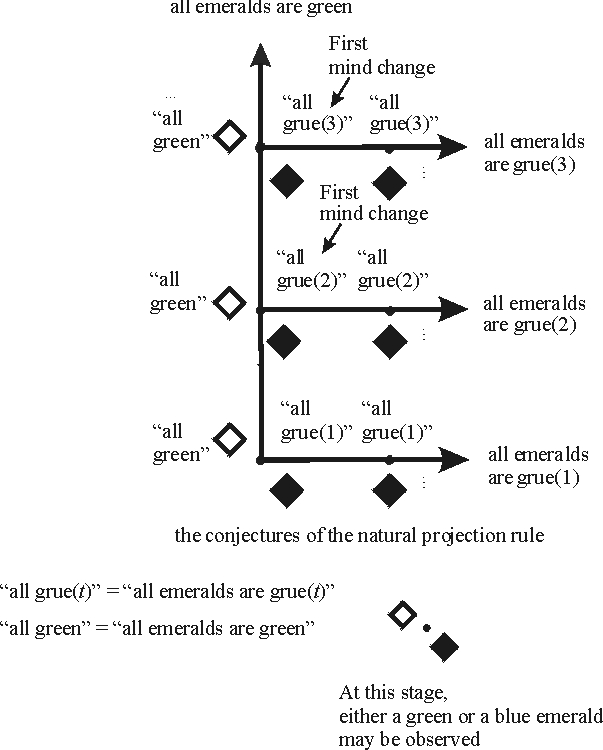

# learning-formal — supplement（supplement）

> （《learning-formal》词条补充材料，源：plato.stanford.edu/entries/learning-formal/supplement.html）

#### Supplement to Formal Learning Theory

## Basic Formal Definitions

The purpose of this supplement is a concise, formal development of the basic notions of learning theory so as to make mathematical treatments of the subject more accessible to the reader. The supplement develops some of the concepts discussed in the main entry in formal language. For the most part I follow Kelly’s [1996] treatment which is at once more general and simpler than other approaches. The discussion below illustrates concepts by reference to the Goodmanian Riddle of Induction; the figure illustrating this inductive problem is reproduced here.

*Figure 3* [An extended description of figure 3 is in a supplement.]

### Evidence, Hypotheses and Discovery Problems

The basic building block of formal learning theory is the notion of an **evidence item**. For a general formulation, we may simply begin with a set $E$ of evidence items. In general, nothing need be assumed about this set; in what follows, I will assume that $E$ is at most countable, that is, that there are at most countably many evidence items. Some authors assume that evidence is formulated in first-order logic, typically as literals (e.g., [Earman 1992], [Martin and Osherson 1998]). In formal models of language learning, the evidence items are strings, representing grammatical strings from the language to be learned. In the example of the Riddle of Induction, the evidence items are $G$ and $B$, respectively represented in the picture by a transparent and by a filled diamond, so $E = \{G,B\}$.

Given the basic set $E$ of evidence items, we have the notion of a **finite evidence sequence**. A finite evidence sequence is a sequence $(e_1,e_2 ,\ldots ,e_n)$ of evidence items, that is, members of $E$. For example, the observation that the first three emeralds are green corresponds to the evidence sequence $(G,G,G)$. A typical notation for a finite evidence sequence is $e$. If a finite evidence sequence $e$ has $n$ members, we say that the sequence is of length $n$ and write $lh(e) = n$.

The next step is to consider an **infinite evidence sequence**. An infinite evidence sequence is a sequence $(e_1,e_2 ,\ldots ,e_n,\ldots)$ that continues indefinitely. For example, the infinite sequence $(G,G,G,\ldots ,G,\ldots)$ represents the circumstance in which all observed emeralds are green. A typical notation for an infinite evidence sequence is $\varepsilon$. Following Kelly [1996], the remainder of this supplement refers to an infinite evidence sequence as a **data stream**. Even though the notion of an infinite data sequence is mathematically straightforward, it takes some practice to get used to employing it. We often have occasion to refer to finite initial segments of a data stream, and introduce some special notation for this purpose: Let $\varepsilon |n$ denote the first $n$ evidence items in the data stream $\varepsilon$. For example if $\varepsilon = (G,G,G,\ldots ,G,\ldots)$ is the data stream featuring only green emeralds, then $\varepsilon |3 = (G,G,G)$ is the finite evidence sequence corresponding to the observation that the first three emeralds are green. We also write $\varepsilon_n$ to denote the $n$-th evidence item observed in $\varepsilon$. For example, if $\varepsilon = (G,G,G,\ldots ,G,\ldots)$, then $\varepsilon_2 = G$.

An **empirical hypothesis** is a claim whose truth supervenes on a data stream. That is, a complete infinite sequence of observations settles whether or not an empirical hypothesis is true. For example, the hypothesis that “all observed emeralds are green” is true on the data stream featuring only green emeralds, and false on any data stream featuring a nongreen emerald. In general, we assume that a **correctness relation** on $C$ has been specified, where $C(\varepsilon ,H)$ holds just in case hypothesis $H$ is correct an data stream $\varepsilon$. What hypotheses are taken as correct on which data streams is a matter of the particular application. Given a correctness relation, we can define the empirical content of a hypothesis $H$ as the set of data streams on which $H$ is correct. Thus the empirical content of hypothesis $H$ is given by $\{\varepsilon : C(\varepsilon , H)\}$. For formal purposes, it is often easiest to dispense with the correctness relation and simply to identify hypotheses with their empirical content. With that understanding, in what follows hypotheses will often be viewed as **sets of data streams**. For ease of exposition, I do not always distinguish between a hypothesis viewed as a set of data streams and an expression denoting that hypothesis, such as “all emeralds are green”.

An inquirer typically does not begin inquiry as a tabula rasa, but has background assumptions about what the world is like. To the extent that such background assumptions help in inductive inquiry, they restrict the space of possible observations. For example in the discussion of the Riddle of Induction above, I assumed that that no data stream will be obtained that has green emeralds followed by blue emeralds followed by green emeralds. In the conservation principle problem discussed in the main entry, the operative background assumption is that the complete particle dynamics can be accounted for with conservation principles. As with hypotheses, we can represent the empirical content of given background assumptions by a set of data streams. Again it is simplest to identify **background knowledge** $K$ with a set of data streams, namely the ones consistent with the background knowledge.

In a logical setting in which evidence statements are literals, learning theorists typically assume that a given data stream will feature all literals of the given first-order language (statements such as $P(a)$ or $\neg P(a))$, and that the total set of evidence statements obtained during inquiry is consistent. With that background assumption, we may view the formula $\forall xP(x)$ as an empirical hypothesis that is correct on an infinite evidence sequence $\varepsilon$ just in case no literal $\neg P(a)$ appears on $\varepsilon$, that is for all $n$ it is the case that $\varepsilon_n \ne \neg P(a)$. More generally, a data stream with a complete, consistent enumeration of literals determines the truth of every quantified statement in the given first-order language.

### Inductive Methods and Inductive Success

An **inductive method** is a function that assigns hypotheses to finite evidence sequences. Following Kelly [1996], I use the symbol $\delta$ for an inductive method. Thus if $e$ is a finite evidence sequence, then $\delta(e) = H$ expresses the fact that on finite evidence sequence $e$, the method $\delta$ outputs hypothesis $H$. It is also possible to have a method $\delta$ assign probabilities to hypotheses rather than choose a single conjecture, but I leave this complication aside here. Inductive methods are also called “learners” or “scientists”; no matter what the label is, the mathematical concept is the same. In the Goodmanian Riddle above, the natural projection rule outputs the hypothesis “all emeralds are green” on any finite sequence of green emeralds. Thus if we denote the natural projection rule by $\delta$, and the hypothesis that all emeralds are green by “all $G$”, we have that $\delta(G) =$ “all $G$”, $\delta(GG) =$ “all $G$”, and so forth. Letting $\varepsilon = (G,G,G,\ldots ,G,\ldots)$ be the data stream with all green emeralds, we can write $\varepsilon |1 = (G), \varepsilon |2 = (GG)$, etc., so we have that $\delta(\varepsilon|1) =$ “all $G$”, $\delta(\varepsilon$|2) = “all $G$”, and more generally that $\delta(\varepsilon |n) =$ “all $G$” for all $n$.

An inductive method $\delta$ **converges to** a hypothesis $H$ on a data stream $\varepsilon$ **by time $n$** just in case for all later times $n'\ge n$, we have that $\delta(\varepsilon |n') = H$. This is a central definition for defining empirical success, as we will see shortly. To illustrate, the natural projection rule converges to “all G” by time 1 on the data stream $\varepsilon = (G,G,G,\ldots ,G,\ldots)$. It converges to “all emeralds are grue(3)” by time 3 on the data stream $(G,G,B,B,B,\ldots)$. An inductive method $\delta$ **converges to** a hypothesis $H$ on a data stream $\varepsilon$ just in case there is a time $n$ such that $\delta$ converges to $H$ on $\varepsilon$ by time $n$. Thus on the data stream $(G,G,G,\ldots)$, the natural projection $\delta$ converges to “all $G$” whereas on the data stream $(G,G,B,B,\ldots)$ this rule converges to “all emeralds are grue(3)”.

A **discovery problem** is a pair $(\mathbf{H}, K)$ where $K$ is a set of data streams representing background knowledge and $\mathbf{H}$ is a mutually exclusive set of hypotheses that covers $K$. That is, for any two hypotheses $H, H'$ in $\mathbf{H}$, viewed as two sets of data streams, we have that $H \cap H' = \varnothing$. And for any data stream $\varepsilon$ in $K$, there is a (unique) hypothesis $H$ in $\mathbf{H}$ such that $\varepsilon \in H$. For example, in the Goodmanian Riddle of Induction, each alternative hypothesis is a singleton containing just one data stream, for example $\{(G,G,G,\ldots)\}$ for the empirical content of “all emeralds are green”. The background knowledge $K$ is just the union of the alternative hypotheses. In the problem involving the generalizations “all but finitely many ravens are nonblack” and “all but finitely many ravens are black”, the former hypothesis corresponds to the set of data streams featuring only finitely many black ravens, and the latter to the set of data streams featuring only finitely many nonblack ravens. The background knowledge $K$ corresponds to the set of data streams that eventually feature only nonblack ravens or eventually feature only black ravens. Since each alternative hypothesis in a discovery problem $(\mathbf{H}, K)$ is mutually exclusive, for a given data stream $\varepsilon$ in $K$ there is exactly one hypothesis correct for that data stream; I write $H(\varepsilon)$ to denote that hypothesis.

In a discovery problem $(\mathbf{H}, K)$, an inductive method $\delta$ **succeeds** on a data stream $\varepsilon$ in $K$ iff $\delta$ converges to the hypothesis correct for $\varepsilon$; more formally, $\delta$ **succeeds** on a data stream $\varepsilon$ in $K$ iff $\delta$ converges to $H(\varepsilon)$ on $\varepsilon$. An inductive method $\delta$ **solves** the discovery problem $(\mathbf{H}, K)$ iff $\delta$ succeeds on all data streams in $K$. If $\delta$ solves a discovery problem $(\mathbf{H}, K)$, then we also say that $\delta$ is **reliable** for $(\mathbf{H}, K)$. If there is a reliable inductive method $\delta$ for a discovery problem $(\mathbf{H}, K)$, we say that the problem $(\mathbf{H}, K)$ is **solvable**. The main entry presented several solvable discovery problems. Characterization theorems like the one discussed there give conditions under which a discovery problem is solvable.

*Efficient* inductive inquiry is concerned with maximizing epistemic values other than convergence to the truth. Minimizing the number of mind changes is a topic in the main entry; what follows defines this measure of inductive performance as well as error and convergence time. Consider a discovery problem $(\mathbf{H}, K)$ and a data stream $\varepsilon$ in $K$.

1. The **convergence time**, or **modulus**, of a method $\delta$ on $\varepsilon$ is the least time $n$ by which $\delta$ converges to a hypothesis $H$ on $\varepsilon$. If $\delta$ is a reliable method for $(\mathbf{H}, K)$, then $\delta$ converges to a hypothesis on every data stream $\varepsilon$ consistent with background knowledge $K$—more specifically, $\delta$ converges to the correct hypothesis H$(\varepsilon)$—and the convergence time of $\delta$ is well-defined.
2. An inductive method $\delta$ **commits an error** at time $n$ on $\varepsilon$ iff $\delta(\varepsilon |n)$ is false, i.e., if $\delta(\varepsilon |n)\ne H(\varepsilon)$. As with convergence time, if $\delta$ is reliable, then it makes only finitely many errors on any data stream consistent with background knowledge. The number of errors committed by $\delta$ on a data stream $\varepsilon$ is thus given by $|\{n:\delta(\varepsilon |n)\ne H(\varepsilon)\}|.$
3. To count mind changes (and errors) properly, it is useful to allow methods to produce an “uninformative conjecture”, denoted by the symbol ?, which we may think of as a tautologous proposition. The point is that we don’t want to count a change from “no opinion” to an informative hypothesis as a mind change. This device allows us to represent methods that “wait” until further evidence before taking an “inductive leap”. Formally we say that an inductive method $\delta$ **changes its mind** at time $n+1$ on $\varepsilon$ iff the method’s previous conjecture at time $n$ was informative and changes at time $n+1$. In symbols, $\delta$ **changes its mind** at time $n+1$ on $\varepsilon$ iff: $\delta(\varepsilon |n)\ne$? and $\delta(\varepsilon |n)\ne \delta(\varepsilon |n+1)$. The number of mind changes made by $\delta$ on a data stream $\varepsilon$ is thus given by $|\{n:\delta$ changes its mind on $\varepsilon$ at time $n\}|.$

As we saw in the main entry, assessing methods by how well they do vis-a-vis these criteria of cognitive success leads to restrictions on inductive inferences in the short run, sometimes very strong restrictions. Learning-theoretic characterization theorems specify the structure of problems in which efficient inquiry is possible, and what kinds of inferences lead to inductive success when it is attainable.

### Illustrative Example of the Mathematical Concepts for Identifying True Statistical Hypotheses

We continue with the example from the main entry: The investigator is concerned with the bias $p$ of a coin. The hypothesis $H$ is that the coin is fair, that is, $p = 0.5.$ Consider the following toy method.

- If the sample is uniformly heads or tails, conjecture “the coin is not fair”.
- If the sample contains a mix of heads or tails, conjecture “the coin is fair”.

We choose this method because it is easy to describe and its conjectures are easy to describe; it would not be recommended for an actual learning problem. The table below shows all possible samples of size 2, the conjectures of our toy method, and the sample probabilities if the true bias is 0.7. The value 0.7 is simply chosen for illustration and has no significance.

| *Observation 1* | *Observation 2* | *Sample Probability* | *Conjecture* |
| --- | --- | --- | --- |
| Heads | Heads | 0.49 | not $H$ |
| Heads | Tails | 0.21 | $H$ |
| Tails | Heads | 0.21 | $H$ |
| Tails | Tails | 0.09 | not $H$ |

Table of all possible samples of size $n=2$ for a coin with a true bias of 0.7, so $p(\text{Heads})=0.7.$ The probability for each sample (consisting of two observations) is given along with the conjecture according to the toy method where $H$ represents the hypothesis that “the coin is fair”.

The *aggregate probability* that the method conjectures $H$, that the coin is fair, for this scenario is computed as follows.

$$ P_{n=2,p=0.7} = 0.21 + 0.21 = 0.42 $$

Return to Formal Learning Theory
