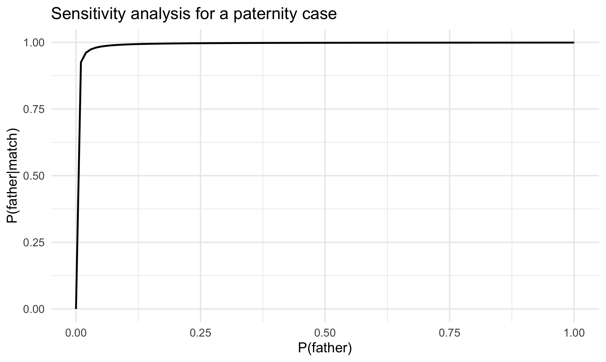
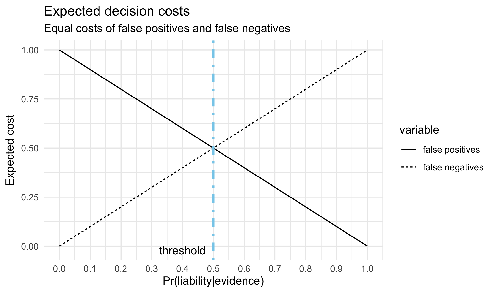
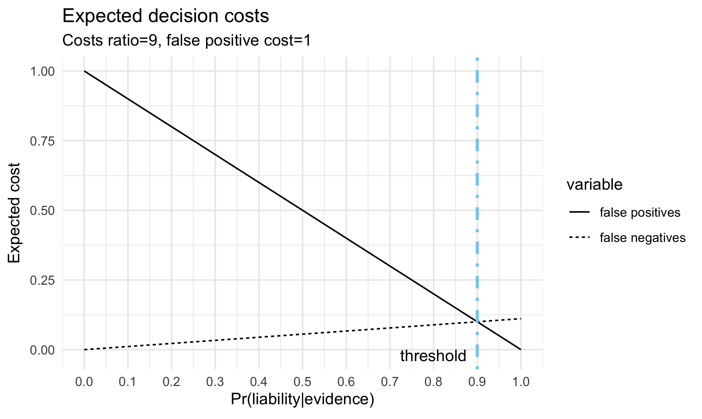

# Legal Probabilism
**First published Tue Jun 8, 2021**

*Urbaniak, Rafal, Di Bello, Marcello*

Legal probabilism is a research program that relies on probability theory to analyze, model and improve the evaluation of evidence and the process of decision-making in trial proceedings. While the expression “legal probabilism” seems to have been coined by Haack (2014b), the underlying idea can be traced back to the early days of probability theory (see, for example, Bernoulli 1713)[^bernoulli-1713]. Another term that is sometimes encountered in the literature is “trial by mathematics” coined by Tribe (1971). Legal probabilism remains a minority view among legal scholars, but attained greater popularity in the second half of the twentieth century in conjunction with the law and economics movement (Becker 1968; Calabresi 1961; Posner 1973)[^becker-1968][^calabresi-1961][^posner-1973].

To illustrate the range of applications of legal probabilism, consider a stylized case. Alice is charged with murder. Traces at the crime scene, which the perpetrator probably left, genetically match Alice. An eyewitness testifies that Alice ran away from the scene after the crime was committed. Another witness asserts that Alice had previously threatened the victim multiple times. Alice, however, has an alibi. Mark claims he was with her for the entire day. This case raises several questions. How should the evidence be evaluated? How to combine conflicting pieces of evidence, such as the incriminating DNA match and the alibi testimony? If the standard of decision in a murder case is proof beyond a reasonable doubt, how strong should the evidence be to meet this standard?

Legal probabilism is a theoretical framework that helps to address these different questions. Finkelstein and Fairley (1970) gave one of the first systematic analyses of how probability theory, and Bayes’ theorem in particular, can help to evaluate evidence at trial (see Section 1). After the discovery of DNA fingerprinting, many legal probabilists focused on how probability theory could be used to quantify the strength of a DNA match (see Section 2). Recent work in Artificial Intelligence made it possible to use probability theory—in the form of Bayesian networks—to evaluate complex bodies of evidence consisting of multiple components (see Section 3). Following the work of Lempert (1977), likelihood ratios are now commonly used as probabilistic measures of the relevance of the evidence presented at trial (see Section 4). Other authors, starting with seminal papers by Kaplan (1968) and Cullison (1969), deployed probability theory and decision theory to model decision-making and standards of proof at trial (see Section 5).

Legal probabilism is no doubt controversial. Many legal theorists and philosophers, starting with Tribe (1971), leveled several critiques against it. These critiques range from difficulties in assessing the probability of someone’s criminal or civil liability to the dehumanization of trial decisions to misconstruing how the process of evidence evaluation and decision-making takes place in trial proceedings.

A key challenge for legal probabilism—one that has galvanized philosophical attention in recent years—comes from the paradoxes of legal proof or puzzles of naked statistical evidence. Nesson (1979), Cohen (1977) and Thomson (1986) formulated scenarios in which, despite a high probability of guilt or civil liability based on the available evidence, a verdict against the defendant seems unwarranted (see Section 6). Other challenges for legal probabilism include the problem of conjunction and the reference class problem (see Section 7).

Legal probabilism can also be understood as a far reaching research program that aims to analyze—by means of probability theory—the trial system as a whole, including institutions such as the jury system and trial procedure. Some early French probability theorists examined the relationship between jury size, jury voting rules and the risk of convicting an innocent (Condorcet 1785; Laplace 1814; Poisson 1837; for more recent discussions, see Kaye 1980; Nitzan 2009; Suzuki 2015)[^condorcet-1785][^kaye-1980][^laplace-1814][^nitzan-2009][^poisson-1837][^suzuki-2015].

At the root of this more radical version of legal probabilism lies the dream of discerning patterns in the behavior of individuals and improving legal institutions (Hacking 1990)[^hacking-1990]. Today’s rapid grow of data—paired with machine learning and the pervasiveness of cost-benefit analysis—has rendered this dream more alive than ever before (Ferguson 2020)[^ferguson-2020]. For a critique of mathematization, quantification and cost-benefit analysis applied to the justice system, see Allen (2013) and Harcourt (2018). This entry will not, however, discuss this far reaching version of legal probabilism.

## 1. Probabilistic Toolkit

This section begins with a review of the axioms of probability and its interpretations, and then shows how probability theory helps to spot mistakes that people may fall prey to when they assess evidence at trial, such as the prosecutor’s fallacy, the base rate fallacy, and the defense attorney’s fallacy. This section also examines how probabilities are assigned to hypotheses and how hypotheses are formulated at different levels of granularity.

### 1.1 Probability and its interpretation

Standard probability theory consists of three axioms:

*Table 1*

| Axiom | In words | In symbols |
| --- | --- | --- |
| Non-negativity | The probability of any proposition $A$ is greater than or equal to 0. | $\Pr(A)\geq 0$ |
| Normality | The probability of any logical tautology is 1. | If $\models A$, then $\Pr(A)=1$ |
| Additivity | The probability of the disjunction of two propositions $A$ and $B$ is the sum of their respective probabilities, provided the two propositions are logically incompatible. | If $\models \neg (A \wedge B)$, then $\Pr(A\vee B)=\Pr(A)+\Pr(B)$ |

An important notion in probability theory is that of conditional probability, that is, the probability of a proposition $A$ conditional on a proposition $B$, in symbols, $\Pr( A\pmid B)$. Although it is sometimes taken as a primitive notion, conditional probability is usually defined as the probability of the conjunction $\Pr(A \wedge B)$ divided by the probability of the proposition being conditioned on, $\Pr(B)$, or in other words,

$$\Pr(A \pmid B)= \frac{\Pr(A \wedge B)}{\Pr(B)}\quad \text{ assuming \(\Pr(B)\neq 0\).}$$

This notion is crucial in legal applications. The fact-finders at trial might want to know the probability of “The defendant was at the scene when the crime was committed” conditional on “Mrs. Dale asserts she saw the defendant run away from the scene”. Or they might want to know the probability of “The defendant is the source of the traces found at the crime scene” conditional on “The DNA expert asserts that the defendant’s DNA matches the traces at the scene.” In general, the fact-finders are interested in the probability of a given hypothesis $H$ about what happened conditional on the available evidence $E$, in symbols, $\Pr(H \pmid E)$.

Most legal probabilists agree that the probabilities ascribed to statements that are disputed in a trial—such as “The defendant is the source of the crime traces” or “The defendant was at the crime scene when the crime was committed”—should be understood as evidence-based degrees of belief (see, for example, Cullison 1969; Kaye 1979b; Nance 2016)[^cullison-1969][^kaye-1979b][^nance-2016]. This interpretation addresses the worry that since past events did or did not happen, their probabilities should be 1 or 0. Even if the objective chances are 1 or 0, statements about past events could still be assigned different degrees of belief given the evidence available. In addition, degrees of belief are better suited than frequencies for applications to unrepeatable events, such as actions of individuals, which are often the focus of trial disputes Further engagement with these issues lies beyond the scope of this entry (for a more extensive discussion, see the entry on the interpretations of probability as well as Childers 2013; Gillies 2000; Mellor 2004; Skyrms 1966)[^childers-2013][^gillies-2000][^mellor-2004][^skyrms-1966].

Some worry that, except for obeying the axioms of probability, degrees of belief are in the end assigned in a subjective and arbitrary manner (Allen and Pardo 2019)[^allen-2019][^pardo-2019]. This worry can be alleviated by noting that degrees of belief should reflect a conscientious assessment of the evidence available which may also include empirical frequencies (see §1.2 below and the examples in ENFSI 2015)[^enfsi-2015]. In some cases, however, the relevant empirical frequencies will not be available. When this happens, degrees of belief can still be assessed by relying on common sense and experience. Sometimes there will be no need to assign exact probabilities to every statement about the past. In such cases, the relevant probabilities can be expressed approximately with sets of probability measures (Shafer 1976; Walley 1991)[^shafer-1976][^walley-1991], probability distributions over parameter values, or intervals (see later in §1.4).

### 1.2 Probabilistic fallacies

Setting aside the practical difficulties of assigning probabilities to different statements, probability theory is a valuable analytical tool in detecting misinterpretations of the evidence and reasoning fallacies that may otherwise go unnoticed.

#### 1.2.1 Assuming independence

A common error that probability theory helps to identify consists in assuming without justification that two events are independent of one another. A theorem of probability theory states that the probability of the conjunction of two events, $A\wedge B$, equals the product of the probabilities of the conjuncts, $A$ and $B$, that is,

$$\Pr(A \wedge B) = \Pr(A)\times \Pr(B),$$

provided $A$ and $B$ are independent of one another in the sense that the conditional probability $\Pr(A \pmid B)$ is the same as the unconditional probability $\Pr(A)$. More formally, note that

$$\Pr(A \pmid B)=\frac{\Pr(A \wedge B)}{\Pr(B)},$$

so

$$\Pr(A \wedge B)=\Pr(A)\times \Pr(B)$$

provided $\Pr(A)=\Pr(A \pmid B)$. The latter equality means that learning about $B$ does not change one's degree of belief about $A$.

The trial of Janet and Malcolm Collins, a couple accused of robbery in 1964 Los Angeles, illustrates how the lack of independence between events can be overlooked. The couple was identified based on features at the time considered unusual. The prosecutor called an expert witness, a college mathematician, to the stand, and asked him to consider the following features and assume they had the following probabilities: black man with a beard (1 in 10), man with a mustache (1 in 4), white woman with blond hair (1 out of 3), woman with a ponytail (1 out of 10), interracial couple in a car (1 out of 1000), couple driving a yellow convertible (1 out of 10). The mathematician, correctly, calculated the probability of a random couple displaying all these features on the assumption of independence: 1 in 12 million (assuming the individual probability estimates were correct). Relying on this argument, the jury convicted the couple. If those features are so rare in Los Angeles and the robbers had them—the jury must have reasoned—the Collins must be the robbers.

The conviction was later reversed by the Supreme Court of California in People v. Collins (68 Cal.2d 319, 1968). The Court pointed out the mistake of assuming that multiplying the probabilities of each feature would give the probability of their joint occurrence. This assumption holds only if the features in question are probabilistically independent. But this is not the case since the occurrence of, say, the feature “man with a beard” might very well correlate with the feature “man with a mustache”. The same correlation might hold for the features “white woman with blond hair” and “woman with a ponytail”. Besides the lack of independence, another problem is the fact that the probabilities associated with each feature were not obtained by any reliable method.

The British case R. v. Clark (EWCA Crim 54, 2000) is another example of how the lack of independence between events can be easily overlooked. Sally Clark had two sons. Her first son died in 1996 and her second son died in similar circumstances a few years later in 1998. They both died within a few weeks after birth. Could it just be a coincidence? At trial, the paediatrician Roy Meadow testified that the probability that a child from an affluent family such as the Clark’s would die of Sudden Infant Death Syndrome (SIDS) was 1 in 8,543. Assuming that the two deaths were independent events, Meadow calculated that the probability of both children dying of SIDS was

$$\frac{1}{8,543}\times \frac{1}{8,543}, \quad \text{which approximately equals} \quad \frac{1}{73\times 10^6}$$

or 1 in 73 million. This impressively low number no doubt played a role in the outcome of the case. Sally Clark was convicted of murdering her two infant sons (though the conviction was ultimately reversed on appeal). The $\slashfrac{1}{(73\times 10^6)}$ figure rests on the assumption of independence. This assumption is seemingly false since environmental or genetic factors may predispose a family to SIDS (for a fuller discussion of this point, see Dawid 2002; Barker 2017; Sesardic 2007)[^barker-2017][^dawid-2002][^sesardic-2007].

#### 1.2.2 The prosecutor’s fallacy

Another mistake that people often make while assessing the evidence presented at trial consists in conflating the two directions of conditional probability, $\Pr(A\pmid B)$ and $\Pr(B \pmid A)$. For instance, if you toss a die, the probability that the result is 2 given that it is even (which equals $\slashfrac{1}{3}$) is different from the probability that the result is even given that it is 2 (which equals 1).

In criminal cases, confusion about the two directions of conditional probability can lead to exaggerating the probability of the prosecutor’s hypothesis. Suppose an expert testifies that the blood found at the crime scene matches the defendant’s and it is 5% probable that a person unrelated to the crime—someone who is *not* the source of the blood found at the scene—would match by coincidence. Some may be tempted to interpret this statement as saying that the probability that the defendant is not the source of the blood is 5% and thus it is 95% probable that the defendant is the source. This flawed interpretation is known as the *prosecutor’s fallacy*, sometimes also called the *transposition fallacy* (Thompson and Schumann 1987)[^thompson-1987]. The 5% figure is the conditional probability $\Pr(\match \pmid \neg \source)$ that, assuming the defendant is not the *source* of the crime scene blood $(\neg \source),$ he would still *match* $(\match).$ The 5% figure is not the probability $\Pr(\neg \source \pmid \match)$ that, if the defendant matches ($\match$), he is not the source ($\neg \source$). By conflating the two directions and thinking that

$$\Pr(\neg \source \pmid \match)=\Pr(\match \pmid \neg \source)=5\%,$$

one is led to erroneously conclude that $\Pr(\source \pmid \match)=95\%$.

The same conflation occurred in the Collins case discussed earlier. Even if the calculations were correct, the 1 in 12 million probability that a random couple would have the specified characteristics should be interpreted as $\Pr(\match\pmid \textsf{innocent})$, not as the probability that the Collins were innocent given that they matched the eyewitness description, $\Pr(\textsf{innocent}\pmid \match)$. Presumably, the jurors convicted the Collins because they thought it was virtually impossible that they were not the robbers. But the 1 in 12 million figure, assuming it is correct, only shows that $\Pr(\match\pmid \textsf{innocent})$ equals $\slashfrac{1}{(12\times 10^6)}$, not that $\Pr(\textsf{innocent}\pmid \match)$ equals $\slashfrac{1}{(12\times 10^6)}$.

#### 1.2.3 Bayes’ theorem and the base rate fallacy

The relation between the probability of the hypothesis given the evidence, $\Pr(H \pmid E)$, and the probability of the evidence given the hypothesis, $\Pr(E \pmid H)$, is captured by Bayes’ theorem:

$$ \Pr(H \pmid E) = \frac{\Pr(E \pmid H)}{\Pr(E)} \times \Pr(H),\quad\text{ assuming } \Pr(E) \neq 0.$$

The probability $\Pr(H)$ is called the *prior* probability of $H$ (it is prior to taking evidence $E$ into account) and $\Pr(H\pmid E)$ is the *posterior* probability of $H$. This terminology is standard, but is slightly misleading because it suggests a temporal ordering which does not have to be there. Next, consider the ratio

$$\frac{\Pr(E \pmid H)}{\Pr(E)},$$

sometimes called the *Bayes factor*.[^note-1] This is the ratio between the probability $\Pr(E \pmid H)$ of observing evidence $E$ assuming $H$ (often called the likelihood) and the probability $\Pr(E)$ of observing $E$. By the *law of total probability*, $\Pr(E)$ results from adding the probability of observing $E$ assuming $H$ and the probability of observing $E$ assuming $\neg H$, each weighted by the prior probabilities of $H$ and $\neg H$ respectively:

$$\Pr(E)= \Pr(E \pmid H)\times \Pr(H)+\Pr(E \pmid \neg H)\times \Pr(\neg H).$$

As is apparent from Bayes’ theorem, multiplying the prior probability by the Bayes factor yields the posterior probability $\Pr(H \pmid E)$. Other things being equal, the lower the prior probability $\Pr(H)$, the lower the posterior probability $\Pr(H \pmid E)$. The *base rate fallacy* consists in ignoring the effect of the prior probability on the posterior (Kahneman and Tversky 1973)[^kahneman-1973]. This leads to thinking that the posterior probability of a hypothesis given the evidence is different than it actually is (Koehler 1996)[^koehler-1996].

Consider the blood evidence example discussed previously. By Bayes’ theorem, the two conditional probabilities $\Pr(\neg \source \pmid \match)$ and $\Pr(\match \pmid \neg \source)$ are related as follows:

$$ \Pr(\neg \source \pmid \match) = \\ \frac{\Pr(\match \pmid \neg \source)\times \Pr(\neg \source)} {\Pr(\match \pmid \neg \source)\times \Pr(\neg \source) + \Pr(\match \pmid \source)\times \Pr(\source)}. $$

Absent any other compelling evidence to the contrary, it should initially be very likely that the defendant, as anyone else, had little to do with the crime. Say, for illustrative purposes, that the prior probability $\Pr(\neg \source)= .99$ and so $\Pr(\source)=.01$ (more on how to assess prior probabilities later in §1.4). Next, $\Pr(\match \pmid \source)$ can be set approximately to $1$, because if the defendant were the source of the blood at the crime scene, he should match the blood at the scene (setting aside the possibility of false negatives). The expert estimated the probability that someone who is not the source would coincidentally match the blood found at the scene—that is, $\Pr(\match \pmid \neg \source)$—as equal to .05. By Bayes’ theorem,

$$ \Pr(\neg \source \pmid \match) = \frac{.05}{(.05 \times .99)+ (1 \times .01)} \times .99 \approx .83.$$

The posterior probability that the defendant is the source, $\Pr(\source\pmid \match)$ is roughly $1-.83=.17$, much lower than the exaggerated value of .95. This posterior probability would have dropped even lower if the prior probability were lower. A similar analysis applies to the Collins case. If the prior probability of the Collins’s guilt is sufficiently low—say in 1 in 6 million—the posterior guilt probability given the match with the eyewitness description would be roughly .7, much less impressive than

$$\left(1-\frac{1}{12\times 10^6}\right)\approx .9999999.$$

#### 1.2.4 Defense attorney’s fallacy

Although base rate information should not be overlooked, paying excessive attention to it and ignoring other evidence leads to the so-called *defense attorney’s fallacy*. As before, suppose the prosecutor expert testifies that the defendant matches the traces found at the crime scene and there is a 5% probability that a random person, unrelated to the crime, would coincidentally match, so $\Pr(\match\pmid \neg\source)=.05$. To claim that it is 95% likely that the defendant is the source of the traces, or in symbols, $\Pr(\source\pmid \textsf{ match})=.95$, would be to commit the prosecutor’s fallacy described earlier. But suppose the defense argues that, since the population in town is 10,000 people, $5\%$ of them would match by coincidence, that is, $10,000\times 5\%=500$ people. Since the defendant could have left the traces as any of the other 499 people, he is $\slashfrac{1}{500}=.2\%$ likely to be the source, a rather unimpressive figure. The match—the defense concludes—is worthless evidence.

This analysis portrays the prosecutor’s case as weaker than it need be. If the investigators narrowed down the set of suspects to, say, 100 people—a potential piece of information the defense ignored—the match would make the defendant 16% likely to be the source. This fact can be verified using Bayes’ theorem (left as an exercise for the reader). Even assuming, as the defense claims, that the pool of suspects comprises as many as 10,000 people, the prior probability that the defendant is the source would be $\slashfrac{1}{10,000}$, and since the defendant matches the traces, this probability should rise to (approximately) $\slashfrac{1}{500}$. Given the upward shift in the probability from $\slashfrac{1}{10,000}$ to $\slashfrac{1}{500}$, the match should not be considered worthless evidence (more on this later in §2.1).

### 1.3 Odds version of Bayes’ theorem

The version of Bayes’ theorem considered so far is informationally demanding since the law of total probability—which spells out $\Pr(E)$, the denominator in the Bayes factor $\slashfrac{\Pr(E \pmid H)}{\Pr(E)}$—requires one to consider $H$ and the catch-all alternative hypothesis $\neg H$, comprising all possible alternatives to $H$. A simpler version of Bayes’ theorem is the so-called odds formulation:

$$ \frac{\Pr(H \pmid E)} {\Pr(H' \pmid E)} = \frac{\Pr(E \pmid H)}{\Pr(E \pmid H')} \times \frac{\Pr(H)} {\Pr(H')},$$

or in words:

$$\textit{posterior odds} = \textit{likelihood ratio} \times \textit{prior odds}.$$

The ratio

$$\frac{\Pr(H)}{\Pr(H')}$$

represents the *prior odds*, where $H$ and $H'$ are two competing hypotheses, not necessarily one the complement of the other. The *likelihood ratio*

$$\frac{\Pr(E \pmid H)}{\Pr(E \pmid H')}$$

compares the probability of the same item of evidence $E$ given the two hypotheses. The *posterior odds*

$$\frac{\Pr(H \pmid E)}{\Pr(H' \pmid E)}$$

compares the probabilities of the hypotheses given the evidence. This ratio is different from the probability $\Pr(H \pmid E)$ of a specific hypothesis given the evidence.

As an illustration, consider the Sally Clark case (previously discussed in §1.2). The two hypotheses to compare are that Sally Clark’s sons died of natural causes (natural) and that Clark killed them (kill). The evidence available is that the two sons died in similar circumstances one after the other (two deaths). By Bayes’ theorem (in the odds version),

$$\frac{\Pr(\textsf{kill} \pmid \textsf{two deaths})}{\Pr(\textsf{natural} \pmid \textsf{two deaths})} = \frac{\Pr(\textsf{two deaths} \pmid \textsf{kill})}{\Pr(\textsf{two deaths} \pmid \textsf{natural})} \times \frac{\Pr(\textsf{kill})}{\Pr(\textsf{natural})}.$$

The likelihood ratio

$$\frac{\Pr(\textsf{two deaths} \pmid \textsf{kill})}{\Pr(\textsf{two deaths} \pmid \textsf{natural})}$$

compares the likelihood of the evidence (two deaths) under each hypothesis (kill v. natural). Since under either hypothesis both babies would have died—by natural causes or killing—the ratio should equal to one (Dawid 2002)[^dawid-2002]. What about the prior odds

$$\frac{\Pr(\textsf{kill})}{\Pr(\textsf{natural})}?$$

Recall the $\slashfrac{1}{(73\times 10^6)}$ figure given by the pediatrician Roy Meadow. This figure was intended to convey how unlikely it was that two babies would die of natural causes, one after the other. If it is so unlikely that both would die of natural causes—one might reason—it must be likely that they did not actually die of natural causes and quite likely that Clark killed them. But did she?

The prior probability that they died of natural causes should be compared to the prior probability that a mother would kill them. To have a rough idea, suppose that in a mid-size country like the United Kingdom 1 million babies are born every year of whom 100 are murdered by their mothers. So the chance that a mother would kill one baby in a year is 1 in 10,000. What is the chance that the same mother kills *two* babies? Say we appeal to the (controversial) assumption of independence. On this assumption, the chance that a mother kills two babies equals 1 in 100 million. Assuming independence,

$$\Pr(\textsf{natural})=\frac{1}{73\times10^6}$$

and

$$\Pr(\textsf{kill})=\frac{1}{100\times 10^6}.$$

This means that the prior odds would equal .73. With a likelihood ratio of one, the posterior odds would also equal .73. On this analysis, that Clark killed her sons would be .73 times less likely than they died of natural causes, or in other words, the natural cause hypothesis is 1.37 times more likely than the hypothesis that Clark killed her sons.

A limitation of this analysis should be kept in mind. The .73 ratio is a measure of the probability of one hypothesis compared to another. From this ratio alone, the posterior probability of the individual hypotheses cannot be deduced. Only if the competing hypotheses $H$ and $H'$ are exclusive and exhaustive, say one is the negation of the other, can the posterior probability be derived from the posterior odds

$$PO=\frac{P(H \pmid E)}{ P(H' \pmid E)}$$

via the equality

$$\Pr(H\pmid E)= \frac{PO}{1+PO}.$$

But the hypotheses kill and natural are not exhaustive, since the two babies could have died in other ways. So the posterior odds

$$\frac{\Pr(\textsf{kill} \pmid \textsf{two deaths})}{\Pr(\textsf{natural} \pmid \textsf{two deaths})}$$

cannot be translated into the posterior probabilities of individual hypotheses. (A more sophisticated probabilistic analysis is presented in §3.3.)

### 1.4 Where do the numbers come from?

In the examples considered so far, probabilities were assigned on the basis of empirical frequencies and expert opinions. For example, an expert testimony that only 5% of people possess a particular blood type was used to set $\Pr(\match \pmid \neg \source)=.05$. Probabilities were also assigned on the basis of common sense, for example, $\Pr(\match \pmid \source)$ was set to 1 assuming that if someone is the source of the crime traces, the person must match the crime traces (setting aside the possibility of framing, fabrication of the traces or false negatives in the test results). But probabilities need not always be assigned exact values. Agreeing on an exact value can in fact be extremely difficult, especially for prior probabilities. This is a challenge for legal probabilism (see later in §7.3). One way to circumvent this challenge is to avoid setting exact values and adopt plausible intervals. This method is based on *sensitivity analysis*, an assessment of how prior probabilities affect other probabilities.

Consider the paternity case State v. Boyd (331 N.W.2d 480, Minn. 1983). Expert witness Dr. Polesky testified that 1,121 unrelated men would have to be randomly selected from the general population before another man could be found with all the appropriate genes to have fathered the child in question. This formulation can be misleading since the expected number of matching DNA profiles need not be the same as the number of matching profiles actually found in a population (the error of thinking otherwise is called the expected value fallacy). On a more careful formulation, the probability that a random person would be a match is $\slashfrac{1}{1121}$, or in symbols,

$$\Pr(\match\pmid \neg \textsf{father})=\frac{1}{1121}.$$

As explained earlier in §1.2.3, this probability cannot be easily translated into the probability that a person whose genetic profile matches is the father, or in symbols, $\Pr(\textsf{father}\pmid \match)$. The latter should be calculated using Bayes’ theorem:

$$\begin{align} \Pr(\textsf{father}\pmid \match) & = \frac{ \Pr(\match\pmid \textsf{father}) \times \Pr(\textsf{father}) } { \Pr(\match \pmid \textsf{father}) \times \Pr(\textsf{father}) + \Pr(\match \pmid \textsf{not-father}) \times \Pr(\textsf{not-father}) } \end{align}$$

In actual practice, the formula to establish paternity is more complicated (Kaiser and Seber, 1983)[^kaiser-1983], but for the sake of illustration, we abstract away from this complexity. Suppose the prior probability that the defendant would be the father is as low as .01, or in symbols, $\Pr(\textsf{father})=.01$. Plugging in this prior probability into Bayes theorem, along with $\Pr(\textsf{m}\pmid \textsf{father})=1$ and $\Pr(\textsf{m}\pmid \textsf{not-father})=1/1,121$, gives a probability of paternity $\Pr(\textsf{father}\pmid \textsf{m})$ that is equal to about .92.

But why take the prior probability $\Pr(\textsf{father})$ to be .01 and not something else? The idea in sensitivity analysis is to look at a range of plausible probability assignments and investigate the impact of such choices. In legal applications, the key question is whether assignments that are most favorable to the defendant would still return a strong evidentiary case against the defendant. In the case at hand, the expert testimony is so strong that for a wide spectrum of the prior probability $\Pr(\textsf{father})$, the posterior probability $\Pr(\textsf{father} \pmid \match)$ remains high, as the plot in figure 1 shows.

*Figure 1*

The posterior surpasses .9 once the prior is above approximately .008. In a paternity case, given the mother’s testimony and other evidence, it is clear that the probability of fatherhood before the expert testimony is taken into account should be higher than that, no matter what the prior probability should exactly be. Without settling on an exact value, the interval of values above .008 would guarantee a posterior probability of paternity to be at least .9. This is amply sufficient to meet the preponderance standard that governs civil cases such as paternity disputes (on standards of proof, see later in Section 5.)

### 1.5 Source, activity and offense level hypotheses

Difficulties in assessing probabilities go hand in hand with the choice of the hypotheses of interest. To some approximation, hypotheses can be divided into three levels: offence, activity, and source level hypotheses. At the offence level, the issue is whether the defendant is guilty, as in the statement “Smith is guilty of manslaughter”. At the activity level, hypotheses describe what happened and what those involved did or did not do. An example of activity level hypothesis is “Smith stabbed the victim”. Finally, source level hypotheses describe the source of the traces, such as “The victim left the stains at the scene”, without specifying how the traces got there. Overlooking differences in hypothesis level can lead to serious confusions.

Consider a case in which a DNA match is the primary incriminating evidence. DNA evidence is one of the most widely used forms of quantitative evidence currently available, but it does not work much differently from blood evidence or other forms of trace evidence. In testifying about a DNA match, trial experts will often assess the probability that a random person, unrelated to the crime, would coincidentally match the crime stain profile (Foreman et al. 2003)[^foreman-2003]. This is called the Genotype Probability or Random Match Probability, which can be extremely low, in the order of 1 in 100 million or even lower (Donnelly 1995; Kaye and Sensabaugh 2011; Wasserman 2002)[^donnelly-1995][^kaye-2011][^wasserman-2002]. It is tempting to equate the random match probability to $\Pr(\match \pmid \textsf{innocence})$ and together with the prior $\Pr(\textsf{innocence})$ use Bayes’ theorem to calculate the posterior probability of innocence $\Pr(\textsf{innocence} \pmid \match)$. This would be a mistake. Applying Bayes’ theorem is of course recommended and helps to avoid the prosecutor’s fallacy, the conflation of $\Pr(\textsf{innocence} \pmid \match)$ and $\Pr(\match \pmid \textsf{innocence})$. The problem here lies elsewhere. Equating the random match probability with $\Pr(\match \pmid \textsf{innocence})$ overlooks the difference between offense, activity and source level hypotheses. A DNA match cannot speak directly to the question of guilt or innocence. Even if the suspect is the source of the genetic material at the scene, the match does not establish that the defendant did visit the scene and came into contact with the victim, and even if they did, it does not follow that they committed the crime they were accused of.

Few forms of evidence can speak directly to offense level hypotheses. Circumstantial evidence that is more amenable to a probabilistic quantification, such as DNA matches and other trace evidence, does not. Eyewitness testimony may speak more directly to offense level hypotheses, but it is also less easily amenable to a probabilistic quantification (see however Friedman 1987, recent results by Wixted and Wells 2017, and a survey of related issues by Urbaniak et al. 2020)[^friedman-1987][^urbaniak-2020][^urbaniak-2020-2][^wixted-2017]. This makes it difficult to assign probabilities to offense level hypotheses. Moving beyond source level hypotheses requires a close collaboration between scientists, investigators and attorneys (see Cook et al. 1998 for a discussion)[^cook-1998].

## 2. The Strength of Evidence

The posterior probability of a hypothesis given the evidence should not be confused with the strength (or probative value, weight) of the evidence in favor of the hypothesis. The strength of an item of evidence reflects its impact on the probability of the hypothesis. Suppose the prior probability of $H$ is extremely low, say $\Pr(H)=.001$, but taking evidence $E$ into account brings this probability up to 35%, that is, $\Pr(H \pmid E)=.35$. This is a dramatic upward shift. Even though the posterior probability of $H$ given $E$ is not high, $E$ strongly favors $H$. This section examines how probability theory helps to assess the strength of evidence.

### 2.1 Bayes factor v. likelihood ratio

The notion of strength of evidence—as distinct from prior and posterior probability—can be captured formally in a number of different ways (for a comprehensive discussion, see the entry on confirmation theory). One measure of the strength of evidence is the Bayes factor

$$\frac{\Pr(E \pmid H)}{\Pr(E)}$$

(already discussed in §1.2.3). This is an intuitively plausible measure of evidential strength. Note that by Bayes’ theorem

$$ \Pr(H \pmid E) = \textit{BayesFactor}(H, E) \times \Pr(H),$$

and thus the Bayes factor is greater than one if and only if the posterior probability $\Pr(H \pmid E)$ is higher than the prior probability $\Pr(H)$. The greater the Bayes factor (for values above one), the greater the upward shift from prior to posterior probability, the more strongly $E$ positively supports $H$. Conversely, the smaller the Bayes factor (for values below one), the greater the downward shift from prior to posterior probability, the more strongly $E$ negatively supports $H$. If $\Pr(H)=\Pr(H\pmid E)$ the evidence has no impact, upwards or downwards, on the prior probability of $H$.

The Bayes factor is an absolute measure of evidence $E$’s support toward $H$ since it compares the probability of $E$ under hypothesis $H$ against the probability of $E$ in general. The denominator is calculated following the law of total probability:

$$\Pr(E)= \Pr(E \pmid H) \Pr(H)+\Pr(E \pmid \neg H) \Pr(\neg H).$$

The catch-all alternative hypothesis $\neg H$ can be replaced by a more fine-grained set of alternatives, say $H_1, H_2, \dots H_k$, provided $H$ and its alternatives cover the entire space of possibilities. The law of total probability would then read:

$$\Pr(E) = \Pr(E\pmid H)\Pr(H) +\sum_{i=1}^k \Pr(E\pmid H_i)\Pr(H_i).$$

Instead of Bayes factor, the strength of evidence can be assessed by means of the likelihood ratio, a comparative measure of whether evidence $E$ supports a hypothesis $H$ more than a competing hypothesis $H'$, in symbols,

$$\frac{\Pr(E \pmid H)}{\Pr(E \pmid H')}.$$

An expert, for instance, may testify that the blood-staining on the jacket of the defendant is ten times more likely to be seen if the wearer of the jacket hit the victim (hypothesis $H$) rather than if he did not (hypothesis $H'$) (Aitken, Roberts, & Jackson 2010, 38)[^aitken-2010]. If the evidence supports $H$ more than $H'$, the ratio would be above one, and if the evidence supports $H'$ more than $H$, the ratio would be below one. The greater the likelihood ratio (for values above one), the stronger the evidence in favor of $H$ as contrasted with $H'$. The smaller the likelihood ratio (for values below one), the stronger the evidence in favor of the competing hypothesis $H'$ as contrasted with $H$.

The relationship between likelihood ratio

$$\frac{\Pr(E \pmid H)}{\Pr(E \pmid H')}$$

and posterior odds

$$\frac{\Pr(H \pmid E)}{\Pr(H' \pmid E)}$$

is apparent in the odds version of Bayes’ theorem (see earlier in §1.3). If the likelihood ratio is greater (lower) than one, the posterior odds will be greater (lower) than the prior odds of $H$. The likelihood ratio, then, is a measure of the upward or downward impact of the evidence on the odds of two hypotheses $H$ and $H'$.

A competitor of the likelihood ratio as a measure of evidentiary strength is an even simpler notion, the probability $\Pr(E \pmid H)$. It is tempting to think that, whenever $\Pr(E \pmid H)$ is low, $E$ should be strong evidence against $H$. Consider an example by Triggs and Buckleton (2014). In a child abuse case, the prosecutor offers evidence that a couple’s child rocks (a movement pattern) and that only 3% of non-abused children rock, $\Pr(\textsf{child rocks} \pmid \textsf{no abuse})=.03$. If it is unlikely that a non-abused child would rock, the fact that this child rocks might seem strong evidence of abuse. But this reading of the 3% figure is mistaken. It could well be that 3% of abused children rock, $\Pr(\textsf{child rocks} \pmid \textsf{abuse})=.03$. If rocking is unlikely under either hypothesis—which means the likelihood ratio

$$\frac{\Pr(\textsf{child rocks} \pmid \textsf{abuse})}{\Pr(\textsf{child rocks} \pmid \textsf{no abuse})}$$

equals one—rocking cannot count as evidence of abuse. In order to avoid exaggerations of the evidence, it is best to assess it by means of the likelihood ratio rather the probability of the evidence given a hypothesis (ENFSI 2015; Royall 1997)[^enfsi-2015][^royall-1997].

### 2.2 Cold-hit DNA matches

To better understand likelihood ratios, it is instructive to look at DNA evidence as a case study, focusing in particular on cold-hit matches. DNA evidence may be used to corroborate other evidence in a case or as the primary incriminating evidence. Suppose different investigative leads point to an individual, Mark Smith, as the perpetrator. Suppose the investigators also find several traces at the crime scene left by the perpetrator, and laboratory analyses show that the genetic profile associated with the traces matches Smith. In this scenario, the DNA match corroborates the other evidence against Smith. In contrast, suppose no investigative lead allowed the police to identify a suspect. The only evidence consists of the traces found at the crime scene. The police run the genetic profile associated with the traces through a database of profiles and find a match, a so-called *cold-hit*. Since in cold-hit cases there is no other evidence, cold-hit matches are the primary item of evidence against the defendant. Some scholars believe that this circumstance weakens the evidentiary value of the match. Others disagree. We now examine some of the main arguments in this debate.

#### 2.2.1 Random match v. database match

Suppose an expert testifies that the crime traces genetically match the defendant and that the random match probability is extremely low, say 1 in 100 million. The random match probability—often interpreted as the probability that someone who is not the source would coincidentally match, $\Pr(\match \pmid \neg \source)$—is a common measure of the strength of a DNA match. The lower this probability, the more strongly incriminating the match. Strictly speaking, a match is strong evidence that the defendant is the source only if the likelihood ratio

$$\frac{\Pr(\textsf{DNA match} \pmid \source)}{\Pr(\textsf{DNA match} \pmid \neg \source)}$$

is significantly greater than one. In practice, however, when the random match probability is low—that is, $\Pr(\match \pmid \neg \source)$ is low—the likelihood ratio should be significantly above one because the probability that the individual who is the source would match, $\Pr(\match \pmid \source)$, should be high so long as the test has a low false negative rate. For practical purposes, then, a low random match probability does count as strong incriminating evidence.

When it comes to cold-hit matches, however, further complications arise. The Puckett case can serve as an illustration. In 2008, John Puckett was identified through a database search of 338,000 profiles. He was the only individual in the database who matched the traces collected from Diana Sylvester, a victim of rape in 1972. The expert witness testified that Puckett’s genetic profile should occur randomly among Caucasian men with a frequency of 1 in 1.1 million. This would seem strong evidence against Puckett’s innocence. But the DNA expert for the defense, Bicka Barlow, pointed out that besides the cold-hit match the evidence against Puckett was slim. Barlow argued that the correct assessment of the cold-hit match required to multiply 1/1.1 million by the size of the database. Call the result of this multiplication the *database match probability*. Multiplying 1/1.1 million by 338,000 yields a database match probability of roughly 1/3, an unimpressive figure. If someone in the database could match with a probability of 1/3, the cold-hit match should not count as strong evidence against Puckett. This was Barlow’s argument.

Barlow followed a 1996 report by the National Research Council, often referred to as NRC II (National Research Council 1996)[^national-1996]. The report recommended that in cold-hit cases the random match probability should be multiplied by the size of the database. This correction was meant to guard against the heightened risk of mistaken matches for the innocent people in the database. NRC II used an analogy. If you toss several different coins at once and all show heads on the first attempt, this outcome seems strong evidence that the coins are biased. If, however, you repeat this experiment sufficiently many times, it is almost certain that at some point all coins will land heads. This outcome should not count as evidence that the coins are biased. According to NRC II, repeating the coin toss experiment multiple times is analogous to trying to find a match by searching through a database of profiles. As the size of the database increases, it is more likely that someone in the database who had nothing to do with the crime would match.

The aptness of the analogy has been challenged (Donnelly and Friedman 1999)[^donnelly-1999]. Searching a larger database no doubt increases the probability of finding a match at some point. But the relevant proposition here is not “At least one of the profiles in the database would randomly match the crime sample”. Rather, the relevant proposition is “The profile of the defendant on trial would randomly match the crime sample”. The probability of finding a match between the defendant and the crime sample does not increase because other people in the database are tested. In fact, suppose everyone in the world is recorded in the database. A unique cold-hit match would be extremely strong evidence of guilt since everybody would be excluded as a suspect except one matching individual. Instead, if the random match probability were multiplied by the size of the database, the probative value of the match should be quite low. This is counter-intuitive.

Another analogy is sometimes used to argue that the evidentiary value of a cold-hit match should be weakened. The analogy is between searching for a match in a database and multiple hypothesis testing, an objectionable research practice. In classical hypothesis testing, if the probability of type I error in a single test of a hypothesis is .05, this probability will increase by testing the same hypothesis multiple times. The database match probability—the argument goes—would correct for the increased risk of type I error. However, as Balding (2002, 2005) points out, multiple testing consists in testing the *same* hypothesis multiple times against new evidence. In cold-hit cases, multiple hypotheses—each concerning a different individual in the database—are tested only once and then excluded if a negative match occurs. From this perspective, the hypothesis that the defendant is the source is one of the many hypotheses subject to testing. The cold-hit match supports that hypothesis and rules out the others.

#### 2.2.2 The likelihood ratio of cold-hit matches

A more principled way to assess cold-hit matches is based on the likelihood ratio. The proposal draws from the literature on the so-called *island problem*, studied by Eggleston (1978), Dawid (1994), and Dawid and Mortera (1996). Let the prosecutor’s hypothesis $H_p$ be “The suspect is the source of the crime traces” and the defense hypothesis $H_d$ be “The suspect is not the source of the crime traces”. Let $M$ be the DNA match between the crime stain and the suspect (included in the database) and $D$ the information that no one among the profiles in the database, except for the suspect, matches the crime stain. The likelihood ratio associated with $M$ and $D$ should be (Balding and Donnelly 1996; Taroni et al. 2014)[^balding-1996][^taroni-2014]:

$$V = \frac{\Pr(M,D\pmid H_p)}{\Pr(M,D\pmid H_d)}.$$

Since $\Pr(A\wedge B)=\Pr(A\pmid B)\times \Pr(B)$, for any statement $A$ and $B$, this ratio can be written as

$$ V = \frac{\Pr(M\pmid H_p,D)}{\Pr(M\pmid H_d,D)} \times \frac{\Pr(D\pmid H_p)}{\Pr(D\pmid H_d)}.$$

The first ratio

$$\frac{\Pr(M\pmid H_p,D)}{\Pr(M\pmid H_d,D)}$$

is roughly $\slashfrac{1}{\gamma}$, where $\gamma$ is the random match probability. The second ratio

$$\frac{\Pr(D\pmid H_p)}{\Pr(D\pmid H_d)}$$

is the *database search ratio*, defined as follows (for details, see Balding and Donnelly 1996; Taroni et al. 2014)[^balding-1996][^taroni-2014]:

$$ \frac{\Pr(D\pmid H_p)}{\Pr(D\pmid H_d)} = \frac{1}{1-\varphi},$$

where $\Pr(S \pmid H_d)=\varphi$ and $S$ stands for the proposition that someone in the database is the source of the crime traces. Donnelly and Friedman (1999) derived a similar formula for this ratio. As the database gets larger, $\varphi$ increases and the database search ratio increases. This ratio equals one only if no one in the database could be the source.

Since the likelihood ratio $V$ of the cold-hit match results by multiplying the likelihood ratio of the DNA match and the database search ratio, $V$ will always be greater than the mere likelihood ratio of the match (except for the unrealistic case in which $\varphi=0$) . Thus, a cold-hit DNA match should count as stronger evidence than a DNA match of a previously identified suspect. Dawid and Mortera (1996) study different database search strategies and consider the possibility that information about the match is itself uncertain, but the general point remains. Under reasonable assumptions, ignoring the database search would give a conservative assessment of the evidentiary strength of the cold-hit match.

There is intuitive resistance in basing a conviction on a cold-hit match, but this resistance is less strong in case of an ordinary match (more on this later in Section 6). This preference for convictions based on an ordinary DNA match seems in tension with the claim that a cold-hit match is stronger evidence of guilt than an ordinary match. There is a way to reconcile both sides, however. The key is to keep in mind that the evidentiary strength—measured by the likelihood ratio—should not be confused with the posterior probability of guilt given the evidence. If the cold-hit match is the only evidence of guilt, the posterior probability of guilt may well be lower compared to cases in which other evidence, such as investigative leads, supplements the DNA match. This lower posterior probability would justify the intuitive resistance towards convictions in cold-hit cases despite the stronger probative value of the cold-hit match.

### 2.3 Choosing competing hypotheses

The likelihood ratio is helpful for assessing the strength of the evidence, as the preceding discussion about cold-hit matches shows. One major difficulty, however, is the choice of the hypotheses $H$ and $H'$ that should be compared. The hypotheses should compete with one another—say, in a criminal trial, $H$ is the hypothesis put forward by the prosecution and $H'$ is the hypothesis put forward by the defense. But this constraint leaves open the possibility for manipulations and misinterpretations of the evidence. Let us examine some of the main controversies in the literature on this topic.

#### 2.3.1 Ad hoc hypotheses and Barry George

Consider again a stylized DNA evidence case. Suppose the prosecutor puts forward the hypothesis that the suspect left the traces found at the crime scene. This hypothesis is well supported by laboratory analyses showing that the defendant genetically matches the traces. The defense, however, responds by putting forward the following *ad hoc* hypothesis: “The crime stain was left by some unknown person who happened to have the same genotype as the suspect”. Since the probability of the DNA match given either hypothesis is 1, the likelihood ratio equals 1 (Evett, Jackson, and Lambert 2000)[^evett-2000]. The problem generalizes. For any item of evidence and any given prosecutor’s hypothesis $H$, there is an *ad hoc* competing hypothesis $H^*$ such that

$$\frac{\Pr(E \pmid H)}{\Pr(E \pmid H^*)}=1.$$

Hypothesis $H^*$ is a just-so hypothesis, one that is selected only because it explains the evidence just as well as hypothesis $H$ does (Mayo 2018: 30–55)[^mayo-2018]. If no further constraints are placed on the choice of the competing hypotheses—it would seem—no evidence could ever incriminate a defendant.

Judges and jurors will often recognize *ad hoc* hypotheses for what they are—artificial theories that should not be taken seriously. Perhaps, the common sense of the participants in a trial will suffice to constrain the choice of hypotheses in the right way. But real cases are complex, and it is not always obvious whether a choice of competing hypotheses, which are not obviously *ad hoc*, is legitimate or not.

A notable example is R. v. George (2007 EWCA Crim 2722). Barry George was accused of murdering British journalist and TV celebrity Jill Dando. A single particle of firearm residue was found one year later in George’s coat pocket and it matched the residue from the crime scene. This was the key incriminating evidence against him. George was convicted, and his first appeal was unsuccessful. After the first appeal, Ian Evett from the Forensic Science Service worried that the evidence had not been properly assessed at trial. The jurors were presented with the conditional probability of finding the firearm residue in George’s coat given the defense hypothesis that George *did not* fire the gun. This probability was estimated to be quite low. But the jurors were not presented with the conditional probability of finding the same evidence given the prosecutor’s hypothesis that George *did* fire the gun that shot Dando. An expert witness, Mr. Keeley, was asked to provide both conditional probabilities and estimated them to be $\slashfrac{1}{100}$, which indicated that the firearm residue had no probative value. George appealed again in 2007, and relying on Keely’s estimates, won the appeal.

A study of the trial transcript shows that Keeley’s choice of hypotheses lacked coherence and the likelihood ratio based on them was therefore meaningless. On one occasion, Keeley compared the hypothesis that the particle found in George’s pocket came from a gun fired by George himself, and the alternative hypothesis that the particle came from another source. On another occasion, Keeley took the prosecutor’s hypothesis to be “The particle found in George’s pocket came from the gun that killed Dando.” But the conditional probability of the evidence given this hypothesis should not be low. It should actually be one. The most charitable reading of the trial transcript suggests that the expert had in mind the hypotheses “George was the man who shot Dando” and “The integrity of George’s coat was corrupted”. But Keeley gave no justification for why these hypotheses should be compared in the likelihood ratio (see Fenton et al. 2014 for details)[^fenton-2014].

A related complication is that competing hypotheses can concern any factual dispute, from minute details such as whether the cloth used to suffocate the victim was red or blue, to ultimate questions such as whether the defendant stabbed the victim. The likelihood ratio varies across hypotheses formulated at different levels of granularity: offense, activity and source level hypotheses (on this distinction, see earlier in §1.5). It is even possible that, at the source level, the likelihood ratio favors one side, say the prosecution, but at the offence level, the likelihood ratio favors the other side, say the defense, even though the hypotheses at the two levels are quite similar (Fenton, et al. 2014)[^fenton-2014].

#### 2.3.2 Exclusive and exhaustive?

The confusion in the Barry George case is attributable to the absence of clear rules for choosing the hypotheses in the likelihood ratio. One such rule could be: pick competing hypotheses that are exclusive (they cannot be both true) and exhaustive (they cannot be both false). In this way, the parties would not be able to pick *ad hoc* hypotheses and skew the assessment of the evidence in their own favor.

There are other good reasons why the hypotheses in the likelihood ratio should be exclusive and exhaustive. For if they are not, the likelihood ratio can deliver counterintuitive results. To see why, first consider hypotheses that are not mutually exclusive. Let $H_p$ stand for “The defendant is guilty” and $H_d$ for “The defendant was not at the crime scene”. Let $E$ stand for

> Ten minutes before the crime took place the defendant—seen at a different location—was overheard on the phone saying *go ahead and kill him*.

The evidence positively supports each hypothesis, yet it is conceivable that the likelihood ratio should equal one in this context. Further, consider two competing hypotheses that are not exhaustive. Suppose Fred and Bill attempted to rob a man. The victim resisted, was struck on the head and died. Say $H_p$ stand for “Fred struck the fatal blow” and $H_d$ stand for “Bill struck the fatal blow”. The hypotheses are not exhaustive because a third hypothesis is “The man did not die from the blow”. Suppose $E$ is the information that the victim had a heart attack six months earlier. The likelihood ratio

$$\frac{\Pr(E \pmid H_p)}{\Pr(E \pmid H_d)}$$

equals one since

$$\Pr(E\pmid H_p)=\Pr(E\pmid H_d).$$

Yet $E$ reduces the probability of both $H_p$ and $H_d$. So, in this case, the evidence negatively supports each hypothesis, contrary to what the likelihood ratio suggests.

But relying on exclusive and exhaustive hypotheses is not without complications either. Consider an expert who decides to formulate the defense hypothesis by negating the prosecution hypothesis, say, “the defendant did not hit the victim in the head”. This choice of defense hypothesis can be unhelpful in assessing the evidence. What is the probability that the suspect would carry such and such blood stain if he did not hit the victim in the head? This depends on whether he was present at the scene, what he was doing at the time and many other circumstances. As Evett, Jackson, and Lambert (2000) point out, the choice of a particular hypothesis to be used in the evaluation of the strength of the evidence will depend on contextual factors. More often than not, the hypotheses chosen will not be mutually exclusive. Comparing exclusive and exhaustive hypotheses can also be unhelpful for jurors or judges making a decision at trial. In a paternity case, for example, the expert should not compare the hypotheses “The accused is the father of the child” and its negation, but rather, “The accused is the father of the child” and “The father of the child is a man unrelated to the putative father” (Biedermann et al. 2014)[^biedermann-2014]. Even though the relatives of the accused are potential fathers, considering such a far-fetched possibility would make the assessment of the evidence more difficult than needed (Evett et al. 2000)[^evett-2000].

Exclusive and exhaustive hypotheses guard against arbitrary comparisons and ensure a more principled assessment of the evidence. The drawback is that such hypotheses cover the entire space of possibilities, and sifting through this space is cognitively unfeasible (Allen 2017)[^allen-2017]. In this respect, comparing more circumscribed hypotheses is preferable. The danger of doing so, however, is that likelihood ratios heavily depend on the hypotheses that are compared. The more latitude in the choice of the hypotheses, the more variable the likelihood ratio as a measure of evidentiary value.

### 2.4 The two-stain problem

A case study that further illustrates the limitations of the likelihood ratio as a measure of evidentiary strength is the two-stain problem, originally formulated by Evett (1987).

In Evett’s original formulation, two stains from two different sources are left at the crime scene, and the suspect’s blood matches one of them. Let the first hypothesis be that the suspect was one of the two men who committed the crime and the second hypothesis the negation of the first. Evett (1987) shows (see his paper for details) that the likelihood ratio of the match relative to these two hypotheses is $\slashfrac{1}{2q_1}$ where $q_1$ is the estimated frequency of the characteristics of the first stain. Surprisingly, the likelihood ratio does not depend on the frequency associated with the second stain.

Consider now a more complex two-stain scenario. Suppose a crime was committed by two people, who left two stains at the crime scene: one on a pillow and another on a sheet. John Smith, who was arrested for a different reason, genetically matches the DNA on the pillow, but not the one on the sheet. Meester and Sjerps (2004) argue that there are three plausible pairs of hypotheses associated with numerically different likelihood ratios (see their paper for details). The three options are listed in table 2, where $R$ is the random match probability of Smith’s genetic profile and $\delta$ the prior probability that Smith was one of the crime scene donors.

*Table 2*

| $H_p$ | $H_d$ | LR |
| --- | --- | --- |
| Smith was one of the crime scene donors. | Smith was not one of the crime scene donors. | $\frac{R}{2}$ |
| Smith was the pillow stain donor. | Smith was not one of the crime scene donors. | $R$ |
| Smith was the pillow stain donor. | Smith was not the pillow stain donor. | $\frac{R(2-\delta)}{2(1-\delta)}$ |

Even though the likelihood ratios are numerically different, their posterior probabilities given the evidence are the same. Note that the prior odds of the three $H_p$’s in the table should be written in terms of $\delta$. Following (Meester and Sjerps 2004)[^meester-2004], the prior odds of the first hypothesis in the table are $\slashfrac{\delta}{(1-\delta)}$. The prior odds of the second hypothesis are $\slashfrac{(\delta/2)}{(1-\delta)}$. The prior odds of the third hypothesis are $\slashfrac{(\delta/2)}{(1-(\delta/2))}$. In each case, the posterior odds—the result of multiplying the prior odds by the likelihood ratio—are the same: $R\times \slashfrac{\delta}{(2(1-\delta))}$. So despite differences in the likelihood ratio, the posterior odds of the different hypotheses are the same so long as the priors are appropriately related.

Meester and Sjerps (2004) recommend that each likelihood ratio should be accompanied by a tabular account of how a choice of prior odds (or prior probabilities) will impact the posterior odds, for a sensible range of priors (for a general discussion of this strategy, called “sensitivity analysis”, see earlier discussion in §1.4). In this way, the impact of the likelihood ratio is made clear, no matter the hypotheses chosen. This strategy concedes that likelihood ratios are insufficiently informative, and that they should be combined with other information, such as a range of priors, to allow for an adequate assessment of the evidence.

## 3. Bayesian Networks for Legal Applications

So far we examined how probability theory can help to assess single items of evidence such as a DNA match. But things are often more complicated. In legal cases, different lines of evidence may converge, such as two witnesses who testify that the defendant was seen at the crime scene, or they may diverge, such as a witness who asserts the defendant was seen at the crime scene while DNA testing shows no genetic match between the defendant and the scene. Another source of complexity is that the hypotheses put forward by the parties in a trial are often complex structures of statements. How can different statements, and their supporting evidence, be combined and the overall prosecutor’s case (or the defense’s case) be evaluated?

The probability of a hypothesis given multiple pieces of evidence can, in principle, be assessed by sequential applications of Bayes’ theorem. Consider, for example, a case in which the defendant faces two pieces of incriminating evidence: a DNA match and hair evidence found at the scene matching the defendant’s hair color. Assume—as is often done—that someone’s hair color is independent of someone’s genetic profile. Say the likelihood ratio of hair evidence is 40 and the likelihood ratio of the DNA match is 200, that is, it is 40 times more likely (and 200 times more likely) to find the evidence given the guilt hypothesis than the innocence hypothesis. If the prior odds of guilt to innocence are $\slashfrac{1}{1000}$, the posterior odds would be $\slashfrac{1}{1000}\times 40\times 200=8$.

These calculations are straightforward, but in more realistic cases, there will be complications. The parties at trial will often put forward several piecemeal claims that need to be combined together to form a theory of what happened. For example, the prosecutor may present eyewitness testimony to argue that the defendant ran away from the crime scene, along with documentary evidence as proof of a motive. The different piecemeal claims, each supported by distinct pieces of evidence, must be combined to form structured hypotheses about what happened. Since different claims and different pieces of evidence may depend on one another, direct calculations would soon become unmanageable. Fortunately, a tool exists to make the task easier: Bayesian networks. This section identifies guidelines for deploying Bayesian networks in the presentation, aggregation and evaluation of complex bodies of evidence and hypotheses.

### 3.1 Bayesian networks to the rescue

The idea that Bayesian networks can be used for probabilistic reasoning in legal fact-finding started gaining traction in late eighties (Friedman 1986)[^friedman-1986] and early nineties (Edwards 1991)[^edwards-1991]. Two recent books on the topic with an emphasis on legal applications are Fenton and Neil 2013 [2018] and Taroni et al. 2014. A Bayesian network comprises two components: first, a directed acyclic graph of relations of dependence (represented by arrows) between variables (represented by nodes); second, conditional probability tables. Consider the graphical component first. The graph is acyclic because the arrows connecting the nodes do not form loops. As an illustration, let $H$ be the claim that the suspect committed the murder, *BT* the presence of a blood type B match with a crime scene stain, and $W$ the fact that an eyewitness observed the suspect near the scene around the time of the crime. The graphical component of the Bayesian network would look like this:

*Figure 2*

The *ancestors* of a node $X$ are all those nodes from which we can reach $X$ by following the arrows going forwards. The *parents* of a node $X$ are those for which we can do this in one step. The *descendants* of $X$ are all which can be reached from $X$ by following the arrows going forward. The *children* are those for which we can do this in one step. In the example, $H$ is the parent (and ancestor) of both $W$ and *BT*, which are its children (and descendants). There are no non-parent ancestors or non-children descendants.

The variables, which are represented by nodes and are connected by arrows, stand in relation of probabilistic dependence. To describe these relations, the graphical model is accompanied by conditional probability tables. For parentless nodes such as $H$, the tables specify the prior probabilities of all their possible states. Assuming $H$ stands for a binary random variable, with two possible states, the prior probabilities could be:

*Table 3*

|   | Prior |
| --- | --- |
| $H=\text{murderer}$ | .01 |
| $H=\text{not.murderer}$ | .99 |

The .01 figure for $H=\text{murderer}$ rests on the assumption that, absent any incriminating evidence, the defendant is unlikely to be guilty. For children nodes, the tables specify their conditional probability given combinations of their parents’ states. If the variables are binary, an assignment of values for them could be:

*Table 4*

|   | $H=\text{murderer}$ | $H=\text{not.murderer}$ |
| --- | --- | --- |
| $W=\text{seen}$ | .7 | .4 |
| $W=\text{not.seen}$ | .3 | .6 |

*Table 5*

|   | $H=\text{murderer}$ | $H=\text{not.murderer}$ |
| --- | --- | --- |
| $\BT=\text{match}$ | 1 | .063 |
| $\BT=\text{no.match}$ | 0 | .937 |

According to the tables above, even if the defendant is not the culprit, the eyewitness testimony would still incriminate him with probability of .4, while the blood evidence with probability equal to only .063. The blood type frequency estimate is realistic (Lucy 2013: 141)[^lucy-2013], and so are the conditional probabilities for the eyewitness identification. As expected, eyewitness testimony is assumed to be less trustworthy than blood match evidence (but for complications about assessing eyewitness testimony, see Wixted and Wells 2017; Urbaniak et al. 2020)[^urbaniak-2020][^urbaniak-2020-2][^wixted-2017].

The three probability tables above are all that is needed to define the probability distribution. The tables do not specify probabilistic dependencies between nodes that are not in a relation of child/parent, such as *BT* and $W$. Since there is no arrow between them, nodes *BT* and $W$ are assumed to be independent conditional on $H$, that is, $\Pr(W \pmid H)=\Pr(W \pmid H \wedge \BT)$. This fact represents, as part of the structure of the network, the independence between eyewitness testimony and blood evidence. A generalization of this fact is the so-called Markov condition (see the textbook by Neapolitan [2004] and the supplement on Bayesian networks of the entry on artificial intelligence.)

While the Bayesian network above—comprising a directed acyclic graph along with probability tables—is simple, a correct intuitive assessment of the probability of the hypothesis given the evidence is already challenging. Try to guess the probability that the defendant committed the murder ($H=\text{murderer}$) given the following states of the evidence:

- The suspect’s blood type matches the crime stain but information about the witness is unavailable.
- The suspect’s blood type matches the crime stain but the witness says they did not see the suspect near the crime scene.
- The suspect’s blood type matches the crime stain and the witness says they saw the suspect near the crime scene.

Already at this level of complexity, calculations by hand become cumbersome. In contrast, software for Bayesian networks (see, for example, the $\textsf{R}$ package $\textsf{bnlearn}$ developed by Marco Scutari and described in Scutari and Denis 2015)[^scutari-2015] will easily give the following results:

*Table 6*

|   | $H=\text{murderer}$ |
| --- | --- |
| $\BT=\text{match},W=?$ | .138 |
| $\BT=\text{match},W=\text{not.seen}$ | .074 |
| $\BT=\text{match}, W=\text{seen}$ | .219 |

Perhaps surprisingly the posterior probability of $H$ = murderer is about .22 even when both pieces of evidence are incriminating ($\BT=\text{match}, W=\text{seen}$).

### 3.2 Idioms

While modeling the relationships between evidence and hypotheses, simple graphical patterns (called *idioms*) are often used. Complex graphical models can be constructed by combining these basic patterns in a modular way. General methods for constructing Bayesian networks are discussed in (Neil, Fenton, and Nielson 2000; Hepler, Dawid, and Leucari 2007)[^hepler-2007][^neil-2000] and general idioms are discussed in (Fenton, Neil, and Lagnado 2013)[^fenton-2013][^fenton-2013-2]. A few of the basic idioms are illustrated below.

The *evidence idiom* is the most basic graphical representation of the relation between a hypothesis and a piece of evidence:

*Figure 3*

This directed graph suggests that the direction of influence—which could, but need not, be interpreted as causal influence—goes from hypothesis to evidence (though the probabilistic dependence goes both ways). The hypothesis node and the evidence node can be binary variables, such as “The defendant was the source of the crime scene traces” (hypothesis) and “The defendant genetically matches the crime traces” (evidence). But the variables need not be binary. The hypothesis node might take values from the range of 1–40, say the distance in meters from which the gun was shot, and the evidence node might be a continuous variable representing the density of gun shot residues (Taroni et al. 2014)[^taroni-2014].

A more complex idiom, called the *evidence accuracy idiom*, consists of two arrows going into the evidence node (Bovens and Hartmann 2004; Fenton, Neil, and Lagnado 2013)[^bovens-2004][^fenton-2013][^fenton-2013-2]. One incoming arrow comes from the hypothesis node and the other from the accuracy node. This idiom can be used to model, say, an alcohol test:

*Figure 4*

The directions of the arrows indicate that the accuracy of the evidence (accuracy node) and the alcohol level (hypothesis node) influence the outcome of the test (evidence node). The graphical model represents different sources of uncertainty. The uncertainty associated with the sensitivity and specificity of the test—that is, the probability that the tests reports excessive alcohol level when the level is excessive (sensitivity) and the probability that the test reports normal alcohol level when the level is normal (specificity)—is captured by the arrow going from the hypothesis node (Excess alcohol level) to the evidence node (Evidence for excess). Other sources of uncertainty comprise the possibility that the police officer lied about the test report or the possibility that the driver took medications which then affected the alcohol level. These possibilities can be taken into consideration by adding an accuracy node (or multiple accuracy nodes, if each factor is kept separate from the other).

When multiple items of evidence depend on one another—as may happen in many legal cases—this situation is modeled by the *evidence dependency idiom*. Following an example by Fenton and Neil (2013 [2018]), if one of two security cameras directed at the same location captured an image of someone who looks like the defendant but isn’t him, it is likely that the same person walked by the second camera, which also captured the same image. In such cases, presenting the second recording as independent from the first would lead to overestimating the strength of the evidence.

| Node | Proposition |
| --- | --- |
| H | Defendant present at the scene |
| C1 | Camera 1 captures image of a matching person |
| C2 | Camera 2 captures image of a matching person |
| D | What cameras capture is dependent |

*Figure 5*

The network structure is quite natural. The truth of the hypothesis, say, the defendant was present at the crime scene, influences whether the cameras capture an image of someone who looks like the defendant. However, if the two camera recordings are dependent on one another (for instance, they are directed at the same spot with a similar angle), the fact that the second camera captured the same image as the first does not make the hypothesis more likely once the first camera recording is known.

Finally, the *scenario idiom* can model complex hypotheses, consisting of a sequence of events organized in space and time (a scenario). A graphical model that uses the scenario idiom would consist of the following components: first, nodes for the states and events in the scenario, with each node linked to the supporting evidence; second, a separate scenario node that has states and events as its children; finally, a node corresponding to the ultimate hypothesis as a child of the scenario node. The graphical model would look like this (Vlek et al. 2014)[^vlek-2014]:

*Figure 6* [An extended description of figure 6 is in the supplement.]

The scenario node unifies the different events and states. Because of this unifying role, increasing the probability of one part of the scenario (say State/event 2) will also increase the probability of the other parts (State/event 1 and State/event 3). This captures the fact that the different components of a scenario form an interconnected sequence of events.

A discussion of modeling crime scenarios by means of other graphical devices (called structural scenario spaces) mixed with probabilities can be found in the work of Shen et al. (2007); Bex (2011, 2015); and Verheij (2017). See also the survey by Di Bello and Verheij (2018). Dawid and Mortera (2018) give a treatment of scenarios in terms of Bayesian networks. Lacave and Díez (2002) show how Bayesian Network can be used to construct explanations.

### 3.3 Modeling an entire case

Kadane and Schum (2011) made one of the first attempts to model an entire criminal case, Sacco and Vanzetti from 1920, using probabilistic graphs. More recently, Fenton and Neil (2013 [2018]) constructed a Bayesian network for the Sally Clark case (discussed earlier in §1.3), reproduced below:

*Figure 7* [An extended description of figure 7 is in the supplement.]

The arrows depict relationships of influence between variables. Whether Sally Clark’s sons, call them $A$ and $B$, died by SIDS or murder (A.cause and B.cause) influences whether signs of disease (A.disease and B.disease) and bruising (A.bruising and B.bruising) were present. Since son $A$ died first, whether $A$ was murdered or died by SIDS (A.cause) influences how son $B$ died (B.cause). How the sons died determines how many sons were murdered (No.murdered), and how many sons were murdered decides whether Sally Clark is guilty (Guilty).

According to the calculation by Fenton and Neil (2013 [2018]) (see their paper for details), the prior probability of Guilty = Yes should be .0789. After taking into account the incriminating evidence presented at trial, such as that there were signs of bruising but no signs of a preexisting disease affecting the children, the posterior probabilities are as follows:

*Table 8*

| Evidence (cumulative) | $\Pr(\textrm{Clark guilty})$ |
| --- | --- |
| A bruising | .2887 |
| A no signs of disease | .3093 |
| B bruising | .6913 |
| B no signs of disease | .7019 |

The incriminating evidence, combined, brings the probability of guilt from .0789 to .7019. This is a significant increase, but not quite enough for a conviction. If one wishes to perform sensitivity analysis—see earlier discussion in §1.4—by modifying some of the probabilities, this can be easily done. During the appeal trial, new evidence was discovered, in particular, evidence that son $A$ was affected by a disease. Once this evidence is taken into account, the probability of guilt drops to .00459 (and if signs of disease were also present on $B$, the guilt probability would drop even further to .0009). For a general discussion on how to elicit probabilities, see Renooij (2001) and Gaag et al. (1999).

## 4. Relevance

The preceding sections modeled evidence assessment, using Bayes’ theorem (Section 1), likelihood ratios (Section 2) and Bayesian networks (Section 3). Evidence assessment, however, begins with a preliminary decision, the identification of relevant evidence. Once a piece of evidence is deemed relevant, the next step is to assess its strength (probative value, weight). This section discusses how probability theory helps to identify relevant evidence.

### 4.1 Likelihood ratios

The U.S. Federal Rules of Evidence define relevant evidence as evidence that has

> any tendency to make the existence of any fact that is of consequence to the determination of the action more probable or less probable than it would be without the evidence (rule 401).

This definition is formulated in a probabilistic language. Legal probabilists interpret it using the likelihood ratio, a standard probabilistic measure of evidential relevance (Aitken et al. 2010; Aitken and Taroni 1995 [2004]; Lempert 1977; Lyon and Koehler 1996; Sullivan 2019)[^aitken-2010][^aitken-1995][^koehler-1996][^lempert-1977][^lyon-1996][^sullivan-2019]. The likelihood ratio (discussed in Section 2) is the probability of observing the evidence given the prosecutor’s or plaintiff’s hypothesis, divided by the probability of observing the same evidence given the defense’s hypothesis.

Let $E$ be the evidence, $H$ the prosecutor’s or plaintiff’s hypothesis, and $H'$ the defense’s hypothesis. The likelihood ratio is defined as follows:

$$ LR(E,H,H') = \frac{P(E\pmid H)}{P(E\pmid H')}$$

On the likelihood ratio interpretation, relevance depends on the choice of the competing hypotheses. A piece of evidence is relevant—in relation to a pair of hypotheses $H$ and $H'$—provided the likelihood ratio $LR(E, H, H')$ is different from one and irrelevant otherwise. For example, the bloody knife found in the suspect’s home is relevant evidence in favor of the prosecutor’s hypothesis because we think it is far more likely to find such evidence if the suspect committed the crime (prosecutor’s hypothesis) than if he didn’t (defense hypothesis) (Finkelstein 2009)[^finkelstein-2009]. In general, for values greater than one, $LR(E, H, H')>1$, the evidence supports the prosecutor’s or plaintiff’s hypothesis $H$, and for values below one, $LR(E, H, H')<1$, the evidence supports the defense’s hypothesis $H'$. If the evidence is equally likely under either hypothesis, $LR(E, H, H')=1$, the evidence is irrelevant.

### 4.2 The Small Town Murder objection

This account of relevance has been challenged by cases in which the evidence is intuitively relevant and yet its likelihood ratio, arguably, equals one. Here is one problematic case:

> *Small Town Murder:* A person accused of murder in a small town was seen driving to the small town at a time prior to the murder. The prosecution’s theory is that he was driving there to commit the murder. The defense theory is an alibi: he was driving to the town to visit his mother. The probability of this evidence if he is guilty equals that if he is innocent, and thus the likelihood ratio is 1 … Yet, every judge in every trial courtroom of the country would admit it [as relevant evidence]. (The difficulty has been formulated by Ronald Allen, see the discussion in Park et al. 2010)[^park-2010]

Counterexamples of this sort abound. Suppose a prisoner and two guards had an altercation because the prisoner refused to return a food tray. The prisoner had not received a package sent to him by his family and kept the tray in protest. According to the defense, the prisoner was attacked by the guards, but according to the prosecution, he attacked the guards. The information about the package sent to the prisoner and the withholding of the tray fails to favor either version of the facts, yet it is relevant evidence (Pardo 2013)[^pardo-2013].

It is true that if a piece of evidence $E$ fits equally well with two competing hypotheses $H$ and $H'$, then $P(E\pmid H)=P(E\pmid H')$ and thus $LR(E,H,H')$ will equal 1. But the likelihood ratio may change depending on the selection of hypotheses. Rule 401 makes clear that relevant evidence should have

> any tendency to make the existence of *any fact that is of consequence* [emphasis ours] to the determination of the action more probable or less probable.

So the range of hypotheses to compare should be broad. Just because the likelihood ratio equals one for a specific selection of $H$ and $H'$, it does not follow that it equals one for *any* selection of $H$ and $H'$ which are of consequence to the determination of what happened. In *Small Town Murder*, whether the suspect was in town is of consequence for determining what happened (if he was not in town, he could not have committed the crime). The fact that he was seen driving is helpful information for establishing whether he was in town.

But if the range of hypotheses $H$ and $H'$ to compare in the likelihood ratio $LR(E, H, H')$ is broad, this may raise another concern. The choice of hypotheses needed to determine the relevance of an item of evidence might depend on other items of evidence, and so it might be difficult to determine relevance until one has heard all the evidence. This fact—Ronald Allen and Samuel Gross argue in Park et al. (2010)—makes the probabilistic account of relevance impractical. In response, David Kaye points out that deciding whether a reasonable juror would find evidence $E$ helpful requires only looking at what hypotheses or stories the juror would reasonably consider. Since the jurors will rely on several clues about which stories are reasonable, this task is computationally easier than going over all possible combinations of hypotheses (Park et al. 2010)[^park-2010].

The problem with the paradoxes of relevance is that in complex situations there is no single likelihood ratio that corresponds to a piece of evidence. The problematic cases focus on a single likelihood ratio based on non-exclusive or non-exhaustive hypotheses. However, evidence can be relevant so long as it has a probabilistic impact on a pertinent sub-hypothesis, even without having a probabilistic impact on the prosecutor’s or defense’s ultimate hypotheses. When this happens, the evidence is relevant, in agreement with Rule 401 of the Federal Rules of Evidence. Bayesian networks (discussed in the preceding section) help to see how pieces of evidence can increase or decrease the probability of different sub-hypotheses (for more details, see de Zoete et al. 2019)[^zoete-2019].

## 5. Standards of Proof

After the evidence has been presented, examined and cross-examined at trial, trained judges or lay jurors must reach a decision (see Laudan 2010 for a few caveats on what the decision should be about)[^laudan-2010]. The decision criterion is defined by law and consists of a standard of proof, also called the burden of persuasion. If the evidence against the defendant is sufficiently strong to meet the requisite proof standard, the defendant should be found liable. This section begins with a description of standards of proof in the law, then outlines a probabilistic account of standards of proof, and discusses some objections to this account.

### 5.1 Legal background

In criminal proceedings, the governing standard is “proof beyond a reasonable doubt”. In civil cases, the standard is typically “preponderance of the evidence”. The latter is less demanding than the former, so the same body of evidence may be enough to meet the preponderance standard, but not enough to meet the beyond a reasonable doubt standard. A vivid example of this difference is the 1995 trial of O.J. Simpson who was charged with murdering his wife. He was acquitted of the criminal charges, but when the family of the victim brought a lawsuit against him, they prevailed. O.J. Simpson did not kill his wife according to the beyond a reasonable doubt standard, but he did according to the preponderance standard. An intermediate standard, called “clear and convincing evidence”, is sometimes used for civil proceedings in which the decision is particularly weighty, for example, a decision whether someone should be involuntarily committed to a hospital facility.

How to define standards of proof, or whether they should be even defined in the first place, remains contentious (Diamond 1990; Horowitz and Kirkpatrick 1996; Laudan 2006; Newman 1993; Walen 2015)[^diamond-1990][^horowitz-1996][^laudan-2006][^newman-1993][^walen-2015]. Judicial opinions offer different paraphrases, sometimes conflicting, of what these standards mean. The meaning of “proof beyond a reasonable doubt” is the most controversial. It has been equated to “moral certainty” or “abiding conviction” (Commonwealth v. Webster, 59 Mass. 295, 1850), or to

> proof of such a convincing character that a reasonable person would not hesitate to rely and act upon it in the most important of his own affairs. (US Federal Jury Practice and Instructions, Devitt et al. 1987, 12.10, 354)[^devitt-1987]

But courts have also cautioned that there is no need to define the term because “jurors know what is reasonable and are quite familiar with the meaning of doubt” and attempts to define it only “muddy the water” (U.S. v. Glass, 846 F.2d 386, 1988).

Probability theory can bring conceptual clarity to an otherwise heterogeneous legal doctrine, or at least this is the position of legal probabilists.

### 5.2 Probability thresholds

Legal probabilists have proposed to interpret proof beyond a reasonable doubt as the requirement that the defendant’s probability of guilt, given the evidence presented at trial, meet a threshold, say, $>$.95. Variations of this view are common (see, for example, Bernoulli 1713; DeKay 1996; Kaplan 1968; Kaye 1979b; Laplace 1814; Laudan 2006)[^bernoulli-1713][^dekay-1996][^kaplan-1968][^kaye-1979b][^laplace-1814][^laudan-2006]. This interpretation is, in some respects, plausible. From a legal standpoint, the requirement that guilt be established with high probability, still short of 1, accords with the principle that proof beyond a reasonable doubt is the most stringent standard of all but “does not involve proof to an absolute certainty” and thus “it is not proof beyond any doubt” (R. v. Lifchus, 1997, 3 SCR 320, 335).

Reliance on probabilistic ideas is even more explicit in the standard “preponderance of the evidence”—also called “balance of probabilities”—which governs decisions in civil disputes. This standard can be interpreted as the requirement that the plaintiff—the party making the complaint against the defendant—establish its version of the facts with greater than probability of .5. The .5 threshold, as opposed to a more stringent threshold of .95 for criminal cases, reflects the fact that preponderance is less demanding than proof beyond a reasonable doubt. The intermediate standard “clear and convincing evidence” is more stringent than the preponderance standard but not as stringent as the beyond a reasonable doubt standard. Since it lies in between the other two, it can be interpreted as the requirement that the plaintiff establish its versions of the facts with, say, probability at the level of .75-.8.

Some worry that a mechanical application of numerical thresholds would undermine the humanizing function of trial decision-making. As Tribe put it,

> induced by the persuasive force of formulas and the precision of decimal points to perceive themselves as performing a largely mechanical and automatic role, few jurors …could be relied upon to recall, let alone to perform, [their] humanizing function. (1971: 1376)

Thresholds, however, can vary depending on the costs and benefits at stake in each case (see later discussion). So they need not be applied mechanically without considering the individual circumstances (Hedden and Colyvan 2019)[^hedden-2019]. Furthermore, if jurors are numerically literate, they should not lose sight of their humanizing function as they would no longer be intimated by numbers. So the worry suggests the need to ensure that jurors are numerically literate, not dispensing with probabilistic thresholds altogether.

Even if numerical thresholds cannot be used in the daily business of trial proceedings, they can still serve as theoretical concepts for understanding the role of proof standards in the justice system, such as regulating the relative frequency of false positive and false negative decisions or minimizing expected costs. A more stringent threshold will decrease the number of false positives (say false convictions) at the cost of increasing the number of false negatives (say false acquittals), and a less stringent threshold will increase the number of false positives while decreasing the number of false negatives. This trade-off has been described, among others, by Justice Harlan in his concurring opinion in re Winship, 397 U.S. 358, 397 (1970). As shown below, the formal apparatus of probability theory, in combination with expected utility theory, can make this point more precise.

### 5.3 Minimizing expected costs

Expected utility theory recommends agents to take the course of action that, among the available alternatives, maximizes expected utility. On this view, the standard of proof is met whenever the expected utility (or cost) of a decision against the defendant (say, a conviction) is greater (or lower) than the expected utility (or cost) of a decision in favor of the defendant (say, an acquittal) (DeKay 1996; Hamer 2004; Kaplan 1968)[^dekay-1996][^hamer-2004][^kaplan-1968]. Let $c(CI)$ be the cost of convicting a factually innocent defendant and $c(AG)$ the cost of acquitting a factually guilty defendant. For a conviction to be justified, the expected cost of convicting an innocent—that is, $c(CI)$ discounted by the probability of innocence $[1-\Pr(G\pmid E)]$—must be lower than the expected cost of acquitting a guilty defendant—that is, $c(AG)$ discounted by the probability of guilt $\Pr(G\pmid E)$. This holds just in case

$$\frac{\Pr(G\pmid E)}{1- \Pr(G\pmid E)} > \frac{c(CI)}{c(AG)}.$$

This inequality serves to identify the probability threshold that should be met for decisions against the defendant. When the cost ratio $\slashfrac{c(CI)}{c(AG)}$ is set to 9—which might be appropriate in a criminal case since convicting an innocent is often considered more harmful than acquitting a guilty defendant (however, see Laudan 2016)[^laudan-2016]—the inequality holds only if $\Pr(G \pmid E)$ meets the .9 threshold. The same analysis *mutatis mutandis* applies to civil cases in which mistaken decisions comprise mistaken attributions of liability (false positives) and mistaken failures to attribute liability (false negatives). If the cost ratio is one—as might be appropriate in a civil case in which false positives and false negatives are equally harmful—the inequality holds only if the probability that the defendant is liable meets the .5 threshold.

 

*Figure 8* [An extended description of figure 8 is in the supplement.]

This analysis only considers the costs of mistaken decisions, but leaves out the benefits associated with correct decisions. More comprehensive analyses would consider both (Lillquist 2002; Laudan and Saunders 2009)[^laudan-2009][^lillquist-2002], but the basic insight would remain the same. Trial decision-making is viewed as one instrument among others for maximizing overall social welfare (Posner 1973)[^posner-1973]. On this account of proof standards, the stringency of the threshold depends on costs and benefits, and thus different cases may require different thresholds. Cases in which the charge is more serious than others—say, murder compared to petty theft—may require higher thresholds so long as the cost of a mistaken decision against the defendant is more significant. Whether or not standards of proof should vary in this way is debated (Kaplow 2012; Picinali 2013; see also the entry on the legal concept of evidence)[^kaplow-2012][^picinali-2013].

The standard “proof beyond a reasonable doubt” is often paired with the Blackstone ratio, the principle that it is better that ten guilty defendants go free rather than even just one innocent be convicted. The exact ratio is in fact a matter of controversy (Volokh 1997)[^volokh-1997]. It is tempting to think that, say, the .9 threshold guarantees a 1:9 ratio between false convictions and false acquittals. But this would be hasty for at least two reasons. First, probabilistic thresholds affect the expected rate of mistaken decisions. The actual rate may deviate from its expected value (Kaye 1999)[^kaye-1999]. Second, if the threshold is .9, *at most* 10% of decision against defendants are expected to be mistaken (false convictions) and *at most* 90% of the decisions in favor of the defendant are expected to be mistaken (false acquittals). The exact ratio will depend on the probabilities assigned to defendants and how they are distributed (Allen 2014)[^allen-2014]. What can be said, in general, is that the threshold that minimizes the expected rate of incorrect decisions overall, no matter the underlying distribution, lies at .5 (see Kaye 1982, 1999; Cheng & Pardo 2015 for a proof)[^cheng-2015][^kaye-1982][^kaye-1999].

### 5.4 Alternatives to probabilistic thresholds

There exist several theoretical alternatives to the probabilistic interpretation of proof standards in the scholarly literature. Pennington and Hastie (1991, 1993) have proposed the *story model* according to which judges and jurors first make sense of the evidence by constructing stories of what happened, and then select the best story on the basis of multiple criteria, such as coherence, fit with the evidence and completeness. Pardo and Allen (2008) argue that the version of the facts that best explains the evidence should prevail in a court of law. On the role of coherence and story construction in evidence assessment and decision-making at trial, see (Amaya 2015; Griffin 2013; Simon 2004)[^amaya-2015][^griffin-2013][^simon-2004].

Another approach is due to Gordon, Prakken, and Walton (2007) and Prakken and Sartor (2009) who view the trial as a place in which arguments and counterarguments confront one another. The party that has the best arguments, all things considered, should prevail. On this view, probability estimates can themselves be the target of objections and counterarguments. Along these lines, Stein (2008) argues that, in order to warrant a verdict against the defendant, the evidence should have survived individualized scrutiny, not merely support a high probability of liability.

Philosophers and legal theorists have also leveled distinctively epistemological critiques. Ho (2008) and Haack (2014) hold that degrees of epistemic warrant for a claim, which depend on multiple factors—such as the extent to which the evidence supports the claim and it is comprehensive—cannot be equated to probabilities. Gardiner (2019) argues that standards of proof should rule out all error possibilities that are relevant and these need not coincide with error possibilities that are probable. Finally, some epistemologists argue that a belief that is assigned high probability, no matter how high, is not enough to warrant knowledge, and knowledge should be the standard for trial verdicts (Blome-Tillmann 2017; Duff et al. 2007; Levanon 2019; Littlejohn 2020; Moss forthcoming)[^blome-tillmann-2017][^duff-2007][^levanon-2019][^littlejohn-2020].

Scholars and commentators have also voiced more specific objections that need not invalidate the probabilistic framework but rather call for refinements. Nance (2016) argues that the evidence on which to base a trial decision should be reasonably complete—it should be all the evidence that one would reasonably expect to see from a conscientious investigation of the facts. A similar argument can be found in Davidson and Pargetter (1987). Arguably, probability-based decision thresholds can accommodate these considerations, for example, by lowering the probability of civil or criminal liability whenever the body of evidence is one-sided or incomplete (Friedman 1996; Kaye 1979c, 1986)[^friedman-1996][^kaye-1979c][^kaye-1986]. Another strategy is to give a probability-based account of the notion of completeness of the evidence and other seemingly non-probabilistic criteria (Urbaniak 2018)[^urbaniak-2018].

There are a plethora of other objections. The puzzles of naked statistical evidence and the conjunction paradox are two of the most widely debated in the literature. These and other objections are examined in the sections that follow.

## 6. Naked Statistical Evidence

The puzzles of naked statistical evidence consist of hypothetical scenarios in which the probability of the defendant’s civil or criminal liability, given the evidence, is above the requisite threshold. Yet many have the intuition that the defendant should not be found liable. The question is how to justify this intuition despite the fact that the probability of liability meets the threshold. The puzzles of naked statistical evidence concern the question of *sufficiency*, namely, whether a body of evidence is enough to meet the proof standard applicable in a case. They are not about whether some evidence should be *admissible* at trial (on the distinction, see Picinali 2016)[^picinali-2016].

### 6.1 Blue Bus, Gatecrasher, Prisoner

> *Blue Bus* (Tribe 1971)[^tribe-1971]. Mrs. Brown is run down by a bus. It is common knowledge that 80% of the buses in town are owned by Blue Bus, and the remaining 20% by Red Bus. There was no witness to the accident except Brown who is, however, color-blind. Since Blue Bus owns 80% of the buses in town, it is 80% likely that Brown was run down by a bus operated by Blue Bus, well above the 50% threshold for civil liability. Yet, merely presenting the 80% naked statistics should not be sufficient for Brown to prevail in a civil lawsuit against Blue Bus.
>
> *Gatecrasher* (Cohen 1977)[^cohen-1977]. It is known that 499 people paid for admission to a rodeo, but the total number of spectators was 1000. Suppose no paper tickets were issued and no witness could identify those who paid. For any spectator picked at random, it is more than 50% likely that they did not pay for admission. But even if this probability is above the .5 threshold for civil liability, it would be odd that the rodeo organizers could win a lawsuit against any of the spectators simply by presenting the 449-out-of-1000 naked statistics.
>
> *Prisoner* (Nesson 1979)[^nesson-1979]. 100 prisoners are exercising in a prison yard. Suddenly 99 of them attack and kill the only guard on duty. One prisoner played no role whatsoever in the assault. These are the undisputed facts in the case, and there is no further information about what happened. If a prisoner is picked at random, his probability of guilt would be as high as .99. Yet the intuition is that this cannot be enough to establish guilt beyond a reasonable doubt.

These scenarios are like lottery cases in which the probability of a proposition such as “my ticket is a loser” is high, yet intuitively the proposition cannot count as knowledge (see, e.g., Harman 1968; Ebert, Smith, and Durbach 2018; Hawthorne 2004; Lawlor 2013; Nelkin 2000)[^ebert-2018][^harman-1968][^hawthorne-2004][^lawlor-2013][^nelkin-2000][^smith-2018]. The evidence in these scenarios—in particular, *Gatecrasher* and *Prisoner*—does not single out an individual specifically, but applies to any member of a group. Just as in lottery cases any ticket is very likely to lose, anyone who attended the rodeo or any prisoner in the yard is very likely to be liable. In this sense, naked statistical evidence is sometimes contrasted with individualized or case-specific evidence such as trace evidence or eyewitness testimony (Colyvan, Regan, and Ferson 2001; Stein 2005; Thomson 1986; Williams 1979)[^colyvan-2001][^stein-2005][^thomson-1986][^williams-1979]. The distinction is contested, however. Any form of evidence, after all, relies on a categorization that places the defendant in a class with others, being the class of those who have such-and-such facial features or were in such-and-such a place (Harcourt 2006; Saks and Kidd 1980; Schauer 2003; Schoeman 1987; Wright 1988)[^harcourt-2006][^saks-1980][^schoeman-1987][^schauer-2003][^wright-1988]. Tillers (1997, 2005) notes that it is not always objectionable to base inferences about the behavior of an individual on the behavior of others, for example, membership in a gang or in the Ku Klux Klan can be indicative of someone’s beliefs.

Still, there is intuitive resistance against verdicts of liability based on naked statistics, but this resistance is less pronounced for verdicts based on more traditional forms of evidence, such as trace or eyewitness testimony. The asymmetry might just be an artifact of history, since the testimony of an honest witness has been the bedrock of the Anglo-American trial system. However, the resistance toward naked statistical evidence along with the preference for other forms of evidence has also been verified empirically (Arkes, Shoots-Reinhard, and Mayes 2012; Niedermeier, Kerr, and Messé 1999; Wells 1992)[^arkes-2012][^niedermeier-1999][^wells-1992] and is not limited to the legal context (Ebert et al. 2018; Friedman and Turri 2015; Sykes and Johnson 1999)[^ebert-2018][^friedman-2015][^sykes-1999].

Some scholars have expressed reservations about the relevance of hypothetical scenarios featuring naked statistical evidence. Since these scenarios are removed from trial practice, they might be an unreliable guide for theorizing about the trial (Allen and Leiter 2001; Dant 1988; Schmalbeck 1986)[^allen-2001][^dant-1988][^schmalbeck-1986]. These scenarios, however, are partly modeled on real cases. For example, *Blue Bus* is modeled on Smith v. Rapid Transit, Inc. 317 Mas. 469 (1945). The hypothetical also bears a similarity with the landmark case Sindell v. Abbott Laboratories, 26 Cal. 3d 588 (1980) in which different companies marketed the same drug that was later shown to have caused cancer to a particular individual. Since the drug was sold by multiple companies, it was impossible to determine which company was responsible. Statistics about the market share of the two companies were used to attribute liability in absence of better, more individualized evidence.

### 6.2 Cold-hits

Legal scholars have drawn parallels between naked statistical evidence and DNA evidence in cold-hit cases (Roth 2010)[^roth-2010]. The peculiarity of cold-hit cases is that the defendant is identified through a database search of several different genetic profiles, and as a consequence, the evidence in cold-hit cases consists almost exclusively of a DNA match between the crime traces and the defendant (see earlier discussion in §2.2). The match—as is customary—is complemented by a statistical estimate of the frequency of the profile, say, one in one hundred million people share the same matching profile. Given the largely statistical nature of the evidence, cold-hit cases can be seen as realistic examples of scenarios such as *Prisoner* or *Gatecrasher*. But whether we should think about cold-hit cases in this way is contested. Some authors place naked statistical evidence and cold-hit matches on a par (Smith 2018)[^smith-2018] and others do not (Enoch and Fisher 2015; Enoch, Spectre, and Fisher 2012)[^enoch-2015][^enoch-2012].

Some appellate courts in the United States have ruled that cold-hit matches, even though they are uncorroborated by other evidence, constitute sufficient ground for verdicts of criminal liability (Malcom 2008)[^malcom-2008]. Judge Hardwick, for example, writes that

> if DNA material is found in a location, quantity, and type inconsistent with casual contact and there is one in one quintillion likelihood that some else was the source of the material, the evidence is legally sufficient to support a guilty verdict. Missouri v. Abdelmalik, 273 S.W.3d, 61, 66 (Mo. Ct. App. 2008)

Such pronouncements by appellate court lend support to the view that the statistics underlying cold-hit DNA matches are unlike naked statistical evidence (Cheng and Nunn 2016; Di Bello 2019)[^cheng-2016].

### 6.3 Revisionist responses

The puzzles of naked naked statistical evidence are some of the most difficult for legal probabilism. They directly challenge the claim that a high probability should suffice for a judgment of criminal or civil liability. One line of response that legal probabilists can pursue is to recommend revising our intuitions in hypothetical cases and questioning their relevance as a guide for theorizing about standards of proof. Legal probabilists can argue that the preference for traditional forms of evidence over statistical evidence is an unwarranted bias (Laudan 2006; Papineau forthcoming)[^laudan-2006]. They can point out that research in psychology and cognitive science has shown that eyewitness testimony and fingerprint evidence are often unreliable (Simons and Chabris 1999)[^simons-1999], prone to manipulation (Loftus 1979 [1996])[^loftus-1979], and influenced by subjective considerations and matters of context (Dror, Charlton, and Péron 2006; Zabell 2005)[^dror-2006][^zabell-2005]. Relying on statistical evidence, on the other hand, should improve the overall accuracy of trial decisions (Koehler and Shaviro 1990)[^koehler-1990]. Legal probabilists can also argue that the puzzles of naked statistical evidence are confined to hypotheticals, and our judgments about statistical evidence may well differ in more realistic cases (Hedden and Colyvan 2019; Ross 2021)[^hedden-2019][^ross-2021].

Few have defended such revisionist views, however. The literature has predominantly tried to vindicate the intuitive difference between naked statistical evidence and other forms of evidence. What follows is a discussion of some of the proposals in the literature, focusing specifically on the probabilistic ones. An examination of the non-probabilistic solutions to the paradoxes of naked statistical evidence falls outside the scope of this entry (for critical surveys, see Redmayne 2008; Gardiner 2018; Pardo 2019)[^gardiner-2018][^pardo-2019][^redmayne-2008].

### 6.4 Non-revisionist responses

Below are six non-revisionist moves legal probabilists can make in response to the paradoxes of naked statistical evidence.

First, legal probabilists can deny that in scenarios such as *Gatecrasher* the probability of liability is high enough to meet the required threshold. Kaye (1979a) argues that whenever there is no other evidence besides naked statistical evidence, this is not enough for the plaintiff to win because the evidence is suspiciously thin. This circumstance should lead the fact-finders to lower the probability of liability below the requisite threshold. Along similar lines, Nance (2016) argues that when the evidence presented at trial is incomplete—that is, evidence that one would reasonably expect to see at trial is missing—the defendant should not be found liable. This strategy might work in scenarios such as *Blue Bus* in which the paucity of the evidence could well be the plaintiff’s fault. But the difficulty is, it is unclear whether this strategy works for scenarios such as *Gatecrasher* or *Prisoner* in which the paucity of the evidence is a characteristic of the scenarios themselves, not anyone’s fault.

Second, legal probabilists can appeal to the reference class problem (Colyvan, Regan, and Ferson 2001; see also later Section 7)[^colyvan-2001]. An individual may fall under different reference classes. If 3% of those who smoke have lung cancer and 0.1% of those who exercise regularly have lung cancer, what about someone who smokes and exercises regularly? In *Gatecrasher*, it is arbitrary to single out the group of people at the stadium and not the group of people with a history of trespassing. There is no clear reason why one or the other reference class was chosen. The choice of another reference class could have led to a different conclusion about the defendant’s probability of liability. This approach has also been endorsed by scholars who are decidedly opposed to legal probabilism (Allen and Pardo 2007)[^allen-2007]. Critics of this approach note that the reference class problem affects any evidence-based judgment. In assessing the strength of any piece of evidence, different reference classes can be used, say the class of witnesses who give detailed descriptions of what they saw or the class of witnesses who are nervous (Redmayne 2008)[^redmayne-2008].

Third, legal probabilists can observe that probabilistic claims based on naked statistical evidence are not resilient enough against possible countervailing evidence (on the notion of resilience and stability of belief, see Skyrms 1980; Leitgeb 2014)[^leitgeb-2014][^skyrms-1980]. If an eyewitness were to assert that the prisoner did not participate in the riot, the probability that he would be guilty of killing the guard should be lowered significantly. Presumably, trial verdicts cannot be so volatile. They should aim to some degree of stability even in light of possible further evidence (Bolinger 2021)[^bolinger-2021]. A problem with this approach is that more evidence could always be found that would change one’s probabilistic assessment. A further problem is that the puzzles of naked statistical evidence are cases in which no further evidence is—or could possibly be—available. But adding the assurance that the probabilistic claims could not be revised does not make the naked statistics less problematic.

Fourth, legal probabilists can insist that verdicts solely based on naked statistics do not promote the goal of expected utility maximization. This is not so much because the naked statistics are bad evidence, but rather, because reliance on them may have a number of unintended costs, such as suboptimal allocation of the burden of error or lack of deterrence. In *Blue Bus*, for example, a verdict against the company with the largest market share might create a perverse economic incentive against larger companies (Posner 1973)[^posner-1973]. It is unclear how this explanation could be extended to other cases such as *Gatecrasher* or *Prisoner*, and there are even variants of *Blue Bus* not susceptible to this objection (Wells 1992)[^wells-1992]. Alternatively, Dahlman (2020) argues that verdicts based on naked statistical evidence do not provide any added incentive for lawful conduct because they would not make a distinction between lawful and unlawful behavior. (On deterrence and naked statistics, see also Enoch, Spectre, and Fisher 2012; Enoch and Fisher 2015)[^enoch-2015][^enoch-2012].

Fifth, another line of response for legal probabilists is to concede that the paradoxes of naked statistical evidence demonstrate the inadequacy of simple probabilistic thresholds as proof standards (Urbaniak 2019)[^urbaniak-2019]. Instead of the posterior probability of liability, a number of scholars have focused on the likelihood ratio $P(E\pmid H)/P(E \pmid H')$. Their argument is that, even though naked statistical evidence can support a high posterior probability of liability, the likelihood ratio of this evidence equals one because it could be presented against a defendant no matter what the defendant did. If so, naked statistical evidence should have no evidential value (Cheng 2012; Sullivan 2019)[^cheng-2012][^sullivan-2019]. However, Dahlman (2020) has criticized this argument noting that, under plausible assumptions, the likelihood ratio of naked statistical evidence is significantly greater than one. Di Bello (2019) argues that in cases such as *Prisoner* and *Gatecrasher* the likelihood ratio could take a range of different values depending on the background information that is taken into account. The likelihood ratio of naked statistical evidence in those scenarios is therefore neither one nor greater than one, but strictly speaking unknown (for a critique of this argument, see Urbaniak et al. 2020)[^urbaniak-2020][^urbaniak-2020-2].

Finally, legal probabilists can reformulate probabilistic standards of proof using the concept of knowledge. Moss (2018) argues that a probabilistic belief, just like a full belief, can constitute knowledge. This notion of probabilistic knowledge can be used to formulate an account of standards of proof for trial decisions (Moss, 2018: ch. 10; Moss, forthcoming)[^moss-2018]. The preponderance standard for civil cases would be met if, based on the evidence presented at trial, judges or jurors have at least .5 credence that the defendant is liable, and this probabilistic belief constitutes knowledge. The standard in criminal cases—proof beyond a reasonable doubt—would instead require knowledge of the probabilistic belief that the defendant is extremely likely to be guilty or simply full-fledged knowledge of guilt. To the extent that naked statistical evidence does not warrant full-fledged knowledge or probabilistic knowledge, knowledge-based accounts offer a solution to the puzzles of naked statistical evidence. In addition, the probabilistic knowledge account of standards of proof promises to vindicate the intuition that probability alone is not enough for legal proof while also acknowledging the key role that probability plays in decision-making at trial (however, for a critique of knowledge-based accounts of legal proof from a legal standpoint, see Allen 2021)[^allen-2021].

## 7. Further Objections

Aside from the paradoxes of naked statistical evidence, the conjunction paradox is one of the most widely discussed objections against legal probabilism. This section examines this paradox together with a few other objections. Many of these objections can be traced back to the seminal work of Cohen (1977) who also leveled criticisms against Bayesian epistemology more generally (for further discussion, see Earman 1992; Bovens and Hartmann 2004; Bradley 2015 and the entry on Bayesian epistemology)[^bovens-2004][^bradley-2015][^earman-1992].

### 7.1 The difficulty about conjunction

Suppose the plaintiff is to prove two separate claims, $A$ and $B$, according to the governing standard of proof, say, preponderance of the evidence (which the legal probabilist may interpret as the requirement that the facts be established with greater probability than .5). If the plaintiff has proven each claim with probability .7, the burden of proof should be met. And yet, if the two claims are independent, the probability of their conjunction is only $.7\times.7=.49$, below the required threshold. Arguably, common law systems subscribe to a conjunction principle which states that if $A$ and $B$ are established according to the governing standard of proof, so is their conjunction. Probability theory—the criticism goes—cannot capture this principle. This is the so-called conjunction paradox or difficulty about conjunction. It was originally formulated by Cohen (1977) and has enjoyed great popularity every since (Allen 1986; Allen and Stein 2013; Allen and Pardo 2019; Haack 2014; Schwartz and Sober 2017; Stein 2005)[^allen-1986][^allen-2013][^allen-2013-2][^allen-2019][^pardo-2019][^schwartz-2017][^stein-2005].

Without rejecting the conjunction principle of the common law, legal probabilists can respond in a few different ways. Dawid (1987) argues that the difficulty about conjunction disappears if evidential support is modeled probabilistically by likelihood ratios instead of posterior probabilities. He writes that

> suitably measured, the support supplied by the conjunction of several independent testimonies exceeds that supplied by any of its constituents.

Although the original paradox pertains to posterior probabilities of liability, Dawid argues that the paradox does not arise for likelihood ratios. Garbolino (2014) also recommends switching to likelihood ratios. Yet the conjunction paradox still arises for likelihood ratios when the items of evidence, say $a$ and $b$, are assessed relative to a composite hypothesis, say $A \wedge B$. Suppose $a$ and $b$ provide positive support for $A$ and $B$, respectively. Urbaniak (2019) shows that the combined likelihood ratio

$$\frac{\Pr(a \wedge b \pmid A\wedge B)}{\Pr(a\wedge b \pmid \neg (A \wedge B))}$$

can be lower than the individual likelihood ratios

$$\frac{\Pr(a \pmid A)}{\Pr(a \pmid \neg A)}$$

and

$$\frac{\Pr(b \pmid B)}{\Pr(b \pmid \neg B)}.$$

Cheng (2012) provides another probability-based solution to the conjunction paradox. He argues that the standard of proof in civil cases should require that the plaintiff’s hypothesis be comparatively more probable on the evidence than the defendant’s hypothesis. On this account, the probability of $A\wedge B$ given the overall evidence in a case should be compared with the probability of the alternative hypotheses given the same evidence. The alternatives to be considered are as follows:

- $A\wedge \neg B$,
- $\neg A \wedge B$, and
- $\neg A \wedge \neg B$.

Given suitable assumptions, the probabilities of these alternatives will fall below the probability of $A\wedge B$ provided $A$ and $B$, individually, are supported by the evidence. So whenever the standard of proof is met for individual claims $A$ and $B$, the standard should also be met for the composite claim $A \wedge B$. Kaplow (2014) advances a similar argument. Urbaniak (2019) points out that Cheng splits the defense hypothesis into three sub-cases, $A\wedge \neg B$, $\neg A \wedge B$, and $\neg A \wedge \neg B$, but does not consider the alternative $\neg (A \wedge B)$. The probability of $\neg (A \wedge B)$ may actually exceed that of $A\wedge B$. If $\neg (A \wedge B)$ is the alternative hypothesis, the standard might not be met for the composite claim $A \wedge B$, even when the standard is met for individual claims $A$ and $B$ (for another critique of Cheng’s approach, see Allen & Stein 2013)[^allen-2013][^allen-2013-2].

Finally, legal probabilists can pursue a holistic approach in response to the conjunction paradox. This solution has been defended by opponents of legal probabilism (Allen 1986; Allen and Pardo 2019)[^allen-1986][^allen-2019][^pardo-2019], but can also be adopted by legal probabilists. Instead of assessing the posterior probabilities of individual claims given individual pieces of evidence, the holistic approach recommends assessing the probability of the overall composite claim, say $A \wedge B$, in light of all the evidence available (Hedden and Colyvan, 2019; see however the response by Allen 2020)[^allen-2020][^hedden-2019]. Bayesian networks (see earlier discussion in Section 3) can help to assess the evidence holistically (de Zoete, Sjerps, and Meester 2017; de Zoete and Sjerps 2018; Neil et al. 2019)[^zoete-2017][^zoete-2018][^neil-2019].

### 7.2 Cohen’s other objections

Cohen (1977) leveled a few other objections against legal probabilism. They are less well-known than the paradoxes of naked statistical evidence or the conjunction paradox, but are still worth examining.

#### 7.2.1 Completeness

The statement $\Pr(\neg H\pmid E) = 1-\Pr(H\pmid E)$ is a theorem of the probability calculus. If the probability of $H$ given $E$ is low, the probability of $\neg H$ given the same evidence must be high. This fact may seem to create evidence from ignorance. If $E$ is meager evidence of $H$ (that is, $\Pr(H \pmid E)$ is low), it must be strong evidence for the negation of $H$ (that is, $\Pr(\neg H \pmid E)$ is high). This seems wrong. Intuitively, some evidence can weakly support both a hypothesis and its negation. For example, suppose one has heard a rumor that the defendant spent the night at the bar when the crime was committed. The rumor is weak evidence for the claim that the defendant spent the night at the bar. It does not follow that the rumor is strong evidence that the defendant did *not* spend the night at the bar. Evidence may actually have no bearing whatsoever on a hypothesis. Probability seems unable to capture this fact, or at least this is the objection.

This difficulty motivated the development of a non-classical theory of probability and evidential support by Dempster (1968) and Shafer (1976). Legal probabilists, however, need not reject classical probability theory. They can respond that the difficulty just described arises only because one is inclined to measure the strength of evidence in terms of the posterior probability $\Pr(H \pmid E)$, rather than by means of the likelihood ratio (on this distinction, see earlier in Section 2). If $E$ weakly supports $H$—that is, the likeklihood ratio

$$\frac{\Pr(E \pmid H)}{\Pr(E \pmid \neg H)}$$

is barely above one—it does not follow that $E$ strongly supports $\neg H$. In fact, it rather follows follows that $E$ weakly disfavors $\neg H$, because

$$\frac{\Pr(E \pmid \neg H)}{\Pr(E \pmid H)}$$

will be slightly below one.

#### 7.2.2 Corroboration

When two or more independent witnesses testify to the truth of the same proposition, and their stories are relatively unlikely, the probability of the proposition in question should increase significantly. This phenomenon of “confidence boost” is known as corroboration. In case of circumstantial evidence, the analogous phenomenon is called convergence. Cohen (1977) argues that no probabilistic measure of evidential support captures this phenomenon. He examines different probabilistic proposals—Boole’s formula (Boole 1857)[^boole-1857], Ekelöf’s principle (Ekelöf 1964)[^ekelöf-1964], a formula due to Lambert and Kruskal (1988)—and finds them inadequate. He argues that the confidence boost that is expected from corroboration is not adequately captured by any of these proposals.

More recently, better probabilistic accounts of corroboration have been developed (Fenton and Neil 2013 [2018]; Robertson, Vignaux, and Berger 2016; Taroni et al. 2014)[^fenton-2013][^fenton-2013-2][^robertson-2016][^taroni-2014]. A recurrent theme in this line of work is that corroboration can be accounted for in probabilistic terms by multiplying the likelihood ratios of the individual pieces of evidence. The thought is that the result of multiplying the likelihood ratios of different pieces of evidence combined exceeds the likelihood ratios associated with the individual pieces of evidence (see general discussion in Bovens and Hartmann 2004: ch. 5)[^bovens-2004]. Cohen, however, insisted that the confidence boost due to corroboration should be large, and the large boost is not reflected as a result of multiplying the likelihood ratios. What needs further exploring is the size of the confidence boost and the features of the evidence that affect the boost. Urbaniak and Janda (2020) offer a detailed discussion of Cohen’s objections and candidates for a solution.

### 7.3 The problem of priors

Another objection often leveled against legal probabilism is the problem of priors. This problem emerges as one sets out to assess the posterior probability of a hypothesis given the available evidence, $\Pr(H \pmid E)$.

To carry out the calculations, Bayes’ theorem requires as a starting point the prior probability of the hypothesis, $\Pr(H)$, irrespective of the evidence. The correct assessment of this prior probability is by no means obvious. Different strategies have been proposed.

First, the prior probability can be equated to $1/k$ where $k$ is the number of alternative equiprobable hypotheses. If there are $k$ possible hypotheses and no one is more probable than the other, it is natural to assign $1/k$ to each hypothesis. This approach, however, would render prior probabilities quite sensitive to the choice of hypotheses and thus potentially arbitrary. In addition, this approach is particularly unsuitable for criminal cases. If two hypotheses are “the defendant is guilty” and “the defendant is innocent”, the prior probability of each would be 50%. Defendants in criminal cases, however, should be presumed innocent until proven guilty. Prior probability of guilt at the level of .5 seems excessive. The presumption of innocence—a procedural protection afforded to all defendants in many countries—should require that the prior probability of guilt be set to a small value (Allen et al. 1995)[^allen-1995]. But it is unclear how low that value should be. Would .001 be sufficiently low or should it be .000001? All that can be said, perhaps, is that in criminal cases the prior probability of guilt should be extremely low (Friedman 2000)[^friedman-2000].

Alternatively, the prior probability can be equated to $1/n$ where $n$ is the number of total possible suspects or wrongdoers who could have committed the crime or civil wrong under dispute at trial. This, too, is a plausible proposal. Since someone must have committed the wrong, absent any further evidence anyone could have committed it, so $1/n$ is a reasonable starting point. But this proposal also quickly runs into difficulties. In some cases, whether a wrong was committed by anyone can itself be disputed. Or there might be cases in which an illegal act was certainly committed and the defendant took part in it, but it is not clear what illegal act it was, say murder or manslaughter.

To avoid some of the difficulties described above, other models rely on relevant background information, for example, geographical information about people’s opportunities to commit crimes (Fenton et al. 2019)[^fenton-2019]. But even if these models are successful in giving well-informed assessments of prior probabilities, a deeper difficulty lingers. That is, any assessment of prior probabilities, no matter how it is done, is likely to violate existing normative requirements of the trial system (Dahlman 2017; Engel 2012; Schweizer 2013)[^dahlman-2017][^engel-2012][^schweizer-2013]. If the assessment of prior probabilities relies on demographic information, people who belong to certain demographic groups will be regarded as having a higher prior probability of committing a wrong than others. But if some people’s priors are higher than other people’s priors, it will be easier to convict or find liable those who are assigned higher priors, even if the evidence against them is the same as the evidence against those assigned lower priors. This outcome can be seen as unfair, especially in criminal cases, since it exposes to a higher risk of conviction those innocents who are assigned a higher prior probability because of the demographic group they belong to (Di Bello and O’Neil 2020).

Perhaps, as some have suggested, legal probabilists should do away with prior probabilities and rely on likelihood ratios instead as a guide for trial decisions (Sullivan 2019)[^sullivan-2019]. Another strategy for avoiding the problem of priors is to consider an interval of values and see the extent to which different possible priors affect the posterior probability (Finkelstein and Fairley 1970)[^finkelstein-1970], as discussed in Section 1.4.

### 7.4 The reference class problem

Another challenge to legal probabilism is the reference class problem. The reference class problem, originally formulated by Venn (1866), arises because the same event may belong to multiple reference classes in which the frequencies of the event in question are different. A common approach, given among others by Reichenbach (1935 [1949: 374]), is to rely on “the narrowest class for which reliable statistics can be compiled”. This may work in some cases provided reliable statistics are available. But what if someone belongs to different classes that are equally narrow?

Consider the case of Charles Shonubi, a Nigerian citizen working in New Jersey, who was arrested on 10 December 1991 at JFK Airport in New York for smuggling heroin into the United States. He was found carrying 103 balloons in his gastrintestinal tract containing 427.4 grams of heroin. During the sentencing proceedings, the prosecutor argued that since Shonubi made seven trips between the United States and Nigeria prior to his arrest, he smuggled a larger total quantity of heroin than 427.4 grams. The prosecution offered data on amounts of heroin seized from 117 Nigerian drug smugglers who were arrested at JFK airport between 1 September 1990 and 10 December 1991. The expert for the prosecutor, Dr. Boyum, calculated that it was 99% likely that Shonubi smuggled at least 2090.2 grams in total before his final trip (U.S. v. Shonubi 895 F. Supp 460, E.D.N.Y. 1995).

Shonubi was a member of the reference class “people found carrying heroin while traveling between Nigeria and New York” but also the class “toll collectors at the George Washington bridge”. Why rely on the former and not the latter to make inferences about how much heroin Shonubi smuggled into the United States? (Colyvan, Regan, and Ferson 2001)[^colyvan-2001]. What follows examines the specific difficulties that the reference class problem poses for legal probabilism and how legal probabilists might respond.

#### 7.4.1 The challenge

Allen and Pardo (2007) argue that the reference class problem poses a challenge for legal probabilism and more specifically for probabilistic measures of evidentiary strength such as likelihood ratios (see earlier in Section 2). The problem is that the same piece of evidence may be assigned different likelihood ratios depending on the reference class chosen. For example, the denominator in the likelihood ratio associated with a DNA match is the probability of a match given that a random person, unrelated to the crime, is the source. This probability depends on the frequency of the profile in a select population. But which reference population should one choose? Since nothing in the natural world picks out one reference class over another—the argument goes—the likelihood ratio would be an arbitrary measure of evidentiary strength.

It is tempting to dismiss this challenge by noting that expert witnesses work with multiple reference classes and entertain plausible ranges of values (Nance 2007)[^nance-2007]. In fact, relying on multiple reference classes is customary in the assessment of DNA evidence. In Darling v. State, 808 So. 2d 145 (Fla. 2002), for example, a Polish woman living in Orlando was sexually assaulted and killed. The DNA expert testified about multiple random match probabilities, relying on frequencies about African-Americans, Caucasians and Southeastern Hispanics from the Miami area. Since the perpetrator could have belonged to any of these ethnic groups, the groups considered by the expert were all relevant under different scenarios of what could have happened.

Unlike expert witnesses, appellate courts often prefer that only one reference class be considered. In another case, Michael Pizarro, who matched the crime traces, was convicted of raping and suffocating his 13-year-old-half-sister (People v. Pizarro, 110 Cal.App.4th 530, 2003). The FBI analyst testified at trial that the likelihood of finding another unrelated Hispanic individual with the same genetic profile was approximately $\slashfrac{1}{250,000}$. Since the race of the perpetrator was not known, Pizarro appealed arguing that the DNA evidence was inadmissible. The appellate court sided with Pizarro and objected to the presentation of frequency estimates for the Hispanic population as well as frequencies for any other racial or ethnic groups. The court wrote:

> It does not matter how many Hispanics, Caucasians, Blacks, or Native Americans resemble the perpetrator if the perpetrator is actually Asian.

The uneasiness that appellate courts display when expert witnesses testify about multiple references classes is understandable. Perhaps, the reference class most favorable to the defendant should be selected, giving the accused the benefit of the doubt. This might be appropriate in some cases. But suppose the random match probability associated with a DNA match is 1 in 10 for people in group A, while it is 1 in 100 million for people in group B. Always going for the reference class that is most favorable to the defendant will in some cases weaken the incriminating force of DNA matches more than necessary.

#### 7.4.2 Relevance and critical questions

Legal probabilists have formulated different criteria for identifying the most appropriate reference class. Franklin (2011) is optimistic. On his approach, the most appropriate reference class for drawing an inference about an event or outcome $B$ is the class defined by the intersection of all the features that are relevant to $B$. Relevance is measured statistically given the available data as the co-variation of $B$ with the feature in question. Co-variation will be measured using appropriate statistical criteria, such as the correlation coefficient between two variables. For instance, in the Shonubi case, features such as being Nigerian, drug courier, traveling toward JFK, were all relevant for making an inference about the total amount of drugs Shonubi carried. Other features for which data were available, such as being a toll collector at the George Washington Bridge, were not relevant. The optimism of Franklin’s approach, however, is dimmed by the pervasiveness of the reference class problem (for more details, see Hájek 2007)[^hájek-2007].

Instead of focusing on relevance only, the choice of the most appropriate reference class may also include a mix of statistical (or epistemic) criteria as well as non-epistemic criteria. Dahlman (2018) proposes a list of critical questions, such as: Is the reference class heterogeneous or homogeneous? Is it robust? Does it put people in the reference class at an unfair disadvantage? The first two questions are epistemic, but the third is not. If people in certain ethnic or socio-economic groups engage in criminal acts more often than others, relying on ethnic or socio-economic reference classes may heighten society’s stigma and prejudice toward members of these groups. Relying on these reference classes should therefore be avoided, not because they are irrelevant but because they are prejudicial.

#### 7.4.3 Model selection

The reference class problem can be thought of as a particular case of the model selection problem (Cheng 2009)[^cheng-2009]. The model should capture the data to some extent, but not overfit the data. Random variation in the data should not be built into the model. In statistics, different criteria for model selection exists, most notably the Akaike’s Information Criterion (AIC), which is a popular measure of the trade-off between model’s fit with the data and its complexity. Consider the Shonubi case again. In order to predict the total amount of heroin Shonubi transported, a simple linear model could be used, where each reference class comes with an empirically established multiplier $\beta$ for the expected total amount of drugs carried based on how much drugs one carried on a single trip. Picking too generic a class (say, “airline passenger”) would lower the empirical adequacy of the model, but relying on too narrow a class would incorporate random noise. A model using the class “toll collector” would clearly perform (in terms of statistical measures such as AIC) worse than, say a model based on the class “Nigerian drug courier at JFK”.

Colyvan and Regan (2007) argue that the reference class problem is a form of model uncertainty. For them, the reference class problem stems from uncertainty about the particular statistical model that should be employed. Model uncertainty is evident in the Shonubi case as alternative models were discussed. The first model consisted in multiplying the amount which Shonubi was found carrying when he was arrested by the number of trips he made between the Nigeria and New York. Admittedly, this model was too simplistic. The expert witness for the prosecution, Dr. Boyum, developed a second model. It was based on the DEA data and consisted in the simulation of 100,000 possible series of seven trips by re-sampling sets of seven net weights from the 117 known cases.

Boyum’s model was criticized by another expert in the case, Dr. Finkelstein, who complained that the model did not take into consideration systematic differences between trips. Presumably, smugglers will tend to carry larger quantities as they become more experienced. When they carry larger quantities, it should be more likely they would be apprehended. If the trip effect holds, the data would mostly be about advanced smugglers who tend to carry more than beginners. No empirical evidence for or against the trip effect theory could be found. Information on the number of previous trips was missing from the data so an appropriate regression model for the trip effect could not be developed. On other other hand, Judge Weinstein argued that beginner smugglers do practice swallowing with grapes, and thus the learning curve should not be excessively steep. In addition, beginners are more likely to be apprehended than advanced smugglers. If so, the data would not be biased by the trip effect. Interestingly, information on Nigerian drug smuggling practices undermines the trip effect theory: the drug cartel did not waste money on sending half-filled drug mules, but rather made them practice swallowing balloons weeks prior to their first trip (Treaser 1992; Wren 1999)[^treaser-1992][^wren-1999].

Statistical analyses of the evidence in Shonubi were published after the case was decided. These analyses took into account other potential sources of error, such as outliers and biased data. Gastwirth, Freidlin, and Miao (2000) showed that, because of sensitivity to outliers, the inference that the total amount was above 3000 grams was unstable. However, even looking at the data in the light most favorable to the defendant, the total amount of drugs should be above the 1000 gram threshold (Gastwirth, Freidlin, and Miao 2000; Izenman 2000a,b)[^gastwirth-2000][^gastwirth-2000-2][^izenman-2000a].

Besides Shonubi, many other cases raise the reference class or model selection in their own way. Just to list a few:

- *Vuyanich v. Republic National Bank* involved race and sex discrimination allegation. The case involved nine different expert witnesses deploying various statistical analyses. The case ended with a 127-page opinion.
- *E.E.O.C. v. Federal Reserve Bank of Richmond* was a similar case, where the appropriateness of various methods for group comparisons and the choice of level of aggregation for the analysis of employment data was at play.
- *Gulf South Insulation v. U.S. Consumer Product Safety Commission* was related to banning the use of urea-formaldehyde foam insulation. The difficulty lied in the choice of a risk assessment model to calculate the risk of increased incidence of cancer.

These cases are interesting as well as complicated. They are discussed in some detail in Fienberg (1989).

## References（引用注释）

> 原文参考文献已转为脚注引用：文内“作者-年份”引用组后附 [^key] 标记，完整条目见本文末脚注定义。

## Academic Tools

> |   | [How to cite this entry](https://plato.stanford.edu/cgi-bin/encyclopedia/archinfo.cgi?entry=legal-probabilism). |
> | --- | --- |
> |   | [Preview the PDF version of this entry](https://leibniz.stanford.edu/friends/preview/legal-probabilism/) at the [Friends of the SEP Society](https://leibniz.stanford.edu/friends/). |
> |   | [Look up topics and thinkers related to this entry](https://www.inphoproject.org/entity?sep=legal-probabilism&redirect=True) at the Internet Philosophy Ontology Project (InPhO). |
> |   | [Enhanced bibliography for this entry](https://philpapers.org/sep/legal-probabilism/) at [PhilPapers](https://philpapers.org/), with links to its database. |

## Other Internet Resources

### Journals that publish widely on law and probability

- [*Law, Probability and Risk*](https://academic.oup.com/lpr)
- [*Jurimetrics*](https://www.americanbar.org/groups/science_technology/publications/jurimetrics/)
- [*The International Journal of Evidence & Proof*](https://journals.sagepub.com/home/epj)
- [*Artificial Intelligence and Law*](https://www.springer.com/journal/10506)

### Other Resources

- [Bayes and the Law](https://sites.google.com/site/bayeslegal/home), a site containing a list of cases involving the use of probability, not currently maintained.
- [Legal Probabilism with Bayesian Networks and R](https://rfl-urbaniak.github.io/LegalProbabilismBNs/), a website that describes the R code used to generate the Bayesian networks in this entry as well as more mathematical details.

## Related Entries

abduction | Bayes’ Theorem | confirmation | epistemology, formal | epistemology: Bayesian | evidence: the legal concept of | legal reasoning: interpretation and coherence in

### Acknowledgments

For comments on an earlier version of this entry, many thanks to Ronald Allen, Alex Biedermann, Christian Dahlman, Patryk Dziurosz-Serafinowicz, Norman Fenton, Pavel Janda, David Kaye, Alicja Kowalewska, Weronika Majek, Sarah Moss, Pawel Pawlowski. Rafal Urbaniak’s research for this entry has been supported by the National Science Centre grant 2016/22/E/HS1/00304.

## Notes（原文脚注）

[^note-1]: Some call it “normalized likelihood” and reserve the expression “Bayesian factor” for what later in §1.3 is called the “likelihood ratio”

[^aitken-2010]: Aitken, Colin, Paul Roberts, and Graham Jackson, 2010, “Fundamentals of Probability and Statistical Evidence in Criminal Proceedings: Guidance for Judges, Lawyers, Forensic Scientists and Expert Witnesses” (Practitioners Guide No 1), Royal Statistical Society’s *Working Group on Statistics and the Law*. [[Aitken, Roberts, and Jackson 2010 available online](https://rss.org.uk/news-publication/publications/law-guides/)]

[^aitken-1995]: Aitken, Colin G.G. and Franco Taroni, 1995 [2004], *Statistics and the Evaluation of Evidence for Forensic Scientists*, Chichester, UK: John Wiley & Sons. Second edition, 2004. doi:10.1002/0470011238

[^allen-1986]: Allen, Ronald J., 1986, “A Reconceptualization of Civil Trials”, *Boston University Law Review*, 66: 401–437.

[^allen-2013]: –––, 2013, “Complexity, the Generation of Legal Knowledge, and the Future of Litigation”, *UCLA Law Review*, 60: 1384–1411.

[^allen-2014]: –––, 2014, “Burdens of Proof”, *Law, Probability and Risk*, 13(3–4): 195–219. doi:10.1093/lpr/mgu005

[^allen-2017]: –––, 2017, “The Nature of Juridical Proof: Probability as a Tool in Plausible Reasoning”. *International Journal of Evidence and Proof*, 21(2): 133-142.

[^allen-2020]: –––, 2020, “Legal Probabilism–––A Qualified Rejection: A Response to Hedden and Colyvan”. *Journal of Political Philosophy*, 28(1): 117-128.

[^allen-2021]: –––, 2021, “Naturalized Epistemology and the Law of Evidence Revisited”, *Quaestio Facti*, 2: 253–283.

[^allen-1995]: Allen, Ronald J., David J. Balding, Peter Donnelly, Richard Friedman, David H. Kaye, Lewis Henry LaRue, Roger C. Park, Bernard Robertson, and Alexander Stein, 1995, “Probability and Proof in State v. Skipper: An Internet Exchange”, *Jurimetrics*, 35(3): 277–310.

[^allen-2001]: Allen, Ronald J. and Brian Leiter, 2001, “Naturalized Epistemology and the Law of Evidence”, *Virginia Law Review*, 87(8): 1491–1550.

[^allen-2013-2]: Allen, Ronald J. and Alex Stein, 2013, “Evidence, Probability and the Burden of Proof”, *Arizona Law Journal*, 55(3): 557–602.

[^allen-2007]: Allen, Ronald J. and Michael S. Pardo, 2007, “The Problematic Value of Mathematical Models of Evidence”, *The Journal of Legal Studies*, 36(1): 107–140. doi:10.1086/508269

[^allen-2019]: –––, 2019, “Relative Plausibility and Its Critics”, *The International Journal of Evidence & Proof*, 23(1–2): 5–59. doi:10.1177/1365712718813781

[^amaya-2015]: Amaya, Amalia, 2015, *The Tapestry of Reason: An Inquiry into the Nature of Coherence and its Role in Legal Argument*, Oxford: Hart Publishing.

[^arkes-2012]: Arkes, Hal R., Brittany Shoots-Reinhard, and Ryan S. Mayes, 2012, “Disjunction Between Probability and Verdict in Juror Decision Making”, *Journal of Behavioral Decision Making*, 25(3): 276–294. doi:10.1002/bdm.734

[^balding-2002]: Balding, David J., 2002, “The DNA Database Search Controversy”, *Biometrics*, 58(1): 241–244. doi:10.1111/j.0006-341X.2002.00241.x

[^balding-2005]: –––, 2005, *Weight-of-Evidence for Forensic DNA Profiles*, Hoboken, NJ: John Wiley & Sons.

[^balding-1996]: Balding, David J. and Peter Donnelly, 1996, “Evaluating DNA Profile Evidence When the Suspect Is Identified Through a Database Search”, *Journal of Forensic Sciences*, 41(4): 13961J. doi:10.1520/JFS13961J

[^barker-2017]: Barker, Matthew J., 2017, “Connecting Applied and Theoretical Bayesian Epistemology: Data Relevance, Pragmatics, and the Legal Case of Sally Clark”, *Journal of Applied Philosophy*, 34(2): 242–262. doi:10.1111/japp.12181

[^becker-1968]: Becker, Gary S., 1968, “Crime and Punishment: An Economic Approach”, *Journal of Political Economy*, 76(2): 169–217. doi:10.1086/259394

[^bernoulli-1713]: Bernoulli, Jacobi, 1713, *Ars Conjectandi*, Basileae : Impensis Thurnisiorum, fratrum. Translated as *The Art of Conjecture*, 2005, Edith Dudley Sylla (trans), Baltimore: John Hopkins University Press.

[^bex-2011]: Bex, Floris J., 2011, *Arguments, Stories and Criminal Evidence: A Formal Hybrid Theory* (Law and Philosophy Library 92), Dordrecht: Springer Netherlands. doi:10.1007/978-94-007-0140-3

[^bex-2015]: –––, 2015, “An Integrated Theory of Causal Stories and Evidential Arguments”, in *Proceedings of the 15th International Conference on Artificial Intelligence and Law (ICAIL ’15)*, San Diego CA: ACM Press, 13–22. doi:10.1145/2746090.2746094

[^biedermann-2014]: Biedermann, Alex, Tacha Hicks, Franco Taroni, Christophe Champod, and Colin Aitken, 2014, “On the Use of the Likelihood Ratio for Forensic Evaluation: Response to Fenton et al.”, *Science & Justice*, 54(4): 316–318. doi:10.1016/j.scijus.2014.04.001

[^blome-tillmann-2017]: Blome-Tillmann, Michael, 2017, “‘More Likely Than Not’—Knowledge First and the Role of Bare Statistical Evidence in Courts of Law”, in Adam Carter, Emma Gordon, & Benjamin Jarvi (eds.), *Knowledge First—Approaches in Epistemology and Mind*, Oxford: Oxford University Press, pp. 278–292. doi:10.1093/oso/9780198716310.003.0014

[^bolinger-2021]: Bolinger, Renèe Jorgensen, 2021, “Explaining the Justificatory Asymmetry Between Statistical and Individualized Evidence”, in *The Social Epistemology of Legal Trials*, Zachary Hoskins and Jon Robson (eds.), New York: Routledge, pages 60–76.

[^boole-1857]: Boole, George, 1857, “On the Application of the Theory of Probabilities to the Question of the Combination of Testimonies or Judgments”, *Transactions of the Royal Society of Edinburgh*, 21(4): 597–653. doi:10.1017/S0080456800032312

[^bovens-2004]: Bovens, Luc and Stephan Hartmann, 2004, *Bayesian Epistemology*, Oxford: Oxford University Press. doi:10.1093/0199269750.001.0001

[^bradley-2015]: Bradley, Darren, 2015, *A Critical Introduction to Formal Epistemology*, London: Bloomsbury Publishing.

[^calabresi-1961]: Calabresi, Guido, 1961, “Some Thoughts on Risk Distribution and the Law of Torts”, *Yale Law Journal*, 70(4): 499–553.

[^cheng-2009]: Cheng, Edward K., 2009, “A Practical Solution to the Reference Class Problem”, *Columbia Law Review*, 109: 2081–2105.

[^cheng-2012]: –––, 2012, “Reconceptualizing the Burden of Proof”, *Yale Law Journal*, 122(5): 1254–1279.

[^cheng-2016]: Cheng, Edward K. and G. Alexander Nunn, 2016, “DNA, Blue Bus, and Phase Changes”, *The International Journal of Evidence & Proof*, 20(2): 112–120. doi:10.1177/1365712715623556

[^cheng-2015]: Cheng, Edward K. and Michael S. Pardo, 2015, “Accuracy, Optimality and the Preponderance Standard”, *Law, Probability and Risk*, 14(3): 193–212. doi:10.1093/lpr/mgv001

[^childers-2013]: Childers, Timothy, 2013, *Philosophy and Probability*, Oxford: Oxford University Press.

[^cohen-1977]: Cohen, L. Jonathan, 1977, *The Probable and The Provable*, Oxford: Oxford University Press. doi:10.1093/acprof:oso/9780198244127.001.0001

[^cohen-1981]: –––, 1981, “Subjective Probability and the Paradox of the Gatecrasher”, *Arizona State Law Journal*, 1981: 627–634.

[^colyvan-2007]: Colyvan, Mark and Helen M. Regan, 2007, “Legal Decisions and the Reference Class Problem”, *The International Journal of Evidence & Proof*, 11(4): 274–285. doi:10.1350/ijep.2007.11.4.274

[^colyvan-2001]: Colyvan, Mark, Helen M. Regan, and Scott Ferson, 2001, “Is It a Crime to Belong to a Reference Class”, *Journal of Political Philosophy*, 9(2): 168–181. doi:10.1111/1467-9760.00123

[^condorcet-1785]: Condorcet, Marquis de, 1785, *Essai sur l’application de l’analyse à la probabilité des décisions rendues à la pluralité des voix*, Paris.

[^cook-1998]: Cook, R., I.W. Evett, G. Jackson, P.J. Jones, and J.A. Lambert, 1998, “A Hierarchy of Propositions: Deciding Which Level to Address in Casework”, *Science & Justice*, 38(4): 231–239. doi:10.1016/S1355-0306(98)72117-3

[^cullison-1969]: Cullison, Alan D., 1969, “Probability Analysis of Judicial Fact-Finding: A Preliminary Outline of the Subjective Approach”, *Toledo Law Review*, 1: 538–598.

[^dahlman-2017]: Dahlman, Christian, 2017, “Unacceptable Generalizations in Arguments on Legal Evidence”, *Argumentation*, 31(1): 83–99. doi:10.1007/s10503-016-9399-1

[^dahlman-2018]: –––, 2018, “Determining the Base Rate for Guilt”, *Law, Probability and Risk*, 17(1): 15–28. doi:10.1093/lpr/mgx009

[^dahlman-2020]: –––, 2020, “Naked Statistical Evidence and Incentives for Lawful Conduct”, *The International Journal of Evidence & Proof*, 24(2): 162–179. doi:10.1177/1365712720913333

[^dant-1988]: Dant, Mary, 1988, “Gambling on the Truth: The Use of Purely Statistical Evidence as a Basis for Civil Liability”, *Columbia Journal of Law and Social Problems*, 22: 31–70.

[^davidson-1987]: Davidson, Barbara and Robert Pargetter, 1987, “Guilt beyond Reasonable Doubt”, *Australasian Journal of Philosophy*, 65(2): 182–187. doi:10.1080/00048408712342861

[^dawid-1987]: Dawid, Alexander Philip, 1987, “The Difficulty About Conjunction”, *The Statistician*, 36(2/3): 91–97. doi:10.2307/2348501

[^dawid-1994]: –––, 1994, “The Island Problem: Coherent Use of Identification Evidence”, in *Aspects of Uncertainty: A Tribute to D. V. Lindley*, P. R. Freeman and A. F. M. Smith (eds.), Chichester/New York: Wiley, pp. 159–170.

[^dawid-2002]: –––, 2002, “Bayes’s Theorem and Weighing Evidence by Juries”, in *Bayes’s Theorem*, Richard Swinburne (ed.), Oxford: Oxford University Press, pp. 71–90.

[^dawid-1996]: Dawid, A. Philip and Julia Mortera, 1996, “Coherent Analysis of Forensic Identification Evidence”, *Journal of the Royal Statistical Society: Series B (Methodological)*, 58(2): 425–443. doi:10.1111/j.2517-6161.1996.tb02091.x

[^dawid-2018]: –––, 2018, “Graphical Models for Forensic Analysis”, in *Handbook of Graphical Models*, Marloes Maathuis, Mathias Drton, Steffen Lauritzen, and Martin Wainwright (eds.), Boca Raton, FL: CRC Press, pp. 491–514.

[^dekay-1996]: DeKay, Michael L., 1996, “The Difference between Blackstone-Like Error Ratios and Probabilistic Standards of Proof”, *Law & Social Inquiry*, 21(1): 95–132. doi:10.1111/j.1747-4469.1996.tb00013.x

[^dempster-1968]: Dempster, A. P., 1968, “A Generalization of Bayesian Inference”, *Journal of the Royal Statistical Society: Series B (Methodological)*, 30(2): 205–232. doi:10.1111/j.2517-6161.1968.tb00722.x

[^devitt-1987]: Devitt, Edward J., Charles B. Blackmar and Michael A .Wolff, 1987, *Federal Jury Practice and Instructions*, (4th ed), St. Paul: West Publishing Company.

[^zoete-2017]: de Zoete, Jacob, Marjan Sjerps, and Ronald Meester, 2017, “Evaluating Evidence in Linked Crimes with Multiple Offenders”, *Science & Justice*, 57(3): 228–238. doi:10.1016/j.scijus.2017.01.003

[^zoete-2019]: de Zoete, Jacob, Norman Fenton, Takao Noguchi, and David Lagnado, 2019, “Resolving the So-Called ‘Probabilistic Paradoxes in Legal Reasoning’ with Bayesian Networks”, *Science & Justice*, 59(4): 367–379. doi:10.1016/j.scijus.2019.03.003

[^zoete-2018]: de Zoete, Jacob and Marjan Sjerps, 2018, “Combining Multiple Pieces of Evidence Using a Lower Bound for the LR”, *Law, Probability and Risk*, 17(2): 163–178. doi:10.1093/lpr/mgy006

[^diamond-1990]: Diamond, Henry A., 1990, “Reasonable Doubt: To Define, or Not to Define”, *Columbia Law Review*, 90(6): 1716–1736.

[^di-2019]: Di Bello, Marcello, 2019, “Trial by Statistics: Is a High Probability of Guilt Enough to Convict?”, *Mind*, 128(512): 1045–1084. doi:10.1093/mind/fzy026

[^di-2020]: Di Bello, Marcello and Collin O’Neil, 2020, “Profile Evidence, Fairness, and the Risks of Mistaken Convictions”, *Ethics*, 130(2): 147–178. doi:10.1086/705764

[^di-2018]: Di Bello, Marcello and Bart Verheij, 2018, “Evidential Reasoning”, in *Handbook of Legal Reasoning and Argumentation*, Giorgio Bongiovanni, Gerald Postema, Antonino Rotolo, Giovanni Sartor, Chiara Valentini, and Douglas Walton (eds.), Dordrecht: Springer Netherlands, 447–493. doi:10.1007/978-90-481-9452-0_16

[^donnelly-1995]: Donnelly, Peter, 1995, “Nonindependence of Matches at Different Loci in DNA Profiles: Quantifying the Effect of Close Relatives on the Match Probability”, *Heredity*, 75(1): 26–34. doi:10.1038/hdy.1995.100

[^donnelly-1999]: Donnelly, Peter and Richard D. Friedman, 1999, “DNA Database Searches and the Legal Consumption of Scientific Evidence”, *Michigan Law Review*, 97(4): 931–984. doi:10.2307/1290377

[^dror-2006]: Dror, Itiel E., David Charlton, and Ailsa E. Péron, 2006, “Contextual Information Renders Experts Vulnerable to Making Erroneous Identifications”, *Forensic Science International*, 156(1): 74–78. doi:10.1016/j.forsciint.2005.10.017

[^duff-2007]: Duff, Antony, Lindsay Farmer, Sandra Marshall, and Victor Tadros, 2007, *The Trial on Trial (Volume 3): Towards a Normative Theory of the Criminal Trial*, Oxford: Hart Publishing.

[^earman-1992]: Earman, John, 1992, *Bayes or Bust? A Critical Examination of Bayesian Confirmation Theory*, Cambridge, MA: MIT Press.

[^ebert-2018]: Ebert, Philip A., Martin Smith, and Ian Durbach, 2018, “Lottery Judgments: A Philosophical and Experimental Study”, *Philosophical Psychology*, 31(1): 110–138. doi:10.1080/09515089.2017.1367767

[^edwards-1991]: Edwards, Ward, 1991, “Influence Diagrams, Bayesian Imperialism, and the Collins Case: An Appeal to Reason”, *Cardozo Law Review*, 13: 1025–1074.

[^eggleston-1978]: Eggleston, Richard, 1978, *Evidence, Proof and Probability*, London: Weidenfeld and Nicolson.

[^ekelöf-1964]: Ekelöf, Per Olof, 1964, “Free Evaluation of Evidence”, *Scandinavian Studies in Law*, 8: 47–66.

[^enfsi-2015]: [ENFSI] European Network of Forensic Science Institutes, 2015, *ENFSI Guidelines for Evaluative Reporting in Forensic Sciences*. [[ENFSI 2015 available online](https://enfsi.eu/wp-content/uploads/2016/09/m1_guideline.pdf)]

[^engel-2012]: Engel, Christoph, 2012, “Neglect the Base Rate: It’s the Law!”, Max Planck Institute (MPI) for Research on Collective Goods Preprint, 2012/23. doi:10.2139/ssrn.2192423

[^enoch-2015]: Enoch, David and Talia Fisher, 2015, “Sense and ‘Sensitivity’: Epistemic and Instrumental Approaches to Statistical Evidence”, *Stanford Law Review*, 67: 557–611.

[^enoch-2012]: Enoch, David, Levi Spectre, and Talia Fisher, 2012, “Statistical Evidence, Sensitivity, and the Legal Value of Knowledge”, *Philosophy & Public Affairs*, 40(3): 197–224. doi:10.1111/papa.12000

[^evett-1987]: Evett, I.W., 1987, “On Meaningful Questions: A Two-Trace Transfer Problem”, *Journal of the Forensic Science Society*, 27(6): 375–381. doi:10.1016/S0015-7368(87)72785-6

[^evett-2000]: Evett, I.W., G. Jackson, and J.A. Lambert, 2000, “More on the Hierarchy of Propositions: Exploring the Distinction between Explanations and Propositions”, *Science & Justice*, 40(1): 3–10. doi:10.1016/S1355-0306(00)71926-5

[^fenton-2014]: Fenton, Norman, Daniel Berger, David Lagnado, Martin Neil, and Anne Hsu, 2014, “When ‘Neutral’ Evidence Still Has Probative Value (with Implications from the Barry George Case)”, *Science & Justice*, 54(4): 274–287. doi:10.1016/j.scijus.2013.07.002

[^fenton-2019]: Fenton, Norman, David Lagnado, Christian Dahlman, and Martin Neil, 2019, “The Opportunity Prior: A Proof-Based Prior for Criminal Cases”, *Law, Probability and Risk*, 15(4): 237–253. doi:10.1093/lpr/mgz007

[^fenton-2013]: Fenton, Norman and Martin Neil, 2013 [2018], *Risk Assessment and Decision Analysis with Bayesian Networks*, Boca Raton, FL: Chapman and Hall/ CRC Press. Second edition, 2018.

[^fenton-2013-2]: Fenton, Norman, Martin Neil, and David A. Lagnado, 2013, “A General Structure for Legal Arguments About Evidence Using Bayesian Networks”, *Cognitive Science*, 37(1): 61–102. doi:10.1111/cogs.12004

[^ferguson-2020]: Ferguson, Andrew Guthrie, 2020, “Big Data Prosecution and Brady”, *UCLA Law Review*, 67: 180–256.

[^fienberg-1989]: Fienberg, Stephen E. (ed.), 1989, *The Evolving Role of Statistical Assessments as Evidence in the Courts*, New York: Springer New York. doi:10.1007/978-1-4612-3604-7

[^finkelstein-2009]: Finkelstein, Michael O., 2009, *Basic Concepts of Probability and Statistics in the Law*, New York, NY: Springer New York. doi:10.1007/b105519

[^finkelstein-1970]: Finkelstein, Michael O. and William B. Fairley, 1970, “A Bayesian Approach to Identification Evidence”, *Harvard Law Review*, 83(3): 489–517. doi:10.2307/1339656

[^foreman-2003]: Foreman, L.A., C. Champod, I.W. Evett, J.A. Lambert, and S. Pope, 2003, “Interpreting DNA Evidence: A Review”, *International Statistical Review*, 71(3): 473–495. doi:10.1111/j.1751-5823.2003.tb00207.x

[^franklin-2011]: Franklin, James, 2011, “Objective Bayesian Conceptualisation of Proof and Reference Class Problems”, *Sydney Law Review*, 33(3): 545–561.

[^friedman-2015]: Friedman, Ori and John Turri, 2015, “Is Probabilistic Evidence a Source of Knowledge?”, *Cognitive Science*, 39(5): 1062–1080. doi:10.1111/cogs.12182

[^friedman-1986]: Friedman, Richard D., 1986, “A Diagrammatic Approach to Evidence”, *Boston University Law Review*, 66(4): 571–622.

[^friedman-1987]: –––, 1987, “Route Analysis of Credibility and Hearsay”, *The Yale Law Journal*, 97(4): 667–742.

[^friedman-1996]: –––, 1996, “Assessing Evidence”, (Review of Aitken & Taroni 1995 and Robertson & Vignaux 1995) *Michigan Law Review*, 94(6): 1810–1838.

[^friedman-2000]: –––, 2000, “A Presumption of Innocence, Not of Even Odds”, *Stanford Law Review*, 52(4): 873–887.

[^gaag-1999]: Gaag, Linda C. van der, Silja Renooij, Cilia L. M. Witteman, Berthe M. P. Aleman, and Babs G. Taal, 1999, “How to Elicit Many Probabilities”, *UAI'99: Proceedings of the Fifteenth conference on Uncertainty in artificial intelligence*, pp. 647–654. [[Gaag et al. 1999 available online](https://dl.acm.org/doi/pdf/10.5555/2073796.2073869)

[^garbolino-2014]: Garbolino, Paolo, 2014, *Probabilità e logica della prova*, Milan: Giuffrè Editore.

[^gardiner-2018]: Gardiner, Georgi, 2018, “Legal Burdens of Proof and Statistical Evidence”, in David Coady & James Chase (eds.), *Routledge Handbook of Applied Epistemology*, London: Routledge, ch. 14.

[^gardiner-2019]: –––, 2019, “The Reasonable and the Relevant: Legal Standards of Proof”, *Philosophy & Public Affairs*, 47(3): 288–318. doi:10.1111/papa.12149

[^gastwirth-2000]: Gastwirth, Joseph L. (ed.), 2000, *Statistical Science in the Courtroom*, New York, NY: Springer New York. doi:10.1007/978-1-4612-1216-4

[^gastwirth-2000-2]: Gastwirth, Joseph L., Boris Freidlin, and Weiwen Miao, 2000, “The Shonubi Case as an Example of the Legal System’s Failure to Appreciate Statistical Evidence”, in Gastwirth 2000: 405–413. doi:10.1007/978-1-4612-1216-4_21

[^gillies-2000]: Gillies, Donald, 2000, *Philosophical Theories of Probability* (Philosophical Issues in Science), London: Routledge.

[^gordon-2007]: Gordon, Thomas F., Henry Prakken, and Douglas Walton, 2007, “The Carneades Model of Argument and Burden of Proof”, *Artificial Intelligence*, 171(10–15): 875–896. doi:10.1016/j.artint.2007.04.010

[^griffin-2013]: Griffin, Lisa, 2013, “Narrative, Truth, and Trial”, *Georgetown Law Journal*, 101: 281–335.

[^haack-2014a]: Haack, Susan, 2014a, *Evidence Matters: Science, Proof, and Truth in the Law*, Cambridge: Cambridge University Press. doi:10.1017/CBO9781139626866

[^haack-2014b]: –––, 2014b, “Legal Probabilism: An Epistemological Dissent”, in Haack 2014a: 47–77.

[^hacking-1990]: Hacking, Ian, 1990, *The Taming of Chance*, Cambridge: Cambridge University Press. doi:10.1017/CBO9780511819766

[^hájek-2007]: Hájek, Alan, 2007, “The Reference Class Problem Is Your Problem Too”, *Synthese*, 156(3): 563–585.

[^hamer-2004]: Hamer, David, 2004, “Probabilistic Standards of Proof, Their Complements and the Errors That Are Expected to Flow from Them”, *University of New England Law Journal*, 1(1): 71–107.

[^harcourt-2006]: Harcourt, Bernard E., 2006, *Against Prediction: Profiling, Policing, and Punishing in an Actuarial Age*, Chicago: University Of Chicago Press.

[^harcourt-2018]: –––, 2018, “The Systems Fallacy: A Genealogy and Critique of Public Policy and Cost-Benefit Analysis”, *The Journal of Legal Studies*, 47(2): 419–447. doi:10.1086/698135

[^harman-1968]: Harman, Gilbert, 1968, “Knowledge, Inference, and Explanation”, *American Philosophical Quartely*, 5(3): 164–173.

[^hawthorne-2004]: Hawthorne, John, 2004, *Knowledge and Lotteries*, Oxford: Clarendon Press. doi:10.1093/0199269556.001.0001

[^hedden-2019]: Hedden, Brian and Mark Colyvan, 2019, “Legal Probabilism: A Qualified Defence”, *Journal of Political Philosophy*, 27(4): 448–468. doi:10.1111/jopp.12180

[^hepler-2007]: Hepler, Amanda B., A. Philip Dawid, and Valentina Leucari, 2007, “Object-Oriented Graphical Representations of Complex Patterns of Evidence”, *Law, Probability and Risk*, 6(1–4): 275–293. doi:10.1093/lpr/mgm005

[^ho-2008]: Ho Hock Lai, 2008, *A Philosophy of Evidence Law: Justice in the Search for Truth*, Oxford: Oxford University Press.

[^horowitz-1996]: Horowitz, Irwin A. and Laird C. Kirkpatrick, 1996, “A Concept in Search of a Definition: The Effects of Reasonable Doubt Instructions on Certainty of Guilt Standards and Jury Verdicts.”, *Law and Human Behavior*, 20(6): 655–670. doi:10.1007/BF01499236

[^izenman-2000a]: Izenman, Alan Julian, 2000a, “Assessing the Statistical Evidence in the Shonubi Case”, in Gastwirth 2000: 415–443. doi:10.1007/978-1-4612-1216-4_22

[^izenman-2000b]: –––, 2000b, “Introduction to Two Views on the Shonubi Case”, in Gastwirth 2000: 393–403. doi:10.1007/978-1-4612-1216-4_20

[^kadane-2011]: Kadane, Joseph B. and David A. Schum, 2011, *A Probabilistic Analysis of the Sacco and Vanzetti Evidence*, New York: John Wiley & Sons.

[^kahneman-1973]: Kahneman, Daniel and Amos Tversky, 1973, “On the Psychology of Prediction”, *Psychological Review*, 80(4): 237–251. doi:10.1037/h0034747

[^kaiser-1983]: Kaiser L. and Seber, G.A., 1983, “Paternity testing: I. Calculation of paternity indexes”, *American Journal of Medical Genetics*, 15(2): 323–329. doi:10.1002/ajmg.1320150216

[^kaplan-1968]: Kaplan, John, 1968, “Decision Theory and the Fact-Finding Process”, *Stanford Law Review*, 20(6): 1065–1092.

[^kaplow-2012]: Kaplow, Louis, 2012, “Burden of Proof”, *Yale Law Journal*, 121(4): 738–1013.

[^kaplow-2014]: –––, 2014, “Likelihood Ratio Tests and Legal Decision Rules”, *American Law and Economics Review*, 16(1): 1–39. doi:10.1093/aler/aht020

[^kaye-1979a]: Kaye, David H., 1979a, “Probability Theory Meets Res Ipsa Loquitur”, *Michigan Law Review*, 77(6): 1456–1484.

[^kaye-1979b]: –––, 1979b, “The Laws of Probability and the Law of the Land”, *The University of Chicago Law Review*, 47(1): 34–56.

[^kaye-1979c]: –––, 1979c, “The Paradox of the Gatecrasher and Other Stories”, *The Arizona State Law Journal*, 1979: 101–110.

[^kaye-1980]: –––, 1980, “Mathematical Models and Legal Realities: Some Comments on the Poisson Model of Jury Behavior”, *Connecticut Law Review*, 13(1): 1–15.

[^kaye-1982]: –––, 1982, “The Limits of the Preponderance of the Evidence Standard: Justifiably Naked Statistical Evidence and Multiple Causation”, *American Bar Foundation Research Journal*, 7(2): 487–516. doi:10.1111/j.1747-4469.1982.tb00464.x

[^kaye-1986]: –––, 1986, “Do We Need a Calculus of Weight to Understand Proof Beyond a Reasonable Doubt?” *Boston University Law Review*, 66: 657–672.

[^kaye-1999]: –––, 1999, “Clarifying the Burden of Persuasion: What Bayesian Rules Do and Not Do”, *International Commentary on Evidence*, 3(1): 1–28. doi:10.1177/136571279900300101

[^kaye-2011]: Kaye, David H. and George F. Sensabaugh, 2011, “Reference Guide on DNA Identification Evidence”, in *Reference Manual on Scientific Evidence*, third edition, Federal Judicial Center, 129–210.

[^koehler-1996]: Koehler, Jonathan J., 1996, “The Base Rate Fallacy Reconsidered: Descriptive, Normative, and Methodological Challenges”, *Behavioral and Brain Sciences*, 19(1): 1–17. doi:10.1017/S0140525X00041157

[^koehler-1990]: Koehler, Jonathan J. and Daniel N. Shaviro, 1990, “Veridical Verdicts: Increasing Verdict Accuracy Through the Use of Overtly Probabilistic Evidence and Methods”, *Cornell Law Review*, 75(2): 247–279.

[^kruskal-1988]: Kruskal, William, 1988, “Miracles and Statistics: The Casual Assumption of Independence”, *Journal of the American Statistical Association*, 83(404): 929–940. doi:10.1080/01621459.1988.10478682

[^lacave-2002]: Lacave, Carmen and Francisco J Díez, 2002, “A Review of Explanation Methods for Bayesian Networks”, *The Knowledge Engineering Review*, 17(2): 107–127. doi:10.1017/S026988890200019X

[^laplace-1814]: Laplace, Pierre-Simon, 1814, *Essai Philosophique sur les Probabilités*, Paris. Translated as *A philosophical essay on probabilities*, Frederick Wilson Truscott and Frederick Lincoln Emory (trans), 1951, New York: Dover.

[^laudan-2006]: Laudan, Larry, 2006, *Truth, Error, and Criminal Law: An Essay in Legal Epistemology*, Cambridge: Cambridge University Press. doi:10.1017/CBO9780511617515

[^laudan-2010]: –––, 2010, “Need Verdicts Come in Pairs?”, *The International Journal of Evidence & Proof*, 14(1): 1–24. doi:10.1350/ijep.2010.14.1.338

[^laudan-2016]: –––, 2016, *The Law’s Flaws: Rethinking Trials and Errors?*, London: College Publications.

[^laudan-2009]: Laudan, Larry and Harry Saunders, 2009, “Re-Thinking the Criminal Standard of Proof: Seeking Consensus about the Utilities of Trial Outcomes”, *International Commentary on Evidence*, 7(2): article 1. [[Laudan and Saunders 2009 available online](https://papers.ssrn.com/sol3/papers.cfm?abstract_id=1369996)]

[^lawlor-2013]: Lawlor, Krista, 2013, *Assurance: An Austinian View of Knowledge and Knowledge Claims*, Oxford: Oxford University Press. doi:10.1093/acprof:oso/9780199657896.001.0001

[^leitgeb-2014]: Leitgeb, Hannes, 2014, “The Stability Theory of Belief”, *Philosophical Review*, 123(2): 131–171. doi:10.1215/00318108-2400575

[^lempert-1977]: Lempert, Richard O., 1977, “Modeling Relevance”, *Michigan Law Review*, 75: 1021–1057.

[^levanon-2019]: Levanon, Liat, 2019, “Statistical Evidence, Assertions and Responsibility”, *The Modern Law Review*, 82(2): 269–292. doi:10.1111/1468-2230.12404

[^lillquist-2002]: Lillquist, Erik, 2002, “Recasting Reasonable Doubt: Decision Theory and the Virtues of Variability”, *University of California Davies Law Review*, 36(1): 85–197

[^littlejohn-2020]: Littlejohn, Clayton, 2020, “Truth, Knowledge, and the Standard of Proof in Criminal Law”, *Synthese*, 197(12): 5253–5286. doi:10.1007/s11229-017-1608-4

[^loftus-1979]: Loftus, Elizabeth F., 1979 [1996], *Eyewitness Testimony*, Cambridge, MA: Harvard University Press. Revised edition, 1996.

[^lucy-2013]: Lucy, David, 2013, *Introduction to Statistics for Forensic Scientists*, Chichester: John Wiley & Sons.

[^lyon-1996]: Lyon, Thomas D. and Jonathan J. Koehler, 1996, “Relevance Ratio: Evaluating the Probative Value of Expert Testimony in Child Sexual Abuse Cases”, *Cornell Law Review*, 82(1): 43–78.

[^malcom-2008]: Malcom, Brooke G., 2008, “Convictions Predicated on DNA Evidence Alone: How Reliable Evidence Became Infallible”, *Columbia Law Review*, 38(2): 313–338.

[^mayo-2018]: Mayo, Deborah G., 2018, *Statistical Inference as Severe Testing: How to Get Beyond the Statistics Wars*, Cambridge: Cambridge University Press. doi:10.1017/9781107286184

[^meester-2004]: Meester, Ronald and Marjan Sjerps, 2004, “Why the Effect of Prior Odds Should Accompany the Likelihood Ratio When Reporting DNA Evidence”, *Law, Probability and Risk*, 3(1): 51–62. doi:10.1093/lpr/3.1.51

[^mellor-2004]: Mellor, David Hugh, 2004, *Probability: A Philosophical Introduction*, London: Routledge.

[^moss-2018]: Moss, Sarah, 2018, *Probabilistic Knowledge*, Oxford: Oxford University Press.

[^moss-nd]: –––, forthcoming, “Knowledge and Legal Proof”, *Oxford Studies in Epistemology 7*, Oxford: Oxford University Press.

[^nance-2007]: Nance, Dale A., 2007, “The Reference Class Problem and Mathematical Models of Inference”, *The International Journal of Evidence & Proof*, 11(4): 259–273. doi:10.1350/ijep.2007.11.4.259

[^nance-2016]: –––, 2016, *The Burdens of Proof: Discriminatory Power, Weight of Evidence, and Tenacity of Belief*, Cambridge: Cambridge University Press. doi:10.1017/CBO9781316415771

[^national-1996]: National Research Council, [NRC II] 1996, *The Evaluation of Forensic DNA Evidence*, Washington, DC: The National Academies Press. doi:10.17226/5141.

[^neapolitan-2004]: Neapolitan, Richard E., 2004, *Learning Bayesian Networks*, Upper Saddle River, NJ: Pearson/Prentice Hall.

[^neil-2019]: Neil, Martin, Norman Fenton, David Lagnado, and Richard David Gill, 2019, “Modelling Competing Legal Arguments Using Bayesian Model Comparison and Averaging”, *Artificial Intelligence and Law*, 27(4): 403–430. doi:10.1007/s10506-019-09250-3

[^neil-2000]: Neil, Martin, Norman Fenton, and Lars Nielson, 2000, “Building Large-Scale Bayesian Networks”, *The Knowledge Engineering Review*, 15(3): 257–284. doi:10.1017/S0269888900003039

[^nelkin-2000]: Nelkin, Dana K., 2000, “The Lottery Paradox, Knowledge, and Rationality”, *Philosophical Review*, 109(3): 373–408. doi:10.1215/00318108-109-3-373

[^nesson-1979]: Nesson, Charles R., 1979, “Reasonable Doubt and Permissive Inferences: The Value of Complexity”, *Harvard Law Review*, 92(6): 1187–1225. doi:10.2307/1340444

[^newman-1993]: Newman, Jon O., 1993, “Beyon ‘Reasonable Doub’”, *New York University Law Review*, 68(5): 979–1002.

[^niedermeier-1999]: Niedermeier, Keith E., Norbert L. Kerr, and Lawrence A. Messé, 1999, “Jurors’ Use of Naked Statistical Evidence: Exploring Bases and Implications of the Wells Effect.”, *Journal of Personality and Social Psychology*, 76(4): 533–542. doi:10.1037/0022-3514.76.4.533

[^nitzan-2009]: Nitzan, Shmuel, 2009, *Collective Preference and Choice*, Cambridge: Cambridge University Press. doi:10.1017/CBO9780511803871

[^papineau-2019]: Papineau, David, forthcoming, “The Disvalue of Knowledge”, *Synthese*, first online: 4 October 2019. doi:10.1007/s11229-019-02405-4

[^pardo-2013]: Pardo, Michael S., 2013, “The Nature and Purpose of Evidence Theory”, *Vanderbilt Law Review*, 66: 547–613.

[^pardo-2019]: –––, 2019, “The Paradoxes of Legal Proof: A Critical Guide”, *Boston University Law Review*, 99(1): 233–290.

[^pardo-2008]: Pardo, Michael S. and Ronald J. Allen, 2008, “Juridical Proof and the Best Explanation”, *Law and Philosophy*, 27(3): 223–268. doi:10.1007/s10982-007-9016-4

[^park-2010]: Park, Roger C., Peter Tillers, Frederick C. Moss, D. Michael Risinger, David H. Kaye, Ronald J. Allen, Samuel R. Gross, Bruce L. Hay, Michael S. Pardo, and Paul F. Kirgis, 2010, “Bayes Wars Redivivus—An Exchange”, *International Commentary on Evidence*, 8(1). doi:10.2202/1554-4567.1115

[^pennington-1991]: Pennington, Nancy and Reid Hastie, 1991, “A Cognitive Theory of Juror Decision Making: The Story Model”, *Cardozo Law Review*, 13: 519–557.

[^pennington-1993]: –––, 1993, “Reasoning in Explanation-Based Decision Making”, *Cognition*, 49(1–2): 123–163. doi:10.1016/0010-0277(93)90038-W

[^picinali-2013]: Picinali, Federico, 2013, “Two Meanings of ‘Reasonableness’: Dispelling the ‘Floating’ Reasonable Doubt”, *The Modern Law Review*, 76(5): 845–875. doi:10.1111/1468-2230.12038

[^picinali-2016]: –––, 2016, “Base-Rates of Negative Traits: Instructions for Use in Criminal Trials: Base-Rates of Negative Traits”, *Journal of Applied Philosophy*, 33(1): 69–87. doi:10.1111/japp.12109

[^poisson-1837]: Poisson, Siméon Denis, 1837, *Recherches sur la Probabilité des Jugements en Matière Criminelle et en Matière Civile*, Paris: Bachelier. Translated as *Researches into the Probabilities of Judgements in Criminal and Civil Cases*, 2013, Oscar Sheynin (trans), Berlin: NG-Verlag.

[^posner-1973]: Posner, Richard, 1973, *The Economic Analysis of Law*, Boston: Brown & Company.

[^prakken-2009]: Prakken, Henry and Giovanni Sartor, 2009, “A Logical Analysis of Burdens of Proof”, in *Legal Evidence and Proof: Statistics, Stories, Logic*, Hendrik Kaptein, Henry Prakken, & Bart Verheij (eds.), London/New York: Routledge, pp. 223–253.

[^redmayne-2008]: Redmayne, Mike, 2008, “Exploring the Proof Paradoxes”, *Legal Theory*, 14(4): 281–309. doi:10.1017/S1352325208080117

[^reichenbach-1935]: Reichenbach, Hans, 1935 [1949], *Wahrscheinlichkeitslehre; eine untersuchung über die logischen und mathematischen grundlagen der wahrscheinlichkeitsrechnung*, Leiden: A. W. Sijthoff’s uitgeversmaatschappij. Translated as *The Theory of Probability: An Inquiry into the Logical and Mathematical Foundations of the Calculus of Probability*, second edition, Ernest H. Hutten and Maria Reichenbach (trans), Berkeley, CA: University of California Press.

[^renooij-2001]: Renooij, Silja, 2001, “Probability Elicitation for Belief Networks: Issues to Consider”, *The Knowledge Engineering Review*, 16(3): 255–269. doi:10.1017/S0269888901000145

[^robertson-1995]: Robertson, Bernard and G.A. Vignaux, 1995 [2016], *Interpreting Evidence: Evaluating Forensic Science in the Courtroom*, Chichester, UK: John Wiley & Sons. Second edition is Robertson, Vignaux, and Berger 2016.

[^robertson-2016]: Robertson, Bernard, G.A. Vignaux, and Charles E.H. Berger, 2016, *Interpreting Evidence: Evaluating Forensic Science in the Courtroom*, second edition, Chichester, UK: John Wiley & Sons. First edition is Robertson and Vignaux 1995. doi:10.1002/9781118492475

[^ross-2021]: Ross, Lewis, 2021, “Rehabilitating Statistical Evidence”, *Philosophy and Phenomenological Research*, 102(1): 3–23. doi:10.1111/phpr.12622

[^roth-2010]: Roth, Andrea, 2010, “Safety in Numbers? Deciding When DNA Alone Is Enough to Convict”, *New York University Law Review*, 85(4): 1130–1185.

[^royall-1997]: Royall, Richard M., 1997, *Statistical Evidence: A Likelihood Paradigm*, London/New York: Chapman & Hall.

[^saks-1980]: Saks, Michael J. and Robert F. Kidd, 1980, “Human Information Processing and Adjudication: Trial by Heuristics”, *Law and Society Review*, 15(1): 123–160.

[^schmalbeck-1986]: Schmalbeck, Richard, 1986, “The Trouble with Statistical Evidence”, *Law and Contemporary Problems*, 49(3): 221–236.

[^schoeman-1987]: Schoeman, Ferdinand, 1987, “Statistical vs. Direct Evidence”, *Noûs*, 21(2): 179–198. doi:10.2307/2214913

[^schwartz-2017]: Schwartz, David S. and Elliott R. Sober, 2017, “The Conjunction Problem and the Logic of Jury Findings”, *William & Mary Law Review*, 59(2): 619–692.

[^schweizer-2013]: Schweizer, Mark, 2013, “The Law Doesn’t Say Much About Base Rates”, SSRN Electronic Journal. doi:10.2139/ssrn.2329387

[^scutari-2015]: Scutari, Marco and Jean-Baptiste Denis, 2015, *Bayesian Networks: With Examples in R*, New York: Chapman and Hall/CRC. doi:10.1201/b17065

[^sesardic-2007]: Sesardic, Neven, 2007, “Sudden Infant Death or Murder? A Royal Confusion About Probabilities”, *The British Journal for the Philosophy of Science*, 58(2): 299–329. doi:10.1093/bjps/axm015

[^shafer-1976]: Shafer, Glenn, 1976, *A Mathematical Theory of Evidence*, Princeton, NJ: Princeton University Press.

[^schauer-2003]: Schauer, Frederick, 2003, *Profiles, Probabilities, and Stereotypes*, Cambridge, MA: Belknap Press.

[^shen-2007]: Shen, Qiang, Jeroen Keppens, Colin Aitken, Burkhard Schafer, and Mark Lee, 2007, “A Scenario-Driven Decision Support System for Serious Crime Investigation”, *Law, Probability and Risk*, 5(2): 87–117. doi:10.1093/lpr/mgl014

[^simon-2004]: Simon, Dan, 2004, “A Third View of the Black Box: Cognitive Coherence in Legal Decision Making”, *University of Chicago Law Review*, 71: 511–586.

[^simons-1999]: Simons, Daniel J and Christopher F Chabris, 1999, “Gorillas in Our Midst: Sustained Inattentional Blindness for Dynamic Events”, *Perception*, 28(9): 1059–1074. doi:10.1068/p281059

[^skyrms-1966]: Skyrms, Brian, 1966, *Choice and Chance: An Introduction to Inductive Logic*, Belmont, CA: Dickenson Pub.

[^skyrms-1980]: –––, 1980, *Causal Necessity: a Pragmatic Investigation of the Necessity of Laws*, New Haven, CT: Yale University Press.

[^smith-2018]: Smith, Martin, 2018, “When Does Evidence Suffice for Conviction?”, *Mind*, 127(508): 1193–1218. doi:10.1093/mind/fzx026

[^stein-2005]: Stein, Alex, 2005, *Foundations of Evidence Law*, Oxford: Oxford University Press. doi:10.1093/acprof:oso/9780198257363.001.0001

[^stein-2008]: –––, 2008, “The Right to Silence Helps the Innocent: A Response to Critics”, *Cardozo Law Review*, 30(3): 1115–1140.

[^sullivan-2019]: Sullivan, Sean Patrick, 2019, “A Likelihood Story: The Theory of Legal Fact-Finding”, *University of Colorado Law Review*, 90(1): 1–66.

[^suzuki-2015]: Suzuki, Jeff, 2015, *Constitutional Calculus: The Math of Justice and the Myth of Common Sense*, Baltimore, MD: Johns Hopkins University Press.

[^sykes-1999]: Sykes, Deanna L. and Joel T. Johnson, 1999, “Probabilistic Evidence Versus the Representation of an Event: The Curious Case of Mrs. Prob’s Dog”, *Basic and Applied Social Psychology*, 21(3): 199–212. doi:10.1207/S15324834BASP2103_4

[^taroni-2014]: Taroni, Franco, Alex Biedermann, Silvia Bozza, Paolo Garbolino, and Colin Aitken, 2014, *Bayesian Networks for Probabilistic Inference and Decision Analysis in Forensic Science*, second edition, Chichester, UK: John Wiley & Sons, Ltd. doi:10.1002/9781118914762

[^thompson-1987]: Thompson, William C. and Edward L. Schumann, 1987, “Interpretation of Statistical Evidence in Criminal Trials: The Prosecutor’s Fallacy and the Defense Attorney’s Fallacy.”, *Law and Human Behavior*, 11(3): 167–187. doi:10.1007/BF01044641

[^thomson-1986]: Thomson, Judith Jarvis, 1986, “Liability and Individualized Evidence”, *Law and Contemporary Problems*, 49(3): 199–219.

[^tillers-1997]: Tillers, Peter, 1997, “Introduction: Three Contributions to Three Important Problems in Evidence Scholarship”, *Cardozo Law Review*, 18: 1875–1889. [The portion of this article that discusses statistical evidence is often referred to as ‘United States v. Shonubi: A Statistical Oddity' [available](https://web.archive.org/web/20160310180053/http://tillers.net/shonubi.html).]

[^tillers-2005]: –––, 2005, “If Wishes Were Horses: Discursive Comments on Attempts to Prevent Individuals from Being Unfairly Burdened by Their Reference Classes”, *Law, Probability and Risk*, 4(1–2): 33–49. doi:10.1093/lpr/mgi001

[^treaser-1992]: Treaser, Joseph B., 1992, “Nigerian Connection Floods U.S. Airport with Asian Heroin”, *New York Times*, National edition, 15 February 1992, Section 1, Page 1.

[^tribe-1971]: Tribe, Laurence H., 1971, “Trial by Mathematics: Precision and Ritual in the Legal Process”, *Harvard Law Review*, 84(6): 1329–1393. doi:10.2307/1339610

[^triggs-2004]: Triggs, Christopher M. and John S. Buckleton, 2004, “Comment on: Why the Effect of Prior Odds Should Accompany the Likelihood Ratio When Reporting DNA Evidence”, *Law, Probability and Risk*, 3(1): 73–82. doi:10.1093/lpr/3.1.73

[^urbaniak-2018]: Urbaniak, Rafal, 2018, “Narration in Judiciary Fact-Finding: A Probabilistic Explication”, *Artificial Intelligence and Law*, 26(4): 345–376. doi:10.1007/s10506-018-9219-z

[^urbaniak-2019]: –––, 2019, “Probabilistic Legal Decision Standards Still Fail”, *Journal of Applied Logics*, 6(5): 865–902.

[^urbaniak-2020]: Urbaniak, Rafal and Pavel Janda, 2020, “Probabilistic Models of Legal Corroboration”, *The International Journal of Evidence & Proof*, 24(1): 12–34. doi:10.1177/1365712719864608

[^urbaniak-2020-2]: Urbaniak, Rafal, Alicja Kowalewska, Pavel Janda, and Patryk Dziurosz-Serafinowicz, 2020, “Decision-Theoretic and Risk-Based Approaches to Naked Statistical Evidence: Some Consequences and Challenges”, *Law, Probability and Risk*, 19(1): 67–83. doi:10.1093/lpr/mgaa001

[^venn-1866]: Venn, John, 1866, *The Logic of Chance: An Essay on the Foundations and Province of the Theory of Probability, with Especial Reference to Its Application to Moral and Social Science*, London/Cambridge: Macmillan.

[^verheij-2017]: Verheij, Bart, 2017, “Proof with and without Probabilities: Correct Evidential Reasoning with Presumptive Arguments, Coherent Hypotheses and Degrees of Uncertainty”, *Artificial Intelligence and Law*, 25(1): 127–154. doi:10.1007/s10506-017-9199-4

[^vlek-2014]: Vlek, Charlotte S., Henry Prakken, Silja Renooij, and Bart Verheij, 2014, “Building Bayesian Networks for Legal Evidence with Narratives: A Case Study Evaluation”, *Artificial Intelligence and Law*, 22(4): 375–421. doi:10.1007/s10506-014-9161-7

[^volokh-1997]: Volokh, Alexander, 1997, “*n* Guilty Men”, *University of Pennsylvania Law Review*, 146(2): 173–216.

[^walen-2015]: Walen, Alec, 2015, “Proof Beyond a Reasonable Doubt: A Balanced Retributive Account”, *Louisiana Law Review*, 76(2): 355–446.

[^walley-1991]: Walley, Peter, 1991, *Statistical Reasoning with Imprecise Probabilities*, London: Chapman and Hall.

[^wasserman-2002]: Wasserman, David, 2002, “Forensic DNA Typing”, in *A Companion to Genethics*, Justine Burley and John Harris (eds.), Oxford, UK: Blackwell Publishing, 349–363. doi:10.1002/9780470756423.ch26

[^wells-1992]: Wells, Gary L., 1992, “Naked Statistical Evidence of Liability: Is Subjective Probability Enough?”, *Journal of Personality and Social Psychology*, 62(5): 739–752. doi:10.1037/0022-3514.62.5.739

[^williams-1979]: Williams, Glanville, 1979, “The Mathematics of Proof (Parts I and II)”, *Criminal Law Review*, 297–312 (part I) and 340–354 (part II).

[^wixted-2017]: Wixted, John T. and Gary L. Wells, 2017, “The Relationship Between Eyewitness Confidence and Identification Accuracy: A New Synthesis”, *Psychological Science in the Public Interest*, 18(1): 10–65. doi:10.1177/1529100616686966

[^wren-1999]: Wren, Christopher S., 1999, “A Pipeline of the Poor Feeds the Flow of Heroin: Traffickers Field More ‘Swallowers’ To Evade Sophisticated Drug Crackdown”, *New York Times*, National Edition, 21 February 1998, section 1, page 37.

[^wright-1988]: Wright, Richard W., 1988, “Causation, Responsibility, Risk, Probability, Naked Statistics, and Proof: Pruning the Bramble Bush by Clarifying the Concepts”, *Iowa Law Review*, 73: 1001–1077.

[^zabell-2005]: Zabell, Sandy L., 2005, “Fingerprint Evidence”, *Journal of Law and Policy*, 13(1): 143–179.
