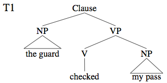
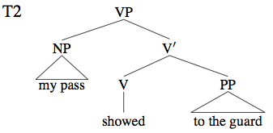
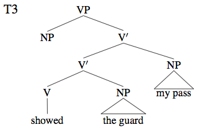
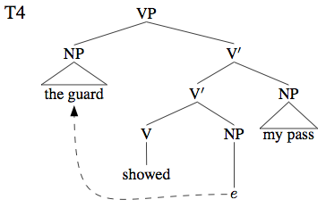
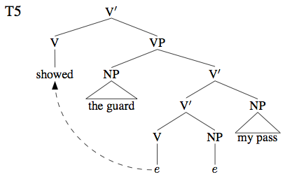
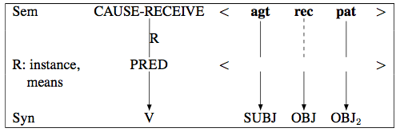
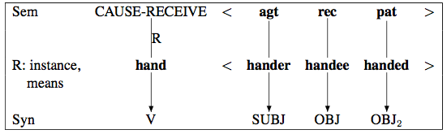
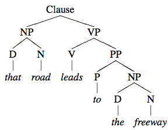

# Philosophy of Linguistics
**First published Wed Sep 21, 2011; substantive revision Thu Mar 7, 2024**

*Scholz, Barbara C., Pelletier, Francis Jeffry, Pullum, Geoffrey K., Nefdt, Ryan*

Philosophy of linguistics is the philosophy of science as applied to linguistics. This differentiates it sharply from the philosophy of language, traditionally concerned with matters of meaning and reference.

As with the philosophy of other special sciences, there are general topics relating to matters like methodology and explanation (e.g., the status of statistical explanations in psychology and sociology, or the physics-chemistry relation in philosophy of chemistry), and more specific philosophical issues that come up in the special science at issue (simultaneity for philosophy of physics; individuation of species and ecosystems for the philosophy of biology). General topics of the first type in the philosophy of linguistics include:

- What the subject matter is,
- What the theoretical goals are,
- What form theories should take, and
- What counts as data.

Specific topics include issues in language learnability, language change, the competence-performance distinction, and the expressive power of linguistic theories.

There are also topics that fall on the borderline between philosophy of language and philosophy of linguistics: of “linguistic relativity” (see the supplement on the linguistic relativity hypothesis in the Summer 2015 archived version of the entry on [relativism](https://plato.stanford.edu/archives/sum2015/entries/relativism/supplement2.html)), language vs. idiolect, speech acts (including the distinction between locutionary, illocutionary, and perlocutionary acts), the language of thought, implicature, and the semantics of mental states (see the entries on analysis, semantic compositionality, mental representation, pragmatics, and defaults in semantics and pragmatics). In these cases it is often the kind of answer given and not the inherent nature of the topic itself that determines the classification. Topics that we consider to be more in the philosophy of language than the philosophy of linguistics include intensional contexts, direct reference, and empty names (see the entries on propositional attitude reports, intensional logic, rigid designators, reference, and descriptions).

This entry does not aim to provide a general introduction to linguistics for philosophers; readers seeking that should consult a suitable textbook such as Akmajian et al. (2010) or Napoli (1996). For a general history of Western linguistic thought, including recent theoretical linguistics, see Seuren (1998). Newmeyer (1986) is useful additional reading for post-1950 American linguistics. Tomalin (2006) traces the philosophical, scientific, and linguistic antecedents of Chomsky’s magnum opus (1955/1956; published 1975), and Scholz and Pullum (2007) provide a critical review. Articles that have focused on the philosophical implications of generative linguistics include Ludlow (2011) and Rey (2020). For recent articles on the philosophy of linguistics more generally, Itkonen (2013) discusses various aspects of the field from its early Greek beginnings, Pullum (2019) details debates that have engaged philosophers from 1945 to 2015, and Nefdt (2019a) discusses connections with contemporary issues in the philosophy of science.

## 1. Three Approaches to Linguistic Theorizing: Externalism, Emergentism, and Essentialism

The issues we discuss have been debated with vigor and sometimes venom. Some of the people involved have had famous exchanges in the linguistics journals, in the popular press, and in public forums. To understand the sharp disagreements between advocates of the approaches it may be useful to have a sketch of the dramatis personae before us, even if it is undeniably an oversimplification.

We see three tendencies or foci, divided by what they take to be the subject matter, the approach they advocate for studying it, and what they count as an explanation. We characterize them roughly in Table 1.

*Table 1.*

|   | externalists | emergentists | essentialists |
| --- | --- | --- | --- |
| *Primary phenomena* | Actual utterances as produced by language users | Facts of social cognition, interaction, and communication | Intuitions of grammaticality and literal meaning |
| *Primary subject matter* | Language use; structural properties of expressions and languages | Linguistic communication, cognition, variation, and change | Abstract universal principles that explain the properties of specific languages |
| *Aim* | To describe attested expression structure and interrelations, and predicting properties of unattested expressions | To explain structural properties of languages in terms of general cognitive mechanisms and communicative functions | To articulate universal principles and provide explanations for deep and cross-linguistically constant linguistic properties |
| *Linguistic structure* | A system of patterns, inferrable from generally accessible, objective features of language use | A system of constructions that range from fixed idiomatic phrases to highly abstract productive types | A system of abstract conditions that may not be evident from the experience of typical language users |
| *Values* | Accurate modeling of linguistic form that accords with empirical data and permits prediction concerning unconsidered cases | Cognitive, cultural, historical, and evolutionary explanations of phenomena found in linguistic communication systems | Highly abstract, covering-law explanations for properties of language as inferred from linguistic intuitions |
| *Children’s language* | A nascent form of language, very different from adult linguistic competence | A series of stages in an ontogenetic process of developing adult communicative competence | Very similar to adult linguistic competence though obscured by cognitive, articulatory, and lexical limits |
| *What is acquired* | A grasp of the distributional properties of the constituents of expressions of a language | A mainly conventional and culturally transmitted system for linguistic communication | An internalized generative device that characterizes an infinite set of expressions |

Table 1. Three Approaches to the Study of Language

A broad and varied range of distinct research projects can be pursued within any of these approaches; one advocate may be more motivated by some parts of the overall project than others are. So the tendencies should not be taken as sharply honed, well-developed research programs or theories. Rather, they provide background biases for the development of specific research programs—biases which sometimes develop into ideological stances or polemical programs or lead to the branching off of new specialisms with separate journals. In the judgment of Phillips (2010), “Dialog between adherents of different approaches is alarmingly rare.”

The names we have given these approaches are just mnemonic tags, not descriptions. The Externalists, for example, might well have been called ‘structural descriptivists’ instead, since they tend to be especially concerned to develop models that can be used to predict the structure of natural language expressions. The Externalists have long been referred to by Essentialists as ‘empiricists’ (and sometimes Externalists apply that term to themselves), though this is misleading (see Scholz and Pullum 2006: 60–63)[^scholz-2006]: the ‘empiricist’ tag comes with an accusation of denying the role of learning biases in language acquisition (see Matthews 1984, Laurence and Margolis 2001)[^laurence-2001][^matthews-1984], but that is no part of the Externalists’ creed (see e.g. Elman 1993, Lappin and Shieber 2007)[^elman-1993][^lappin-2007].

Emergentists are also sometimes referred to by Essentialists as ‘empiricists’, but they either use the Emergentist label for themselves (Bates et al. 1998, O’Grady 2008, MacWhinney 2005)[^bates-1998][^macwhinney-2005][^o’grady-2008] or call themselves ‘usage-based’ linguists (Barlow and Kemmer 2002, Tomasello 2003)[^barlow-2002][^tomasello-2003] or ‘construction grammarians’ (Goldberg 1995, Croft 2001)[^goldberg-1995]. Newmeyer (1991), like Tomasello, refers to the Essentialists as ‘formalists’, because of their tendency to employ abstractions, and to use tools from mathematics and logic.

Despite these terminological inconsistencies, we can look at what typical members of each approach would say about their vision of linguistic science, and what they say about the alternatives. Many of the central differences between these approaches depend on what proponents consider to be the main project of linguistic theorizing, and what they count as a satisfying explanation.

Many researchers—perhaps most—mix elements from each of the three approaches. For example, if Emergentists are to explain the syntactic structure of expressions by appeal to facts about the nature of the use of symbols in human communication, then they will presuppose a great deal of Externalist work in describing linguistic patterns, and those Externalists who work on computational parsing systems frequently use (at least as a starting point) rule systems and ‘structural’ patterns worked out by Essentialists. Certainly, there are no logical impediments for a researcher with one tendency from simultaneously pursuing another; these approaches are only general centers of emphasis.

### 1.1 The Externalists

If one assumes, with the Externalists, that the main goal of a linguistic theory is to develop accurate models of the structural properties of the speech sounds, words, phrases, and other linguistic items, then the clearly privileged information will include corpora (written and oral)—bodies of attested and recorded language use (suitably idealized). The goal is to describe how this public record exhibits certain (perhaps non-phenomenal) patterns that are projectable.

American structural linguistics of the 1920s to 1950s championed the development of techniques for using corpora as a basis for developing structural descriptions of natural languages, although such work was really not practically possible until the wide-spread availability of cheap, powerful, and fast computers. André Martinet (1960: 1) notes that one of the basic assumptions of structuralist approaches to linguistics is that “nothing may be called ‘linguistic’ that is not manifest or manifested one way or another between the mouth of the speaker and the ears of the listener”. He is, however, quick to point out that “this assumption does not entail that linguists should restrict their field of research to the audible part of the communication process—speech can only be interpreted as such, and not as so much noise, because it stands for something else that is not speech.”

American structuralists—Leonard Bloomfield in particular—were attacked, sometimes legitimately and sometimes illegitimately, by certain factions in the Essentialist tradition. For example, it was perhaps justifiable to criticize Bloomfield for adopting a nominalist ontology as popularized by the logical empiricists. But he was later attacked by Essentialists for holding anti-mentalist views about linguistics, when it is arguable that his actual view was that the science of linguistics should not commit itself to any particular psychological theory. (He had earlier been an enthusiast for the mentalist and introspectionist psychology of Wilhelm Wundt; see Bloomfield 1914.)[^bloomfield-1914]

Externalism continues to thrive within computational linguistics, where the American structuralist vison of studying language through automatic analysis of corpora has enjoyed a recrudescence, and very large, computationally searchable corpora are being used to test hypotheses about the structure of languages (see Sampson 2001, chapter 1, for discussion)[^sampson-2001].

### 1.2 The Emergentists

Emergentists aim to explain the capacity for language in terms of non-linguistic human capacities: thinking, communicating, and interacting. Edward Sapir expressed a characteristic Emergentist theme when he wrote:

> Language is primarily a cultural or social product and must be understood as such… It is peculiarly important that linguists, who are often accused, and accused justly, of failure to look beyond the pretty patterns of their subject matter, should become aware of what their science may mean for the interpretation of human conduct in general. (Sapir 1929: 214)[^sapir-1929]

The “pretty patterns” derided here are characteristic of structuralist analyses. Sociolinguistics, which is much closer in spirit to Sapir’s project, studies the influence of social and linguistic structure on each other. One particularly influential study, Labov (1966), examines the influence of social class on language variation. Other sociolinguists examine the relation between status within a group on linguistic innovation (Eckert 1989)[^eckert-1989]. This interest in variation within languages is characteristic of Emergentist approaches to the study of language.

Another kind of Emergentist, like Tomasello (2003), will stress the role of theory of mind and the capacity to use symbols to change conspecifics’ mental states as uniquely human preadaptations for language acquisition, use, and invention. MacWhinney (2005) aims to explain linguistic phenomena (such as phrase structure and constraints on long distance dependencies) in terms of the way conversation facilitates accurate information-tracking and perspective-switching.

Functionalist research programs generally fall within the broad tendency to approach the study of language as an Emergentist. According to one proponent:

> The functionalist view of language [is] as a system of communicative social interaction… Syntax is not radically arbitrary, in this view, but rather is *relatively motivated* by semantic, pragmatic, and cognitive concerns. (Van Valin 1991, quoted in Newmeyer 1991: 4; emphasis in original)[^newmeyer-1991][^van-1991]

And according to Russ Tomlin, a linguist who takes a functionalist approach:

> Syntax is not autonomous from semantics or pragmatics…the rejection of autonomy derives from the observation that the use of particular grammatical forms is strongly linked, even deterministically linked, to the presence of particular semantic or pragmatic functions in discourse. (Tomlin 1990, quoted by Newmeyer (1991): 4)

The idea that linguistic form is autonomous, and more specifically that syntactic form (rather than, say, phonological form) is autonomous, is a characteristic theme of the Essentialists. And the claims of Van Valin and Tomlin to the effect that syntax is *not* independent of semantics and pragmatics might tempt some to think that Emergentism and Essentialism are logically incompatible. But this would be a mistake, since there are a large number of nonequivalent autonomy of form theses.

Even in the context of trying to explain what the autonomy thesis is, Newmeyer (1991: 3) talks about five formulations of the thesis, each of which can be found in some Essentialists’ writings, without (apparently) realizing that they are non-equivalent. One is the relatively strong claim that the central properties of linguistic form *must not* be defined with essential reference to “concepts outside the system”, which suggests that no primitives in linguistics could be defined in psychological or biological terms. Another takes autonomy of form to be a *normative* claim: that linguistic concepts *ought* not to be defined or characterized in terms of non-linguistic concepts. The third and fourth versions are ontological: one denies that central linguistic concepts *should* be ontologically reduced to non-linguistic ones, and the other denies that they *can* be. And in the fifth version the autonomy of syntax is taken to deny that syntactic patterning can be *explained* in terms of meaning or discourse functions.

For each of these versions of autonomy, there are Essentialists who agree with it. Probably the paradigmatic Essentialist agrees with them all. But Emergentists need not disagree with them all. Paradigmatic functionalists like Tomlin, Van Valin and MacWhinney could in principle hold that the explanation of syntactic form, for example, will ultimately be in terms of discourse functions and semantics, but still accept that syntactic categories cannot be reduced to non-linguistic ones.

### 1.3 The Essentialists

If Leonard Bloomfield is the intellectual ancestor of Externalism, and Sapir the father of Emergentism, then Noam Chomsky is the intellectual ancestor of Essentialism. The researcher with predominantly Essentialist inclinations aims to identify the intrinsic properties of language that make it what it is. For a huge majority of practitioners of this approach—researchers in the tradition of **generative grammar** associated with Chomsky—this means postulating universals of human linguistic structure, unlearned but tacitly known, that permit and assist children to acquire human languages. This generative Essentialism has a preference for finding surprising characteristics of languages that cannot be inferred from the data of usage, and are not predictable from human cognition or the requirements of communication.

Rather than being impressed with language variation, as are Emergentists and many Externalists, the generative Essentialists are extremely impressed with the idea that very young children of almost any intelligence level, and just about any social upbringing, acquire language to the same high degree of mastery. From this it is inferred that there must be unlearned features shared by all languages that somehow assist in language acquisition.

A large number of contemporary Essentialists who follow Chomsky’s teaching on this matter claim that semantics and pragmatics are not a central part of the study of language. In Chomsky’s view, “it is possible that natural language has only syntax and pragmatics” (Chomsky 1995: 26)[^chomsky-1995]; that is, only “internalist computations and performance systems that access them”; semantic theories are merely “part of an interface level” or “a form of syntax” (Chomsky 1992: 223)[^chomsky-1992].

Thus, while Bloomfield understood it to be a sensible practical decision to assign semantics to some field other than linguistics because of the underdeveloped state of semantic research, Chomsky appears to think that semantics as standardly understood is not part of the essence of the language faculty at all. (In broad outline, this exclusion of semantics from linguistics comports with Sapir’s view that form is linguistic but content is cultural.)

Although Chomsky is an Essentialist in his approach to the study of language, excluding semantics as a central part of linguistic theory clearly does not follow from linguistic Essentialism (Katz 1980 provides a detailed discussion of Chomsky’s views on semantics)[^katz-1980]. Today there are many Essentialists who *do* hold that semantics is a component of a full linguistic theory.

For example, many linguists today are interested in the syntax-semantics interface—the relationship between the surface syntactic structure of sentences and their semantic interpretation. This area of interest is generally quite alien to philosophers who are primarily concerned with semantics only, and it falls outside of Chomsky’s syntactocentric purview as well. Linguists who work in the kind of semantics initiated by Montague (1974) certainly focus on the essential features of language (most of their findings appear to be of universal import rather than limited to the semantic rules of specific languages). Useful works to consult to get a sense of the modern style of investigation of the syntax-semantics interface would include Partee (1975), Jacobson (1996), Szabolcsi (1997), Chierchia (1998), Steedman (2000).

### 1.4 Comparing the three approaches

The discussion so far has been at a rather high level of abstraction. It may be useful to contrast the three tendencies by looking at how they each would analyze a particular linguistic phenomenon. We have selected the syntax of **double-object** clauses like *Hand the guard your pass* (also called **ditransitive** clauses), in which the verb is immediately followed by a sequence of two noun phrases, the first typically denoting a recipient and the second something transferred. For many such clauses there is an alternative way of expressing roughly the same thing: for *Hand the guard your pass* there is the alternative *Hand your pass to the guard*, in which the verb is followed by a single object noun phrase and the recipient is expressed after that by a preposition phrase with *to*. We will call these **recipient-PP** clauses.

#### 1.4.1 A typical Essentialist analysis

Larson (1988) offers a generative Essentialist approach to the syntax of double-object clauses. In order to provide even a rough outline of his proposals, it will be very useful to be able to use **tree diagrams** of syntactic structure. A tree is a mathematical object consisting of a set of points called **nodes** between which certain relations hold. The nodes correspond to syntactic units; left-right order on the page corresponds to temporal order of utterance between them; and upward connecting lines represent the relation ‘is an immediate subpart of’. Nodes are labeled to show categories of phrases and words, such as noun phrase (NP); preposition phrase (PP); and verb phrase (VP). When the internal structure of some subpart of a tree is basically unimportant to the topic under discussion, it is customary to mask that part with an empty triangle. Consider a simple example: an active transitive clause like (Ai) and its passive equivalent (Aii).

**(A)**

i. The guard checked my pass. [active clause]

**ii.**

My pass was checked by the guard. [passive clause]

A tree structure for (Ai) is shown in (T1).



In analyses of the sort Larson exemplifies, the structure of an expression is given by a **derivation**, which consists of a sequence of successively modified trees. Larson calls the earliest ones **underlying** structures. The last (and least abstract) in the derivation is the surface structure, which captures properties relevant to the way the expression is written and pronounced. The underlying structures are posited in order to better identify syntactic generalizations. They are related to surface structures by a series of operations called **transformations** (which generative Essentialists typically regard as mentally real operations of the human language faculty).

One of the fundamental operations that a transformation can effect is **movement**, which involves shifting a part of the syntactic structure of a tree to another location within it. For example, it is often claimed that passive clauses have very much the same kinds of underlying structures as the synonymous active clauses, and thus a passive clause like (Aii) would have an underlying structure much like (T1). A movement transformation would shift *the guard* toward the end of the clause (and add *by*), and another would shift *my pass* into the position before the verb. In other words, passive clauses look much more like their active counterparts in underlying structure.

In a similar way, Larson proposes that a double-object clause like (B.ii) has the same underlying structure as (B.i).

**(B)**

i. *I showed my pass to the guard.* [recipient-PP]

**ii.**

*I showed the guard my pass.* [double object]

Moreover, he proposes that the transformational operation of deriving the surface structure of (B.ii) from the underlying structure of (B.i) is essentially the same as the one that derives the surface structure of (A.ii) from the underlying structure of (A.i).

Larson adopts many assumptions from Chomsky (1981) and subsequent work. One is that all NPs have to be assigned **Case** in the course of a derivation. (Case is an abstract syntactic property, only indirectly related to the morphological case forms displayed by nominative, accusative, and genitive pronouns. Objective Case is assumed to be assigned to any NP in direct object position, e.g., *my pass* in (T1), and Nominative Case is assigned to an NP in the subject position of a tensed clause, e.g., *the guard* in (T1).)

He also makes two specific assumptions about the derivation of passive clauses. First, Case assignment to the position immediately after the verb is “suppressed”, which entails that the NP there will not get Case unless it moves to some other position. (The subject position is the obvious one, because there it will receive Nominative Case.) Second, there is an unusual assignment of semantic role to NPs: instead of the subject NP being identified as the agent of the action the clause describes, that role is assigned to an adjunct at the end of the VP (the *by*-phrase in (A.ii); an adjunct is a constituent with an optional modifying role in its clause rather than a grammatically obligatory one like subject or object).

Larson proposes that both of these points about passive clauses have analogs in the structure of double-object VPs. First, Case assignment to the position immediately after the verb is suppressed; and since Larson takes the preposition to to be the marker of Case, this means in effect that *to* disappears. This entails that the NP after *to* will not get Case unless it moves to some other position. Second, there is an unusual assignment of semantic role to NPs: instead of the direct object NP being identified as the entity affected by the action the clause describes, that role is assigned to an adjunct at the end of the VP.

Larson makes some innovative assumptions about VPs. First, he proposes that in the underlying structure of a double-object clause *the direct object precedes the verb*, the tree diagram being (T2).



This does not match the surface order of words (*showed my pass to the guard*), but it is not intended to: it is an underlying structure. A transformation will move the verb to the left of *my pass* to produce the surface order seen in (B.i).

Second, he assumes that there are two nodes labeled VP in a double-object clause, and two more labeled V′, though there is only one word of the verb (V) category. (Only the smaller VP and V′ are shown in the partial structure (T2).)

What is important here is that (T2) is the basis for the double-object surface structure as well. To produce that, the preposition *to* is erased and an additional NP position (for *my pass*) is attached to the V′, thus:



The additional NP is assigned the affected-entity semantic role. The other NP (*the guard*) does not yet have Case; but Larson assumes that it moves into the NP position before the verb. The result is shown in (T4), where ‘*e*’ marks the empty string left where some words have been moved away:



Larson assumes that in this position *the guard* can receive Case. What remains is for the verb to move into a higher V position further to its left, to obtain the surface order:



The complete sequence of transformations is taken to give a deep theoretical explanation of many properties of (B.i) and (B.ii), including such things as what could be substituted for the two NPs, and the fact there is at least rough truth-conditional equivalence between the two clauses.

The reader with no previous experience of generative linguistics will have many questions about the foregoing sketch (e.g., whether it is really necessary to have *the guard* after *showed* in (T3), then the opposite order in (T4), and finally the same order again in (T5)). We cannot hope to answer such questions here; Larson’s paper is extremely rich in further assumptions, links to the previous literature, and additional classes of data that he aims to explain. But the foregoing should suffice to convey some of the flavor of the analysis.

The key point to note is that Essentialists seek underlying symmetries and parallels whose operation is not manifest in the data of language use. For Essentialists, there is positive explanatory virtue in hypothesizing abstract structures that are very far from being inferrable from performance; and the posited operations on those structures are justified in terms of elegance and formal parallelism with other analyses, not through observation of language use in communicative situations.

#### 1.4.2 A typical Emergentist analysis

Many Emergentists are favorably disposed toward the kind of **construction grammar** expounded in Goldberg (1995). We will use her work as an exemplar of the Emergentist approach. The first thing to note is that Goldberg does not take double-object clauses like (B.ii) to be derived alternants of recipient-PP structures like (B.i), the way Larson does. So she is not looking for a regular syntactic operation that can relate their derivations; indeed, she does not posit derivations at all. She is interested in explaining correlations between syntactic, semantic, and pragmatic aspects of clauses; for example, she asks this question:

> How are the semantics of independent constructions related such that the classes of verbs associated with one overlap with the classes of verbs associated with another? (Goldberg 1995: 89)[^goldberg-1995]

Thus she aims to explain why some verbs occur in both the double-object and recipient-PP kinds of expression and some do not.

The fundamental notion in Goldberg’s linguistic theory is that of a **construction**. A construction can be defined very roughly as a way of structurally composing words or phrases—a sort of template—for expressing a certain class of meanings. Like Emergentists in general, Goldberg regards linguistic theory as continuous with a certain part of general cognitive psychological theory; linguistics emerges from this more general theory, and linguistic matters are rarely fully separate from cognitive matters. So a construction for Goldberg has a mental reality: it corresponds to a generalized concept or scenario expressible in a language, annotated with a guide to the linguistic structure of the expression.

Many words will be trivial examples of constructions: a single concept paired with a way of pronouncing and some details about grammatical restrictions (category, inflectional class, etc.); but constructions can be much more abstract and internally complex. The double-object construction, which Goldberg calls the Ditransitive Construction, is a moderately abstract and complex one; she diagrams it thus (p. 50):



This expresses a set of constraints on how to use English to communicate the idea of a particular kind of scenario. The scenario involves a ternary relation CAUSE-RECEIVE holding between an agent (**agt**), a recipient (**rec**), and a patient (**pat**). PRED is a variable that is filled by the meaning of a particular verb when it is employed in this construction.

The solid vertical lines downward from **agt** and **pat** indicate that for any verb integrated into this construction it is required that its subject NP should express the agent participant, and the direct object (OBJ₂) should express the patient participant. The dashed vertical line downward from rec signals that the first object (OBJ) may express the recipient but it does not have to—the necessity of there being a recipient is a property of the construction itself, and not every verb demands that it be made explicit who the recipient is. But if there are two objects, the first is obligatorily associated with the recipient role: *We sent the builder a carpenter* can only express a claim about the sending of a carpenter over to the builder, never the sending of the builder over to where a carpenter is.

When a particular verb is used in this construction, it may have obligatory accompanying NPs denoting what Goldberg calls “profiled participants” so that the match between the participant roles (**agt**, **rec**, **pat**) is one-to-one, as with the verb *hand*. When this verb is used, the agent (‘hander’), recipient (‘handee’), and item transferred (‘handed’) must all be made explicit. Goldberg gives the following diagram of the “composite structure” that results when *hand* is used in the construction:



Because of this requirement of explicit presence, *Hand him your pass* is grammatical, but ^{*}*Hand him* is not, and neither is ^{*}*Hand your pass*. The verb *send*, on the other hand, illustrates the optional syntactic expression of the recipient role: we can say *Send a text message*, which is understood to involve some recipient but does not make the recipient explicit.

The R notation relates to the fact that particular verbs may express either an *instance* of causing someone to receive something, as with *hand*, or a *means* of causing someone to receive something, as with *kick*: what *Joe kicked Bill the ball* means is that Joe caused Bill to receive the ball by means of a kicking action.

Goldberg’s discussion covers many subtle ways in which the scenario communicated affects whether the use of a construction is grammatical and appropriate. For example, there is something odd about ^{?}*Joe kicked Bill the ball he was trying to kick to Sam*: the Ditransitive Construction seems best suited to cases of volitional transfer (rather than transfer as an unexpected side effect of a blunder). However, an exception is provided by a class of cases in which the transfer is not of a physical object but is only metaphorical: *That guy gives me the creeps* does not imply any volitional transfer of a physical object.

Metaphorical cases are distinguished from physical transfers in other ways as well. Goldberg notes sentences like *The music lent the event a festive air*, where *the music* is subject of the verb lend despite the fact that music cannot literally lend anything to anyone.

Goldberg discusses many topics such as metaphorical extension, shading, metonymy, cutting, role merging, and also presents various general principles linking meanings and constructions. One of these principles, the No Synonymy Principle, says that no two syntactically distinct constructions can be both semantically and pragmatically synonymous. It might seem that if any two sentences are synonymous, pairs like this are:

**(C)**

i. *She gave her husband an iPod.* [double object]

**ii.**

*She gave an iPod to her husband.* [recipient-PP]

Yet the two constructions cannot be fully synonymous, both semantically and pragmatically, if the No Synonymy Principle is correct. And to support the principle, Goldberg notes purported contrasts such as this:

**(D)**

i. *She gave her husband a new interest in music.* [double object]

**ii.**

^{?}*She gave a new interest in music to her husband.* [recipient-PP]

There is a causation-as-transfer metaphor here, and it seems to be compatible with the double object construction but not with the recipient-PP. So (in Goldberg’s view) the two are not fully synonymous.

It is no part of our aim here to provide a full account of the content of Goldberg’s discussion of double-object clauses. But what we want to highlight is that the focus is not on finding abstract elements or operations of a purely syntactic nature that are candidates for being essential properties of language per se. The focus for Emergentists is nearly always on the ways in which meaning is conveyed, the scenarios that particular constructions are used to communicate, and the aspects of language that connect up with psychological topics like cognition, perception, and conceptualization.

#### 1.4.3 A typical Externalist analysis

One kind of work that is representative of the Externalist tendency is nicely illustrated by Bresnan et al. (2007) and Bresnan and Ford (2010). Bresnan and her colleagues defend the use of corpora—bodies of attested written and spoken texts. One of their findings is that a number of types of expressions that linguists have often taken to be ungrammatical do in fact turn up in actual use. Essentialists and Emergentists alike have often, purely on the basis of intuition, asserted that sentences like *John gave Mary a kiss* are grammatical but sentences like *John gave a kiss to Mary* are no, as we see above with Goldberg’s (D)(ii). Bresnan and her colleagues find numerous occurrences of the latter sort on the World Wide Web, and conclude that they are not ungrammatical or even unacceptable, but merely dispreferred.

Bresnan and colleagues used a three-million-word collection of recorded and transcribed spontaneous telephone conversations known as the Switchboard corpus to study the double-object and recipient-PP constructions. They first annotated the utterances with indications of a number of factors that they thought might influence the choice between the double-object and recipient-PP constructions:

- Discourse accessibility of NPs: does a particular NP refer to something already mentioned, or to something new to the discourse?
- Relative lengths of NPs: what is the difference in number of words between the recipient NP and the transferred-item NP?
- Definiteness: are the recipient and transferred-item NPs definite like *the bishop* or indefinite like *some members*
- Animacy: do the recipient and transferred-item NPs denote animate beings or inanimate things?
- Pronominality: are the recipient and transferred-item NPs pronouns?
- Number: are the recipient and transferred-item NPs singular or plural?
- person: are the recipient and transferred-item NPs first-person or second-person pronouns, or third person?

They also coded the verb meanings by assigning them to half a dozen semantic categories:

- Abstract senses (*give it some thought*);
- Transfer of possession (*give him an armband*);
- Future transfer of possession (*I owe you a dollar*);
- Prevention of possession (*They denied me my rights*);
- Communication verb sense (*tell me your name*).

They then constructed a statistical model of the corpus: a mathematical formula expressing, for each combination of the factors listed above, the ratio of the probabilities of the double object and the recipient-PP. (To be precise, they used the natural logarithm of the ratio of *p* to 1 − *p*, where *p* is the probability of a double-object or recipient-PP in the corpus being of the double-object form.) They then used logistic regression to predict the probability of fit to the data.

To determine how well the model generalized to unseen data, they divided the data randomly 100 times into a training set and a testing set, fit the model parameters on each training set, and scored its predictions on the unseen testing set. The average percent of correct predictions on unseen data was 92%. All components of the model except number of the recipient NP made a statistically significant difference—almost all at the 0.001 level.

What this means is that knowing only the presence or absence of the sort of factors listed above they were reliably able to predict whether double-object or recipient-PP structures would be used in a given context, with a 92% score accuracy rate.

The implication is that the two kinds of structure are not interchangeable: they are reliably differentiated by the presence of other factors in the texts in which they occur.

They then took the model they had generated for the telephone speech data and applied it to a corpus of written material: the *Wall Street Journal* corpus (WSJ), a collection of 1987–9 newspaper copy, only roughly edited. The main relevant difference with written language is that the language producer has more opportunity to reflect thoughtfully on how they are going to phrase things. It was reasonable to think that a model based on speech data might not transfer well. But instead the model had 93.5% accuracy. The authors conclude is that “the model for spoken English transfers beautifully to written”. The main difference between the corpora was found to be a slightly higher probability of the recipient-PP structure in written English.

In a very thorough subsequent study, Bresnan and Ford (2010) show that the results also correlate with native speakers’ metalinguistic judgments of naturalness for sentence structures, and with lexical decision latencies (speed of deciding whether the words in a text were genuine English words or not), and with a sentence completion task (choosing the most natural of a list of possible completions of a partial sentence). The results of these experiments confirmed that their model predicted participants’ performance.

Among the things to note about this work is that it was all done on directly recorded performance data: transcripts of people speaking to each other spontaneously on the phone in the case of the Switchboard corpus, stories as written by newspaper journalists in the case of WSJ, measured responses of volunteer subjects in a laboratory in the case of the psycholinguistic experiments of Bresnan and Ford (2010). The focus is on identifying the factors in linguistic performance that permit accurate prediction of future performance, and the methods of investigation have a replicability and checkability that is familiar in the natural sciences.

However, we should make it clear that the work is not some kind of close-to-the-ground collecting and classifying of instances. The models that Bresnan and her colleagues develop are sophisticated mathematical abstractions, very far removed from the records of utterance tokens. They claim that these models “allow linguistic theory to solve more difficult problems than it has in the past, and to build convergent projects with psychology, computer science, and allied fields of cognitive science” (Bresnan et al. 2007: 69)[^bresnan-2007][^bresnan-2007-2].

#### 1.4.4 Conclusion

It is important to see that the contrast we have drawn here is not just between three pieces of work that chose to look at different aspects of the phenomena associated with double-object sentences. It is true that Larson focuses more on details of tree structure, Goldberg more on subtle differences in meaning, and Bresnan et al. on frequencies of occurrence. But that is not what we are pointing to. What we want to stress is that we are illustrating three different broad approaches to language that regard different facts as likely to be relevant, and make different assumptions about what needs to be accounted for, and what might count as an explanation.

Larson looks at contrasts between different kinds of clause with different meanings and see evidence of abstract operations affecting subtle details of tree structure, and parallelism between derivational operations formerly thought distinct.

Goldberg looks at the same facts and sees evidence not for anything to do with derivations but for the reality of specific constructions—roughly, packets of syntactic, semantic, and pragmatic information tied together by constraints.

Bresnan and her colleagues see evidence that readily observable facts about speaker behavior and frequency of word sequences correlate closely with certain lexical, syntactic, and semantic properties of words.

Nothing precludes defenders of any of the three approaches from paying attention to any of the phenomena that the other approaches attend to. There is ample opportunity for linguists to mix aspects of the three approaches in particular projects. But in broad outline there are three different tendencies exhibited here, with stereotypical views and assumptions roughly as we laid them out in Table 1.

## 2. The Subject Matter of Linguistic Theories

The complex and multi-faceted character of linguistic phenomena means that the discipline of linguistics has a whole complex of distinguishable subject matters associated with different research questions. Among the possible topics for investigation are these:

1. the capacity of humans to acquire, use, and invent languages;
2. the abstract structural patterns (phonetic, morphological, syntactic, or semantic) found in a particular language under some idealization;
3. systematic structural manifestations of the use of some particular language;
4. the changes in a language or among languages across time;
5. the psychological functioning of individuals who have successfully acquired particular languages;
6. the psychological processes underlying speech or linguistically mediated thinking in humans;
7. the evolutionary origin of (i), and/or (ii).

There is no reason for all of the discipline of linguistics to converge on a single subject matter, or to think that the entire field of linguistics cannot have a diverse range of subject matters. To give a few examples:

- The influential Swiss linguist Ferdinand de Saussure (1916) distinguished between *langue*, a socially shared set of abstract conventions (compare with (ii)) and *parole*, the particular choices made by a speaker deploying a language (compare (iii)).
- The anthropological linguist Edward Sapir (1921, 1929) thought that human beings have a seemingly species-universal capacity to acquire and use languages (compare (i)), but his own interest was limited to the systematic structural features of particular languages (compare (ii)) and the psychological reality of linguistic units such as the phoneme (an aspect of (vi)), and the psychological effects of language and thought (an aspect of (v)).
- Bloomfield (1933) showed a strong interest in historical linguistic change (compare (iv)), distinguishing that sharply (much as Saussure did) from synchronic description of language structure ((ii) again) and language use (compare (iii)), arguing that the study of (iv) presupposed (vi).
- Bloomfield famously eschewed all dualistic mentalistic approaches to the study of language, but since he rejected them on materialist ontological grounds, his rejection of mentalism was not clearly a rejection of (vi) or (vii): his attempt to cast linguistics in terms of stimulus-response psychology indicates that he was sympathetic to the Weissian psychology of his time and accepted that linguistics might have psychological subject matter.
- Zellig Harris, on the other hand, showed little interest in the psychology of language, concentrating on mathematical techniques for tackling (ii).

Most saliently of all, Harris’s student Chomsky reacted strongly against indifference toward the mind, and insisted that the principal subject matter of linguistics was, and had to be, a narrow psychological version of (i), and an individual, non-social, and internalized conception of (ii).

In the course of advancing his view, Chomsky introduced a number of novel pairs of terms into the linguistics literature: competence vs. performance (Chomsky 1965)[^chomsky-1965]; ‘I-language’ vs. ‘E-language’ (Chomsky 1986)[^chomsky-1986]; the faculty of language in the narrow sense vs. the and faculty of language in the broad sense (the ‘FLN’ and ‘FLB’ of Hauser et al. 2002)[^hauser-2002]. Because Chomsky’s terminological innovations have been adopted so widely in linguistics, the focus of sections 2.1–2.3 will be to examine the use of these expressions as they were introduced into the linguistics literature and consider their relation to (i)–(vii).

### 2.1 Competence and performance

Essentialists invariably distinguish between what Chomsky (1965) called **competence** and **performance**. Competence is what knowing a language confers: a tacit grasp of the structural properties of all the sentences of a language. Performance involves actual real-time use, and may diverge radically from the underlying competence, for at least two reasons: (a) an attempt to produce an utterance may be perturbed by non-linguistic factors like being distracted or interrupted, changing plans or losing attention, being drunk or having a brain injury; or (b) certain capacity limits of the mechanisms of perception or production may be overstepped.

Emergentists tend to feel that the competence/performance distinction sidelines language use too much. Bybee and McClelland put it this way:

> One common view is that language has an essential and unique inner structure that conforms to a universal ideal, and what people say is a potentially imperfect reflection of this inner essence, muddied by performance factors. According to an opposing view…language use has a major impact on language structure. The experience that users have with language shapes cognitive representations, which are built up through the application of general principles of human cognition to linguistic input. The structure that appears to underlie language use reflects the operation of these principles as they shape how individual speakers and hearers represent form and meaning and adapt these forms and meanings as they speak. (Bybee and McClelland 2005: 382)[^bybee-2005]

And Externalists are often concerned to describe and explain not only language structure, but also the workings of processing mechanisms and the etiology of performance errors.

However, every linguist accepts that some idealization away from the speech phenomena is necessary. Emergentists and Externalists are almost always happy to idealize away from sporadic speech errors. What they are not so keen to do is to idealize away from limitations on linguistic processing and the short-term memory on which it relies. Acceptance of a thoroughgoing competence/performance distinction thus tends to be a hallmark of Essentialist approaches, which take the nature of language to be entirely independent of other human cognitive processes (though of course capable of connecting to them).

The Essentialists’ practice of idealizing away from even psycholinguistically relevant factors like limits on memory and processing plays a significant role in various important debates within linguistics. Perhaps the most salient and famous is the issue of whether English is a finite-state language.

The claim that English is not accepted by any finite-state automaton can only be supported by showing that every grammar for English has center- embedding to an unbounded depth (see Levelt 2008: 20–23 for an exposition and proof of the relevant theorem, originally from Chomsky 1959)[^chomsky-1959][^levelt-2008]. But even depth-3 center-embedding of clauses (a clause interrupting a clause that itself interrupts a clause) is in practice extraordinarily hard to process. Hardly anyone can readily understand even semantically plausible sentences like *Vehicles that engineers who car companies trust build crash every day*. And such sentences virtually never occur, even in writing. Karlsson (2007) undertakes an extensive examination of available textual material, and concludes that depth-3 center-embeddings are vanishingly rare, and no genuine depth-4 center-embedding has ever occurred at all in naturally composed text. He proposes that there is no reason to regard center-embedding as grammatical beyond depth 3 (and for spoken language, depth 2). Karlsson is proposing a grammar that stays close to what performance data can confirm; the standard Essentialist view is that we should project massively from what is observed, and say that depth-*n* center-embedding is fully grammatical for all *n*.

### 2.2 ‘I-Language’ and ‘E-Language’

Chomsky (1986) introduced into the linguistics literature two technical notions of a language: ‘E-Language’ and ‘I-Language’. He deprecates the former as either undeserving of study or as a fictional entity, and promotes the latter as the only scientifically respectable object of study for a serious linguistics.

#### 2.2.1 ‘E-language’

Chomsky’s notion ‘E-language’ is supposed to suggest by its initial ‘E’ both ‘extensional’ (concerned with which sentences happen to satisfy a definition of a language rather than with what the definition says) and ‘external’ (external to the mind, that is, non-mental). The dismissal of E-language as an object of study is aimed at critics of Essentialism—many but not all of those critics falling within our categories of Externalists and Emergentists.

**Extensional**. First, there is an attempt to impugn the extensional notion of a language that is found in two radically different strands of Externalist work. Some Externalist investigations are grounded in the details of attested utterances (as collected in corpora), external to human minds. Others, with mathematical or computational interests, sometimes idealize languages as extensionally definable objects (typically infinite sets of strings) with a certain structure, independently of whatever device might be employed to characterize them. A set of strings of words either is or is not regular (finite-state), either is or is not recursive (decidable), etc., independently of forms of grammar statement. Chomsky (1986) basically dismissed both corpus-based work and mathematical linguistics simply on the grounds that they employ an extensional conception of language that is, a conception that removes the object of study from having an essential connection with the mental.

**External**. Second, a distinct meaning based on ‘external’ was folded into the neologism ‘E-language’ to suggest criticism of any view that conceives of a natural language as a public, intersubjectively accessible system used by a community of people (often millions of them spread across different countries). Here, the objection is that languages as thus conceived have no clear criteria of individuation in terms of necessary and sufficient conditions. On this conception, the subject matter of interest is a historico-geographical entity that changes as it is transmitted over generations, or over mountain ranges. Famously, for example, there is a gradual valley-to-valley change in the language spoken between southeastern France and northwestern Italy such that each valley’s speakers can understand the next. But the far northwesterners clearly speak French and the far southeasterners clearly speak Italian. It is the politically defined geographical border, not the intrinsic properties of the dialects, that would encourage viewing this continuum as two different languages.

Perhaps the most famous quotation by any linguist is standardly attributed to Max Weinreich (1945): ‘A shprakh iz a dialekt mit an armey un flot’ (‘A language is a dialect with an army and navy’; he actually credits the remark to an unnamed student). The implication is that E-languages are defined in terms of non-linguistic, non-essential properties. Essentialists object that a scientific linguistics cannot tolerate individuating French and Italian in a way that is subject to historical contingencies of wars and treaties (after all, the borders could have coincided with a different hill or valley had some battle had a different outcome).

Considerations of intelligibility fare no better. Mutual intelligibility between languages is not a transitive relation, and sometimes the intelligibility relation is not even symmetric (smaller, more isolated, or less prestigious groups often understand the dialects of larger, more central, or higher-prestige groups when the converse does not hold). So these sociological facts cannot individuate languages either.

Chomsky therefore concludes that languages cannot be defined or individuated extensionally or mind-externally, and hence the only scientifically interesting conception of a ‘language’ is the ‘I-language’ view (see for example Chomsky 1986: 25; 1992; 1995 and elsewhere)[^chomsky-1986]. Chomsky says of E-languages that “all scientific approaches have simply abandoned these elements of what is called ‘language’ in common usage” (Chomsky 1988, 37)[^chomsky-1988]; and “we can define E-language in one way or another or not at all, since the concept appears to play no role in the theory of language” (Chomsky 1986: 26; in saying that it appears to play no role in the theory of language, here he means that it plays no role in the theory he favours)[^chomsky-1986].

This conclusion may be bewildering to non-linguists as well as non-Essentialists. It is at odds with what a broad range of philosophers have tacitly assumed or explicitly claimed about language or languages: ‘[A language] is a practice in which people engage…it is constituted by rules which it is part of social custom to follow’ (Dummett 1986: 473–473)[^dummett-1986]; ‘Language is a set of rules existing at the level of common knowledge’ and these rules are ‘norms which govern intentional social behavior’ (Itkonen 1978: 122)[^itkonen-1978], and so on. Generally speaking, those philosophers influenced by Wittgenstein also take the view that a language is a social-historical entity. But the opposite view has become a part of the conceptual underpinning of linguistics for many Essentialists.

Failing to have precise individuation conditions is surely not a sufficient reason to deny that an entity can be studied scientifically. ‘Language’ as a count noun in the extensional and socio-historical sense is vague, but this need not be any greater obstacle to theorizing about them than is the vagueness of other terms for historical entities without clear individuation conditions, like ‘species’ and ‘individual organism’ in biology.

At least some Emergentist linguists, and perhaps some Externalists, would be content to say that languages are collections of social conventions, publicly shared, and some philosophers would agree (see Millikan 2003, for example, and Chomsky 2003 for a reply)[^chomsky-2003][^millikan-2003]. Lewis (1969) explicitly defends the view that language can be understood in terms of public communications, functioning to solve coordination problems within a group (although he acknowledges that the coordination could be between different temporal stages of one individual, so language use by an isolated person is also intelligible; see the appendix “Lewis’s Theory of Languages as Conventions” in the entry on idiolects, for further discussion of Lewis). What Chomsky calls E-languages, then, would be perfectly amenable to linguistic or philosophical study. Santana (2016) makes a similar argument in terms of scientific idealization. He argues that since all sciences idealize their targets, Chomsky needs to do more to show why idealizations concerning E-languages are illicit (see also Stainton 2014)[^stainton-2014].

#### 2.2.2 ‘I-language’

Chomsky (1986) introduced the neologism ‘I-language’ in part to disambiguate the word ‘grammar’. In earlier generative Essentialist literature, ‘grammar’ was (deliberately) ambiguous between (i) the linguist’s generative theory and (ii) what a speaker knows when they know a language. ‘I-language’ can be regarded as a replacement for Bever’s term ‘psychogrammar’ (see also George 1989)[^george-1989]: it denotes a mental or psychological entity (not a grammarian’s description of a language as externally manifested).

I-language is first discussed under the sub-heading of ‘internalized language’ to denote linguistic knowledge. Later discussion in Chomsky 1986 and 1995 makes it clear that the ‘I’ of ‘I-language’ is supposed to suggest at least three English words: ‘individual’, ‘internal’, and ‘intensional’. And Chomsky emphasizes that the neologism also implies a kind of realism about speakers’ knowledge of language.

**Individual**. A language is claimed to be strictly a property of individual human beings—not groups. The contrast is between the idiolect of a single individual, and a dialect or language of a geographical, social, historical, or political group. I-languages are properties of the minds of individuals who know them.

**Internal**. As generative Essentialists see it, your I-language is a state of your mind/brain. Meaning is internal—indeed, on Chomsky’s conception, an I-language

> is a strictly internalist, individualist approach to language, analogous in this respect to studies of the visual system. If the cognitive system of Jones’s language faculty is in state L, we will say that Jones has the I-language L. (Chomsky 1995: 13)[^chomsky-1995]

And he clarifies the sense in which an I-language is internal by appealing to an analogy with the way the study of vision is internal:

> The same considerations apply to the study of visual perception along lines pioneered by David Marr, which has been much discussed in this connection. This work is mostly concerned with operations carried out by the retina; loosely put, the mapping of retinal images to the visual cortex. Marr’s famous three levels of analysis—computational, algorithmic, and implementation—have to do with ways of construing such mappings. Again, the theory applies to a brain in a vat exactly as it does to a person seeing an object in motion. (Chomsky 1995: 52)[^chomsky-1995]

Thus, while the speaker’s I-language may be involved in performing operations over representations of distal stimuli—representations of other speaker’s utterances—I-languages can and should be studied in isolation from their external environments.

Although Chomsky sometimes refers to this narrow individuation of I-languages as ‘individual’, he clearly claims that I-languages are individuated in isolation from both speech communities and other aspects of the broadly conceived natural environment:

> Suppose Jones is a member of some ordinary community, and J is indistinguishable from him except that his total experience derives from some virtual reality design; or let J be Jones’s Twin in a Twin-Earth scenario. They have had indistinguishable experiences and will behave the same way (in so far as behavior is predictable at all); they have the same internal states. Suppose that J replaces Jones in the community, unknown to anyone except the observing scientist. Unaware of any change, everyone will act as before, treating J as Jones; J too will continue as before. The scientist seeking the best theory of all of this will construct a narrow individualist account of Jones, J, and others in the community. The account omits nothing… (Chomsky 1995: 53–54)[^chomsky-1995]

This passage can also be seen as suggesting a radically intensionalist conception of language.

**Intensional**. The way in which I-languages are ‘intensional’ for Chomsky needs a little explication. The concept of intension is familiar in logic and semantics, where ‘intensional’ contrasts with ‘extensional’. The extension of a predicate like blue is simply the set of all blue objects; the intension is the function that picks out in a given world the blue objects contained therein. In a similar way, the extension of a set can be distinguished from an intensional description of the set in terms of a function: the set of integer squares is {1, 4, 9, 16, 25, 36, …}, and the intension could be given in terms of the one-place function *f* such that *f*(*n*) = *n* × *n*. One difference between the two accounts of squaring is that the intensional one could be applied to a different domain (any domain on which the ‘×’ operation is defined: on the rationals rather than the integers, for example, the extension of the identically defined function is a different and larger set containing infinitely many fractions).

In an analogous way, a language can be identified with the set of all and only its expressions (regardless of what sort of object an expression is: a word sequence, a tree structure, a complete derivation, or whatever), which is the extensional view; but it can also be identified intensionally by means of a recipe or formal specification of some kind—what linguists call a grammar. Ludlow (2011) considers the first I (individual) to be the weakest link and thus the most expendable. He argues in its stead for a concept of a “Ψ-language” which allows for the possibility of the I-language relating to external objects either constitutively or otherwise.

In natural language semantics, an intensional context is one where substitution of co-extensional terms fails to preserve truth value (*Scott is Scott* is true, and *Scott is the author of Waverley* is true, but the truth of *George knows that Scott is Scott* doesn’t guarantee the truth of *George knows that Scott is the author of Waverly*, so *knows that* establishes an intensional context).

Chomsky claims that the truth of an I-language attribution is not preserved by substituting terms that have the same extension. That is, even when two human beings do not differ at all on what expressions are grammatical, it may be false to say that they have the same I-language. Where H is a human being and L is a language (in the informal sense) and R is the relation of knowing (or having, or using) that holds between a human being and a language, Chomsky holds, in effect, that R establishes an intensional context in statements of the theory:

> [F]or H to know L is for H to have a certain I-language. The statements of the grammar are statements of the theory of mind about the I-language, hence structures of the brain formulated at a certain level of abstraction from mechanisms. These structures are specific things in the world, with their properties… The I-language L may be the one used by a speaker but not the I-language L′ even if the two generate the same class of expressions (or other formal objects) … L′ may not even be a possible human I-language, one attainable by the language faculty. (Chomsky 1986: 23)[^chomsky-1986]

The idea is that two individuals can know (or have, or use) different I-languages that generate exactly the same strings of words, and even give them exactly the same structures. This situation forms the basis of Quine’s (1972) infamous critique of the psychological reality of generative grammars (see Johnson 2015 for a solution in terms of invariance of ‘behaviorally equivalent grammar formalisms, to use Quine’s terminology, see also Nefdt 2021 for a similar resolution in terms of structural realism in the philosophy of science)[^johnson-2015][^nefdt-2021].

The generative Essentialist conception of an I-language is antithetical to Emergentist research programs. If the fundamental explanandum of scientific linguistics is how actual linguistic communication takes place, one must start by looking at both internal (psychological) and external (public) practices and conventions in virtue of which it occurs, and consider the effect of historical and geographic contingencies on the relevant underlying processes. That would not rule out ‘I-language’ as part of the explanans; but some Emergentists seem to be *fictionalists* about I-languages, in an analogous sense to the way that Chomsky is a fictionalist about E-languages. Emergentists do not see a child as learning a generative grammar, but as learning how to use a symbolic system for propositional communication. On this view grammars are mere artifacts that are developed by linguists to codify aspects of the relevant systems, and positing an I-language amounts to projecting the linguist’s codification illegitimately onto human minds (see, for example, Tomasello 2003)[^tomasello-2003].

The I-language concept brushes aside certain phenomena of interest to the Externalists, who hold that the forms of actually attested expressions (sentences, phrases, syllables, and systems of such units) are of interest for linguistics. For example, computational linguistics (work on speech recognition, machine translation, and natural language interfaces to databases) must rely on a conception of language as public and extensional; so must any work on the utterances of young children, or the effects of word frequency on vowel reduction, or misunderstandings caused by road sign wordings. At the very least, it might be said on behalf of this strain of Externalism (along the lines of Soames 1984)[^soames-1984] that linguistics will need careful work on languages as intersubjectively accessible systems before hypotheses about the I-language that purportedly produces them can be investigated.

It is a highly biased claim that the E-language concept “appears to play no role in the theory of language” (Chomsky 1986: 26)[^chomsky-1986]. Indeed, the terminological contrast seems to have been invented not to clarify a distinction between concepts but to nudge linguistic research in a particular direction.

### 2.3 The faculty of language in narrow and broad senses

In Hauser et al. (2002) (henceforth HCF) a further pair of contrasting terms is introduced. They draw a distinction quite separate from the competence/performance and ‘I-language’/‘E-language’ distinctions: the “language faculty in the narrow sense” (FLN) is distinguished from the “language faculty in the broad sense” (FLB). According to HCF, FLB “excludes other organism-internal systems that are necessary but not sufficient for language (e.g., memory, respiration, digestion, circulation, etc.)” but includes whatever is involved in language, and FLN is some limited part of FLB (p. 1571) This is all fairly vague, but it is clear that FLN and FLB are both internal rather than external, and individual rather than social.

The FLN/FLB distinction apparently aims to address the uniqueness of one component of the human capacity for language rather than (say) the content of human grammars. HCF say (p. 1573) that “Only FLN is uniquely human”; they “hypothesize that most, if not all, of FLB is based on mechanisms shared with nonhuman animals”; and they say:

> [T]he computations underlying FLN may be quite limited. In fact, we propose in this hypothesis that FLN comprises only the core computational mechanisms of recursion as they appear in narrow syntax and the mappings to the interfaces. (ibid.)

The components of FLB that HCF hypothesize are not part of FLN are the “sensory-motor” and “conceptual-intentional” systems. The study of the conceptual-intentional system includes investigations of things like the theory of mind; referential vocal signals; whether imitation is goal directed; and the field of pragmatics. The study of the sensory motor system, by contrast, includes “vocal tract length and formant dispersion in birds and primates”; learning of songs by songbirds; analyses of vocal dialects in whales and spontaneous imitation of artificially created sounds in dolphins; “primate vocal production, including the role of mandibular oscillations”; and “[c]ross-modal perception and sign language in humans versus unimodal communication in animals”.

It is presented as an empirical hypothesis that a core property of the FLN is “recursion”:

> All approaches agree that a core property of FLN is recursion, attributed to narrow syntax…FLN takes a finite set of elements and yields a potentially infinite array of discrete expressions. This capacity of FLN yields discrete infinity (a property that also characterizes the natural numbers). (HCF, p. 1571)

HCF leave open exactly what the FLN includes in addition to recursion. It is not ruled out that the FLN incorporates substantive universals as well as the formal property of “recursion”. But whatever “recursion” is in this context, it is apparently not domain-specific in the sense of earlier discussions by generative Essentialists, because it is not unique to human natural language or defined over specifically linguistic inputs and outputs: it is the basis for humans’ grasp of the formal and arguably non-natural language of arithmetic (counting, and the successor function), and perhaps also navigation and social relations. It might be more appropriate to say that HCF identify recursion as a cognitive universal, not a linguistic one. And in that case it is difficult to see how the so-called ‘language faculty’ deserves that name: it is more like a faculty for cognition and communication.

This abandonment of linguistic domain-specificity contrasts very sharply with the picture that was such a prominent characteristic of the earlier work on linguistic nativism, popularized in different ways by Fodor (1983), Barkow et al. (1992), and Pinker (1994). And yet the HCF discussion of FLN seems to incline to the view that human language capacities have a unique human (though not uniquely linguistic) essence.

The FLN/FLB distinction provides earlier generative Essentialism with an answer (at least in part) to the question of what the singularity of the human language faculty consists in, and it does so in a way that subsumes many of the empirical discoveries of paleoanthropology, primatology, and ethnography that have been part of highly influential in Emergentist approaches as well as neo-Darwinian Essentialist approaches. A neo-Darwinian Essentialist like Pinker will accept that the language faculty involves recursion, but also will also hold (with Emergentists) that human language capacities originated, via natural selection, for the purpose of linguistic communication.

Thus, over the years, those Essentialists who follow Chomsky closely have changed the term they use for their core subject matter from ‘linguistic competence’ to ‘I-language’ to ‘FLN’, and the concepts expressed by these terms are all slightly different. In particular, what they are counterposed to differs in each case.

The challenge for the generative Essentialist adopting the FLN/FLB distinction as characterized by HCF is to identify empirical data that can support the hypothesis that the FLN “yields discrete infinity”. That will mean answering the question: discrete infinity of what? HCF write that FLN “takes a finite set of elements and yields a potentially infinite array of discrete expressions” (p. 1571), which makes it clear that there must be a recursive procedure in the mathematical sense, perhaps putting atomic elements such as words together to make internally complex elements like sentences (“array” should probably be understood as a misnomer for ‘set’). But then they say, somewhat mystifyingly:

> Each of these discrete expressions is then passed to the sensory-motor and conceptual-intentional systems, which process and elaborate this information in the use of language. Each expression is, in this sense, a pairing of sound and meaning. (HCF, p. 1571)

But the sensory-motor and conceptual-intentional systems are concrete parts of the organism: muscles and nerves and articulatory organs and perceptual channels and neuronal activity. How can each one of a “potentially infinite array” be “passed to” such concrete systems without it taking a potentially infinite amount of time? HCF may mean that for any one of the expressions that FLN defines as well-formed (by generating it) there is a possibility of its being used as the basis for a pairing of sound and meaning. This would be closer to the classical generative Essentialist view that the grammar generates an infinite set of structural descriptions; but it is not what HCF say.

At root, HCF is a polemical work intended to identify the view it promotes as valuable and all other approaches to linguistics as otiose.

> In the varieties of modern linguistics that concern us here, the term “language” is used quite differently to refer to an internal component of the mind/brain (sometimes called internal language or I-language).… However, this biologically and individually grounded usage still leaves much open to interpretation (and misunderstanding). For example, a neuroscientist might ask: What components of the human nervous system are recruited in the use of language in its broadest sense? Because any aspect of cognition appears to be, at least in principle, accessible to language, the broadest answer to this question is, probably, “most of it.” Even aspects of emotion or cognition not readily verbalized may be influenced by linguistically based thought processes. Thus, this conception is too broad to be of much use. (HCF, p. 1570)

It is hard to see this as anything other than a claim that approaches to linguistics focusing on anything that could fall under the label ‘E-language’ are to be dismissed as useless.

Some Externalists and Emergentists actually reject the idea that the human capacity for language yields “a potentially infinite array of expressions”. It is often pointed out by empirically inclined computational linguists that in practice there will only ever be a finite number of sentences to be dealt with (though the people saying this may underestimate the sheer vastness of the finite set involved). And naturally, for those who do not believe there are generative grammars in speakers’ heads at all, it holds a fortiori that speakers do not have grammars in their heads generating infinite languages (see Nefdt 2019c for a scientific modeling perspective on the infinity postulate)[^nefdt-2019c]. Externalists and Emergentists tend to hold that the “discrete infinity” that HCF posits is more plausibly a property of the generative Essentialists’ model of linguistic competence, I-language, or FLN, than a part of the human mind/brain. This does not mean that non-Essentialists deny that actual language use is creative, or (of course) that they think there is a longest sentence of English. But they may reject the link between linguistic productivity or creativity and the mathematical notion of recursion (see Pullum and Scholz 2010)[^pullum-2010].

HCF’s remarks about how FLN “yields” or “generates” a specific “array” assume that languages are clearly and sharply individuated by their generators. They appear to be committed to the view that there is a fact of the matter about exactly which generator is in a given speaker’s head. Emergentists tend not to individuate languages in this way, and may reject generative grammars entirely as inappropriately or unacceptably ‘formalist’. They are content with the notion that the common-sense concept of a language is vague, and it is not the job of linguistic theory to explain what a language is, any more than it is the job of physicists to explain what material is, or of biologists to explain what life is. Emergentists, in particular, are interested not so much in identifying generators, or individuating languages, but in exploring the component capacities that facilitate linguistic communication, and finding out how they interact.

Similarly, Externalists are interested in the linguistic structure of expressions, but have little use for the idea of a discrete infinity of them, a view that is not, and cannot be empirically supported, unless one thinks of simplicity and elegance of theory as empirical matters. They focus on the outward manifestations of language, not on a set of expressions regarded as a whole language—at least not in any way that would give a language a definite cardinality. Zellig Harris, an archetypal Externalist, is explicit that the reason for not regarding the set of utterances as finite concerns the elegance of the resulting grammar: “If we were to insist on a finite language, we would have to include in our grammar several highly arbitrary and numerical conditions” (Harris 1957: 208)[^harris-1957]. Infinitude, on his view is an unimportant side consequence of setting up a sentence-generating grammar in an uncluttered and maximally elegant way, not a discovered property of languages (see Pullum and Scholz 2010 for further discussion)[^pullum-2010].

### 2.4 Linguistic Ontology

Not all Essentialists agree that linguistics studies aspects of what is in the mind or aspects of what is human. There are some who do not see language as either mental or human, and certainly do not regard linguists as working on a problem within cognitive psychology or neurophysiology. The debate on the ontology of language has seen three major options emerging in the literature. Besides the mentalism of Chomskyan linguistics, Katz (1981), Katz and Postal (1991) and Postal (2003) proffered a platonistic alternative and finally nominalism was proposed by Devitt (2006).

However, the Katzian trichotomy is no longer a useful characterisation of the state-of-the-art in linguistic ontology. For one thing, Katzian-style linguistic Platonism has very few if any extant adherents. One reason for this situation is that linguistic platonists attempt to restage the debate on the foundations and metaphysics of natural language within the philosophy of mathematics (see Katz 1996)[^katz-1996]. But even if this move was legitimate, it would only have opened up a range of possibilities including nominalism (Field 1980; Azzouni 2004)[^azzouni-2004][^field-1980], structuralism (Hellman 1989; Shapiro 2007; Nefdt 2016)[^hellman-1989][^nefdt-2016], and forms of mentalism in the guise of intuitionism. For instance, while Richard Montague is often attributed with the view that linguistics can be viewed as a branch of mathematics, it is unclear whether or not he endorsed a platonistic ontology. Devitt (2006: 26) describes the possibility of a ‘methodological platonism’ in the following manner:

> It is often convenient to talk of objects posited by these theories as if they were types not tokens, as if they were Platonic objects, but this need be nothing more than a manner of speaking: when the chips are down the objects are part of the spatiotemporal physical world.

Devitt’s nominalism or ‘linguistic conception’ was not around at the time of the original Katzian tripartite analysis. He argues that linguistics is an empirical science which studies languages as they are spoken by linguistic communities and viewing sentences as ‘idealised tokens’. Devitt’s ‘linguistic view’ (as opposed to the ’psychological view’ or Chomskyan mentalism) claims that grammars map onto behavioural output of language production, of which speakers are generally ignorant.

Katz took nominalism to have been refuted by Chomsky in his critiques of American structuralists in the 1960s. But, in Katz’s opinion, Chomsky had failed to notice that conceptualism was infected with many of the same faults as nominalism, because it too localized language spatiotemporally (in contingently existing, finite, human brains). Since contemporary Minimalist theories share in the earlier ontological commitment, Katz’ argument would presumably extent to them. Through an argument by elimination, Katz concluded that only platonism remained, and must be the correct view to adopt. But this is a false trichotomy and besides predating Devitt’s more philosophically grounded nominalism, it also fails to take linguistic pluralism into account.

Recent adherents of pluralism are Stainton (2014) and Santana (2016). Santana (2016) argues in favour of a pluralistic ontology for natural language based on all of the major foundational approaches, including sociolinguistic ontology. His approach is thoroughly naturalistic in asking the ontological question through the lens of “what sort of roles the concept of language plays in linguistic theory and practice” (Santana, 2016: 501)[^santana-2016].

The first thing Santana does is to separate the discussion into two related questions, one scientific and the other metascientific or ‘descriptive’ and ‘normative’ in his terms. He claims that “[l]anguage, the scientific concept, is thus descriptively whatever it is that linguists take as their primary object of study, and normatively whatever it is they should be studying” (Santana, 2016: 501)[^santana-2016]. Eventually he advocates a union of various ontologies based on the ineliminable status of each perspective (in that way the oppose of Katz’ eliminative strategy).

Stainton (2014) similarly proposes a pluralistic ontology but with a more intersectional approach. His additional argument relates to how all of the views are indeed compatible. This argument is a response to an immediate objection along the lines of Postal (2003, 2009) as to the incompatibility of the various ontologies associated with mentalism, Platonism, physicalism and public language views. Stainton begins the pluralist apology in this way.

> There is an obvious rebuttal on behalf of pluralism, namely that “the linguistic” is a complex phenomenon with parts that belong to distinct ontological categories. This shouldn’t surprise, since even “the mathematical” is like this: Two wholly physical dogs plus two other wholly physical dogs yields four dogs; there certainly is the mental operation of multiplying 26 by 84, the mental state of thinking about the square root of 7, and so on. (2014: 5)

His main argument against incompatibility, and in favour of intersection, is that the former rests on an equivocation of the terms ‘mental’, ‘abstract’ and even ‘physical’. Once the equivocation is cleared up, it is argued, hybrid ontological objects are licensed. The argument goes that appreciating the nuanced physical and mental and what he calls ‘abstractish’ nature of natural language will dissolve worries about ontological inconsistency and open the door for intersection. Consider some other members of this category of objects.

> Indeed, our world is replete with such hybrid objects: psychocultural kinds (e.g. dining room tables, footwear, bonfires, people, sport fishing [...]; intellectual artifacts (college diplomas, drivers’ licenses, the Canadian dollar [...]; and institutions (MIT’s Department of Linguistics and Philosophy, Disneyworld [...] (Stainton, 2014: 6)[^stainton-2014].

Despite the decline in interest in the ontology of language itself, philosophers have recently embraced a subset of this debate in the philosophy of linguistic objects with a special focus on words. There is a recent debate in philosophy on the philosophy of what Rey (2006, 2020) calls ‘Standard Linguistic Entities’ (SLEs) or tokens of word, sentence, morpheme, and phonemes types. Rey then defines a position called ’physical tokenism’ or PT as the assumption that SLEs can be identified with physical (acoustic) spatio-temporal phenomena. He doesn’t think that SLEs share the same kind of existence as his trusty Honda. In fact he thinks that they are ‘intentional inexistents’ (borrowed from Brentano, see the SEP entry on ‘Brentano’s Theory of Judgement, see also the section entitled ‘Intentional Inexistence’ in the entry on Intentionality) or purely intentional uses of the term ‘represents’ which denote fictions of a particular sort. Linguistic theory according to him is only committed to the intentional contents of things like nouns, verbs, verb phrases etc. where “an (intentional) content is whatever we understand x to be when we use the idiom ‘represent(ation of) x’ but there is no real x” (2006: 242).

There has been some theoretical work on the nature of entities like phrases and words in linguistics. For example, Ross (2010) argues that the concept of parts of speech is fuzzy. Similarly, Szabó (2015) rejects the idea that parts of speech should be identified by distributional analysis as is common in syntax. Instead he offers a semantic approach based on predicate logic where the aim is to model the major lexical categories directly in terms of open class constants. This, he claims, results in a reduction of the gap between grammar and logic. So, for instance, nouns become not types corresponding to distributionally defined syntactic objects but rather open lexical constants used for reference such that the semantic clause only needs to involve a universal quantifier and a variable specified in terms of reference. Verbs, on the other hand, are constants which purport to predicate (for more details, see Szabó 2015 and Nefdt 2020)[^nefdt-2020][^szabó-2015]. For Haspelmath (2011) a central problem is the concept of wordhood. He identifies ten morphosyntactic criteria for words as the best possible candidates over seemingly inferior semantic or phonological options. He shows all of them to be wanting, with the result among other things being that “the notion of lexical integrity is not well supported and should not be appealed to in explaining grammatical phenomena” (Haspelmath, 2011: 33)[^haspelmath-2011]. The very notion of wordhood, although intuitive and central, is unclear upon further scrutiny. Yet, in linguistics there is continual hope for a resolution, that there is something more than essential inexistence at stake. Haspelmath thinks this is a vain hope, and attributes it to the influence of orthography on the thought of linguist researchers.

Philosophers have been traditionally interested in the metaphysics of SLEs with a special focus on the ontological status of words. Interestingly, this literature showcases variations on the foundational debates on the ontology of language. As Miller (2020) notes:

> Words play various roles in our lives. Some insult, some inspire, and words are central to communication. The aim of an ontology of words is to determine what entities, if any, can play those roles and possess (or instantiate) these properties. (2)

However the positions advocated are somewhat more nuanced than the original Katzian trichotomy suggests. They usually start with the problem of word individuation expressed in the following manner:

> Think of the following line: A rose is a rose is a rose. How many words are there in this line? If we were to count words themselves, not their instances, the answer is three: rose, is, and a. If we were to count the concrete instances we see on a piece of paper, the answer is eight. The line, however, can be taken as an abstract type; a sequence of shapes. (Irmak, 2019: 1140)[^irmak-2019]

Further complications are introduced by reference to words like “color” and “colour”. Here the idea is that the phonological profile of a word is a guide to its identity. But this fails in other cases.

> Now take the name MOHAMMED. Since Arabic does not notate vowels, the name has been transcribed in a wide variety of ways in English, and some of such transcriptions present important discrepancies: For example, “Mohammad” and “Mehmood.” Even if we know that they originated from the same source, the difference between the two forms is considerable, and intuitions about their being variants of the same name are less clear. What is the point up to which differences in spelling are consistent with word identity? (Gasparri, 2021: 594)[^gasparri-2021]

Word individuation goes beyond this initial characterisation and it is not always clear how the many accounts deal with the more complex questions directly in their metaphysical pursuits. For instance, issues not usually mentioned in the literature, but which seem equally important are related to whether pitch in ‘They poured pitch all over the parking lot’ and ‘The players swarmed the pitch after they won the game’ are different words. What about words within different syntactic categories, such as ‘watch’ (time-telling device) and ‘watch’ (observe)? Are “ain’t” and “isn’t” and “aren’t” different words? What about simple cases of inflectional morphology such as like ‘toy’ and ‘toys’?

According to Nefdt (2019b), the identity of a word is tied to its role in the sentence structure. In which case, “ain’t” and “isn’t” come out as the same word (at least in the singular use) but ‘watch’ (noun) and ‘watch’ (verb) do not. However, counterintuitively, his account might license the identity of words like ‘truck’ and ‘lorry’.

There are two strong but separate traditions which can both lay claim to being the ‘received position’. Within linguistics, the idea of a word as a LEXEME or mental dictionary entry is commonplace (with stipulations for senses, irregular forms, and selectional criteria). Most introductory textbooks assume something of this sort. In the philosophical literature, on the other hand, a mild or methodological version of platonism is often presupposed. This view has it that words can be separated into types and tokens, where the former lack specific spatiotemporal features and the latter instantiate these forms somehow.

The latter intuition seems to characterize most views on the ontology of words. Bromberger (1989) defines what he calls “the Platonic Relationship Principle” or the principle that allows us to ‘impute properties to types after observing and judging some of their tokens’ (Bromberger 1989, 62)[^bromberger-1989]. While Bromberger (1989, 2011) represents the pinnacle of the classical philosophy of linguistics approach to these questions. In a more metaphysical mode, David Kaplan (1990, 2011) constructs a thoroughly physicalist proposal in which words are modelled in terms of a stages and continuants:

> I propose a quite different model according to which utterances and inscriptions are stages of words, which are the continuants made up of these interpersonal stages along with some more mysterious intrapersonal stages. (Kaplan 1990: 98)[^kaplan-1990]

For him, what individuates words is the intention of the user (see Cappelen (1999) for an objection to intentional accounts tout court). Unfortunately, fascinating as Kaplan’s proposal is, it does not attempt to reflect on linguistic theory directly. In fact, one major criticism of his view, courtesy of Hawthorne and Lepore (2011), is that it fails to account for uninstantiated word-types whose existence is guaranteed by derivational morphology, whether or not they’ve been tokened or baptized in the real world. Other notable accounts are Wetzel’s (2009) Platonism (see the SEP entry on abstract objects) and Szabó’s (1999) representational/nominalist view.

The philosophy of words has recently seen a resurgence in interest among philosophers, especially on the ontological issues. Miller (2021), for example, attempts to apply a bundle theory to the task of word individuation and identification. Irmak (2019) suggests that words are abstract artifacts (similarly to Katz and Wetzel) but insists that they are more akin to musical scores or works of fiction which have temporal components (“temporal abstracta” as he calls it). Mallory (2020) advocates the position that words are not really objects in the ordinary sense. However, he opts for an action-theoretic approach in which tokens provide instructions for the performance of action-types where our normal understanding of ‘word’ is to be identified with those types. His view is overtly naturalistic and focuses on the concept of words which is drawn from contemporary linguistic theory. Similarly, Nefdt (2019b) proffers a mathematical structuralist interpretation of SLEs in which the definition of words is continuous with the ontology of phrases and sentences. Here he follows Jackendoff (2018) who uses model-theoretic (Pullum 2013)[^pullum-2013] or constraint-based grammar formalisms to argue for a continuum between words and linguistic rules. In other words, these latter two authors reject the idea that words are somehow sui generis entities in need of discontinuous explanation. Gasparri (2020) suggests pluralism is a more solid foundation for the ontology of words. He evaluates both “bundlistic” views such as Miller’s and causal-historical accounts such as Irmak’s before offering an alternative “view that there is a plurality of epistemically virtuous ways of thinking about the nature of words” (608).

These are of course complex issues and they offer a lens through which to appreciate the erstwhile debate on the ontology of language but with a contemporary and more focused flavor. Not all of the authors who work on the philosophy of words consider the role of linguistic theory to be central. Hence their work might be related but it does not quite qualify as the philosophy of linguistics, where this is viewed as a subfield of the philosophy of science. By contrast, we have focused on the authors who directly engage with linguistic theory in their accounts of the ontology of SLEs. There is also no clear mapping between the various ontological accounts mentioned here and the characterizations of linguistic theorizing in terms of Externalism, Emergentism and Essentialism. No particular metaphysical view unifies any of our three groupings. For example, not all Externalists incline toward nominalism; numerous Emergentists as well as most Essentialists take linguistics to be about mental phenomena; and our Essentialists include Katz’s platonism alongside the Chomskyan ‘I-language’ advocates and pluralists embrace aspects of all of the above.

### 2.5 Components of linguistic theories

Linguists’ conception of the components of the study of language contrast with philosophers’ conceptions (even those of philosophers of language) in at least three ways. First, linguists are often intensely interested in small details of linguistic form in their own right. Second, linguists take an interest in whole topic areas like the internal structure of phrases, the physics of pronunciation, morphological features such as conjugation classes, lexical information about particular words, and so on—topics in which there is typically little philosophical payoff. And third, linguists are concerned with relations between the different subsystems of languages: the exact way the syntax meshes with the semantics, the relationship between phonological and syntactic facts, and so on.

With regard to form, philosophers broadly follow Morris (1938), a foundational work in semiotics, and to some extent Peirce (see SEP entry: Peirce, semiotics), in thinking of the theory of language as having three main components:

- *syntax*, which treats of the form of signs;
- *semantics*, which deals with the relations of signs to their denotations; and
- *pragmatics*, which concerns the contextualized use of interpreted signs.

Linguists, by contrast, following both Sapir (1921) and Bloomfield (1933), treat the syntactic component in a more detailed way than Morris or Peirce, and distinguish between at least three kinds of linguistic form: the form of speech sounds (phonology), the form of words (morphology), and the form of sentences. (If syntax is about the form of expressions in general, then each of these would be an element of Morris’s syntax.)

Emergentists in general deny that there is a distinction between semantics and pragmatics—a position that is familiar enough in philosophy: Quine (1987: 211), for instance, holds that “the separation between semantics and pragmatics is a pernicious error.” And generally speaking, those theorists who, like the later Wittgenstein, focus on meaning as use will deny that one can separate semantics from pragmatics. Emergentists such as Paul Hopper & Sandra Thompson agree:

> [W]hat is called semantics and what is called pragmatics are an integrated whole. (Hopper and Thompson 1993: 372)[^hopper-1993]

Some Essentialists—notably Chomsky—also deny that semantics can be separated from pragmatics, but unlike the Emergentists (who think that semantics-pragmatics is a starting point for linguistic theory), Chomsky (as we noted briefly in section 1.3) denies that semantics and pragmatics can have any role in linguistics:

> It seems that other cognitive systems—in particular, our system of beliefs concerning things in the world and their behavior—play an essential part in our judgments of meaning and reference, in an extremely intricate manner, and it is not at all clear that much will remain if we try to separate the purely linguistic components of what in informal usage or even in technical discussion we call ‘the meaning of [a] linguistic expression.’ (Chomsky 1979; 142)[^chomsky-1979]

Regarding the theoretical account of the relation between words or phrases and what speakers take them to refer to, Chomsky says, “I think such theories should be regarded as a variety of syntax” (Chomsky 1992: 223)[^chomsky-1992].

Not every Essentialist agrees with Chomsky on this point. Many believe that every theory should incorporate a linguistic component that yields meanings, in much the same way that many philosophers of language believe there to be such a separate component. Often, although not always, this component amounts to a truth-theoretic account of the values of syntactically-characterized sentences. This typically involves a translation of the natural language sentence into some representation that is “intermediate” between natural language and a truth-theory—perhaps an augmented version of first-order logic, or perhaps a higher-order intensional language. The Essentialists who study semantics in such ways usually agree with Chomsky in seeing little role for pragmatics within linguistic theory. But their separation of semantics from pragmatics allows them to accord semantics a legitimacy within linguistics itself, and not just in psychology or sociology.

Such Essentialists, as well as the Emergentists, differ in important ways from classical philosophical logic in their attitudes towards “the syntactic-semantic interface”, however. Philosophers of language and logic who are not also heavily influenced by linguistics tend to move directly—perhaps by means of a “semantic intuition” or perhaps from an intuitive understanding of the truth conditions involved—from a natural language sentence to its “deep, logical” representation. For example, they may move directly from (EX1) to (LF1):

**(EX1)**

Every linguist admires Pānini.

**(LF1)**

∀*x*(Linguist(*x*) ⊃ Admires(*x*, *p*))

And from there perhaps to a model-theoretic description of its truth-conditions. A linguist, on the other hand, would aim to describe how (EX1) and (LF1) are related. From the point of view of a semantically-inclined Essentialist, the question is: how should the syntactic component of linguistic theory be written so that the semantic value (or, “logical form representation”) can be assigned? From some Emergentist points of view, the question is: how can the semantic properties and communicative function of an expression explain its syntactic properties?

Matters are perhaps less clear with the Externalists—at least with those who identify semantic value with distribution in terms of neighboring words (there is a tradition stemming from the structuralists of equating synonymy with the possibility of substitution in all contexts without affecting acceptability).

Matters are in general quite a bit more subtle and tricky than (EX1) might suggest. Philosophers have taken the natural language sentence (EX2) to have two logical forms, (LF2a) and (LF2b):

**(EX2)**

Every linguist admires a philosopher.

**(LF2a)**

∀*x*(Linguist(*x*) ⊃ ∃*y*(Philosopher(*y*) ∧ Admires(*x*,*y*)))

**(LF2b)**

∃*x*(Philosopher(*x*) ∧ ∀*y*(Linguist(*y*) ⊃ Admires(*y*,*x*)))

But for the linguist interested in the syntax-semantics interface, there needs to be some explanation of how (LF2a) and (LF2b) are associated with (EX2). It could be a way in which rules can derive (LF2a) and (LF2b) from the syntactic representation of (EX2), as some semantically-inclined Essentialists would propose, or a way to explain the syntactic properties of (EX2) from facts about the meanings represented by (LF2a) and (LF2b), as some Emergentists might want. But that they should be connected up in some way is something that linguists would typically count as non-negotiable.

## 3. Linguistic Methodology and Data

The strengths and limitations of different data gathering methods began to play an important role in linguistics in the early to mid-20th century. Voegelin and Harris (1951: 323) discuss several methods that had been used to distinguish Amerindian languages and dialects:

- **Informal elicitation**: asking an informant for a metalinguistic judgment on an expression. [E.g., “Is this sentence grammatical?” “Do these two sentences mean the same thing?”]
- **Corpus collection**: gathering a body of naturally occurring utterances.
- **Controlled experimentation**: testing informants in some way that directly gauges their linguistic capacities.

They note that the anthropological linguists Boas and Sapir (who we take to be proto-Emergentists) used the ‘ask the informant’ method of informal elicitation, addressing questions “to the informant’s perception rather than to the data directly” (1951: 324). Bloomfield (the proto-Externalist), on the other hand, worked on Amerindian languages mostly by collecting corpora, with occasional use of monolingual elicitation.

The preferred method of Essentialists today is informal elicitation, including elicitation from oneself. Although the techniques for gathering data about speakers and their language use have changed dramatically over the past 60 or more years, the general strategies have not: data is still gathered by elicitation of metalinguistic judgments, collection of corpus material, or direct psychological testing of speakers’ reactions and behaviors. Different linguists will have different preferences among these techniques, but it is important to understand that data could be gathered in any of the three ways by advocates of any tendency. Essentialists, Emergentists, and Externalists differ as much on how data is interpreted and used as on their views of how it should be gathered.

A wide range of methodological issues about data collection have been raised in linguistics. Since gathering data by direct objective experimental testing of informants is a familiar practice throughout the social, psychological, medical, and biological sciences, we will say little about it here, focusing instead on these five issues about data:

1. Disputes over the use of linguistic intuitions as linguistic data;
2. Differences between grammaticality and acceptability judgments;
3. Differences between scales for measuring acceptability judgments;
4. Debates about the reliability of informal judgment elicitation methods; and
5. Issues concerning the relevance and reliability of corpus evidence.

### 3.1 Acrimony over linguistic intuitions

The debate in linguistics over the use of linguistic intuitions (elicited metalinguistic judgments) as data, and how that data should be collected has resulted in enduring, rancorous, often ideologically tinged disputes over the past 45 years. The disputes are remarkable, if only for their fairly consistent venomous tone.

At their most extreme, many Emergentists and some Externalists cast the debate in terms of whether linguistic intuitions should *ever* count as evidence for linguistic theorizing. And many Essentialists cast it in terms of whether anything but linguistic intuitions are ever really needed to support linguistic theorizing.

The debate focuses on the Essentialists’ notion of a mental grammar, since linguistic intuitions are generally understood to be a consequence of tacit knowledge of language. Emergentists who deny that speakers have innate domain-specific grammars (competence, I-languages, or FLN) have raised a diverse range of objections to the use of reports of intuitions as linguistic data – though Devitt (2006) offers an account of linguistic intuitions that does not base them on inferred tacit knowledge of competence grammars. The following passages are representative Emergentist critiques of ‘intuitions’ (elicited judgments):

> Generative linguists typically respond to calls for evidence for the reality of their theoretical constructs by claiming that no evidence is needed over and above the theory’s ability to account for patterns of grammaticality judgments elicited from native speakers. This response is unsatisfactory on two accounts. First, such judgments are inherently unreliable because of their unavoidable meta-cognitive overtones… Second, the outcome of a judgment (or the analysis of an elicited utterance) is invariably brought to bear on some distinction between variants of the current generative theory, never on its foundational assumptions. (Edelman and Christiansen 2003: 60)[^edelman-2003]
>
> The data that are actually used toward this end in Generative Grammar analyses are almost always disembodied sentences that analysts have made up ad hoc, … rather than utterances produced by real people in real discourse situations… In diametric opposition to these methodological assumptions and choices, cognitive-functional linguists take as their object of study all aspects of natural language understanding and use… They (especially the more functionally oriented analysts) take as an important part of their data not disembodied sentences derived from introspection, but rather utterances or other longer sequences from naturally occurring discourse. (Tomasello 1998: xiii)[^tomasello-1998]
>
> [T]he journals are full of papers containing highly questionable data, as readers can verify simply by perusing the examples in nearly any syntax article about a familiar language. (Wasow and Arnold 2005: 1484)[^wasow-2005]

It is a common Emergentist objection that linguistic intuitions (taken to be reports of elicited judgments of the acceptability of expressions not their grammaticality) are bad data points because not only are they not usage data, i.e., they are metalinguistic, but also because they are linguists’ judgments about invented example sentences. On neither count would they be clear and direct evidence of language use and human communicative capacities—the subject matter of linguistics on the Emergentist view. A further objection is to their use by theorists to the exclusion of all other kinds of evidence. For example,

> [Formal linguistics] continues to insist that its method for gathering data is not only appropriate, but is superior to others. Occasionally a syntactician will acknowledge that no one type of data is privileged, but the actual behavior of people in the field belies this concession. Take a look at any recent article on formal syntax and see whether anything other than the theorist’s judgments constitute the data on which the arguments are based. (Ferreira 2005: 372)[^ferreira-2005]

“Formal” is Emergentist shorthand for referring to generative linguistics. And it should be noted that the practice by Essentialists of collapsing various kinds of acceptability judgments under the single label ‘intuitions’ masks important differences. In principle there might be significant differences between the judgments of (i) linguists with a stake in what the evidence shows; (ii) linguists with experience in syntactic theory but no stake in the issue at hand; (iii) non-linguist native speakers who have been tutored in how to provide the kinds of judgments the linguist is interested in; and (iv) linguistically naïve native speakers.

Many Emergentists object to all four kinds of reports of intuitions on the grounds that they are not direct evidence language use. For example, a common objection is based on the view that

> [T]he primary object of study is the language people actually produce and understand. Language in use is the best evidence we have for determining the nature and specific organization of linguistic systems. Thus, an ideal usage-based analysis is one that emerges from observation of such bodies of usage data, called corpora.… Because the linguistic system is so closely tied to usage, it follows that theories of language should be grounded in an observation of data from actual uses of language. (Barlow and Kemmer 2002, Introduction)[^barlow-2002]

But collections of linguists’ reports of their own judgments are also criticized by Emergentists as “arm-chair data collection,” or “data collection by introspection”. All parties tend to call this kind of data collection “informal”—though they all rely on either formally or informally elicited judgments to some degree.

On the other side, Essentialists tend to deny that usage data is adequate evidence by itself:

> More than five decades of research in generative linguistics have shown that the standard generative methodology of hypothesis formation and empirical verification via judgment elicitation can lead to a veritable goldmine of linguistic discovery and explanation. In many cases it has yielded good, replicable results, ones that could not as easily have been obtained by using other data-gathering methods, such as corpus-based research…[C]onsider the fact that parasitic gap constructions…are exceedingly rare in corpora…. [T]hese distributional phenomena would have been entirely impossible to distill via any non-introspective, non-elicitation based data gathering method. Corpus data simply cannot yield such a detailed picture of what is licit and, more crucially, what is not licit for a particular construction in a particular linguistic environment. (den Dikken et al. 2007: 336)[^dikken-2007]

And Essentialists often seem to deny that they are guilty of what the Emergentist claims they are guilty of. For example, Chomsky appears to be claiming that acceptability judgments are performance data, i.e. evidence of use:

> Acceptability is a concept that belongs to the study of performance, whereas grammaticalness belongs to the study of competence… Like acceptability, grammaticalness is, no doubt, a matter of degree…but the scales of grammaticalness and acceptability do not coincide. Grammaticalness is only one of many factors that interact to determine acceptability. (Chomsky 1965: 11)[^chomsky-1965]

Chomsky means to deny that acceptability judgments are direct evidence of *linguistic competence*. But it does not follow from this that elicited acceptability judgments are direct evidence of language use.

And as for the charge of “arm-chair” collection methods, some Essentialists claim to have shown that such methods are as good as more controlled experimental methods. For example, Sprouse and Almeida report:

> [W]e empirically assess this claim by formally testing all 469 (unique, US-English) data points from a popular syntax textbook (Adger 2003)[^adger-2003] using 440 naïve participants, two judgment tasks (magnitude estimation and yes–no), and three different types of statistical analyses (standard frequentist tests, linear mixed effects models, and Bayes factor analysis). The results suggest that the maximum discrepancy between traditional methods and formal experimental methods is 2%. This suggests that … the minimum replication rate of these 469 data points is 98%. (Spouse and Almeida 2012, p. 609, abstract)

This can be read as defending either Essentialists’ consulting of their own intuitions simpliciter, or their self-consultation of intuitions on uncontroversial textbook cases only. The former is much more controversial than the later.

One might also wonder whether an error rate of 2% really is appropriate for the primary data presented in an elementary textbook. If a geography textbook misidentified 2–3% of the rivers of the continental United States, or gave incorrect locations for them, or incorrectly reported their lengths, it would forfeit our trust. Analogous claims could be made about any elementary textbook in other fields: an elementary English literature textbook that misidentified the authors of 2% of the books discussed, or their years of publication, etc.

Finally, both parties of the debate engage in *ad hominem* attacks on their opponents. Here is one example of a classic *ad hominem* or *tu quoque* attack on Emergentists in defense of constructed examples by Essentialists:

> [The charge made concerning “armchair data collection”] implies that there is something intrinsic to generative grammar that invites partisans of that framework to construct syntactic theories on the evidence of a single person’s judgments. Nothing could be farther from the truth. The great bulk of publications in cognitive and functional linguistics follow the same practice. Of course, *rhetorically* many of the latter decry the use of linguists’ own intuitions as data. For example, in … an important collections [sic] of papers in cognitive-functional linguistics, … only two contributors to the volume … present segments of natural discourse, neither filling even a page of text. All of the other contributors employ examples constructed by the linguists themselves. It is quite difficult to find *any* work in cognitive linguistics (and functional linguists are only slightly better) that uses multiple informants. It seems almost disingenuous … to fault generativists for what (for better or worse) is standard practice in the field, regardless of theoretical allegiance. (Newmeyer 2007: 395)[^newmeyer-2007]

Clearly, the mere fact that some Emergentists may in practice have made use of invented examples in testing their theories does not tell against any cogent general objections they may have offered to such practice. What is needed is a decision on the methodological point, not just a cry of “You did it too!”.

Given the intolerance of each other’s views, and the crosstalk present in these debates, it is tempting to think that Emergentism and Essentialism are fundamentally incompatible on what counts as linguistic data, since their differences are based on their different views of the subject matter of linguistics, and what the phenomena and goals of linguistic theorizing are. There is no doubt that the opposing sides think that their respective views are incompatible. But this conclusion may well be too hasty. In what follows, we try to point to a way that the dispute could be ameliorated, if not adjudicated.

### 3.2 Grammaticality and acceptability judgments

Essentialists who accept the competence/performance distinction of Chomsky (1965) traditionally emphasize elicited acceptability judgment data (although they need not reject data that is gathered using other methods). But as Cowart notes:

> In this view, which exploits the distinction between competence and performance, the act of expressing a judgment of acceptability is a kind of linguistic performance. The grammar that a [generative Essentialist] linguistic theory posits in the head of a speaker does not exercise exhaustive control of judgments… While forming a sentence judgment, a speaker draws on a variety of cognitive resources… The resulting [acceptability] judgments could pattern quite differently than the grammaticality values we might like them to reflect. (Cowart 1997: 7)[^cowart-1997]

The grammaticality of an expression, on the standard generative Essentialist view, is the status conferred on it by the competence state of an ideal speaker. But competence can never be exercised or used without potentially interfering performance factors like memory being exercised as well. This means that judgments about grammaticality are never really directly available to the linguist through informant judgments: they have to be inferred from judgments of acceptability (along with any other relevant evidence). Nevertheless, Essentialists do take acceptability judgments to provide fairly good evidence concerning the character of linguistic competence. In fact the use of informally gathered acceptability judgment data is a hallmark of post-1965 Essentialist practice.

It would be a mistake, however, to suppose that only Essentialists make use of such judgments. Many contemporary Externalists and Emergentists who reject the competence/performance distinction still use informally gathered acceptability judgments in linguistic theorizing, though perhaps not in theory testing. Emergentists tend to interpret experimentally gathered judgment data as performance data reflecting the interactions between learned features of communication systems and general learning mechanisms as deployed in communication. And Externalists use judgment data for corpus cleaning (see below).

It should be noted that sociolinguists and anthropological linguists (and we regard them as tending toward Emergentist views) often informally elicit informant judgments not only about acceptability but also about social and regional style and variation, and meaning. They may ask informants questions like, “Who would typically say that?”, or “What does X mean in context XYZ?”, or “If you can say WXY, can you say WXZ?” (see Labov 1996: 77)[^labov-1996].

### 3.3 Assessing degrees of acceptability

A generative grammar gives a finite specification of a set of expressions. A psychogrammar, to the extent that it corresponds to a generative grammar, might be thought to equip a speaker to know (at least in principle) absolutely whether a string is in the language. However, elicited metalinguistic judgments are uncontroversially a matter of degree. A question arises concerning the scale on which these degrees of acceptability should be measured.

Linguists have implicitly worked with a scale of roughly half a dozen levels and types of acceptability, annotating them with prefixed symbols. The most familiar is the asterisk, originally used simply to mark strings of words as ungrammatical, i.e., as not belonging to the language at all. Other prefixed marks have gradually become current:

| prefix | approximate meaning |
| --- | --- |
| # | semantically anomalous: unacceptable in virtue of a bizarre meaning |
| % | subject to a ‘dialect’ split: judged grammatical only by some speakers |

But other annotations have been used to indicate a gradation in the extent to which some sentences are unacceptable. No scientifically validated or explicitly agreed meanings have been associated with these marks, but a tradition has slowly grown up of assigning prefixes such as those in Table 2 to signify degrees of unacceptability:

*Table 2:*

| prefix | approximate meaning |
| --- | --- |
| (no prefix) | acceptable and thus presumably grammatical |
| ? | of dubious acceptability, though probably grammatical |
| ?? | clearly unacceptable but possibly grammatical |
| ?* | unacceptable enough to suggest probable ungrammaticality |
| * | unacceptable enough to suggest clear ungrammaticality |
| ** | grossly unacceptable, suggesting extreme ungrammaticality |

Table 2: Prefixes used to mark levels of acceptability

Such markings are often used in a way that suggests an **ordinal scale**, i.e. a partial ordering that is silent on anything other than equivalence in acceptability or ranking in degree of unacceptability.

By contrast, Bard et al. (1996: 39) point out, it is possible to use **interval scales**, which additionally measure distance between ordinal positions. Interval scales of acceptability would measure *relative distances* between strings—how much more or less acceptable one is than another. **Magnitude estimation** is a method developed in psychophysics to measure subjects’ judgments of physical stimuli on an interval scale. Bard et al. (1996) adapted these methods to linguistic acceptability judgments, arguing that interval scales of measurement are required for testing theoretical claims that rely on subtle judgments of comparative acceptability. An ordinal scale of acceptability can represent one expression as being less acceptable than another, but cannot support quantitative questions about how much less. Many generative Essentialist theorists had been suggesting that violation of different universal principles led to different degrees of unacceptability. According to Bard et al. (34–35), because there may be “disproportion between the fineness of judgments people can make and the symbol set available for recording them” it will not suffice to use some fixed scale such as this one:

? < ?? < ?* < * < **

indicating absolute degrees of unacceptability. Degrees of relative unacceptability must be measured. This is done by asking the informant how much less acceptable one string is than another.

Magnitude estimation can be used with both informal and experimental methods of data collection. And data that is measured using interval scales can be subjected to much more mathematically sophisticated tests and analyses than data measured solely by an ordinal scale, provided that quantitative data are available.

It should be noted that the value of applying magnitude estimation to the judgment of acceptability has been directly challenged in two recent papers. Weskott and Fanselow (2011) and Sprouse (2011) both present critiques of Bard et al. (1996). Weskott and Fanselow compared magnitude estimation data to standard judgments on binary and 7-point scales, and claim that magnitude estimation does not yield more information than other judgment tasks, and moreover can produce spurious variance. And Sprouse, on the basis of recent formalizations of magnitude estimation in the psychophysics literature, presents experimental evidence that participants cannot make ratio judgments of acceptability (for example, a judgment that one sentence is precisely half as acceptable as another), which suggests that the magnitude estimation task probably provides the same interval-level data as other judgment tasks.

### 3.4 Informal and experimental elicitation

Part of the dispute over the reliability of informal methods of acceptability judgment elicitation and collection is between different groups of Essentialists. Experimentally trained psycholinguists advocate using and adapting various experimental methods that have been developed in the cognitive and behavioral sciences to collect acceptability judgments. And while the debate is often cast in terms of which method is absolutely better, a more appropriate question might be when one method is to be preferred to the others. Those inclined toward less experimentally controlled methods point out that there are many clear and uncontroversial acceptability judgments that do not need to be shown to be reliable. Advocates of experimental methods point out that many purportedly clear, uncontroversial judgments have turned out to be unreliable, and led to false empirical generalizations about languages. Both seem to be right in different cases.

Chomsky has frequently stated his view that the experimental data-gathering techniques developed in the behavioral sciences are neither used nor needed in linguistic theorizing. For example:

> The gathering of data is informal; there has been little use of experimental approaches (outside of phonetics) or of complex techniques of data collection and data analysis of a sort that can easily be devised, and that are widely used in the behavioral sciences. The arguments in favor of this informal procedure seem to me quite compelling; basically, they turn on the realization that for the theoretical problems that seem most critical today, it is not at all difficult to obtain a mass of crucial data without use of such techniques. Consequently, linguistic work, at what I believe to be its best, lacks many of the features of the behavioral sciences. (Chomsky 1969: 56)[^chomsky-1969]

He also expressed the opinion that using experimental behavioral data collection methods in linguistics “would be a waste of time and energy” (1969: 81).

Although many Emergentists—the intellectual heirs of Sapir—would accept ‘ask-the-informant’ data, we might expect them to tend to accept experimental data-gathering methods that have been developed in the social sciences. There is little doubt that strict followers of the methodology preferred by Bloomfield in his later career would disapprove of ‘ask the informant’ methods. Charles Hockett remarked:

> A language, as a set of habits, is a fragile thing, subject to minor modification in the slightest breeze of circumstance; this, indeed, is its great source of power. But this is also why the transformationalists (like the rest of us!), using themselves as informants, have such a hard time deciding whether certain candidates for sentencehood are really ‘in their dialect’ or not; and it is why Bloomfield, in his field work, would never elicit paradigms, for fear he would induce his informant to say something under the artificial conditions of talking with an outsider that he would never have said in his own everyday surroundings. (Hockett 1968: 89–90, fn. 31)[^hockett-1968]

We might expect Bloomfield, having abandoned his earlier Wundtian psychological leanings, to be suspicious of any method that could be cast as introspective. And we might expect many contemporary Externalists to prefer more experimentally controlled methods too. (We shall see below that to some extent they do.)

Derwing (1973) was one early critic of Chomsky’s view (1969) that experimentally controlled data collection is useless; but it was nearly 25 years before systematic research into possible confounding variables in acceptability judgment data started being conducted on any significant scale. In the same year that Bard et al. (1996) appeared, Carson Schütze (1996) published a monograph with the following goal statement:

> I aim to demonstrate…that grammaticality judgments and other sorts of linguistic intuition, while indispensable forms of data for linguistic theory, require new ways of being collected and used. A great deal is known about the instability and unreliability of judgments, but rather than propose that they be abandoned, I endeavor to explain the source of their shiftiness and how it can be minimized. (1996: 1)

In a similar vein, Wayne Cowart stated that he wanted to “describe a family of practical methods that yield demonstrably reliable data on patterns of sentence acceptability.” He observes that the stability and reliability of acceptability judgment collection is

> complicated by the fact that there seems to be no consensus on how to gather judgments apart from a widespread tolerance for informal methods in which the linguist consults her own intuitions and those of the first handy informant (what we might call the “Hey, Sally” method). (Cowart 1997: 2)[^cowart-1997]

Schütze also expresses the importance of using experimental methods developed in cognitive science:

> [M]y claim is that *none* of the variables that confound metalinguistic data are peculiar to judgments about language. Rather they can be shown to operate in some other domain in a similar way. (This is quite similar to Valian’s (1982) claim that the data of more traditional psychological experiments have all the same problems that judgment data have.) (Schütze 1996: 14)[^schütze-1996]

The above can be read as sympathetic to the Essentialist preference for elicited judgments.

Among the findings of Schütze and Cowart about informal judgment collection methods are these:

- There is really no agreement in linguistics on what counts as an informal method (though note that Sprouse and Almeida 2012 are much more comfortable with the informal method of consulting one’s own intuitions of grammaticality)[^sprouse-2012].
- The collection of acceptability judgment data is just as vulnerable to the influence of extraneous variables as are other kinds of psychological data.
- Judgment samples can be biased in informal judgment collection.
- Experimenter bias is often not controlled for in informal judgment collection.
- Judgment materials are often not carefully prepared to present a relevant, well-ordered, contrasting set of minimal pairs.
- The instability of one-off speaker judgments can be controlled for by gathering judgments from a given speaker across time.

Although Schütze (1996) and Cowart (1997) are both critical of traditional Essentialist informal elicitation methods, their primary concern is to show how the claims of Essentialist linguistics can be made less vulnerable to legitimate complaints about informal data collection methods. Broadly speaking, they are friends of Essentialism. Critics of Essentialism have raised similar concerns in less friendly terms, but it is important to note that the debate over the reliability of informal methods is a debate within Essentialist linguistics as well.

### 3.5 What informal methods actually are

Informal methods of acceptability judgment data have often been described as excessively casual. Ferreira described the informal method this way:

> An example sentence that is predicted to be ungrammatical is contrasted with some other sentence that is supposed to be similar in all relevant ways; these two sentences constitute a “minimal pair”. The author of the article provides the judgment that the sentence hypothesized to be bad is in fact ungrammatical, as indicated by the star annotating the example. But there are serious problems with this methodology. The example that is tested could have idiosyncratic properties due to its unique lexical content. Occasionally a second or third minimal pair is provided, but no attempt is made to consider the range of relevant extraneous variables that must be accounted for and held constant to make sure there isn’t some correlated property that is responsible for the contrast in judgments. Even worse, the “subject” who provides the data is not a naïve informant, but is in fact the theorist himself or herself, and that person has a stake in whether the sentence is judged grammatical or ungrammatical. That is, the person’s theory would be falsified if the prediction were wrong, and this is a potential source of bias. (Ferreira 2005: 372)[^ferreira-2005]

(It would be appropriate to read ‘grammatical’ and ‘grammaticality’ in Ferreira’s text as meaning ‘acceptable’ and ‘acceptability’.)

This critical characterization exemplifies the kind of method that Schütze and Cowart aimed to improve on. More recently, Gibson and Fedorenko describe the traditional informal method this way:

> As has often been noted in recent years (Cowart, 1997; Edelman & Christiansen, 2003; Featherston, 2007; Ferreira, 2005; Gibson & Fedorenko, 2010a; Marantz, 2005; Myers, 2009; Schütze, 1996; Wasow & Arnold, 2005)[^cowart-1997][^edelman-2003][^ferreira-2005][^schütze-1996][^wasow-2005], the results obtained using this method are not necessarily generalisable because of (a) the small number of experimental participants (typically one); (b) the small number of experimental stimuli (typically one); (c) cognitive biases on the part of the researcher and participants; and (d) the effect of the preceding context (e.g., other constructions the researcher may have been recently considering). (Gibson and Fedorenko, 2013)[^gibson-2013]

While some Essentialists have acknowledged these problems with the reliability of informal methods, others have, in effect, denied their relevance. For example, Colin Phillips (2010) argues that “there is little evidence for the frequent claim that sloppy data-collection practices have harmed the development of linguistic theories”. He admits that not all is epistemologically well in syntactic theory, but adds, “I just don’t think that the problems will be solved by a few rating surveys.” He concludes:

> I do not think that we should be fooled into thinking that informal judgment gathering is the root of the problem or that more formalized judgment collection will solve the problems. (Phillips 2010: 61)[^phillips-2010]

To suggest that informal methods are as fully reliable as controlled experimental ones would be a serious charge, implying that researchers like Bard, Robinson, Sorace, Cowart, Schütze, Gibson, Fedorenko, and others have been wasting their time. But Phillips actually seems to be making a different claim. He suggests first that informally gathered data has not actually harmed linguistics, and second that linguists are in danger of being “fooled” by critics who invent stories about unreliable data having harmed linguistics.

The harm that Phillips claims has not occurred relates to the charge that “mainstream linguistics” (he means the current generative Essentialist framework called ‘Minimalism’) is “irrelevant” to broader interests in the cognitive sciences, and has lost “the initiative in language study”. Of course, Phillips is right in a sense: one cannot insure that experimental judgment collection methods will address every way in which Minimalist theorizing is irrelevant to particular endeavors (language description, language teaching, natural language processing, or broader questions in cognitive psychological research). But this claim does not bear on what Schütze (1996) and Cowart (1997) show about the unreliability of informal methods.

Phillips does not fully accept the view of Chomsky (1969) that experimental methods are useless for data gathering (he says, “I do not mean to argue that comprehensive data gathering studies of acceptability are worthless”). But his defense of informal methods of data collection rests on whether these methods have damaged Essentialist theory testing:

> The critiques I have read present no evidence of the supposed damage that informal intuitions have caused, and among those who do provide specific examples it is rare to provide clear evidence of the supposed damage that informal intuitions have caused…
>
> What I am specifically questioning is whether informal (and occasionally careless) gathering of acceptability judgments has actually held back progress in linguistics, and whether more careful gathering of acceptability judgments will provide the key to future progress.

Either Phillips is fronting the surprising opinion that generative theorizing has never been led down the wrong track by demonstrably unreliable data, or he is changing the subject. And unless clear criteria are established for what counts as “damage” and “holding back,” Phillips is not offering any testable hypothesis about data collection methodology. For example, Phillips discounts the observation of Schütze (1996) that conflicting judgments of relative unacceptability of violations of two linguistic universals held back the development of Government and Binding (GB), on the grounds that two sets of conflicting judgments and their analyses “are now largely forgotten, supplanted by theories that have little to say about such examples.” But the fact that the proposed universals are discarded principles of UG is irrelevant to the effect that unreliable data once had on the (now largely abandoned) GB theory. A methodological concern cannot be dismissed on the basis of a move to a new theory that abandons the old theory but not its methods!

More recently, Bresnan (2007) claims that many theoretical claims have arguably been supported by unreliable informally gathered syntactic acceptability judgments. She observes:

> Erroneous generalizations based on linguistic intuitions about isolated, constructed examples occur throughout all parts of the grammar. They often seriously underestimate the space of grammatical possibility (Taylor 1994, 1996, Bresnan & Nikitina 2003, Fellbaum 2005, Lødrup 2006, among others), reflect relative frequency instead of categorical grammaticality (Labov 1996, Lapata 1999, Manning 2003)[^labov-1996], overlook complex constraint interactions (Green 1971, Gries 2003) and processing effects (Arnon et al. 2005a, b), and fail to address the problems of investigator bias (Labov 1975, Naro 1980, Chambers 2003: 34)[^labov-1975] and social intervention (Labov 1996, Milroy 2001, Cornips & Poletto 2005)[^labov-1996]. (Bresnan 2007: 301)[^bresnan-2007][^bresnan-2007-2]

Her discussion supports the view that various highly abstract theoretical hypotheses have been defended through the use of generalizations based on unreliable data.

The debate over the harm that the acceptance of informally collected data has had on theory testing is somewhat difficult to understand for Essentialist, Externalist, and Emergentist researchers who have been trained in the methods of the cognitive and behavioral sciences. Why try to support one’s theories of universal grammar, or of the grammars of particular languages, by using questionably reliable data?

One clue might be found in Culicover and Jackendoff (2010), who write:

> [T]heoreticians’ subjective judgments are essential in formulating linguistic theories. It would cripple linguistic investigation if it were required that all judgments of ambiguity and grammaticality be subject to statistically rigorous experiments on naive subjects. (Culicover and Jackendoff 2010)[^culicover-2010]

The worry is that use of experimental methods is so resource consumptive that it would impede the formulation of linguistic theories. But this changes the subject from the importance of using reliable data as evidence in theory *testing* to using only experimentally gathered data in theory *formulation*. We are not aware of anyone who has ever suggested that at the stage of hypothesis development or theory formulation the linguist should eschew intuition. Certainly Bard et al., Schütze, Cowart, Gibson & Fedorenko, and Ferreira say no such thing. The relevant issue concerns what data should be used to *test* theories, which is a very different matter.

We noted earlier that there are clear and uncontroversial acceptability judgments, and that these judgments are reliable data. The difficulty lies in distinguishing the clear, uncontroversial, and reliable data from what only appears to be clear, uncontroversial, and reliable to a research community at a time. William Labov, the founder of modern quantitative sociolinguistics, who takes an Emergentist approach, proposed a set of working methodological principles in Labov (1975) for adjudicating when experimental methods should be employed.

> **The Consensus Principle**: If there is no reason to think otherwise, assume that the judgments of any native speaker are characteristic of all speakers.
>
> **The Experimenter Principle**: If there is any disagreement on introspective judgments, the judgments of those who are familiar with the theoretical issues may not be counted as evidence.
>
> **The Clear Case Principle**: Disputed judgments should be shown to include at least one consistent pattern in the speech community or be abandoned. If differing judgments are said to represent different dialects, enough investigation of each dialect should be carried out to show that each judgment is a clear case in that dialect. (Labov 1975, quoted in Schütze 1996: 200)[^labov-1975][^labov-1996][^schütze-1996]

If we accept that ‘introspective judgments’ are acceptability judgments, then Labov’s rules of thumb are guides for when to deploy experimental methods, although they no doubt need refinement. However, it seems vastly more likely that careful development of such methodological rules of thumb can serve to improve the reliability of linguistic data and adjudicate these methodological disputes that seem largely independent of any particular approach to linguistics.

### 3.6 Corpus data

In linguistics, the goal of collecting corpus data is to identify and organize a representative sample of a written and/or spoken variety from which characteristics of the entire variety or genre can be induced. Concordances of word usage in linguistic context have long been used to aid in the translation and interpretation of literary and sacred texts of particular authors (e.g. Plato, Aristotle, Aquinas) and of particular texts (e.g. the Torah, the rest of the Old Testament, the Gospels, the Epistles). Formal textual criticism, the identification of antecedently existing oral traditions that were later redacted into Biblical texts, and author identification (e.g. figuring out which of the Epistles were written by Paul and which were probably not) began to develop in the late 19th century.

The development of computational methods for collecting, analyzing, and searching corpora have seen rapid development as computer memory has become less expensive and search and analysis programs have become faster. The first computer searchable corpus of American English, the Brown Corpus, developed in the 1960s, contained just over one million word tokens. The British National Corpus (BNC) is a balanced corpus containing over 100 million words—a hundredfold size increase—of which 90% is written prose published from 1991 to 1994 and 10% is spoken English. Between 2005 and 2007, billion-word corpora were released for British English (ukWaC), German (deWaC), and Italian (itWaC)—a thousand times bigger than the Brown corpus. And the entire World Wide Web probably holds about a thousand times as much as that—around a trillion words. Thus corpus linguistics has gone from megabytes of data (∼ 10³kB) to terabytes of data (∼ 10⁹kB) in fifty years.

Just as a central issue concerning acceptability judgment data concerns its reliability as evidence for empirical generalizations about languages or idiolects, a central question concerning the collection of corpus data concerns whether or not it is representative of the language variety it purports to represent. Some linguists make the criterion of representativeness definitional: they call a collection of samples of language use a corpus only if it has been carefully balanced between different genres (conversation, informal writing, journalism, literature, etc.), regional varieties, or whatever.

But corpora are of many different kinds. Some are just very large compilations of text from individual sources such as newspapers of record or the World Wide Web—compilations large enough for the diversity in the source to act as a surrogate for representativeness. For example, a billion words of a newspaper, despite coming from a single source, will include not only journalists’ news reports and prepared editorials but also quoted speech, political rhetoric, humor columns, light features, theater and film reviews, readers’ letters, fiction items, and so on, and will thus provide examples of a much wider variety of styles than one might have thought.

Corpora are cleaned up through automatic or manual removal of such elements as numerical tables, typographical slips, spelling mistakes, markup tags, accidental repetitions (*the the*), larger-scale duplications (e.g., copies on mirror sites), boilerplate text (*Opinions expressed in this email do not necessarily reflect*…), and so on (see Baroni et al. 2009 for a fuller discussion of corpus cleaning)[^baroni-2009].

The entire web itself can be used as a corpus to some degree, despite its constantly changing content, its multilinguality, its many tables and images, and its total lack of quality control; but when it is, the outputs of searches are nearly always cleaned by disregarding unwanted results. For example, Google searches are blind to punctuation, capitalization, and sentence boundaries, so search results for *to be* will unfortunately include irrelevant cases, such as where a sentence like *Do you want to?* happens to be followed by a sentence like *Be careful*.

Corpora can be annotated in ways that permit certain kinds of analysis and grammar testing. One basic kind of annotation is part-of-speech tagging, in which each word is labeled with its syntactic category. Another is lemmatization, which classifies the different morphologically inflected forms of a word as belonging together (*goes*, *gone*, *going*, and *went* belong with *go*, for example). A more thoroughgoing kind of annotation involves adding markup that encodes trees representing their structure; an example like *That road leads to the freeway* might be marked up as a Clause within which the first two words make up a Noun Phrase (NP), the last four constitute a Verb Phrase (VP), and so on, giving a structural analysis represented thus:



Such a diagram is isomorphic to (and the one shown was computed directly from) a labeled bracketing like this:

(.Clause. (.NP. (.D. ‘that’ ) (.N. ‘road’ ) ) (.VP. (.V. ‘leads’ ) (.PP. (.P. ‘to’ ) (.NP. (.D. ‘the’ ) (.N. ‘freeway’ ) ) ) ) )

and this in turn could be represented in a markup language like XML as:

```
<clause>
 <nounphrase>

<determiner>that</determiner>

<noun>road</noun>
 </nounphrase>

<verbphrase>
 <verb>leads</verb>

<prepphrase>
 <prep>to</prep>

<nounphrase>
 <determiner>the</determiner>

<noun>freeway</noun>
 </nounphrase>

</prepphrase>

</verbphrase>
</clause>
```

A corpus annotated with tree structure is known as a **treebank**. Clearly, such a corpus is not a raw record of attested utterances at all; it is a combination of a collection of attested utterances together with a systematic attempt at analysing their structure. Whether the analysis is added manually or semi-automatically, it is ultimately based on native speaker judgments. (Treebanks are often developed by graduate student annotators tutored by computational linguists; naturally, consistency between annotators is an issue that needs regular attention. See Artstein and Poesio, 2008, for discussion of the methodological issues.)[^artstein-2008].

One of the purposes of a treebank is to permit the further investigation of a language and the checking of further linguistic hypotheses by searching a large database of previously established analyses. It can also be used to test grammars, natural language processing systems, or machine learning programs.

Going beyond syntactic parse trees, it is possible to annotate corpora further, with information of a semantic and pragmatic nature. There is ongoing computational linguistic research aimed at discovering whether, for example, semantic annotation that is semi-automatically added might suffice for recognition of whether a product review is positive or negative (what computational linguists call ‘sentiment analysis’).

Notice, then, that using corpus data does not mean abandoning or escaping from the use of intuitions about acceptability or grammatical structure: the results of a corpus search are generally filtered through the judgments of an investigator who decides which pieces of corpus data are to be taken at face value and which are just bad hits or irrelevant noise.

Difficult methodological issues arise in connection with the collection, annotation, and use of corpus data. For example, there is the issue of extremely rare expression tokens. Are they accurately recorded tokens of expression types that turn up only in consequence of sporadic errors and should be dismissed as irrelevant unless the topic of interest is performance errors? Are they due to errors in the compilation of the corpus itself, corresponding to neither accepted usage nor sporadic speech errors? Or are they perfectly grammatical but (for some extraneous reason) very rare, at least in that particular corpus?

Many questions arise about what kind of corpus is best suited to the research questions under consideration, as well as what kind of annotation is most appropriate. For example, as Ferreira (2005: 375) points out, some large corpora, insofar as they have *not* been cleaned of speech errors, provide relevant data for studying the distribution of speech disfluencies. In addition, probabilistic information about the relation between a particular verb and its arguments has been used to show that “verb-argument preferences [are] an essential part of the process of sentence interpretation” (Roland and Jurafsky 2002: 325)[^roland-2002]: acceptability judgments on individual expressions do not provide information about the distribution of a verb and its arguments in various kinds of speech and writing. Studying conveyed meaning in context and identification of speech acts will require a kind of data that decontextualized acceptability judgments do not provide but semantically annotated corpora might.

Many Essentialists have been skeptical of the reliability of uncleaned, unanalyzed corpus data as evidence to support linguistic theorizing, because it is assumed to be replete with strings that any native speaker would judge unacceptable. And many Emergentists and Externalists, as well as some Essentialists, have charged that informally gathered acceptability judgments can be highly unreliable too. Both worries are apposite; but the former does not hold for adequately cleaned and analyzed corpora, and the latter does not hold for judgment data that has been gathered using appropriately controlled methods. In certain contested cases of acceptability, it will of course be important to use both corpus and controlled elicitation methods to cross-compare.

Notice that we have not in any way suggested that our three broad approaches to linguistics should differ in the kinds of data they use for theory testing: Essentialists are not limited to informal elicitation; nor are Emergentists and Externalists denied access to it. In matters of methodology, at least, there is in principle an open market—even if many linguists seem to think otherwise.

## 4. Language Acquisition

The three approaches to linguistic theorizing have at least something to say about how languages are acquired, or could in principle be acquired. Language acquisition has had a much higher profile since generative Essentialist work of the 1970s and 1980s gave it a central place on the agenda for linguistic theory.

Research into language acquisition falls squarely within the psychology of language; see the entry on language and innateness. In this section we do not aim to deal in detail with any of the voluminous literature on psychological or computational experiments bearing on language acquisition, or with any of the empirical study of language acquisition by developmental linguists, or the ‘stimulus poverty’ argument for the existence of innate knowledge about linguistic structure (Pullum and Scholz 2002)[^pullum-2002][^scholz-2002]. Our goals are merely to define the issue of **linguistic nativism**, set it in context, and draw morals for our three approaches from some of the mathematical work on inductive language learning.

### 4.1 Linguistic nativism

The reader with prior acquaintance with the literature of linguistics will notice that we have not made reference to any partitioning of linguists into two camps called ‘empiricists’ and ‘rationalists’ (see e.g. Matthews 1984, Cowie 1999)[^cowie-1999][^matthews-1984]. We draw a different distinction relating to the psychological and biological prerequisites for first language acquisition. It divides nearly all Emergentists and Externalists from most Essentialists. It has often been confused with the classical empiricist/rationalist issue.

**General nativists** maintain that the prerequisites for language acquisition are just general cognitive abilities and resources. **Linguistic nativists**, by contrast, claim that human infants have access to at least some specifically linguistic information that is not learned from linguistic experience. Table 3 briefly sketches the differences between the two views.

*Table 3:*

| general nativists | linguistic nativists |
| --- | --- |
| Languages are acquired mainly through the exercise of defeasible inductive methods, based on experience of linguistic communication | Language cannot be acquired by defeasible inductive methods; its structural principles must to a very large degree be unlearned |
| The unlearned capacities that underpin language acquisition constitute a uniquely human complex of non-linguistic dispositions and mechanisms that also subserve other cognitive functions | In addition to various broadly language-relevant cognitive and perceptual capacities, language acquisition draws on an unlearned system of ‘universal grammar’ that constrains language form |
| Various non-human animal species may well have most or all of the capacities that humans use for language acquisition—though no non-human species seems to have the whole package, so interspecies differences are a matter of degree | There is a special component of the human mind which has the development of language as its key function, and no non-human species has anything of the sort, so there is a difference in kind between the abilities of humans and other animals |

Table 3: General and linguistic nativism contrasted

There does not really seem to be anyone who is a complete non-nativist: nobody really thinks that a creature with no unlearned capacities at all could acquire a language. That was the point of the much-quoted remark by Quine (1972: 95–96) about how “the behaviorist is knowingly and cheerfully up to his neck in innate mechanisms of learning-readiness”. Geoffrey Sampson (2001, 2005) is about as extreme an opponent of linguistic nativism as one can find, but even he would not take the failure of language acquisition in his cat to be unrelated to the cognitive and physical capabilities of cats.

The issue on which empirical research can and should be done is whether some of the unlearned prerequisites that humans enjoy have specifically linguistic content. For a philosophically-oriented discussion of the matter, see chapters 4–6 of Stainton (2006). For extensive debate about “the argument from poverty of the stimulus”, see Pullum and Scholz (2002) together with the six critiques published in the same issue of *The Linguistic Review* and the responses to those critiques by Scholz and Pullum (2002).

### 4.2 Language learnability

Linguists have given considerable attention to considerations of in-principle **learnability**—not so much the course of language acquisition as tracked empirically (the work of developmental psycholinguists) but the question of how languages of the human sort could possibly be learned by any kind of learner. The topic was placed squarely on the agenda by Chomsky (1965); and a hugely influential mathematical linguistics paper by Gold (1967)has dominated much of the subsequent discussion.

#### 4.2.1 The Gold paradigm

Gold began by considering a reformulation of the standard philosophical problem of induction. The trouble with the question ‘Which hypothesis is correct given the totality of the data?’ is of course the one that Hume saw: if the domain is unbounded, no finite amount of data can answer the question. Any finite body of evidence will be consistent with arbitrarily many hypotheses that are not consistent with each other. But Gold proposed replacing the question with a very different one: *Which tentative hypothesis is the one to pick*, given the data provided so far, assuming a finite number of wrong guesses can be forgiven?

Gold assumed that the hypotheses, in the case of language learning, were generative grammars (or alternatively parsers; he proves results concerning both, but for brevity we follow most of the literature and neglect the very similar results on parsers). The learner’s task is conceived of as responding to an unending input data stream (ultimately complete, in that every expression eventually turns up) by enunciating a sequence of guesses at grammars.

Although Gold talks in developmental psycholinguistic terms about language learners learning grammars by trial and error, his extremely abstract proofs actually make no reference to the linguistic content of languages or grammars at all. The set of all finite grammars formulable in any given metalanguage is computably enumerable, so grammars can be systematically numbered. Inputs—grammatical expressions from the target language—can also be numerically encoded. We end up being concerned simply with the existence or non-existence of certain functions from natural number sequences to natural numbers.

A successful learner is one who uses a procedure that is guaranteed to eventually hit on a correct grammar. For single languages, this is trivial: if the target language is *L* and it is generated by a grammar *G*, then the procedure “Always guess *G*” does the job, and every language is learnable. What makes the problem interesting is applying it to *classes* of grammars. A successful learner for a class *C* is one who uses a procedure that is guaranteed to succeed no matter what grammar from *C* is the target and no matter what the data stream is like (as long as it is complete and contains no ungrammatical examples).

Gold’s work has interesting similarities with earlier philosophical work on inductive learning by Hilary Putnam (1963; it is not clear whether Gold was aware of this paper). Putnam gave an informal proof of a sort of incompleteness theorem for inductive regularity-learning devices: no matter what algorithm is used in a machine for inducing regularities from experience, and thus becoming able to predict events, there will always be some possible environmental regularities that will defeat it. (As a simple example, imagine an environment giving an unbroken sequence of presentations all having some property *a*. If there is a positive integer *n* such that after *n* presentations the machine will predict that presentation number n + 1 will also have property *a*, then the machine will be defeated by an environment consisting of *n* presentations of *a* followed by one with the incompatible property *b*—the future need not always resemble the past. But if on the other hand there is no such *n*, then an environment consisting of an unending sequence of *a* presentations will defeat it.)

Gold’s theorems are founded on certain specific idealizing assumptions about the language learning situation, some of which are intuitively very generous to the learner. The main ones are these:

- **Pre-set grammar class**. A class of grammars from among which to select is fixed ab initio, and the learner’s strategy can be one that only works for that class.
- **Pre-set vocabulary**. A finite universal vocabulary of elements *V* is fixed ab initio, and the learner can rely on not encountering any other elements (though the learner does not know which subset of *V* is used in the target language).
- **Unending input**. The input (the evidence presented to the learner) goes on forever—though it may contain arbitrary repetitions, and a successful learner will always reach a point where no future evidence will cause a change of guess.
- **Exhaustive evidence**. Ultimately every expression in the language will appear in the evidence presented to the learner.
- **No noise**. Every input example is a grammatical expression of the target language.
- **No ordering restrictions**. Any expression may appear at any point in the input data stream.
- **No memory limit**. The learner can remember every expression ever presented.
- **No time limit**. Learning must be achieved after some finite time, but no fixed bound is set in advance.
- **Generative grammar target**. What is ultimately learned is a generative grammar.
- **No statistics**. Frequency of particular expressions in the input plays no role in the learning process.

The most celebrated of the theorems Gold proved (using some reasoning remarkably similar to that of Putnam 1963)[^putnam-1963] showed that a language learner could be similarly hostage to malign environments. Imagine a learner being exposed to an endless and ultimately exhaustive sequence of presented expressions from some target language—Gold calls such a sequence a ‘text’. Suppose the learner does not know in advance whether the language is infinite, or is one of the infinitely many finite languages over the vocabulary *V*. Gold reasons roughly thus:

- There must be some *n* such that an environment consisting of a sequence of *n* presented expressions all taken from a certain finite language *L*₁ (possibly with many repetitions) will cause the learner to guess the target language is *L*₁. (If there is not, then we already know how to baffle the learner: the learner will be unable to learn *L*₁ from any text.)
- But if there is such an *n*, then the learner will be baffled by any infinite target language that is a superset of them all: a text consisting of *n* presentations of expressions from *L*₁ followed by *n* presentations of a slightly larger finite language *L*₂, and so on forever (there is no largest finite language, and ex hypothesi the learner will keep trying them all).

Leaping too soon to the conclusion that the target language is infinite will be disastrous, because there will be no way to retrench: no presented examples from a finite language *L*_{*k*} will ever conflict with the hypothesis that the target is some infinite superset of *L*_{*k*}.

The relevance of all this to the philosophy of linguistics is that the theorem just sketched has been interpreted by many linguists, psycholinguists, and philosophers as showing that humans could not learn languages by inductive inference based on examples of language use, because *all* of the well-known families of languages defined by different types of generative grammar have the crucial property of allowing grammars for every finite language and for at least some infinite supersets of them. But Gold’s paper has often been over-interpreted. A few examples of the resultant mistakes follow.

**It’s not about underdetermination**. Gold’s negative results are sometimes wrongly taken to be an unsurprising reflection of the underdetermination of theories by finite bodies of evidence (Hauser et al. 2002 seem to make this erroneous equation on p. 1577; so do Fodor and Crowther 2002, implicitly—see Scholz and Pullum 2002, 204–206)[^fodor-2002][^hauser-2002][^pullum-2002][^scholz-2002]. But the failure of text-identifiability for certain classes of languages is different from underdetermination in a very important way, because there are infinite classes of infinite languages that *are* identifiable from text. The first chapter of Jain et al. (1999) discusses an illustrative example (basically, it is the class containing, for all *n* > 0, the set of all strings with length greater than *n*). There are infinitely many others. For example, Shinohara (1990) showed that for any positive integer *n* the class of all languages generated by a context-sensitive grammar with not more than *n* rules is learnable from text.

**It’s not about stimulus poverty**. It has also sometimes been assumed that Gold is giving some kind of argument from poverty of the stimulus (there are signs of this in Cowie 1999, 194ff; Hauser et al. 2002, 1577; and Prinz 2002, 210)[^cowie-1999][^hauser-2002][^prinz-2002]. This is very clearly a mistake (as both Laurence and Margolis 2001 and Matthews 2007 note)[^laurence-2001][^matthews-2007]: in Gold’s text-learning scenario there is no stimulus poverty at all. Every expression in the language eventually turns up in the learner’s input.

**It’s not all bad news**. It is sometimes forgotten that Gold established a number of optimistic results as well as the pessimistic one about learning from text. Given what he called an ‘informant’ environment rather than a text environment, we see strikingly different results. An informant environment is an infinite sequence of presentations sorted into two lists, positive instances (expressions belonging to the target language) and negative instances (not in the language). Almost all major language-theoretic classes are identifiable in the limit from an informant environment (up to and including the class of all languages with a primitive recursive characteristic function, which comes close to covering any language that could conceivably be of linguistic interest), and all computably enumerable languages become learnable if texts are allowed to be sequenced in particular ways (see the results in Gold 1967 on ‘anomalous text’)[^gold-1967].

Gold did not give a necessary condition for a class to be identifiable in the limit from text, but Angluin (1980) later provided one (in a result almost but not quite obtained by Wexler and Hamburger 1973)[^wexler-1973]. Angluin showed that a class *C* is text-identifiable iff every language *L* in *C* has a finite “telltale” subset *T* such that if *T* is also proper subset of some other language in *C*, that other language is not a proper subset of *L*. This condition precludes guessing too large a language. Once all the members of the telltale subset for *L* have been received as input, the learner can safely make *L* the current conjecture. The language to be identified must be either *L* or (if subsequent inputs include new sentences not in *L*) some larger language, but it can’t be a proper subset of *L*.

Johnson (2004) provides a useful review of several other misconceptions about Gold’s work; e.g., the notion that it might be the absence of semantics from the input that makes identification from text impossible (this is not the case).

#### 4.2.2 Gold’s paradox

Some generative Essentialists see a kind of paradox in Gold’s results—a reductio on one or more of the assumptions he makes about in-principle learnability. To put it very crudely, learning generative grammars from presented grammatical examples seems to have been proved impossible, yet children do learn their first languages, which for generative Essentialists means they internalize generative psychogrammars, and it is claimed to be an empirical fact that they get almost no explicit evidence about what is *not* in the language (Brown and Hanlon 1970 is invariably cited to support this)[^brown-1970]. Contradiction. Gold himself suggested three escape routes from the apparent paradox:

1. Assume tighter limits on the pre-set grammar class. Perhaps, for example, learners have an ‘innate’ grasp of some definition of the pre-set grammar class that guarantees its learnability. (For example, identifiability in the limit from text could be guaranteed by ensuring that the class of candidate languages does not contain both (a) some infinite set of finite languages and (b) some infinite language that is the union of all of them.)
2. Assume learners get systematic information about what is *not* in the language (perhaps indirectly, in ways not yet recognized), so that the environment is of the informant type rather than the text type.
3. Assume some helpful feature is present in learning environments. The ‘no order restrictions’ assumption might be false: there could be regularities in the order of expressions in texts that can support inferences about what is ungrammatical.

All three of these paths have been subsequently explored. Path (1) appealed to generative Essentialists. Chomsky (1981) suggested an extreme restriction: that universal grammar permitted only finitely many grammars. This claim (for which Chomsky had little basis: see Pullum 1983)[^pullum-1983] would immediately guarantee that not all finite languages are humanly learnable (there are infinitely many finite languages, so for most of them there would be no permissible grammar). Osherson and Weinstein (1984) even proved that under three fairly plausible assumptions about the conditions on learning, finiteness of the class of languages is necessary—that is, a class *must* be finite if it is to be identifiable from text. However, they also proved that this is not sufficient: there are very small finite classes of languages that are *not* identifiable from text, so it is logically possible for text-identification to be impossible even given only a finite number of languages (grammars). These two results show that Chomsky’s approach cannot be the whole answer.

Path (2) proposes investigation of children’s input with an eye to finding covert sources of negative evidence. Various psycholinguists have pursued this idea; see the entry on language and innateness in this encyclopedia, and (to cite one example) the results of Chouinard and Clark (2003) on hitherto unnoticed sources of negative evidence in the infant’s linguistic environment, such as parental corrections.

Path (3) suggests investigating the nature of children’s linguistic environments more generally. Making evidence available to the learner in some fixed order can certainly alter the picture quite radically (Gold proved that if some primitive-recursive generator controls the text it can in effect encode the identity of the target language so that all computably enumerable languages become identifiable from text). It is possible in principle that limitations on texts (or on learners’ uptake) might have positive rather than negative effects on learnability (see Newport 1988; Elman 1993; Rohde and Plaut 1999; and the entry on language and innateness)[^elman-1993][^newport-1988][^rohde-1999].

#### 4.2.3 The claimed link to ‘rationalism’ versus ‘empiricism’

Gold’s suggested strategy of restricting the pre-set class of grammars has been interpreted by some as a defense of rationalist rather than empiricist theories of language acquisition. For example, Wexler and Culicover state:

> Empiricist theory allows for a class of sensory or peripheral processing mechanisms by means of which the organism receives data. In addition, the organism possesses some set of inductive principles or learning mechanisms…Rationalist theory also assumes that a learner has sensory mechanisms and inductive principles. But rationalist theory assumes that in addition the learner possesses a rich set of principles concerning the general nature of the ability that is to be learned. (Wexler and Culicover 1980: 5)[^wexler-1980]

Wexler and Culicover claim that ‘empiricist’ learning mechanisms are both weak and general: not only are they ‘not related to the learning of any particular subject matter or cognitive ability’ but they are not ‘limited to any particular species’. It is of course not surprising that empiricist learning fails if it is defined in a way that precludes drawing a distinction between the cognitive abilities of humans and fruit flies.

Equating Gold’s idea of restricting the class of grammars with the idea of a ‘rationalist’ knowledge acquisition theory, Wexler and Culicover try to draw out the consequences of Gold’s paradigm for the Essentialist linguistic theory of Chomsky (1965). They show how a very tightly restricted class of transformational grammars could be regarded as text-identifiable under extremely strong assumptions (e.g., that all languages have the same innately known deep structures).

Matthews (1984) follows Wexler and Culicover’s lead and draws a more philosophically oriented moral:

> The significance of Gold’s result becomes apparent if one considers that (i) empiricists assume that there are no constraints on the class of possible languages (besides perhaps that natural languages be recursively enumerable), and (ii) the learner employs a maximally powerful learning strategy—there are no strategies that could accomplish what that assumed by Gold cannot. These two facts, given Gold’s unsolvability result for text data, effectively dispose of the empiricist claim that there exists a ‘discovery procedure’. (1989: 60)

The actual relation of Gold’s results to the empiricism/rationalism controversy seems to us rather different. Gold’s paradigm looks a lot more like a formalization of so-called ‘rationalism’. The fixed class of candidate hypotheses (grammars) corresponds to what is given by universal grammar—the innate definition of the essential properties of language. What Gold actually shows, therefore, is not “the plausibility of rationalism” but rather the inadequacy of a huge range of rationalist theories: under a wide range of different choices of universal grammar, language acquisition appears to remain impossible.

Moreover, Matthews ignores (as most linguists have) the existence of large and interesting classes of languages that are text-identifiable.

Gold’s result, like Putnam’s earlier one, does show that a certain kind of trial-and-error inductive learning is insufficient to permit learning of arbitrary environmental regularities. There has to be some kind of initial bias in the learning procedure or in the data. But ‘empiricism’, the supposed opponent of ‘rationalism’, is not to be equated with a denial of the existence of learning biases. No one doubts that humans have inductive biases. To quote Quine again, “Innate biases and dispositions are the cornerstone of behaviorism, and have been studied by behaviorists” (1972: 95–96). As Lappin and Shieber (2007) stress, there cannot be such a thing as a learning procedure (or processing mechanism) with no biases at all.

The biases posited in Emergentist theories of language acquisition are found, at least in part, in the non-linguistic social and cognitive bases of human communication. And the biases of Externalist approaches to language acquisition are to be found in the distributional and stochastic structure of the learning input and the multitude of mechanisms that process that input and their interactions. All contemporary approaches to language acquistion have acknowledged Gold’s results, but those results do not by themselves vindicate any one of our three approaches to the study of language.

Gold’s explicit equation of acquiring a language with identifying a generative grammar that exactly generates it naturally makes his work seem relevant to generative Essentialists (though even for them, his results do not provide anything like a sufficient reason for adopting the linguistic nativist position). But another key assumption, that nothing about the statistical structure of the input plays a role in the acquisition process, is being questioned by increasing numbers of Externalists, many of whom have used Bayesian modeling to show that the absence of positive evidence can function as a powerful source of (indirect) negative evidence: learning can be driven by what is not found as well as by what is (see e.g. Foraker et al. (2009)).

Most Emergentists simply reject the assumption that what is learned is a generative grammar. They see the acquisition task as a matter of learning the details of an array of constructions (roughly, meaning-bearing ways of structurally composing words or phrases) and how to use them to communicate. How such learning is accomplished needs a great deal of further study, but Gold’s paper did not show it to be impossible.

## 5. Language Evolution

Over the past three decades a large amount of work has been done on topics to which the term ‘language evolution’ is attached, but there are in fact four distinct such topics:

1. the phylogenetic emergence of **non-human communication** capacities, systems, and behaviors in various animals;
2. the phylogenetic emergence of uniquely **human communication** capacities, systems, and behaviors;
3. the phylogenetic emergence, unique in humans, of the capacity (or capacities) to **develop**, **acquire**, and **use** language;
4. the course of **historical evolution** through intergenerational changes in particular languages as they are acquired and used by humans.

### 5.1 Phylogenetic emergence

Emergentists tend to regard any of the topics (a)–(d) as potentially relevant to the study of language evolution. Essentialists tend to focus solely on (c). Some Essentialists even deny that (a) and (b) have any relevance to the study of (c); for example:

> There is nothing useful to be said about behavior or thought at the level of abstraction at which animal and human communication fall together… [H]uman language, it appears, is based on entirely different principles. This, I think, is an important point, often overlooked by those who approach language as a natural, biological phenomenon; in particular, it seems rather pointless, for these reasons, to speculate about the evolution of human language from simpler systems… (Chomsky 1968: 62)[^chomsky-1968]

Other generative Essentialists, like Pinker and Bloom (1990) and Pinker and Jackendoff (2005), seem open to the view that even the most elemental aspects of topic (b) can be directly relevant to the study of (c). This division among Essentialists reflects a division among their views about the role of adaptive explanations in the emergence of (b) and especially (c). For example:

> We know very little about what happens when 10¹⁰ neurons are crammed into something the size of a basketball, with further conditions imposed by the specific manner in which this system developed over time. It would be a serious error to suppose that all properties, or the interesting properties of the structures that evolved, can be ‘explained’ in terms of ‘natural selection’. (Chomsky 1975:59, quoted by Newmeyer 1998 and Jackendoff 2002)[^chomsky-1975][^jackendoff-2002][^newmeyer-1998]

The view expressed here that all (or even most) interesting properties of the language faculty are not adaptations conflicts with the basic explanatory strategy of evolutionary psychology found in the neo-Darwinian Essentialist views of Pinker and Bloom. Piattelli-Palmarini (1989), following Chomsky, adopts a fairly standard Bauplan critique of adaptationism. On this view the language faculty did not originate as an adaptation, but more plausibly “may have originally arisen for some purely architectural or structural reason (perhaps overall brain size, or the sheer duplication of pre-existing modules), or as a by product of the evolutionary pressures” (p. 19), i.e., it is a kind of Gouldian spandrel.

More recently, some Essentialist-leaning authors have rejected the view that no analogies and homologies between animal and human communication are relevant to the study of language. For example, in the context of commenting on Hauser et al. (2002), Tecumseh Fitch (2010) claims that “Although Language, writ large, is unique to our species (many probably most) of the mechanisms involved in language have analogues or homologues in other animals.” However, the view that the investigation of animal communication can shed light on human language is still firmly rejected by some. For example, Bickerton (2007: 512) asserts that “nothing resembling human language could have developed from prior animal call systems.”

Bickerton fronts the following simple argument for his view:

> If any adaptation is unique to a species, the selective pressure that drove it must also be unique to that species; otherwise the adaptation would have appeared elsewhere, at least in rudimentary form. (2007: 514)

Thus, the mere fact that language is unique to humans is sufficient to rule out monkey and primate call systems as preadapations for language. But, *contra* Bickerton, a neo-Darwinian like Jackendoff (2002) appeals to the work of Dunbar (1998), Power (1998), Worden (1998) to provide a selectionist story which assumes that cooperation in hunting, defense (Pinker and Bloom 1990)[^pinker-1990], and “ ‘social grooming’ or deception” are selective forces that operated on human ancestors to drive increases in expressive power that distinguishes non-human communication and human linguistic capacities and systems. Bickerton (2014), however, combines aspects of Essentialism, Emergentism, and Externalism by taking equal parts of Minimalism, primatology, and cultural evolution into a more holistic account. He specifically tailors a niche construction theory to explain the emergence of displaced, discrete symbolization in a particular kind of primate, namely human beings. He thus allows for (a) and (b) to figure in an explanation of (c). This is somewhat of a departure from his earlier positions.

Within the general Essentialist camp, language evolution has taken center stage since the inception of the Minimalist Program. An explanation of the evolution of language now became one of the main theoretical driving forces behind linguistic theory and explanation. Again, the focus seems to have stayed largely on (c). Berwick and Chomsky explicitly state:

> At some time in the very recent past, apparently sometime before 80,000 years ago, if we can judge from associated symbolic proxies, individuals in a small group of hominids in East Africa underwent a minor biological change that provided the operation Merge-an operation that takes human concepts as computational atoms and yields structured expressions that, systematically interpreted by the conceptual system, provide a rich language of thought. (2016: 87)

Such theories rely heavily on the possibility of the evolution of language being explained in terms of saltation or random mutation. This postulate has come under significant scrutiny (see Steedman 2017)[^steedman-2017]. Saltation views, however, rely on one of the core assumptions mentioned in the quote above, i.e. that language evolved circa 100 000 years old. This central claim has recently been challenged by Everett (2017) who cites paleontological evidence from the alleged nautical abilities of *Homo Erectus* to dismantle this timeline. If true, this would mean that language evolved around two million years ago and random mutation need not be the only viable explanation as many in the Essentialist framework assume (see Progovac 2015 for a particular gradualist account)[^progovac-2015].

While generative Essentialists debate among themselves about the plausibility of adaptive explanations for the emergence of essential features of a modular language capacity, Emergentists are perhaps best characterized as seeking broad evolutionary explanations of the features of languages (topic (c)) and communicative capacities (topics (b) and (c)) conceived in non-essentialist, non-modular ways. And as theorists who are committed to exploring non-modular views of linguistic capacities (topic (c)), the differences and similarities between (a) and (b) are potentially relevant to (c).

Primatologists like Cheney and Seyfarth, psychologists like Tomasello, anthropologists like Terrence Deacon, and linguists like Phillip Lieberman share an interest in investigating the communicative, anatomical, and cognitive characteristics of non-human animals to identify biological differences between humans, and monkeys and primates. In the following paragraph we discuss Cheney and Seyfarth (2005) as an example, but we could easily have chosen any of a number of other theorists.

Cheney and Seyfarth (2005) emphasize that non-human primates have a small, stimulus specific repertoire of vocal productions that are not “entirely involuntary,” and this contrasts with their “almost openended ability to learn novel sound-meaning pairs” (p. 149). They also emphasize that vocalizations in monkeys and apes are used to communicate information about the vocalizer, not to provide information intended to “rectify false beliefs in others or instruct others” (p. 150). Non-human primate communication consists in the mainly involuntary broadcasting of the vocalizer’s current affective state. Moreover, although Cheney and Seyfarth recognize that the vervet monkey’s celebrated call system (Cheney and Seyfarth 1990)[^cheney-1990] is “functionally referential” in context, their calls have no explicit meaning since they lack “any propositional structure”. From this they conclude:

> The communication of non-human animals lacks three features that are abundantly present in the utterances of young children: a rudimentary ability to attribute mental states different from their own to others, the ability to generate new words, and lexical syntax. (2005: 151)

By ‘lexical syntax’ Cheney and Seyfarth mean a kind of semantic compositionality of characteristic vocalizations. If a vocalization (call) were to have lexical syntax, the semantic significance of the whole would depend on the relation of the structure of parts of the call to the structure of what they signify. The absence of ‘lexical syntax’ in call systems suggests that it is illegitimate to think of them as having anything like semantic structure at all.

Despite the rudimentary character of animal communication systems when compared with human languages, Cheney and Seyfarth argue that monkeys and apes exhibit at least five characteristics that are pre-adaptations for human communication:

1. their vocalizations are representational;
2. they have competitive/cooperative relations in which alliances, friendships, and rivalries that “create selective pressures for the kind of complex, abstract conceptual abilities that are likely to have proceeded the earlier linguistic communication”;
3. because of (ii), their representations of social relations between individuals and themselves are hierarchally structured;
4. certain monkeys, e.g. baboons, have open-ended, rule-governed systems of social knowledge;
5. their knowledge is propositional.

It is, of course, controversial to claim that monkeys have rule-governed propositional social knowledge systems as claimed in (iv) and (v). For instance, Tomasello’s (2008) ‘Cooperative Communication’ approach makes a case for primate intentional systems not based on their vocalizations but on their gestural systems. Therein he claims that “great ape gestural communication shares with human linguistic communication foundational aspects of its manner of functioning, namely, the intentional and flexible use of learned communicative signals” (2008: 21).

But Emergentists, Externalists, and Essentialists could all, in principle, agree that there are both unique characteristics of human communicative capacities and characteristics of such capacities that are shared with non-humans. For example, by the age of one, human infants can use direction of gaze and focus of attention to infer the referent of a speaker’s utterance (Baldwin and Moses 1994)[^baldwin-1994]. By contrast, this sort of social referencing capacity in monkeys and apes is rudimentary. This suggests that a major component of humans’ capacity to infer a specific referent is lacking in non-humans.

Disagreements between the approaches might be due to the perceived significance of non-human communicative capacities and their relation to uniquely human ones.

### 5.2 Historical evolution

We mentioned earlier that both early 20th-century linguistics monographs and contemporary introductory textbooks include discussions of historical linguistics, i.e., that branch that studies the history and prehistory of changes in particular languages, how they are related to each other, and how and why they change. Again, this topic is distinct from the emergence of language in hominoid species and concerns mostly the linguistic changes that have occurred over a much shorter period within languages.

The last decade has seen two kinds of innovations related to studying changes in particular languages. One, which we will call ‘linguistic phylogeny’, concerns the application of stochastic phylogenetic methods to investigate prehistoric population and language dispersion (Gray and Jordan 2000, Gray 2005, Atkinson and Gray 2006, Gray et al. 2009)[^atkinson-2006][^gray-2005][^gray-2009][^gray-2000]. These methods answer questions about how members of a family of languages are related to each other and dispersed throughout a geographic area. The second, which we will call the effects of transmission, examines how interpreted artificial languages (sets of signifier/signified pairs) change under a range of transmission conditions (Kirby et al. 2008, Kirby 2001, Hurford 2000)[^hurford-2000][^kirby-2001][^kirby-2008], thus providing evidence about how the process of transmission affects the characteristics, especially the structure, of the transmitted interpreted system.

#### 5.2.1 Linguistic phylogeny

Russell Gray and his colleagues have taken powerful phylogenetic methods that were developed by biologists to investigate molecular evolution, and applied them to linguistic data in order to answer questions about the evolution of language families. For example, Gray and Jordan (2000) used a parsimony analysis of a large language data set to adjudicate between competing hypotheses about the speed of the spread of Austronesian languages through the Pacific. More recently, Greenhill et al. (2010) used a NeighbourNet analysis to evaluate the relative rates of change in the typological and lexical features of Austronesian and Indo-European. These results bear on hypotheses about the relative stability of language types over lexical features of those languages, and how far back in time that stability extends. If there were highly conserved typological and lexical features, then it might be possible to identify relationships between languages that date beyond the 8000 (plus or minus 2000) year limit that is imposed by lexical instability.

#### 5.2.2 Effects of transmission

The computational and laboratory experiments of Kirby and his collaborators have shown that under certain conditions of iterated learning, any given set of signifier/signified pairs in which the mapping is initially arbitrary will change to exhibit a very general kind of compositional structure. Iterated learning has been studied in both computational and laboratory experiments by means of diffusion chains, i.e., sequences of learners. A primary characteristic of such sequences of transmission is that what is transmitted from learner to learner will change in an iterated learning environment, in a way that depends on the conditions of transmission.

The children’s game called ‘Telephone’ in the USA (‘Chinese Whispers’ in the UK), provides an example of diffusion chains under which what is transmitted is not stable. In a diffusion chain learning situation what a chain member has actually learned from an earlier member of the chain is presented as the input to the next learner, and what that learner has actually learned provides the input to the following learner. In cases where the initial learning task is very simple: i.e., where what is transmitted is both simple, completely transmitted, and the transmission channel is not noisy, what is transmitted is stable over iterated transmissions even in cases when the participants are young children and chimpanzees (Horner et al. 2006)[^horner-2006]. That is, there is little change in what is transmitted over iterated transmissions. However, in cases where what is transmitted is only partially presented, very complex, or the channel is noisy, then there is a decrease in the fidelity of what is transmitted across iterations just like there is in the children’s game of Telephone.

What Kirby and colleagues show is that when the initial input to a diffusion chain is a reasonably complex set of arbitrary signal/signifier pairs, e.g. one in which 27 complex signals of 6 letters are randomly assigned to 27 objects varying on dimensions of color, kind of motion, and shape, what is transmitted becomes more and more compositional over iterated transmission. Here, ‘compositional’ is being used to refer to the high degree to which sub-strings of the signals come to be systematically paired with specific phenomenal sub-features of what is signified. The transmission conditions in these experiments were free of noise, and for each iteration of the learning task only half of the possible 27 signifier/signified pairs were presented to participants. Under this kind of transmission bottleneck a high degree of sign/signified structure emerged.

A plausible interpretation of these results is that the developing structure of the collection of signs is a consequence of the repeated forced inference by participants from 14 signs and signifieds in the training set to the entire set of 27 pairs. A moral could be that iterated forced prediction of the sign/signified pairs in the entire set, on the basis of exposure to only about half of them, induced the development of a systematic, compositional structure over the course of transmission. It is reasonable to conjecture that this resulting structure reflects effects of human memory, not a domain-specific language module—although further work would be required to rule out many other competing hypotheses.

Thus Kirby and his colleagues focus on something very different from the prerequisites for language emergence. Linguistic nativists have been interested in how primates like us could have become capable of acquiring systems with the structural properties of natural languages. Kirby and his colleagues (while not denying that human cognitive evolution is of interest) are studying how *languages evolve to be capable of being acquired by primates like us*.

#### 5.2.3 Trends in the Philosophy of Language Evolution

Lastly, language evolution has amassed a great deal of interdisciplinary work in recent times. This has allowed philosophers to directly contribute to this emerging field. The trends in the philosophical work have only loosely followed the Externalist, Emergentist and Essentialist divisions we advocate here. Most philosophical work has largely been focused on Emergentist conceptions within the evolution of linguistic meaning specifically.

Bar-On (2013) distinguishes between Gricean and Post-Gricean approaches to the evolution of language. The former requires an attribution of Gricean speaker meaning to our languageless ancestors which in turn seems to assume intentional actions govern by rationality (‘nonnatural meaning’). This task is as fraught as explaining the evolution of language itself. She thus proposes the latter, specifically a Post-Gricean (Orrigi and Sperber 2000) approach which takes expressive communication (found widely in non-human animal species) as a basis for the emergence of linguistic meaning between signalers and receivers. She states:

> Expressive communication, I will argue, exhibits features that foreshadow significant aspects of linguistic communication. In its domain, we can identify legitimate natural precursors of meaningful linguistic communication. (For present purposes, by ‘legitimate natural precursors’, I mean behavioral interactions that at least: a. can be found in the natural world; b. go beyond Tomasello’s mere ‘communicative displays’; c. do not depend on crediting the relevant creatures with language-like propositional thought or post-Gricean communicative intentions, and; d. exhibit features that foreshadow important semantic and pragmatic features of linguistic communication so in that sense are proto-semantic and proto-pragmatic.) (2013: 354)

Recent work in Evolutionary Game Theory has also lent credence to the emergence of signaling systems involving non-intentional states. Taking Lewis (1969) as a spring-board, Skyrms (2010) investigates the structure of signaling behavior beyond the existence of mutual conventions. His framework starts from the most basic non-trivial cases and gradually introduces complexity (such as deception and the introduction of new signals etc.). Skyrms’ account views propositional or semantic content as a special case of informational content thereby reintroducing information theory as a tool to philosophers of language and linguistics interested in the emergence of linguistic communication and/or semantic meaning.

## References（引用注释）

> 原文参考文献已转为脚注引用：文内“作者-年份”引用组后附 [^key] 标记，完整条目见本文末脚注定义。

## Academic Tools

> |   | [How to cite this entry](https://plato.stanford.edu/cgi-bin/encyclopedia/archinfo.cgi?entry=linguistics). |
> | --- | --- |
> |   | [Preview the PDF version of this entry](https://leibniz.stanford.edu/friends/preview/linguistics/) at the [Friends of the SEP Society](https://leibniz.stanford.edu/friends/). |
> |   | [Look up topics and thinkers related to this entry](https://www.inphoproject.org/entity?sep=linguistics&redirect=True) at the Internet Philosophy Ontology Project (InPhO). |
> |   | [Enhanced bibliography for this entry](https://philpapers.org/sep/linguistics/) at [PhilPapers](https://philpapers.org/), with links to its database. |

## Other Internet Resources

- [Treebank](http://en.wikipedia.org/wiki/Treebank), Wikipedia.
- [The Switchboard Corpus](http://www.ldc.upenn.edu/Catalog/readme_files/switchboard.readme.html).
- [The British National Corpus](http://www.natcorp.ox.ac.uk/docs/URG/).

## Related Entries

analysis | assertion | compositionality | defaults in semantics and pragmatics | descriptions | empiricism: logical | idiolects | innate/acquired distinction | innateness: and language | language of thought hypothesis | linguistics: computational | logic: intensional | mental representation | pragmatics | propositional attitude reports | reference | relativism | rigid designators

### Acknowledgments

The authors are very grateful to the two SEP referees, Tom Wasow and William Starr, who provided careful reviews of our drafts; to Bonnie Webber and Zoltan Galsi for insightful comments and advice; and to Dean Mellow for some helpful corrections. BCS was the lead author of this article throughout the lengthy period of its preparation, and worked on it in collaboration with FJP and GKP until the post-refereeing revision was submitted at the end of April 2011. She died two weeks later, on May 14. FJP and GKP oversaw the few final corrections that were made when the HTML version was first published in September 2011.

[^adger-2003]: Adger, David, 2003, *Core Syntax: A Minimalist Approach*, New York: Oxford University Press.

[^akmajian-2010]: Akmajian, Adrian, Demers, Richard, Farmer, Ann, and Harnish, Robert, 2010, *Linguistics: An Introduction to Language and Communication*, Cambridge, Massachusetts: MIT Press, 6th ed.

[^angluin-1980]: Angluin, Dana, 1980, “Inductive inference of formal languages from positive data”, *Information and Control*, 45: 117–135.

[^artstein-2008]: Artstein, Ron and Poesio, Massimo, 2008, “Inter-Coder Agreement for Computational Linguistics”, *Computational Linguistics*, 34: 555–596.

[^atkinson-2006]: Atkinson, Quentin D. and Gray, Russell D., 2006, “How old is the Indo-European language family? Progress or more moths to the flame?”, in J. Clackson, P. Forster, and C. Renfrew, (eds.), *Phylogenetic Methods and the Prehistory of Languages*, Cambridge: MacDonald Institute for Archaeological Research, 91–109.

[^azzouni-2004]: Azzouni, Jody, 2004, *Deflating Existential Consequence: A Case for Nominalism*, New York: Oxford University Press.

[^baldwin-1994]: Baldwin, Dare A. and Moses, L. J., 1994, “Early understanding of referential intent and attentional focus: Evidence from language and emotion”, in C. Lewis and P. Mitchell (eds.), *Children’s Early Understanding of Mind: Origins and Development*, Hillsdale, NJ: Lawrence Erlbaum, 133–156.

[^bard-1996]: Bard, Ellen, Robertson, David, and Sorace, Antonella, 1996, “Magnitude estimation of linguistic acceptability”, *Language*, 72(1): 32–68.

[^barkow-1992]: Barkow, J. H., Cosmides, Leda, and Tooby, J., 1992, *The Adapted Mind: Evolutionary Psychology and the Generation of Culture*, New York: Oxford University Press.

[^barlow-2002]: Barlow, Michael and Kemmer, Suzanne (eds.), 2002, *Usage-Based Models of Language*, Stanford: CSLI Press.

[^bar-on-2013]: Bar-On, Dorit, 2013, “Origins of Meaning: Must We ‘Go Gricean’?” *Mind and Language*, 38(3): 342–375.

[^baroni-2009]: Baroni, M., Bernardini, S., Ferraresi, A., and Zanchetta, E., 2009, “The WaCky Wide Web: A collection of very large linguistically processed web-crawled corpora”, *Journal of Language Resources and Evaluation*, 43(3): 209–226.

[^bates-1998]: Bates, Elizabeth, Elman, Jeffrey, Johnson, Mark, Karmiloff-Smith, Annette, Parisi, Domenico, and Plunkett, Kim, 1998, “Innateness and emergentism”, William Bechtel and George Graham (eds.), *A Companion to Cognitive Science*, Oxford: Basil Blackwell, 590–601.

[^berwick-2016]: Berwick, Robert, and Chomsky, Noam, 2016, *Why only us? Language and evolution*, Cambridge, MA: MIT Press.

[^bickerton-2007]: Bickerton, Derek, 2007, “Language evolution: A brief guide for linguists”, *Lingua*, 117: 510–526.

[^bickerton-2014]: Bickerton, Derek, 2014, *More than nature needs: Language, mind, and evolution*, Cambridge, MA: Harvard University Press.

[^bloomfield-1914]: Bloomfield, Leonard, 1914, *An Introduction to the Study of Language*, New York, NY: Henry Holt.

[^bloomfield-1933]: –––, 1933, *Language*, New York, NY: Henry Holt.

[^bloomfield-1939]: –––, 1939, *Linguistic Aspects of Science* (International Encyclopedia of Unified Science: Volume 1/Number 4), Chicago: University of Chicago Press.

[^boroditsky-2003]: Boroditsky, Lera, Schmidt, L., and Phillips, W., 2003, “Sex, syntax, and semantics”, in Dedre Gentner and Susan Goldin-Meadow (eds.), *Language in Mind: Advances in the Study of Language and Cognition*, Cambridge, Massachusetts: MIT Press, 61–80.

[^bresnan-2007]: Bresnan, Joan, 2007, “A few lessons from typology”, *Linguistic Typology*, 11: 297–306.

[^bresnan-2007-2]: Bresnan, Joan, Cueni, Anna, Nikitina, Tatiana, and Baayen, Harald, 2007, “Predicting the dative alternation”, in G. Boume, I. Kraemer, and J. Zwarts (eds.), *Cognitive Foundations of Interpretation*, Amsterdam: Royal Netherlands Academy of Science, 69–94.

[^bresnan-2010]: Bresnan, Joan and Ford, Marilyn, 2010, “Predicting syntax: Processing dative constructions in American and Australian varieties of English”, *Language*, 86: 168–213.

[^bromberger-1989]: Bromberger, Sylvain, 1989, “Types and tokens in linguistics”, in *Reflections on Chomsky*, A. George, (ed.), Oxford: Blackwell, 58–88.

[^bromberger-2011]: –––, 2011, “What are words? Comments on Kaplan (1990), on Hawthorne and Lepore, and on the issue”, *The Journal of Philosophy*, 108(9): 486–503.

[^brown-1970]: Brown, Roger and Hanlon, Camille, 1970, “Derivational complexity and order of acquisition in child speech”, in *Cognition and the Development of Language*, J. R. Hayes, (ed.), New York: John Wiley and Sons, 11–54.

[^brown-1954]: Brown, Roger and Lenneberg, Eric, 1954, “A study in language and cognition”, *Journal of Abnormal and Social Psychology*, 49: 445–453.

[^bybee-2005]: Bybee, Joan and McClelland, J. L., 2005, “Alternatives to the combinatorial paradigm of linguistic theory based on domain general principles of human cognition”, *The Linguistic Review*, 22(2–4): 381–410.

[^cappelen-1999]: Cappelen, Herman, 1999, “Intentions in words”, *Noûs*, 33(1): 92–102.

[^cheney-1990]: Cheney, D. L. and Seyfarth, R. M., 1990, “The assessment by vervet monkeys of their own and another species’ alarm calls”, *Animal Behavior*, 40: 754–764.

[^cheney-2005]: –––, 2005, “Constraints and preadaptations in the earliest stages of language evolution”, *The Linguistic Review*, 22: 135–159.

[^chierchia-1998]: Chierchia, Gennaro, 1998, “Reference to kinds across languages”, *Natural Language Semantics*, 6: 339–405.

[^chomsky-1955]: Chomsky, Noam, 1955, “The logical structure of linguistic theory”, Unpublished manuscript; revised in 1956 and distributed from MIT Library; published with some abridgement in 1975 by Plenum Press, New York.

[^chomsky-1959]: –––, 1959, “On certain formal properties of grammars”, *Information and Control*, 1: 91–112.

[^chomsky-1965]: –––, 1965, *Aspects of the Theory of Syntax*, Cambridge, Massachusetts: MIT Press.

[^chomsky-1968]: –––, 1968, *Language and Mind*, New York: Harper and Row.

[^chomsky-1969]: –––, 1969, “Linguistics and philosophy”, in Language and Philosophy: A Symposium, Sidney Hook, (ed.), New York: New York University Press, 51–94.

[^chomsky-1975]: –––, 1975, *Reflections on Language*, New York, NY: Pantheon.

[^chomsky-1979]: –––, 1979, *Language and Responsibility*, [translated by John Viertel from the 1977 French edition produced by Mitsou Ronat], Hassocks, Sussex: Harvester Press.

[^chomsky-1981]: –––, 1981, *Lectures on Government and Binding*, Dordrecht: Foris.

[^chomsky-1986]: –––, 1986, *Knowledge of Language: Its Nature, Origin and Use*, Westport, CT: Praeger.

[^chomsky-1988]: –––, 1988, *Language and Problems of Knowledge*, Cambridge, Massachusetts: MIT Press.

[^chomsky-1992]: –––, 1992, “Explaining language use”, *Philosophical Topics*, 20: 205–231.

[^chomsky-1995]: –––, 1995, “Language and nature”, *Mind*, 104: 1–61.

[^chomsky-2003]: –––, 2003, “Reply to Millikan”, in Louise M. Antony and Norbert Hornstein (eds.), *Chomsky and His Critics*, Oxford: Blackwell, 308–315.

[^chouinard-2003]: Chouinard, M. M. and Clark, E. V., 2003, “Adult reformulations of child errors as negative evidence”, *Journal of Child Language*, 30(3): 637–669.

[^cowart-1997]: Cowart, Wayne, 1997, *Experimental Syntax: Applying Objective Methods to Sentence Judgments*, Newbury Park, CA: Sage Publications.

[^cowie-1999]: Cowie, Fiona, 1999, *What’s Within? Nativism Reconsidered*, New York: Oxford University Press.

[^culicover-2010]: Culicover, Peter W. and Jackendoff, Ray S., 2010, “Quantitative methods alone are not enough: Response to Gibson and Fedorenko”, *Trends in Cognitive Science*, 14(6): 234–235.

[^dikken-2007]: den Dikken, Marcel, Bernstein, Judy, Tortora, Christina, and Zanuttini, Raffaella, 2007, “Data and grammar: Means and individuals”, *Theoretical Linguistics*, 33: 269–318.

[^derwing-1973]: Derwing, Bruce, 1973, *Transformational Grammar as a Theory of Language Acquisition: A Study in the Empirical, Conceptual and Methodological Foundations of Contemporary Linguistics*, Cambridge: Cambridge University Press.

[^devitt-2006]: Devitt, Michael, 2006, *Ignorance of Language*, Oxford: Clarendon Press.

[^dummett-1986]: Dummett, Michael, 1986, “‘A nice derangement of epitaphs’: Some comments on Davidson and Hacking”, in *Truth and Interpretation*, Ernest Lepore (ed.), Oxford: Blackwell, 459–476.

[^dunbar-1998]: Dunbar, Robin, 1998, “Theory of mind and the evolution of language”, in James R. Hurford, Michael Studdert-Kennedy, and Chris Knight (eds.), *Approaches to the Evolution of Language*, Cambridge: Cambridge University Press, 92–110.

[^eckert-1989]: Eckert, Penelope, 1989, *Jocks and Burnouts: Social Categories and Identity in the High School*, New York, NY: Teachers College Press.

[^edelman-2003]: Edelman, Shimon and Christiansen, Morten, 2003, “How seriously should we take minimalist syntax?”, *Trends in Cognitive Sciences*, 7: 60–61.

[^elman-1993]: Elman, Jeffrey L., 1993, “Learning and development in neural networks: The importance of starting small”, *Cognition*, 48: 71–99.

[^everett-2017]: Everett, Daniel, 2017, *How language began: The story of humanity’s greatest invention*, New York: W. W. Norton.

[^ferreira-2005]: Ferreira, Fernanda, 2005, “Psycholinguistics, formal grammars, and cognitive science”, *The Linguistic Review*, 22: 365–380.

[^field-1980]: Field, Hartry, 1980, *Science without Numbers: A Defense of Nominalism*, Princeton, N.J.: Princeton University Press.

[^fitch-2010]: Fitch, W. Tecumseh, 2010, “Prolegomena to a future science of biolinguistics”, *Biolinguistics*, 3(4): 283–320.

[^fodor-2002]: Fodor, Janet Dean and Crowther, Carrie, 2002, “Understanding stimulus poverty arguments”, *The Linguistic Review*, 19(1–2): 105–146.

[^fodor-1983]: Fodor, Jerry A., 1983, *The Modularity of Mind: An Essay on Faculty Psychology*, Cambridge, Massachusetts: MIT Press.

[^fodor-1988]: Fodor, Jerry A. and Pylyshyn, Zenon W., 1988, “Connectionism and cognitive architecture: A critical analysis”, *Cognition*, 28: 3–71.

[^foraker-2009]: Foraker, Stephani, Regier, Terry, Khetarpal, Naveen, Perfors, Amy, and Tenenbaum, Joshua, 2009, “Indirect evidence and the poverty of the stimulus: The case of anaphoric one”, *Cognitive Science*, 33: 287–300.

[^gasparri-2021]: Gasparri, Luca, 2021, “A pluralistic theory of wordhood”, *Mind and Language*, 36(4): 592–609.

[^george-1989]: George, Alexander, 1989, “How not to become confused about linguistics”, in *Reflections on Chomsky*, Alexander George (ed.), Oxford: Basil Blackwell, 90–110.

[^gibson-2013]: Gibson, Edward and Fedorenko, Evelina, 2013, “The need for quantitative methods in syntax and semantics research”, *Language and Cognitive Processes*, 28: 88–124. (See also the authors’ summary in *Trends in Cognitive Sciences*, 2010, Volume 14, pp. 233–234.)

[^gold-1967]: Gold, E. Mark, 1967, “Language identification in the limit”, *Information and Control*, 10: 447–474.

[^goldberg-1995]: Goldberg, Adele, 1995, *Constructions: A Construction Grammar Approach to Argument Structure*, Chicago: University of Chicago Press.

[^gray-2005]: Gray, Russell D., 2005, “Pushing the time barrier in the quest for language roots”, *Science*, 209: 307–308.

[^gray-2009]: Gray, Russell D., Drummond, A. J., and Greenhill, S. J., 2009, “Phylogenies reveal expansion pulses and pauses in Pacific settlement”, *Science*, 323: 479–483.

[^gray-2000]: Gray, Russell D. and Jordan, Fiona M., 2000, “Language trees support the express-train sequence of Austronesian expansion”, *Nature*, 405: 1052–1055. Minor technical correction noted in *Nature*, 409: 743 (8 February 2001).

[^greenhill-2010]: Greenhill, S. J., Atkinson, Q. D., Meade, A., and Gray, R. D., 2010, “The shape and tempo of language evolution”, *Proceedings of the Royal Society B*, 277: 2443–2450.

[^harris-1957]: Harris, Zellig, 1957, “Co-occurrence and transformation in linguistic structure”, *Language*, 33: 283–340.

[^haspelmath-2011]: Haspelmath, Martin, 2011, “The indeterminacy of word segmentation and the nature of morphology and syntax”, *Folia Linguistica*, 45(1): 31–80.

[^hauser-2002]: Hauser, Marc D., Chomsky, Noam, and Fitch, W. Tecumseh, 2002 [HCF], “The faculty of language: What is it, who has it, and how did it evolve”, *Science*, 298: 1569–1579.

[^hawthorne-2011]: Hawthorne, John, and Lepore, Ernest, 2011, “On words”, *The Journal of Philosophy*, 108(9): 447–485.

[^hellman-1989]: Hellman, Geoffrey, 1989, *Mathematics without Numbers: Towards a Modal-Structural Interpretation*, Oxford: Clarendon Press.

[^hockett-1968]: Hockett, Charles F., 1968, *The State of the Art*, The Hague: Mouton.

[^hoijer-1954]: Hoijer, Harry, 1954, “The Sapir Whorf hypothesis”, in *Language in Culture*, Harry Hoijer (ed.), Chicago: University of Chicago Press, 92–105.

[^hopper-1993]: Hopper, Paul and Thompson, Sandra, 1993, “Language universals, discourse pragmatics, and semantics”, *Linguistic Sciences*, 15: 357–376.

[^horner-2006]: Horner, Victoria, Whiten, Andrew, Flynn, Emma, and de Waal, Frans B. M., 2006, “Faithful replication of foraging techniques along cultural transmission chains by chimpanzees and children”, *Proceedings of the National Academy of Sciences*, 103: 13878–13883.

[^hurford-2000]: Hurford, James R., 2000, “Social transmission favours linguistic generalization”, in J. R. Hurford, M. Studdert-Kennedy, and C. Knight (eds.), *The Evolutionary Emergence of Language: Social Function and the Origins of Linguistic Form*, Cambridge: Cambridge University Press, 219–230.

[^irmak-2019]: Irmak, Nurbay, 2019, “An ontology of words”, *Erkenntnis*, 84(5): 1139–1158.

[^itkonen-1978]: Itkonen, Esa, 1978, *Grammatical Theory and Metascience: A Critical Investigation into the Methodological and Philosophical Foundations of ‘Autonomous’ Linguistics*, Berlin: Walter de Gruyter.

[^itkonen-2013]: –––, 2013, “The philosophy of linguistics”, in Keith Allan (ed.), *The Oxford Handbook of the History of Linguistics*, Oxford: Oxford University Press, 747–774.

[^jackendoff-2002]: Jackendoff, Ray S., 2002, *Foundations of Language: Brain, Meaning, Grammar, Evolution*, Oxford: Oxford University Press.

[^jackendoff-2018]: –––, 2018, “Representations and Rules of Language”, in *The Philosophy of Daniel Dennett*, B. Huebner (ed.), Oxford University Press, 95–126.

[^jacobson-1996]: Jacobson, Pauline, 1996, “The syntax/semantics interface in categorial grammar”, in *Handbook of Contemporary Semantic Theory*, Shalom Lappin (ed.), Cambridge, Massachusetts: Oxford University Press, 89–116.

[^jain-1999]: Jain, Sanjay, Osherson, Daniel N., Royer, James S., and Sharma, Arun, 1999, *Systems That Learn*, Cambridge, Massachusetts: MIT Press, 2nd ed.

[^johnson-2004]: Johnson, Kent, 2004, “Gold’s theorem and cognitive science”, *Philosophy of Science*, 70(4): 571–592.

[^johnson-2007]: –––, 2007, “On the systematicity of language and thought”, *Journal of Philosophy*, 101: 111–139.

[^johnson-2015]: –––, 2015, “Notational variants and invariance in linguistics”, *Mind and Language*, 30(2): 162–186.

[^joos-1966]: Joos, Martin (ed.), 1966, *Readings in Linguistics I: The Development of Descriptive Linguistics in America 1925–56*, Chicago, IL: University of Chicago Press, fourth ed.

[^kaplan-1990]: Kaplan, David, 1990, “Words”, *Proceedings of the Aristotelian Society*, 64: 93–119.

[^kaplan-2011]: –––, 2011, “Words on words”, *The Journal of Philosophy*, 108(9): 504–529.

[^karlsson-2007]: Karlsson, Fred, 2007, “Constraints on multiple center-embedding of clauses”, *Journal of Linguistics*, 43(2): 365–392.

[^katz-1980]: Katz, Jerrold J., 1980, “Chomsky on meaning”, *Language*, 56(1): 1–41.

[^katz-1981]: –––, 1981, *Language and Other Abstract Objects*, Totowa, NJ: Rowman and Littlefield.

[^katz-1985]: ––– (ed.), 1985, *Philosophy of Linguistics*, Oxford: Oxford University Press.

[^katz-1996]: –––, 1996, “The Unfinished Chomskyan Revolution”, *Mind and Language*, 11(3): 270–294.

[^katz-1998]: –––, 1998, *Realistic Rationalism*, Cambridge, Massachusetts: MIT Press.

[^kay-2006]: Kay, Paul and Regier, Terry, 2006, “Language, thought and color: Recent developments”, *Trends in Cognitive Sciences*, 10(2): 51–53.

[^kay-2011]: Kay, Paul, Berlin, Brent, Maffi, Luisa, Merrifield, William, 2011, *The World Color Survey*, Stanford, Center for the Study of Language and Information.

[^kirby-2001]: Kirby, Simon, 2001, “Spontaneous evolution of linguistic structure: An iterated learning model of the emergence of regularity and irregularity”, *IEEE Transactions on Evolutionary Computation*, 5(2): 102–110.

[^kirby-2008]: Kirby, Simon, Cornish, Hannah, and Smith, Kenny, 2008, “Cumulative cultural evolution in the laboratory: An experimental approach to the origins of structure in human language”, *Proceedings of the National Academy of Sciences*, 101(31): 10681–10686.

[^kousta-2008]: Kousta, S. T., Vinson, D. P., and Vigliocco, G., 2008, “Investigating linguistic relativity through bilingualism: The case of grammatical gender”, *Journal of Experimental Psychology: Learning, Memory, and Cognition*, 34(4): 843–858.

[^labov-1966]: Labov, William, 1966, *The Social Stratification of English in New York City*, Washington, DC: Center for Applied Linguistics. 2nd edition Cambridge University Press, 2006.

[^labov-1975]: –––, 1975, “Empirical foundations of linguistic theory”, in *The Scope of American Linguistics*, R. Austerlitz (ed.), Lisse: Peter de Ridder, 77–133.

[^labov-1996]: –––, 1996, “When intuitions fail”, in L. McNair, K. Singer, L. Dobrin, and M. Aucon (eds.), *Papers from the Parasession on Theory and Data in Linguistics*, Chicago: Chicago Linguistic Society, 77–106.

[^lappin-2007]: Lappin, Shalom and Shieber, Stuart, 2007, “Machine learning theory and practice as a source of insight into universal grammar”, *Journal of Linguistics*, 43: 393–427.

[^larson-1988]: Larson, Richard, 1988, “On the double object construction”, *Linguistic Inquiry*, 19: 335–391.

[^laurence-2001]: Laurence, Stephen and Margolis, Eric, 2001, “The poverty of the stimulus argument”, *British Journal of Philosophy of Science*, 52(2): 217–276.

[^levelt-2008]: Levelt, W. J. M., 2008, *An Introduction to the Theory of Formal Languages and Automata*, Amsterdam: John Benjamins.

[^lewis-1969]: Lewis, David, 1969, *Convention: A Philosophical Study*, Cambridge, Massachusetts: Harvard University Press.

[^li-2002]: Li, P. and Gleitman, Lila, 2002, “Turning the tables: Language and spatial reasoning”, *Cognition*, 83: 265–294.

[^lucy-1996]: Lucy, John, 1996, “The scope of linguistic relativity: An analysis and review of empirical research”, in J. Gumperz and S. Levinson (eds.), *Rethinking Linguistic Relativity*, Cambridge: Cambridge University Press, 37–69.

[^ludlow-2011]: Ludlow, Peter, 2011, *The Philosophy of Generative Linguistics*, Oxford: Oxford University Press.

[^macwhinney-2005]: MacWhinney, Brian, 2005, “The emergence of grammar from perspective taking”, in D. Pecher and R. A. Zwaan (eds.), *The Grounding of Cognition*, Cambridge: Cambridge University Press, 198–223.

[^mallory-2020]: Mallory, Fintan, 2020, “Linguistic types are capacity-individuated action-types”. *Inquiry*, 63(9–10): 1123–1148.

[^martinet-1960]: Martinet, André, 1960, *Elements of General Linguistics*, London: Faber.

[^matthews-1984]: Matthews, Robert, 1984, “The plausibility of rationalism”, *Journal of Philosophy*, 81: 492–515. Reprinted in Matthews and Demopoulos (1989), 51–75.

[^matthews-2007]: –––, 2007, “The case for linguistic nativism”, in *Contemporary Debates in Cognitive Science*, Robert J. Stainton, (ed.), Oxford: Blackwell, 81–96.

[^matthews-1989]: Matthews, Robert and Demopoulos, William (eds.), 1989, *Learnability and Language Acquisition*, Dordrecht: Foris.

[^miller-2020]: Miller, James, 2020, “The ontology of words: Realism, nominalism, and eliminativism”, *Philosophy Compass*, 15(7): e12691.

[^miller-2021]: –––, 2021, “A bundle theory of words”, *Synthese*, 198: 5731–5748.

[^millikan-2003]: Millikan, Ruth Garrett, 2003, “In defense of public language”, in L. M. Antony and N. Hornstein (eds.), *Chomsky and His Critics*, Oxford: Blackwell, 215–237.

[^montague-1974]: Montague, Richard, 1974, *Formal Philosophy: Selected Papers of Richard Montague*, New Haven: Yale University Press. Edited by R. Thomason.

[^morris-1938]: Morris, Charles, 1938, *Foundations of the Theory of Signs*, Chicago: University of Chicago Press.

[^napoli-1996]: Napoli, Donna Jo, 1996, *Linguistics: An Introduction*, New York, NY: Oxford University Press.

[^nefdt-2016]: Nefdt, Ryan, 2016, “Languages and other abstract structures”, in *Essays on Linguistic Realism*, C. Behme and M. Neef (eds.), Amsterdam: John Benjamins Publishing, 139–184.

[^nefdt-2019a]: –––, 2019a, “The philosophy of linguistics: scientific underpinnings and methodological disputes”, *Philosophy Compass*, 14(12): e12636.

[^nefdt-2019b]: –––, 2019b, “The ontology of words: a structural approach”, *Inquiry*, 62(8): 877–911.

[^nefdt-2019c]: –––, 2019c, “Infinity and the foundations of linguistics”, *Synthese*, 196: 1671–1711.

[^nefdt-2020]: –––, 2020, “Formal semantics and applied mathematics: an inferential account”, *Journal of Logic, Language and Information*, 29(2): 221–253.

[^nefdt-2021]: –––, 2021, “Structural realism and generative linguistics”, *Synthese*, 199: 3711–3737.

[^newmeyer-1986]: Newmeyer, Frederick J., 1986, *Linguistic Theory in America*, New York: Academic Press, 2nd edition.

[^newmeyer-1991]: –––, 1991, “Functional explanation in linguistics and the origins of language”, *Language and Communication*, 11(1–2): 3–28.

[^newmeyer-1998]: –––, 1998, “On the supposed ‘counterfunctionality’ of universal grammar: Some evolutionary implications”, in J. R. Hurford, M. Studdert-Kennedy, and C. Knight (eds.), *Approaches to the Evolution of Language*, Cambridge: Cambridge University Press, 305–319.

[^newmeyer-2007]: –––, 2007, “Commentary on Sam Featherston, ‘Data in generative grammar: The stick and the carrot”’, *Theoretical Linguistics*, 33: 395–399.

[^newport-1988]: Newport, Elissa L., 1988, “Constraints on learning and their role in language acquisition: Studies of the acquisition of American sign language”, *Language Sciences*, 10: 147–172.

[^o’grady-2008]: O’Grady, William, 2008, “The emergentist program”, *Lingua*, 118: 447–464.

[^osherson-1984]: Osherson, Daniel N., Stob, Michael, and Weinstein, Scott, 1984, “Learning theory and natural language”, *Cognition*, 17(1): 1–28. Reprinted in Matthews and Demopoulos (1989), 19–50.

[^partee-1975]: Partee, Barbara, 1975, “Montague grammar and transformational grammar”, *Linguistic Inquiry*, 6: 203–300.

[^pelletier-1991]: Pelletier, Francis Jeffry, 1991, “The principle of semantic compositionality”, *Topoi*, 13: 11–24; reprinted, with additions, in S. Davis and B. Gillon, *Semantics: A Reader*, Oxford: Oxford University Press, 2004, pp. 133–156.

[^penn-1972]: Penn, Julia, 1972, *Linguistic Relativity versus Innate Ideas: The Origins of the Sapir-Whorf Hypothesis in German Thought*, Paris: Mouton.

[^phillips-2010]: Phillips, Colin, 2010, “Should we impeach armchair linguists?”, in S. Iwasaki, H. Hoji, P. Clancy, and S.-O. Sohn (eds.), *Japanese-Korean Linguistics 17*, Stanford, CA: CSLI Publications, 49–64.

[^piattelli-palmarini-1989]: Piattelli-Palmarini, Massimo, 1989, “Evolution, selection, and cognition: From ‘learning’ to parameter setting in biology and the study of language”, *Cognition*, 31: 1–44.

[^pinker-1994]: Pinker, Steven, 1994, *The Language Instinct: The New Science of Language and Mind*, New York, NY: Morrow Press.

[^pinker-2007]: –––, 2007, *The Stuff of Thought: Language as a Window into Human Nature*, New York, NY: Viking Penguin.

[^pinker-1990]: Pinker, Steven and Bloom, Paul, 1990, “Natural language and natural selection”, *Behavioral and Brain Sciences*, 13: 707–726.

[^pinker-2005]: Pinker, Steven and Jackendoff, Ray S., 2005, “The faculty of language: What’s special about it?”, *Cognition*, 95: 201–236.

[^postal-2003]: Postal, Paul, 2003, “Remarks on the foundations of linguistics”, *The Philosophical Forum*, 34: 233–251.

[^power-1998]: Power, Camilla, 1998, “‘Old wives’ tales’: The gossip hypothesis and the reliability of cheap signals”, in J. R. Hurford, M. Studdert-Kennedy, and C. Knight (eds.), *Approaches to the Evolution of Language*, Cambridge: Cambridge University Press, 111–129.

[^prinz-2002]: Prinz, Jesse, 2002, *Furnishing the Mind: Concepts and Their Perceptual Basis*, Cambridge, Massachusetts: MIT Press.

[^progovac-2015]: Progovac, Ljiljana, 2015, *Evolutionary syntax* (Oxford Studies in the Evolution of Language), Oxford: Oxford University Press.

[^pullum-1983]: Pullum, Geoffrey K., 1983, “How many possible human languages are there?”, *Linguistic Inquiry*, 14: 447–467.

[^pullum-2013]: –––, 2013, “The central question in comparative syntactic metatheory”, *Mind and Language*, 28(4): 492–521.

[^pullum-2019]: –––, 2019, “Philosophy of linguistics”, in Kelly Michael Becker and Iain Thomson, (eds.), *The Cambridge History of Philosophy, 1945–2015*, Cambridge: Cambridge University Press, 49–59.

[^pullum-1997]: Pullum, Geoffrey K. and Scholz, Barbara C., 1997, “Theoretical linguistics and the ontology of linguistic structure”, in T. Haukioja, M.-L. Helasvuo, and M. Miestamo, (eds.), *SKY 1997: 1997 Yearbook of the Linguistic Association of Finland*, Turku: Suomen kielitieteelinen yhdistys [Linguistic Association of Finland], 25–47.

[^pullum-2002]: –––, 2002, “Empirical assessment of stimulus poverty arguments”, *The Linguistic Review*, 19: 9–50.

[^pullum-2007]: –––, 2007, “ Systematicity and Natural Language Syntax”, *Croatian Journal of Philosophy*, 21: 375–402.

[^pullum-2010]: –––, 2010, “Recursion and the infinitude claim”, in *Recursion in Human Language*, Harry van der Hulst (ed.), Berlin: Mouton de Gruyter, no. 104 in Studies in Generative Grammar, 113–138.

[^putnam-1963]: Putnam, Hilary, 1963, “Probability and confirmation”, in *The Voice of America Forum Lectures* (Philosophy of Science Series, No. 10), Hilary Putnam, (ed.), Washington, D.C.: United States Information Agency. Reprinted in *Mathematics, Matter and Method*, Cambridge: Cambridge University Press, 1975, 293–304.

[^quine-1972]: Quine, Willard Van Orman, 1972, “Linguistics and philosophy”, in *Language and Philosophy: A Symposium*, Sidney Hook (ed.), New York: New York University Press, 95–98.

[^quine-1987]: –––, 1987, *Quiddities: An Intermittently Philosophical Dictionary*, Cambridge, Massachusetts: Harvard University Press.

[^rey-2006]: Rey, Georges, 2006, “The intentional inexistence of language—But not cars”, in R. J. Stainton (ed.), *Contemporary debates in cognitive science*, Oxford: Blackwell, 237–255.

[^rey-2020]: –––, 2020, *Representation of Language: philosophical issues in a Chomskyan linguistics*, Oxford: Oxford University Press.

[^rohde-1999]: Rohde, D. L. T. and Plaut, D. C., 1999, “Language acquisition in the absence of explicit negative evidence: How important is starting small?”, *Cognition*, 72: 67–109.

[^roland-2002]: Roland, Doug and Jurafsky, Daniel, 2002, “Verb sense and verb subcategorization probabilities”, in S. Stevenson and P. Merlo (eds.), *The Lexical Basis of Sentence Processing: Formal, Computational, and Experimental Issues*, Amsterdam: John Benjamins, 325–346.

[^ross-2010]: Ross, John R., 2010, “The Category Squish: Endstation Hauptwort”, *Cognitive Linguistics Bibliography (CogBib)*, Berlin, Boston: De Gruyter Mouton, 316–339.

[^sampson-2001]: Sampson, Geoffrey, 2001, *Empirical Linguistics*, London: Continuum Press.

[^sampson-2005]: –––, 2005, *The Language Instinct Debate*, London: Continuum Press.

[^santana-2016]: Santana, Carlos, 2016, “What Is Language?” *Ergo*, 3(19): 501–523.

[^sapir-1921]: Sapir, Edward, 1921, *Language*, New York, NY: Harcourt.

[^sapir-1929]: –––, 1929, “The status of linguistics as a science”, *Language*, 5: 207–214. Reprinted in David Mandelbaum (ed.), *Selected Writings of Edward Sapir in Language Culture and Personality*, Berkeley and Los Angeles: University of California Press, 1968, 160–166.

[^saussure-1916]: Saussure, Ferdinand de, 1916, *Cours de linguistique générale*, Paris and Lausanne: Payot. Edited and published after Saussure’s death by Charles Bally and Albert Sechehaye with the collaboration of Albert Riedlinger. English translation by Roy Harris (1998) in Ferinand de Saussure *Course in General Linguistics*, New York: Open Court.

[^scholz-2002]: Scholz, Barbara C. and Pullum, Geoffrey K., 2002, “Searching for arguments to support linguistic nativism”, *The Linguistic Review*, 19: 185–223.

[^scholz-2006]: –––, 2006, “Irrational nativist exuberance”, in *Contemporary Debates in Cognitive Science*, Robert J. Stainton (ed.), Oxford: Basil Blackwell, 59–80.

[^scholz-2007]: –––, 2007, “Tracking the origins of generative grammar”, *Journal of Linguistics*, 43: 701–723.

[^schütze-1996]: Schütze, Carson, 1996, *The Empirical Base of Linguistics: Grammaticality Judgments and Linguistic Methodology*, Chicago: University of Chicago Press.

[^seuren-1998]: Seuren, Pieter A. M., 1998, *Western Linguistics: An Historical Introduction*, Oxford: Blackwell.

[^shapiro-1997]: Shapiro, Stewart, 1997, *Philosophy of Mathematics: Structure and Ontology*, Oxford University Press.

[^shinohara-1990]: Shinohara, Takeshi, 1990, “Inductive inference of monotonic formal systems from positive data”, in S. Arikawa, S. Goto, S. Ohsuga, and T. Yokomori (eds.), *Algorithmic Learning Theory*, Berlin: Springer, 339–351.

[^skyrms-2010]: Skyrms, Brian, 2010, *Signals: Evolution, Learning and Information*, Oxford: Oxford University Press.

[^slobin-1996]: Slobin, Dan, 1996, “From thought and language to thinking for speaking”, in J. Gumperz and S. Levinson (eds.), *Rethinking Linguistic Relativity*, Cambridge: Cambridge University Press, 70–96.

[^soames-1984]: Soames, Scott, 1984, “Linguistics and psychology”, *Linguistics and Philosophy*, 7: 155–179.

[^sperber-2010]: Sperber, Dan, and Origgi, Gloria, 2010, “A pragmatic perspective on the evolution of language”, in R. K. Larson, V. Déprez, and H. Yamakido (eds.), *The Evolution of Human Language: Biolinguistic Perspectives*, Cambridge: Cambridge University Press, 124–132.

[^sprouse-2011]: Sprouse, Jon, 2011, “A test of the cognitive assumptions of magnitude estimation: Commutativity does not hold for acceptability judgments”, *Language*, 87(2): 274–288.

[^sprouse-2012]: Sprouse, Jon and Almeida, Diogo, 2012, “Assessing the reliability of textbook data in syntax: Adger’s *Core Syntax*”, *Journal of Linguistics*, 48(3): 609–652.

[^stainton-2006]: Stainton, Robert J. (ed.), 2006, *Contemporary Debates in Cognitive Science*, Oxford: Blackwell.

[^stainton-2014]: Stainton, Robert J., 2014, “Philosophy of Linguistics”. *Oxford Handbooks Online*, published online July 2014. doi:10.1093/oxfordhb/9780199935314.013.002

[^steedman-2000]: Steedman, Mark, 2000, *The Syntactic Process*, Cambridge, Massachusetts: MIT Press.

[^steedman-2017]: –––, 2017, “The emergence of language”, *Mind and Language*, 32(5): 597–590.

[^szabó-1999]: Szabó, Zoltan, 1999, “Expressions and their representation”, *The Philosophical Quarterly*, 49(195): 145–163.

[^szabó-2015]: –––, 2015, “Major parts of speech”, *Erkenntnis*, 80: 3–29.

[^szabolcsi-1997]: Szabolcsi, Anna, 1997, “Strategies for scope taking”, in *Ways of Scope Taking*, Anna Szabolcsi (ed.), Dordrecht: Kluwer, 109–155.

[^thierry-2009]: Thierry, Guillaume, Athanasopulous, Panos, Wiggett, Alison, Dering, Benjamin, and Kuipers, Jan-Rouke, 2009, “Unconscious effects of language-specific terminology on pre-attentive color perception”, *Proceedings of the National Academy of Sciences*, 106(11): 4567–4570.

[^tomalin-2006]: Tomalin, Marcus, 2006, *Linguistics and the Formal Sciences: The Origins of Generative Grammar*, Cambridge: Cambridge University Press.

[^tomasello-1998]: Tomasello, Michael, 1998, “Introduction”, in *The New Psychology of Language: Cognitive and Functional Approaches to Language Structure*, Michael Tomasello (ed.), Mahwah, NJ: Lawrence Erlbaum.

[^tomasello-2003]: –––, 2003, *Constructing a Language: A Usage-Based Theory of Language Acquisition*, Cambridge, MA: Harvard University Press.

[^tomasello-2008]: –––, 2008, *Origins of Human Communication*, Cambridge, MA: Bradford Books/MIT Press.

[^tomlin-1990]: Tomlin, Russell S., 1990, “Functionalism in second language acquisition”, *Studies in Second Language Acquisition*, 12: 155–177.

[^valian-1982]: Valian, Virginia, 1982, “Psycholinguistic experiment and linguistic intuition”, in T. W. Simon and R. J. Scholes (eds.), *Language, Mind, and Brain*, Hillsdale, NJ: Lawrence Erlbaum, 179–188.

[^van-1991]: Van Valin, Robert, 1991, “Functionalist linguistic theory and language acquisition”, *First Language*, 11: 7–40.

[^voegelin-1951]: Voegelin, Carl F. and Harris, Zellig S., 1951, “Methods for determining intelligibility among dialects of natural languages”, *Proceedings of the American Philosophical Society*, 95(3): 322–329.

[^wasow-2005]: Wasow, Thomas and Arnold, Jennifer, 2005, “Intuitions in linguistic argumentation”, *Lingua*, 115: 1481–1496.

[^weinreich-1945]: Weinreich, Max, 1945, “Der yivo un di problemen fun undzer tsayt”, *Yivo Bleter*, 25: 3–18.

[^weskott-2011]: Weskott, Thomas and Fanselow, Gisbert, 2011, “On the informativity of different measures of linguistic acceptability”, *Language*, 87(2): 249–273.

[^weisberg-2013]: Weisberg, Michael, 2013, *Simulation and Similarity: Using Models to Understand the World*, New York: Oxford University Press.

[^wetzel-2009]: Wetzel, Linda, 2009, *Types and tokens: An essay on abstract objects*, Boston, MA: MIT Press.

[^wexler-1980]: Wexler, Kenneth and Culicover, Peter, 1980, *Formal Principles of Language Acquisition*, Cambridge, Massachusetts: MIT Press.

[^wexler-1973]: Wexler, Kenneth and Hamburger, Henry, 1973, “On the insufficiency of surface data for the learning of transformational languages”, in J. Hintikka, J. Moravcsik, and P. Suppes (eds.), *Approaches to Natural Language*, Dordrecht: Reidel, 16–179.

[^whorf-1956]: Whorf, Benjamin Lee, 1956, *Language, Thought and Reality*, Cambridge University Press: MIT Press. Edited by John B. Carroll.

[^worden-1998]: Worden, Robert, 1998, “The evolution of language from social intelligence”, in J. R. Hurford, M. Studdert-Kennedy, and C. Knight (eds.), *Approaches to the Evolution of Language*, Cambridge: Cambridge University Press, 148–166.
