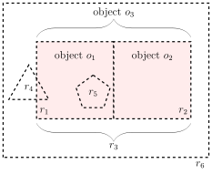
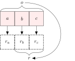
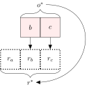
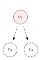
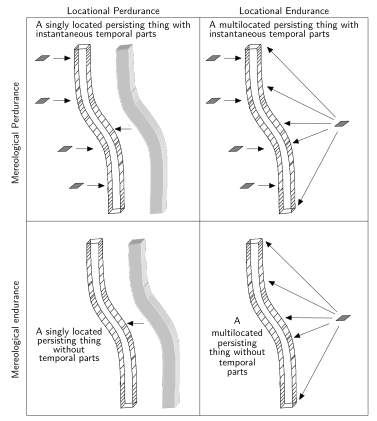
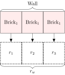

# Location and Mereology
**First published Fri Jun 7, 2013; substantive revision Mon Mar 18, 2024**

*Gilmore, Cody, Calosi, Claudio, Costa, Damiano*

Substantivalists believe that there are *regions* of space or spacetime. Many substantivalists also believe that there are entities (people, tables, social groups, electrons, fields, holes, events, tropes, universals, …) that are *located at* regions. These philosophers face questions about the relationship between entities and the regions they are located at. Are located entities identical to their locations? Are they entirely separate from their locations, i.e., they share no parts with them?

Without prejudging these metaphysical questions, some philosophers have formulated *logics* of location—typically groups of axioms governing a location relation and its interaction with mereological notions. These logics aim to capture the ways in which the mereological properties of and relations between located entities must mirror the mereological properties of and relations between the locations of those entities.

The recent literature focuses on four questions, each corresponding to a way in which the relevant mirroring might fail:

- Say that two entities **interpenetrate** just in case they do not share parts but their exact locations do. Is interpenetration possible?
- Say that an **extended simple** is an entity that has no proper parts but is exactly located at a region that has proper parts. Are extended simples possible?
- Conversely, say that an **unextended complex** is an entity that has proper parts but is exactly located at a region that does not have proper parts. Are unextended complexes possible?
- Say that an entity is **multilocated** just in case it is exactly located at more than one region. Is multilocation possible?

The present article surveys recent work on these questions and addresses other issues along the way. The goal of the entry is not to provide a general account of the metaphysics of location. Rather it focuses on the issues that are concerned with location and its interaction with parthood (in the spirit of, e.g., the papers collected in Kleinschmidt (2014)).

## 1. Preliminaries: Spacetime and Parthood

This article focuses on the recent literature on location and mereology. On the history of these topics, see Marmodoro (2017), Harte (2002), Sorabji (1983, 1988), Pasnau (2011), and Holden (2004), as well as the entries ancient atomism, medieval mereology, atomism from the 17th to the 20th century, and mereology.

In keeping with the recent literature, we will focus on ‘entity-to-region’ location relations—i.e., those that paradigmatically hold between entities and *regions*. We will ignore location relations that hold between entities and non-regions.

Since our focus is on entity-to-region location relations, we will work under the following controversial but popular assumptions. There are spacetime regions that comprise a fundamental four-dimensional arena, spacetime. All spacetime regions are equally real and there is no region which is absolutely present in any non-indexical sense. We do not assume that there are points; we leave open the hypothesis that spacetime is gunky. However, we do assume that if there are points, then points count as regions—specifically, they would be simple regions.

Throughout the entry we take parthood as primitive and take for granted several standard mereological definitions. We use *P* for parthood, *PP* for Proper Parthood, and *O* for Overlap—see the entry mereology, and Cotnoir and Varzi (2021).

We address questions framed in modal terms. Are extended simples possible? Is it necessary that nothing is multilocated? The relevant modality is metaphysical. In keeping with current orthodoxy, we assume that being metaphysically necessary (a property of propositions or sentences) is not to be identified with being a logical truth, being an analytic truth, being a conceptual truth, or being an *a priori* truth—see the entry varieties of modality. Although metaphysical necessity is not identified with conceptual truth—and, correlatively, metaphysical possibility is not identified with conceivability—one might still think that conceivability (or something in that vicinity) is evidence for metaphysical possibility—see the entry on the epistemology of modality.[^note-1]

One last preliminary. The recent literature on location and mereology tends to bracket considerations of vagueness and indeterminacy (though see Eagle 2016a, Leonard 2022)[^eagle-2016a][^leonard-2022] and quantum theory (though see Pashby 2016, Calosi 2022a)[^calosi-2022a][^pashby-2016]. We will do the same.

## 2. Location

### 2.1 Which Location Relation is Fundamental?

We begin by distinguishing four location relations. Often it is assumed that one of these is fundamental and involved in the definitions of the others—more on that shortly. For now, we give informal glosses of the four relations.

- **Exact location**: $x$ is exactly located at region $y$ if and only if $x$ has (or has-at$-y)$ exactly the same shape and size as $y$ and stands (or stands-at$-y)$ in all the same spatial or spatiotemporal relations to other entities as does $y$.[^note-2] (See Casati & Varzi 1999: 119–120; Bittner, Donnelly, & Smith 2004; Gilmore 2006: 200–202; Sattig 2006: 48)[^casati-1999][^gilmore-2006][^sattig-2006]. In symbols: $L(x, y)$
- **Weak location:** $x$ is weakly located at region $y$ if and only if $y$ is ‘not completely free of’ $x$ (Parsons 2007: 203)[^parsons-2007]. $\WKL(x, y)$
- **Entire location**: $x$ is entirely located at region $y$ if and only if $x$ ‘lies within’ $y$ (Parsons 2007: 203; Correia 2022: 560)[^correia-2022][^parsons-2007]. $\EL(x, y)$
- **Pervasive location**: $x$ is pervasively located at region $y$ if and only if $y$ is no larger than $x$ and $x$ ‘completely fills’ $y$ (Parsons 2008: 429; Correia 2022: 560)[^correia-2022][^parsons-2008]. $\PL(x, y)$

Figure 1 illustrates cases of these four relations.

*Figure 1:*

Figure 1: The dashed lines indicate regions $(r_1$–$r_6)$. The two shaded squares indicate two square objects, $o_1$ and $o_2$, that compose a larger rectangular object, $o_3$. [An extended description of figure 1 is in the supplement.]

The table (Figure 2) indicates, incompletely, which objects bear which relations to which regions.

*Figure 2*

|   | $r_1$ | $r_2$ | $r_3$ | $r_4$ | $r_5$ | $r_6$ |
| --- | --- | --- | --- | --- | --- | --- |
| $o_1$ | exactly weakly entirely pervasively |   | weakly entirely | weakly | weakly   pervasively | weakly entirely |
| $o_2$ |   | exactly weakly entirely pervasively | weakly entirely |   |   | weakly entirely |
| $o_3$ | weakly   pervasively | weakly   pervasively | exactly weakly entirely pervasively | weakly | weakly   pervasively | weakly entirely |

Figure 2

Intuitively, $o_1$ is exactly located at one and only one region, $r_1$, which has the same size and shape, and stands in the same spatial relations to other things, as $o_1$. However, $o_1$ is entirely located at each region that it lies within, such as $r_1, r_3$, and $r_6$. It is pervasively located at each region that it completely fills, such as $r_1$ and $r_5$. It is weakly located at each region that is not completely free from it, such as $r_1, r_3, r_5, r_6$, as well as $r_4$, at which it is neither entirely nor pervasively located. Region $r_2$, however, is completely free from $o_1$, so $o_1$ is not even weakly located at $r_2$. Likewise, $o_2$ is not even weakly located at $r_1$. This should be enough for a pre-theoretic grasp of our four target relations.

Typically, one of the relations above is taken to be fundamental and used to define the others. This gives rise to a wide range of possible theories, each with its own set of definitions and axioms. Some of these theories differ in what patterns of location they permit. For example, if one assumes that exact location is fundamental, then one is free to accept the possibility of a strongly multilocated thing, a thing that is exactly located at two non-overlapping regions. On the other hand, Parsons (2007) presents two theories, one that takes exact location as fundamental and one that takes weak location as fundamental. In the latter exact location is defined as follows:

**(DS2a.1)**

$x$ is exactly located at $y$ $=_{\df}$ $x$ is weakly located at all and only those entities that overlap $y$ $$L(x, y) =_{\df} \forall z[\WKL(x, z) \leftrightarrow O(y, z)]$$

According to this definition, it is analytic, hence impossible, that nothing is strongly multilocated. To save space, we will assume henceforth that exact location is the unique fundamental locative relation, and that the other three relations are defined, as follows:

**(DS1.1)**

$x$ is weakly located at $y$ $=_{\df}$ $x$ is exactly located at something that overlaps $y$. $$\WKL(x, y) =_{\df} \exists z[L(x, z) \amp O(z, y)]$$

**(DS1.2)**

$x$ is entirely located at $y$ $=_{\df}$ $x$ is exactly located at some part of $y$. $$\EL(x, y) =_{\df}\exists z[L(x, z) \amp P(z, y)]$$

**(DS1.3)**

$x$ is pervasively located at $y$ $=_{\df}$ $x$ is exactly located at something of which $y$ is a part. $$\PL(x, y) =_{\df} \exists z[L(x, z) \amp P(y, z)]$$

For a sketch of some theories arising from other views about which relations are defined, and how, see the supplementary document [Systems of Location](location-mereology.systems-of-location.md).

### 2.2 The Pure Logic of Location

Most of the formal work on location has focused on how location interacts with parthood. But one might wonder about the logic of location itself. We raise two groups of questions about this logic.

#### 2.2.1 Logical Form

We take exact location as our unique locative primitive. We assume that

1. it is a two-place relation, and
2. both argument places in that relation are singular.

But both (i) and (ii) have been questioned.

For example, one might reject (i) in favor of the view that exact location is a three-place relation that holds between a located entity, a region of space, and an instant of time (Thomson 1983; Costa 2017)[^costa-2017][^thomson-1983]. This is a natural view for those who think of space as a three-dimensional entity that endures through, and is separate from, time. (This picture is discussed in Skow 2015 and Gilmore, Costa, & Calosi 2016.)[^calosi-2016][^skow-2015] To allow for the possibility of motion, those who endorse such a view will want to be able to say, of a given object, that it is exactly located at region $r_1$, not at region $r_2$, at time $t_1$, and that the same object is exactly located at $r_2$, not at $r_1$, at time $t_2$. To allow for the possibility that time is gunky and does not contain instants, one might take exact location to be expressed by ‘$x$ is exactly located at region $r$ within interval $s$’. A different option is to reject (i) in favor of the view that exact location is variably polyadic, an idea floated by Jones (2018: note 29). The thought here is that one and the same relation is expressed both by the two-place predicate ‘(…) is located at (…)’ and by (e.g.,) the three-place predicate ‘(…) is located at (…) at time (…)’. The relation is neither two-place simpliciter nor three-place simpliciter but two-place as it occurs in some propositions and three-place as it occurs in others.

Alternatively, one might agree that exact location is a two-place relation but reject (ii) above in favor of the view that, say, the second argument place in exact location (the ‘location’ slot) is plural. One idea is that an extended object can be exactly located at many points, collectively, without being exactly located at any one of them individually or at the set or fusion of them. This is suggested by Hudson (2005: 17); motivations are developed in Gilmore (2014b: 25). A different idea is to take the first argument place (the ‘occupant’ slot) to be plural, and to speak in some cases of some things collectively being exactly located at a given region. For approaches like this, but applied to a primitive relation of pervasive location, see Loss (2023) and the supplementary document [Systems of Location](location-mereology.systems-of-location.md).

#### 2.2.2 Purely Locational Principles

If we assume that exact location is the one fundamental locational relation, that it’s two-place, and that both of its argument places are singular, what should we say about its behavior? Here we confine our attention to purely locational principles, that is, principles that can be stated in a first-order language with identity whose only non-logical predicate is ‘$L$’.

Casati and Varzi (1999: 121) propose two principles:

- **Functionality:** Nothing has more than one exact location. $$\forall x\forall y\forall z[(L(x, y) \amp L(x, z)) \rightarrow y = z]$$
- **Conditional Reflexivity:** Exact locations are exactly located at themselves. $$\forall x\forall y[L(x, y) \rightarrow L(y, y)]$$

Functionality bans multilocation, which we discuss in Section 6. It tells us that nothing is exactly located at more than one region, or indeed, at more than one entity.

Conditional Reflexivity is a principle about the location of regions. It boils down—roughly—to the claim that regions are located at themselves. There seems to be another option for the location of regions, namely that they do *not have* any locations, insofar as they *are* locations. Varzi (2007: 1016) calls this principle Conditional Emptiness:

- **Conditional Emptiness:** If $x$ is exactly located at $y$, $y$ does not have an exact location $$\forall x\forall y\forall z [L (x, y) \rightarrow L (y, z)]$$

Simons (2004b: 345) endorses Conditional Emptiness, whereas Parsons (2007: 224) and Varzi (2007: 1016) both claim that the choice between the two is somewhat conventional. However, as we show below, Conditional Reflexivity and Conditional Emptiness might be incompatible with different locative principles.

According to Conditional Reflexivity, exact locations are exactly located at themselves. (See also Donnelly (2004: 158), who presents a system in which Conditional Reflexivity is a theorem, though she replaces the location predicate ‘$L$’ with a primitive function symbol ‘$r$’ for ‘the exact location of’.) Suppose that Obama is exactly located at region $r$. Together with Conditional Reflexivity, this entails that $r$ is exactly located at itself. This conflicts with a purely locational principle endorsed by Simons (2004b: 345):

- **Asymmetry of Location:** If $x$ is exactly located at $y$ then $y$ is not exactly located at $x$. $$\forall x\forall y[(L(x, y) \rightarrow \neg L(y, x)]$$

Note, however, that cases in which a region is exactly located at itself do not conflict with

- **Antisymmetry of Location:** No two entities are exactly located at each other. $$\forall x\forall y[(L(x, y) \amp L(y, x)) \rightarrow x = y]$$

Antisymmetry of Location may salvage some of the motivation for Asymmetry of Location while still harmonizing with Conditional Reflexivity. Antisymmetry of Location is a logical consequence of Functionality and Conditional Reflexivity (as is the view that exact location is transitive).

If we further assume that Obama is not identical to his exact location $r$, we get the result that there are two different entities exactly located at $r$—namely, $r$ and Obama. In that case, we have a counterexample to another purely locational principle that some have found attractive:

- **Injectivity of Location:** No two entities share an exact location. $$\forall x\forall y\forall z[(L(x, z) \amp L(y, z)) \rightarrow x = y]$$

Opponents of co-location may take this as a *reductio* of Conditional Reflexivity. Others may take it as a reason to reject Injectivity of Location in favor of a weaker variant, e.g.:

- **Conditional Injectivity of Location:** If neither $x$ nor $y$ is identical to $z$, then if each of them is exactly located at $z$, then $x$ and $y$ are identical to each other. $$\forall x\forall y\forall z[(\neg x = z \amp \neg y = z) \rightarrow ((L(x, z) \amp L(y, z)) \rightarrow x = y)]$$

Conditional Injectivity is equivalent to the claim that whenever two different entities share a given exact location, one of them is identical to that location. This may salvage some of the motivation for the ban on co-location, while still harmonizing with Conditional Reflexivity.

In the presence of Conditional Reflexivity the ‘region predicate’ can be defined as:

- **Regionhood:** $R(x) =_{\df} L(x, x)$

That is, regions are the entities located at themselves. In turn this helps formulating restricted mereological principles such as “any plurality of regions has a fusion”.

## 3. Interaction with Parthood

Philosophers have put forward various axiom systems to capture the interaction between parthood and location. One idea is that the mereological properties of, and relations between, located entities *perfectly match* those of their locations. This has been dubbed *Mereological Harmony* (Schaffer 2009a; Uzquiano 2011; Leonard 2016)[^leonard-2016][^schaffer-2009a][^uzquiano-2011], and *Mirroring* in Varzi (2007).

Mereological Harmony has been captured formally in different ways by Varzi (2007), Uzquiano (2011), and Leonard (2016). Saucedo (2011: 227–228) offers the following principles:

**(H1)**

$x$ is mereologically simple iff $x$’s location is mereologically simple.

**(H2)**

$x$ is mereologically complex iff $x$’s location is mereologically complex.

**(H3)**

$x$ has exactly $n$ parts iff $x$’s location has exactly $n$ parts.

**(H4)**

$x$ is gunky iff $x$’s location is gunky.

**(H5)**

$x$ is a part of $y$ iff $x$’s location is a subregion of $y$’s location.

**(H6)**

$x$ is a proper part of $y$ iff $x$’s location is a proper part of $y$’s location.

**(H7)**

$x$ and $y$ overlap iff $x$’s location and $y$’s location overlap.

**(H8)**

The $x$s compose $y$ iff the locations of the $x$s compose $y$’s location.

Some philosophers take Mereological Harmony to be a necessary truth (Schaffer 2009a: 138)[^schaffer-2009a].[^note-3] The remainder of this entry considers three separate threats to the view that Mereological Harmony is necessary: interpenetration (Section 4), extended simples and unextended complexes (Section 5), and multilocation (Section 6).

There are other threats to Mereological Harmony that we will not discuss, e.g., threats to (H7) and (H8) that arise from ‘moderate views about receptacles’, according to which only topologically open (alternatively: only topologically closed) regions can be exact locations (see Cartwright 1975; Hudson 2005: 47–56; and especially Uzquiano 2006)[^cartwright-1975][^hudson-2005][^uzquiano-2006], or threats to (H4) discussed in Uzquiano (2011).)

A case of interpenetration occurs when non-overlapping entities have overlapping exact locations—e.g., when a ghost passes through a wall. In such a case, the right-to-left direction of (H7) fails. Similar cases involve violations of the right-to-left directions of (H5) and (H6). An extended simple is a simple entity with a complex exact location: it violates the left-to-right direction of (H1), the right-to-left direction of the (equivalent) H2, and the left-to-right direction of the instance of (H3) that results from letting $n = 1$. An unextended complex violates (H1) and (H2) and, depending upon cases, (H5)—see Section 5.5. A case of multilocation occurs when a given entity has more than one exact location. This violates Functionality, which is left implicit in Saucedo’s statement of Mereological Harmony.

The four questions that we consider—Is interpenetration possible? Are extended simples possible? Are unextended complexes possible? Is multilocation possible?—are logically independent of one another. Thus, there is room for 32 specific packages of views.

Even if interpenetration, extended simples, unextended complexes, and multilocation are all possible, some substantive principles linking parthood and location may still survive. For example, the possibility of interpenetration and extended simples poses no threat to:

- **Expansivity:** Necessarily, if $x$ is a part of $y$, and if $x$ is exactly located at $z$ and $y$ is exactly located at $w$, then $z$ is a part of $w$: “the part’s location is a part of the whole’s location”.[^note-4] $$\Box \forall x\forall y\forall z\forall w[[P(x, y) \amp L(x, z) \amp L(y, w)] \rightarrow P(z, w)]$$

- **Delegation:** Necessarily, if $x$ is complex and is exactly located at $y$, then for any part $z$ of $y$, some proper part $w$ of $x$ is exactly located at some region that overlaps $z$.[^note-5] $$\begin{align} \Box\forall z\forall x\forall y &\left[ \left[ C(x) \amp L(x,y) \amp P(z,y)\right] \right. \\ & \rightarrow \exists w\exists v \left.\left[ PP(w,x) \amp O(v,z) \amp L(w,v) \right]\right] \end{align}$$

Roughly, Expansivity says that an object must extend out at least as far as its parts: it must go where its parts go; and Delegation says that if an object is complex, then it must not extend out farther than its proper parts: it must not go anywhere that its proper parts do not go. Expansivity rules out cases like the following (Figure 3), in which the object $a$ is a part of the object $o$, but $a$’s exact location, $r_a$, is *not* a part of $o$’s exact location, $r$.

*Figure 3:*

Figure 3: The object $a$ is part of the object $o$, but $a$’s exact location $r_a$ is not a part of $o$’s exact location, $r$. *Ruled out by Expansitivity*. [An extended description of figure 3 is in the supplement.]

The idea behind Delegation, in slightly different terms, is that a complex entity cannot be weakly located at a certain region unless one of its proper parts—a ‘delegate’—is also weakly located there. Regarding the formal statement of Delegation, one might wonder why it is not formulated with ‘$\PP(u, z)$’ in place of ‘$O(u, z)$’ in the consequent. The reason for this is that Delegation is meant to be friendly to extended simples. Suppose that a complex, spherical object, $c$, is exactly located a spherical region, $r$. Suppose that $c$ is composed of two hemispherical simples, $h$ and $h*$, and that $r$ is composed of continuum-many simple points, each plurality of which composes a region that is a part of $r$. Then, contrary to the proposed revision, it will not be true that for every part $y$ of $r$, some proper part of $c$ is exactly located at a region that has $y$ as a proper part. Consider, for example, the spherical region $r*$ with the same center point as, but half the volume as, $r$ itself. $c$ does not have a proper part that is exactly located at $r*$, nor does it have a proper part whose exact location has $r*$ as a proper part. But, as Delegation requires, $c$ does have a proper part $(h$, for example) that has an exact location that overlaps $r*$.

Delegation rules out cases like the following (Figure 4), in which $o^*$ is a complex object that is exactly located at region $r^*$, but $r^*$ has a part $r_a$ that does not overlap an exact location of any of $o^*$’s proper parts:

*Figure 4:*

Figure 4: The region $r_a$ is a part of object $o^*$’s exact location, and object $o^*$ is complex, but no proper part of $o$ has an exact location that overlaps $r_a$. *Ruled out by Delegation*. [An extended description of figure 4 is in the supplement.]

Neither interpenetration nor extended simples threaten Expansivity or Delegation. One threat to Delegation comes from Pickup (2016: 260), who considers the possibility of a complex entity that is exactly located somewhere despite the fact that none of its proper parts is exactly (or weakly) located anywhere. One route to such entities (not Pickup’s) runs as follows:

1. some material objects (electrons, maybe) do not have any other material objects as proper parts,
2. any such material object is a complex entity whose only proper parts are universals,
3. all material objects have locations, but
4. no universals have locations.

Bundle theorists who are platonic realists about universals, and who take the constituents of a given bundle to be parts of that bundle, will face pressure to accept (i)–(iv) and hence to reject Delegation. A related idea is discussed in connection with the Burying Strategy in Section 4.1 below.

Another possible threat to *Delegation* comes from recent literature on the mereological emergence of spacetime in quantum gravity. According to one account, spacetime does not exist at the fundamental level but it is *mereologically composed* of (more) fundamental entities that are not themselves spatiotemporal. Glossing over some details, if one holds that emergent spacetime regions are exactly located at themselves, one will then have yet another counterexample to *Delegation*. In effect, this is similar in spirit to the one we discussed already. It provides an example of a complex entity with an exact location whose proper parts are not located anywhere (see, e.g., Baron 2020 and Baron & Le Bihan 2022a)[^baron-2020][^baron-2022a]. Naturally, one could turn the argument on its head and claim that Delegation provides reason to think that the fundamental entities, whatever they are, are not *parts* of the region.

Finally, a particular view, i.e. (unrestricted) supersubstantivalism, entails mereological harmony—see Section 7. Therefore, any argument in favor of the former is an argument in favor of the latter.

## 4. Interpenetration

In this section we consider some arguments for the following principle:

- **No Interpenetration** Necessarily, if $x$ and $y$ have exact locations that overlap, then $x$ and $y$ themselves overlap. $$\Box \forall x\forall y\forall z\forall w[(L(x, z) \amp L(y, w) \amp O(z, w)) \rightarrow O(x, y)]$$

According to No Interpenetration, it is metaphysically impossible for entities of any type to ‘pass through one another’ without sharing parts—in the manner of a ghost passing through a solid brick wall. There is a related principle that deserves some comment. The related principle says that, necessarily, if $x$’s exact location is a part of $y$’s exact location, then $x$ is a part of $y$. In symbols:

**(1)**

Necessarily, if $x$ is exactly located at a part of $y$’s exact location, then $x$ is part of $y$. $$\Box \forall x\forall y\forall z\forall w[(L(x, z) \amp L(y, w) \amp P(z, w)) \rightarrow P(x, y)]$$

This principle may seem to say basically the same thing as No Interpenetration but to say it more simply—using the primitive predicate ‘*P*’ instead of the defined predicate ‘$O$’. Why then focus on No Interpenetration instead of (1)?

The reason for this is that some of the opposition to (1) will stem from opposition to a purely mereological principle: Strong Supplementation. It says that if every part of $x$ overlaps $y$, then $x$ is a part of $y$. Those who deny this will be very likely to deny (1), but they might still be attracted to No Interpenetration. Consider for example the case of the statue Goliath and Lumpl, the clay it is ‘made out of’. Goliath and Lumpl have the same exact location yet one might want to deny that Goliath is part of Lumpl (Lowe 2003). In this case they will constitute a counterexample to (1), but insofar as they share parts, they do not constitute a counterexample to No Interpenetration.

As we noted in the introduction, in general, our task here is to set aside the purely mereological controversies (see the entry on mereology and Cotnoir & Varzi 2021)[^cotnoir-2021] and to focus instead on the issues that are exclusively concerned with location and its interaction with parthood. Too much of the controversy over (1) arises from controversy over ‘pure mereology’. By contrast, if No Interpenetration is controversial, this is only because of what it says about the *connections* between parthood and location.

### 4.1 For Interpenetration #1: from Universals or Tropes

Immanent realists say that a universal is in some sense ‘wholly present’ in each thing that instantiates it (Armstrong 1978: 79; Bigelow 1988; O’Leary-Hawthorne 1995; O’Leary-Hawthorne & Cover 1998; Paul 2002, 2006, 2012; Newman 2002; Hawley & Bird 2011; Lafrance 2015; Peacock 2016)[^armstrong-1978][^bigelow-1988][^hawley-2011][^lafrance-2015][^newman-2002][^o’leary-hawthorne-1995][^o’leary-hawthorne-1998][^paul-2002][^peacock-2016]. If immanent realism is true, it is plausible that disjoint universals frequently interpenetrate.

Let $e$ be an electron and suppose that it instantiates two different universals: a mass universal, $u_m$, and a charge universal, $u_c$. Suppose that $e$ is exactly located at region $r$. Then it will be natural for the immanent realist to say that

1. $u_m$ is exactly located at $r$, or at some region $r_m$ that has $r$ as a part, and
2. $u_c$ is exactly located at $r$ or at some region $r_c$ that has $r$ as a part.

If these universals are also instantiated elsewhere, then it will be debatable whether they are *exactly* located at $r$. Perhaps $u_m$ has only one exact location, which fuses the exact locations of its instances (Effingham 2015b)[^effingham-2015b]. Likewise, for $u_c$. Either way, the immanent realist will say that $u_m$ and $u_c$ have exact locations that overlap by having $r$ as a common part. But presumably $u_m$ and $u_c$ do not overlap. If these universals are non-structural, non-conjunctive, and perfectly natural, then they are plausibly *simple*, in which case they overlap only if they are identical, which they are not. A similar point can be made in terms of tropes—particular, spatiotemporally located ‘cases’ of properties or relations. For trope theorists who take tropes to be located at spacetime regions, it will be natural to say that mass tropes and charges tropes, for example, frequently interpenetrate.

Three responses to this argument are worth considering.

The first response says: so much the worse for immanent universals and tropes. This response uses a mereo-locational principle, No Interpenetration, as a premise in an argument against certain metaphysical views, namely those that posit immanent universals or tropes. Is there some reason why mereo-locational principles should not be used in this way? The principles of pure mereology are often so used. For example, Lewis (1999: 108–110) rejects states of affairs and structural universals on the grounds that they would violate Uniqueness of Composition, the principle that no entities $xx$ have more than one fusion.[^note-6] Why not give the same status to certain mereo-locational principles? One might, for example, say that No Interpenetration is better justified than is the view that universals or tropes are spatiotemporally located.

The second response says that while immanent universals or tropes are spatiotemporal entities that are ‘in their instances’, they are not exactly located anywhere. Simplified somewhat, the response holds that

1. universals are suitably related to entities that have exact locations, and in that sense they are ‘in their instances’, but
2. universals do no themselves have exact locations and hence do not have overlapping exact locations.

Given (ii), the universals or tropes in question no longer count as examples of interpenetration. Call this the *Burying Strategy*, since it ‘buries’ universals and/or tropes in located entities, rather than treating them as being located—examples are found in Armstrong (1989: 99) and Lowe (2006: 25).

The third response to the argument from universals and tropes is to say, ‘True, universals and/or tropes can interpenetrate, but material objects can’t’. This grants the argument and rejects No Interpenetration in favor of the weaker, restricted principle below, where $M$ stands for the ‘material object’ predicate:

**(2)**

Necessarily, if material objects $x$ and $y$ have exact locations that overlap, then $x$ and $y$ themselves overlap. $$ \Box \forall x\forall y\forall z\forall w[(M(x) \amp M(y) \amp L(x, z) \amp L(y, w) \amp O(z, w)) \rightarrow O(x, y)] $$

This response also handles potential counterexamples to No Interpenetration arising from regions, sets, events, portions of stuff, holes, spirits, and other ‘immaterial entities’.

On the location of regions, see Casati & Varzi (1999: 123), who hold that regions are located at themselves, and Simons (2004b: 345), who holds that nothing is located at itself. On the location of sets, see Maddy (1990); Lewis (1991); Effingham (2010, 2012); and Cook (2012). On the location of events, see Casati & Varzi (1999); Price (2008); Giordani & Costa (2013); Costa & Giordani (2016); and Costa (2017). On the location of portions of stuff, see Markosian (1998, 2004, 2015). On the location of holes and shadows, see Lewis & Lewis (1970); Casati & Varzi (1994); Wake, Spencer, & Fowler (2007); Donnelly, Bittner, & Rosse (2006); and Sorensen (2008). On the location of spirits, see Thomas (2009) and Inman (2017). Sanford (1970) discusses many of these topics, and Hudson (2005: 4) mentions many of them briefly.

The next two pro-interpenetration arguments count equally against No Interpenetration and (2), but we will continue to focus on No Interpenetration for simplicity.

### 4.2 For Interpenetration #2: from Conceivability

Some think that it is possible for two disjoint *material objects* to have overlapping exact locations. Perhaps there are no actual cases of the relevant sort. Such cases may even be nomically impossible—ruled out by the laws of nature (though see the next section). But one might still think that these cases are metaphysically possible.

After all, what is it that keeps material objects from interpenetrating in the actual world? Repulsive forces, presumably. But a standard view is that the laws governing such forces are not metaphysically necessary.[^note-7] And on that assumption it is natural to conclude that there are metaphysically possible worlds in which any repulsive forces that exist can be overridden in such a way as to allow material objects to interpenetrate. (For more on this, see Zimmerman 1996a and Sider 2000.)[^sider-2000][^zimmerman-1996a]

A similar line of thought is sometimes framed as a conceivability argument. One might take cases of interpenetration to be conceivable or intuitively possible, and one might take this to be some evidence for their possibility. In *New Essays the Human Understanding* (II.xxvii.1), Leibniz writes that

> we find that two shadows or two rays of light interpenetrate, and we could devise an imaginary world where bodies did the same. (1704 [1996]).

Sanford (1967: 37) describes a similar scenario in more detail.

### 4.3 For Interpenetration #3: from Bosons

Does contemporary physics provide us with examples of disjoint fundamental particles that have the same, or overlapping, exact locations? Hawthorne and Uzquiano apparently claim that the answer is ‘Yes’. They write that

> particles having integral spin—otherwise known as bosons—in modern particle physics (…) are generally thought to be point-sized. Moreover (…) bosons are perfectly well able to cohabit a single spacetime point. (2011: 3–4)

Schaffer (2009a) suggests that in the case at hand, we are not forced to consider the conceived scenario as one in which there are two co-located yet disjoint bosons. Rather,

> [a] more sophisticated treatment of these cases involves field theory. Instead of there being two bosons co-located at region *r*, there is a bosonic field with doubled intensity at *r*. (2009a: 140).

Whereas Hawthorne and Uzquiano apparently take bosons to provide *actual* examples of interpenetration, McDaniel (2007a: 240) suggests that they at least reinforce the conceivability of such counterexamples and therefore their possibility should not be discarded *a priori*.

If one’s goal, in constructing a theory of location, is to articulate the necessary and *a priori* truths governing location and its interaction with parthood, then even McDaniel’s modest point still counts against including No Interpenetration in one’s theory. For if McDaniel is right, then that principle is not an *a priori* truth, though perhaps it is still a necessary truth. (See Simons 1994 & 2004a for further discussion of bosons and for related considerations in support of interpenetration. For further discussion of Hawthorne and Uzquiano, see Cotnoir 2016.)[^cotnoir-2016][^simons-1994][^simons-2004a]

### 4.4 For Interpenetration #4: from Recombination

Sider (2000: 585–6), McDaniel (2007a), and Saucedo (2011) have all objected to No Interpenetration on the grounds that it conflicts with plausible broadly Humean ‘principles of recombination’. The following is a reconstruction of the argument in McDaniel’s (2007a: 241).

Let $o_1$ and $o_2$ be two different objects, let $r$ be a region, and consider the following states of affairs:

**$(s_1)$**

$o_1$’s being simple and exactly located at $r$

**$(s_2)$**

$o_2$’s being simple and exactly located at $r$

Then we can reconstruct the argument as follows:

**(P1)**

$s_1$ is a contingent state of affairs.

**(P2)**

$s_2$ is a contingent state of affairs.

**(P3)**

$s_1$ is distinct from $s_2$.

**(P4)**

For any $x$ and any $y$, if $x$ and $y$ are each contingent states of affairs, and if they are distinct from each other, then possibly, both $x$ and $y$ obtain.

*Therefore*

**(C)**

Possibly, both $s_1$ and $s_2$ obtain.

If it’s possible for both $s_1$ and $s_2$ to obtain, then it’s possible for a given region to be the exact location of two different simples. And since no two simples can overlap, this would mean that it’s possible for disjoint things (the simples) to have identical (hence overlapping) exact locations.

Is the argument successful? As Sider and McDaniel are well aware, the notion of distinctness in the formulation of Humean recombination principles needs to be handled with care if P4 is to get off the ground. As a way of illustration, it cannot be simple *numerical distinctness*. If it were, the state of affairs that *p* and the state of affairs that not *p* would be recombinable to yield a genuine metaphysical possibility. For another example, the state of affairs that *x* is green and the state of affairs that *x* is scarlet could be recombinable to yield yet another genuine metaphysical possibility.[^note-8] But it is no easy matter to give ‘distinct from’ a meaning that makes P3 and P4 simultaneously plausible. If it means ‘shares no parts or constituents with’, then P4 avoids the counterexample given above, but P3 ceases to be plausible, since $s_1$ and $s_2$ do plausibly share a constituent, namely *r*. If ‘$s$ is distinct from $s^*$’ is defined as

1. possibly, $s$ obtains and $s^*$ does not,
2. possibly, $s$ does not obtain and $s$ does,
3. possibly, neither $s$ nor $s^*$ obtains, and
4. possibly, both $s$ and $s^*$ obtain’,

then P4 is trivially true, but P3 begs the question—see also Lo and Lin (2023).

## 5. Extended Simples and Unextended Complexes

A simple is an entity that has no proper parts. Are there any simples? Within the realm of spatiotemporal entities, some natural candidates are: spacetime points, fundamental particles such as electrons (or instantaneous temporal parts of them), and perhaps certain universals, certain tropes, or certain sets. On the other hand, it would seem to be an empirically open possibility that all spatiotemporal entities are gunky.

Say that an entity is *extended* just in case it is a spatiotemporal entity and does not have the shape and size of a point. In this sense of ‘extended’, a solid cube would count as extended, but, given natural assumptions, so would a fusion of two point-particles that are one foot apart. Although such a fusion is naturally taken to have zero length, it would be a scattered object and so would not have the shape of a point.

Are there any extended simples? Could there be? Those who answer ‘No’ to both questions will be inclined to accept

- **No Extended Simples** (NXS) Necessarily, if $x$ is exactly located at $y$ and $y$ is complex, then $x$ is complex. $$\Box \forall x\forall y[[L(x, y) \amp C(y)] \rightarrow C(x)]$$

Strictly speaking, NXS does not say that extended simples are impossible; rather, it says that simples with complex exact locations are impossible. It leaves open the possibility that there are extended simple regions and extended simple entities that are exactly located at them. (For more on extended simple regions and discrete space or spacetime, see Forrest 1995; Tognazzini 2006; Braddon-Mitchell & Miller 2006; McDaniel 2007b, 2007c; Dainton 2010: 294–301; Spencer 2010, 2014; Hagar 2014; Jaeger 2014; Kleinschmidt 2016; Goodsell et al. 2020; and Baron & Le Bihan 2022b.)[^baron-2022b][^braddon-mitchell-2006][^dainton-2010][^forrest-1995][^goodsell-2020][^hagar-2014][^jaeger-2014][^kleinschmidt-2016][^mcdaniel-2007b][^miller-2006][^spencer-2010][^tognazzini-2006] And NXS rules out the possibility that there is a point-sized material simple that is exactly located at a point-sized but mereologically complex region (e.g., a region that is the fusion of several point-sized tropes each of which is at zero distance from each of the others).

For the most part, however, it will do no harm to treat the debate over extended simples as a debate over NXS. We can do so if we assume that, necessarily, a region is extended if and only if it is complex. So, in what follows, we will operate under that assumption unless we explicitly note otherwise.

Unextended complexes are objects that are mereologically complex and exactly located at regions that are simple and so, we assume, pointlike. Are there unextended complexes? Could there be? Those who answer ‘No’ to both questions will be inclined to accept:

- **No Unextended Complexes (NUC)** Necessarily, if $x$ is exactly located at $y$ and $y$ is simple, then $x$ is simple. $$\Box \forall x\forall y[[L(x, y) \amp \neg C(y)] \rightarrow \neg C(x)]$$

Strictly speaking, NUC says that complexes with simple exact locations are impossible, but for the most part, it will do no harm to treat the debate over unextended complexes as a debate over NUC.

### 5.1 For Extended Simples #1: from Conceivability

An initial argument appeals to the claim that extended simples are conceivable and takes that to be some evidence in favor of their possibility. To conceive of an extended simple, think of an extended—say, cubical—object that has no proper parts. The idea is not, or not merely, that the cube *cannot be physically split or cut up*. Whether or not it can be split is a separate question.

Debates about extended simples typically focus on the question of whether extended simple material objects are possible. But entities in other ontological categories (tropes, universals, sets, regions) are sometimes thought to be located. So it is worth keeping in mind that, whatever one thinks about material objects, one might hold that extended simples in other categories are possible. With that said, we will focus on material objects for the remainder of this section.

### 5.2 For Extended Simples #2: from String Theory

As McDaniel (2007a: 235–6) notes, some physicists interpret string theory as positing extended simples. McDaniel quotes a passage from Brian Greene:

> What are strings made of? There are two possible answers to this question. First, strings are truly fundamental—they are “atoms,” *uncuttable* constituents…. From this perspective, even though strings have spatial extent, the question of their composition is without any content. (1999: 141)

Can strings be treated as being identical to the spacetime regions at which they are exactly located? Greene does not explicitly address this question. If the answer is ‘Yes’, however, and if strings are exactly located only at complex regions, then string theory would not be committed to extended simples after all. For an argument that string theory does not posit extended simples, see Baker (2016). For a discussion of different arguments for and against extended simples in quantum gravity see Baron and LeBihan (2022b).

### 5.3 For Extended Simples #3: from Recombination

As with interpenetration, one might offer a recombination argument for the possibility of extended simples (Sider 2007; McDaniel 2007b; Saucedo 2011)[^mcdaniel-2007b][^saucedo-2011][^sider-2007]. One could claim that being simple and being a simple region are accidental properties that can be recombined to yield a state of affairs in which a simple is exactly located at a complex—and therefore, we take it, extended—region. Since this argument does not appear to raise any issues that are specific to extended simples, we will move on.

### 5.4 Against Extended Simples #1: from Qualitative Variation

One might argue that if extended simples were possible, then they could vary qualitatively across space or spacetime.[^note-9] An ordinary hammer can vary qualitatively over space by having a white handle and a non-white (say, gray) head. Likewise, one might think that if extended simples were possible then there could be an extended, hammer-shaped simple that varies in color across space in the manner of an ordinary hammer with a white handle and a non-white head. It is tempting to say that, if there were such a simple, then one part of it would be white and one part would be non-white. But since the simple has only one part, itself, this would entail that the simple itself is both white and non-white. This being impossible, one might conclude that extended simples quite generally are impossible.

One might resist the argument by insisting that extended simples are possible only if qualitatively homogeneous across spacetime (see Spencer 2010, Jaeger 2014, and Spencer 2014 for discussion)[^jaeger-2014][^spencer-2010][^spencer-2014]. But most friends of extended simples try to resist the argument in other ways.

In this connection, it is useful to see that the problem of qualitative variation perfectly mirrors the infamous problem of change (a.k.a., temporary intrinsics), which deals with the case of a persisting entity exhibiting qualitative variation across time. Consequently, several solutions developed for the problem of change apply, *mutatis mutandis*, to the case of extended simples. For example, a friend of extended simples might adopt regionalized properties or regionalized instantiation (the terminology is due to Schaffer 2010)[^schaffer-2010]. In the first case, a seemingly monadic property such as being white is really taken to be a relation to a region in disguise, such as being *white at*. In the second case, one regionalizes instantiation rather than the property by claiming, for example, that the extended simple instantiates-here whiteness. These two strategies parallel the classic relativization strategies of, e.g., Mellor (1981) and adverbialist strategy of, e.g., Johnston (1987) and Haslanger (1989).

Yet another strategy is worth mentioning here, because it was developed originally to deal with qualitative variation in extended simples. This is Parsons’ (2000) solution involving distributional properties. Parsons proposes that if a simple is white in one region and gray in another, then it has a fundamental, intrinsic, distributional property. Some distributional properties, such as being black all over, are uniform. Others, such as being polka-dotted, are non-uniform. When a simple has a non-uniform distributional property, this fact is not grounded in it having proper parts, configured in a certain way, that each have simpler, uniform properties. Nor is it grounded in the simple’s standing in different relations (being white at and being gray at) to different spacetime regions. Rather, it is an ungrounded fact about the simple. This apparently avoids the worries faced by previous approaches (on which see Haslanger 2003)[^haslanger-2003]. As McDaniel (2009) notes, however, Parsons’s solution faces several difficulties. For example, it seems unable to provide an account of what is it for $x$ to be $F$ at $r$. What is it, for example, for something to be gray at a region $r$? It can’t simply be for it to have a given distributional property $D$, such as being gray all over. And this for at least two reasons. First, something could be gray at $r$ in virtue of having other distributional properties, such as being half gray and half white. Second, something could have the relevant distributional property without being gray at $r$, for example because it is not located at $r$. The problem is not solved if we further require the thing to be located at $r$. Indeed, two circles that are co-located at $r$ and have both the distributional property of being half gray and half white might be such that one is gray at the top part of their exact location while the other is gray at the bottom part.

As we point out in the supplementary document [Systems of Location](location-mereology.systems-of-location.md) some theories of location rule out extended simples by definition.

### 5.5 For Unextended Complexes

What about unextended complexes? McDaniel (2007b), Pickup (2016), and Calosi (2023) all discuss their possibility (but see also Leonard 2016, which labels them “crowded simples”)[^leonard-2016].

A first argument, due to McDaniel, goes as follows:

1. point-like entities are possible;
2. co-located point-like entities are possible;
3. fusions of point-like co-located entities are possible.

Fusions of co-located point-like entities qualify as unextended complexes. Pickup suggests that there is another way a complex entity might be exactly located at a single point: the parts of the pointy complex do not have exact locations, but the pointy complex has one, namely the relevant point. (We touched upon this when discussing possible violations of Delegation.) For the purpose of this entry, it is interesting to note that the two cases discussed above violate very different principles about the interaction between parthood and location. In the first case both Injectivity and Conditional Injectivity of Location in Section 3 are violated. Therefore, any argument against interpenetration will count against this particular kind of unextended complex.

In the second case, the following principle will be violated:

- Expansivity*: Necessarily, if $x$ is part of $y$ and $y$ is exactly located at $w$, then there is a subregion $z$ of $w$ such that $x$ is exactly located at $w$. $$\Box \forall x \forall y \forall w [ P(x, y) \amp L(y, w) \rightarrow \exists z (P(z, w) \amp L(x, w))] $$

We should note that Expansivity* is similar (in spirit) to Expansivity in Section 3, but is slightly stronger. Depending on whether one takes the parts of the pointy complex to have at least weak locations—Pickup being silent on that—one would also have a violation of

- **Exactness +**: Necessarily, if a thing is weakly located somewhere, then it is exactly located somewhere. $$\Box \forall x [\exists y \WKL (x, y) \rightarrow \exists y L(x, y)]$$

Pickup offers yet another argument in favor of the possibility of unextended complexes. The argument has it that unless a reason is given for the difference between the case of extended simples and the case of unextended complexes one should treat their possibilities equally. That is, if one finds extended simples possible, then one should find unextended complexes possible as well. A possible reply is that, as we saw, extended simples and unextended complexes violate very different principles of location. One could have different attitudes towards those principles which would then warrant different attitudes towards the metaphysical possibility of the (allegedly) problematic entities—see for example, Calosi (2023).

## 6. Multilocation

To say that an object is multilocated is to say that it has more than one exact location: ‘$x$ is multilocated’ means

$$\exists y_1\exists y_2 [L(x, y_1) \amp L(x, y_2) \amp y_1\ne y_2].$$

(For an attempt to motivate a slightly different definition of multilocation, designed to allow for cases of multilocation in absence of exact location, see Calosi 2022a, Correia 2022.)[^calosi-2022a][^correia-2022] We consider a series of putative *examples* of multi-location in Section 6.3.

The debate over multilocation concerns

- **Functionality+** Necessarily, nothing has more than one exact location. $$\Box \forall x\forall y_1\forall y_2 [[L(x, y_1) \amp L(x, y_2)] \rightarrow y_1 =y_2]$$

Opponents of multilocation accept Functionality+. Friends of multilocation typically want to affirm something stronger than the negation of Functionality+. They typically accept the possibility of an entity that is exactly located at each of two regions that do not even overlap.

Earlier we glossed ‘$x$ is exactly located at $y$’ as ‘$x$ has (or has-at$-y)$ the same size and shape as $y$, and stands (or stands-at$-y)$ in all the same spatiotemporal relations to things as does $y$’. Thus, spheres are exactly located only at spherical regions, cubes only at cubical regions, and so on. When an entity is said to be multilocated, then, it is said to stand in this relation to *each of several regions*: informally put, it has the same size, shape, and position as region $r_1$; it has the same size, shape, and position as region $r_2$; and so on. No claim is made to the effect that the object is exactly located at the *fusion* of $r_1, r_2,\ldots$, or at any *proper parts* of any of these regions.

To clarify the idea of multilocation in an informal way, it may be useful to consider Figure 5, inspired by Hudson (2005: 105) and Kleinschmidt (2011: 256).

*Figure 5:*

(a) A scattered, singly located object

(b) A non-scattered, multilocated object

Figure 5: [An extended description of figures 5a and 5b are in the supplement.]

The object $o_1$ is scattered: its shape is that of the sum of two non-overlapping circles. It is not multilocated. Rather, it has just one exact location: the scattered region $r_3$. It is not exactly located at any proper part of that region, such as $r_1$ or $r_2$.

The object $o_2$ is multilocated. It has two (and only two) exact locations. It is exactly located at the circular region $r_3$; and it is exactly located at the circular region $r_4$, which does not overlap $r_3$. It is not exactly located at their fusion, and it is not located at any of their proper parts. Since $o_2$ is exactly located at $r_3$, which is circular, $o_2$ is circular, at least *at $r_3$*. For parallel reasons, $o_2$ is circular at $r_4$. By contrast, $o_1$ is not circular *simpliciter*, nor is it circular at any region.

Everything we have said so far is neutral with respect to whether either of the material objects is simple. It may be that both objects are simple, or that both are complex, or that $o_1$ is simple and $o_2$ is complex, or *vice versa*. This is worth emphasizing, since questions about the possibility of extended simples and questions about the possibility of multilocation are sometimes run together.

It is natural to think that if these two objects were visible, they would be visually indistinguishable. Indeed, it is tempting to think that there would be no empirical difference between $o_1$ and $o_2$. For those with verificationist leanings, this may lead to the belief that there is no difference at all between $o_1$ and $o_2$ and hence that there must be something defective about the initial set-up of the case.

### 6.1 For Multilocation #1: from Conceivability

As with interpenetration and extended simples, one might offer a conceivability argument for the possibility of multilocation. One could claim that multilocation is conceivable and take this to be evidence that multilocation is possible. Since this argument does not appear to raise any issues that are specific to multilocation, we will move on.

### 6.2 For Multilocation #2: from Recombination

As with interpenetration and extended simples, one might offer a recombination argument for the possibility of multilocation. One could claim that exact location is fundamental and accidental and take this to be evidence that multilocation is possible. Since this argument, too, appears not to raise any issues that are specific to multilocation, we will move on.

### 6.3 For Multilocation #3: from Examples

Arguments in favor of multilocation may simply come from concrete examples of multilocated entities. These include: immanent universals, enduring material objects, enduring tropes—Ehring (1997a,b, 2011), four-dimensional perduring objects—Hudson (2001), backward time travelers—(MacBride 1998, Keller & Nelson 2001; Gilmore 2003, 2006, 2007; Miller 2006; Carroll 2011; Kleinschmidt 2011; Effingham 2011)[^carroll-2011][^effingham-2011][^gilmore-2003][^keller-2001][^kleinschmidt-2011][^macbride-1998][^miller-2006], fission products—Dainton (2008: 364–408), transworld individuals—McDaniel (2004), works of music—Tillman (2011), and an omnipresent God—(Hudson 2009; Inman 2017)[^hudson-2009][^inman-2017].[^note-10] We will focus on the first two examples here for they are arguably the more widely discussed.

#### 6.3.1 Immanent universals

As we have noted, immanent realists say that universals are spatiotemporal entities that are in some sense ‘wholly present’ in the things that instantiate them. One natural way to translate immanent realism into the terminology of exact location is via the following principle:

**(3)**

Necessarily, for any $x$, any $y$, and any $z$, if $x$ is exactly located at $y$ and $x$ instantiates $z$, then $z$ is exactly located at $y$.

To see how this leads to multilocation, suppose that some monadic universal $u$ is instantiated by an entity $e_1$ that is exactly located at region $r_1$ and by a different entity, $e_2$, that is exactly located at region $r_2$, disjoint from $r_1$. Then, given (3), $u$ itself is exactly located both at $r_1$ and at $r_2$ (Paul 2006; Lafrance 2015)[^lafrance-2015][^paul-2006].

(3) is not inevitable, even for immanent realists. Some of them might prefer to say that a monadic universal is exactly located only at the *fusion* of the exact locations of its instances (Bigelow 1988: 18–27, can in places be read as embracing this, and Effingham 2015b argues that this is what immanent realists should say)[^bigelow-1988][^effingham-2015b]. On this view, a simple monadic universal might be scattered but would not be multilocated. Others (Armstrong 1989: 99)[^armstrong-1989] prefer to say that universals do not have exact locations at all, though they are parts or constituents of things that have exact locations or of spacetime itself. This was dubbed the ‘Burying Strategy’ in Section 4.1.[^note-11]

#### 6.3.2 Enduring material objects

The debate over persistence of *material objects* through time centers around two rival views, endurantism and perdurantism.[^note-12] Endurantists often say that a persisting material object is temporally unextended and in some sense ‘wholly present’ at each instant of its career. Perdurantists often say that a persisting material object is a temporally extended entity that has a different temporal part at each different instant of its career and is at most partially present at any one instant (Informally, an instantaneous temporal part of Obama is an object that is a part of Obama, is made of the exactly same matter as Obama is whenever it exists, and has exactly the same spatial location as Obama does whenever it exists, but exists at only a single instant.)[^note-13]

Some philosophers have suggested that the traditional endurantism versus perdurantism dispute runs together a pair of independent disputes about persistence: a mereological dispute concerning the existence of temporal parts, and a locational dispute concerning exact locations (Gilmore 2006, 2008; Hawthorne 2006; Sattig 2006; Donnelly 2010, 2011b; Eddon 2010; Rychter 2011; Calosi & Fano 2015)[^calosi-2015][^calosi-2015-2][^calosi-2015-3][^donnelly-2010][^eddon-2010][^gilmore-2006][^hawthorne-2006][^rychter-2011][^sattig-2006]. Stated loosely, the mereological dispute is between the following views:

- **Mereological perdurance:** there are persisting material objects, and each such object has a different temporal part at each different instant at which the object exists.
- **Mereological endurance:** there are persisting material objects, but none of them has a different temporal part at each different instant of its career. (Perhaps none of them have any instantaneous temporal parts—or any temporal parts aside from themselves—at all.)

To frame the locational dispute, it will be useful to have one further piece of terminology. Say that $y$ is a *path* of $x$ if and only if $y$ is a fusion of the exact locations of $x$ (Gilmore 2006: 204)[^gilmore-2006]. Informally, a path of an object is a region at which the object’s complete career is exactly located.

We can then state the locational dispute as follows:

- **Locational perdurance:** there are persisting material objects, and each of them has exactly one exact location—its path.
- **Locational endurance:** there are persisting material objects, and each of them has many different exact locations, each such location being instantaneous or ‘spacelike’. Typically, each of these exact locations will count as an instantaneous temporal part of the object’s path.

Philosophers on both sides of this dispute can agree about which spacetime regions are the paths of which material objects—provided they agree that the relevant persisting objects exist. They will disagree about which spacetime regions are the exact locations of which objects. The locational perdurantist will say that material objects are exactly located only at their paths. The locational endurantist will say that a persisting material object is exactly located at many regions, each of them a slice of its path. The interaction between the two disputes about persistence is summarized in Figure 6 (from Gilmore 2008: 1230)[^gilmore-2008].

*Figure 6:*

Figure 6: Persistence, the locational and mereological disputes. [An extended description of figure 6 is in the supplement.]

Locational endurance entails multilocation: it says that some material objects are exactly located at many different regions (for a locational characterization of endurantism that does not entail multilocation see Garcia forthcoming). Mereological endurance, which merely rejects temporal parts, does not entail multilocation. Thus, one might reject temporal parts while retaining Functionality. This is the position of Parsons (2000, 2007). It corresponds to the lower left-hand box in Figure 6.[^note-14]

### 6.4 Against Multilocation #1: from Definition

As we noted in Section 2.1, Parsons (2007) develops a theory of location on which weak location is primitive and exact location is defined, via definition (DS2a.1). According to that definition, ‘$x$ is exactly located at $y$’ means the same as ‘$x$ is weakly located at all and only those entities that overlap $y$’. Those who endorse this definition may deny the possibility of multilocation, on the basis of the following argument:

**(4)**

Necessarily, for any $x$ and any $y, x$ is exactly located at $y$ if and only if for any $y^*$, $x$ is weakly located at $y^*$ if and only $y$ overlaps $y^*$ (Definition of ‘$L$’).

**(5)**

So, necessarily, for any $x$, any $y_1$, and any $y_2$, if $x$ is exactly located at $y_1$ and $x$ is exactly located at $y_2$, then $y_1$ overlaps exactly the same things as $y_2$ (from (4)).

**(6)**

Necessarily, for any $y_1$ and any $y_2$, if something is exactly located at $y_1$ and something is exactly located at $y_2$ and $y_1$ overlaps exactly the same things as $y_2$, then $y_1 =y_2$.

*Therefore*

**(7)**

Necessarily, for any $x$, and $y_1$ and any $y_2$, if $x$ is exactly located at $y_1$ and $x$ is exactly located at $y_2$, then $y_1 =y_2$ (from (5) and (6).)

To see that the inference from (4) to (5) is valid, suppose that object $o$ is exactly located at regions $r_a$ and $r_b$. Since $o$ is exactly located at $r_a, o$ is (by (4)) weakly located at all and only the entities that overlap $r_a$. Likewise, since $o$ is exactly located at $r_b, o$ is weakly located at all and only the entities that overlap $r_b$. So $r_a$ overlaps a given entity if and only if $o$ is weakly located at that entity; and $r_b$ overlaps a given entity if and only if $o$ is weakly located at that entity. Hence $r_a$ and $r_b$ overlap exactly the same entities. The rest of the argument is self-explanatory.

The argument may persuade some. However, those who are initially inclined to take the possibility of multilocation seriously may see this argument as a reason to doubt the first premise and the associated definition (Gilmore 2006: 203; Effingham 2015b)[^effingham-2015b][^gilmore-2006].

Interestingly, in the supplementary document [Systems of Location](location-mereology.systems-of-location.md), we present three systems—namely systems 3, 4 and 5—that allow for multilocation but rule out specific kinds of multilocation, in particular *nested* *multilocation*, in which something is exactly located at a region $r$ and at one or more of $r$’s proper subregions. Kleinschmidt (2011) argues that certain types of nested multilocation entail a violation of the partial ordering axioms of parthood—see Section 6.6.

### 6.5 Against Multilocation #2: from Qualitative Variation

Extended simples face a problem arising from qualitative variation. Multilocated entities face a similar problem, insofar as a multilocated entity might instantiate incompatible properties at different locations. When such locations are temporally separated, such cases are in fact cases of change.

Some friends of multilocation might insist that multilocation is possible, but only for entities, such as universals or tropes, that do not vary qualitatively between locations. However, friends of multilocation usually defend the claim that multilocation is possible even for entities that do vary between locations and try to resist the argument by adopting other strategies. Such strategies mirror those applied to the case of the problem of change and that of qualitative variation in extended simples, and they appear to have the same virtues and vices here as in those contexts.

### 6.6 Against Multilocation #3: from the Mereological Structure of Occupants

There are a few arguments against multilocation that share a common structure. These arguments have it that multilocation is inconsistent with particular mereological structures of occupants. If one holds that occupants have at least the relevant mereological structure, one has an argument against multilocation. Following Varzi (2003) [2019]) we stipulate:

- **Ground Mereology:** The mereological theory that only comprises the partial ordering axioms for parthood.
- **Minimal Mereology:** Ground Mereology plus Weak Supplementation.
- **Classical Extensional Mereology**: Ground Mereology, plus Strong Supplementation and Unrestricted Composition.

Given these stipulations, the different arguments take a more specific shape:[^note-15]

- *Ground Mereology Argument*: Multilocation is inconsistent with Ground Mereology (Kleinschmidt 2011)[^kleinschmidt-2011].
- *Minimal Mereology Argument*: Multilocation is inconsistent with Minimal Mereology (Effingham & Robson 2007)[^effingham-2007].
- *Classical Mereology Argument*: Multilocation is inconsistent with Classical Extensional Mereology (Calosi 2014)[^calosi-2014][^calosi-2014-2].

The Classical Mereology Argument depends crucially on other admittedly controversial principles of location we did not mention. We will therefore not discuss the argument (see Smid 2023a for a discussion and response)[^smid-2023a].

#### 6.6.1 Ground Mereology and Multilocation

Kleinschmidt (2011) argues that multilocation is inconsistent with Ground Mereology for occupants.[^note-16] More precisely, what is inconsistent with Ground Mereology for occupants is a particular kind of multilocation, nested multilocation. In Kleinschmidt’s own words:

- **Claim 1:** It is possible that there exists some objects, $x$ and $y$, and regions $r_1, r_2$, and $r_3$, such that $x$ is located at $r_1, y$ is located at $r_2, x$ is located at $r_3$, and $x$ is (at $r_1)$ a proper part of $y$ (at $r_2)$ which is a proper part of $x$ at $(r_3)$ (Kleinschmidt 2011: 256)[^kleinschmidt-2011]

Consider the following scenario. *Clifford* is a statue of a dog that is made of smaller statues. One such smaller statue is *Kibble*, a statue of a biscuit. *Kibble* itself is made of smaller statues, in particular a small statue of a dog, *Odie*. Kleinschmidt maintains we should agree to the following:

**(8)**

*Kibble* is a proper part of *Clifford*

$\PP(k, c)$

**(9)**

*Odie* is a proper part of *Kibble*

$\PP(o, k)$

But it turns out that *Odie* is a time traveling *Clifford* that shrank a little. Thus,

**(10)**

*Clifford* is numerically identical with *Odie*

$c = o$

Setting *Clifford* $=$ *Odie* $= x$ and *Kibble* $= y$ one gets an example of the locational pattern in Claim 1. Indeed, *Clifford* $(=$ *Odie*) is multilocated at two regions which are a proper part and a proper extension of the location of *Kibble*. It is easy to see that (8)–(10) violate the conjunction of Transitivity and Asymmetry of proper parthood, which are theorems of Ground Mereology. Hence the conclusion: Ground Mereology is inconsistent with multilocation.

Let us consider some possible replies. A first one consists in noting that Kleinschmidt’s case rests on the possibility of a very particular kind of multilocation, ‘nested multilocation’. One might simply deny the possibility of such particular kind. Indeed, this is exactly the case according to some systems of location we discuss in the supplementary document [Systems of Location](location-mereology.systems-of-location.md).

Another response has it that, once we are told that *Clifford* = *Odie* (i.e., (10) above) we should simply deny that *Odie* is a proper part of *Kibble* (i.e., (9) above). Kleinschmidt anticipates something similar and replies:

> When we started describing the case, we noted that *Odie* was a proper part of *Kibble*, which was a proper part of *Clifford*. Finding out that *Odie* is actually a time-traveler shouldn’t change the parthood relations we say he stands in at that time. (2011: 257)

This, one might contend, can be resisted. Finding out that something is a time-traveler ought to change our beliefs in, for example, numerical claims about what exists at a certain time. If you are in front of what seem to be three dogs at disjoint locations, and you are told that ‘one of them’ is a time traveler, present in front of you at least twice over, then you ought to revisit your belief about there being three dogs. Indeed, banning perfect co-location—which ought to have caused you to revisit the belief that there are three dogs in the first place—the scenario is actually inconsistent with there being three dogs: either there are two dogs one of which is multilocated at two disjoint regions, or one dog which is multilocated at three disjoint regions. And, so the argument continues, what goes for numerical claims goes for mereological claims. Note that, if one believes that the locational pattern in **Claim 1** is possible, one will then not have any reason to read off the mereological structure of occupants from the mereological structure of their exact locations.

#### 6.6.2 Minimal Mereology and Multilocation

Effingham and Robson (2007) argue that multilocation is inconsistent with Minimal Mereology for occupants. To be more precise, it is inconsistent with the conjunction of the following metaphysical theses: endurantism, the possibility of time travel, and Weak Supplementation.

Effingham and Robson consider a case in which a certain enduring brick, $\textit{Brick}_1$, travels backward in time repeatedly, so that it exists at a certain time, $t_{100}$, ‘many times over’. At that time there exist what appear to be one hundred bricks, $\textit{Brick}_1 \ldots \textit{Brick}_{100}$, though in fact each of them is identical to $\textit{Brick}_1$ (on one or another of its journeys to the time $t_{100})$, and a bricklayer arranges ‘them’ into what appears to be a brick wall, *Wall*.

Given the scenario just described, Effingham and Robson maintain that we should agree on:

**(11)**

$\textit{Brick}_1$ is numerically identical with $\textit{Brick}_{2 (3, …, 100)}$

$b_1 = b_2 = \ldots = b_{100}$

**(12)**

$\textit{Brick}_{1 (2, 3, …, 100)}$ is a proper part of *Wall*

$\PP(b_1, w), \PP(b_2, w),\ldots, \PP(b_{100}, w)$

It is easily seen that (11) and (12) violate Weak Supplementation in that there is no part of *Wall* which is disjoint from $\textit{Brick}_{1(2, 3, …, 100)}$.

Indeed, the scenario envisaged by Effingham and Robson violates almost every decomposition principle discussed in mereology, including principles that are strictly weaker than Weak Supplementation, such as Company, Strong Company, and Quasi Supplementation, the last one under the assumption that *Brick* is atomic—see the entry on mereology. Be that as it may, the conclusion remains that, given the possibility of endurantist time travel, multilocation is inconsistent with Minimal Mereology.

One possible reaction to this argument is to simply take it as an argument against endurantism rather than against multilocation—as Effingham and Robson themselves do. See Daniels (2014) for a reply.

#### 6.6.3 General Replies

So far, we have discussed some strategies to resist the arguments *individually*. Other things being equal, one should prefer a more systematic reply that applies to all such cases independently of (some of) their respective details. We will consider two such general strategies. First, Smid (2023b) argues that at least *some* relevant premises in *all* the arguments derive their plausibility *solely* from controversial principles linking parthood and location such as:

- **Strong Partition:** If $x$ is exactly located at a subregion of the exact location of $w$, it is part of $w$ $$\forall x\forall y \forall w\forall z [ L(x, y) \land L(w, z) \land P(y, z) \rightarrow P(x, w)]$$
- **Strong Proper Partition:** If $x$ is exactly located at a proper subregion of the exact location of $w$, it is a proper part of $w$[^note-17] $$\forall x\forall y \forall w\forall z [L(x, y) \land L(w, z) \land \PP(y, z) \rightarrow \PP(x, w)]$$

If he is right, then one can reject these principles and undermine the arguments against multilocation. Second, one could relativize mereological claims of parthood. This raises two related questions:

1. If we relativize mereological claims what adicity should the parthood relation have? Arguably, the leading contenders are that parthood is a three-place relation, and that parthood is a four-place relation.
2. What goes in the third and fourth argument slots if we take parthood to be three or four-place respectively?

Suppose one answers (i) by claiming that parthood should be three-place. How should we answer (ii)? ‘Natural’ candidates include external time, personal time, the exact location of the part, and the exact location of the whole. Kleinschmidt (2011) argues that none would work. For the sake of brevity, we will focus on the case in which one takes parthood to be a four-place relation (thus answering (i) above) where the two additional slots are filled by the exact location of the part and the exact location of whole respectively, thus answering (ii). (This is the “Location Principle” below.) This is suggested independently by both Gilmore (2009) and Kleinschmidt (2011). Gilmore (2009) provides a more detailed proposal so we will stick to that. Indeed Gilmore (2009) argues that friends of multilocation have independent reasons—reasons having nothing to do with time travel—to treat the fundamental parthood relation as a four-place relation. Let $P^4(x, y, z, w)$ stand for “$x$ at $y$ is part of $z$ at $w$”. Then, according to Gilmore, four-place parthood obeys the following principles:

- **Location Principle:** If $x$ at $y$ is a part of $z$ at $w$, then: $x$ is exactly located at $y$ and $z$ is exactly located at $w$. $$\forall x\forall y\forall z\forall w[P^4 (x, y, z, w)\rightarrow[L(x, y) \amp L(z,w)]]$$
- **Reflexivity_{4P}:** If $x$ is exactly located at $y$, then $x$ at $y$ is a part of $x$ at $y.$ $$\forall x\forall y[L(x, y)\rightarrow P^4 (x, y, x, y)]$$
- **Transitivity_{4P}:** If $x_1$ at $x_2$ is a part of $y_1$ at $y_2$ and $y_1$ at $y_2$ is a part of $z_1$ at $z_2$, then $x_1$ at $x_2$ is a part of $z_1$ at $z_2$. $$ \begin{align} &\forall x_1\forall x_2\forall y_1\forall y_2\forall z_1\forall z_2 \\ &\qquad[[P^4 (x_1, x_2, y_1, y_2) \amp P^4 (y_1, y_2, z_1, z_2)] \\ &\qquad\qquad\rightarrow P^4 (x_1, x_2, z_1, z_2)] \end{align} $$
- **Weak Supplementation_{4P}:** If $x_1$ at $x_2$ is a part of $y_1$ at $y_2$ and either $x_1$ is not identical to $y_1$ or $x_2$ is not identical to $y_2$, then for some $z_1$ and some $z_2$: $z_1$ at $z_2$ is a part of $y_1$ at $y_2$ and $z_1$ at $z_2$ does not overlap $x_1$ at $x_2$, $$ \begin{multline} \forall x_1\forall x_2\forall y_1\forall y_2 [[P^4 (x_1, x_2, y_1, y_2) \amp [x_1\ne y_1 \vee x_2\ne y_2]] \\ \rightarrow \exists z_1\exists z_2 [P^4 (z_1, z_2, y_1, y_2) \amp \neg \exists w_1\exists w_2 [O^4 (z_1, z_2, x_1, x_2)]] \end{multline} $$

where four-place overlapping is defined via:

- **Overlapping_{4P}:** ‘$x_1$ at $x_2$ overlaps $y_1$ at $y_2$’ means ‘some $z_1$, at some $z_2$, is a part both of $x_1$ at $x_2$ and of $y_1$ at $y_2$’ $$\kern-3pt O^4 (x_1, x_2, y_1, y_2) =_{\df} \exists z_1\exists z_2 [P^4 (z_1, z_2, x_1, x_2) \amp P^4 (z_1, z_2, y_1,y_2)] $$

It is easy to see how this handles the Minimal Mereology argument. In effect, Effingham and Robson’s scenario simply respects Weak Supplementation_{4P}. Consider the following simplified representation of the case:

*Figure 7*

Figure 7 [An extended description of figure 7 is in the supplement.]

Here, *Brick* at $r_1$ is a part of *Wall* at $r_w$. Moreover, *Brick* at $r_1$ is, in the relevant sense, a ‘proper part’ of *Wall* at $r_w$, since either $\textit{Brick}_1 \ne \textit{Wall}$ or $r_1 \ne r_w$—in fact, both disjuncts hold. So, we have a case in which Weak Supplementation_{4P} applies: its antecedent is satisfied. Accordingly, that principle tells us that there must be an $\langle x, r\rangle$ pair such that $x$ at $r$ is a part *Wall* at $r_w$ but does not overlap $\textit{Brick}_1$ at $r_1$. One such pair is $\langle\textit{Brick}_1, r_3\rangle$: $\textit{Brick}_1$ at $r_3$ is a part of *Wall* at $r_w$, but $\textit{Brick}_1$ at $r_3$ does not overlap $\textit{Brick}_1$ at $r_1$. There is no $\langle x, r\rangle$ pair such that $x$ at $r$ is a part *both* of $\textit{Brick}_1$ at $r_1$ *and* of $\textit{Brick}_1$ at $r_3$. Hence the consequent is satisfied as well.

What about the Ground Mereology argument? Gilmore (2009) does not discuss this case. However, the four-place notion of parthood might be helpful here as well, even if things are a little less straightforward. Once proper parthood is defined (and a lot might hang on this definition), plausibly the four-place counterparts of Transitivity and Asymmetry of Proper Parthood are given by:

- **Proper Parthood Transitivity_{4P}:** If $x_1$ at $x_2$ is a proper part of y$_1$ at y$_2$ and y$_1$ at y$_2$ is a proper part of $z_1$ at $z_2$, then $x_1$ at $x_2$ is a proper part of $z_1$ at $z_2$. $$ \begin{multline} \forall x_1\forall x_2\forall y_1\forall y_2\forall z_1\forall z_2 [[\PP^4 (x_1, x_2, y_1, y_2) \\ \amp \PP^4 (y_1, y_2, z_1, z_2)] \rightarrow \PP^4 (x_1, x_2, z_1, z_2)] \end{multline} $$
- **Proper Parthood Asymmetry_{4P}:** If $x_1$ at $x_2$ is a proper part of $y_1$ at $y_2$, then $y_1$ at $y_2$ is not a proper part of $x_1$ at $x_2$. $$(\forall x_1\forall x_2\forall y_1\forall y_2 [\PP^4 (x_1, x_2, y_1, y_2) \rightarrow \neg(\PP^4 (y_1, y_2, x_1, x_2)]$$

Now, go back to Kleinschmidt (2011) case, and to **Claim 1** in Section 6.6.1. Clearly $x_1 = z_1 =$ *Clifford* = *Odie*, $x_2 = r_3, y_1 =$ *Kibble*, $y_2 = r_2$, and, finally, $z_2 = r_1$. Consider Asymmetry first. There we have that

1. *Kibble* at $r_2$ is a proper part of *Clifford* at $r_3$, and
2. *Odie* at $r_1$ is a proper part of *Kibble* at $r_2$.

But, plausibly, we have that neither

1. *Clifford* at $r_3$ is a proper part of *Kibble* at $r_2$, nor that
2. *Kibble* at $r_2$ is a proper part of *Odie* at $r_1$.

At first sight the notion of four-place parthood can handle the violation of Asymmetry in the Kleinschmidt’s case.

What about transitivity? In that case we have that

1. *Odie* at $r_1$ is a proper part of *Kibble* at $r_2$, and
2. *Kibble* at $r_2$ is a proper part of *Clifford* at $r_3$.

Transitivity_{4P} yields that

1. *Odie* at $r_1$ is a proper part of *Clifford* at $r_3$.

Note that this does not violate the 4-place counterpart of Irreflexivity of Proper Parthood, which is, arguably:

- **Proper Parthood Irreflexivity_{4P}:** If $x$ is exactly located at $y$, then $x$ at $y$ is not a proper part of $x$ at $y$. $$\forall x\forall y[L(x, y)\rightarrow \neg \PP^4 (x, y, x, y)]$$

Thus, one may argue that at first sight the notion of four-place parthood can handle the violation of Transitivity as well. It should be noted however that the success or failure of the arguments above crucially depend on the interaction of four-place parthood with identity. For example, the Asymmetry argument depends upon whether one can plausibly deny that *Clifford* at $r_3$ is identical to *Odie* at $r_1$. And the Transitivity argument depends upon whether one can plausibly deny the following: if $x$ at $r_1$ is a proper part of $x$ at $r_2$ (with $r_{1} \neq r_{2}$ ), then $x \neq x$.

## 7. Supersubstantivalism and Harmony

As we noted in Section 3, a particular metaphysical thesis, *supersubstantivalism*, roughly the view that material objects are *identical* to their exact locations, entails full blown mereological harmony.

It is both interesting and important to distinguish two versions of *Supersubstantivalism*. *Restricted Supersubstantivalism* only subscribes to *Sup-Sub 1* below, whereas *Unrestricted Supersubstantivalism* maintains both *Sup-Sub 1* and *Sup-Sub 2*—the terminology is due to Schaffer (2009).

- *Sup-Sub 1*: Necessarily, for every material object $x, x$ is exactly located at $r$ iff $x = r$.
- *Sup-Sub 2*: Necessarily, for every region $r$, there is a material object $o$ such that $o$ is exactly located at $r$ iff $o = r$.

The first version is called *Restricted Supersubstantivalism* because it is compatible with there being a *restriction* on which regions can be identified with material objects. For instance, one can maintain that empty regions should not be identified with material objects, or regions with a given dimensionality should not be identified with material objects (e.g., regions that are four-dimensional cannot be the exact locations of objects, say because one endorses some variant of endurantism—see, e.g., Nolan 2014)[^nolan-2014].

- (*Unrestricted*) *Supersubstantivalism* entails: *Perfect Harmony:* For any mereological predicate $P, x$ is $P$ iff $x$’s exact location is $P$.

One obtains H1–H8 in Section 3, by substituting the relevant predicates for $P$ in *Perfect Harmony.* Let us see the arguments for the four cases we discussed.

- **Interpenetration.** *Supersubstantivalism* entails No Interpenetration. Assume the antecedent, i.e., suppose $L(x, z), L(y, w)$, and $O(z ,w)$. By *Sup-Sub 1*, $x = z$, and $y = w$. Therefore $O(x, y)$, which is the consequent.
- **Extended Simples.** *Supersubstantivalism* entails No Extended Simples. Assume the antecedent, i.e., suppose $L(x, y)$, and $y$ is complex, $C(y)$. By *Sup-Sub 1*, $x = y$, and therefore $C(x)$, which is the consequent. The argument for **No Unextended Complexes** is exactly parallel.
- **Multilocation.** *Supersubstantivalism* entails there cannot be “object multilocation”. For reductio, suppose an object $x$ is multilocated, that is, exactly located at least at two *distinct* regions $y$ and $w$. Then by *Sup-Sub 1*, $x = y$ and $x = w$. By symmetry and transitivity of identity, $y = w$. Contradiction.

## 8. Further Issues

We conclude by listing some important issues about which we have so far said little. These include—but are not limited to:

- the interaction of parthood and location with other notions such as
- *topological connection* (Cartwright 1975; Hudson 2005; Bays 2003; Uzquiano 2006; S. Smith 2007; Wilson 2008; Zimmerman 1996a, 1996b; Casati & Varzi 1999; Donnelly 2004; Hudson 2005; Varzi 2007)[^bays-2003][^cartwright-1975][^casati-1999][^donnelly-2004][^hudson-2005][^smith-2007][^uzquiano-2006][^varzi-2007][^wilson-2008][^zimmerman-1996a],
- *dependence and grounding* (Brzozowski 2008; Schaffer 2009b; Markosian 2014)[^brzozowski-2008][^markosian-2014][^schaffer-2009b], and
- *vagueness and indeterminacy* (McKinnon 2003; Hawley 2004; N. Smith 2005; Donnelly 2009; Barnes & Williams 2011; Carmichael 2011; Eagle 2016a)[^barnes-2011][^carmichael-2011][^donnelly-2009][^eagle-2016a][^hawley-2004][^mckinnon-2003][^smith-2005];
- questions about
- *locational pluralism* (Fine 2006; Leonard 2014; Kleinschmidt 2016)[^fine-2006][^kleinschmidt-2016][^leonard-2014] and
- *topic neutrality* of location (Simons 2004a,b; Cowling 2014b; Gilmore 2014a)[^gilmore-2014a][^simons-2004a];
- applications to particular domains such as
- *social* (Effingham 2010; Hindriks 2013)[^effingham-2010][^hindriks-2013] and
- *personal ontology* (Lowe 1996, 2000, 2001; Olson 1998)[^olson-1998];
- the impact of
- *relativistic* (Balashov 1999, 2000, 2008, 2010,2014a,b; Gibson & Pooley 2006; Gilmore 2006, 2008; Sattig 2006, 2015; Calosi & Fano 2015; Davidson 2014; Calosi 2015)[^balashov-1999][^calosi-2015][^calosi-2015-2][^calosi-2015-3][^davidson-2014][^gibson-2006][^gilmore-2006][^sattig-2006] and
- *quantum physics* (Pashby 2013, 2016; Calosi 2022a)[^calosi-2022a][^pashby-2013].

## References（引用注释）

> 原文参考文献已转为脚注引用：文内“作者-年份”引用组后附 [^key] 标记，完整条目见本文末脚注定义。

## Academic Tools

> |   | [How to cite this entry](https://plato.stanford.edu/cgi-bin/encyclopedia/archinfo.cgi?entry=location-mereology). |
> | --- | --- |
> |   | [Preview the PDF version of this entry](https://leibniz.stanford.edu/friends/preview/location-mereology/) at the [Friends of the SEP Society](https://leibniz.stanford.edu/friends/). |
> |   | [Look up topics and thinkers related to this entry](https://www.inphoproject.org/entity?sep=location-mereology&redirect=True) at the Internet Philosophy Ontology Project (InPhO). |
> |   | [Enhanced bibliography for this entry](https://philpapers.org/sep/location-mereology/) at [PhilPapers](https://philpapers.org/), with links to its database. |

## Other Internet Resources

[Please contact the author with suggestions.]

## Related Entries

atomism: 17th to 20th century | atomism: ancient | mereology | mereology: medieval | modality: epistemology of | modality: varieties of | tropes

### Acknowledgments

We want to thank the editors of the *Stanford Encyclopedia of Philosophy* and especially the subject editor, Daniel Nolan, for comments that improved the entry substantially. We also thank Fabrice Correia, Antony Eagle, Matt Leonard, Achille Varzi, and the eidos group in Geneva for useful feedback. Claudio Calosi acknowledges support from the Swiss National Science Foundation, SNSF Eccellenza Project "The Metaphysics of Quantum Objects PCEFP1_181088. Damiano Costa acknowledges support from the Swiss National Science Foundation, SNSF Starting Grant Project "Temporal existence", Project Number TMSGI1_211294.

## Notes（原文脚注）

[^note-1]: See Yablo (1993) and Chalmers (2002) for distinctions between various sorts of conceivability and for discussion of how each of them connects or fails to connect to metaphysical possibility. For relevant criticism see the entry on the epistemology of modality, especially §4.1.

[^note-2]: Different authors, and different time-slices of the same author, use different phrases to express the given relation.

- Moore (1953: 356–7); van Inwagen (1990b: 10); Lewis (1991: 32; 1999: 194, 226–7); Sattig (2006); McDaniel (2007a,b); and Gilmore (2007) all use ‘occupies’.
- Thomson (1983); Hudson (2001); Hawthorne (2006: 103–4); Uzquiano (2006); Gilmore (2006; 2009); and Eddon (2010) use ‘exactly occupies’.
- Lewis (1999: 11); Gilmore (2002; 2003); and Gibson & Pooley (2006) all use ‘is wholly present at’.
- Casati & Varzi (1999); Bittner, Donnelly, & Smith (2004); and Parsons (2007) use ‘is exactly located at’.
- Hawthorne (2008: 276) and Kleinschmidt (2011) use ‘is wholly located at’.
- Balashov (2010); Donnelly (2010); and Saucedo (2011) use ‘is located at’.

Admittedly, there is some controversy as to whether all these authors have exact location in mind. For example, Parsons (2007: 219–20) denies that Gilmore’s ‘exactly occupies’ expresses exact location.

[^note-3]: Though Schaffer (2009a) would not endorse H1–H8 when they are interpreted as quantifying over all entities unrestrictedly. Instead he would holds that H1–H8 are true only when the variables are interpreted as ranging over material objects. (As we shall see, when these principles are not so restricted, they face potential counterexamples involving entities that seem not to be material objects, such as universals and tropes.)

[^note-4]: This principle, minus the necessity operator, is endorsed in Casati and Varzi (1999) and labeled ‘Weak Expansivity’ by Parsons (2007).

[^note-5]: Uzquiano (2006: 443) formulates principles very similar to Expansivity and Delegation and notes that they are especially uncontroversial.

[^note-6]: Lewis considers a similar argument against immanent universals (that if they existed, they would violate the transitivity of co-location) and rejects it very casually:

> by occurring repeatedly, universals defy intuitive principles. But this is no damaging objection, since plainly the intuitions were made for particulars. (1999: 11)

Why not reject his argument against states of affairs on similar grounds? (One might say: yes, states of affairs violate the uniqueness of composition, but that is no damaging objection, since plainly that principle holds only for material objects.) See Donnelly (2011a) for a critical discussion of arguments that, in her terms, “use mereological principles to support metaphysics”.

[^note-7]: Though see Bird (2007) for a defense of the view that such laws are metaphysically necessary.

[^note-8]: It is beyond the scope of this entry to enter into the details of Humean recombinability principles. The interested reader is referred to Saucedo (2011) where many of these subtleties about notions and formulations are discussed at length.

[^note-9]: The possibility of qualitatively heterogenous extended simples was already discussed in the early modern period. Holden (2004: 81) for instance, argues that the popular modern *Doctrine of Actual Parts*—roughly the view that a body is a compound of a definite number of (possibly extended) parts that are independent of the whole or any act of division of said whole—was compatible with both homogeneous and heterogeneous ultimate parts, i.e., mereological simples.

[^note-10]: For further cases in philosophy of religion see Pruss (2009, 2013); Hudson (2010, 2014); Baber (2013); Effingham (2015a); and Pickup (2015).

[^note-11]: In addition to the works cited elsewhere in this entry, the literature on universals and their relation to space or spacetime includes Russell (1912 [1956]); Moore (1966: 77–86); Bar-Elli (1988: 120–21); Newman (1992); Zimmerman (1997); Lowe (1998, 2006); MacBride (1998); Ehring (2004); Magalhães (2006); Calosi & Varzi (2016); and Mahlan (2018).

[^note-12]: For the purpose of this section, we assume that material objects are neither identical to events nor spacetime regions.

[^note-13]: For more rigorous definitions of temporal parthood and fourdimensionalism, see Sider (2001: 59); Gibson & Pooley (2006: 163); Parsons (2007); Noonan (2009); Balashov (2010: 73); and Kleinschmidt (2011, 2017).

[^note-14]: Locational endurantism is endorsed by van Inwagen (1990a, 1990b); Bittner, Donnelly, & Smith (2004); and Sattig (2006), and it is discussed sympathetically in Hawthorne (2006, 2008). Lewis (1999: 227) claims that there are possible worlds at which things endure via multilocation. Gilmore (2006) presents a relativity-based argument against locational endurantism. Gibson and Pooley defend locational endurantism against Gilmore’s argument and others, though they do not positively endorse the view. Gilmore (2007) presents a time-travel based argument in favor of locational endurantism; Eagle (2010a) responds; Gilmore (2010) and Eagle (2010b) are rejoinders. Rychter (2011) and Wasserman (2018) offer a different responses to Gilmore (2007). Balashov (2010) develops a series of detailed relativity based arguments against locational endurantism. Gilmore (2009), Donnelly (2010), and Kleinschmidt (2011) discuss the ways in which standard mereology would need to be modified if locational endurantism were true. Hofweber & Velleman (2011) deny the intelligibility of locational endurantism. Leonard (2018) and Correia (2022) develop versions of locational endurantism that is compatible with absence of exact locations.

[^note-15]: Minimal Mereology is the mereological systema that only comprises the partial ordering axioms for parthood (*Reflexivity*, *Anti-symmetry* and *Transitivity*). Ground Mereology is the mereological system that is obtained by adding to Minimal Mereology the *Weak Supplementation* principle (if x is a proper part of y, there is a part of y that is disjoint from x). Classical Extensional Mereology is the mereological system that comprises the partial ordering axioms and the following two principles—at least on one of its equivalent axiomatizations: *Strong Supplementation* (if y is not part of x, there is a part of y that is disjoint from x), and *Unrestricted Composition* (any non-empty plurality has a mereological fusion). Its extensional character is witnessed by the fact that sameness of proper parts is sufficient for identity.

[^note-16]: The original argument has a different modal force: the *possibility* of multilocation is inconsistent with ground mereology for occupants.

[^note-17]: This is called Region Dissection in Calosi (2014) and Calosi & Costa (2015).

[^armstrong-1978]: Armstrong, D. M., 1978, *Nominalism and Realism: Universals and Scientific Realism, Volume 1*, New York: Cambridge University Press.

[^armstrong-1989]: –––, 1989, *Universals: An Opinionated Introduction*, (The Focus Series), Boulder, CO: Westview Press.

[^baber-2013]: Baber, H. E., 2013, “The Real Presence”, *Religious Studies*, 49(1): 19–33. doi:10.1017/S0034412512000121

[^bacon-2018]: Bacon, Andrew, 2018, “Relative Locations”, in *Oxford Studies in Metaphysics, Volume 11*, Karen Bennett and Dean W. Zimmerman (eds), Oxford/New York: Oxford University Press, 44–92.

[^baker-2016]: Baker, John David, 2016, “Does String Theory Posit Extended Simples?”, *Philosopher’s Imprint*, 16(18): 1–15.

[^balashov-1999]: Balashov, Yuri, 1999, “Relativistic Objects”, *Noûs*, 33(4): 644–662. doi:10.1111/0029-4624.00198

[^balashov-2000]: –––, 2000, “Enduring and Perduring Objects in Minkowski Space-Time”, *Philosophical Studies*, 99(2): 129–166. doi:10.1023/A:1018684803885

[^balashov-2008]: –––, 2008, “Persistence and Multilocation in Spacetime”, in *The Ontology of Spacetime II*, Dennis Dieks (ed.), (Philosophy and Foundations of Physics Book Series 4), Amsterdam: Elsevier, 59–81. doi:10.1016/S1871-1774(08)00004-1

[^balashov-2010]: –––, 2010, *Persistence and Spacetime*, Oxford/New York: Oxford University Press. doi:10.1093/acprof:oso/9780199579921.001.0001

[^balashov-2014a]: –––, 2014a, “On the Invariance and Intrinsicality of Four-Dimensional Shapes in Special Relativity”, *Analysis*, 74(4): 608–612. doi:10.1093/analys/anu085

[^balashov-2014b]: –––, 2014b, “Relativistic Parts and Places: A Note on Corner Slices and Shrinking Chairs”, in Calosi and Graziani 2014: 35–51. doi:10.1007/978-3-319-05356-1_2

[^bar-elli-1988]: Bar-Elli, Gilead, 1988, “Can a Naturalist Believe in Universals? A Comment”, in *Science in Reflection*, Edna Ullmann-Margalit (ed.), (Boston Studies in the Philosophy of Science 110), Dordrecht: Reidel, 117–122. doi:10.1007/978-94-009-2957-9_10

[^barnes-2011]: Barnes, Elizabeth and J. Robert G. Williams, 2011, “A Theory Of Metaphysical Indeterminacy”, in *Oxford Studies in Metaphysics, Volume 6*, Karen Bennett and Dean W. Zimmerman (eds), Oxford/New York: Oxford University Press, 103–148.

[^baron-2020]: Baron, Sam, 2020, “The Curious Case of Spacetime Emergence”, *Philosophical Studies*, 177(8): 2207–2226. doi:10.1007/s11098-019-01306-z

[^baron-2022a]: Baron, Sam and Baptiste Le Bihan, 2022a, “Composing Spacetime”, *The Journal of Philosophy*, 119(1): 33–54. doi:10.5840/jphil202211912

[^baron-2022b]: –––, 2022b, “Quantum Gravity and Mereology: Not So Simple”, *The Philosophical Quarterly*, 72(1): 19–40. doi:10.1093/pq/pqab016

[^bays-2003]: Bays, Timothy, 2003, “Hudson on Receptacles”, *Australasian Journal of Philosophy*, 81(4): 569–572. doi:10.1080/713659763

[^bigelow-1988]: Bigelow, John, 1988, *The Reality of Numbers: A Physicalist’s Philosophy of Mathematics*, Oxford: Clarendon Press.

[^bird-2007]: Bird, Alexander, 2007, *Nature’s Metaphysics: Laws and Properties*, Oxford: Clarendon Press. doi:10.1093/acprof:oso/9780199227013.001.0001

[^bittner-2004]: Bittner, Thomas, Maureen Donnelly, and Barry Smith, 2004, “Endurants and Perdurants in Directly Depicting Ontologies”, *AI Communications*, 17(4): 247–258.

[^braddon-mitchell-2006]: Braddon-Mitchell, David and Kristie Miller, 2006, “The Physics of Extended Simples”, *Analysis*, 66(3): 222–226. doi:10.1093/analys/66.3.222

[^brzozowski-2008]: Brzozowski, Jacek, 2008, “On Locating Composite Objects”, in *Oxford Studies in Metaphysics, Volume 4*, Dean W Zimmerman (ed.), Oxford: Oxford University Press, 193–222. doi:10.1093/oso/9780199542987.003.0009

[^calosi-2014]: Calosi, Claudio, 2014, “Extensionality, Multilocation, Persistence: Extensionality, Multilocation, Persistence”, *Dialectica*, 68(1): 121–139. doi:10.1111/1746-8361.12052

[^calosi-2015]: –––, 2015, “The Relativistic Invariance of 4D-Shapes”, *Studies in History and Philosophy of Science Part B: Studies in History and Philosophy of Modern Physics*, 50: 1–4. doi:10.1016/j.shpsb.2015.01.006

[^calosi-2022a]: –––, 2022a, “There Are No Saints: Or: Quantum Multilocation”, *Grazer Philosophische Studien*, 99(1): 30–49. doi:10.1163/18756735-00000147

[^calosi-2022b]: –––, 2022b, “Inheriting Harmony”, *Analysis*, 82(1): 23–32. doi:10.1093/analys/anab055

[^calosi-2023]: –––, 2023, “Extended Simples, Unextended Complexes”, *Journal of Philosophical Logic*, 52(2): 643–668. doi:10.1007/s10992-022-09683-3

[^calosi-2015-2]: Calosi, Claudio and Damiano Costa, 2015, “Multilocation, Fusions and Confusions”, *Philosophia*, 43(1): 25–33. doi:10.1007/s11406-014-9566-2

[^calosi-2015-3]: Calosi, Claudio and Vincenzo Fano, 2015, “A New Taxonomy of Persisting (Relativistic) Objects”, *Topoi*, 34(1): 283–294. doi:10.1007/s11245-013-9212-9

[^calosi-2014-2]: Calosi, Claudio and Pierluigi Graziani (eds), 2014, *Mereology and the Sciences: Parts and Wholes in the Contemporary Scientific Context*, (Synthese Library 371), Berlin: Springer. doi:10.1007/978-3-319-05356-1

[^calosi-2016]: Calosi, Claudio and Achille C. Varzi, 2016, “Back to Black”, *Ratio*, 29(1): 1–10. doi:10.1111/rati.12082

[^carmichael-2011]: Carmichael, Chad, 2011, “Vague Composition Without Vague Existence: Vague Composition Without Vague Existence”, *Noûs*, 45(2): 315–327. doi:10.1111/j.1468-0068.2010.00807.x

[^carroll-2011]: Carroll, John W., 2011, “Self Visitation, Traveler Time, and Compatible Properties”, *Canadian Journal of Philosophy*, 41(3): 359–370. doi:10.1353/cjp.2011.0025

[^cartwright-1975]: Cartwright, Richard, 1975, “Scattered Objects”, in *Analysis and Metaphysics: Essays in Honor of R. M. Chisholm*, Keith Lehrer (ed.), Dordrecht/Boston: Reidel, 153–171. doi:10.1007/978-94-010-9098-8_9

[^casati-1994]: Casati, Roberto and Achille C. Varzi, 1994, *Holes and Other Superficialities*, Cambridge, MA: MIT Press.

[^casati-1999]: –––, 1999, *Parts and Places: The Structures of Spatial Representation*, Cambridge, MA: MIT Press.

[^chalmers-2002]: Chalmers, David, 2002, “Does Conceivability Entail Possibility?”, in *Conceivability and Possibility*, Tamar Szabo Gendler and John Hawthorne (eds), Oxford University Press, 145–200.

[^correia-2022]: Correia, Fabrice, 2022, “A General Theory of Location Based on the Notion of Entire Location”, *Journal of Philosophical Logic*, 51(3): 555–582. doi:10.1007/s10992-021-09641-5

[^costa-2017]: Costa, Damiano, 2017, “The Transcendentist Theory of Persistence”:, *Journal of Philosophy*, 114(2): 57–75. doi:10.5840/jphil201711425

[^costa-2016]: Costa, Damiano and Alessandro Giordani, 2016, “In Defence of Transcendentism”, *Acta Analytica*, 31(2): 225–234. doi:10.1007/s12136-015-0270-z

[^costa-2022]: Costa, Damiano and Claudio Calosi, 2022, “The Multi-Location Trilemma”, *Erkenntnis*, 87(3): 1063–1079. doi:10.1007/s10670-020-00230-7

[^cotnoir-2016]: Cotnoir, A. J., 2016, “How Many Angels Can Be in the Same Place at the Same Time? A Defence of Mereological Universalism”, *Mind*, 125(500): 959–965. doi:10.1093/mind/fzv158

[^cotnoir-2021]: Cotnoir, A. J. and Achille C. Varzi, 2021, *Mereology*, Oxford: Oxford University Press. doi:10.1093/oso/9780198749004.001.0001

[^cowling-2014]: Cowling, Sam, 2014, “Instantiation as Location”, *Philosophical Studies*, 167(3): 667–682. doi:10.1007/s11098-013-0120-z

[^dainton-2008]: Dainton, Barry, 2008, *The Phenomenal Self*, Oxford/New York: Oxford University Press. doi:10.1093/acprof:oso/9780199288847.001.0001

[^dainton-2010]: –––, 2010, *Time and Space*, second edition, Montreal/Ithaca, NY: McGill-Queen’s University Press.

[^daniels-2014]: Daniels, Paul R., 2014, “Occupy Wall: A Mereological Puzzle and the Burdens of Endurantism”, *Australasian Journal of Philosophy*, 92(1): 91–101. doi:10.1080/00048402.2013.820764

[^davidson-2014]: Davidson, Matthew, 2014, “Special Relativity and the Intrinsicality of Shape”, *Analysis*, 74(1): 57–58. doi:10.1093/analys/ant100

[^donnelly-2004]: Donnelly, Maureen, 2004, “A Formal Theory for Reasoning about Parthood, Connection, and Location”, *Artificial Intelligence*, 160(1–2): 145–172. doi:10.1016/j.artint.2004.06.003

[^donnelly-2009]: –––, 2009, “Mereological Vagueness and Existential Vagueness”, *Synthese*, 168(1): 53–79. doi:10.1007/s11229-008-9312-z

[^donnelly-2010]: –––, 2010, “Parthood and Multi-Location”, in *Oxford Studies in Metaphysics, Volume 5*, Dean W. Zimmerman (ed.), Oxford/New York: Oxford University Press, 203–243 (ch. 10).

[^donnelly-2011a]: –––, 2011a, “Using Mereological Principles to Support Metaphysics”, *The Philosophical Quarterly*, 61(243): 225–246. doi:10.1111/j.1467-9213.2010.683.x

[^donnelly-2011b]: –––, 2011b, “Endurantist and Perdurantist Accounts of Persistence”, *Philosophical Studies*, 154(1): 27–51. doi:10.1007/s11098-010-9526-z

[^donnelly-2006]: Donnelly, Maureen, Thomas Bittner, and Cornelius Rosse, 2006, “A Formal Theory for Spatial Representation and Reasoning in Biomedical Ontologies”, *Artificial Intelligence in Medicine*, 36(1): 1–27. doi:10.1016/j.artmed.2005.07.004

[^eagle-2010a]: Eagle, Antony, 2010a, “Location and Perdurance”, in *Oxford Studies in Metaphysics, Volume 5*, Dean W. Zimmerman (ed.), Oxford/New York: Oxford University Press, 53–94 (ch. 4).

[^eagle-2010b]: –––, 2010b, “Duration in Relativistic Spacetime”, in *Oxford Studies in Metaphysics, Volume 5*, Dean W. Zimmerman (ed.), Oxford/New York: Oxford University Press, 113–118 (ch. 6).

[^eagle-2016a]: –––, 2016a, “Persistence, Vagueness, and Location”:, *Journal of Philosophy*, 113(10): 507–532. doi:10.5840/jphil20161131035

[^eagle-2016b]: –––, 2016b, “Multiple Location Defended”, *Philosophical Studies*, 173(8): 2215–2231. doi:10.1007/s11098-015-0605-z

[^eagle-2019]: –––, 2019, “Weak Location”, *Dialectica*, 73(1–2): 149–181. doi:10.1111/1746-8361.12264

[^eddon-2010]: Eddon, M., 2010, “Why Four-Dimensionalism Explains Coincidence”, *Australasian Journal of Philosophy*, 88(4): 721–728. doi:10.1080/00048401003636887

[^effingham-2010]: Effingham, Nikk, 2010, “The Metaphysics of Groups”, *Philosophical Studies*, 149(2): 251–267. doi:10.1007/s11098-009-9335-4

[^effingham-2011]: –––, 2011, “Temporal Parts and Time Travel”, *Erkenntnis*, 74(2): 225–240. doi:10.1007/s10670-010-9231-5

[^effingham-2012]: –––, 2012, “Impure Sets May Be Located: A Reply to Cook: Impure Sets May Be Located”, *Thought: A Journal of Philosophy*, 1(4): 330–336. doi:10.1002/tht3.48

[^effingham-2015a]: –––, 2015a, “Multiple Location and Christian Philosophical Theology”:, *Faith and Philosophy*, 32(1): 25–44. doi:10.5840/faithphil20153427

[^effingham-2015b]: –––, 2015b, “The Location of Properties”, *Noûs*, 49(4): 846–866. doi:10.1111/nous.12093

[^effingham-2007]: Effingham, Nikk and Jon Robson, 2007, “A Mereological Challenge to Endurantism”, *Australasian Journal of Philosophy*, 85(4): 633–640. doi:10.1080/00048400701728541

[^ehring-1997a]: Ehring, Douglas, 1997a, “Lewis, Temporary Intrinsics and Momentary Tropes”, *Analysis*, 57(4): 254–258. doi:10.1093/analys/57.4.254

[^ehring-1997b]: –––, 1997b, *Causation and Persistence: A Theory of Causation*, New York/Oxford: Oxford University Press. doi:10.1093/oso/9780195107944.001.0001

[^ehring-2004]: –––, 2004, “Distinguishing Universals from Particulars”, *Analysis*, 64(4): 326–332. doi:10.1093/analys/64.4.326

[^ehring-2011]: –––, 2011, *Tropes: Properties, Objects, and Mental Causation*, Oxford/New York: Oxford University Press. doi:10.1093/acprof:oso/9780199608539.001.0001

[^fine-2006]: Fine, Kit, 2006, “In Defense of Three-Dimensionalism”:, *Journal of Philosophy*, 103(12): 699–714. doi:10.5840/jphil2006103126

[^flint-2009]: Flint, Thomas P. and Michael C. Rea (eds), 2009, *The Oxford Handbook of Philosophical Theology*, (Oxford Handbooks Series), Oxford/New York: Oxford University Press. doi:10.1093/oxfordhb/9780199596539.001.0001

[^forrest-1995]: Forrest, Peter, 1995, “Is Space-Time Discrete or Continuous? An Empirical Question”, *Synthese*, 103(3): 327–354. doi:10.1007/BF01089732

[^garcia-2023]: Garcia, Yanssel, forthcoming, “Endurantism, Presentism, and the Problem of Temporary Intrinsics”, *Analytic Philosophy*, first online: 15 May 2023, doi:10.1111/phib.12307

[^gibson-2006]: Gibson, Ian and Oliver Pooley, 2006, “Relativistic Persistence”, *Philosophical Perspectives*, 20: 157–198. doi:10.1111/j.1520-8583.2006.00106.x

[^gilmore-2002]: Gilmore, Cody S., 2002, “Balashov on Special Relativity, Coexistence, and Temporal Parts”, *Philosophical Studies*, 109(3): 241–263. doi:10.1023/A:1019629628465

[^gilmore-2003]: –––, 2003, “In Defence of Spatially Related Universals”, *Australasian Journal of Philosophy*, 81(3): 420–428. doi:10.1080/713659709

[^gilmore-2006]: –––, 2006, “Where in the Relativistic World Are We?”, *Philosophical Perspectives*, 20: 199–236. doi:10.1111/j.1520-8583.2006.00107.x

[^gilmore-2007]: –––, 2007, “Time Travel, Coinciding Objects, and Persistence”, in *Oxford Studies in Metaphysics, Volume 3*, Dean W Zimmerman (ed.), Oxford: Oxford University Press, 177–198. doi:10.1093/oso/9780199218394.003.0006

[^gilmore-2008]: –––, 2008, “Persistence and Location in Relativistic Spacetime”, *Philosophy Compass*, 3(6): 1224–1254. doi:10.1111/j.1747-9991.2008.00185.x

[^gilmore-2009]: –––, 2009, “Why Parthood Might Be a Four-Place Relation, and How It Behaves If It Is”, in *Unity and Time in Metaphysics*, Ludger Honnefelder, Edmund Runggaldier, and Benedikt Schick (eds), Berlin/New York: Walter de Gruyter, 83–133. doi:10.1515/9783110212358.83

[^gilmore-2010]: –––, 2010, “Coinciding Objects and Duration Properties: Reply to Eagle”, in *Oxford Studies in Metaphysics, Volume 5*, Dean W. Zimmerman (ed.), Oxford/New York: Oxford University Press, 95–111 (ch. 5).

[^gilmore-2014a]: –––, 2014a, “Parts of Propositions”, in Kleinschmidt 2014: 156–208 (ch. 9). doi:10.1093/acprof:oso/9780199593828.003.0009

[^gilmore-2014b]: –––, 2014b, “Building Enduring Objects Out of Spacetime”, in Calosi and Graziani 2014: 5–34. doi:10.1007/978-3-319-05356-1_1

[^gilmore-2016]: Gilmore, Cody, Damiano Costa, and Claudio Calosi, 2016, “Relativity and Three Four‐dimensionalisms”, *Philosophy Compass*, 11(2): 102–120. doi:10.1111/phc3.12308

[^giordani-2013]: Giordani, Alessandro and Damiano Costa, 2013, “From Times to Worlds and Back Again: A Transcendentist Theory of Persistence”, *Thought: A Journal of Philosophy*, 2(3): 210–220. doi:10.1002/tht3.79

[^goodsell-2020]: Goodsell, Zachary, Michael Duncan, and Kristie Miller, 2020, “What Is an Extended Simple Region?”, *Philosophy and Phenomenological Research*, 101(3): 649–659. doi:10.1111/phpr.12623

[^greene-1999]: Greene, Brian, 1999, *The Elegant Universe: Superstrings, Hidden Dimensions, and the Quest for the Ultimate Theory*, New York: W.W. Norton.

[^hagar-2014]: Hagar, Amit, 2014, *Discrete or Continuous? The Quest for Fundamental Length in Modern Physics*, Cambridge: Cambridge University Press. doi:10.1017/CBO9781107477346

[^harte-2002]: Harte, Verity, 2002, *Plato on Parts and Wholes: The Metaphysics of Structure*, Oxford/New York: Clarendon Press. doi:10.1093/0198236751.001.0001

[^haslanger-1989]: Haslanger, Sally, 1989, “Endurance and Temporary Intrinsics”, *Analysis*, 49(3): 119–125. doi:10.1093/analys/49.3.119

[^haslanger-2003]: –––, 2003, “Persistence through Time”, in *The Oxford Handbook of Metaphysics*, Michael J. Loux and Dean W. Zimmerman (eds), Oxford/New York: Oxford University Press, 315–354.

[^hawley-2004]: Hawley, Katherine, 2004, “Borderline Simple or Extremely Simple”:, *Monist*, 87(3): 385–404. doi:10.5840/monist200487319

[^hawley-2011]: Hawley, Katherine and Alexander Bird, 2011, “What Are Natural Kinds?”, *Philosophical Perspectives*, 25: 205–221. doi:10.1111/j.1520-8583.2011.00212.x

[^hawthorne-2006]: Hawthorne, John, 2006, *Metaphysical Essays*, Oxford: Clarendon. doi:10.1093/acprof:oso/9780199291236.001.0001

[^hawthorne-2008]: –––, 2008, “Three-Dimensionalism vs. Four-Dimensionalism”, in *Contemporary Debates in Metaphysics*, Theodore Sider, John Hawthorne, and Dean W. Zimmerman (eds), (Contemporary Debates in Philosophy 10), Malden, MA: Blackwell Pub, 263–282.

[^hawthorne-2011]: Hawthorne, John and Gabriel Uzquiano, 2011, “How Many Angels Can Dance on the Point of a Needle? Transcendental Theology Meets Modal Metaphysics”, *Mind*, 120(477): 53–81. doi:10.1093/mind/fzr004

[^hindriks-2013]: Hindriks, Frank, 2013, “The Location Problem in Social Ontology”, *Synthese*, 190(3): 413–437. doi:10.1007/s11229-011-0036-0

[^hofweber-2011]: Hofweber, Thomas and J. David Velleman, 2011, “How to Endure”, *The Philosophical Quarterly*, 61(242): 37–57. doi:10.1111/j.1467-9213.2010.671.x

[^holden-2004]: Holden, Thomas, 2004, *The Architecture of Matter: Galileo to Kant*, Oxford: Clarendon. doi:10.1093/0199263264.001.0001

[^hudson-2001]: Hudson, Hud, 2001, *A Materialist Metaphysics of the Human Person*, Ithaca, NY: Cornell University Press.

[^hudson-2005]: –––, 2005, *The Metaphysics of Hyperspace*, Oxford/New York: Oxford University Press. doi:10.1093/acprof:oso/9780199282579.001.0001

[^hudson-2009]: –––, 2009, “Omnipresence”, in Flint and Rea 2009: 199–216 (ch. 9).

[^hudson-2010]: –––, 2010, “Multiple Location and Single Location Resurrection”, in *Personal Identity and Resurrection: How Do We Survive Our Death?*, Georg Gasser (ed.), Farnham: Ashgate, 87–101 (ch. 5).

[^hudson-2014]: –––, 2014, “Transhypertime Identity”, in Kleinschmidt 2014: 135–155 (ch. 8). doi:10.1093/acprof:oso/9780199593828.003.0008

[^inman-2017]: Inman, Ross D., 2017, “Omnipresence and the Location of the Immaterial”, in *Oxford Studies in Philosophy of Religion, Volume 8*, Jonathan L. Kvanvig (ed.), Oxford: Oxford University Press, 168–206 (ch. 8).

[^jaeger-2014]: Jaeger, Andrew J., 2014, “A Tale of Two Parts”, *Res Philosophica*, 91(3): 477–484. doi:10.11612/resphil.2014.91.3.1

[^johnston-1987]: Johnston, Mark, 1987, “Is There a Problem About Persistence? Part 1”, *Aristotelian Society Supplementary Volume*, 61(1): 107–156. doi:10.1093/aristoteliansupp/61.1.107

[^jones-2018]: Jones, Nicholas K., 2018, “Nominalist Realism”, *Noûs*, 52(4): 808–835. doi:10.1111/nous.12193

[^keller-2001]: Keller, S. and M. Nelson, 2001, “Presentists Should Believe in Time-Travel”, *Australasian Journal of Philosophy*, 79(3): 333–345. doi:10.1080/713931204

[^kleinschmidt-2011]: Kleinschmidt, Shieva, 2011, “Multilocation and Mereology”, *Philosophical Perspectives*, 25: 253–276. doi:10.1111/j.1520-8583.2011.00215.x

[^kleinschmidt-2014]: ––– (ed.), 2014, *Mereology and Location*, Oxford: Oxford University Press. doi:10.1093/acprof:oso/9780199593828.001.0001

[^kleinschmidt-2016]: –––, 2016, “Placement Permissivism and Logics of Location”:, *Journal of Philosophy*, 113(3): 117–136. doi:10.5840/jphil201611337

[^kleinschmidt-2017]: –––, 2017, “Refining Four-Dimensionalism”, *Synthese*, 194(11): 4623–4640. doi:10.1007/s11229-016-1164-3

[^lafrance-2015]: Lafrance, J. D., 2015, “A Bundle of Universals Theory of Material Objects”, *The Philosophical Quarterly*, 65(259): 202–219. doi:10.1093/pq/pqu078

[^leibniz-1704]: Leibniz, Gottfried, 1704 [1996], *Nouveaux essais sur l’entendement humain*, written 1704, published 1765. Translated as *New Essays on Human Understanding*, Peter Remnant and Jonathan Bennett (trans/eds), (Cambridge Texts in the History of Philosophy), New York: Cambridge University Press, 1996.

[^leonard-2014]: Leonard, Matt, 2014, “Locating Gunky Water and Wine”, *Ratio*, 27(3): 306–315. doi:10.1111/rati.12046

[^leonard-2016]: –––, 2016, “What Is Mereological Harmony?”, *Synthese*, 193(6): 1949–1965. doi:10.1007/s11229-015-0822-1

[^leonard-2018]: –––, 2018, “Enduring Through Gunk”, *Erkenntnis*, 83(4): 753–771. doi:10.1007/s10670-017-9912-4

[^leonard-2022]: –––, 2022, “Supersubstantivalism and Vague Location”, *Philosophical Studies*, 179(11): 3473–3488. doi:10.1007/s11098-022-01828-z

[^lewis-1991]: Lewis, David K., 1991, *Parts of Classes*, Oxford/Cambridge, MA: B. Blackwell.

[^lewis-1999]: –––, 1999, *Papers in Metaphysics and Epistemology* (Cambridge Studies in Philosophy), Cambridge/New York: Cambridge University Press. doi:10.1017/CBO9780511625343

[^lewis-1970]: Lewis, David and Stephanie Lewis, 1970, “Holes”, *Australasian Journal of Philosophy*, 48(2): 206–212. doi:10.1080/00048407012341181

[^lo-2023]: Lo, Tien-Chun and Hsuan-Chih Lin, 2023, “Against the Humean Argument for Extended Simples”, *Australasian Journal of Philosophy*, 101(3): 551–563. doi:10.1080/00048402.2022.2036783

[^loss-2019]: Loss, Roberto, 2019, “How to Make a Gunky Spritz”, *Thought: A Journal of Philosophy*, 8(4): 250–259. doi:10.1002/tht3.429

[^loss-2023]: –––, 2023, “Somewhere Together: Location, Parsimony and Multilocation”, *Erkenntnis*, 88(2): 675–691. doi:10.1007/s10670-021-00376-y

[^loss-1996]: owe, E. J., 1996, *Subjects of Experience* (Cambridge Studies in Philosophy), Cambridge/New York: Cambridge University Press. doi:10.1017/CBO9780511598005

[^loss-1998]: –––, 1998, *The Possibility of Metaphysics: Substance, Identity, and Time*, Oxford: Clarendon Press. doi:10.1093/0199244995.001.0001

[^loss-2000]: –––, 2000, “In Defence of the Simplicity Argument”, *Australasian Journal of Philosophy*, 78(1): 105–112. doi:10.1080/00048400012349381

[^loss-2001]: –––, 2001, “Identity, Composition, and the Simplicity of the Self”, in *Soul, Body, and Survival: Essays on the Metaphysics of Human Persons*, Kevin Corcoran (ed.), Ithaca, NY: Cornell University Press, 139–158.

[^loss-2003]: –––, 2003, “Substantial Change and Spatiotemporal Coincidence”, *Ratio*, 16(2): 140-160. doi:10.1111/1467-9329.00212

[^macbride-1998]: MacBride, Fraser, 1998, “Where Are Particulars and Universals?”, *Dialectica*, 52(3): 203–227. doi:10.1111/j.1746-8361.1998.tb00050.x

[^maddy-1990]: Maddy, Penelope, 1990, *Realism in Mathematics*, Oxford: Clarendon Press. doi:10.1093/019824035X.001.0001

[^magalhães-2006]: Magalhães, Ernâni, 2006, “Armstrong on the Spatio-Temporality of Universals”, *Australasian Journal of Philosophy*, 84(2): 301–308. doi:10.1080/00048400600759209

[^mahlan-2018]: Mahlan, John Robert, 2018, “Can Universals Be Wholly Located Where Their Instances Are Located?”, *Metaphysica*, 19(1): 39–55. doi:10.1515/mp-2018-0002

[^markosian-1998]: Markosian, Ned, 1998, “Simples”, *Australasian Journal of Philosophy*, 76(2): 213–228. doi:10.1080/00048409812348361

[^markosian-2004]: –––, 2004, “Simple, Stuff, and Simple People”, *The Monist*, 87(3): 405–428. doi:10.5840/monist200487318.

[^markosian-2014]: –––, 2014, “A Spatial Approach to Mereology”, in Kleinschmidt 2014: 69–90 (ch. 5). doi:10.1093/acprof:oso/9780199593828.003.0005

[^markosian-2015]: –––, 2015, “The Right Stuff”, *Australasian Journal of Philosophy*, 93(4): 665–687. doi:10.1080/00048402.2014.999001

[^marmodoro-2017]: Marmodoro, Anna, 2017, *Everything in Everything: Anaxagoras’s Metaphysics*, New York: Oxford University Press. doi:10.1093/acprof:oso/9780190611972.001.0001

[^mcdaniel-2004]: McDaniel, Kris, 2004, “Modal Realism with Overlap”, *Australasian Journal of Philosophy*, 82(1): 137–152. doi:10.1080/713659792

[^mcdaniel-2007a]: –––, 2007a, “Brutal Simples”, in *Oxford Studies In Metaphysics, Volume 3*, Dean W Zimmerman (ed.), Oxford: Oxford University Press, 233–266. doi:10.1093/oso/9780199218394.003.0008

[^mcdaniel-2007b]: –––, 2007b, “Extended Simples”, *Philosophical Studies*, 133(1): 131–141. doi:10.1007/s11098-006-9010-y

[^mcdaniel-2007c]: –––, 2007c, “Distance and Discrete Space”, *Synthese*, 155(1): 157–162. doi:10.1007/s11229-005-5034-7

[^mcdaniel-2009]: –––, 2009, “Extended Simples and Qualitative Heterogeneity”, *The Philosophical Quarterly*, 59(235): 325–331. doi:10.1111/j.1467-9213.2008.589.x

[^mckinnon-2003]: McKinnon, Neil, 2003, “Vague Simples”, *Pacific Philosophical Quarterly*, 84(4): 394–397. doi:10.1046/j.1468-0114.2003.00181.x

[^mellor-1981]: Mellor, D. H., 1981, *Real Time*, Cambridge/New York: Cambridge University Press.

[^miller-2006]: Miller, Kristie, 2006, “Travelling in Time: How to Wholly Exist in Two Places at the Same Time”, *Canadian Journal of Philosophy*, 36(3): 309–334. doi:10.1353/cjp.2006.0019

[^moore-1953]: Moore, G. E., 1953, *Some Main Problems of Philosophy* (Muirhead Library of Philosophy), London/New York: George Allen & Unwin/Macmillan.

[^moore-1966]: –––, 1966, *Lectures on Philosophy*, Casimir Lewy (ed.), (Muirhead Library of Philosophy), London/New York: Allen & Unwin; Humanities Press.

[^newman-1992]: Newman, Andrew, 1992, *The Physical Basis of Predication* (Cambridge Studies in Philosophy), Cambridge/New York: Cambridge University Press. doi:10.1017/CBO9780511663833

[^newman-2002]: –––, 2002, *The Correspondence Theory of Truth: An Essay on the Metaphysics of Predication* (Cambridge Studies in Philosophy), Cambridge/New York: Cambridge University Press. doi:10.1017/CBO9780511497971

[^nolan-2014]: Nolan, Daniel, 2014, “Balls and All”, in Kleinschmidt 2014: 91–116 (ch. 6). doi:10.1093/acprof:oso/9780199593828.003.0006

[^noonan-2009]: Noonan, Harold W., 2009, “Perdurance, Location and Classical Mereology”, *Analysis*, 69(3): 448–452. doi:10.1093/analys/anp073

[^o’leary-hawthorne-1995]: O’Leary-Hawthorne, John, 1995, “The Bundle Theory of Substance and the Identity of Indiscernibles”, *Analysis*, 55(3): 191–196. doi:10.1093/analys/55.3.191

[^o’leary-hawthorne-1998]: O’Leary-Hawthorne, John and J. A. Cover, 1998, “A World of Universals”, *Philosophical Studies*, 91(3): 205–219. doi:10.1023/A:1004276510940

[^olson-1998]: Olson, Eric T., 1998, “Human Atoms”, *Australasian Journal of Philosophy*, 76(3): 396–406. doi:10.1080/00048409812348521

[^parsons-2000]: Parsons, Josh, 2000, “Must a Four-Dimensionalist Believe in Temporal Parts?”:, *Monist*, 83(3): 399–418. doi:10.5840/monist200083319

[^parsons-2007]: –––, 2007, “Theories of Location”, in *Oxford Studies In Metaphysics, Volume 3*, Dean W Zimmerman (ed.), Oxford: Oxford University Press, 201–232. doi:10.1093/oso/9780199218394.003.0007

[^parsons-2008]: –––, 2008, “Hudson on Location”, *Philosophy and Phenomenological Research*, 76(2): 427–435. doi:10.1111/j.1933-1592.2007.00143.x

[^pashby-2013]: Pashby, Thomas, 2013, “Do Quantum Objects Have Temporal Parts?”, *Philosophy of Science*, 80(5): 1137–1147. doi:10.1086/673968

[^pashby-2016]: –––, 2016, “How *Do* Things Persist? Location Relations in Physics and the Metaphysics of Persistence: How Do Things Persist?”, *Dialectica*, 70(3): 269–309. doi:10.1111/1746-8361.12150

[^pasnau-2011]: Pasnau, Robert, 2011, *Metaphysical Themes, 1274–1671*, Oxford: Clarendon Press. doi:10.1093/acprof:oso/9780199567911.001.0001

[^paul-2002]: Paul, L.A., 2002, “Logical Parts”, *Noûs*, 36(4): 578–596. doi:10.1111/1468-0068.00402

[^paul-2006]: –––, 2006, “Coincidence as Overlap”, *Noûs*, 40(4): 623–659. doi:10.1111/j.1468-0068.2006.00627.x

[^paul-2012]: –––, 2012, “Building the World from Its Fundamental Constituents”, *Philosophical Studies*, 158(2): 221–256. doi:10.1007/s11098-012-9885-8

[^payton-2023]: Payton, Jonathan D., 2023, “Mereological Destruction and Relativized Parthood: A Reply to Costa and Calosi”, *Erkenntnis*, 88(4): 1797–1806. doi:10.1007/s10670-021-00423-8

[^peacock-2016]: Peacock, Howard, 2016, “Where Are Universals?”, *Metaphysica*, 17(1): 43–67. doi:10.1515/mp-2016-0005

[^pickup-2015]: Pickup, Martin, 2015, “Real Presence in the Eucharist and Time-Travel”, *Religious Studies*, 51(3): 379–389. doi:10.1017/S0034412514000444

[^pickup-2016]: –––, 2016, “Unextended Complexes”, *Thought: A Journal of Philosophy*, 5(4): 257–264. doi:10.1002/tht3.221

[^price-2008]: Price, Marjorie Spear, 2008, “Particularism and the Spatial Location of Events”, *Philosophia*, 36(1): 129–140. doi:10.1007/s11406-007-9075-7

[^pruss-2009]: Pruss, Alexander R., 2009, “The Eucharist: Real Presence and Real Absence”, in Flint and Rea 2009: 512–538 (ch. 23).

[^pruss-2013]: –––, 2013, “Omnipresence, Multilocation, the Real Presence, and Time Travel”, *Journal of Analytic Theology*, 1: 60–73.

[^russell-1912]: Russell, Bertrand, 1912 [1956], “On the Relations of Universals and Particulars”, *Proceedings of the Aristotelian Society*, 12(1): 1–24. Collected in his *Logic and Knowledge; Essays, 1901–1950*, London: G. Allen & Unwin, 1956, 105–124. doi:10.1093/aristotelian/12.1.1

[^rychter-2011]: Rychter, Pablo, 2011, “How Coincidence Bears on Persistence”, *Philosophia*, 39(4): 759–770. doi:10.1007/s11406-011-9314-9

[^sanford-1967]: Sanford, David H., 1967, “Volume and Solidity”, *Australasian Journal of Philosophy*, 45(3): 329–340. doi:10.1080/00048406712341261

[^sanford-1970]: –––, 1970, “Locke, Leibniz, and Wiggins on Being in the Same Place at the Same Time”, *The Philosophical Review*, 79(1): 75–82. doi:10.2307/2184070

[^sattig-2006]: Sattig, Thomas, 2006, *The Language and Reality of Time*, Oxford/New York: Oxford University Press. doi:10.1093/0199279527.001.0001

[^sattig-2015]: –––, 2015, *The Double Lives of Objects: An Essay in the Metaphysics of the Ordinary World*, Oxford/New York: Oxford University Press. doi:10.1093/acprof:oso/9780199683017.001.0001

[^saucedo-2011]: Saucedo, Raul, 2011, “Parthood and Location”, in *Oxford Studies in Metaphysics, Volume 6*, Karen Bennett and Dean W. Zimmerman (eds), Oxford: Oxford University Press, 225–284.

[^schaffer-2009a]: Schaffer, Jonathan, 2009a, “Spacetime the One Substance”, *Philosophical Studies*, 145(1): 131–148. doi:10.1007/s11098-009-9386-6

[^schaffer-2009b]: –––, 2009b, “On What Grounds What”, in *Metametaphysics: New Essays on the Foundations of Ontology*, David Chalmers, David Manley, and Ryan Wasserman (eds), Oxford: Clarendon Press, 347–383 (ch. 12). doi:10.1093/oso/9780199546046.003.0012

[^schaffer-2010]: –––, 2010, “Monism: The Priority of the Whole”, *The Philosophical Review*, 119(1): 31–76. doi:10.1215/00318108-2009-025

[^sider-2000]: Sider, Theodore, 2000, “Simply Possible”, *Philosophy and Phenomenological Research*, 60(3): 585–590. doi:10.2307/2653816

[^sider-2001]: –––, 2001, *Four-Dimensionalism: An Ontology of Persistence and Time*, Oxford: Clarendon Press. doi:10.1093/019924443X.001.0001

[^sider-2007]: –––, 2007, “Parthood”, *The Philosophical Review*, 116(1): 51–91. doi:10.1215/00318108-2006-022

[^simons-1994]: Simons, Peter, 1994, “Particulars in Particular Clothing: Three Trope Theories of Substance”, *Philosophy and Phenomenological Research*, 54(3): 553–575. doi:10.2307/2108581

[^simons-2004a]: –––, 2004a, “Extended Simples: A Third Way Between Atoms and Gunk”, *Monist*, 87(3): 371–384. doi:10.5840/monist200487315

[^simons-2004b]: –––, 2004b, “Location”, *Dialectica*, 58(3): 341–347. doi:10.1111/j.1746-8361.2004.tb00309.x

[^simons-2008]: –––, 2008, “Modes of Extension: Comments on Kit Fine’s ‘In Defence of Three-Dimensionalism’”, *Royal Institute of Philosophy Supplement*, 62: 17–21. doi:10.1017/S1358246108000556

[^skow-2015]: Skow, Bradford, 2015, *Objective Becoming*, New York: Oxford University Press. doi:10.1093/acprof:oso/9780198713272.001.0001

[^smid-2023a]: Smid, Jeroen, 2023a, “Plenty of Room for Multilocation”, *Erkenntnis*, 88(6): 2365–2378. doi:10.1007/s10670-021-00456-z

[^smid-2023b]: –––, 2023b, “The Aleph and Other Alleged Mereological Curiosities”, *Australasian Journal of Philosophy*, 101(3): 564–574. doi:10.1080/00048402.2022.2043400

[^smith-2005]: Smith, Nicholas J.J., 2005, “A Plea for Things That Are Not Quite All There: Or, Is There a Problem about Vague Composition and Vague Existence?”:, *Journal of Philosophy*, 102(8): 381–421. doi:10.5840/jphil2005102816

[^smith-2007]: Smith, Sheldon R., 2007, “Continuous Bodies, Impenetrability, and Contact Interactions: The View from the Applied Mathematics of Continuum Mechanics”, *The British Journal for the Philosophy of Science*, 58(3): 503–538. doi:10.1093/bjps/axm025

[^sorabji-1983]: Sorabji, Richard, 1983, *Time, Creation, and the Continuum: Theories in Antiquity and the Early Middle Ages*, Ithaca, NY: Cornell University Press.

[^sorabji-1988]: –––, 1988, *Matter, Space, and Motion: Theories in Antiquity and Their Sequel*, Ithaca, NY: Cornell University Press.

[^sorensen-2008]: Sorensen, Roy A., 2008, *Seeing Dark Things: The Philosophy of Shadows*, Oxford/New York: Oxford University Press. doi:10.1093/acprof:oso/9780195326574.001.0001

[^spencer-2010]: Spencer, Joshua, 2010, “A Tale of Two Simples”, *Philosophical Studies*, 148(2): 167–181. doi:10.1007/s11098-008-9291-4

[^spencer-2014]: –––, 2014, “Two Thoughts on ‘A Tale of Two Parts’”, *Res Philosophica*, 91(3): 485–490. doi:10.11612/resphil.2014.91.3.5

[^thomas-2009]: Thomas, Emily, 2009, “The Spatial Location of God and Casper the Friendly Ghost”, *Think*, 8(21): 53–61. doi:10.1017/S1477175608000377

[^thomson-1983]: Thomson, Judith Jarvis, 1983, “Parthood and Identity Across Time”, *The Journal of Philosophy*, 80(4): 201–220. doi:10.2307/2026004

[^tillman-2011]: Tillman, Chris, 2011, “Musical Materialism”, *The British Journal of Aesthetics*, 51(1): 13–29. doi:10.1093/aesthj/ayq028

[^tognazzini-2006]: Tognazzini, Neal A., 2006, “Simples and the Possibility of Discrete Space”, *Australasian Journal of Philosophy*, 84(1): 117–128. doi:10.1080/00048400600571786

[^uzquiano-2006]: Uzquiano, Gabriel, 2006, “Receptacles”, *Philosophical Perspectives*, 20: 427–451. doi:10.1111/j.1520-8583.2006.00114.x

[^uzquiano-2011]: –––, 2011, “Mereological Harmony”, in *Oxford Studies in Metaphysics: Volume 6*, Karen Bennett and Dean W. Zimmerman (eds), Oxford University Press, 199–224.

[^inwagen-1990a]: van Inwagen, Peter, 1990a, “Four-Dimensional Objects”, *Noûs*, 24(2): 245–255. doi:10.2307/2215526

[^inwagen-1990b]: –––, 1990b, *Material Beings*, Ithaca, NY/London: Cornell University Press.

[^varzi-2003]: Varzi, Achille, 2003 [2019], “Mereology”, *The Stanford Encyclopedia of Philosophy* (Spring 2019 edition), Edward N. Zalta (ed.), <[https://plato.stanford.edu/archives/spr2019/entries/mereology/](https://plato.stanford.edu/archives/spr2019/entries/mereology/)>.

[^varzi-2007]: –––, 2007, “Spatial Reasoning and Ontology: Parts, Wholes, and Locations”, in *Handbook of Spatial Logics*, Marco Aiello, Ian Pratt-Hartmann, and Johan Van Benthem (eds), Dordrecht: Springer Netherlands, 945–1038. doi:10.1007/978-1-4020-5587-4_15

[^vihvelin-1996]: Vihvelin, Kadri, 1996, “What Time Travelers Cannot Do”, *Philosophical Studies*, 81(2–3): 315–330. doi:10.1007/BF00372789

[^wake-2007]: Wake, Andrew, Joshua Spencer, and Gregory Fowler, 2007, “Holes as Regions of Spacetime”:, *Monist*, 90(3): 372–378. doi:10.5840/monist200790325

[^wasserman-2018]: Wasserman, Ryan, 2018, *Paradoxes of Time Travel*, Oxford: Oxford University Press. doi:10.1093/oso/9780198793335.001.0001

[^wilson-2008]: Wilson, Mark, 2008, “Beware of the Blob: Cautions for Would-Be Metaphysicians”, in *Oxford Studies In Metaphysics, Volume 4*, Dean W Zimmerman (ed.), Oxford: Oxford University Press, 275–320. doi:10.1093/oso/9780199542987.003.0012

[^yablo-1993]: Yablo, Stephen, 1993, “Is Conceivability a Guide to Possibility?”, *Philosophy and Phenomenological Research*, 53(1): 1–42. doi:10.2307/2108052

[^zimmerman-1996a]: Zimmerman, Dean W., 1996a, “Could Extended Objects Be Made Out of Simple Parts? An Argument for ‘Atomless Gunk’”, *Philosophy and Phenomenological Research*, 56(1): 1–29. doi:10.2307/2108463

[^zimmerman-1996b]: –––, 1996b, “Indivisible Parts and Extended Objects: Some Philosophical Episodes from Topology’s Prehistory”, *Monist*, 79(1): 148–180. doi:10.5840/monist19967918

[^zimmerman-1997]: –––, 1997, “Distinct Indiscernibles and the Bundle Theory”, *Mind*, 106(422): 305–309. doi:10.1093/mind/106.422.305
