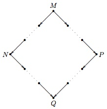
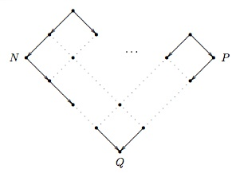

# Combinatory Logic
**First published Fri Nov 14, 2008; substantive revision Tue Nov 5, 2024**

*Bimbó, Katalin*

Combinatory logic (henceforth: CL) is an *elegant* and *powerful* logical theory that is connected to many areas of logic, and has found applications in other disciplines, especially, in computer science and mathematics.

CL was originally invented as a continuation of the reduction of the set of logical constants to a singleton set in classical first-order logic (FOL). CL untangles *the problem of substitution*, because formulas can be prepared for the *elimination of bound variables* by inserting combinators. Philosophically speaking, an expression that has no bound variables represents the logical form of the original formula. Sometimes, bound variables are thought to signify “ontological commitments.” Another philosophical rôle of CL is to show the variability of the ontological assumptions a theory has.

Substitution is a crucial operation not only in first-order logics, but also in higher-order logics, as well as in other formal systems that contain a variable binding operator, such as the $\lambda$-calculuses and the $\varepsilon$-calculus. Indeed, carrying out substitution correctly is particularly pressing in $\lambda$-calculuses and in the closely related functional programming languages. CL can emulate $\lambda$-abstraction despite the fact that CL has no variable binding operators. This makes CL a suitable target language for functional programming languages to be compiled into.

The connection to $\lambda$-calculuses might suggest—correctly—that CL is sufficiently expressive to formalize recursive functions (i.e., *computable functions*) and arithmetic. Consequently, CL is susceptible to Gödel-type incompleteness theorems.

CL is an archetypical *term rewriting system* (TRS). These systems comprise a wide range of formal calculuses from syntactic specifications of programming languages and context-free grammars to Markov algorithms; even some number theoretic problems may be viewed as special instances of questions about TRSs. Several notions and proof techniques that were originally invented for CL, later turned out to be useful in applications to less well-understood TRSs.

CL is connected to *nonclassical logics* via typing. First, a correspondence between formulas that are provable in the implicational fragment of intuitionistic logic and the typable combinatory terms was discovered. Then the isomorphism was generalized to other combinatory bases and implicational logics (such as the logic of relevant implication, exponential-free linear logic, affine logic, etc.).

*Self-reference* factors into some paradoxes, such as the widely known liar paradox and Russell’s paradox. The set theoretical understanding of functions also discourages the idea of self-application. Thus it is remarkable that pure untyped CL does not exclude the self-application of functions. Moreover, its mathematical models showed that a theory in which functions can become their own arguments is completely sensible, in addition to being *consistent* (what was established earlier using proof theoretic methods).

## 1. Schönfinkel’s elimination of bound variables

### 1.1 The problem of substitution

Classical first-order logic includes *quantifiers* that are denoted by $\forall$ (“for all”) and $\exists$ (“there is a”). A simple sentence such as “All birds are animals” may be formalized as $\forall x(Bx\supset Ax)$, where $x$ is a variable, $B$ and $A$ are one-place predicates, and $\supset$ is a symbol for (material) implication. The occurrences of the variables in the closed formula $\forall x(Bx\supset Ax)$ are *bound*, whereas those in the open formula $Bx\supset Ax$ are *free*. If we assume that $t$ (for “Tweety”) is a name constant, then an instance of the above sentence is $Bt\supset At$, that may be read as “Tweety is an animal, provided Tweety is a bird.” This illustrates that the instantiation of a (universal) quantifier involves substitution.

Due to the simplicity of the example, the *substitution* of $t$ for $x$ in $Bx$ and in $Ax$ seems to be easy to understand and to perform. However, a definition of substitution for FOL (and in general, for an abstract syntax, that is, for a language with a variable binding operator) has to guarantee that *no free* occurrence of a variable in the substituted expression *becomes bound* in the resulting expression.

To see what can go wrong, let us consider the (open) formula $\forall x(Rxy\land Rxr)$, where $R$ is a two-place predicate, $r$ is a name constant abbreviating “Bertrand Russell” and $\land$ is conjunction. $\forall x(Rxy\land Rxr)$ contains a free occurrence of $y$ (that is, $y$ is a free variable of the formula), however, $y$ is not free for a substitution of a term that contains a free occurrence of $x$, for instance, $x$ itself. More formally, the occurrence of $y$ in the second argument place of $R$ in $\forall x(Rxy\land Rxr)$ is not bound by a quantifier (the only quantifier) of the formula, whereas $\forall x(Rxx\land Rxr)$ is a closed formula, that is, it contains no free occurrences of variables. Informally, the following natural language sentences could be thought of as interpretations of the previous formulas. “Everybody reads him and Russell,” (where ‘him’ is deictic, or perhaps, anaphoric) and “Everybody reads himself and Russell.” Obviously, the meanings of the two sentences are vastly different, even if we assume that everybody pens something. As a contrast, $\forall x(Rxw\land Rxr)$ exhibits an unproblematic substitution of the name constant $w$ for the free occurrence of $y$. (The latter formula, perhaps, formalizes the sentence “Everybody reads Ludwig Wittgenstein and Bertrand Russell.”) These examples are meant to demonstrate the more complex part of the problem Moses Schönfinkel set out to solve, and for what he invented CL.[^note-1]

### 1.2 The operators “nextand” and “$U$”

A well-known result about *classical sentential logic* (SL) is that all truth-functions can be expressed in terms of $\lnot$ and $\land$ (or of $\lnot$ and $\lor$, etc.). A minimal sufficient set of connectives, however, can contain just one connective such as $\mid$ (“nand,” which is often called, Sheffer’s stroke), or $\downarrow$ (“nor,” which is Peirce’s joint denial). “Nand” is “not-and,” in other words, $A\mid B$ is defined as $\lnot(A\land B)$, where $A$, $B$ range over formulas and $\lnot$ is *negation*. Going into the other direction, if $\mid$ is a primitive, then $\lnot A$ is definable as $A\mid A$, and $A\land B$ is $(A\mid B)\mid(A\mid B)$. Although formulas with numerous vertical lines may quickly become visually confusing and hard to parse, it is straightforward to prove that $\mid$ alone is sufficiently expressive to define all the truth-functions.

Schönfinkel’s aim was to minimize the number of logical constants that are required for a formalization of FOL, just as Henry M. Sheffer (indeed, already Charles S. Peirce) did for classical propositional logic. One of the two quantifiers mentioned above suffices and the other may be assumed to be defined. Let us say, $\exists x A$ is an abbreviation for $\lnot\forall x\lnot A$. Even if $\lnot$ and the rest of the connectives are traded in for $\mid$, two logical constants remain: $\forall$ and $\mid$. A further pressing issue is that quantifiers may be nested (i.e., the scope of a quantifier may fully contain the scope of another quantifier), and the variable bindings (that could be visualized by drawing lines between quantifiers and the variables they bind) may get quite intertwined. Keeping for a moment the familiar logical constants, we may look at the following formula that hints at the emerging difficulties—when the question to be tackled is considered in its full generality.[^note-2]

$$ \forall x(\exists y(Py\land Bxy)\supset\exists y(Py\land Bxy\land \forall z((Rz\land Ozy)\supset \lnot Cz))) $$

$\forall x$ binds all occurrences of $x$; the variables in the second argument place of the two $B$s are bound by one of the two $\exists y$s, the latter of which interacts with $\forall z$ via $Ozy$.

Predicates have a fixed finite arity in FOL, and nothing precludes binding at once a variable in the first argument of one predicate and in the second argument of another predicate. (Indeed, FOL would lose some of its expressiveness, if bindings of this sort would be excluded without some means to compensate for them.) These difficulties persist when a formula is transformed into a(n equivalent) formula in *prenex normal form*. As long as the variable bindings can interweave and braid into arbitrarily complex patterns, there seems to be no way to eliminate bound variables. (Note that free variables in open formulas—in a sense—behave like local name constants, and their elimination is neither intended, nor achieved in the procedures described here.)

Schönfinkel’s ingenuity was that he introduced combinators to untangle variable bindings. The *combinators* $\textsf{S}$, $\textsf{K}$, $\textsf{I}$, $\textsf{B}$ and $\textsf{C}$ (in contemporary notation) are his, and he established that $\textsf{S}$ and $\textsf{K}$ suffice to define all the other combinators. In effect, he also defined an algorithm to carry out the elimination of bound variables, which is essentially one of the algorithms used nowadays to define *bracket abstraction* in CL.[^note-3]

Schönfinkel introduced a new logical constant $U$, that expresses the *disjointness* of two classes. For instance, $UPQ$ may be written in usual FOL notation as $\lnot\exists x(Px\land Qx)$, when $P$ and $Q$ are one-place predicates. (The formula may be thought to formalize, for instance, the natural language sentence “No parrots are quiet.”) In the process of the elimination of the bound variables, $UXY$ is obtained from an expression that contains ‘$Xx$’ and ‘$Yx$’, where $x$ does not occur in $X$ or $Y$. For example, if $X$ and $Y$ happen to be $n$-ary predicates with $n\ge2$, then $x$ occurs only in their last argument places. “Nobody reads Aristotle and Plato” can be formalized as $\lnot\exists x(Rxa\land Rxp)$, where $a$ and $p$ are name constants that stand for “Aristotle” and “Plato,” respectively. This formula *cannot* be written as $U(Ra)(Rp)$. On the other hand, “There is nobody whom both Russell and Wittgenstein read,” that is, $\lnot\exists x(Rrx\land Rwx)$ turns into $U(Rr)(Rw)$, where the parentheses delineate the arguments of $U$. Often, the expressions $X$ and $Y$ (in $UXY$) consist of predicates (and name constants) *together with combinators* and other $U$s.

It is useful to have a notation for “nextand” (i.e., “not-exists-and”) without assuming either that $x$ has a free occurrence in the expressions joined, or that if it has one, then it is the last component of the expressions. Following Schönfinkel, we use $\mid^x$ for the “nextand” *operator* that binds $x$. (The notation $\mid^-$, where $^-$ is the place for a variable, closely resembles the Sheffer stroke.) Schönfinkel achieved his goal of the reduction of the set of logical constants for FOL to a *singleton set* $\{\mid^-\}$, because every formula of FOL is equivalent to a formula that contains only “nextand.”

A formula $\forall x A$ is usually defined to be well-formed in FOL even if $A$ has no free occurrences of $x$. Then, of course, $\forall x A$ is equivalent to $A$ as well as to $\exists x A$, and such quantifiers are called *vacuous*. In order to show that any formula can be rewritten into an equivalent formula that contains only “nextand,” it is sufficient to inspect the following definitions for $\lnot$, $\lor$ and $\forall$ (with suitable variables)—that are due to Schönfinkel.

$$\begin{align*} \lnot A & \Leftrightarrow_\textrm{df} A\mid^x A \\ A\lor B & \Leftrightarrow_\textrm{df} (A\mid^yA)\mid^x(B\mid^yB) \\ \forall xAx &\Leftrightarrow_\textrm{df} (Ax\mid^yAx)\mid^x(Ax\mid^yAx) \end{align*}$$

The definition for $\lnot$, for instance, may be justified by the following equivalences. $A\Leftrightarrow A\land A$, $A\land A\Leftrightarrow \exists x(A\land A)$ (assuming that $x$ is not free in $A$), hence by replacement, $\lnot A\Leftrightarrow \lnot\exists x(A\land A)$.

Now we give a concrete example to illustrate how to turn a formula of FOL into one that contains only $\mid^-$, and then how to eliminate the bound variables using $U$ and combinators. To put some excitement into the process, we start with the sentence in (#1).

**(#1)**

For every natural number there is a greater prime.

A straightforward formalization of this sentence—on the foreground of the domain of numbers—is the formula in (#2), (where ‘$Nx$’ stands for “$x$ is a natural number,” ‘$Px$’ stands for “$x$ is a prime” and ‘$Gxy$’ is to be read as “$x$ is greater that $y$”).

**(#2)**

$\forall y\exists x(Ny\supset(Px\land Gxy))$

This formula is equivalent to $\forall y(Ny\supset\exists x(Px\land Gxy))$ and further to $\lnot\exists y\lnot(Ny\supset\exists x(Px\land Gxy))$. In one or two more steps, we get $Ny\mid^y(Px\mid^xGxy)$. (Expressions are considered to be *grouped* to the left unless parentheses indicate otherwise. E.g., $Gxy$ is $((Gx)y)$ not $G(xy)$ as could have been, perhaps, expected based on the most common way of arranging parentheses in FOL formulas.) Unfortunately, neither $\mid^x$ nor $\mid^y$ can be replaced by $U$ in the last expression. However, if the arguments of $G$ were permuted then the former reduction could be carried out. One of the combinators, $\textsf{C}$ does exactly what is needed: $Gxy$ can be changed to $\textsf{C}Gyx$ (see the definition of combinators in section 2.1). That is, we have $Ny\mid^y(Px\mid^x\textsf{C}Gyx)$, and then $Ny\mid^yUP (\textsf{C}Gy)$.[^note-4] The expression may give the impression that $y$ is the last component of $UP(\textsf{C}Gy)$, which is the second argument of $\mid^y$, but it is not so. The grouping within expressions cannot be disregarded, and another combinator, $\textsf{B}$ is needed to turn $UP(\textsf{C}Gy)$ into the desired form $\textsf{B}(UP)(\textsf{C}G)y$. From $Ny\mid^y\textsf{B}(UP)(\textsf{C}G)y$, we get $UN(\textsf{B}(UP) (\textsf{C}G))$ in one more step. This expression is completely free of variables, and it also makes the *renaming of bound variables* in FOL easily comprehensible: given two sequences of (distinct) variables that are different in their first two elements, the reversal of the above process yields formulas that are (logically equivalent) alphabetic variants of the formula in (#2).

The expression $UN(\textsf{B}(UP)(\textsf{C}G))$ may look “unfamiliar” when compared to formulas of FOL, but notation—to a large extent—is a matter of convention. It may be interesting to note that the first $U$ is simply followed by its two arguments, however, the second $U$ is not. $\textsf{B}(UP)$ is a subexpression, but $UP(\textsf{C}G)$ is not a subexpressions of $UN (\textsf{B}(UP)(\textsf{C}G))$. Furthermore, the whole expression can be transformed into $XNPG$ using combinators, where $X$ is composed of $U$s and combinators only. Such an $X$ concisely encodes the *logical form* or *logical content* of the formula with the predicates being arguments.[^note-5]

The expressions obtained via the transformations outlined above quickly become lengthy—as trying to rewrite a simple FOL sentence such as $\exists x(Px\land Qx)$ can show.[^note-6] However, this does not diminish the importance of Schönfinkel’s theoretical results. A slight increase (if any) in the length of the expressions is not even an inconvenience, let alone an impediment in the era of computers with petabytes (or even exa- and zettabytes) of memory.

It seems unfortunate that Schönfinkel’s reduction procedure for FOL is not widely known, despite the recent publication of Wolfram (2020). This book was written to celebrate the 100-year anniversary of Schönfinkel’s lecture (in which he introduced combinators) with computer-aided explorations of the realm of combinators and with documents filling in gaps in the historical context. As a measure of how widely Sheffer’s and Schönfinkel’s reductions are known, we appeal to the fact that the first is part of standard intro courses in logic, whereas the second is not. Undoubtedly, one of the reasons for this is that Schönfinkel’s process to eliminate bound variables is conceptually more opulent than defining a few truth functions from $\mid$ (or $\downarrow$). Another reason may be that Schönfinkel, perhaps, did not place a sufficiently strong emphasis on the intermediate step that allows the elimination of all other logical connectives and quantifiers via “nextand.” The importance of this step was also overlooked in the introduction to the English translation of Schönfinkel’s paper, which was written more than 30 years after the original publication. We may also note that although “nextand” is an operator in the standard logical sense, it is binary—unlike $\forall$ and $\exists$, which are unary.

If $A\mid B \Leftrightarrow_\textrm{df} \lnot(A\land B)$ is added as a definition to SL, then the result is a *conservative extension*, and it becomes provable that for any formula $A(p_0,\ldots,p_n)$ (i.e., for a formula containing the displayed propositional variables and some connectives) there is a formula $B(p_0,\ldots,p_n)$ containing only the connective $\mid$, and $B(p_0,\ldots,p_n)\Leftrightarrow A(p_0,\ldots,p_n)$ itself is provable. $\mid$ is, of course, interpreted as the “nand” truth function. “Nand” as a binary connective or as a binary truth function is of the same sort of object as conjunction, disjunction, etc.

The first stage in Schönfinkel’s extension of FOL is analogous. The addition of $\mid^-$ is (also) a conservative extension of FOL, and every occurrence of $\mid^-$ can be eliminated. (We noted that $\mid^-$ is a binary operator, and so it may be thought to combine a quantifier ($\exists$) with connectives ($\lnot$, $\land$), but $\mid^-$ of course, does not introduce any objects that are not definable in FOL.)

The second stage in Schönfinkel’s extension of FOL is slightly different. $UXY$ is definable in FOL only for one-place predicates $P$ and $Q$ (or for predicates of higher arity when the variable in their last argument is bound). Thus, in general, neither $U$ nor the combinators are definable in FOL.

The elimination of bound variables goes beyond the resources of FOL. The combinators are not only undefinable, but they are new kinds of objects—which are absent from FOL itself. Also, the intermediate steps of the bound variable elimination procedure presuppose that functions of several arguments can be viewed as functions in one variable, and the other way around.[^note-7] Enriching a presentation of FOL with predicate letters that have sufficiently many arguments in the right order would be more or less unproblematic, and it would add objects to the language that would have the same sort of interpretation as other predicates. A potential problem though is that for each predicate, infinitely many ($\aleph_0$ many) new predicates would be needed—together with axioms stipulating the intended equivalences between the meanings of the variants of the predicates. Notationally, these steps amount to padding predicate symbols with extra arguments, omitting some arguments, as well as permuting and regrouping the arguments. Although some of these additions may look superfluous or too fussy, for the understanding of Schönfinkel’s procedure to eliminate bound variables, it is crucial to note that formulas are viewed as structured strings of symbols.[^note-8]

In conclusion to this section, it is important to emphasize that there are *no questions of consistency* with respect to the above reduction process, because it can be viewed—or described in contemporary terms—as a *well-defined algorithm*. It is a completely different issue that if we consider the language of FOL expanded with combinators, then the resulting system is inconsistent, because CL is powerful enough to define the fixed point of any function. The effect of having fixed points for all functions—including truth functions—may be thought to amount to adding certain biconditionals (which may or may not be valid) as axioms. (For instance, Russell’s paradox emerges from the fixed point of the negation connective.) Notably, both FOL and (pure) CL are *consistent*.

### 1.3 Alternative approaches: basic logic and predicate functors

In this section we briefly outline two ideas that are related to Schönfinkel’s work or are motivated by his use of combinators in the elimination of bound variables.

*Fitch’s metalogic* From the late 1930s, Frederic Fitch worked on a logic that he called *basic logic*. The label is motivated by his aim to provide a framework in which any logic could be formalized. Fitch’s approach is utterly *syntactic* (much like Schönfinkel’s), and “formalization” is to be understood as *encoding* a formally described system in another—not unlike the arithmetization of the syntax in Gödel’s incompleteness theorem.

In 1942, Fitch introduced a logic that he labeled $K$. The expressions in $K$ are formed like combinatory terms by a binary application operation, which is not assumed to be associative. (See the definition of combinatory terms in the next section.) However, the constants of $K$ do not coincide with the constants of pure CL. Fitch uses *10 constants:* $\varepsilon$, $o$, $\acute{\varepsilon}$, $\acute{o}$, $W$, $=$, $\land$, $\lor$, $E$ and $*$. The first five constants are combinators, though the notation may suggest a different (informal) meaning. ‘$=$’ is the syntactical identity of expressions. ‘$\land$’ and ‘$\lor$’ are intended to stand for “and” and “or.” ‘$E$’ is the analogue of Schönfinkel’s $U$, but it corresponds to a non-vacuous existential quantifier. Finally, ‘$*$’ is similar to the transitive closure operator for binary relations or the Kleene star. Notably, there is no negation or universal quantifier in the system. The uses of the constants are characterized as follows—somewhat like axioms characterize combinators.

1. $=ab$   if and only if   $a$ and $b$ are (syntactically) the same expression
2. $\varepsilon ab$   if and only if   $ba$
3. $oabc$  if and only if   $a(bc)$
4. $\acute{\varepsilon} abc$   if and only if   $bac$
5. $\acute{o} abcd$   if and only if   $a(bc)d$
6. $Wab$   if and only if   $abb$
7. $\land ab$   if and only if   $a$ and $b$
8. $\lor ab$   if and only if   $a$ or $b$
9. $Eb$   if and only if   $\exists a.\,ba$
10. $*abc$   if and only if   $abc$ and $\exists d.\,abd\&adc$

In CL, the axioms are followed up with notions such as one-step and weak reduction, the latter of which can be viewed as a computation or inference step. (See the next section for some of these notions.) Similarly, an axiomatic calculus for FOL, for instance, would contain rules of inference in addition to the axioms. One of the obstacles to penetrate the various presentations of basic logic is the lack of a similar formulation.

During the next two decades or so after his first paper on basic logic, Fitch published a series of papers on basic logic devoted to (1) the *representation of recursive functions* (i.e., a demonstration of the possibility of the arithmetization of syntax), (2) $K^\prime$, an extension of $K$ with *negation*, *universal quantifier* and # (the dual of the $*$ operator), (3) the *consistency* of $K$ and $K^\prime$, (4) $L$, an extension of $K^\prime$ with *implication* and *necessity* operators, (5) the *definability* of some of the constants such as $*$ and #, as well as $E$.

The combinators that are included in $K$ (hence, in all its extensions) are $\textsf{T}$, $\textsf{B}$ and $\textsf{W}$. $\acute \varepsilon$ and $\acute o$ are the ternary version of $\textsf{T}$ and the quaternary version of $\textsf{B}$, respectively. Russell’s paradox involves negation, but (either variant of) Curry’s paradox is positive, in the sense that it relies on one or two theorems of the positive implicational logic of David Hilbert. This means that if the various systems of basic logic, especially $K^\prime$ and $L$ are consistent, then they either cannot contain full abstraction, or the notions of implication, entailment and identity should differ from their usual counterparts. Indeed, $K$, $K^\prime$ and $L$ are *not extensional* systems. That is, even if two expressions applied to the same expression are always equal, the equality of the applied expressions does not follow. Turning basic logic into an extensional system proved less than straightforward. Fitch’s system $JE^\prime$ was shown to be inconsistent by Myhill, which led to a more complicated formulation of the conditions for extensional identity.

Basic logic has not (yet) become a widely used general framework for the description of formal systems; however, renewed interest in this approach is signaled by Updike (2010)[^updike-2010], which attempts to situate basic logic in the broader context of foundational work at the middle of the 20th century.

*Quine’s elimination strategy* From the late 1930s, W. V. O. Quine worked on an alternative way to eliminate bound variables from first-order logic. It is plausible to assume that Schönfinkel’s goal was to find a single operator in classical logic and then to eliminate the bound variables—as he claims in Schönfinkel (1924)[^schönfinkel-1924]—rather than defining an overarching symbolic system to describe all mathematics. Nonetheless, CL was soon fused with classical logic in a more free-wheeling fashion, which resulted in an inconsistent system.

Quine saw the way out of a situation where inconsistency may arise via *implicit typing* of constants that are to some extent similar to combinators. He called such constants *predicate functors*, and introduced several groups of them, the last one in Quine (1981)[^quine-1981].

The most common presentations of FOL stipulate that an $n$-place predicate followed by a *sequence* of $n$ terms (possibly, punctuated by commas and surrounded by parentheses) is a formula. (This is in contrast with Schönfinkel’s view of formulas and in accordance with the informal and formal interpretations of predicates as $n$-ary relations. In other words, FOL does not permit “currying” of predicates or of their interpretations.) Quine subscribes to the view that sequences of terms follow predicates.

Predicate functors are not applicable to each other—unlike the combinators are. This is a point that Quine repeatedly emphasizes. *Atomic predicates* are the predicates of a first-order language, whereas *complex predicates* are obtained by applying a predicate functor (of appropriate arity) to predicates (which may be atomic or complex).

The prohibition of self-application together with the use of “flat” sequences of arguments means that *infinitely many* predicate functors are needed to ensure the elimination of bound variables from all formulas of FOL. To explain the problem quickly: a permutation of a pair of elements that are arbitrarily far apart cannot be ensured otherwise. Just as combinators may be divided into groups based on their effect, Quine was able to select predicate functors that can be grouped together naturally based on their effects. Indeed, the groups of predicate functors are similar to classes of combinators, though Quine’s labels are often sublime. In order to give a concrete example of this alternative approach, we outline a slightly modified version of a set of predicate functors from Quine (1981)[^quine-1981].

A first-order language with $\mid^-$ as the only operator is assumed. ($F$ and $G$ are metavariables for predicates in the predicate functor language.) $\wr^n$ $\textit{Inv}^n$, $\textit{inv}^n$, $\textit{Pad}^{n+1}$ and $\textit{Ref}^n$ are predicate functors, for every $n\in\omega$. A formula of FOL is rewritten into a formula in a predicate functor language by applications of the following clauses.

1. A variable $x$ and a predicate $P$ of FOL is $x$ and $P$, respectively, in the predicate functor language.
2. $Fx_1x_2\ldots x_n\mid^{x_1}Gx_1x_2\ldots x_n \mathbin{{:}{=}{:}} (F\wr G)x_2\ldots x_n$, where $x_2,\ldots, x_n$ are distinct from $x_1$, and $F$ and $G$ are followed by the same sequence of variables.
3. $Fx_1x_2\ldots x_n \mathbin{{:}{=}{:}} (\textit{Inv }F)x_2\ldots x_nx_1$
4. $Fx_1x_2\ldots x_n \mathbin{{:}{=}{:}} (\textit{inv }F)x_2x_1\ldots x_n$
5. $Fx_2\ldots x_n \mathbin{{:}{=}{:}} (\textit{Pad } F)x_1x_2\ldots x_n$
6. $Fx_1x_1x_2\ldots x_n \mathbin{{:}{=}{:}} (\textit{Ref }F )x_1x_2\ldots x_n$

There is an obvious similarity between $\textit{Ref}$ and $\textsf{W}$, $\textit{Pad}$ and $\textsf{K}$, as well as $\textit{Inv}$ and $\textit{inv}$ and various combinators with permutative effects (e.g., $\textsf{C}$ and $\textsf{T}$). If $\mid^-$ is the only operator in the first-order language, then all formulas, which are not atomic, are almost of the form of the left-hand side expression in 2. What has to be assured is that the side condition is satisfied, and that is where clauses 3–6 enter. Although the various $n$-ary versions of $\wr$, $\textit{inv}$, $\textit{Pad}$ and $\textit{Ref}$ could be conflated (by ignoring unaffected arguments), $\textit{Inv}$ clearly stands for infinitely many predicate functors, because $x_1,\ldots,x_n$ cannot be ignored or omitted.

It may be interesting to note that there is a difference between $\wr$ and Schönfinkel’s $U$. Not only the place of the bound variable is different, but $\wr$ builds in contraction for $n-1$ variables (which are separated by $\mid^-$ and other symbols in the left-hand expression).

Quine intended the predicate functor language to lead to a novel algebraization of first-order logic. While bound variables can be eliminated using predicate functors, Quine never defined an algebra in the usual sense—something similar, for instance, to polyadic or cylindric algebras. Predicate functors, by design, have a very limited applicability, which has the unfortunate side effect that they seem to be of little interest and not much of use outside their intended context.

## 2. Combinatory terms and their main properties

### 2.1 Reduction, equality and their formalizations

The paradoxes that were discovered by Georg Cantor and Bertrand Russell in the late 19th–early 20th century both involve self-membership of a set. The ramified theory of types due to Alfred N. Whitehead and Bertrand Russell, and ZF (the formalization of set theory named after Ernst Zermelo and Abraham A. Fraenkel) exclude self-membership. However, there seems to have been always a desire to create a theory that allows self-membership or self-application. Indeed, one of Curry’s motivations for the development of CL was the goal to construct a formal language that includes a wide range of well-formed expressions, some of which—under certain interpretations—may turn out to be meaningless. (This idea may be compared to the von Neumann–Bernays–Gödel formalization of set theory, in which—without the axiom of foundation—the Russell class can be proved not to be a set, hence, to be a proper class.)

A few natural language examples provide a convenient illustration to clarify the difference between (1), that is a well-formed (but meaningless) expression and (2), which is a meaningful (but ill-formed) sentence. (The meaningfulness of (2), of course, should be taken with a grain of salt. In reality, Kurt Gödel proved the system of PM to be incomplete in 1930. Thus (2) may be guessed—using syntactic and semantics clues—to be a distorted version of (2′) Peano arithmetic was proved to be incomplete by Gödel in 1930.)

**(1)**

The derivative of $\lambda x\,(x^2+4x-6)$ wishes to declare that functions are smart.

**(2)**

Peano arithmetics prove incomplete with Gödel at 1930.

After these informal motivations, we turn to CL proper and introduce some of its notions a bit more formally.

The *objects* in CL are called *terms*.[^note-9] Terms may be thought to be interpreted as functions (as further explained in section 4.1). *Primitive terms* comprise *variables* and *constants*, whereas *compound terms* are formed by combining terms. Usually, a denumerable set (i.e., a set with cardinality $\aleph_0$) of variables is included, and the constants include some (undefined) *combinators*. (We use $x,y,z,v,w,u,x_0,\ldots$ as variables in the object language, and $M,N,P,Q,\ldots$ as metavariables that range over terms.)

*Terms* are inductively defined as follows.

**(t1)**

If $x$ is a variable, then $x$ is a term;

**(t2)**

if $c$ is a constant, then $c$ is a term;

**(t3)**

if $M$ and $N$ are terms, then ($MN$) is a term.

In the above definition, (t3) conceals the binary operation that conjoins the two terms $M$ and $N$. This operation is called *application*, and it is often denoted by juxtaposition, that is, by placing its two arguments next to each other as in ($MN$).

Application is not assumed to possess additional properties (such as commutativity), because its intended interpretation is *function application*. For instance, $((vw)u)$ and $(v(wu))$ are distinct terms—just as the derivative of $\lambda x.\,x^2+4x-6$ applied to 8 (that is, ($\lambda x.\,2x+4)8=20$) is different from the derivative of 90 (that is, $(8^2+32-6)'=0$). Using $\lambda$ notation, the two terms in the example may be expressed as

$$ ((\lambda y.\,y')(\lambda x.\,x^2+4x-6))8 $$

vs

$$ (\lambda y.\,y')((\lambda x.\,x^2+4x-6)8). $$

If terms are viewed as structured strings (where parentheses show grouping), then the number of distinct terms associated to a string of length $n$ is the *Catalan number* $C_{n-1}$. For a non-negative integer $n$ (i.e., for $n\in\mathbb{N}$),

$$ C_n = \frac{1}{n+1} {2n \choose n}. $$

The first seven Catalan numbers are $C_0=1$, $C_1=1$, $C_2=2$, $C_3=5$, $C_4=14$, $C_5=42$ and $C_6=132$. As an illustration, we may take—for simplicity—strings consisting of $x$s, because the terms are to differ only in their grouping. Clearly, if the term is $x$ or $xx$, that is of length 1 or 2, then there is only one way to form a term, that is, there exists just one possible term in each case. If we start with three $x$s, then we may form $(xx)x$ or $x(xx)$. If the length of the term is 4, then the five terms are: $xxxx$, $x(xx)x$, $xx(xx)$, $x(xxx)$ and $x(x(xx ))$. (It is a useful exercise to try to list the 14 distinct terms that can be formed from 5 $x$s.)

The usual notational convention in CL is to *drop parentheses* from left-associated terms together with the outmost pair. For instance, $xyz$ would be fully written as $((xy)z)$, whereas $xy(xz)$ and $(xy)(xz)$ are both “shorthand versions” of the term $((xy)(xz))$ (unlike $xyxz$). Grouping in terms delineates subterms. For instance, $xy$ is a subterm of each of the terms mentioned in this paragraph, whereas $yz$ and $yx$ are subterms of none of those terms.

*Subterms* of a term are recursively defined as follows.

**(s1)**

$M$ is a subterm of $M$;

**(s2)**

if $M$ is a subterm of $N$ or of $P$, then $M$ is a subterm of $NP$.

Incidentally, the notion of free variables is straightforwardly definable now: $x$ is a free variable of $M$ iff $x$ is a subterm of $M$. The set of free variables of $M$ is sometimes denoted by $\textrm{fv}(M)$.

All terms are interpreted as functions, and combinators are functions too. Similarly, to some numerical and geometrical functions, that can be described and grasped easily, the combinators that are frequently encountered can be characterized as perspicuous transformations on terms. (Sans serif letters denote combinators and $\mathbin{\triangleright_1}$ denotes *one-step reduction*.)

**Definition. (Axioms of some well-known combinators)**

| $\textsf{S}xyz \mathbin{\triangleright_1} xz(yz)$ | $\textsf{K}xy \mathbin{\triangleright_1} x$ | $\textsf{I}x \mathbin{\triangleright_1} x$ |
| --- | --- | --- |
| $\textsf{B}xyz \mathbin{\triangleright_1} x(yz)$ | $\textsf{T}xy \mathbin{\triangleright_1} yx$ | $\textsf{C}xyz \mathbin{\triangleright_1} xzy$ |
| $\textsf{W}xy \mathbin{\triangleright_1} xyy$ | $\textsf{M}x \mathbin{\triangleright_1} xx$ | $\textsf{Y}x \mathbin{\triangleright_1} x(\textsf{Y}x)$ |
| $\textsf{J}xyzv \mathbin{\triangleright_1} xy(xvz)$ | $\textsf{B}^\prime xyz \mathbin{\triangleright_1} y(xz)$ | $\textsf{V}xyz \mathbin{\triangleright_1} zxy$ |

These axioms tacitly specify the *arity* of a combinator as well as their *reduction* (or *contraction*) pattern. Perhaps, the simplest combinator is the *identity* combinator $\textsf{I}$, that applied to an argument $x$ returns the same $x$. $\textsf{K}$ applied to $x$ is a constant function, because when it is further applied to $y$, it yields $x$ as a result, that is, $\textsf{K}$ is a cancellator with respect to its second argument. $\textsf{W}$ and $\textsf{M}$ are *duplicators*, because in the result of their application one of the arguments (always) appears twice.[^note-10] $\textsf{C}$, $\textsf{T}$ and $\textsf{V}$ are *permutators*, because they change the order of some of their arguments. $\textsf{B}$ is an *associator*, because $\textsf{B}xyz$ turns into a term in which $y$ is applied to $z$ before $x$ is applied to the result. $\textsf{Y}$ is the *fixed point* combinator, because for any function $x$, $\textsf{Y}x$ is the fixed point of that function (see section 2.3). The combinator $\textsf{B}^\prime$ is an associator and a permutator, whereas $\textsf{S}$ and $\textsf{J}$ are also duplicators. $\textsf{S}$ is very special and it is called the *strong composition* combinator, because when applied to two functions, let us say, $g$ and $f$ (in that order), as well as $x$, then the resulting term $gx(fx)$ expresses the composition of $g$ and $f$ both applied to the same argument $x$.

These informal explications did not mention any restrictions on the sort of functions $x,y,z,f,g,\ldots$ may be. However, the axioms above limit the applicability of the combinators to variables. Intuitively, we would like to say that given any terms, that is, any functions $M$ and $N$, $\textsf{W}MN$ one-step reduces to $MNN$ (possibly, as a subterm of another term). For example, $M$ may be $\textsf{K}$ and $N$ may be $yy$, and then $\textsf{WK}(yy)\triangleright_1\textsf{K}(yy) (yy)$. The latter term suggests a further one-step reduction, and indeed we might be interested in successive one-step reductions—such as those leading from $\textsf{WK}(yy)$ to $yy$. A way to achieve these goals is to formalize (a theory of) CL starting with the standard *inequational logic* but to omit the anti-symmetry rule and to add certain other axioms and rules.

**Inequational Calculus for CL** ($\text{CL}_\triangleright$).

| $M\triangleright M$ | $\textsf{S}MNP\triangleright MP(NP)$ | $\quad\textsf{K}MN\triangleright M$ |
| --- | --- | --- |
| $\dfrac{M\triangleright N \quad N\triangleright P}{M\triangleright P}$ | $\dfrac{M\triangleright N}{MP\triangleright NP}$ | $\dfrac{M\triangleright N}{PM\triangleright PN}$ |

The use of metavariables encompasses *substitution* (that we illustrated above on the term $\textsf{W}MN)$. The identity axiom and the rule of transitivity imply that $\triangleright$ is a transitive and reflexive relation. The last two rules characterize application as an operation that is *monotone* in both of its argument places. $\text{CL}_\triangleright$ includes only $\textsf{S}$ and $\textsf{K}$, because the other combinators are definable from them—as we already mentioned in section 1.2, and as we explain more precisely toward the end of this section.

The set of combinators $\{\textsf{S},\textsf{K}\}$ is called a *combinatory base*, that is, these two combinators are the undefined constants of $\text{CL}_\triangleright$. To give an idea of a *proof* in this calculus, the following steps may be pieced together to prove $\textsf{SKK} (\textsf{KSK})\triangleright \textsf{S}$. $\textsf{KSK}\triangleright \textsf{S}$ is an instance of an axiom. Then $\textsf{SKK}(\textsf{KSK}) \triangleright\textsf{SKKS}$ is obtained by right monotonicity, and further, $\textsf{SKK}(\textsf{KSK})\triangleright\textsf{S}$ results by instances of the $\textsf{S}$ and $\textsf{K}$ axioms together with applications of the transitivity rule.

The relation $\triangleright$ is called *weak reduction*, and it may be defined alternatively as follows. (‘Weak reduction’ is a technical term used in CL to distinguish this relation on the set of terms from some other relations, one of which is called ‘strong reduction’.) A term that is either of the form $\textsf{S}MNP$ or of the form $\textsf{K}MN$ is a *redex*, and the leading combinators ($\textsf{S}$ and $\textsf{K}$, respectively) are the *heads* of the redexes. If a term $Q$ contains a subterm of the form $\textsf{S}MNP$, then $Q^\prime$, which is obtained by replacing that subterm by $MP(NP)$ is a *one-step reduct* of $Q$. (Similarly, for the redex $\textsf{K} MN$ and $M$.) That is, $Q\triangleright Q^\prime$ in both cases. *Reduction* then may be defined as the reflexive transitive closure of one-step reduction. This notion is *completely* captured by $\text{CL}_\triangleright$. The calculus $\text{CL}_\triangleright$ is *complete* in the sense that if $M\triangleright N$ in the sense we have just described, then $\text{CL}_\triangleright$ proves $M\triangleright N$. (It is easy to see that the converse implication is true too.)

The notion of reduction is a weaker relation than one-step reduction, and so it is useful to distinguish a subclass of terms using the stronger relation. A term is in *normal form* (nf) when it contains no redexes. Note that one-step reduction does not need to decrease the total number of redexes that a term contains, hence, it does not follow that every term can be turned into a term in nf via finitely many one-step reductions. Indeed, some terms do not reduce to a term in nf.

Reduction is arguably an important relation between terms that denote functions. The typical steps in a program execution and in other concrete calculations are function applications rather than moves in the other direction, what is called *expansion*. However, the notion of the equality of functions is familiar to everybody from mathematics, and the analogous notion has been introduced in CL too. The transitive, reflexive, symmetric closure of the one-step reduction relation is called (weak) *equality*. A formalization of equational CL may be obtained by extending the standard equational logic with combinatory axioms and rules characterizing the combinatory constants and the application operation.

**Equational Calculus for CL** ($\text{CL}_=$).

| $M=M$ | $\textsf{K}MN=M$ | $\quad\textsf{S}MNP=MP(NP)\quad$ |   |
| --- | --- | --- | --- |
| $\quad\dfrac{M=N \quad N=P}{M=P}\quad$ | $\dfrac{M=N}{N=M}$ | $\dfrac{M=N}{MP=NP}$ | $\dfrac{M=N}{PM=PN}$ |

The first axiom and the first two rules constitute equational logic. The constants are again the combinators $\textsf{S}$ and $\textsf{K}$. Note that $\text{CL}_=$ could have been defined as an extension of $\text{CL}_\triangleright$ by adding the rule of symmetry, that would have paralleled the description of the definition of equality from reduction as its transitive, symmetric closure. We chose instead to repeat the inequational axioms and rules with the new notation (and add the rule of symmetry) to make the two definitions self-contained and easy to grasp. The two characterizations of $=$ coincide—as those of $\triangleright$ did.

$\text{CL}_\triangleright$ and $\text{CL}_=$ share a feature that may or may not be desirable—depending on what sort of understanding of functions is to be captured. To illustrate the issue, let us consider the one-place combinators $\textsf{SKK}$ and $\textsf{SK}(\textsf{KK})$. It is easy to verify that $\textsf{SKK}M\triangleright M$ and $\textsf{SK}(\textsf{KK})M \triangleright M$. However, neither $\textsf{SKK}\triangleright \textsf{SK}(\textsf{KK})$ nor $\textsf{SK}(\textsf{KK})\triangleright \textsf{SKK}$ is provable in $\text{CL}_\triangleright$; a fortiori, the equality of the two terms in not provable in $\text{CL}_=$. This means that $\text{CL}_\triangleright$ and $\text{CL}_=$ formalize *intensional* notions of functions, where “intensionality” implies that functions that give the same output on the same input may remain distinguishable.

The archetypical intensional functions that one is likely to encounter are *algorithms*. As examples, we might think of various specifications to calculate the decimal expansion of $\pi$, or various computer programs that behave in the same way. For instance, compilers (for one and the same language) may differ from each other by using or not using some optimizations, and thereby, producing programs from a given piece of code that have identical input–output behavior but different run times.

If functions that are indistinguishable from the point of view of their input–output behavior are to be identified, that is, an *extensional* understanding of functions is sought, then $\text{CL}_\triangleright$ and $\text{CL}_=$ have to be extended by the following rule, (where the symbol $\ddagger$ is to be replaced by $\triangleright$ or $=$, respectively).

$$ \frac{Mx\ddagger Nx}{M\ddagger N} \text{ where } x \text{ is not free in } MN. $$

### 2.2 Church–Rosser theorems and consistency theorems

The calculuses $\text{CL}_\triangleright$ and $\text{CL}_=$ of the previous section formalize reduction and equality. However, $\triangleright$ and $=$ have some further properties that are important when the terms are thought to stand for functions. The next theorem is one of the earliest and best-known results about CL.

**Church–Rosser theorem (I).** If $M$ reduces to $N$ and $P$, then there is a term $Q$ to which both $N$ and $P$ reduce.

*Figure 1.* Illustration for the Church–Rosser theorem (I)

If we think that reduction is like computing the value of a function, then the Church–Rosser theorem—in a first approximation—can be thought to state that the final result of a series of calculations with a term is unique—independently of the order of the steps. This is a slight overstatement though, because uniqueness implies that each series of calculations ends (or “loops” on a term). That is, if there is a unique final term, then only finitely many distinct consecutive calculation steps are possible.

A coarse analogy with elementary arithmetic operations, perhaps, can shed some light on the situation. The addition and multiplication of natural numbers always yield a natural number. However, if division is included then it is no longer true that all numerical expressions evaluate to a natural number, since $7/5$ is a rational number that is not a natural one, and $n/0$ is undefined (even if $n$ were real). That is, some numerical expressions do not evaluate to a (natural) number. Although the analogy with combinatory terms is not very tight, it is useful. For instance, $n/0$ (assuming that the codomain of the function $\lambda n.\,n/0$ is extended to permit $r$ to be rational) could be implemented on a computer by a loop (that would never terminate when executed if $n\ne0$) which would go through an enumeration of the rational numbers trying to find an $r$ such that $r\cdot0=n$.

The combinatory terms $\textsf{WWW}$ and $\textsf{WI}(\textsf{WI})$ are, perhaps, the simplest examples of terms that do not have a normal form. Both terms induce an infinite *reduction sequence*, that is, an infinite chain of successive one-step reductions. To make the example more transparent, let us assume for a moment that $\textsf{W}$, $\textsf{I}$, $\textsf{C}$, etc. are not defined from $\textsf{K}$ and $\textsf{S}$, but are primitive constants. The contraction of the only redex in $\textsf{WWW}$ returns the same term, which shows that uniqueness does not imply that the term is in nf. The contraction of the only redex in $\textsf{WI}(\textsf{WI})$ gives $\textsf{I}(\textsf{WI})(\textsf{WI})$ that further reduces to the term we started with. A slightly more complicated example of a term that has only infinite reduction sequences is $\textsf{Y}(\textsf{CKI})$. This term has a reduction sequence (in which each contracted redex is headed by $\textsf{Y}$) that contains infinitely many distinct terms. It is also possible to create infinite reduction sequences that start with $\textsf{Y} (\textsf{CKI})$ and have various loops too. To sum up, the Church–Rosser theorem, in general, does not guarantee the uniqueness of the term $Q$. However, if $M$ has *a normal form* then that is *unique*.

The Church–Rosser theorem is often stated as follows.

**Church–Rosser theorem (II).** If $N$ and $P$ are equal, then there is a term $Q$ to which both $N$ and $P$ reduces.

*Figure 2.* Illustration for the Church–Rosser theorem (II)

The second form of the Church–Rosser theorem differs from the first in its *assumption*. From the definition of equality as a superset of reduction, it is obvious that the first form of the theorem is implied by the second. However, despite the weaker assumption in the second formulation of the Church–Rosser theorem, the two theorems are *equivalent*. Equality is the transitive, symmetric closure of reduction, which means that if two terms are equal then there is a finite path comprising reduction and expansion steps (which decompose into one-step reductions and one-step expansions, respectively). Then by finitely many applications of the first Church–Rosser theorem (i.e., by induction on the length of the path connecting $N$ and $P$), the first Church–Rosser theorem implies the second formulation.

*Modern proofs* of the Church–Rosser theorem for CL proceed indirectly because one-step reduction fails to have the diamond property. A binary relation $R$ (e.g., reduction) is said to have the *diamond property* when $xRy$ and $xRz$ imply that $yRv$ and $zRv$ for some $v$. If a binary relation $R$ has the diamond property, so does its transitive closure. To exploit this insight in the proof of the Church–Rosser theorem, a suitable *subrelation of reduction* has to be found. The sought after subrelation should possess the diamond property, and its reflexive transitive closure should coincide with reduction.

The following counterexample illustrates that one-step reductions of a term may yield terms that further do not reduce to a common term in *one* step. $\textsf{SKK}(\textsf{KKS})\triangleright_1\textsf{SKKK}$ and $\textsf{SKK}(\textsf{KKS})\triangleright_1\textsf{K}(\textsf{KKS}) (\textsf{K}(\textsf{KKS}))$, and then some of the potential reduction sequences are as follows.

1. $\textsf{SKKK}\triangleright_1\textsf{KK}(\textsf{KK})\triangleright_1 \textsf{K}$
2. $\textsf{K}(\textsf{KKS})(\textsf{K}(\textsf{KKS}))\triangleright_1 \textsf{KKS}\triangleright_1\textsf{K}$
3. $\textsf{K}(\textsf{KKS})(\textsf{K}(\textsf{KKS}))\triangleright_1 \textsf{KK}(\textsf{K}(\textsf{KKS}))\triangleright_1 \textsf{KK}(\textsf{KK})\triangleright_1\textsf{K}$
4. $\textsf{K}(\textsf{KKS})(\textsf{K}(\textsf{KKS}))\triangleright_1 \textsf{K}(\textsf{KKS})(\textsf{KK})\triangleright_1\textsf{KKS} \triangleright_1\textsf{K}$
5. $\textsf{K}(\textsf{KKS})(\textsf{K}(\textsf{KKS}))\triangleright_1 \textsf{K}(\textsf{KKS})(\textsf{KK})\triangleright_1\textsf{KK} (\textsf{KK})\triangleright_1\textsf{K}$

The failure of the diamond property is obvious once we note that $\textsf{SKKK}\triangleright_1\textsf{KK}(\textsf{KK})$ (only), but $\textsf{K}(\textsf{KKS})(\textsf{K}(\textsf{KKS}))$ does not reduce in one step to $\textsf{KK}(\textsf{KK})$.

An appropriate subrelation of reduction is the *simultaneous reduction of a set of nonoverlapping redexes*, which is denoted by $\triangleright _\textrm{sr}$. ‘Nonoverlapping’ means that there are no shared subterm occurrences between two redexes. $\triangleright_\textrm{sr}$ includes $\triangleright_1$ because a one-step reduction of a redex may be viewed instead as $\triangleright_\textrm{sr}$ of a singleton set of redexes. $\triangleright_\textrm{sr}$ is, obviously, included in $\triangleright$ (i.e., in reduction). These two facts imply that the reflexive transitive closure of $\triangleright_\textrm{sr}$ is reduction—when the tonicity of the reflexive transitive closure operation (denoted by $^*$) is taken into account.

(1)–(3) summarize the key inclusions between the relations mentioned.

**(1)**

$\triangleright_1\subseteq\triangleright_\textrm{sr}\; \Rightarrow\;\triangleright_1^*\subseteq\triangleright_\textrm{sr}^*$

**(2)**

$\triangleright_\textrm{sr}\subseteq\triangleright \;\Rightarrow\;\triangleright_\textrm{sr}^*\subseteq\triangleright^*$

**(3)**

$\triangleright_1^*\subseteq\triangleright^*\quad \textrm{ and }\quad\triangleright^*=\triangleright$.

The central property of $\triangleright_\textrm{sr}$ that we need is the content of the following theorem.

**Theorem. (Diamond property for** $\triangleright_\textrm{sr}$) If $M\triangleright_\textrm{sr}N$ and $M\triangleright_\textrm{sr}P$ then there is a term $Q$ such that both $N\triangleright_\textrm{sr}Q$ and $P\triangleright_\textrm{sr}Q$.

The proof of this theorem is an easy induction on the term $M$. The properties of $\triangleright_\textrm{sr}$ guarantee that one or more one-step reductions can be performed at once, but the reductions cannot interfere (or overlap) with each other.

The *consistency* of CL follows from the Church–Rosser theorem together with the existence of (at least two) distinct normal forms.

**Theorem. (Consistency)** CL is consistent, that is, there are terms that do not reduce to each other, hence they are not equal.

Not all terms have an nf, however, many do. Examples, first of all, include $\textsf{S}$ and $\textsf{K}$. (The variables, if included, of which there are $\aleph_0$ many, are all in nf.) None of these terms contains a redex, hence each reduces only to itself. By the Church–Rosser theorem, it is excluded that some term $M$ could reduce to both $x$ and $\textsf{S}$ (making $\textsf{S}$ equal to $x$).

The interaction between infinite reduction sequences and nfs deserves a more careful inspection though. The terms $\textsf{WWW}$, $\textsf{Y} (\textsf{CKI})$ and $\textsf{WI}(\textsf{WI})$ have *only* infinite reduction sequences. However, the existence of an infinite reduction sequence for a term does not imply that the term has no normal form (when the combinatory base is complete or contains a cancellator). $\textsf{Y} (\textsf{KI})$ reduces to $\textsf{KI}(\textsf{Y}(\textsf{KI}))$, $\textsf{KI}(\textsf{KI}(\textsf{Y}(\textsf{KI})))$, $\textsf{KI} (\textsf{KI}(\textsf{KI}(\textsf{Y}(\textsf{KI})))),\ldots$ as well as to $\textsf{I}$.

A term *weakly normalizes* when it has an nf, whereas a term *strongly normalizes* when all its reduction sequences lead to an nf (hence, to *the nf*) of the term. A computational analogue of a strongly normalizing term is a (nondeterministic) program that terminates on every branch of computation, whereas termination on at least one branch is akin to weak normalization.

The importance of normalization led to a whole range of questions (and an extensive literature of answers). How does the order of the reduction steps (i.e., a reduction strategy) affect finding the nf (if there is one)? Are there combinatory bases that guarantee the existence of normal forms for every combinator over that base? To quickly illustrate possible answers to our sample questions, we start with noting that if there is no combinator with a duplicative effect in a base, then all combinators over that base strongly normalize. This is a very easy answer, and as a concrete base, we could have, for example, $\{\textsf{B},\textsf{C},\textsf{K}\}$ or $\{\textsf{B}, \textsf{C},\textsf{I}\}$, which have some independent interest in view of their connection to simply typed calculuses. However, these bases are far from being combinatorially complete and even a fixed point combinator is undefinable in them.

We could ask a slightly different question: If we start with the base $\{\textsf{S},\textsf{K}\}$ and we omit $\textsf{S}$, then we get the base $\{\textsf{K}\}$ and all the combinators strongly normalize, but what if we omit $\textsf{K}$? Do the combinators over $\{\textsf{S}\}$ strongly normalize or at least normalize? The answer is “no.” A term (discovered by Henk Barendregt in the early 1970s) that shows the lack of strong normalization is $\textsf{SSS}(\textsf{SSS})(\textsf{SSS})$. The first $\textsf{S}$ is the head of a (indeed, *the only*) redex, and the head reduction sequence of this term is infinite. Since $\{\textsf{S}\}$ does not contain any combinator with a cancellative effect, the existence of an infinite reduction sequence for a term means that the term has no nf. There are shorter combinators over the base $\{\textsf{S}\}$ without an nf, for example, $\textsf{S}(\textsf{SS})\textsf{SSSSS}$ comprises only eight occurrences of $\textsf{S}$.

The sorts of questions we illustrated here (or rather, the answers to them) can become a bit technical, because they often involve concepts and techniques from graph theory, automata theory and the theory of term-rewriting.

### 2.3 The existence of fixed points and combinatorial completeness

Schönfinkel proved that $\textsf{S}$ and $\textsf{K}$ suffice to define the other combinators he introduced, and we mentioned in the definition of $\text{CL}_\triangleright$ that the set of constants is limited to $\textsf{S}$ and $\textsf{K}$, because other combinators could be defined from those.

To demonstrate the sense in which definability is understood here we consider the example of $\textsf{B}$. The axiom for $\textsf{B}$ is $\textsf{B} xyz\triangleright_1x(yz)$, and if we take $\textsf{S}(\textsf{KS}) \textsf{K}$ instead of $\textsf{B}$, then the following reduction sequence results.

$$ \textsf{S}(\textsf{KS})\textsf{K}xyz\triangleright_1\textsf{KS}x (\textsf{K}x)yz\triangleright_1\textsf{S}(\textsf{K}x)yz\triangleright_1 \textsf{K}xz(yz)\triangleright_1x(yz) $$

The term $\textsf{S}(\textsf{KS})\textsf{K}$ is in nf, however, to be in nf is not a requirement for definability. It is more convenient to work with defining terms that are in nf, because an application of a combinator that is not in nf could be started with reducing the combinator to its normal form. (Also, there are always infinitely many combinators that reduce to a combinator.) However, note that the preference for choosing combinators in nf is not meant to imply that a combinator cannot be defined by two or more terms in nf; below we give two definitions (involving only $\textsf{S}$ and $\textsf{K}$) for $\textsf{I}$.

If the constants are $\textsf{S}$ and $\textsf{K}$, then the *combinators* are all those terms that are formed from $\textsf{S}$ and $\textsf{K}$ (without variables). Once we have defined $\textsf{B}$ as $\textsf{S}(\textsf{KS})\textsf{K}$, we may use $\textsf{B}$ in further definitions as an abbreviation, and we do that primarily to reduce the size of the resulting terms as well as to preserve the transparency of the definitions.

The following list gives definitions for the other well-known combinators that we mentioned earlier. (Here ‘$=$’ is placed between a definiendum and a definiens.)

| $\textsf{I}=\textsf{SK}(\textsf{KK})$ | $\textsf{T}=\textsf{B}(\textsf{SI})\textsf{K}$ | $\textsf{C}=\textsf{B}(\textsf{T}(\textsf{BBT}))(\textsf{BBT})$ |
| --- | --- | --- |
| $\textsf{W}=\textsf{CSI}$ | $\textsf{M}=\textsf{SII}$ | $\textsf{Y}=\textsf{BW}(\textsf{BB}^\prime\textsf{M})(\textsf{BW}(\textsf{BB}^\prime\textsf{M}))$ |
| $\textsf{V}=\textsf{BCT}$ | $\textsf{B}^\prime=\textsf{CB}$ | $\textsf{J}=\textsf{W}(\textsf{BC}(\textsf{B}(\textsf{B}(\textsf{BC}))(\textsf{B}(\textsf{BB})(\textsf{BB}))))$ |

The definitions are easily seen to imply that all these combinators depend on both $\textsf{S}$ and $\textsf{K}$, but it is not obvious from the definitions that the defined combinators are mutually independent, that is, that none of the listed combinators is definable from another one. (Clearly, some subsets suffice to define some of the combinators.) We do not intend to give an exhaustive list of interdefinability between various subsets of these combinators, but to hint at the multiplicity and intricacy of such definitions, we list a handful of them. We also introduce two further combinators $\textsf{S}^\prime$ and $\textsf{R}$.

| $\textsf{I}=\textsf{SKK}$ | $\textsf{I}=\textsf{WK}$ | $\textsf{I}=\textsf{CK}(\textsf{KK})$ |
| --- | --- | --- |
| $\textsf{B}=\textsf{CB}^\prime$ | $\textsf{S}^\prime=\textsf{CS}$ | $\textsf{S}=\textsf{CS}^\prime$ |
| $\textsf{W}=\textsf{S}^\prime\textsf{I}$ | $\textsf{W}=\textsf{B}(\textsf{T}(\textsf{BM}(\textsf{BBT})))(\textsf{BBT})$ | $\textsf{W}=\textsf{C}(\textsf{S}(\textsf{CC})(\textsf{CC}))$ |
| $\textsf{R}=\textsf{BBT}$ | $\textsf{Y}=\textsf{BM}(\textsf{CBM})$ | $\textsf{Y}=\textsf{B}^\prime(\textsf{B}^\prime\textsf{M})\textsf{M}$ |

If the fixed point combinator $\textsf{Y}$ is not taken to be a primitive, then there are various ways to define it—so far, we have listed three.

**Fixed point theorem.** For any function $M$, there is a term $N$ such that $MN = N$.

The proof of this theorem is easy using a fixed point combinator, because a term that can play the rôle of $N$ is $\textsf{Y}M$.

Some of the definitions of $\textsf{Y}$ have slightly different properties with respect to reduction. But the importance of the fixed point combinator is that it ensures that all functions have a fixed point and all *recursive equations* can be solved.

Both Haskell B. Curry and Alan Turing defined fixed point combinators (in CL or in the $\lambda$-calculus). If we consider the definitions

$$ \textsf{Y}_1=\textsf{BM}(\textsf{BWB}) \quad \textsf{Y}_2=\textsf{W}(\textsf{B}(\textsf{BW}(\textsf{BT})))(\textsf{W}(\textsf{B}(\textsf{BW}(\textsf{BT})))) $$

(where the subscripts are added to distinguish the two definitions), then we can see that $\textsf{Y}_1 M=M(\textsf{Y}_1M)$, but for $\textsf{Y}_2$, $\textsf{Y}_2M\triangleright M(\textsf{Y}_2M)$ holds too. In this respect, $\textsf{Y}_1$ is similar to Curry’s fixed point combinator (and really, to any fixed point combinator), whereas $\textsf{Y}_2$ is like Turing’s fixed point combinator.

The fixed point theorem demonstrates—to some extent—the expressive power of CL. However, fixed point combinators may be defined from bases without a cancellator (as $\textsf{Y}_1$ and $\textsf{Y}_2$ show). The full power of CL (with the base $\{\textsf{S},\textsf{K}\}$) is enunciated by the following theorem.

**Theorem. (Combinatorial completeness)** If $f(x_1,\ldots,x_n)= M$ (where $M$ is a term containing no other variables than those explicitly listed), then there is a combinator $\textsf{X}$ such that $\textsf{X} x_1\ldots x_n$ reduces to $M.$

The theorem’s assumption may be strengthened to exclude the possibility that some occurrences of $x$ do not occur in $M$. Then the consequent may be strengthened by adding the qualification that $\textsf{X}$ is a relevant combinator, more specifically, $\textsf{X}$ is a combinator over $\{\textsf{B},\textsf{W}, \textsf{C},\textsf{I}\}$ (a base that does not contain a combinator with cancellative effect), or equivalently, $\textsf{X}$ is a combinator over $\{\textsf{I},\textsf{J}\}$. (These bases correspond to Church’s preferred $\lambda\textsf{I}$-calculus.)

Combinatorial completeness is usually proved via defining a “*pseudo*” $\lambda$-*abstraction* (or *bracket abstraction*) in CL. There are various algorithms to define a bracket abstraction operator in CL, that behaves as the $\lambda$ operator does in a $\lambda$-calculus. This operator is usually denoted by $[\,]$ or by $\lambda^*$. The algorithms differ from each other in various aspects: (i) the set of combinators they presuppose, (ii) the length of the resulting terms, (iii) whether they compose into (syntactic) identity with the algorithm that translates a combinatory term into a $\lambda$-term, and (iv) whether they commute with either of the reductions or equalities.

The first algorithm, the elements of which may already be found in Schönfinkel (1924)[^schönfinkel-1924], consists of the following clauses that are applied in the order of their listing.

$$\begin{align} \tag{k} &[x].\,M=\textsf{K}M, \text{ where } x\notin\textrm{fv}(M) \\ \tag{i} &[x].\,x=\textsf{I} \\ \tag{\(\eta\)} &[x].\,Mx=M, \text{ where } x\notin\textrm{fv}(M) \\ \tag{b} &[x].\,MN=\textsf{B}M([x].\,N), \text{ where } x\notin\textrm{fv}(M) \\ \tag{c} &[x].\,MN=\textsf{C}([x].\,M)N, \text{ where } x\notin\textrm{fv}(N) \\ \tag{s} &[x].\,MN=\textsf{S}([x].\,M)([x].\,N) \end{align}$$

For example, if this algorithm is applied to the term $\lambda xyz.x(yz)$ (that is, to the $\lambda$-translation of $\textsf{B}$), then the resulting term is $\textsf{B}$. However, if $\eta$ is omitted then a much longer term results, namely, $\textsf{C}(\textsf{BB}(\textsf{BBI}))(\textsf{C} (\textsf{BBI})\textsf{I})$. Another algorithm, for example, consists of clauses (i), (k) and (s).

## 3. Nonclassical logics and typed CL

### 3.1 Simple types

Combinatory terms are thought of as functions, and functions are thought to have a *domain* (a set of possible inputs) and a *codomain* (a set of possible outputs). For example, if a unary function is considered as a set of ordered pairs, then the domain and codomain are given by the first and second projections, respectively. If partial and non-onto functions are permitted, then *supersets* of the sets resulting from the first and second projections can also be domains and codomains. Category theory, where functions are components of categories (without a set theoretic reduction assumed), retains the notions of a domain and a codomain; moreover, every function has a unique domain and codomain.

Functions that have the same domain and codomain may be quite different, however, by abstraction, they are of the same sort or type. As a simple illustration, let $f_1$ and $f_2$ be two functions defined as $f_1= \lambda x.\,8\cdot x$ and $f_2=\lambda x.\,x/3$. If $x$ is a variable ranging over reals, then $f_1$ and $f_2$ have the same domain and codomain (i.e., they have the same type $\mathbb{R}\rightarrow\mathbb{R}$), although $f_1\ne f_2$, because $f_1(x)\ne f_2(x)$ whenever $x\ne0$. The usual notation to indicate that a function $f$ has $A$ as its domain and $B$ as its codomain is $f\colon A\rightarrow B$. It is a happy coincidence that nowadays ‘$\rightarrow$’ is often used in logics as a symbol for entailment or (nonclassical) implication.

Given a set of basic types (that we denote by $P$), *types* are defined as follows.

1. If $p\in P$ then $p$ is a type;
2. if $A,B$ are types then $(A\rightarrow B)$ is a type.

To distinguish these types from other types—some of which are introduced in the next section—they are called *simple types*.

The connection between combinators and types may be explained on the example of the identity combinator. Compound combinatory terms are formed by the application operation. Premises of modus ponens can be joined by fusion (denoted by $\circ$), which is like the application operation in the strongest relevance logic $B$. $\textsf{I}x \triangleright x$ and so if $x$'s type is $A$, then $\textsf{I}x$'s type should imply $A$. Furthermore, $\textsf{I}x$'s type should be of the form $X\circ A$, for some type $X$; then $\textsf{I}$ can be of type $A\rightarrow A$. In the example, we fixed $x$'s type, however, $\textsf{I}$ can be applied to any term, hence, it is more accurate to say that $A\rightarrow A$ is the type *schema* of $\textsf{I}$, or that $\textsf{I}$'s type can be any formula of the form of *self-implication*.

The type-assignment system TA$_\textrm{CL}$ is formally defined as the following deduction system. (When implicational formulas are considered as types, the usual convention is to omit parentheses by association to the right.)

$$ \Delta\vdash\textsf{S}\colon(A\rightarrow B\rightarrow C)\rightarrow (A\rightarrow B)\rightarrow A\rightarrow C $$ $$ \Delta\vdash\textsf{K}\colon A \rightarrow B\rightarrow A $$ $$ \frac{\Delta\vdash M\colon A\rightarrow B \quad\Theta\vdash N\colon A} {\Delta,\Theta\vdash MN\colon B} $$

Expressions of the form $M\colon A$ above are called *type assignments*. A characteristic feature of type-assignment systems is that if $M\colon A$ is provable then $A$ is considered to be one of the types that can be assigned to $M$. However, a provable assignment does not preclude other types from becoming associated to the same term $M$, that is a type assignment does not fix the type of a term rigidly. $\Delta$ and $\Theta$ on the left-hand side of $\vdash$ are sets of type assignments to variables, and they are assumed to be consistent—meaning that no variable may be assigned two or more types.

Type assignment systems are often called *Curry-style typing systems*. Another way to type terms is by fixing a type for each term, in which case each term has exactly one type. Such calculuses are called *Church-style typing systems*. Then, for example, the identity combinator $\textsf{I}$ of type

$$ (A\rightarrow A\rightarrow A)\rightarrow A\rightarrow A\rightarrow A $$

is not the same as the identity combinator $\textsf{I}$ of type

$$ ((B \rightarrow B)\rightarrow B)\rightarrow(B\rightarrow B)\rightarrow B. $$

The two styles of typing have quite a lot in common, but there are certain differences between them. In particular, no self-application is typable in a Church-style typing system, whereas some of those terms can be assigned a type in a Curry-style typing system. Curry-style typing systems proved very useful in establishing various properties of CL and $\lambda$-calculuses. The Church-style typing, on the other hand, emulates more closely the typing in certain functional programming languages (without objects).

There is no one-one correspondence between types and combinators in either style of typing: not all combinators can be assigned a type, and some implicational formulas cannot be assigned to any combinatory term. A combinator that can be assigned a type is said to be *typable*, and a type that can be assigned to a combinator is said to be *inhabited*. For instance, $\textsf{M}$ has no (simple) type, because an implicational formula is never identical to its own antecedent. On the other hand, Peirce’s law, $((A\rightarrow B)\rightarrow A) \rightarrow A$ is not the type of any combinator in the type assignment system TA$_\textrm{CL}$. Despite (or, indeed, due to) the discrepancy between implicational formulas and combinatory terms, classes of implicational formulas that can be assigned to certain sets of combinatory terms coincide with sets of theorems of some important logics.

**Theorem.** $A\rightarrow B$ is a theorem of the intuitionistic implicational logic, denoted by $IPC_\rightarrow$ or $J_\rightarrow$, iff for some $M$, $M\colon A\rightarrow B$ is a provable type assignment in TA$_\textrm{CL}$, where the term $M$ is built from $\textsf{S}$ and $\textsf{K}$, that is, $M$ is a combinator over the base $\{\textsf{S},\textsf{K}\}$.

A combinator that inhabits an implicational theorem encodes a *proof* of that theorem in the deduction system TA$_\textrm{CL}$. There is an algorithm to recover the formulas that constitute a proof of the type of the combinator, moreover, the algorithm produces a proof that is minimal and well-structured. The correspondence between implicational theorems of intuitionistic logic (and their proofs) and typable closed $\lambda$-terms (or combinators) is called the *Curry–Howard isomorphism*. The usual notion of a proof in a Hilbert-style axiomatic system is quite lax, but it can be tidied up to obtain the notion of *traversing proofs*. In a traversing proof there is a one-one correspondence between subterms of a combinator and the formulas in the traversing proof as well as between applications and detachments therein (cf. Bimbó 2007)[^bimbó-2007].

The above correspondence can be modified for other implicational logics and combinatory bases. The next theorem lists correspondences that obtain between the implicational fragments of the relevance logics $R$ and $T$ and some combinatory bases that are of interest in themselves.

> **Theorem.** $A\rightarrow B$ is a theorem of $R_{\rightarrow}$ (or $T_{\rightarrow}$) iff for some $M$, $M\colon A\rightarrow B$ is a provable type assignment where $M$ is a combinator over $\{\textsf{B}, \textsf{I},\textsf{W},\textsf{C}\}$ (or over $\{\textsf{B},\textsf{B}^\prime, \textsf{I},\textsf{S},\textsf{S}^\prime\}$).

The calculus $\textrm{TA}_\textrm{CL}$ may be amended by adding axiom schemas for the combinators in the two bases. (The axiom schemas of the combinators that are not in these bases may be omitted from the calculus or simply may be neglected in proofs.) The *new axioms* are as follows.

$$\begin{align*} \textsf{B} &\colon (A\rightarrow B)\rightarrow(C\rightarrow A)\rightarrow C\rightarrow B \\ \textsf{B}^\prime &\colon (A\rightarrow B)\rightarrow(B\rightarrow C)\rightarrow A\rightarrow C \\ \textsf{C} &\colon (A\rightarrow B\rightarrow C)\rightarrow B\rightarrow A\rightarrow C \\ \textsf{W} &\colon (A\rightarrow A\rightarrow B)\rightarrow A\rightarrow B \\ \textsf{S}^\prime &\colon (A\rightarrow B)\rightarrow(A\rightarrow B\rightarrow C)\rightarrow A\rightarrow C \\ \textsf{I} &\colon A\rightarrow A \end{align*}$$

The combinatory base $\{\textsf{B},\textsf{C},\textsf{W},\textsf{I}\}$ is especially interesting, because these combinators suffice for a definition of a bracket abstraction that is equivalent to the $\lambda$-abstraction of the $\lambda\textsf{I}$-calculus. To put it differently, all functions that depend on all of their arguments can be defined by this base. The other base allows the definition of functions that can be described by terms in the class of the so-called hereditary right maximal terms (cf. Bimbó 2005)[^bimbó-2005]. Informally, the idea behind these terms is that functions can be enumerated, and then their successive applications should form a sequence in which the indexes are “globally increasing.”

A type assignment has two parts: a *term* and a *formula*. The questions whether some term can be assigned a type and whether some type can be assigned to a term are the problems of *typability* and of *inhabitation*, respectively. Although these questions may be posed about one and the same set of type assignments, the computational properties of these problems may differ widely.

**Theorem.** It is decidable if a term $M$ can be assigned a type, that is, if $M$ is typable.

The theorem is stated in a rather general way without specifying exactly which combinatory base or which modification of TA$_\textrm{CL}$ is assumed, because the theorem holds for any combinatory base. Indeed, there is an algorithm that given a combinator decides if the combinator is typable, and for a typable combinator produces a type too. Of course, in the combinatorially complete base $\{\textsf{S},\textsf{K}\}$ all the combinators are expressible as terms consisting of these two combinators only. However, this assumption is not needed for a solution of typability, though it might provide an explanation for the existence of a general algorithm.

The *problem of inhabitation* does not have a similar general solution, because the problem of the equality of combinatory terms is undecidable. Given a set of axiom schemas that are types of combinators with detachment as the rule of inference, the problem of the *decidability of a logic* can be viewed as the problem of inhabitation. Indeed, if $A$ is an implicational formula, then to decide whether $A$ is a theorem amounts to determining if there is a term (over the base that corresponds to the axiom schemas) that can be assigned $A$ as its type. (Of course, a more sophisticated algorithm may actually produce such a term, in which case it is easy to verify the correctness of the claim by reconstructing the proof of the theorem.)

To see from where complications can emerge in the case of decidability, we compare the rule of the *formation of terms* and the rule of *detachment*. Given a combinatory base and a denumerable set of variables, it is decidable by inspection whether a term *is* or *is not* in the set of the generated terms. That is, all the inputs of the rule are retained in the output as subterms of the resulting term. In contrast, an application of detachment results in a formula that is a proper subformula of the major premise (and in the exceptional case when the major premise is an instance of self-identity it is identical to the minor premise). The lack of the retention of all subformulas of premises through applications of modus ponens is the culprit behind the difficulty of some of the decision problems of implicational logics. It is then somewhat unsurprising that for many decidable logics there is a decision procedure utilizing sequent calculuses in which the cut theorem and the subformula property hold. A solution to the problem of inhabitation may run into difficulties similar to those that arise in decidability problems in general.

For example, the combinator $\textsf{K}$ can be assigned the following type.

$$ p\rightarrow(q\rightarrow(q\rightarrow q\rightarrow q)\rightarrow(q \rightarrow q)\rightarrow q\rightarrow q)\rightarrow p $$

$\textsf{SKK}$ can be assigned the type $p\rightarrow p$. There is a proof in TA$_\textrm{CL}$ ending in $\textsf{SKK}\colon p\rightarrow p$ that does not contain the long formula above. However, there is a proof of $\textsf{SKK}\colon p\rightarrow p$ that contains the above formula the second antecedent of which is not a subformula of $p\rightarrow p$, indeed, the sets of the subformulas of the two formulas are disjoint. (We picked two different propositional variables, $p$ and $q$ to emphasize this point.) Some important cases of the problem of inhabitation, however, are decidable.

**Theorem.** It is decidable if a type has an inhabitant over the base $\{\textsf{S},\textsf{K}\}$.

This theorem amounts to the typed version of the decidability of the implicational fragment of *intuitionistic logic* that is part of Gentzen’s decidability result (dating from 1935).

**Theorem.** It is decidable if a type has an inhabitant over the base $\{\textsf{I},\textsf{C},\textsf{B}^\prime,\textsf{W}\}$.

The theorem is the typed equivalent of the decidability of the implicational fragment of the logic of *relevant implication*. The decidability of $R_{\rightarrow}$ was proved by Saul A. Kripke in 1959 together with the decidability of the closely related $E_{\rightarrow}$ (the implicational fragment of the *logic of entailment*).

**Theorem.** It is decidable if a type has an inhabitant over the base $\{\textsf{B},\textsf{B}^\prime,\textsf{I},\textsf{W}\}$.

the theorem is the typed version of the decidability of the implicational fragment of the logic of ticket entailment $T_\rightarrow$, that was proved—together with the decidability of $R_\rightarrow$ ($R_\rightarrow$ with the truth constant $t$) and $T_\rightarrow^\textbf{t}$ ($T_\rightarrow$ with the truth constant $t$)—in Bimbó and Dunn (2012) and Bimbó and Dunn (2013). An independent result (for $T_\rightarrow$ only) is in Padovani (2013)[^padovani-2013], which extends Broda et al. (2004).

The decision procedures for $T_\rightarrow^\textbf{t}$ and $R_\rightarrow^\textbf{t}$ do not use $\textrm{TA}_\textrm{CL}$ or axiomatic calculuses, instead, they build upon *consecution calculuses* (i.e., sequent calculuses in which the structural connective is not assumed to be associative). The idea that there is an affinity between structural rules and combinators goes back at least to Curry (1963)[^curry-1963]. To tighten the connection, Dunn and Meyer (1997) introduced *structurally free logics* in which introduction rules for combinators replace structural rules—hence the label for these logics. Bimbó and Dunn (2014) introduced a technique to generate a combinatory inhabitant for theorems of $T_\rightarrow$ from their standard proofs in the sequent calculus, which is used in the decision procedure for $T_\rightarrow^\textbf{t}$. Sequent calculuses provide better control over proofs than natural deduction or axiomatic systems do. The combinatory extraction procedure of Bimbó and Dunn (2014) yields an effective link between combinators and types grounded in sequent calculus proofs, which obviates the apparent advantage of $\textrm{TA}_\textrm{CL}$ and axiomatic systems.

The rule of substitution is built-in into the formulation of $\textrm{TA}_\textrm{CL}$ via the rule *schema* called detachment and the axiom *schemas* for the basic combinators. It is obvious that there are formulas of *least complexity* that are types of $\textsf{S}$ and $\textsf{K}$, such that all the other types of $\textsf{S}$ and $\textsf{K}$ are their substitution instances. A formula that has this property is called a *principal type* of a combinator. Obviously, a combinator that has a principal type, has denumerably many principal types, which are all substitution instances of each other; hence, it is justified to talk about the *principal type schema* of a combinator. The existence of principal types for complex combinators is not obvious, nevertheless, obtains.

**Theorem.** If the term $M$ is typable, then $M$ has a principal type and a principal type schema.

Principal types and principal type schemas may seem now to be interchangeable everywhere. Thus we could take a slightly different approach and define $\textrm{TA}_\textrm{CL}$ to include axioms and the rule schema of detachment together with the *rule of substitution*. This version of $\textrm{TA}_\textrm{CL}$ would assume the following form.

$$ \Delta\vdash\textsf{S}\colon(p \rightarrow q\rightarrow s)\rightarrow(p\rightarrow q)\rightarrow p\rightarrow s $$ $$ \Delta\vdash\textsf{K}\colon q\rightarrow s\rightarrow q $$ $$ \frac{\Delta\vdash M\colon A\rightarrow B\qquad \Theta\vdash N\colon A} {\Delta,\Theta\vdash MN\colon B} $$ $$ \frac{\Delta\vdash M\colon A} {\Delta[P/B]\vdash M\colon A[P/B]} $$

where $P$ ranges over propositional variables. (The substitution notation is extended—in the obvious way—to sets of type assignments.) Clearly, the two deduction systems are equivalent.

If substitution were dropped altogether, then the applicability of detachment would become extremely limited, for instance, $\textsf{SK}$ no longer would be typable. A compromise between having substitution everywhere and having no substitution at all is to modify the detachment rule so that that includes as much substitution as necessary to ensure the applicability of the detachment rule. Such a rule (without combinatory terms or type assignments) was invented in the 1950s by Carew A. Meredith, and it is usually called *condensed detachment*. The key to the applicability of detachment is to find a common substitution instance of the minor premise and of the antecedent of the major premise. This step is called *unification*. (A bit more formally, let $s(A)$ denote the application of the substitution $s$ to $A$. Then, the result of the condensed detachment of $A$ from $B\rightarrow C$ is $s(C)$, when there is an $s$ such that $s(A)= s(B)$, and for any $s_1$ with this property, there is an $s_2$ such that $s_1$ is the composition of $s$ and $s_2$.)

Notice that it is always possible to choose substitution instances of a pair of formulas so that the sets of their propositional variables are disjoint, because formulas are finite objects. The *most general common instance* of two formulas $A$ and $B$ (that do not share a propositional variable) is $C$, where $C$ is a substitution instance of both $A$ and $B$, and propositional variables are identified by the substitutions only if the identification is necessary to obtain a formula that is a substitution instance of both $A$ and $B$. The *unification theorem* (specialized to simple types) implies that if two formulas $A$ and $B$ have a common instance then there is a formula $C$ such that all the common instances of $A$ and $B$ are substitution instances of $C$. Obviously, a pair of formulas either has no common instance at all, or it has $\aleph_0$ many most general common instances.

A famous example of a pair of formulas that have *no common instance* is $A\rightarrow A$ and $A\rightarrow A\rightarrow B$. The instances $p \rightarrow p$ and $q\rightarrow q\rightarrow r$ share no propositional variables, however, neither $q\rightarrow q$ nor $(q\rightarrow r)\rightarrow q\rightarrow r$ matches the shape of the second formula. To put the problem differently, $q$ and $q\rightarrow r$ would have to be unified, but they cannot be unified no matter what formula is substituted for $q$. An immediate consequence of this is that $\textsf{WI}$ is not typable.

On the other hand,

$$ (r\rightarrow r)\rightarrow r\rightarrow r $$

and

$$ ((s\rightarrow s)\rightarrow s\rightarrow s)\rightarrow (s \rightarrow s)\rightarrow s\rightarrow s $$

are substitution instances of $p\rightarrow p$ and of $q\rightarrow q$. Furthermore, all simple types are substitution instances of a propositional variable, hence $\textsf{II}$ can be assigned both the type $r\rightarrow r$ and the type ($s\rightarrow s)\rightarrow s\rightarrow s$—and, of course, the latter happens to be an instance of the former because $A\rightarrow A$ is the principal type schema of $\textsf{II}$. If we apply condensed detachment to $p\rightarrow p$ and $q\rightarrow q$, then we get $q\rightarrow q$ (via the substitutions $[p/q\rightarrow q]$ and $[q/q])$, and so condensed detachment yields the principal type of $\textsf{II}$. Incidentally, $\textsf{II}$ and $\textsf{I}$ provide an excellent example to illustrate that *distinct* terms may have the *same* principal type schema.

Condensed detachment has been used extensively to refine axiomatizations of various implicational logics, especially, in search for shorter and fewer axioms. Some logics may be formulated using axioms (rather than axiom schemas) together with the rule of condensed detachment—without loss of theorems. All the logics that we mentioned so far ($J_{\rightarrow}$, $R_{\rightarrow}$, $T_{\rightarrow}$ and $E_{\rightarrow}$) are $\mathbf{D}$-*complete*, that is, they all may be axiomatized by axioms and the rule of condensed detachment. That is, the implicational fragments of classical and intuitionistic logics, and the implicational fragments of the relevance logics $R$, $E$ and $T$ are all $\mathbf{D}$-complete. (See Bimbó (2007)[^bimbó-2007] for some further technical details.)

Simply typed systems have been extended in various directions. Logics often contain connectives beyond implication. It is a natural modification of a type assignment system to expand the set of types via including further *type constructors*. Conjunction and fusion are the easiest to explain or motivate as type constructors, however, disjunction and backward implication have been introduced into types too. Types are useful, because they allow us to get a grip on classes of terms from the point of view of their behavior with respect to reduction.

**Tait’s theorem.** If a combinatory term $M$ is typable (with simple types) then $M$ strongly normalizes, that is, all reduction sequences of $M$ are finite (i.e., terminate).

The converse of this claim is, obviously, not true. For example, $\textsf{WI}$ strongly normalizes but untypable, because the antecedent of contraction cannot be unified with any instance of self-implication. The aim to extend the set of typable terms led to the introduction of $\land$ into types.

### 3.2 Intersection types

A different way to look at the problem of typing $\textsf{WI}$ is to say that $\textsf{W}$ should have a type similar to the formula $(A\rightarrow (A\rightarrow B))\rightarrow A\rightarrow B$, but in which the formulas in place of the two formulas $A$ and $A\rightarrow B$ in the antecedent can be unified. This is the motivation for the inclusion of conjunction ($\land$) and top ($\top$) as new type constructors.

An extended type system, that is often called the *intersection type discipline*, is due to Mario Coppo and Mariangiola Dezani-Ciancaglini. The set of *intersection types* (denoted by wff) is defined as follows.

1. $p\in\textrm{wff}$ if $p$ is a propositional variable;
2. $\top\in\textrm{wff}$, where $\top$ is a constant proposition;
3. $A, B\in\textrm{wff}$ implies $(A\rightarrow B),(A\land B)\in \textrm{wff}$.

Of course, if TA$_\textrm{CL}$ is augmented with an expanded set of types, then new instances of the previously assigned types become available. However, the gist of having types with the new type constructors $\land$ and $\top$ is that the set of types has a richer structure than the relationships between types determined by the rules of substitution and modus ponens.

The structure of intersection types is described by the conjunction–implication fragment of $B$, the *basic relevance logic*. In the following presentation of this logic, $\le$ is the main connective (an implication) of a formula and $\Rightarrow$ separates the premises and the conclusion of an inference rule.

$$\begin{align*} A\le A\qquad A\le\,&\,\top\qquad\top\le\top\to\top\\ A\le A\land A\qquad A\land B&\;\le A\qquad A\land B\le B\\ A\le B,\,B\le C&\;\Rightarrow A\le C \\ A\le B,\,C\le D\Rightarrow&\; A\land C\le B\land D \\ (A\rightarrow B)\land(A\rightarrow C)\le&\;(A\rightarrow (B\land C)) \\ A\le B,\,C\le D\Rightarrow&\; B\rightarrow C\le A \rightarrow D \end{align*}$$

The axiom schemas for the combinators $\textsf{S}$, $\textsf{K}$ and $\textsf{I}$ are as follows. Note that the axiom for $\textsf{S}$ is not simply a substitution instance (with new connectives included) of the previous axiom for $\textsf{S}$.

$$ \Delta\vdash\textsf{S}\colon(A\rightarrow B\rightarrow C)\rightarrow(D\rightarrow B)\rightarrow(A\land D)\rightarrow C $$ $$ \Delta\vdash \textsf{K}\colon A\rightarrow B\rightarrow A \qquad \Delta\vdash \textsf{I}\colon A\rightarrow A $$

There are four new rules added, and there is an axiom for $\top$.

$$ \frac{\Delta\vdash M\colon A\quad\Delta\vdash M\colon B} {\Delta\vdash M\colon A\land B} \quad \frac{\Delta\vdash M\colon A\land B} {\Delta\vdash M\colon A} \quad \frac{\Delta\vdash M\colon A\land B} {\Delta\vdash M\colon B} $$ $$ \frac{\Delta\vdash M\colon A\qquad A\le B} {\Delta\vdash M\colon B} \quad \Delta\vdash M\colon\top $$

This type assignment system is equivalent to the intersection type assignment system for the $\lambda$-calculus, and it allows a more precise characterization of classes of terms with respect to the termination of reduction sequences.

**Theorem.** (1) A term $M$ normalizes whenever $M$ is typable. (2) A term $M$ strongly normalizes whenever $M$ is typable and the proof does not contain $\top$.

## 4. Models

CL has various kinds of models, three of which are exemplified in some detail in this section. *Algebraic models* (often called “term models”) may be constructed without difficulty for both the inequational and the equational systems of CL that were introduced in section 2.1. The set of terms forms an algebra, and given a suitable equivalence relation (that is also a congruence), the application operation can be lifted to the equivalence classes of terms in the standard way. The quasi-inequational characterization of the so obtained algebra provides the basis for an algebraic semantics for these logics. Isolating the Lindenbaum algebra and verifying that it is not a trivial algebra constitutes a consistency proof for $\text{CL}_\triangleright$ and $\text{CL}_=$.

### 4.1 Scott’s models

Dana Scott defined $P\omega$ and $D_\infty$ for the $\lambda$-calculus. We first outline $P\omega$—the so-called *graph model*, which is easier to understand.

The natural numbers have a very rich structure. $P\omega$ is the power set of the set of natural numbers and it is at the core of the model bearing the same label. Every natural number has a unique representation in *base* $2$. (E.g., $7_{10}$ is $111$, that is, $7=1\cdot2^2+1\cdot2^1+1\cdot 2^0=4+2+1$.) Each binary representation is of the form

$$ b_m\cdot2^m+b_{m-1} \cdot2^{m-1}+\cdots+b_1\cdot 2^1+b_0\cdot2^0 , $$

where each $b$ is $0$ or $1$. Then each binary number may be viewed as the characteristic function of a *finite subset of natural numbers*. (On the left, there are infinitely many zeros, as in $\ldots000111$, which are omitted.) For a natural number $n$, $e_n$ denotes the corresponding finite set of natural numbers. (E.g., $e_7=\{0,1,2\}$.)

The *positive topology* on $P\omega$ comprises finitely generated open sets. Let $E$ denote the finite subsets of $\omega$. $X\subseteq P\omega$ is open iff $X$ is a cone (with respect to $\subseteq$) generated by a subset of $E$. Given the positive topology, a function $f\colon P\omega\rightarrow P\omega$ turns out to be *continuous* (in the usual topological sense) iff $f(x)=\cup\{f(e_n)\colon e_n\subseteq x\}$, where $e_n\in E$. This means that $m\in f(x)$ iff $\exists e_n\subseteq x.\, m\in f(e_n)$, which leads to a characterization of a continuous function $f$ by the pairs of natural numbers $(n,m)$.

A one-one correspondence between (ordered) pairs of natural numbers and natural numbers is defined by

$$ (n,m) = \frac{[(n+m)\cdot(n+m+1)]+2\cdot m} {2} $$

The set of pairs that constitute a (unary) function is sometimes called the *graph* of the function. The graph of a continuous function $f\colon P\omega\rightarrow P\omega$ is defined by $\textrm{graph}(f)=\{(n,m)\colon m\in f(e_n)\}$. In order to be able to model type-free application—including self-application—subsets of $\omega$ should be viewed as functions too. For $x, y\subseteq\omega$, the function determined by $y$ is defined as $\textrm{fun}(y)(x)=\{m\colon \exists e_n\subseteq x.\,(n,m)\in y\}$. For a continuous function $f$, $\textrm{fun}(\textrm{graph}(f))=f$ holds.

The graph model of CL maps terms into subsets of $\omega$. To start with, the combinators have concrete sets as their interpretations. As a simple example, $\textsf{I}= \{(n,m)\colon m\in e_n\}$. Of course, each pair corresponds to an element of $\omega$, hence, we get a set of natural numbers. In particular, some of the elements are $\{1,6,7,11,15,23,29,30, \ldots\}$.

If the combinators (as well as the variables) are interpreted as subsets of $\omega$, then function application should take the first set (viewed as a function of type $P\omega\rightarrow P\omega)$ and apply that to the second set. $\textrm{fun}(y)$ is a suitable function that is determined by $y \subseteq\omega$. In general, if $M$ and $N$ are CL-terms, and $I$ is the interpretation of atomic terms into $P\omega$, then $I$ is extended to compound terms by $I(MN)=\textrm{fun}(I(M))(I(N))$. (E.g., let $I(x)$ be $e_9=\{0,3\}$. $I(\textsf{I}x)=\textrm{fun}(I(\textsf{I}))(I(x))=\{m\colon \exists e_n\subseteq I(x).\,(n, m)\in I(\textsf{I})\}$. We know what $I (\textsf{I})$ and $I(x)$ are; hence, we get further that $I(\textsf{I}x)= \{m\colon\exists e_n\subseteq e_9.\,m\in e_n\}$. Of course, $\{0,3\}\subseteq \{0,3\}$, and so we have that $I(\textsf{I}x)=\{0,3\}$.) This model supports an *intensional* notion of functions.

The earliest model for a *typefree applicative system* as a *function space* was also given by Scott, a couple of years before the graph model, in the late 60s. The following is an outline of some of the key elements of the construction.

In pure typefree CL, an expression of the form $MM$ is a well-formed term. Moreover, terms of this form can enter into provable equations and inequations in multiple ways. For example, $xx=xx$ is an axiom, and by one of the rules, $y(xx)=y(xx)$ is provable too. A more interesting occurrence of a term of the form $MM$ can be seen in the provable inequation $\textsf{S} (\textsf{SKK})(\textsf{SKK})x\triangleright xx$.

The set-theoretic reduction of a function yields a set of pairs (in general, a set of tuples). In set theory (assuming well-foundedness, of course) a pair (e.g., $\{\{ a\},\{ a,b\}\}$) is never identical to either of its two elements. Therefore, the main question concerning a mathematical model of CL is how to deal with *self-application*.

Scott’s original model is built starting with a *complete lattice* $(D, \le)$. That is, $(D,\le)$ is a partially ordered set in which greatest lower bounds (infima) and least upper bounds (suprema) exist for arbitrary sets of elements. A function $f$ from $(D,\le)$ into a complete lattice $(E,\le)$ is said to be *continuous* when it preserves the supremum of each ideal on $D$, where an ideal is an upward directed downward closed subset.

A *topology* may be defined on $D$ by selecting certain increasing sets as the opens. More precisely, if $I$ is an ideal and $C$ is a cone, then $C$ is open iff $C\cap I \ne\emptyset$ provided that $\bigvee I\in C$, that is, provided that the supremum of $I$ is an element of $C$. (For example, complements of principal ideals are open.) $f$ turns out to be continuous in the usual topological sense, that is, the inverse image of an open set is open, when $D$ and $E$ are taken together with their topologies. This motivates the earlier labeling of these functions as continuous. Notably, all continuous functions are *monotone*.

For the purposes of modeling functions in CL, the interesting functions are those that are continuous *on* $D$. However, these functions by themselves are not sufficient to obtain a modeling of self-application, because none of them has as its domain a set of functions—as $D$ is not assumed to be a function space. The solution starts with defining a *hierarchy of function spaces* $D_0$, $D_1$, $D_2,\ldots$ so that each function space $D_n$, is a complete lattice on which continuous functions may be defined (creating the function space $D_{n+1}$). The importance of selecting continuous functions is that the emerging function space has the *same cardinality* as the underlying set, which allows us to define embeddings between function spaces adjacent within the hierarchy.

The hierarchy of all the function spaces $D_n$ may be accumulated together. A standard construction in model theory is to form the disjoint union of structures. (Disjointness can always be guaranteed by indexing the carrier sets of the structures.) Scott defined $D_\infty$ to be the *disjoint union* of the function spaces $D_n$, for all $n$, except that the extremal elements are “glued together.” (More formally, the top elements and the bottom elements of the function spaces, respectively, are identified with each other.) $D_\infty$ is a complete lattice, and by Tarski’s fixed point theorem, a continuous function that maps $D_\infty$ into $D_\infty$ has a fixed point, which implies that $D _\infty$ is *isomorphic* to $D_\infty\rightarrow D_\infty$.

The above construction may also be conceptualized in terms of *strings* and *Cartesian products*. The back-and-forth moves between functions of one and more than one variable—the “uncurrying” and “currying” of functions—algebraically corresponds to the two directions of *residuation*. For example, a function $f\colon A\times B\rightarrow C$ may be represented by a function $f^\prime\colon A \rightarrow B\rightarrow C$, and vice versa. Thus, without loss of generality, it is sufficient to consider unary functions. If $a$ is a fixed element of the function space $D_\infty$, then $x = (a,x)$ holds when $x$ is the fixed point of $a$. In terms of tuples, the solution may be viewed as the infinite tuple $(a,(a,(a,\ldots$.

### 4.2 Relational semantics

A further model that we briefly outline falls into the set-theoretical semantics paradigm of *nonclassical logic* and it is due to J. Michael Dunn and Robert K. Meyer (see Dunn and Meyer (1997)). CL and $\lambda$-calculuses are inherently connected to intuitionistic, relevance and other nonclassical logics. In particular, the $\text{CL}_\triangleright$ and $\text{CL}_=$ calculuses are nonclassical logics themselves. Set theoretical semantics in which the intensional connectives are modeled from relations on a collection of situations have been the preferred interpretation of nonclassical logics since the early 1960s. These sorts of semantics are sometimes called “Kripke semantics” (because Kripke introduced possible-world semantics for some normal modal logics in 1959) or “gaggle semantics” (after the pronunciation of the abbreviation ‘ggl’ that stands for “generalized Galois logics” introduced by Dunn (1991)[^dunn-1991]).

A model for $\text{CL}_\triangleright$ may be defined as follows. Let ($W,\le, R,S,K,v)$ comprise a (nonempty) partially ordered set $(W,\le)$ with a three-place relation $R$ on $W$, and let $S$, $K\in W$. Furthermore, for any $\alpha,\beta,\gamma,\delta\in W$, the conditions (s) and (k) are true.

**(s)**

$\exists \zeta_1,\zeta_2,\zeta_3\in W.\,RS\alpha\zeta_1\land R\zeta_1 \beta\zeta_2\land R\zeta_2\gamma\delta\quad$   implies $\exists\zeta_1,\zeta_2,\zeta_3\in W.\,R\alpha\gamma\zeta_1\land R\beta\gamma\zeta_2\land R\zeta_1\zeta_2\delta$,

**(k)**

$\exists\zeta_1\in W.\,RK\alpha\zeta_1\land R\zeta_1\beta\gamma\quad$   implies   $\quad\alpha\le\gamma.$

The ternary relation is stipulated to be antitone in its first two argument places and monotone in the third. These components define a frame for $\text{CL}_\triangleright$. The valuation function $v$ maps variables $x,y,z, \ldots$ into (nonempty) cones on $W$, and it maps the two primitive combinators $\textsf{S}$ and $\textsf{K}$ into the cones generated by $S$ and $K$, respectively. Recall, that the standard notation in CL hides application, a binary operation that allows forming compound terms. The next clause extends $v$ to compound terms and makes this operation explicit again.

$$ v(MN)=\{\beta\colon\exists\alpha,\gamma.\,R\alpha\gamma\beta\land\alpha \in v(M)\land\gamma\in v(N)\} $$

An inequation $M\triangleright N$ is valid if $v(M)\subseteq v(N)$ under all valuations on frames for $\text{CL}_\triangleright$. (That is, the relationship between the interpretations of the two terms is invariant whenever $v$ is varied on the set of variables.)

Informally, the underlying set $W$ is a set of *situations*, and $R$ is an *accessibility relation* connecting situations. All the terms are interpreted as sets of situations, and function application is the *existential image operation* derived from $R$. A difference from the previous models is that the result of an application of a term to a term is not determined by the objects themselves that interpret the two terms—rather the application operation is defined from $R$.

This semantics generalizes the possible worlds semantics for normal modal logics. Therefore, it is important to note that the situations are *not* maximally consistent theories, rather they are theories possessing the property that for any pair of formulas they contain a formula that implies both of them. Equivalently, the situations may be taken to be dual ideals on the Lindenbaum algebra of $\text{CL}_\triangleright$. These situations are typically consistent in the sense that they do not contain all the terms in all but one case. (The notion of negation consistency, of course, cannot be defined for $\text{CL}_\triangleright$ or for $\text{CL}_=$.)

Relational semantics can be defined for $\text{CL}_=$ along similar lines. Then soundness and completeness—that is, the following theorem—obtains.

**Theorem.** (1) An inequation $M\triangleright N$ is provable in $\text{CL}_\triangleright$ if and only if $v(M)\subseteq v(N)$ in any model for $\text{CL}_\triangleright.$ (2) An equation $M = N$ is provable in $\text{CL}_=$ if and only if $v(M)=v(N)$ in any model for $\text{CL}_=.$

Relational and operational semantics for systems of CL that include dual and symmetric combinators can be found in Bimbó (2004)[^bimbó-2004].

## 5. Computable functions and arithmetic

A remarkable feature of CL is that despite its seeming simplicity it is a *powerful formalism*. Of course, the strength of CL cannot be appreciated without discovering certain relationships between combinatory terms or without an illustration that computable functions are definable.

An important beginning step in the formalization of mathematics is the *formalization of arithmetic*, that was first achieved by the Dedekind–Peano axiomatization. There are various ways to formalize arithmetic in CL; two representations of numbers are described in this section together with some functions on them.

*Numbers* may be thought to be objects (or abstract objects) of some sort. (Here by numbers we mean natural numbers, that is, $0$ and the positive integers.) Numbers could be characterized, for example, by the *structure* they possess as a set. This structure supports properties such as $0\ne1$, and that the sum of $n$ and $m$ is the same number as the sum of $m$ and $n$. Another well-known property of the natural numbers is, for example, the existence of infinitely many prime numbers.

Numbers can be represented in CL by terms, and one way is to choose the terms $\textsf{KI}$, $\textsf{I}$, $\textsf{SBI}$, $\textsf{SB} (\textsf{SBI}),\ldots$ for $0$, $1$, $2$, $3$, etc. The terms that represent the arithmetic operations vary, depending on which terms stand for the numbers. Note that unlike the Dedekind–Peano formalization of arithmetic, CL makes no syntactic distinction that would parallel the difference between individual constants and function symbols—in CL the only objects are terms. The above list of terms already shows the *successor function*, which is $\textsf{SB}$. ($\textsf{SB}(\textsf{KI})$ strongly equals to $\textsf{I}$, that is, $1$ is the successor of $0$.)

*Addition* is the term $\textsf{BS}(\textsf{BB})$, and *multiplication* is the term $\textsf{B}$. The usual recursive definition of multiplication based on addition may suggest that addition should be a simpler operation than multiplication. However, in CL the numbers themselves are functions, and so they have properties that allows $\textsf{B}$—a simpler looking term—to be chosen for the function that is often perceived to be more complex than addition. (The addition operation could be defined using primitive recursion, which would produce a more complex term.) As a classical example, we may consider the term $\textsf{BII}$, that is strongly equal to $\textsf{I}$, that is, $1\times1=1$—as expected. We do not pursue here this numerical representation further. We only note that the shape of these numbers is closely related to Church’s numerals in the $\lambda$-calculus, each of which is a binary function (whereas here, each number is a unary function).

Another way to represent numbers in CL is to start with a different choice of terms for the numbers. Previously, $\textsf{I}$ stood for $1$, now we take $\textsf{I}$ to be $0$. The successor of a number $n$ is $\textsf{V} (\textsf{KI})n$, where the second occurrence of $n$ indicates a numeral, that is, the combinator that represents $n$. (The numeral for $n$ is often denoted—more precisely—by an overlined or otherwise decorated $n$. However, the double usage of $n$ in a limited context should not cause any confusion.) In other words, the *successor* function is $\textsf{V}(\textsf{KI})$. Notice that the numbers in the present representation are terms over a more restricted combinatory base than in the former case. For example, no combinator with duplicative effect is definable from $\{\textsf{I},\textsf{K},\textsf{V}\}$.

Some simple *recursive functions* may be defined as follows. The *predecessor* function $P$ on numbers is “$-1$” (i.e., subtracting one) for all numbers greater than or equal to $1$, and the predecessor of $0$ is set to be $0$. The next term defines the predecessor function which is abbreviated by $P$.

$$ P=\textsf{C}(\textsf{W}(\textsf{BB}(\textsf{C}(\textsf{TK})\textsf{I})))(\textsf{KI}) $$

If $n$ is a numeral, then $Pn$ reduces to $n\textsf{KI}(n( \textsf{KI}))$, which suggests that for positive numbers, $P$ could have been defined to be the term $\textsf{T}(\textsf{KI})$, because $\textsf{T}(\textsf{KI})n$ reduces to $n-1$ whenever $n$ is a term of the form $\textsf{V}(\textsf{KI})(n-1)$.

Some models of computation (such as register machines) and certain programming languages include a *test for zero* as a primitive construct. It is useful to find a CL-term for a function $Z$ such that $Znxy$ reduces to $x$ if $n$ is zero, whereas $Znxy$ reduces to $y$ when $n$ is positive. $Znxy$ may be thought of as the conditional instruction “If $n=0$ then $x$ else $y$,” where $x$ and $y$ are themselves functions. (Of course, in the pseudo-code one should have assumed that $n$ is of integer type and cannot take a negative value, that could be guaranteed by a declaration of variables and an additional conditional statement.) The following definition works for branching on zero.

$$ Z=\textsf{TK} $$

$\textsf{TK}nxy=n\textsf{K}xy$, and if $n$ is zero, that is, $n= \textsf{I}$, then by another step $\textsf{K}xy$ and then $x$ results; whereas if $n$ is positive, then after a few more reductions, one gets $\textsf{KI}xy$, that is, $y$. The two terms, $\textsf{K}xy$ and $\textsf{KI}xy$, hint toward an interpretation of $\textsf{K}$ and $\textsf{KI}$ as *truth* and *falsity*, or they can be viewed as terms that can select, respectively, the first or the second argument. These ideas may be further developed into definitions of truth functions and a representation of tuples.

*Addition* may be defined by the recursive equation $+mn=Zmn (\textsf{V}(\textsf{KI})(+(Pm)n))$, where $m$ and $n$ are numerals, and $P$ and $Z$ are the already defined functions. (The abbreviations are used to enhance the readability of the terms—they can be replaced everywhere by the defining combinators.) To put into words, if $m$ is $0$ then the sum is $n$, otherwise $m+n$ is the successor of $(m-1)+n$. Of course, this definition closely simulates the definition of addition from recursion theory, where addition is often defined by the two equations $+(0,n)=n$ and $+(s(m),n)=s(+(m,n))$ (with $s$ denoting the successor function). The fact that CL can express addition in this form shows—once again—the versatility of CL.

Combinatorial completeness guarantees that the term on the right hand side of the defining equation for $+$ (i.e., the term $Zmn(\textsf{V}(\textsf{KI}) (+(Pm)n)))$ can be transformed into a term in which $+$ is the first, $m$ and $n$ are the second and third arguments, respectively. Then $+$ can be defined explicitly as the fixed point of the combinator

$$ \textsf{B}(\textsf{BW})(\textsf{BW}(\textsf{B}(\textsf{B}(\textsf{C} (\textsf{BB}(\textsf{BC}(\textsf{TK})))))(\textsf{B}(\textsf{B}(\textsf{B} (\textsf{V}(\textsf{KI}))))(\textsf{CB}(\textsf{T}(\textsf{KI})))))). $$

Of course, we can abbreviate the so obtained term as $+$ for the sake of transparency, just as we used earlier $P$ and $Z$ as shorthands for longer combinatory terms.

*Multiplication* is often denoted by $\,\cdot\,$. The recursive equation $\,\cdot\, mn = Zm\textsf{I}(+n(\,\cdot\,(Pm)n))$ defines multiplication and it can be deciphered as “if $m$ is $0$ then the result is $0$, else $n$ is added to the result of $(m-1)\cdot n$.” The next step in the definition brings the right-hand side term to the form $\textsf{X}\cdot mn$, where $\textsf{X}$ does not contain occurrences of $\,\cdot\,$, $m$ or $n$. Then taking the fixed point of $\textsf{X}$, and setting $\,\cdot\,$ to be $\textsf{YX}$ concludes the definition of the multiplication function. For instance, the abstraction can yield the combinator

$$ \textsf{BW}(\textsf{B}(\textsf{B}(\textsf{C}(\textsf{BB}(\textsf{C}( \textsf{TK})\textsf{I}))))(\textsf{B}(\textsf{BW})(\textsf{B}(\textsf{B} (\textsf{B}(\textsf{C}+)))(\textsf{CB}(\textsf{T}(\textsf{KI})))))). $$

The *factorial* function is definable from the predecessor function plus from multiplication, and it is useful e.g., in combinatorics. The factorial function (denoted by $\,!\,$) is recursively definable by the equation $\,!\, m=Zm(\textsf{V}(\textsf{KI})\textsf{I})(\cdot m(\,! \,(Pm)))$, that may be read as “if $m$ is $0$, then $\,!\, m=1$, otherwise $\,!\, m$ equals to $m$ multiplied by the factorial of $m-1$.”

Of course, it is not necessary to define various numerical functions by simulating their recursive definitions. As we saw above in the case of the first representation of numbers, we might just happen to have the right terms such as $\textsf{BS}(\textsf{BB})$ and $\textsf{B}$, that behave as the target functions do on numbers. That is, an equally good way to define arithmetic functions is to simply list some terms and then show that they behave as expected. However, once it has been shown that the *basic primitive recursive functions* together with *recursion* and *minimization* can be emulated in CL, we have got not only a nice collection of arithmetic functions in the form of combinators to work with, but also a proof that combinatory logic is sufficiently expressive to formalize all *partial recursive functions*. Indeed, the remaining steps of such a proof can be carried out in CL, though the details are beyond the scope of this entry.

### 5.1 Gödel sentence

The abbreviations and the interspersed explanations in the sketch above may obscure that arithmetic has been formalized in a language that consists of five symbols (when juxtaposition is not counted): $\textsf{S}$, $\textsf{K}$, $=$ plus two delimiters, $\,(\,$ and $\,)\,$. The finite (and perhaps, surprisingly small) number of symbols and the availability of recursive functions conjure the thought that an arithmetization of the syntax of CL could be attempted.

Gödel achieved an encoding of a formal language by assigning numbers to symbols, formulas and sequences of formulas, which later became known as “Gödel numbers.” Concretely, Gödel assigned odd numbers to symbols and products of powers of primes (with the number corresponding to a symbol in the exponent) to sequences of symbols. However, it is possible to arithmetize the language of CL without placing a strong emphasis on the existence and the properties of prime numbers. (See for example, Raymond M. Smullyan’s books: Smullyan (1985)[^smullyan-1985] and Smullyan (1994)[^smullyan-1994].) The five symbols get as their Gödel numbers the first five positive integers. A string is assigned the number in base $10$ that results from the concatenation of the corresponding numbers for the symbols.

The following outline gives the flavor of an analogue of Gödel’s incompleteness theorem adapted to CL. It is possible to define a combinator such that if this combinator is applied to a numeral $n$, then the whole term reduces to the numeral $m$ that is the numeral denoting the *Gödel number* of the numeral $n$. Slightly more formally, there is a combinator $\delta$ such that $\delta n = G(n)$ (where $G (n)$ denotes the Gödel number of the expression $n$). Furthermore, there is a combinatory term, which returns the numeral itself followed by $G(n)$, when applied to a numeral $n$. For any term $A$ there is a term $B$ such that the equation $A(\delta B)=B$ is true. This statement (or its concrete variant for a particular formal system) is usually called the *second fixed point theorem*. Computable characteristic functions of recursive sets of numbers can be represented by combinators with the choice of $\textsf{K}$ for truth and $\textsf{KI}$ for falsity. The complements of such functions are computable too. Finally, it can be proved that there is no combinator that represents the set of *all true equations*. To put it differently, any combinator either represents a set of equations that fails to include some true equations, or represents a set of equations that includes all true but also some false equations.

Alonzo Church proved the *undecidability of classical first-order logic* relying on Gödel’s incompleteness theorem. Dana Scott proved that if $A$ is a nonempty proper subset of $\lambda$-terms that is closed under equality then $A$ is not recursive. The analogous claim for CL, that follows from the existence of a Gödelian sentence for CL, is that it is *undecidable* if two CL-terms are equal.

## References（引用注释）

> 原文参考文献已转为脚注引用：文内“作者-年份”引用组后附 [^key] 标记，完整条目见本文末脚注定义。

## Academic Tools

> |   | [How to cite this entry](https://plato.stanford.edu/cgi-bin/encyclopedia/archinfo.cgi?entry=logic-combinatory). |
> | --- | --- |
> |   | [Preview the PDF version of this entry](https://leibniz.stanford.edu/friends/preview/logic-combinatory/) at the [Friends of the SEP Society](https://leibniz.stanford.edu/friends/). |
> |   | [Look up topics and thinkers related to this entry](https://www.inphoproject.org/entity?sep=logic-combinatory&redirect=True) at the Internet Philosophy Ontology Project (InPhO). |
> |   | [Enhanced bibliography for this entry](https://philpapers.org/sep/logic-combinatory/) at [PhilPapers](https://philpapers.org/), with links to its database. |

## Other Internet Resources

- TLCA (Typed Lambda Calculi and Applications) [open problem list](http://tlca.di.unito.it/opltlca)
- Wolfram S combinator challenge (and $20,000 prize) [problem description](https://writings.stephenwolfram.com/2021/06/1920-2020-and-a-20000-prize-announcing-the-s-combinator-challenge/)
- [Combinatory Logic page](http://softoption.us/content/node/45) at *Software and Tutorials for Instruction in Symbolic Logic* in New Zealand.
- Roger B. Jones’s [$\lambda$-calculus website](http://www.rbjones.com/rbjpub/logic/cl/index.htm)
- Chris Rathman’s [List of combinatory definitions](http://www.angelfire.com/tx4/cus/combinator/birds.html)

## Related Entries

algebra | category theory | computability and complexity | Curry’s paradox | Gödel, Kurt | lambda calculus, the | logic, history of: intuitionistic logic | logic: intuitionistic | logic: linear | logic: relevance | logic: second-order and higher-order | logic: substructural | proof theory: development of | Quine, Willard Van Orman | reasoning: automated | recursive functions | Russell’s paradox | type theory | type theory: Church’s type theory

### Acknowledgements

I am grateful to the referees of the first edition—both to the “internal referees” of this *Encyclopedia* and to Jonathan P. Seldin—for their helpful comments and suggestions, as well as certain corrections. Heeding the advice of the referees, I repeatedly tried to make the entry less technical and more readable.

## Notes（原文脚注）

[^note-1]: Moses Schönfinkel had a chance to publish just one paper on CL (see Schönfinkel (1924)[^schönfinkel-1924]). CL was soon rediscovered and greatly expanded in its scope by Haskell B. Curry, who was joined by several other logicians in an effort to develop CL and the closely related $\lambda$-calculuses invented by Alonzo Church.

[^note-2]: This sentence may be seen to formalize a well-known metatheorem about well-behaved sequent and consecution calculuses—without explicating some of the technical details.

[^note-3]: The *formal* notions of algorithms, computable functions and alike had not yet been formulated at the time when Schönfinkel published his paper. $\lambda$-calculuses, Turing machines and Post’s calculuses appeared a decade or more later, and other notions such as Markov algorithms, register machines, 0-type grammars and abstract state machines are even newer. See Kleene (1967, Ch. V) concerning the early history of some of these concepts.

[^note-4]: ‘$\textsf{C}Gyx$’ could be thought to be read as “$y$ is less than $x$,” and ‘$Lyx$’ could stand for this binary predicate in a more mnemonic presentation of FOL. However, given $G$, ‘$\textsf{C}Gyx$’ and ‘$Lyx$’ express the same meaning.

[^note-5]: The possibility of this move follows from, and therefore, illustrates the *combinatorial completeness theorem*. Although this last potential transformation is not important for the success of Schönfinkel’s procedure, combinatorial completeness is.

[^note-6]: This may be the reason why Schönfinkel gave second-order examples toward the end of his paper, despite the fact that he unequivocally stated at the beginning of his paper that he is concerned with FOL. (Incidentally, the misleading examples were not caught by the German editor, who, on the other hand, appended some paragraphs to the paper that contain mistaken claims.) The unfortunate choice of examples might have contributed to the misinterpretation of Schönfinkel’s aims along the line that he attempted to provide a typefree framework for all of mathematics.

[^note-7]: The importance of this idea can hardly be overstated. Viewing a function of several arguments as a function of one argument is often called “currying” (with the other direction termed “uncurrying”). The same idea reappears in other areas of mathematics, for example, in algebra as (abstract) residuation and in category theory (in the unary case) as adjoint functors.

[^note-8]: One might contend that the understanding of (closed) formulas not only as meaningful sentences but also as sequences of symbols on paper is as crucial to Schönfinkel’s procedure as it is to Gödel’s first incompleteness theorem.

[^note-9]: We follow Curry’s meta-theoretical distinctions in calling the entities that CL deals with ‘objects’ rather than using the neutral expression ‘expressions’. (Curry uses ‘obs’ as a technical term.)

[^note-10]: We do not follow Curry’s terminology completely, according to which the combinator that is denoted here by $\textsf{M}$ is only a combinator with “duplicative effect,” because we do not utilize the distinction between regular and nonregular combinators. The interested reader should consult Curry and Feys (1958) concerning a slightly different use of the terms “cancellator,” “duplicator,” “permutator,” etc.

[^due-1972]: Due to obvious limitations of size, only some representative publications are listed here. More comprehensive bibliographies may be found in Curry, Hindley and Seldin (1972), Hindley (1997), Anderson, Belnap and Dunn (1992), Terese (2003) as well as Hindley and Seldin (2008).

[^anderson-1992]: Anderson, A., N. Belnap, and J.M. Dunn, 1992. *Entailment: The Logic of Relevance and Necessity* (Volume II), Princeton: Princeton University Press.

[^barendregt-1981]: Barendregt, H. P., 1981. *The Lambda Calculus. Its Syntax and Semantics*, (Studies in Logic and the Foundations of Mathematics: Volume 103), Amsterdam: North-Holland.

[^barendregt-2017]: Barendregt, H., J. Endrullis, J. W. Klop and J. Waldmann, 2017. “Dance of the starlings,” in M. Fitting and B. Rayman (eds.), *Raymond Smullyan on Self Reference*, (Outstanding Contributions to Logic: Volume 14), Cham: Springer Nature, 67–111.

[^bimbó-2003]: Bimbó, K., 2003. “The Church-Rosser property in dual combinatory logic,” *Journal of Symbolic Logic*, 68: 132–152.

[^bimbó-2004]: –––, 2004. “Semantics for dual and symmetric combinatory calculi,” *Journal of Philosophical Logic*, 33: 125–153.

[^bimbó-2005]: –––, 2005. “Types of $\textsf{I}$-free hereditary right maximal terms,” *Journal of Philosophical Logic*, 34: 607–620.

[^bimbó-2007]: –––, 2007. “Relevance logics,” in D. Jacquette (ed.), *Philosophy of Logic* (Handbook of the Philosophy of Science: Volume 5), D. Gabbay, P. Thagard and J. Woods (eds.), Amsterdam: Elsevier/North-Holland, 2007, pp. 723–789.

[^bimbó-2010]: –––, 2010. “Schönfinkel-type operators for classical logic,” *Studia Logica*, 95: 355–378.

[^bimbó-2012]: –––, 2012. *Combinatory Logic: Pure, Applied and Typed*, Boca Raton, FL: CRC Press.

[^bimbó-2014]: –––, 2014. *Proof Theory: Sequent Calculi and Related Formalisms*, Boca Raton, FL: CRC Press.

[^bimbó-2018]: –––, 2018. “Inhabitants of intuitionistic implicational theorems,” in L. S. Moss, R de Queiroz and M. Martinez (eds.), *Logic, Language, Information and Computation. Proceedings of the 25th International Workshop*, WoLLIC 2018, Bogota, Colombia, July 24–27, 2018 (Lecture Notes in Computer Science: Volume 10944), Berlin: Springer, pp. 1–24.

[^bimbó-2008]: Bimbó, K., and J. M. Dunn, 2008. *Generalized Galois Logics. Relational Semantics of Nonclassical Logical Calculi* (CSLI Lecture Notes: Volume 188), Stanford, CA: CSLI Publications.

[^bimbó-2012-2]: –––, 2012. “New consecution calculi for $R^\textbf{t}_\rightarrow$,” *Notre Dame Journal of Formal Logic*, 53: 491–509.

[^bimbó-2013]: –––, 2013. “On the decidability of implicational ticket entailment,” *Journal of Symbolic Logic*, 78: 214–236

[^bimbó-2014-2]: –––, 2014. “Extracting $\textsf{BB'IW}$ inhabitants of simple types from proofs in the sequent calculus $LT^{\mathbf{t}}_{\rightarrow}$ for implicational ticket entailment,” *Logica Universalis*, 8(2): 141–164.

[^broda-2004]: Broda, S., Damas, L., Finger, M. and P. S. Silve e Silva, 2004. “The decidability of a fragment of $\textsf{BB'IW}$-logic,” *Theoretical Computer Science*, 318: 373–408.

[^bunder-1992]: Bunder, M. W., 1992. “Combinatory logic and lambda calculus with classical types,” *Logique et Analyse*, 137–128: 69–79.

[^bunder-2000]: –––, 2000. “Expedited Broda–Damas bracket abstraction,” *Journal of Symbolic Logic*, 65: 1850–1857.

[^cardone-2006]: Cardone, F., and J. R. Hindley, 2006. “History of lambda-calculus and combinatory logic,” in D. M. Gabbay and J. Woods (eds.), *Logic from Russell to Church* (Handbook of the History of Logic: Volume 5), Amsterdam: Elsevier, 2006, 732–817.

[^church-1941]: Church, A., 1941. *The Calculi of Lambda-conversion*, 1st edition, Princeton, NJ: Princeton University Press.

[^coppo-1980]: Coppo, M., and M. Dezani-Ciancaglini, 1980. “An extension of the basic functionality theory for the $\lambda$-calculus,” *Notre Dame Journal of Formal Logic*, 21: 685–693.

[^curry-1963]: Curry, H. B., 1963. *Foundations of Mathematical Logic*, 1st edition, New York: McGraw–Hill Book Company, Inc. (2nd edition, 1977, New York: Dover Publications, Inc.)

[^curry-1958]: Curry, H. B., and R. Feys, 1958. *Combinatory Logic* (Studies in Logic and the Foundations of Mathematics: Volume I), 1st edition, Amsterdam: North-Holland.

[^curry-1972]: Curry, H. B., J. R. Hindley, and J. P. Seldin, 1972. *Combinatory Logic* (Studies in Logic and the Foundations of Mathematics: Volume II), Amsterdam: North-Holland.

[^dunn-1991]: Dunn, J. M., 1991. “Gaggle theory: An abstraction of Galois connections and residuation with applications to negation, implication, and various logical operators,” in J. van Eijck (ed.), *Logics in AI: European Workshop JELIA ’90* (Lecture Notes in Computer Science: Volume 478), Springer, Berlin, 1991, pp. 31–51.

[^dunn-1997]: Dunn, J. M., and R. K. Meyer, 1997. “Combinators and structurally free logic,” *Logic Journal of IGPL*, 5: 505–537.

[^endrullis-2016]: Endrullis, J., J. W. Klop and A. Polonsky, 2016. “Reduction cycles in lambda calculus and combinatory logic,” in J. van Eijck, R. Iemhoff and J. J. Joosten (eds.), *Liber Amicorum Alberti. A Tribute to Albert Visser* (Tributes, Volume 30), London: College Publications, 111–124.

[^fitch-1942]: Fitch, F., 1942. “A basic logic,” *Journal of Symbolic Logic*, 7: 105–114.

[^fitch-1942-2]: –––, 1942. “An extension of basic logic,” *Journal of Symbolic Logic*, 13: 95–106.

[^gierz-2003]: Gierz, G., K. H. Hofmann, K. Keimel, J. D. Lawson, M. W. Mislove, and D. S. Scott, 2003. *Continuous Lattices and Domains* (Encyclopedia of Mathematics and its Applications: Volume 93), Cambridge: Cambridge University Press.

[^gödel-1931]: Gödel, K., 1931. “Über formal unentscheidbare Sätze der *Principia mathematica* und verwandter Systeme I,” in S. Feferman (ed.), *Kurt Gödel: Collected Works* (Volume I), New York and Oxford: Oxford University Press and Clarendon Press, 1986, pp. 144–195.

[^hindley-1997]: Hindley, J. R., 1997. *Basic Simple Type Theory* (Cambridge Tracts in Theoretical Computer Science: Volume 42), Cambridge: Cambridge University Press.

[^hindley-2008]: Hindley, J. R., and J. P. Seldin, 2008. *$\lambda$-calculus and Combinators, an Introduction*, Cambridge: Cambridge University Press.

[^kleene-1967]: Kleene, S. C., 1967. *Mathematical Logic*, New York: John Wiley & Sons, Inc; reprinted Mineola, NY: Dover, 2002.

[^mackie-2019]: Mackie, I., 2019. “Linear numeral systems,” *Journal of Automated Reasoning*, 63: 887–909.

[^padovani-2013]: Padovani, V., 2013. “Ticket Entailment is decidable,” *Mathematical Structures in Computer Science*, 23(3): 568–607.

[^quine-1960]: Quine, W. V. O., 1960. “Variables explained away,” *Proceedings of the American Philosophical Association*, 104 (3): 343–347; reprinted in W.V.O. Quine, *Selected Logical Papers*, New York: Random House, 1966, 227–235.

[^quine-1981]: –––, 1981. “Predicate functors revisited,” *Journal of Symbolic Logic*, 46: 649–652.

[^révész-1988]: Révész, G. E., 1988. *Lambda-calculus, Combinators and Functional Programming*, Cambridge: Cambridge University Press.

[^rezus-1982]: Rezus, A., 1982. *A Bibliography of Lambda-Calculi, Combinatory Logics and Related Topics*, Amsterdam: Mathematisch Centrum.

[^rosser-1936]: Rosser, J. B., 1936. “A mathematical logic without variables,” *Annals of Mathematics*, 2: 127–150.

[^schönfinkel-1924]: Schönfinkel, M., 1924. “On the building blocks of mathematical logic,” in J. van Heijenoort, (ed.), *From Frege to Gödel. A Source Book in Mathematical Logic*, Cambridge, MA: Harvard University Press, 1967, pp. 355–366.

[^scott-1970]: Scott, D., 1970. *Outline of a Mathematical Theory of Computation* (Technical report), Oxford: Oxford University Computing Laboratory Programming Research Group.

[^scott-1974]: –––, 1974. “The language Lambda, (abstract),” *Journal of Symbolic Logic*, 39: 425–426.

[^scott-1976]: –––, 1976. “Data types as lattices,” *SIAM Journal on Computing*, 5: 522–587.

[^seldin-2006]: Seldin J. P., 2006. “The logic of Curry and Church,” in D. M. Gabbay and J. Woods (eds.), *Logic from Russell to Church* (Handbook of the History of Logic: Volume 5), Amsterdam: Elsevier, 2006, 819–873.

[^smullyan-1985]: Smullyan, R. M., 1985. *To Mock a Mockingbird. And other Logic Puzzles Including an Amazing Adventure in Combinatory Logic*, New York: Alfred A. Knopf.

[^smullyan-1994]: –––, 1994. *Diagonalization and Self-reference*, Oxford: Clarendon.

[^updike-2010]: Updike, E. T., 2010. *Paradise Regained: Fitch’s Program of Basic Logic*, Ph.D. Thesis, University of California Irvine, Ann Arbor, MI: ProQuest (UMI).

[^updike-2012]: –––, 2012. “Abstraction in Fitch’s basic logic,” *History and Philosophy of Logic*, 33: 215–243.

[^tait-1967]: Tait, W., 1967. “Intensional interpretations of functionals of finite type I,” *Journal of Symbolic Logic*, 32: 198–212.

[^terese-2003]: Terese (by Marc Bezem, Jan Willem Klop, Roel de Vrijer, Erik Barendsen, Inge Bethke, Jan Heering, Richard Kennaway, Paul Klint, Vincent van Oostrom, Femke van Raamsdonk, Fer-Jan de Vries and Hans Zantema), 2003. *Term Rewriting Systems* (Cambridge Tracts in Theoretical Computer Science: Volume 55), Cambridge: Cambridge University Press.

[^wolfram-2021]: Wolfram, S., 2021. *Combinators. A Centennial View*, Champagne, IL: Wolfram Media Inc. [[Wolfram 2021 available online](https://writings.stephenwolfram.com/2020/12/combinators-a-centennial-view/)]
