# Deontic Logic
**First published Tue Feb 7, 2006; substantive revision Thu Mar 11, 2021**

*McNamara, Paul, Van De Putte, Frederik*

Deontic logic[^note-1] is a branch of logic that has been the most concerned with the contribution that the following sorts of notions make to what follows from what (or what supports what, more generally):[^note-2]

- permissible (permitted)
- impermissible (forbidden, prohibited)
- obligatory (duty, required)
- omissible (non-obligatory)
- optional
- non-optional
- must
- ought
- supererogatory (beyond the call)
- indifferent / significant
- the least one can do
- better than / best / good / bad
- claim / liberty / power / immunity
- responsibility
- blame / praise
- agency / action

Consider

> You are obligated to return your friend’s car by noon, and the least you can do is return it on time with the same level of battery charge it had when you borrowed it, but it is beyond the call to buy your friend a dinner on top of that.

Various things seem to follow: It is impermissible to not return your friends car by noon; it is obligatory to return your friends car, it is optional to return it with a full charge, and doing the least you can do precludes buying dinner. For deontic logic, the aim is to develop accounts of the logical contribution made by the key concepts listed above.[^note-3]

As a branch of logic, deontic logic is of *theoretical* interest for some of the same reasons that modal logic (the logic of necessity and possibility), is of theoretical interest. Also, although we need to be cautious about making too easy a link between deontic logic and practicality, many of the notions listed above *are* typically employed in attempting to regulate and coordinate our lives.[^note-4] For these reasons, deontic logics often directly involve topics of considerable practical significance such as morality, law, social and business organizations (their norms, as well as their normative constitution), and security systems. To that extent, studying the logic of notions with such *practical* significance adds practical significance to deontic logic itself. However, in this entry we will focus on deontic logic itself, rather than its applications and practical relevance.

In Section 1 of this entry, we note certain simple formal relationships between the first six concepts in our initial list above, following the many-centuries old tradition of comparing (and contrasting) basic deontic notions (e.g., obligation, permission) with modal notions (e.g., necessity and possibility). In Section 2, we turn to a benchmark system of symbolic deontic logic, one that quickly became a reference point. In Section 3, we examine a closely related approach that reframes deontic notions by “reducing” them to pure modal notions coupled with a so-called “deontic constant”. In a sense, the approaches discussed in Sections 2 and 3 might be said to stand in the shadow of modal logic. In Section 4, we turn to developments in deontic logic that emerged in the attempt to grapple with conditionalized deontic claims, and here deontic logic comes more fully into its own. In Sections 5 and 6 we turn to a variety of perceived inadequacies of the benchmark systems introduced in Sections 1–4. Section 5 focuses primarily on arguing for and specifying expansions of the limited expressive resources in the benchmark systems.[^note-5] Finally, Section 6, rather than expanding on the benchmark approaches, instead raises fundamental shortcomings in their modelling of the ideas they purport to represent, thereby seeking to dismantle some of the principles of the systems and/or construct new systems in their place.

## 1. Informal Preliminaries and Background

Deontic logic has been regularly influenced by reflection on the logic of modal notions, such as *necessity* (in varying senses of the term). In particular, analogies between alethic (truth-implicating) modal notions and deontic notions were noticed before the fourteenth century in Europe, where we might say that the rudiments of formal (though not symbolic) deontic logic experienced its initial European stirrings. In Islamic thought, such analogies go back at least as far as the tenth century.

Although interest in what can be arguably called formal aspects of deontic logic continued off and on, the trend toward studying logic using the *symbolic and exact* techniques of mathematics began primarily in the nineteenth century, and became dominant in the twentieth century. Work in twentieth century symbolic modal logic provided the explicit impetus for von Wright (1951a, 1951b), the central early figure in the emergence of deontic logic as a full-fledged branch of *symbolic* logic in the twentieth century. However, we note that prior to von Wright 1951a, there was one significant earlier episode in symbolic deontic logic, namely Mally 1926. See supplement A: Mally and Symbolic Deontic Logic.[^note-6]

In the remainder of this section, we first spell out a few folk-logical features of alethic modal notions, and then give an impressionistic sense of how natural it was for early developments of deontic logic to explore deontic analogs to those features.

### 1.1 Some Informal Rudiments of Alethic Modal Logic

Alethic modal logic is the logic of necessary truth and related notions. Consider six basic alethic modal notions, expressed as sentential operators—constructions that, when applied to a sentence, yield a sentence (as does “it is not the case that”):

> - it is necessary (necessarily true) that
> - it is possible that
> - it is impossible that
> - it is non-necessary that
> - it is contingent that
> - it is non-contingent that[^note-7]

Although all of the above operators are generally deemed definable in terms of any one of the first four, the necessity operator, usually symbolized as a box, $\Box$, is typically taken as primitive and the rest defined accordingly. Where “$\neg$”, “&” , and “$\vee$“ denote classical negation, conjunction, and disjunction, the definitions are as follows:

> - It is possible that $p$ $(\Diamond p)$ $ \eqdf \neg \Box \neg p$
> - It is impossible that $p$ $ \eqdf \Box \neg p$
> - It is non-necessary that $p$ $ \eqdf \neg \Box p$
> - It is contingent that $p$ $ \eqdf \neg \Box p \amp \neg \Box \neg p$
> - It is non-contingent that $p$ $ \eqdf \Box p \vee \Box \neg p$

It was also routinely assumed that the following threefold partition of propositions holds:

*Fig. 1*

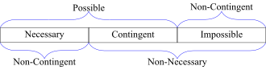

Fig. 1

The three rectangular cells are intended to be jointly exhaustive and mutually exclusive: every proposition is either necessary, contingent (possibly true but also possibly false), or impossible, but no proposition is more than one of these. The possible propositions are those that are either necessary or contingent, the non-necessary propositions are those that are either impossible or contingent, and the non-contingent ones are those either necessary or impossible.

Thirdly, dating back at least to the twelfth and thirteenth century (Knuuttila 2008)[^knuuttila-2008], the following modal square of opposition is often noted:[^note-8]

*Fig. 2*

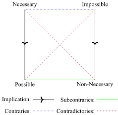

Fig. 2 [An extended description of figure 2.]

Furthermore it is generally assumed that the following hold:

> If $\Box p$ then $p$ (if it is necessary that $p$, then $p$ is true).
>
> If $p$, then $\Diamond p$ (if $p$ is true, then it is possible).

These indicate that the idea of necessity here is alethic or truth-implicating. Many of the ideas above were noted in medieval times. (See, e.g., the entry on medieval theories of modality.)

### 1.2 The Traditional Scheme and the Modal Analogies

We now turn to some of the analogies involved in what is a corresponding bit of deontic folk logic, following the exposition in McNamara 1996a,b. This is a minor elaboration of elements that can be found explicitly in von Wright 1951b and Prior 1955 [1962]. However, much of it has roots in medieval Islamic and late medieval European thought, where possible analogies between deontic modals and alethic modals were being explored and formal deontic schemes were proposed.[^note-9]

Expressed as sentential operators, the six normative statuses of what we will call “the Traditional Scheme” are:

> - it is obligatory that $(\OB)$
> - it is permissible that $(\PE)$
> - it is impermissible that $(\IM)$
> - it is omissible that $(\OM)$
> - it is optional that $(\OP)$
> - it is non-optional that $(\NO)$.[^note-10]

The first three are the most often cited, the fourth is often not labeled, and the fifth has regularly been mislabeled as “it is a matter of *indifference* that”, and so likewise for the sixth. Typically, one of the first two is taken as primitive, and the others defined in terms of it, but any of the first four can play the same defining role. The most prevalent approach is to take $\OB$ as primitive, and define the rest as follows:[^note-11]

$$ \begin{align} \PE p & \eqdf \neg \OB \neg p\\ \IM p & \eqdf \OB \neg p \\ \OM p & \eqdf \neg \OB p \\ \OP p & \eqdf (\neg \OB p \amp \neg \OB \neg p).\\ \NO p & \eqdf (\OB p \vee \OB \neg p).\\ \end{align} $$

These definitions imply that something is permissible iff (if and only if) its negation is not obligatory, impermissible iff its negation is obligatory, omissible iff it is not obligatory, optional iff neither it nor its negation is obligatory, and non-optional iff it is either obligatory or impermissible. Call this “The Traditional *Definitional* Scheme (TDS)”. It, or minor variants, are found as far back as Ockham in European thought, and quite explicitly in Leibniz in the modern period.[^note-12] If one began with $\OB$ alone and considered the formulas on the right above, one could easily be led to consider them as at least candidate defining conditions for those on the left. Although not uncontestable, they are natural, and this scheme has been very widely employed. Now if the reader looks back at our use of the necessity operator in defining the remaining five alethic modal operators, it will be clear that these are perfectly analogous to the five deontic definitions above. From the formal standpoint, the one is merely a syntactic variant of the other: just replace $\OB$ with $\Box$, $\PE$ with $\Diamond$, etc.

In addition to the TDS, it was traditionally assumed that the following, call it “The Traditional Threefold Classification (TTC)” holds:

*Fig. 3*

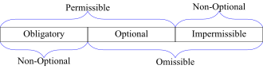

Fig. 3

As in the modal case, the thought is that all propositions are divided into three jointly exhaustive and mutually exclusive classes: every proposition is obligatory, impermissible or neither (that is, optional) and no proposition falls into more than one of these three categories. Furthermore, the permissible propositions are those that are obligatory or optional, the omissible propositions are those that are impermissible or optional, and the non-optional propositions are those that are either obligatory or impermissible. This classification too has roots centuries ago.[^note-13] The reader can easily confirm that this natural scheme is also perfectly analogous to the threefold classification we gave above for necessary, contingent and impossible propositions.

Furthermore, as indicated earlier, “The Deontic Square” (DS) is also often cited in the historical literature:

*Fig. 4*

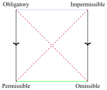

Fig. 4 [An extended description of figure 4.]

The relationships between the logical operators at the corners are to be interpreted as in the modal square of opposition. The two squares are perfectly analogous. If we weave in nodes for optionality and non-optionality, we get a deontic hexagon:[^note-14]

*Fig. 5*

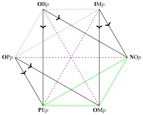

Fig. 5 [An extended description of figure 5.]

Given these analogies, it is unsurprising that our primitive operator, read here as “it is obligatory that”, is often referred to as “deontic *necessity*”. However, there are also obvious disanalogies with alethic necessity. Before, we cited two principles for alethic necessity whose deontic analogs are clearly false:

> - If $\OB p$ then $p$ (if it is obligatory that $p$, then $p$ is true).
> - If $p$, then $\PE p$ (if $p$ is true, then it is permissible).

Obligations can be violated, and impermissible things do happen.[^note-15] However, as researchers turned to generalizations of alethic modal logic, they began to consider wider classes of modal logics, including ones where the necessity operator was *not* truth-implicating. This too encouraged seeing deontic logic as falling within modal logic so-generalized. In fact, recognizing possibilities like this helped to fuel the generalizations of what began with a focus on alethic modal logic to *normal modal logics* (Lemmon & Scott 1977)[^lemmon-1977].

We will revisit the Traditional Scheme in a more precise and unifying way in the next section. There is a sense in which it is an earlier informal and widely endorsed fragment of the most well-known deontic logic, a logic that makes the connection to alethic modal logic even tighter. We now turn to that logic.

## 2. Standard Deontic Logic

### 2.1 SDL Syntax

*Standard Deontic Logic* (SDL) is the most cited and studied system of deontic logic, and one of the first deontic logics axiomatically specified. SDL includes classical propositional logic, and is essentially a distinguished member of the most studied class of propositional modal logics, “normal modal logics”. SDL is a “monadic” deontic logic, since its primitive deontic operator is a one-place operator (like $\neg$, and unlike &): it applies to a *single* sentence to yield a compound sentence.[^note-16] This operator, $\OB$, is taken as primitive within SDL; as explained in Section 1.2, other operators such as $\PE$ and $\IM$ can be defined from it following the Traditional Definitional Scheme.

Assume again that we have a language of classical propositional logic (PC) with an infinite set of propositional variables, the truth functional operators $\neg$ and $\rightarrow$ (and perhaps any of &, $\vee$ and $\leftrightarrow$ as well), and the operator, $\OB$. SDL is then often axiomatized as follows:[^note-17]

| SDL: | All tautologous formulas of the language | (TAUT) |
| --- | --- | --- |
|   | $\OB (p \rightarrow q) \rightarrow(\OB p \rightarrow \OB q)$ | ($\OB$-K) |
|   | $\OB p \rightarrow \neg \OB \neg p$ | (NC) |
|   | If $\vdash p$ and $\vdash p \rightarrow q$ then $\vdash q$ | (MP) |
|   | If $\vdash p$ then $\vdash \OB p$ | ($\OB$-NEC) |

TAUT combined with modus ponens (MP) gives us the full inferential power of PC. $\OB$-K, which is the K-axiom common to all normal modal logics, tells us that if a material conditional is obligatory, and its antecedent is too, then so is its consequent.[^note-18] NC tells us that $p$ is obligatory only if its negation isn’t. The rule $\OB$-NEC tells us that if anything is a theorem, then the claim that that thing is obligatory is also a theorem. Note that this guarantees that something is always obligatory (even if only logical truths).[^note-19]

Each of the distinctively deontic principles, $\OB$-K, NC, and $\OB$-NEC are contestable, and we will consider criticisms of them in Section 6. However, to avoid immediate confusion for those new to deontic logic, it is perhaps worth noting that $\OB$-NEC is generally deemed a convenience that, among other things, assures that SDL is in fact one of the well-studied normal modal logics.[^note-20] Few have spilled blood to defend its cogency substantively, and often these practical compromises are wise, especially in early stages of research.

SDL can be seen as a normalized version of von Wright’s original proposal in von Wright 1951a, though there are some significant differences in terms of the formal language, validities, and its interpretation. A quick comparison of both systems can be found in the supplement B on von Wright’s 1951a System and SDL.

Below we list some theorems and two important derived rules of SDL.[^note-21]

| $\neg \OB \bot$ | ($\OB$-OD) |
| --- | --- |
| $\OB (p \amp q) \rightarrow(\OB p \amp \OB q)$ | ($\OB$-M) |
| $\OB p \vee \OP p \vee \IM p$ | ($\OB$-Exhaustion) |
| $\OB \top$ | ($\OB$-N) |
| If $\vdash p \rightarrow q$ then $\vdash \OB p\rightarrow \OB q$ | ($\OB$-RM) |
| If $\vdash p \leftrightarrow q$ then $\vdash \OB p\leftrightarrow \OB q$ | ($\OB$-RE) |

We will be discussing virtually all of these subsequently. For now, let’s indicate a few derivations. We show that $\OB$-RM is a derived rule of SDL, and note three corollaries.[^note-22]

- **Show:** If $\vdash p \rightarrow q$, then $\vdash \OB p \rightarrow \OB q$. ($\OB$-RM)
- **Proof:** Suppose $\vdash p \rightarrow q$. Then by OB-NEC, $\vdash \OB (p \rightarrow q)$, and then by $\OB$-K, $\vdash \OB p \rightarrow \OB q$.
- **Corollary 1:** $\vdash \OB p \rightarrow \OB (p \vee q)$. (Weakening)
- **Corollary 2:** If $\vdash p \leftrightarrow q$ then $\vdash \OB p \leftrightarrow \OB q$ ($\OB$-RE)
- **Corollary 3:** $\vdash \OB (p \amp q) \rightarrow(\OB p \amp \OB q)$. ($\OB$-M)

An alternative formulation of SDL can be found in supplement C on Alternative Axiomatization of SDL.

SDL can be strengthened by adding additional axioms; in particular, we might consider adding axioms with nested deontic operators. For example, suppose we added the following formula as an axiom to SDL:

$$ \tag{\(\OB\)-U} \OB (\OB p \rightarrow p) $$

Call the resulting system “SDL+” for easy reference in this section. This says (roughly) that it is required that obligations be fulfilled. This is not a theorem of SDL (as we will see in Section 2.3), so SDL+ is a genuine strengthening of SDL. Furthermore, it makes a logically *contingent* proposition (i.e., that $\OB p \rightarrow p)$ obligatory *as a matter of deontic logic*. SDL does not have this feature. With this addition to SDL, it is easy to prove $\OB \OB p \rightarrow \OB p$, a formula involving an iterated occurrence of our main operator.[^note-23] This formula asserts that if it is obligatory that $p$ be obligatory, then $p$ *is* obligatory. (Cf. “the only things that are required to be obligatory are those that actually are”).[^note-24] It should be noted that these are often given an impersonal ought reading, so that $\OB$-U would be read as “It ought to be the case that if it ought to be the case that $p$ then it is)”.[^note-25]

### 2.2 The Traditional Scheme Revisited

In identifying the Traditional Definitional Scheme (TDS) in Section 1.2, we noted that it was widely recognized that we could have taken another notion than *obligation* from our first four primary normative statuses and defined the rest in terms of that one. So it is expected that we should be able to generate the corresponding equivalences derivatively from the scheme we did settle on, where $\OB$ is taken as primitive. For example, it is obviously desirable to have $\OB p \leftrightarrow \neg \PE \neg p$ as part of the Traditional Scheme, as this expresses the equivalence between what would have been definiens and definiendum had “$\PE$” been taken as primitive. However, this equivalence is not thus far derivable. For $\OB p \leftrightarrow \neg \PE \neg p$ is definitionally equivalent to $\OB p \leftrightarrow \neg \neg \OB \neg \neg p$, that is, $\OB p \leftrightarrow \OB \neg \neg p$, but the latter formula is not a tautology, so we cannot in turn derive $\OB p \leftrightarrow \neg \PE \neg p$. So more is presupposed in the Traditional Scheme than what has been noted above. A natural thought is a rule of inference needs to be added, one allowing for the replacement of provably equivalent formulas in the context of “$\OB$”, namely $\OB$-RE in Corollary 2 above Let’s take this to be tacitly part of the Traditional Scheme.

Suppose now that we have the same language as that of SDL, along with the rule RE governing $\OB$. We saw in Section 1.2 that in addition to TDS, the Traditional Threefold Classification (TTC) and/or the Deontic Square (DS) of Opposition were often explicitly endorsed in pre-symbolic investigations of deontic logic. Symbolically formulated, these are:

$$\begin{align} \tag*{DS} (\OB p &\leftrightarrow \neg \OM p) \amp (\IM p \leftrightarrow \neg \PE p) \amp \neg(\OB p \amp \IM p) \\ & {} \amp \neg(\neg \PE p \amp \neg \OM p) \amp (\OB p \rightarrow \PE p) \amp (\IM p \rightarrow \OM p).\\ \end{align} $$ $$\begin{align} \tag*{TTC} (\OB p \vee \OP p &\vee \IM p) \amp \neg(\OB p \amp \IM p) \\ &{} \amp \neg(\OB p \amp \OP p) \amp \neg(\OP p \amp \IM p). \end{align} $$

Given TDS and RE, it turns out that DS and TTC are each *tautologically equivalent* to the principle that obligations cannot conflict (and thus to one another):

$$\tag*{NC:} \neg(\OB p \amp \OB \neg p). $$

For in primitive notation, DS becomes

$$\begin{align} (\OB p &\leftrightarrow \neg \neg \OB p) \amp (\OB \neg p \leftrightarrow \neg \neg \OB \neg p) \amp \neg(\OB p \amp \OB \neg p) \\ & {} \amp \neg(\neg \neg \OB \neg p \amp \neg \neg \OB p) \amp (\OB p \rightarrow \neg \OB \neg p) \\ & {} \amp (\OB \neg p \rightarrow \neg \OB p), \end{align}$$

and although the first two conjuncts are tautologies, the remaining four are each tautologically equivalent to NC above. Similarly, TTC becomes

$$\begin{align} (\OB p &\vee(\neg \OB p \amp \neg \OB \neg p) \vee \OB \neg p) \\ &{} \amp [\neg(\OB p \amp \OB \neg p) \amp \neg(\OB p \amp (\neg \OB p \amp \neg \OB \neg p)) \\ &{} \quad\: {} \amp \neg((\neg \OB p \amp \neg \OB \neg p) \amp \OB \neg p)], \end{align} $$

and although the exhaustiveness clause is tautological, as are the last two conjuncts of the exclusiveness clause, the first conjunct of that clause is just NC again.[^note-26]

So the Traditional Scheme rests squarely on the soundness of NC, along with $\OB$-RE and the TDS. In fact, the Traditional Scheme can be seen as a widely endorsed, informal counterpart of a deontic logic composed of just PC, $\OB$-RE and NC. Since that logic is a (proper) fragment of SDL, it follows that the Traditional Scheme (symbolized) is entailed by SDL.[^note-27]

### 2.3 SDL Semantics

The reader familiar with elementary textbook logic will have perhaps noticed that the deontic square and the modal square both have even better-known analogs for the quantifiers as interpreted in classical predicate logic:

*Fig. 6*

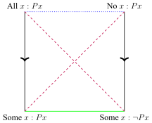

Fig. 6 [An extended description of figure 6.]

Though less widely noted in textbooks, there is also a threefold partition for classical quantifiers regarding any condition, $p$:

*Fig. 7*

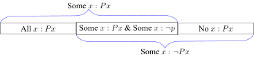

Fig. 7 [An extended description of figure 7.]

These quantificational analogies reflect possible inspiration behind what is most often called “possible worlds semantics” for such logics, to which we now turn.[^note-28] Once the analogies are noticed, spelling out this sort of semantics seems all but inevitable.[^note-29]

We choose a standard “Kripke-style” possible world semantics for SDL (Kripke 1959, 1963)[^kripke-1959][^kripke-1963].[^note-30] We assume that we have a set of possible worlds, $W$, and a relation, $A$, relating worlds to worlds, with the intention that $Aij$ iff $j$ is a world where everything that holds at $j$ is acceptable from the standpoint of $i$, so that everything obligatory at $i$ holds in $j$. For brevity, we will call all worlds so related to $i$, “$i$-acceptable” worlds and denote them by $A^i$.[^note-31] We then add that the acceptability relation is “serial”: for every world, $i$, there is at least one $i$-acceptable world. Finally, propositions are either true or false at a world, never both, and when a proposition, $p$, is true at a world, we will often indicate this by referring to that world as a “$p$-world”. The truth-functional operators have their usual behavior at each world.

The fundamental idea here is that the normative status of a proposition from the standpoint of a world $i$ can be assessed by looking at how that proposition fairs at the $i$-acceptable worlds. For any given world, $i$, we can easily picture the $i$-accessible worlds as all corralled together in logical space, where seriality is reflected by a small dot representing the presence of at least one $i$-acceptable world. The intended truth-conditions, relative to $i$, for our five deontic operators can now be pictured as follows:

*Fig. 8*

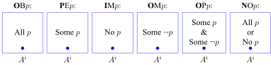

Fig. 8 [An extended description of figure 8.]

Thus, $p$ is *obligatory* iff it holds in all the $i$-acceptable worlds, *permissible* iff it holds in some such world, *impermissible* iff it holds in no such world, *omissible* iff its negation holds in some such world, *optional* iff $p$ holds in some such world, and so does $\neg p$, *and non-optional when* $p$ *either holds at all such worlds or at none.* If a formula is true at every world in any such model of serially-related worlds, then the formula is *valid*.[^note-32]

To illustrate the workings of this framework, consider NC, $\OB p \rightarrow \neg \OB \neg p$. This is valid in this framework because of seriality. For suppose that $\OB p$ holds at any world $i$ in any model. Then each $i$-accessible world is one where $p$ holds, and by the seriality of accessibility, there must be at least one such world. Call it $j$. Now we can see that $\neg \OB \neg p$ must hold at $i$ as well, for otherwise, $\OB \neg p$ would hold at $i$, in which case, $\neg p$ would have to hold at all the $i$-accessible worlds, including $j$. But then p as well as $\neg p$ would hold at $j$ itself, which is impossible (by the semantics for “$\neg$”). The other axioms and rules of SDL can be similarly shown to be valid, as can all the principles listed above as derivable in SDL.

In contrast, $\OB$-U, the axiom $\OB (\OB p \rightarrow p)$ that we added to SDL to get SDL+, is not valid in the class of serial models. In order to validate $\OB$-U, we need the further requirement of “secondary seriality”: that any $i$-acceptable world, $j$, must be in turn *acceptable to itself*. We can illustrate such an $i$ and $j$ as follows:

*Fig. 9*

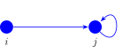

Fig. 9

Here we imagine that the arrow connectors indicate relative acceptability, thus here, $j$ (and only $j)$ is acceptable to $i$, and $j$ (and only $j)$ is acceptable to $j$. If all worlds that are acceptable to any given world have this property of self-acceptability, then our axiom is valid. For assume that this property holds throughout our models, and for reductio, suppose that for some arbitrary world $i, \OB (\OB p \rightarrow p)$ is false at $i$. Then not all $i$-acceptable worlds are worlds where $\OB p \rightarrow p$ is true. So, there must be an $i$-acceptable world, say $j$, where $\OB p$ is true, but $p$ is false. Since $\OB p$ is true at $j$, then $p$ must be true at all $j$-acceptable worlds. But by stipulation, $j$ is acceptable to itself, so $p$ must be true at $j$, but this contradicts our assumption that $p$ was false at $j$. Thus $\OB (\OB p \rightarrow p)$ must be true at all worlds, after all. Two counter-models showing that $\OB$-U is not derivable in SDL, and that SDL $+ \OB \OB p \rightarrow \OB p$ does not imply $\OB$-U can be found in supplement D: Two Counter-Models Regarding Additions to SDL.

We should also note that one alternative semantic picture for SDL is where we have a set of world-relative ordering relations, one for each world $i$ in W, where $j \ge_i k$ iff $j$ is as good as $k$ (and perhaps better) relative to $i$. We might then assume that from the standpoint of any world $i$, a) each world is as good as itself, b) if one is as good as a second, and the second is as good as a third, then the first is as good as the third, c) and for any two worlds, either the first is as good as the second or vice versa (i.e., respectively, each such $\ge_i$ is reflexive, transitive, and connected in W). As a matter of fact, this approach also determines SDL. (See Goble 2003 for one of the few proofs of this claim.)[^goble-2003] If we then add “The Limit Assumption”, that for each world $i$, there is always at least one world as good as all worlds (i.e., one $i$-best world) we can easily generate our earlier semantics for SDL derivatively. We need only add the natural analogue here to our prior truth-conditions for $\OB$: $\OB p$ is true at a world $i$ iff $p$ is true at all the $i$-best worlds:

*Fig. 10*

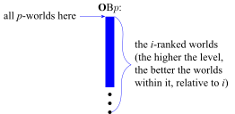

Fig. 10 [An extended description of figure 10.]

Essentially, the ordering relation coupled with the limit assumption just gives us a way to *generate* the set of $i$-acceptable worlds instead of taking them as primitive in the semantics: $j$ is $i$-acceptable iff $j$ is $i$-best. Once generated, we look only at what is going on in the $i$-acceptable (as $i$-best) worlds to interpret the truth-conditions for the deontic operators, just as with our simpler Kripke-Style semantics. The analogue to the seriality of our earlier $i$-acceptability relation is also assured by the Limit Assumption, since it entails that for each world $i$, there is always some $i$-best (so $i$-acceptable) world. Although this ordering semantics approach appears to be a bit of overkill here, as we shall see in Section 4 and Section 5, it became quite important later on in the endeavor to develop expressively richer deontic logics. For now, we turn to the second-most well-known approach to monadic deontic logic, one in which SDL emerges *derivatively*.

## 3. The Andersonian-Kangerian-Leibnizian Reduction

The *Andersonian-Kangerian* reduction is dually-named in acknowledgment of Kanger’s and Anderson’s independent formulation of it around the same time.[^note-33] As Hilpinen 2001a points out, the approach is adumbrated much earlier in Leibniz. We follow Kanger’s development here, noting Anderson’s toward the end.

### 3.1 Syntax

Assume that we have a language of classical modal propositional logic, with a distinguished (deontic) propositional constant:

“$d$” for “all (relevant) normative demands are met”.

Now consider the following axiom system, “K*d*”:

| K*d*: | All Tautologies | (TAUT) |
| --- | --- | --- |
|   | $\Box(p \rightarrow q) \rightarrow(\Box p \rightarrow \Box q)$ | (K) |
|   | $\Diamond d$ | $(\Diamond d)$ |
|   | If $\vdash p$ and $\vdash p \rightarrow q$ then $\vdash q$ | (MP) |
|   | If $\vdash p$ then $\vdash \Box p$ | (NEC) |

K*d* is just the normal modal logic K with $\Diamond d$ added.[^note-34] $\Diamond d$ is interpreted as telling us that it is possible that all normative demands are met. In import when added to system K, it is similar to (though stronger than) the “No Conflicts” axiom of SDL. *All* of the Traditional Scheme’s deontic operators are easily defined derivatively once we provide “the reductive clause” for $\OB$:

$$\OB p \eqdf \Box(d \rightarrow p)$$

So in K*d*, $p$ is *obligatory* if $p$ is necessitated by all normative demands being met, *permissible* if $p$ is compatible with all normative demands being met, *impermissible* if $p$ is incompatible with all normative demands, etc. Since none of the operators of the Traditional Scheme are taken as primitive, and the basic logic is a modal logic with necessity and possibility as the primitive modal operators, this is referred to as “a reduction” (of deontic logic to modal logic)

Proofs of SDL-ish formulas are then just K-proofs of the corresponding modal formulae involving “$d$”.[^note-35] It is well-known that all theorems of SDL are derivable in K*d* and conversely, that if some formula in the language of SDL is not a theorem of SDL, then its translation following the Kangerian reduction is also not a theorem of K*d*.[^note-36] In addition to containing all theorems of SDL, we note a few theorems that are specific to K*d* because of the non-overlapping syntactic ingredients, $d, \Box$, and $\Diamond$:

| $\vdash \OB d $ | $(\OB d)$ |
| --- | --- |
| $\vdash \Box(p \rightarrow q) \rightarrow(\OB p \rightarrow \OB q)$ | (RM’) |
| $\vdash \Box p \rightarrow \OB p$ | (Nec’) |
| $\vdash \OB p \rightarrow \Diamond p$ | (“Kant’s Law”)[^note-37] |
| $\vdash \neg \Diamond(\OB p \amp \OB \neg p)$ | (NC’) |

These are easily derived.[^note-38]

Although our underlying modal system is just K, adding further non-deontic axiom schema (i.e., those that cannot be abbreviated via SDL formulas, nor involving $d$ specifically) can nonetheless have a deontic impact. To illustrate, suppose we added a fourth axiom, one to the effect that necessity is truth-implicating, standardly called axiom “T”:

$$ \Box p \rightarrow p \tag{T} $$

Call the system that results from adding this formula to our current system “KT*d*”. The addition of T makes derivable our previously mentioned axiom $\OB$-U of SDL+, which we have shown is not derivable in SDL itself:[^note-39]

$$ \vdash \OB (\OB p \rightarrow p) $$

So, reflecting on the fact that SDL+ is derivable in KT*d*, we see that the Andersonian-Kangerian reduction must either rely on a non-truth-implicating conception of necessity in order for its pure deontic fragment to match SDL, or SDL itself is not susceptible to the Andersonian-Kangerian reduction. Put another way, the most plausible version of the Andersonian-Kangerian reduction can’t help but view “Standard Deontic Logic” as too weak.

Anderson’s approach is practically equivalent to Kanger’s. First, consider the fact that we can easily define another constant in K*d*, as follows:

$$ s \eqdf \neg d. $$

where this new constant would now be derivatively read as follows:

> “some (relevant) normative demand has been violated”.

Clearly our current axiom, $\Diamond d$, could be replaced with $\neg \Box s$, asserting that it is not necessary that some normative demand is violated. We could then define $\OB$ as:

$$ \OB p \eqdf \Box(\neg p \rightarrow s). $$

Essentially, Anderson took this equivalent course with “$s$” being his primitive (initially standing for something like “the sanction has been invoked” or “there is a liability to sanction”), and $\neg \Box s$, as the axiom added to some modal system (e.g., at least as strong as modal system KT).

We should also note that Anderson was famous as a founding figure in relevance logic, and along with using strict implication, $\Box(p \rightarrow q)$, he also explored the use of a relevant (and thus neither material nor strict) form of implication, $\Rightarrow$, to express the reduction as: $\OB p \eqdf \neg p \Rightarrow s$.[^note-40] (A bit more on this can be found within the entry on Mally’s deontic logic. See further references there.) This alternative reflects the fact that there is an issue in both Kanger’s and Anderson’s strict necessitation (or entailment) approaches of just what notion of “necessity” is involved in claiming that meetings all normative demands (or avoiding the sanction) in some sense *necessitates* $p$.

As a substantive matter, how should we think of these “reductions”? For example, should we view them as giving us an *analysis* of what it is for something to be obligatory? Taking Kanger's approach first, it would seem that $d$ must be read as a distinctive deontic ingredient, if we are to get the derivative deontic reading for the “reduced” deontic operators. Also, as our reading suggests, it is not clear that $d$ does not, at least by intention, express a complex quantificational notion involving the very concept of obligation (demand) as a proper part, namely that all obligations have been fulfilled, so that the “reduction”, *presented as an analysis*, would appear to be circular. If we read $d$ instead as “ideal circumstances obtain”, the claim of a substantive reduction or analysis appears more promising, until we ask: Are the circumstances ideal only with respect to meeting normative *demands or obligations*, or are they ideal in other (for example supererogatory) ways that go beyond merely satisfying normative *demands*? Anderson’s “liability to sanction” approach may appear more promising, since the idea that something is obligatory if (and only if) and because non-compliance necessitates (in some sense) liability to (or perhaps desert of) punishment does not appear to be circular (unless the notion of “liability” itself ultimately involves the idea of permissibility of punishment), but is it plausible? Alternatively, perhaps a norm that is merely an *ideal* cannot be *violated*, in which case perhaps norms that have been *violated* can be distinguished (as a subset) from norms that have not been *complied* with, and then the notion of an obligation as something that must obtain unless some norm is violated will not be obviously circular. There is a substantive philosophical question lingering here that the language of a “reduction” brings naturally to the surface, but is sloughed over. The formal utility of the reduction does not hinge on this, but its philosophical significance does.

### 3.2 Semantics

The semantic elements here are in large part analogous to those for SDL. We have a binary relation again, but this time instead of a relation interpreted as relating worlds *acceptable* to a given world, here we will have a relation, $R$, relating worlds “accessible” to a given world (e.g., possible relative to the given world). The only novelties are two: (1) we add a simple semantic element to match our syntactic constant “$d$”, and (2) we add a slightly more complex analog to seriality, one that links the accessibility relation to the semantic element added in order to model $d$.

Once again, assume that we have a set of possible worlds, $W$, and we assume that we have a relation, $R$, relating worlds to worlds, with the intention that $Rij$ iff $j$ is accessible to $i$ (e.g., $j$ is a world where everything true in $j$ is possible relative to $i$.[^note-41] For brevity, we will call all worlds possible relative to $i$, “$i$-*accessible* worlds” and denote them by $R^i$. For the moment, no restrictions are placed on the relation $R$. We can illustrate the truth-conditions for necessity, and possibility with obvious abbreviations, as follows:

*Fig. 11*

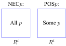

Fig. 11 [An extended description of figure 11.]

Here we imagine that for any given world, $i$, we have corralled all the $i$-accessible worlds together. We then simply look at the quantificational status of $p$ (and/or $\neg p)$ in these $i$-accessible worlds to determine $p$’s modal status back at $i$. For example$,$ at a given world $i, p$ is *necessary* if $p$ holds throughout $R^i$ and *possible* if $p$ holds somewhere in $R^i$.

The only *deontic* element in the syntax of K*d* is our distinguished constant, $d$, intended to express the fact that all normative demands are met$.$ To model that feature, we simply assume that the worlds are divided into those where all normative demands are met and those that are not. We denote the former subset of worlds by “DEM” in a model. Then $d$ is true at a world $j$ iff $j$ belongs to DEM. Here is a picture where $d$ is true at an arbitrary world, $j$:

*Fig. 12*

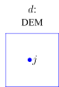

Fig. 12 [An extended description of figure 12.]

Since $j$ is contained in DEM, that means all normative demands are met at $j$.[^note-42]

Corresponding to simple seriality for SDL (that there is always an $i$-acceptable world), we assume what I will call “strong seriality” for K*d*: for every world $i$, there is an $i$-accessible world that is among those where all normative demands are met. In other words, for every world $i$, the intersection of the $i$-accessible worlds with DEM is non-empty. Given the truth conditions for $d$, strong seriality validates $\Diamond d$, ensuring that for any world $i$, there is always some $i$-*accessible* world where $d$ is true:

*Fig. 13*

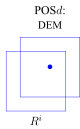

Fig. 13 [An extended description of figure 13.]

Given these semantic elements, if you apply them carefully to the definitions of the deontic operators of K*d*, you will see that in each case, the normative status of $p$ at $i$ depends on $p$’s relationship to this intersection of the i-accessible worlds and the worlds where all normative demands are met:

*Fig. 14*

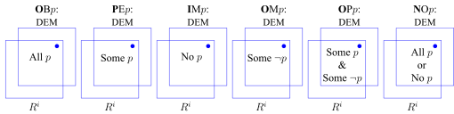

Fig. 14 [An extended description of figure 14.]

If that intersection is permeated by $p$-worlds, $p$ is obligatory; if it contains some $p$-world, $p$ is permissible, etc.[^note-43]

If we wish to validate T, $\Box p \rightarrow p$ (and derivatively, $\OB$-U, $(\OB (\OB p \rightarrow p))$, we need only stipulate that the accessibility relation, R, is reflexive: that each world $i$ is $i$-accessible (possible relative to itself):

*Fig. 15*

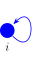

Fig. 15

For then $\Box p \rightarrow p$ must be true at any world $i$, for if $\Box p$ is true at $i$, then $p$ is true at each $i$-accessible world, which includes $i$, since $i$ is self-accessible. This will indirectly yield the result that $\OB (\OB p \rightarrow p)$ is true in all such models as well.

Having introduced deontic logic’s classical points of departure, we now turn to a number of problems, paradoxes, and related logics that are studied in the field today. Here, our aim is mainly to map out the various topics that are central stage in deontic logic; for reasons of space, we cannot present theories or logics in much detail.

## 4. Conditional Obligations and Chisholm’s Puzzle

### 4.1 Chisholm’s Puzzle and SDL

Consider the following four premises (Chisholm 1963a)[^chisholm-1963a] and their most straightforward symbolization in SDL:

**(1)**

It ought to be that Jones goes to assist his neighbors.

**(1′)**

$\OB g$.

**(2)**

It ought to be that if Jones goes, then he tells them he is coming.

**(2′)**

$\OB (g \rightarrow t)$.

**(3)**

If Jones doesn’t go, then he ought not tell them he is coming.

**(3′)**

$\neg g \rightarrow \OB \neg t$.

**(4)**

Jones doesn’t go.

**(4′)**

$\neg g$.

(1)–(4) certainly appear to describe a possible situation. They appear to constitute both a *mutually consistent* and *logically independent* set of sentences. Note that (1) is a *primary obligation*, saying what Jones ought to do unconditionally. (2) is a *compatible-with-duty obligation*, telling us what else Jones ought to do on the condition that Jones fulfills his primary obligation. In contrast, (3) is a *contrary-to-duty obligation* or “imperative” (a “*CTD*”) expressing what Jones ought to do conditional on his violating his primary obligation. (4) is a factual claim, which conjoined with (1), implies that Jones *violates* his primary obligation. Thus this puzzle also places not only deontic *conditional* constructions, but the *violability* of obligations, at center stage. It raises the challenging question: what constitutes proper reasoning about what to do in the face of violations of obligations?

One obvious answer would be: just apply SDL to (1′)–(4′) above. The following table displays the difficulties in trying in to interpret the reasoning in SDL:

| **First Path** | **Second Path** | **Third Path** |
| --- | --- | --- |
| (1′) $\OB g$ | (1′) $\OB g $ | (1′) $\OB g$ |
| (2′) $\OB(g \rightarrow t)$ | (2′) $\OB(g \rightarrow t)$ | (2″) $g \rightarrow \OB t$ |
| (3′) $\neg g \rightarrow \OB \neg t $ | (3″ ) $\OB (\neg g \rightarrow \neg t) $ | (3′) $\neg g \rightarrow \OB \neg t$ |
| (4′) $\neg g$ | (4′) $\neg g$ | (4′) $\neg g$ |
| From (1′), (2′), $\OB t.$ From (3′), (4′), $\OB \neg t.$ By NC, consistency is lost. | (1′) implies (3″ ). Independence is lost. | (4′) implies (2″). Independence is lost. |

The first path, as Chisholm notes, leads to contradiction via $\OB$-K, MP and NC. The second and third paths take a different route, interpreting the conditionals in (2) and (3) uniformly. However, for the second path, the symbolization of (3) follows from that of (1), and for the third path, the symbolization of (2) follows from that of (4). Each SDL symbolization of the original violates one of our desiderata: either mutual consistency or joint independence.

### 4.2 Two Types of Detachment and Two Ways of Enriching SDL

If von Wright launched deontic logic as an academic area of research, Chisholm’s paradox, and similar cases, were the booster rocket that provided the escape velocity deontic logic needed from subsumption under normal modal logics, thus solidifying deontic logic’s status as a distinct branch of logic.[^note-44] It is now virtually universally acknowledged that Chisholm was right: the sort of conditional deontic claim expressed in (3) can’t be faithfully represented in SDL, nor more generally by a composite of some sort of unary deontic operator and *material* conditional. The views diverge however where it comes to exactly what should be added to SDL in order to represent conditional obligations. This divergence in turn relates to a distinction between two types of detachment in deontic reasoning.[^note-45]

Let “$\OB (q\mid p)$” be shorthand for a conditional obligation or ought statement like that in the natural language sentence, (3), above. So we will read $\OB (q\mid p)$ as “if $p$, then it ought to be (or it is obligatory) that $q$”. Suppose we also assume that monadic obligations are disguised dyadic obligations, per the following analysis:

$$ \OB p \eqdf \OB (p\mid \top). $$

This analysis has been widely employed.[^note-46]

With this in mind, we distinguish between two relevant types of“detachment principles” (Greenspan 1975)[^greenspan-1975] that we might ascribe to these iffy-‘ought’s:

- *Factual Detachment* (FD): $p \amp \OB (q\mid p) \vdash \OB q$
- *Deontic Detachment* (DD): $\OB p \amp \OB (q\mid p) \vdash \OB q$.[^note-47]

*Factual detachment* tells us that from $p$, and a deontic conditional to the effect that if $p$ then it ought to be that $q$, we can conclude that it ought to be that $q$. *Deontic Detachment* in contrast tells us that from it ought to be that $p$ and if $p$, then it ought to be that $q$, we can conclude that it ought to be that $q$. If we interpret a deontic conditional as a material conditional with an obligatory consequent (as in (3′) above), FD, but not DD is supported. Conversely, if we interpret deontic conditionals as obligatory material conditionals (as in (2′) above), DD, but not FD is supported. Although we have shown earlier that neither of these interpretations is acceptable, the contrast reveals a general problem. Unrestricted endorsement of both types of detachment is not tenable, since it leads implausibly to the conclusion that Jones is both obligated to tell (the neighbor he is coming) and obligated to not tell. Thus researchers tended to part company over which principle of the two to endorse (Loewer and Belzer 1983)[^loewer-1983].

The Factual Detachment camp typically endorses the view that the conditional in (3) in the Chisholm Quartet needs to be interpreted as a non-material conditional, but otherwise things are as they seem in (3): we have a conditional obligation that is a simple composite of a non-material conditional and a pure unary deontic operator in the consequent:

$\OB (q\mid p) \eqdf p \Rightarrow \OB q$, for some independent conditional.[^note-48]

Typically, the conditional $\Rightarrow$ is of the sort made famous by Stalnaker and Lewis (Stalnaker 1968, Lewis 1973)[^lewis-1973][^stalnaker-1968].[^note-49] It is then generally maintained that deontic detachment is flawed, since the conditional obligations like those in (2) tell us only what to do in ideal circumstances, but they do not necessarily provide “cues”[^note-50] for action *in the actual world*, where things are often typically quite sub-ideal, as (4) combined with (1) indicate. Thus from the fact that Jones ought to go and he ought to tell if he goes, it doesn’t follow that what he ought to *actually* do is tell—that would be so only if it was also a fact that he goes to their aid. At best, we can only say that he ought *ideally* to go.

This suggestion seems a bit more difficult when we change the conditional to something like “If Doe does kill his mother, then it is obligatory that Doe kills her gently” (Forrester 1984)[^forrester-1984]. The idea that my obligation to not kill my mother gently (say for an inheritance) merely expresses an “ideal” obligation, but not an actual obligation, given that I will kill her, seems hard to swallow. So this case makes matters a bit harder for those favoring a factual detachment approach for generating actual obligations. Similarly, it would seem that if it is impermissible for me to kill my mother, then it is impermissible for me to do so gently, or to do so while dancing.[^note-51] So *carte blanche* factual detachment seems to allow the mere fact that I will take an action in the future (killing my mother) that is horribly wrong and completely avoidable now to render obligatory another horrible (but slightly less horrible) action in the future (killing my mother gently). The latter action must be completely avoidable if the former is, and the latter action is one that I would *seem* to be equally obligated to not perform intuitively.

The deontic detachment camp represented conditional obligations via dyadic non-composite obligation operators modeled syntactically on conditional probability, following Danielsson 1968; B. Hansson 1969; von Wright 1956, 1964; Lewis 1973, 1974; and Feldman 1986.[^note-52] On this view, deontic conditionals are viewed as idioms: the meaning of the compound is not a straightforward function of the meaning of the parts. The underlying intuition regarding the Chisholm example is that even if it might be true that we will violate some obligation, that doesn’t get us off the hook from obligations that derive from the original one that we will violate. If I must go help and I must inform my neighbors that I’m coming, if I do go help, then I must inform them, and the fact that I will in fact violate the primary obligation does not block the derivative obligation any more than it blocks the primary obligation.

One early semantic picture for the latter camp was that a sentence of the form $\OB (q\mid p)$ is true at a world $i$ iff the $i$-best $p$-worlds are all $q$-worlds. $\OB q$ is then true iff $\OB (q\mid \top),$ and so iff all the unqualifiedly $i$-best worlds are $q$-worlds (B. Hansson 1969)[^hansson-1969]. Note that this weds preference-based semantic orderings with dyadic conditional obligations.[^note-53] This reflects a widespread trend. Factual detachment does not work in this case, since even if our world is an I-don’t-go-help-world, and the best among the I-don’t-go-help-worlds are I-don’t-call-worlds, it does not follow that the *unqualifiedly* best worlds are I-don’t-call-worlds. In this example, these authors would maintain that the unqualifiedly best worlds are both I-go worlds and I-call worlds, and the fact that I won’t do what I’m supposed to do won’t change that.

But one is compelled to ask those in the Deontic Detachment camp: what then is the point of such apparent conditionals if we can’t ever detach them from their apparent antecedents, and how are these conditionals related to regular ones? This seems to be the central challenge for this camp. Thus they often endorse a restricted form of factual detachment, of which the following is a representative instance:

- *Restricted Factual Detachment*: $\Box p \amp \OB (q\mid p) \rightarrow \OB q$.

Here $\Box p$ might mean various things, for example that $p$ is physically unalterable or necessary as of this moment in history.[^note-54] Only if $p$ is settled true in some sense, can we conclude from $\OB (q\mid p)$ that $\OB q$. This certainly helps, but it still leaves us with a bit of a puzzle about why this apparent composite of a conditional and a deontic operator is actually some sort of primitive idiom.[^note-55]

## 5. Other Enrichments of SDL

While conditional obligations and the puzzles they generate call for extensions of SDL, other problems and distinctions in normative discourse motivate further, mostly orthogonal enrichments. In this section we point to a few of these.

### 5.1. Supererogation and Allied Normative Concepts

Even among monadic deontic notions, and even if we stay within the realm of all-things-considered, unconflicted obligations (cf. Section 6.3), SDL displays various expressive weaknesses compared to our everyday and more theorized ethical argumentation.

#### 5.1.1 Optionality vs. Indifference

Let us start with the distinction between indifference and optionality.[^note-56] In general, optionality of a given state of affairs or action need not imply that it is morally indifferent. For instance, it may be optional that you attend a faculty meeting, but not a matter of indifference that you do so. However, when deontic logicians and ethicists gave an operator label for the condition $(\neg \OB p \amp \neg \OB \neg p)$, it was almost invariably “It is indifferent that $p$”, “$\IN p$”. It would seem to follow from the theorem

$$\OB p \vee(\neg \OB p \amp \neg \OB \neg p) \vee \IM \neg p,$$

that

$$(\neg \OB p \amp \neg \IM \neg p) \rightarrow \IN p,$$

that is, everything that is neither obligatory nor prohibited is a matter of indifference. But many actions are neither obligatory nor prohibited, yet they are hardly matters of indifference. A particularly intriguing class of such actions are those that are deemed supererogatory (e.g., volunteering for a costly or risky good endeavor where others are equally qualified and no one person is obligated). SDL can represent optionality, but not indifference, despite the fact that the latter concept has been a purported target for representation since nearly its beginning.

#### 5.1.2 Must vs. Ought

The distinction between optionality and indifference is moreover strongly linked to that between “must” (and its dual “can”) and “ought”.[^note-57] Consider the following utterance:

**(1)**

Although you can skip the meeting, you ought to attend.

This seems to be a perfectly sensible piece of advice. (1) appears to imply that it is optional that you attend—that you *can* attend and that you *can* fail to attend. The latter two uses of “can” express permissibility. Yet “ought” is routinely the reading given for deontic necessity in deontic logic (and in ethical theory), and then “permissibility” is routinely presented as its dual. However, if we symbolize (1) above accordingly, we get,

$$\tag{\(1'\)} \PE \neg p \amp \OB p$$

which is just $\neg \OB p \amp \OB p$ in disguise (given $\OB$-RE and the Traditional Definitional Scheme). So (1′), given NC, yields a contradiction. Another way to put this is that the “can” of permissibility seems to be the dual of “must” not the dual of “ought”. This yields a dilemma: either deontic necessity represents “ought”, in which case, its dual does not represent permissibility (and neither does any other construction in SDL), or permissibility is represented, but “ought” is inexpressible, despite the ubiquitous assumption otherwise. That “ought” is the dual of permissibility is really a largely overlooked dubious yet pervasive bipartisan presupposition in both ethical theory and deontic logic.[^note-58]

#### 5.1.3 The Least One Can Do

A widely neglected normative notion is exemplified by the following complaint:[^note-59]

**(LYCD)**

You ought to have come home on time; *the least you could have done* was called, and you didn’t do even that.

The expression in the second clause of (LYCD), i.e., “the least you could do”, has been largely ignored in the literature on deontic logic and ethical theory both. (LYCD) appears to express the idea that there is some minimal but acceptable alternative. This notion of what is minimally acceptable among the permissible options is not expressible in SDL.

#### 5.1.4 Supererogation and Permissible Suboptimality

To go beyond the call of duty or to supererogate is to permissibly do more than you would do if you did the least you could do.[^note-60] It has a mirror image, *permissible suboptimality*, or that which you can but ought not do. These are plainly not representable in SDL, given the preceding remarks.

McNamara 1996c and Mares & McNamara 1997 provides a semantic and logical framework for distinguishing “must” from “ought”, indifference from optionality, as well as distinctly representing “the least you can do” idiom and analyzing one central sense of “supererogation” via that otherwise unstudied idiom. As a measure of the increased expressive power, the three-fold partition of normative positions for SDL is extended to a twelve-fold partition; with an extension to accommodate praiseworthiness and blameworthiness (McNamara 2011a,b)[^mcnamara-2011a], an eighty-four fold partition results. See McNamara forthcoming for a thorough introduction to this area of research.

### 5.2 Deontic Logic and Agency

We routinely talk about both what *ought to be* and what people *ought to do*. These hardly look like the same things (for example, the latter notion calls for an agent, the former does not). This issue, and the general issue of representing agency in deontic logic has been much discussed, and continues to be an area of active concern. In the present section we provide an overview of the literature on deontic logics that allow for the expression of agency; in Section 6.2 we consider a more fundamental revision of SDL in order to accommodate deontic claims about actions.

#### 5.2.1 Agency as a Modal Operator

Let us start by introducing some basics from the logical study of agency.[^note-61] Here, the idea is that we treat expressions of the type “x brings it about that” or “x sees to it that” as agent-indexed modal operators. Focusing, as we will do here, on the case of a single agent called Jane Doe, let us introduce the following notation:

- $\BA$: Jane Doe brings it about that.[^note-62]

Then the following claims expressing Jane Doe’s agency with respect to a proposition p are to be distinguished:

- $\BA p$: Jane Doe brings it about that $p$
- $\BA \neg p$: Jane Doe brings it about that $\neg p$
- $\neg \BA p$: Jane Doe does not bring it about that $p$
- $\neg \BA \neg p$: Jane Doe does not bring it about that $\neg p$.

Plainly, if neither of the first two hold, then the conjunction of the last two holds. In such a case we might say that Jane Doe is *passive* with respect to $p$, or more adequately, passive with respect to herself bringing about p or its negation.[^note-63] Let’s introduce $\PV$ as an abbreviation for this:[^note-64]

$$\PV p \eqdf \neg \BA p \amp \neg \BA \neg p.$$

See also supplement E: Non-Performance versus Refraining/Forbearing.

Having thus enriched our propositional language, we can now consider some logical principles for the new operator. Virtually all accounts take it to satisfy the rule for replacement of equivalents:

If $p \leftrightarrow q$ is a theorem, so is $\BA p \leftrightarrow \BA q$ ($\BA$-RE),

as well as the truth scheme,

$\BA p \rightarrow p$ ($\BA$-T).[^note-65]

Taken together, these principles entail that, relative to a fixed proposition $p$ and an agent, a threefold partition emerges:

*Fig. 16*

| $\BA p$ | $\PV p$ | $\BA {\neg p}$ |
| --- | --- | --- |

Fig. 16

#### 5.2.2 The Meinong-Chisholm Reduction

Returning to deontic matters, we can now ask: how do we represent agential obligation? With an agency operator in hand, we might invoke the famous *Meinong-Chisholm Reduction*: the idea that what Jane ought to do is what it ought to be that she does.[^note-66] If we regiment this a bit using our operator for agency, we get the following versions of the “reduction”:

> *Meinong-Chisholm Reduction*: Jane Doe is obligated to bring it about that $p$ iff it is obligatory that Jane Doe brings it about that $p$.

This is sometimes taken to be a reduction of personal, agentive obligation to impersonal obligation on the one hand, and (mere) agency on the other. In terms of modal operators, it is a reduction of “ought to do” to “ought to be” and “brings it about that”.[^note-67] Although not uncontested (cf. Section 5.2.4 below), by relying on this analysis we can make many fine distinctions. Suppose, for instance, that “Jane Doe lights the candle” is equivalent to “Jane Doe sees to it that the candle is lit”, and let “the candle is lit” be represented by p. Then we can distinguish the following claims, while keeping track of their formal interrelations:

**(1)**

Jane Doe ought to light the candle

**(1′)**

$\OB \BA p$

**(2)**

Jane Doe ought not to light the candle

**(2′)**

$\OB \neg \BA p$

**(3)**

Jane Doe ought to bring it about that the candle is not lit

**(3′)**

$\OB \BA \neg p$

**(4)**

Jane Doe may (is permitted to) light the candle

**(4′)**

$\neg \OB \neg \BA p$

**(5)**

Jane Doe may not (is permitted not to) light the candle

**(5′)**

$\neg \OB \BA p$

Here, (2′) would, e.g., express that Jane Doe is positively obligated to not bring it about that $p$; note that this need not preclude that some other agent can still bring it about that $p$, or that $p$ is in itself obligatory. Note also that (2′) is distinct from (5′), which merely expresses that it is not required of Jane Doe that she lights the candle. That is, Jane’s lighting the candle would be a violation of (2), but not of (5). (3) is, on most accounts of agency and obligation, strictly stronger than (2): (3) implies not only that Jane should not light the candle, but that she should bring it about that no one else lights the candle either (e.g., by keeping it in some locked box).

Logics that combine operators for (impersonal) obligation and agency have been very widely employed.[^note-68] Krogh and Herrestad 1996 reinterpret the Meinong-Chisholm analysis so that the deontic operator is *personal*, yet not agential. This is arguably a more plausible way to preserve a componential analysis of agential obligation. McNamara 2004a also makes the case that a person’s being obligated to be such that a certain condition holds (e.g., being obligated to be at home at noon, as promised) is the more basic idiom, and being obligated to bring about something is just being obligated to be such that you do bring it about.

#### 5.2.3 Normative Positions

One way in which agency operators have been fruitfully employed is in the study of what are called *normative positions*.[^note-69] A set of normative positions is intended to describe the set of mutually exclusive and jointly exhaustive positions that a person or set of persons may be in regarding a proposition and with respect to a logic governing a set of selected primitive normative statuses and/or agency operators. Recall the partition regarding how Jane Doe may be positioned agentially with respect to $p$: she may either bring about $p$, bring about its negation, or be passive with respect to $p$. Now also recall our partition with respect obligation from Section 1:

*Fig. 17*

| $\OB p$ | $\PE p \amp \PE {\neg p}$ | $\IM {p}$ |
| --- | --- | --- |

Fig. 17

We might consider “merging” these two partitions, as it were, and try to get a representation of the possible ways Jane Doe may be positioned normatively with respect to her agency regarding $p$. Given certain choices of logic for $\BA$ and for $\OB$, we obtain a set of mutually exclusive and exhaustive “normative positions”:

| $\OB \BA p$ | $\OB \BA \neg p$ | $\OB \PV p$ | $\PE \BA p$ $\PE \BA \neg p$ $\PE \PV p$ | $\PE \BA p$ $\PE \BA \neg p$ $\OB \neg \PV p$ | $\PE \BA p$ $\OB \neg \BA \neg p$ $\PE \PV p$ | $\OB \neg \BA p$ $\PE \BA \neg p$ $\PE \PV p$ |
| --- | --- | --- | --- | --- | --- | --- |

#### 5.2.4 Challenges to the Meinong-Chisholm Analysis

The Meinong-Chisholm analysis that lies at the core of the theory of normative positions is, however, not uncontested. Following an earlier criticism by Geach (1982), in the third chapter of the influential monograph, Horty (2001), Horty has attacked one specific form of the Meinong-Chisholm reduction from a semantic viewpoint. Recall that in the standard semantics for SDL, for any formula p, $\OB$p is true whenever p holds at all the deontically best alternatives. Horty shows that, when combined with the STIT semantics for agency championed in Belnap et al. 2001, this gives rise to counterintuitive cases.[^note-70] Suppose, e.g., that an agent can choose between two things: to gamble or not to gamble. Simplifying somewhat, say all possible states of affairs are ones where either the agent gambles, or he doesn’t. If the agent gambles, there is a possibility that he wins $5, but there is also a possibility that he loses the $5 he currently has. If he doesn’t gamble, then he keeps his money but cannot make any profit. Now, granting that worlds where one has more money are better than worlds where one has less, the best worlds are those where the agent wins $5. Consequently, the best worlds are worlds in which the agent does gamble. Hence, where g denotes that the agent gambles,

$$\OB \BA g$$

is true in this case. Yet intuitively, it is not true that the agent ought to gamble. Absent further information, gambling and not gambling both have their pros and cons in this case, and hence one would not make any recommendation for either.[^note-71] More generally, Horty takes this example to show that from “it ought to be that the agent brings about $p$”, it does not follow that “the agent ought to bring about $p$”.[^note-72]

Horty’s argument has been criticized from various angles: one may, e.g., question whether the same applies to non-standard semantics for $\OB$ (Broersen & van der Torre 2003; McNamara 2004b)[^broersen-2003][^mcnamara-2004b], or one may argue that very similar issues also arise in context where no agency is involved (Danielsson 2002)[^danielsson-2002]. Finally, it should be noted that at the syntactic level, relatively little changes to the basic properties of the (now agent-relative) operator $\OB$: it will still be a KD-type normal modal operator. However, its interaction with other such modal operators, and the relation between obligations of different agents and groups can now be studied in much more fine-grained terms.[^note-73] Moreover, Horty’s incorporation of game-theoretic ideas into the semantics of deontic logic opens up a whole range of new possibilities for logical investigations, a suggestion from Bartha 2002 that was taken up in Tamminga 2013.

#### 5.2.5 Deontic Complements

Another issue that has been disputed in this context is whether or not deontic operators necessarily call for agential complements or not.[^note-74] Consider the

*Strict Deontic Complement Thesis* (SDCT): Each fundamental deontic status must be followed immediately by an operator ascribing agency to an agent (here, by “$\BA$”) to be well-formed.

A *strict omission* (refraining) is now a formula of the form $\RF p$ (i.e., $\BA \neg \BA p)$. “$\neg \BA p$” is just a *non-action*. *Strict deontic omissions* are deontic operators immediately followed by strict omissions. Note that if we substitute “$\BA p$” for “$p$” in the equivalences associated with the Traditional Definitional Scheme, we obtain formulas that violate SDCT. For instance, the first schema would yield

$$\IM \BA p \leftrightarrow \OB \neg \BA p$$

Essentially, non-action statements would have to be replaced by strict omissions.

Belnap et al. 2001 provisionally defends SDCT. McNamara 2004a raises doubts about this thesis. He notes that we are sometimes obligated to be a certain way (e.g., to be in our office), and furthermore, it is plausible to think that agential obligations reduce to these stative obligations— obligations to be the agents of states of affairs, so that obligations to be a certain way are analytically prior to agential obligations. A related issue is whether there can be cases where a certain person $i$ faces a given obligation, but these obligations can (in principle or even in practice) be fulfilled by some other person $j$—and hence, they are not, strictly speaking, agential obligations for $i$ (Krogh & Herrestad 1996; McNamara 2004a)[^krogh-1996][^mcnamara-2004a].

### 5.3 Other Modalities

Aside from the preceding operators in this section, there are a number of other types of modal operators one could sensibly add to a given deontic logic. Far from being exhaustive, let us just give a few examples and mention well-known issues that arise from such enrichments.

In some normative systems (e.g., legal systems), explicit permissions, prohibitions and obligations are given. So it would seem to be possible for there to be normative systems with gaps: systems where something is neither explicitly obligatory, impermissible, nor permissible because, say, it is neither explicitly commanded, prohibited or permitted by the relevant authority. For instance, it may well have been undecided, legally speaking, whether storing someone’s search data on a website was permissible or not prior to any new law being cast to regulate this practice. Yet $\OB p \vee(\PE p \amp \PE \neg p) \vee \IM p$ is a thesis (“exhaustion”) of SDL (given the Traditional Definitional Scheme), which makes any such gaps impossible. There is no place for this fourth category in SDL, as it does not allow for such *normative gaps* (von Wright 1968)[^wright-1968].[^note-75] SDL is not designed to represent a notion of explicitly stated obligations, permissions, etc.

One way to accommodate gaps, without revising the Traditional Definitional Scheme or the underlying logic of the classical connectives, is by enriching SDL with a modal operator $\NS$ that refers explicitly to the normative system at hand: $\NS\OB p$ then means something like “according to the normative system, $p$ is obligatory”. Normative gaps can be expressed by such sentences as

$$\neg \NS\OB p \amp \neg \NS (\PE p \amp \PE \neg p) \amp \neg \NS\IM p.$$

Note that this is perfectly consistent with the claim

$$\NS (\OB p \vee(\PE p \amp \PE \neg p) \vee \IM p),$$

which just says that according to the normative system, the proposition $p$ is either obligatory, optional, or impermissible.[^note-76]

Other types of modalities that display interesting interaction with deontic notions are temporal modalities. For instance, it is plausible to think that one is obligated *to do* something only if that thing is in the future. This suggests that the deontic necessity operator quantifies over states that form a subset of the set of all future states; and hence a principle of the type

**(FO)**

If in all future states, $p$ is the case, then $\OB p$

should hold. Similar observations can be made in terms of the Andersonian-Kangerian reduction of SDL. If we read the deontic constant $d$ atemporally as “all obligations past, present, and future are met”, then the only relevant worlds are those so ideal that in them there has never been a single violation of a mandatory norm. But as a parent, I may be obligated to lock the front door at night even though this would not be a norm unless there had been past violations of other norms (e.g., against theft and murder). People also acquire obligations over time, create them for themselves and for others, discharge them, etc.[^note-77]

Finally, one may also combine deontic and epistemic or doxastic logics. Such combinations may serve two distinct aims: to capture distinctively epistemic obligations such as “Jane ought to know that there is no cure to this illness (as she is a doctor)”, or to study subjective, knowledge-dependent obligations as in “Given what you know about their production, you ought not to buy these clothes”. For a famous puzzle concerning the first type of extension, see supplement F on the Paradox of Epistemic Obligation.

For the second type of extension, a recent puzzle that has received much attention is the so-called Miners Paradox (Kolodny & MacFarlane 2010; Parfit ms. [see Other Internet Resources])[^kolodny-2010]. A proposal for dealing with the latter in the context of deontic STIT logic can be found in Horty 2019; earlier proposals for dealing with knowledge-based obligations are Pacuit, Parikh and Cogan 2006 and Broersen 2008. Clearly, however fundamental the monadic operators represented in SDL, they are but a fragment of those employed in normative discourse.

## 6. Revising the Foundations of Deontic Logic

When one meets a problem in formalizing certain aspects of reasoning via a given formal system (e.g., SDL), one may diagnose the situation in two different ways: as caused by a lack of expressive power in the formalism, one that can be remedied by augmentation, or as a fundamental problem with the initial formalism itself calling for modification or replacement of the initial formalism. In the present section, we survey some attempts to revise the foundations of deontic logic, in view of specific puzzles related to SDL and its extensions.

### 6.1. Jörgensen’s Dilemma and Procedural Semantics for Deontic Logic

A view still held by some researchers within deontic logic and meta-ethics, and particularly popular in the first few decades following the emergence of positivism, was that evaluative sentences are not the sort of sentences that can be either true or false. If that view is correct, we seem to be facing a dilemma. On the one hand, it seems there can be no logic of normative sentences, since logic is the study of what follows from what, and one thing can follow from another only if the things in question are of the sort that can be either true or false. So there can be no deontic logic. On the other hand, some normative sentences do seem to follow from others, and there appear to be logical relations between distinct (possibly logically complex) deontic statements, so there can be deontic logic after all. What to do? This is Jörgensen’s dilemma.

A widespread distinction that was put forward in an attempt to overcome the dilemma is that between a *norm* and a *normative proposition*.[^note-78] Consider a normative sentence such as “You may park here for one hour”. This sentence may be used by an authority to provide permission on the spot or it may be used by a passerby to report on an already existing norm (e.g., a standing municipal regulation). The activity of using a normative sentence as in the first case is sometimes referred to as “norming”—it creates a norm by granting permission by the very use of the sentence. The second use is often said to be descriptive, since the sentence is then not used to grant permission, but to report that permission to do so is a standing state. It is often maintained that the two uses are mutually exclusive, and only the latter use allows for truth or falsity. Some have however challenged the exclusiveness of the division, by blending semantics and speech-act theory (especially regarding performatives). They thereby suggest that one who is in authority to grant a permission can not only grant it by performing the speech act of uttering the relevant sentence (as in the first example), but also thereby makes what it said true— that the person *is* permitted to park (as in the second example with the passerby)).[^note-79]

If one agrees that norm-propositions are distinct from norms, one may insist that the realm of deontic logic is limited to norm-propositions, perhaps interpreted with a standard semantics in terms of truth at possible worlds. Where some normative system, $n$, is the basis in some state, $w$, for a set of normative propositions, one could just say that $\OB p$ is true at a state, $w$, in virtue of the fact that according to the norms in $n$ that apply in $w$, $p$ is required. However, this still leaves a Jörgensenian gap: it remains unclear what it means that a set of norms requires a certain state of affairs (given the way the world currently is). Isn’t there still a need for a framework to model systems of norms, their possible structural features, and how they generate normative propositions? If a normative system $n$ requires $p$ and $n$ also requires $q$, *how* does it do so, and does it then also require $(p \amp q)$, and if so, *in virtue of what* features of $n$?[^note-80]

An alternative route is to give up on truth-functional (possible world) semantics. One may, e.g., assume a primitive notion of “norms” (sometimes also called “imperatives”), which generate “obligations” in a purely syntactic fashion. Originating in the work on conflict-tolerant deontic logics (van Fraassen 1973, cf. Hansen 2008 and Hansen 2013)[^hansen-2008][^hansen-2013][^fraassen-1973], this route became most influential under the banner of Input/Output logic (Makinson & van der Torre 2000, 2001; Parent & van der Torre 2013)[^makinson-2000][^makinson-2001][^parent-2013][^torre-2000]. The “semantics” of I/O-logics is purely operational: it specifies a set of obligations (propositional formulas) that result from the application of factual detachment to (a) a set of factual statements (closed under PC) and (b) a set of conditional norms, i.e., pairs of propositional formulas, closed under a given set of logical rules, R. Variations regarding R give rise to various “input/output relations” (hence, I/O-logics). See Parent and van der Torre 2018 for a short primer.

The I/O-logic framework has proven useful in a number of respects: it puts factual detachment where, for many, it belongs: at the very core of deontic reasoning. It allows for many fine-grained distinctions and nuanced accounts of the interplay between detachment and logical reasoning about facts and norms that seem hard to characterize in terms of classical possible worlds-semantics. Finally, it can accommodate various notions of permission and their relation to obligation (Makinson & van der Torre 2003)[^makinson-2003]. On the downside, how to integrate a procedural semantics from I/O-logic with semantics for epistemic logics, logics of agency, and the like is far from obvious. More generally, since in I/O-logic the notion of obligation is—by definition—one of an “output”, it is unclear how, e.g., truth-functional connectives or other modal operators can be applied to statements concerning obligation (e.g., it is believed that murder is wrong and sometimes done), or what a nested statement like “it is permissible that it is obligatory that p” would mean in this framework.[^note-81]

### 6.2 Deontic Logic and Actions

We often apply terms such as “must”, “ought”, and “can” to actions rather than to states of affairs. For instance, we would say that “Jimmy must tie his shoelaces”, rather than “it is obligatory (for Jimmy) that Jimmy’s shoelaces are tied”. Likewise, we make claims such as “Jack must get the groceries” and “you can turn left here”. In each of these three examples, it seems we signal the deontic status of a certain action— *an agent-initiated way of changing* the current world, or bringing it into a different state. However, the by now common reading of SDL—deviating from von Wright’s original interpretation (recall supplement B, von Wright’s 1951a System and SDL)[^wright-1951a], has it that we can always apply the deontic modals to propositions instead.

Various semantics have been developed in which deontic terms are applied directly to actions, conceived as transitions between states in a Kripke-model. For instance, following the reduction of SDL to alethic modal logic (cf. Section 3), Meyer 1988 adds an Andersonian “violation” constant V to propositional dynamic logic (PDL). In this framework, [$\alpha$]V expresses that executing the action $\alpha$ necessarily leads to a violation, hence, “$\alpha$ is forbidden”. Where $-\alpha$ denotes the negation of action $\alpha$, [$-\alpha$]V then represents that $\alpha$ is obligatory.[^note-82] Note that intuitively, this formula can be read as: “whenever $\alpha$ is not carried out, a violation occurs”. Alternatively, one may define a notion of *strong* permissibility of an action $\alpha$, by introducing a Kangerian constant “OK” and expressing that $\alpha$ is strongly permissible by [$\alpha$]OK. This means, intuitively, that whenever one executes the action $\alpha$, then one is guaranteed to end up in a world that is deontically acceptable (no violation occurs).[^note-83]

Meyer’s analysis reduces the deontic status of a given action (at a given state w) to the occurrence of violations in its terminal states (reachable from w through that action), giving rise to so-called “goal norms”. In contrast, one may also consider “process norms” that concern all the intermediate states that are “passed by” when carrying out a given action at a state. Deontic logics of the latter type have been proposed in van der Meyden 1996; see Broersen 2004, Kulicki and Trypuz 2017, Canavotto and Giordani 2019 for discussions of this distinction.

A different approach to actions in deontic logic originates in Segerberg 1982, and further developed *inter alia* in Kulicki and Trypuz 2017. Here, a *Boolean algebra of actions* is proposed—analogous to the Boolean algebra of PC—and one defines functions that specify which (basic and complex) actions are permissible, forbidden, or required. An expression like “$P \alpha$” then just means that $\alpha$ is a member of the set of permitted actions, and such expressions are used to build more complex ones using classical propositional connectives. Whereas in dynamic deontic logic, the deontic behavior of complex actions is governed by the underlying logic of actions (i.e., PDL), in deontic logics over Boolean action algebras, specific frame conditions are imposed to ensure that, e.g., “action $\alpha$ is forbidden” entails that “doing $\alpha$ and $\beta$ (say, simultaneously) is forbidden”.[^note-84]

### 6.3 Rejecting Core Principles of SDL: OB-NEC and OB-RM

Rather than questioning its semantic foundations on their own terms, one may also argue against SDL in view of the logical principles it validates. Here we outline a number of distinct arguments and examples that have been raised against specific principles of SDL, after which we show how some of these can be overcome by moving to weaker systems.

Let us start with $\OB$-NEC. This rule requires that any tautological statement is obligatory. Now consider the following statement:

**(1)**

Nothing is obligatory.

It seems that what (1) expresses, an absence of obligations, is possible. For example, consider a time when no rational agents existed in the universe. Why should we think that any obligations—even those pertaining to tautological states of affairs—existed then?[^note-85]

If we are reading $\OB$ as simply “it ought to be the case that”, it is not clear that there is anything counterintuitive about $\OB \top$ (now read as, essentially, “it ought to be that contradictions are false”), but there is also no longer any obvious connection to what is obligatory or permissible for that reading, or to what people ought to do. A different way of avoiding the counterintuitive consequences of $\OB$-NEC is by distinguishing between “vacuous” obligations such as $\OB (p \vee \neg p)$ and those that require the satisfaction of some logically contingent statement such as $\OB (p \amp \neg q)$. This can, e.g., be done by enriching one’s language with a modal operator $\Box$ for “settled true” (cf. Belnap 2001 et al., Horty 2001)[^belnap-2001][^horty-2001].

Next on the list of problematic principles is $\OB$-RM, also known as the principle of Inheritance. This principle states that whenever something is obligatory, then everything that is a logical consequence is also obligatory (“inherits” that status). There are various well-known examples highlighting problems with $\OB$-RM. The earliest and most well-known challenge to RM is *Ross’s Paradox* (Ross 1941)[^ross-1941]. From

**(1)**

“It is obligatory that the letter is mailed”

formalized as $\OB m$, we can derive:

**(2)**

“It is obligatory that the letter is mailed (m) or the letter is burned (b).”

Formalized as $\OB(m \vee b)$. It seems rather odd to say that an obligation to mail the letter entails an obligation to mail the letter or burn it (where burning the letter is presumably forbidden), one that can be fulfilled by burning the letter, which invites from the offender: “Well at least I did one thing right by burning it”.

While weakening from $m$ to $m \vee b$ gives problems, similar issues arise when we weaken a conjunction to one of its conjuncts. This is illustrated by the famous *Good Samaritan Paradox* (Prior 1958)[^prior-1958]:[^note-86]

**(1)**

It is obligatory that Jones help Smith who has been robbed.

**(2)**

It is obligatory that Smith has been robbed.

Supposing that Jones helps Smith who has been robbed if and only if Jones helps Smith and Smith has been robbed, it would appear that a correct way to symbolize (1) and (2) in SDLs is:

$$\tag{\(1'\)} \OB (h \amp r) $$ $$\tag{\(2'\)} \OB r$$

By $\OB$-RM, $\OB(h \amp r)$ entails $\OB r$. However, it hardly seems that if helping the robbed man is obligatory it follows that his being robbed is likewise obligatory.[^note-87] A much-discussed, epistemic variant of the Good Samaritan is discussed in supplement F, the Paradox of Epistemic Obligation.

There have been various responses to these RM-related paradoxes. Some defend RM and blame the Ross paradox on an elementary confusion (Føllesdal & Hilpinen 1971)[^føllesdal-1971][^hilpinen-1971] or cite pragmatic features to explain away the puzzle (Castañeda 1981)[^castañeda-1981]: no one would, e.g., merely utter the statement that John ought to mail or burn the letter, knowing that in fact John ought to just mail the letter. Similarly, it has been argued that the Good Samaritan paradox is really a conditional obligation paradox, and so RM is not the real source of the paradox (Castañeda 1981; Tomberlin 1981)[^castañeda-1981][^tomberlin-1981]. However, since these paradoxes all at least *appear* to depend on $\OB$-RM, a natural solution to the problems is to undercut the paradoxes by rejecting $\OB$-RM itself. Two accessible and closely related examples of approaches to deontic logic that reject $\OB$-RM from a principled philosophical perspective are Jackson 1985 and Goble 1990a.[^note-88] A third, somewhat different principled strategy is proposed in Cariani 2013 and studied in formal detail in Van De Putte 2019. Finally, in S. O. Hansson 1990, and more elaborately in Hansson 2001, S.O. Hansson develops systems of deontic logic where he analyzes prohibitive and prescriptive deontic notions in terms of abstract properties of various preference orderings (e.g., a normative status is prohibitive whenever anything worse than something that has that status also has it). He also sees $\OB$-RM as the main culprit in the paradoxes of standard deontic logic, and thus he methodically explores non-standard frameworks where $\OB$-RM is not sound.[^note-89]

One very general semantic framework for logics that can invalidate necessitation, inheritance, or other principles of normal modal logics is the neighborhood semantic framework.[^note-90] , A neighborhood semantics works with a set of possible worlds (just like Kripke-semantics) but replaces the accessibility relation with a neighborhood function $\rN$ that maps every world $w$ onto a set of sets $X, Y,\ldots$ of possible worlds $\rN(w)$, often thought of as a set of propositions. On such a semantics, $\OB p$ is true at a world $w$ iff the set of all $p$-worlds is in the neighborhood of $w$, i.e.

$$ M, w \vDash \OB p \textrm{ iff } |p| \in \rN(w) $$

On the weakest logic characterized by such neighborhood models (the minimal “classical modal logic”, E), only $\OB$-RE is valid. Additional validities and rules can be obtained by imposing specific conditions on the neighborhood functions. Furthermore, neighborhood semantics can be naturally generalized to deal with conditional obligations (Chellas 1974, 1980)[^chellas-1974][^chellas-1980], and combined with semantic accounts of related concepts such as agency and ability (McNamara 2019)[^mcnamara-2019]. It can also accommodate conflict-tolerant logics, as we will see next.

### 6.4 Deontic Dilemmas and Conflict-Tolerant Deontic Logics: Rejecting NC

*A conflict of obligations* is a situation where there are two or more obligations and it is not possible for all of them to be fulfilled. A specific, paradigmatic case is the one where we have two obligations that are logically incompatible, such as:

**(1)**

It is obligatory that I now meet Jones (say, as promised to Jones, my friend).

**(2)**

It is obligatory that I now do not meet Jones (say, as promised to Smith, another friend).[^note-91]

Here it would seem that I have a conflict of obligations, in fact a quite direct and explicit one, since what I promised one person would happen, I promised another would not happen. People do (e.g., under pressure or distraction) make conflicting promises (cf. conflicting appointments), and it appears that they incur conflicting obligations as a result.[^note-92] But consider the natural representation of these in SDLs:

$$\tag{\(1'\)} \OB j$$ $$\tag{\(2'\)} \OB \neg j$$

These premises are inconsistent in SDL. First, they are simply excluded by NC $(\OB p \rightarrow \neg \OB \neg p)$.[^note-93] But merely giving up NC is not sufficient. In fact, any normal modal logic (hence, any logic that contains K and Necessitation, or equivalently, $\OB$-RM, $\OB$-C, and RE based on PC) will generate deontic explosion:

**(DEX)**

For every $p, q: \OB p, \OB \neg p \vdash \OB q$.

In effect this means that once one has conflicting obligations, everything is obligatory. Apart from this trivializing aspect, the validity of $\OB$-RM and $\OB$-C also means that having two incompatible obligations implausibly reduces to having a single self-contradictory obligation, cf. supplement G, Collapse of conflicts into impossible obligations.

As for $\OB$-N and $\OB$-RM, this problem can be tackled in various ways. Let us start with those who develop conflict-tolerant deontic logics, by giving up one or more of the aforementioned principles. This gives rise to three distinct classes of such logics:

- *Non-aggregative deontic logics*, which invalidate $\OB$-C (aka the Aggregation rule for OB). Here, the classical example is the logic $\bP$ (see, e.g., Goble 2003)[^goble-2003], which is characterized by various semantics that weaken specific features of SDL’s possible worlds-semantics.
- *Inheritance-free deontic logics*, or logics that only satisfy a weakened form of $\OB$-RM. Here, Goble’s DPM-systems (Goble 2005)[^goble-2005] are particularly well-studied.
- *Paraconsistent (and possibly relevant) deontic logics*, which refute the *Ex Falso Quodlibet* principle that underlies deontic explosion. These logics preserve the full “modal part” of SDL, at the cost of giving up on classicality for negation. Semantically, they require non-classical (or so-called “impossible”) worlds in which, e.g., both $p$ and $\neg p$ can be true.

However, giving up on any of these three principles may be too drastic. Suppose, e.g., that, apart from the obligations (1) and (2) mentioned above, I also face the obligation to visit Tom ($t$), and in case I visit Tom, to hand him over a letter from Jane ($l$). So we have as premises $\OB j$, $\OB \neg j$, $\OB t$, $\OB (t \rightarrow l)$. Suppose moreover that $t$ and $l$ are perfectly compatible with either of $j$ or $\neg j$. Then any of the three above-mentioned strategies would still invalidate the inference to $\OB l$: we can no longer infer that I ought to hand over the letter.

More recently, it has been argued that by using a non-monotonic framework such as adaptive logics, one can accommodate deontic conflicts and yet retain most of the inferential power of SDL. The rough idea behind this account is that one only rejects certain principles of SDL when they concern obligations that are in fact conflicted (in view of the premises). See Goble 2013 and Van de Putte, Beirlaen, and Meheus forthcoming for an overview of such adaptive deontic logics.

Another shortcoming of most existing conflict-tolerant deontic logics is that they only focus on the above-mentioned paradigmatic case of binary conflicts between logically contradictory obligations. In contrast, conflicts often arise between obligations that are just incompatible in view of the circumstances one finds oneself in, and hence have a contingent basis.[^note-94] In principle, SDL would be perfectly fine with such “contingent” conflicts, and we could express them in an enriched language by formulas of the type

$$\tag{DC} \OB p \amp \OB q \amp \neg \Diamond(p \amp q)$$

However, (DC) in combination with ($\OB$-C) yields triviality as soon as we endorse a minimalistic version of Kant’s law that *ought implies can*:

$$\tag{OiC} \OB p \rightarrow \Diamond p$$

Similar problems arise if we try to formalize contingent deontic conflicts following the Andersonian-Kangerian reduction, as shown in supplement H, A puzzle surrounding Kant’s law.

Let us note that a long-ignored and challenging further puzzle for conflicting obligations, sometimes called “van Fraassen’s Puzzle” and inspired by van Fraassen 1973 has deservedly received increased attention: Horty 1994, 2003; van der Torre and Tan 2000; McNamara 2004a; Hansen 2004; and Goble 2005. For a brief general overview, see Section 8.4 of Hilpinen and McNamara 2013.

An altogether different approach towards conflicting obligations consists in distinguishing between *prima facie* (or *pro tanto*) obligations, and all-things considered (*pro toto*) obligations, and insisting that SDL and its siblings are logics of the latter notion. This distinction has been famous at least since (Ross 1939)[^ross-1939]. It can be illustrated by *Plato’s Dilemma* (Lemmon 1962a)[^lemmon-1962a]:[^note-95]

1. I’m obligated to meet you now for a light lunch meeting at the restaurant.
2. I’m obligated to rush my choking child to the hospital.

Here we seem to have an indirect non-explicit conflict of obligations, if we assume that satisfying both obligations is practically impossible. Yet, unlike in our prior example, where the two promises might naturally have been on a par, we would all agree that the obligation to help my child *overrides* my obligation to meet you for lunch. In other words, the first obligation is *defeated* by the second obligation, which *takes precedence*. Ordinarily, we would also assume that no other obligation overrides my obligation to rush my child to the hospital, so that this obligation is an *all things considered non-overridden obligation*, but not so for the obligation to meet you for lunch. Furthermore, we are also prone to say that the situation is one where the general obligation we have to keep our appointments (or to keep our promises, still more generally) has an *exception*—the circumstances are extenuating.

If we define an “obligations dilemma” as a conflict of obligations where neither of the conflicting obligations is overridden (cf. Sinnott-Armstrong 1988)[^sinnott-armstrong-1988], then the case above involves a conflict of obligations but not an obligations dilemma. Once we acknowledge conflicts of obligation, there is the further issue of representing the logic of reasoning about conflicting obligations where some do or don’t override others, some are or are not defeated, some are, some are not all things considered non-overridden obligations, where obligation dilemmas do or don’t exist, where some obligations hold generally, but not unexceptionally, some are absolute, etc. So a central issue here is that of conflicting obligations *of different weight* and the *defeasibility* of obligations. Clearly, there is no mechanism in SDL for this, since SDL does not allow for conflicts to begin with, yet this is an issue that goes well beyond that of merely having a logic that allows for conflicts. There have been a variety of approaches to this dilemma, and to defeasibility among conflicting obligations.[^note-96]

### 6.5 Hyperintensionality of Deontic Modals and Truthmaker Semantics

Recently, the puzzles related to $\OB$-NEC, Inheritance, and Deontic Explosion have been taken to reflect a more general (alleged) feature of deontic modals, i.e., their *hyperintensionality*. In the syntactic sense, a modal operator is hyperintensional if it is not closed under the replacement of classical, truth-functionally equivalent formulas. On this view, $\OB p$ is, e.g., not equivalent to $\OB$ $((p \amp q) \vee(p \amp \neg q))$, even if the truth of $p$ always coincides with the truth of $(p \amp q) \vee(p \amp \neg q)$. Semantically, this means that such an operator cannot be interpreted as an intensional modal operator, using (classical) possible-worlds semantics.

A promising recent semantic framework for hyperintensional logics is that of truthmaker semantics (Fine 2017)[^fine-2017]. On such a semantics, propositions are interpreted by “truthmakers”, resp. “falsemakers” rather than sets of worlds, where these entities are related to one another in terms of a mereological (parthood) relation. For instance, a truthmaker for “it rains” would be simply a state of it’s raining, nothing less and nothing more. A truthmaker for “(it rains and the sun shines) or (it rains and the sun does not shine)” can be either of two things: a fusion of a state of it’s raining with a state of the sun’s shining, or a fusion of a state of it’s raining with a state of the sun’s not shining (and hence, the latter, a falsemaker of “the sun shines”). Formally, the set of truthmakers of $p$ may, e.g., be $\{X, X'\}$, while the set of truthmakers of $(p \amp q) \vee(p \amp \neg q)$ may be $\{X*Y,$ $X*Z,$ $X'*Z,$ $X'*Z\}$, with the “*” symbol denoting a fusion operation.[^note-97] Fine applied this framework to the logic of imperatives and to deontic logic proper in a series of papers (Fine 2018a,b)[^fine-2018a] where “actions” play the role usually played by truthmakers in the semantics of indicative sentences, and analogous to the truthmaking and falsemaking relations between truthmakers and propositions, such actions can be either in compliance with or contravening a given command. For instance, the imperative “Sing or dance!” is interpreted in terms of (a) the actions that are in (exact) compliance with it, and (b) the actions that are in (exact) contravention of it. For the case of conditional obligations, additional complications arise, as one may also *avoid* a conditional by making its antecedent false.[^note-98] Similar ideas, though worked out in different ways, can be found in Anglberger and Korbmacher 2020, which also relate truthmaker semantics to Goble’s logic BDL from Goble 2013. For a full-fledged discussion of the hyperintensionality of normativity and formal approaches to it, see Faroldi 2019.

## 7. Conclusion

Plainly, there are a number of outstanding problems for deontic logic. Some see this as a serious defect; others see it merely as a serious challenge, even an attractive one. There is some antecedent reason to expect that the challenges will be great in this area. Normativity is challenging generally, not just in deontic logic. Normative notions appear to have strong pragmatic features. Normative notions must combine with notions for agency and with temporal notions to be of maximal interest—which introduces considerable logical complexity. There is also reason to think that there are hidden complexities in the interaction of normative notions and conditionals. Finally, there appears to be a wide array of normative notions with interesting interactions, some easily conflated with others (by ethicists as much as deontic logicians). Clearly, there is a lot of work to be done.

## References（引用注释）

> 原文参考文献已转为脚注引用：文内“作者-年份”引用组后附 [^key] 标记，完整条目见本文末脚注定义。

## Academic Tools

> |   | [How to cite this entry](https://plato.stanford.edu/cgi-bin/encyclopedia/archinfo.cgi?entry=logic-deontic). |
> | --- | --- |
> |   | [Preview the PDF version of this entry](https://leibniz.stanford.edu/friends/preview/logic-deontic/) at the [Friends of the SEP Society](https://leibniz.stanford.edu/friends/). |
> |   | [Look up topics and thinkers related to this entry](https://www.inphoproject.org/entity?sep=logic-deontic&redirect=True) at the Internet Philosophy Ontology Project (InPhO). |
> |   | [Enhanced bibliography for this entry](https://philpapers.org/sep/logic-deontic/) at [PhilPapers](https://philpapers.org/), with links to its database. |

## Other Internet Resources

- Parfit, Derek, 1988, “What We Together Do”, unpublished but widely distributed typescript. [[Parfit unpublished available online](https://philpapers-org.stanford.idm.oclc.org/rec/PARWWT-3)]
- [DeonticLogic.Org](https://icr.uni.lu/deonticlogic/index.html),

## Related Entries

actualism and possibilism in ethics | logic: action | logic: modal | logic: normative status of | logic: relevance | Mally, Ernst: deontic logic | moral dilemmas | reasoning: moral | square of opposition | value: incommensurable

### Acknowledgments

Various people have helped with this and prior renditions. We thank Ruth Barcan Marcus, Willem DeVries, Risto Hilpinen, Lars Lindahl, David Makinson, Simo Knuuttila, Andrew Jones, Lou Goble, Mark Sergot, Jeff Horty, Mark Brown, Leon van de Torre, Xavier Parent, Ilaria Canavotto, Federico Faroldi, Georg Spielthenner; Reto Givel, Wojciech Żełaniec.]

## Notes（原文脚注）

[^note-1]: The term “*deontic* logic” appears to have arisen in English as the result of C. D. Broad’s suggestion to von Wright (von Wright 1951a)[^wright-1951a]; Mally used “Deontik” earlier to describe his work (Mally 1926)[^mally-1926]. Both terms derive from the Greek term, δεον, for “that which is binding”, and ικ, a common Greek adjective-forming suffix for “after the manner of”, “of the nature of”, “pertaining to”, “of”, thus suggesting roughly the idea of a logic of duty. (The intervening “τ” in “δεοντικ” is inserted for phonetic reasons.)

[^note-2]: To be sure, some of these notions (e.g., “ought”) have received more attention in deontic logic than others. However, virtually everyone working in this area would see logical systems designed to model the logical contributions of these notions as part of deontic logic proper.

[^note-3]: We will assume the reader is at least familiar with classical proposition logic for this entry.

[^note-4]: But also to evaluate states of affairs, as in “it ought to be the case that there is no past injustice”.

[^note-5]: Section 4 can itself be seen as the first and most well-known expansion on the approaches in Sections 1–3.

[^note-6]: For brevity, supplements like this one to Mally are occasionally used to provide additional info of value that is not central to understanding the point in the text. Footnotes are for more minor asides, such as short proofs; but also for often annotated bibliographical paragraphs associated with a topic.

[^note-7]: In keeping with wide practice in logic over the past century or so, we will treat both modal notions and deontic notions as sentential (or propositional) operators unless otherwise stated. Although it is controversial whether the most fundamental (if there are such) modal and deontic notions have the logical form of propositional operators, focusing on these forms allowed for essentially seamless integration of these logics with propositional logics (especially classical truth-functional logic).

[^note-8]: The color-coded key indicated will be relied on throughout for similar diagrams. Propositions are said to be *contraries* if they can’t both be true, *sub-contraries* if they can’t both be false, and *contradictories* if they always have opposing truth-values. The arrows, indicate proper entailment (if the arrow’s source is true, then so is its destination, but not necessarily the reverse). So for example, the square implies that no proposition is both necessarily and impossible, and a necessary proposition is possible, and possible if and only not impossible. The square can be easily augmented as a hexagon by including nodes for contingency. Cf. the deontic hexagon below.

[^note-9]: For some deontic schemes in Islamic thought, see for example Carney 1983, Reinhart 1983, Hourani 1985, and more recently, Rahman et al. 2019, Rahman et al. forthcoming.

[^note-10]: Deontic operators will appear with an initial boldface letter. These abbreviations are not standard. “O” is routinely used instead of “$\OB$”, and “O” is often read as “It ought to be the case that”, “P” is used instead of “$\PE$”, and if used at all, “F” (for “forbidden”) is used instead of “$\IM$” and “I” (for “indifference”) is used instead of “$\OP$”. Deontic non-necessity, here denoted by “$\OM$” is seldom labeled, and likewise for non-optionality. The double letter choices used here are easy mnemonics expressing *all six* basic conditions, and they will facilitate later discussion involving just what notions to take SDL and kin to be modeling, and how it might be enriched to handle other related normative notions. Both deontic logic and ethical theory are fraught with difficulties when it comes to interchanging allegedly equivalent expressions for one another. Here we choose to read the primitive operator as “it is obligatory that” so that all continuity with permissibility, impermissibility, and optionality is retained. “It is obligatory that” may also be read personally, but non-agentially as “it is obligatory *for Jones* that”. (See Krogh & Herrestad 1996 and McNamara 2004a. We will return to these issues again in Section 5.2.

[^note-11]: In this essay we will slough over the distinction between abbreviational definitions of operators not officially in the formal language, and axiom systems with languages containing these operators, and axioms directly encoding the force of such definitions as equivalences.

[^note-12]: See for example, Knuuttila 2008, Kilcullen & Scott 2001 for Ockham, and Lenzen 2004, for Leibniz.

[^note-13]: See Hruschka 1990, Tierney 2007, Johns 2014 on the modern period. Islamic thought embraced TTC as far back as the eleventh century, since TTC is clearly entailed by a more fine-grained five-fold partition embraced in Islamic thought. See for example, the second section of Hilpinen and McNamara 2013 and some references there.

[^note-14]: Likewise for adding contingency and non-contingency to the modal square. For important new work on developing theories generalizing squares of opposition and oppositional relations, see for example Moretti 2004 and Béziau & Payette 2012, Béziau 2012, and the many references there, as well as the conference series [World Congress on the Square of Opposition](https://www.square-of-opposition.org/).

[^note-15]: The logic of Mally 1926 was saddled with the T-analog above. Mally reluctantly embraced it since it followed from premises that seemed faultless to him. See the entry on Mally’s deontic logic.

[^note-16]: In a monadic system one can easily *define* dyadic deontic operators *of sorts* Hintikka 1971. For example, we might define “deontic implication” as $\OB (p \rightarrow q)$ . We will consider non-monadic systems in Section 4.

[^note-17]: “$\vdash$“ before a formula indicates it is a theorem of the relevant system.

[^note-18]: Note that this axiomatization, and all others here, use “axiom schemata”: schematic specifications by syntactic pattern of classes of axioms (rather than particular axioms generalized via a substitution rule). We will nonetheless slough over the distinction here and often refer to such schemes as just “axioms”.

[^note-19]: Compare the rule that contradictions are not permissible: if $\vdash \neg p$ then $\vdash \neg \PE p$. $\OB$-NEC is often said to be equivalent to “not everything is permissible”, and thus to rule out only “normative systems” that have no normative force at all.

[^note-20]: SDL is a normal modal logic often called “D” (for “Deontic”) or “KD”, and the “No Conflicts” axiom, NC, is often referred to as the “D axiom”, in the context of normal modal logics, the characteristic axiom of system D.

[^note-21]: $\OB$-OD should not be confused with NC. $\OB$-OD asserts that no single logical contradiction can be obligatory, whereas NC asserts that there can no (binary) deontic conflicts.

[^note-22]: $\OB$-RE is the fundamental rule for “Classical Systems of modal logic”, a class that includes normal modal logics as a proper subset. See Chellas 1980.

[^note-23]: For $\OB(\OB p \rightarrow p) \rightarrow(\OB \OB p \rightarrow \OB p)$ is just a special instance of $\OB$-K.

[^note-24]: See Chellas 1980, 193–194, for a concise critical discussion of the comparative plausibility of these two formula. (Note that the chapters on deontic logic in this seminal textbook are gems.)

[^note-25]: For an earlier critical discussion of deontic iteration, see Marcus 1966.

[^note-26]: Likewise for the assumptions that *the omissible* is the disjunction of *the permissible* and *the obligatory* and that *the permissible* is the disjunction of *the obligatory* and *the optional*.

[^note-27]: Widely endorsed as indicated in the prior historical references where TDS is endorsed, along with either of these three: NC itself, or TTC, or the DS, and something like RE is presupposed. As we’ve just seen, anyone of these three commits one to the others once RE and TDS are endorsed. That the resulting logic is only a fragment is easy to show using neighborhood semantics (see Section 6.3 for a sketch.). The Standard Semantics for SDL is too strong. See Chellas 1980 for examples of the sort of proof needed to show this “only a fragment” claim semantically.

[^note-28]: Von Wright 1951b and Prior 1955 [1962] (already in 1ˢᵗ ed., 1955).

[^note-29]: The first person known to informally endorse a simplified version of the possible world semantics we are about to describe was Leibniz. See Lenzen 2004.

[^note-30]: A cluster of others also devised similar semantic frameworks around the same time. See Wolenski 1990, Copeland 2002, and Goldblatt 2006 for excellent overviews, as well as the entry on modern origins of modal logic.

[^note-31]: The worlds related to $i$ by $A$ are also often called “ideal worlds”. We will return to this terminology later.

[^note-32]: See Hilpinen and McNamara 2013 for a more formal identification of the semantics.

[^note-33]: Kanger 1957 [1971] (circulating in 1950 as a manuscript) and Anderson 1967, 1958.

[^note-34]: K is the basic (weakest) normal modal logic. (See Chellas 1980, or the entry modal logic.)[^chellas-1980] Traditionally, and in keeping with the intended interpretation of modal operators when employed for the reduction, the underlying modal logic had T as a theorem, indicating that necessity is here truth-implicating. We begin with K instead because T generates a system *stronger* than SDL. We will look at the addition of T shortly. Åqvist 2002 is an excellent source on the meta-theory of the relationship between SDL-ish deontic logics and corresponding Andersonian-Kangerian modal logics, as well as the main dyadic (primitive conditional operator) versions of these logics. Smiley 1963 is a landmark in the comparative study of such deontic systems.

[^note-35]: First consider the very simple proof of a mixed formula $\OB d$: By PC, we have $d \rightarrow d$ as a theorem. Then by NEC, it follows that $\Box(d \rightarrow d)$, that is, $\OB d$. Next consider a proof of a key formula of SDL, NC, $\OB p \rightarrow \neg \OB \neg p$. As usual, in proofs with deontic operators, we make free use of the rules and theorems that carry over from the normal modal logic K. For reductio, assume $\neg(\OB p \rightarrow \neg \OB \neg p)$, that is,

$$\neg(\Box(d\rightarrow p) \rightarrow \neg \Box(d\rightarrow \neg p)).$$

So

$$\Box(d \rightarrow p) \amp \Box(d \rightarrow \neg p).$$

and then from the modal logic K, $\Box(d \rightarrow(p \amp \neg p))$ follows. But then along with $\Diamond d, \Diamond(p \amp \neg p)$ follows in modal logic K. Yet it is a theorem of K that $\neg \Diamond(p \amp \neg p)$, so we get a contradiction.

[^note-36]: See for example Åqvist 2002 or Åqvist 1987.

[^note-37]: Scare quotes because *Kant’s* law is more accurately rendered as involving agency (if Doe is obligated to bring something about then Doe is able to do so), but the label is often used in deontic logic for almost any implication from something’s being obligatory to something’s being possible, roughly any formula that comes close to saying “if obligatory $p$ then possible (in some sense) $p$.

[^note-38]: We proved the first above, and given our definition of $\OB$, RM′ and NEC′ follow from standard features of the modal logic K alone, but Kant’s Law and NC′ also depend on the distinctive deontic axiom, $\Diamond d$.

[^note-39]: By T, $\vdash \Box(d \rightarrow p) \rightarrow(d \rightarrow p)$. Then by PC, we can get $\vdash d \rightarrow[\Box(d \rightarrow p) \rightarrow p]$. From this in turn, by NEC, we have $\vdash \Box(d \rightarrow[\Box(d \rightarrow p) \rightarrow p])$, that is, $\OB (\OB p \rightarrow p)$, by definition of $\OB$.

[^note-40]: See Anderson 1967 , where a system (called “R”) of “relevant implication” is favored.

[^note-41]: Note that this means that, for generality, we assume that what is possible may vary from one world to another. This is standard in this sort of semantics for modal logics. For example, if we wanted to model physical possibility and necessity, what is physically possible for our world, may not be so for some other logically possible world with different fundamental physical laws than ours. By adding certain constraints, we can generate a picture where what is possible does not vary at all from one world to another. See the entry on modal logic.

[^note-42]: Note that we could add an ordering-relation semantics like that described at the end of Section 2 in order to generate the DEM component of these models. The main difference would be that instead of a set of world-relative ordering relations, one for each world (e.g., $\ge_i )$ there would be just one ordering relation, $\ge$, whereby all worlds in W (in a given model) would be ranked just once. This relation would be reflexive, transitive and connected, while satisfying the limit assumption in W. DEM would then be the set of all the best worlds in W, and then the truth conditions for $d$ and the six deontic operators would be cast via DEM so generated.

[^note-43]: More explicitly, since $\OB p \eqdf \Box(d \rightarrow p)$, we need only look at $\Box(d \rightarrow p)$. The latter will be true at a world $i$, iff $(d \rightarrow p)$ is true at all the $i$-accessible worlds. But given the truth-conditions for the material conditional “$\rightarrow$“, that just amounts to saying $p$ is true at all those $i$-accessible worlds (if any) where $d$ is true, which in turn holds iff $p$ is true at all the $i$-accessible worlds falling within DEM, i.e., at their intersection (which is non-empty by strong seriality). Similarly for the other deontic operators.

[^note-44]: A more dramatic case is the Gentle Murderer Paradox (Forrester 1984)[^forrester-1984], which concerns the obligation to kill gently, in case one will violate the obligation to not kill at all. Prakken and Sergot 1996 presented a famous variant that avoids temporal or agential solutions to the contrary-to-duty paradox, involving stative obligations for a housing community: there is a dog; it is obligatory that there not be a dog; if there is a dog, it is obligatory that there be a “beware of dog” sign. A forerunner of CTDs is the “paradox of derived obligation/commitment” Prior 1954.

[^note-45]: Von Wright 1956 takes the now-classic non-componential dyadic operator approach to the syntax of CTDs. Danielsson 1968; B. Hansson 1969 [1971]; Lewis 1973, 1974; and Feldman 1986 provide samples of a “next best thing” approach: the interpretation of conditional obligations via a primitive non-componential dyadic operator, in turn interpreted via a preference ordering of the possible worlds where the (perhaps obligation-violating) antecedent holds; see also Åqvist 1987, 2002 for extensive systematic presentations of this sort of approach, and al-Hibri 1978 for an early widely-read systematic discussion of a number of approaches to CTDs. van Fraassen 1972; Loewer & Belzer 1983; and Jones & Pörn 1985 also offer influential discussions of CTDs and propose distinct formal solutions. Tomberlin 1981 contains a very influential informal discussion of various approaches to conditional obligations. Åqvist & Hoepelman 1981, and Van Eck 1982 (and again, Loewer & Belzer 1983)[^loewer-1983] are classic representatives of attempts to solve the puzzle by incorporating temporal notions into deontic logic. Jones 1990 contains an influential argument against any temporal-based general solution to the puzzle. Castañeda 1981 argued that by carefully distinguishing between (very roughly) propositions and actions in the scope of deontic operators, Chisholm’s puzzle, as well as most puzzles for deontic logic, can be resolved; Meyer 1988 offers a version of this general approach using dynamic logic. Prakken & Sergot 1996 contains an influential argument against any such action-based general solution to the puzzle. For later work on CTDs in the context of a branching time framework with agency represented a la Horty-Belnap, see Horty 1996, Bartha 1999, and Bartha’s contribution (chapter 11) to Belnap et al. 2001. A recent source that reviews a good deal of the literature on CTDs and proposes its own solution is Carmo & Jones 2002; but see also material on this problem in Nute 1997. See also Saint Croix & Thomason 2014, which argues that there are a set of puzzles, not all involving conditionals for Chisholm’s case, and Cariani Forthcoming, which discusses more recent approaches to the Chisholm puzzle, especially those in the philosophy of deontic language.

[^note-46]: Alchourrón 1993 is a salient exception to this approach. More recently, Van De Putte, Frijters, & Meheus 2018 introduced a logic for “Holistic Detachment” in which “detached, unconditional obligations” are independent of “obligations conditional on the verum”.

[^note-47]: The turnstile is sometimes replaced with a material conditional symbol, and then FD/DD appear as axioms or theorems.

[^note-48]: Smith 1994 notes that adding factual detachment to SDL with $\OB (q\mid p)$ interpreted as $\OB (p \rightarrow q)$, yields Mally’s problem: $\vdash \OB p \leftrightarrow p$. Smith, crediting Andrew Jones, shows that already in PC, $\OB$-D, $\OB$-RE, and FD yields $\OB p \rightarrow p$, which is still enough to make Voltaire, who chastised Leibniz for claiming this was the best of all possible words, grin. Clearly a non-material conditional is essential here.

[^note-49]: Mott 1973 and Chellas 1974 (and Chellas 1980)[^chellas-1980], and Thomason 1981b are early advocates for analyses of the puzzle that combine a *non-material* conditional and a *unary* deontic operator to form a genuine componential compound, $p \Rightarrow \OB q$, for representing conditionals like (3) above. DeCew 1981 is an important early critical response to this sort of approach. Tomberlin 1981 contains an influential informal discussion of various approaches. Bonevac 1998 argues against taking conditional obligation to be a primitive non-componential dyadic operator, suggesting roughly that techniques like those developed in AI (e.g., Brewka 1989)[^brewka-1989] for defeasible reasoning suffice for handling woes with CTDs. Smith (1993, 1994) stresses the difference between violability and defeasibility, and the relevance of the former rather than the latter to CTDs.

[^note-50]: Van Eck 1982.

[^note-51]: In Chisholm’s example it is easier to accept that telling is merely *ideal*, but not required, since it is easy to interpret Chisholm’s example as one where giving advanced notice is what the agent perhaps *ought* to do, but not something the agent *must* do (even assuming the neighborly help is itself a must).

[^note-52]: See also Åqvist 2002 for an extensive systematic presentation of this sort of approach. Important sources on the metatheory of classical and near-classical logics via classic and near-classic ordering structures for the dyadic operator are Goble 2003 (see also Goble 2004)[^goble-2004], Parent 2014, and Parent Forthcoming.

[^note-53]: As Makinson 1993 notes, it was also a forerunner of semantics for defeasible conditionals generally (cf. “if $p$, normally $q$”).

[^note-54]: The idea is perhaps implicit in B. Hansson 1969 [1971]; it is argued for explicitly in Greenspan 1975, and adopted by many since.

[^note-55]: In Benthem, Grossi, & Liu 2014, it is shown how Hansson-style deontic operators are definable in a richer language featuring normal modal operators that talk about “what is true at all worlds at least as good as the present one”. There, detachment is modeled as a dynamic operation: the formula $\OB (p\mid q) \rightarrow[!q]\OB p$ expresses that, if $p$ is obligatory conditional on $q$, then a public announcement of $q$ makes $p$ obligatory simpliciter. See the entry on dynamic epistemic logic for an introduction to dynamic operations (including public announcements) on possible worlds models.

[^note-56]: The issues discussed in this section were introduced in Urmson 1958.

[^note-57]: The issues discussed in this section were introduced in Chisholm 1963b and Wertheimer 1972.

[^note-58]: Jones & Pörn 1986 is an early attempt to distinguish the two formally, although “must” ends up modeled as *practical* necessity in their framework (that which holds in all accessible scenarios—permissible or not) rather than *deontic* necessity (that which holds in all permissible scenarios). McNamara 1990 provides the first model-theoretic representation of deontic “must” and “ought”, as well as a cumulative case argument that “must” not “ought” is the dual of permissibility, and thus that it is this almost universally ignored term “must”, not “ought”, that tracks the traditional concern in ethical theory and deontic logic with permissibility. See also McNamara 1996c.

[^note-59]: The issues discussed in this section were introduced in McNamara 1990 and 1996c.

[^note-60]: The issues discussed in this section were introduced in McNamara 1990 and 1996c.

[^note-61]: The issues discussed in this section were introduced in Kanger 1957 [1971] and Kanger & Kanger 1966 [1972]. For the sake of simplicity, we focus here on some basic syntactic principles of such logics. Some key references for the logic of agency are Belnap & Perloff 1988; Belnap 1991; Belnap et al. 2001; Elgesem 1993, 1997; Hilpinen 1997a, 1997b; Segerberg 1982, 1989, 1992.

[^note-62]: With two or more agents, we would need to represent agents explicitly: $\BA_s p$, $\BA_{s'} p$, etc. “E” is often used for this operator.

[^note-63]: This “passivity” terminology, although used elsewhere, is perhaps not ideal and can’t seriously be viewed as an analysis of “passivity” per se, since one might bring about neither a proposition nor its negation, and yet be quite influential regarding it (e.g., intentionally and actively increasing its probability without making it happen), thus the longer and more cumbersome expression.

[^note-64]: Note that one can introduce rough analogues to our traditional definitional schemes for deontic operators (cf. Section 2 of this entry), giving rise to other agential operators.

[^note-65]: However, see Section 6.4 for arguments against $\OB$-RE and for the hyperintensionality of deontic operators.

[^note-66]: The idea discussed in this section was introduced in Meinong 1894 [1968], 1917 [1972] and Chisholm 1963b, 1964, 1974. Chisholm attributes the idea to Nicolai Hartmann.

[^note-67]: More generally, it can be seen as a reduction of an agential deontic operator to a non-agential deontic operator (but not necessarily an impersonal one) and a non-deontic agency operator Herrestad & Krogh 1993.

[^note-68]: For example, see Pörn 1970, 1977, 1989; Kanger 1957 [1971]; Lindahl 1977; Horty 1996; Jones & Sergot 1996; Santos & Carmo 1996; Belnap et al. 2001. Herrestad & Krogh 1993 reinterpret the analysis so that the deontic operator is *personal* (rather than impersonal) yet not agential. This is arguably a more plausible way to preserve a componential analysis of agential obligation (McNamara 2004a)[^mcnamara-2004a]. Horty 2001 provides an alternative non-componential analysis of agential obligation in the context of a branching-time analysis of agency. This is in contrast to the branching-time approach to deontic contexts in Belnap et al. 2001 (with Paul Bartha), where agential obligation is a componential compound of an agency operator and an obligation operator (one in turn analyzed via an Andersonian-Kangerian reduction). Another alternative to the major trend above, is the adaptation of modal logics for representing computer programs (e.g., dynamic logic) to represent actions in deontic logic. Since this deviates from SDL more than adding to it, this is covered further below. See also Segerberg 1992 for coverage and background on approaches to agency generally.

[^note-69]: The theory of normative positions has been an important and active sub-area of deontic logic since its inception in Stig Kanger’s work Kanger 1957 [1971], 1972, Kanger & Kanger 1966 [1972], further developed in a book-length study by Lars Lindahl (1977), and thus sometimes referred to as “the Kanger-Lindahl theory”. It has been used in attempts to analyze legal relations, like those made famous by Hohfeld 1919, among other things. The Kanger-Lindahl theory has been further developed by Makinson 1986; Jones & Sergot 1993; Sergot 1999, 2013; Herrestad & Krogh 1995; Lindahl 2001. See also Allen 1996 for a somewhat different approach to Hohfeldian legal relations, and Pörn 1970, 1977 for a framework employed to analyze various normatively laden social positions and relations. Lindahl 2001 provides an excellent overview and orientation on Kanger’s work in this area, and various problems informing subsequent research. (Other seminal contributions of Kanger to deontic logic are discussed in Hilpinen 2001b in the same volume.)[^hilpinen-2001b] Sergot 1999, 2013 takes the formal work of normative positions to a new level of abstraction and precision. The later work mentioned above by Lindahl, Herrestad, and Krogh, continue the exploration of refinements of the earlier Kanger-Lindahl conceptual framework to adapt it better to the analysis of legal notions. More recently Dong & Roy 2017 provides a first attempt at modeling the dynamics of normative powers.

[^note-70]: We explain the point here in rough terms, using a highly simplified semantics. Introducing the full semantics from Horty 2001 is beyond the scope of the present entry.

[^note-71]: For Horty’s reasoning to work here, it is important that the case is seen as one of decision under uncertainty, rather than decision under risk. In other words, it does not make sense (for the agent) to think in terms of probabilities.

[^note-72]: The converse can also easily be shown: suppose that by gambling, the agent risks a loss of 5$, but the agent cannot make any gains. There is however a possibility that the agent still keeps his money when gambling. Then intuitively, we would say the agent ought not to gamble. However, on the Meinong-Chisholm analysis this is false, since there is a “best” world (i.e., one in which the agent luckily keeps his money) in which the agent does gamble.

[^note-73]: In addition to Horty 2001, see Murakami 2005 for an axiomatization of Horty’s deontic STIT logic. In Tamminga & Hindriks 2020 and Tamminga & Duijf 2017, an alternative semantics for these logics is developed and used to study notions such as collective responsibility, member obligations, and group plans.

[^note-74]: The issue discussed in this section was introduced in Belnap et al. 2001.

[^note-75]: See also Alchourrón & Bulygin 1971.

[^note-76]: If one were to also reject the latter claim but keep full SDL, the modality $\NS$ should become non-normal: necessitation for it would have to be rejected. See Section 6.3 for a discussion of (deontic) necessitation and semantics that allow one to get rid of it.

[^note-77]: Two classics on time and deontic logic are Thomason 1981a, 1981b, where temporal and deontic interactions are discussed, including an distinction between *deliberative “ought”s* (future-oriented/decision-oriented “ought”s) versus judgmental “ought”s (past present or future oriented “ought”s from an purely evaluative, rather than action-oriented perspective). (Cf. the notion of “cues” for action in Van Eck 1982)[^van-1982]. Some other important earlier entries are Loewer & Belzer 1983; Åqvist & Hoepelman 1981; and Chellas 1969. For a sample of some more recent work, see Bailhache 1998, as well as Brown 1996a for an attempt to develop a diachronic logic of obligations, representing obligations coming to be, and being discharged over time, where, for example, someone can now have an obligation to bring about p only if p is (now) false. See Governatori, Hulstijn, et al. 2007 for a typology of deadlines framed in a modal temporal defeasible logic.

[^note-78]: Von Wright 1963; Hedenius 1963 [1941]; Alchourrón & Bulygin 1971, 1981; Makinson 1999. Von Wright 1963 attributes the distinction to Ingemar Hedenius.

[^note-79]: See Lemmon 1962b; Kamp 1974, 1979. It is often thought that performative utterances generally work this way Kempson 1977. For example, if a marriage ceremony conducted by a legitimate authority requires that authority to end the ceremony with the proverbial (albeit dated) “You are now husband and wife” in order to complete an act of marriage, the speech act utilizing this sentence not only marries the couple (in the context), but it appears to also be a true description of their state as of that moment.

[^note-80]: Of course, there are meta-normative accounts (e.g., realist and some constructivist accounts) that would not require a system of norms to have arisen for something to be required (e.g., ethically, prudentially, rationally, or epistemically required), but in many cases, by any account, some requirements will be based on such normative systems (e.g., legal norms, municipal regulations, etiquette, rules for games). For the latter, it would seem the normative propositions derive from a set of norms, and then might not their logic need to do so as well?

[^note-81]: In Straßer, Beirlaen, & Van De Putte 2016, logics are presented that characterize input/output logic (with constraints) as fragments of more traditional modal logics, thus allowing for Boolean combinations and other operations on deontic expressions.

[^note-82]: See however Broersen 2004 for a critical discussion of action negations in the context of deontic logic.

[^note-83]: A similar notion of strong permissibility or “deontic sufficiency” of propositions is studied in Van De Putte 2017.

[^note-84]: In Kulicki & Trypuz 2017, a logic is proposed that combines both deontic claims about states of affairs and deontic claims about actions, and allows one to study their interrelation through principles such as “if action a necessarily results in a state of affairs that is forbidden, then action a is also forbidden.” Other recent papers that combine deontic logics of actions and states of affairs with PDL-like modalities for action types are Craven & Sergot 2008; Canavotto & Giordani 2019; and Ju & van Eijck 2019.

[^note-85]: Von Wright 1951a notes that since the denial of $\neg \OB\top$ is provably equivalent to $\PE\bot$ (given the traditional definitional scheme and $\OB$-RE), and since both $\OB\top$ and $\PE\bot$ are odd, we should opt for a “principle of contingency”, which says that $\OB\top$ and $\PE\bot$ are both logically contingent. Von Wright 1963 argues that $\OB\top$ (and $\PE$\top) do not express real prescriptions (pp.152-4). Føllesdal & Hilpinen 1971 suggests that excluding $\OB$-N only excludes “*empty* normative systems” (i.e., normative systems with no obligations), and perhaps not even that, since no one can fail to fulfill $\OB\top$ anyway, so why worry, cf. Prior 1958. However, since it is dubious that anyone can bring it about that $\top$, it would seem to be equally dubious that anyone can “fulfill” $\OB\top$, and thus matters are not so simple. al-Hibri 1978 discusses various early takes on this problem, rejects $\OB$-N, and later develops a deontic logic without it. Note that similar observations can be coined in terms of “violations”, a notion central to CTDs. Von Wright 1963 comes close to endorsing violability as essential to any obligation (1963: 154), but the context there is more complex and less straightforward. Jones & Pörn 1985 explicitly rejects $\OB$-N for “ought”, taking violability to be essential to what people ought to do.

[^note-86]: Prior cast it using this variant of RM: If $\vdash p \rightarrow q$ then $\vdash \IM q \rightarrow \IM p$ (the impermissibility of Smith being robbed then appears to wrongly imply the impermissibility of helping him who has been robbed). See also Åqvist 1967, which has been very influential.

[^note-87]: This paradox can also be cast equivalently with just one agent, and via $\IM$ as easily as $\OB$: “The Victims Paradox” notes that the victim of the crime helps herself only if there was a crime. If it is impermissible that there be a crime, it will follow under similar symbolization that it is impermissible for the victim of the crime to help herself, which hardly sounds right. Similarly for “The Robber’s (Repenter’s) Paradox”, where now we focus on the robber making amends (or repenting) for his crime, and again we seem to get the result that it is impermissible for the robber to make amends for his crime, suggesting a rather convenient argument against all obligations to ever make amends for one’s crimes. These early variations were used to show that certain initially proposed solutions to the Good Samaritan paradox didn’t really solve the problem. Both versions are found in Nowell-Smith & Lemmon 1960.

[^note-88]: Jackson 1985 argues for an approach to “ought to be” that links it to counterfactuals, and he informally explores its semantics and logic; Goble 1990a makes a similar case for “good” and “bad” (as well as “ought”), formally tying these to logical features of counterfactuals explicitly. Goble 1990b contains the main technical details and axiomatization of this approach.

[^note-89]: Interestingly, the debate on the validity of RM also intersects with the issue of “actualism” and “possibilism” as these terms are used in ethical theory. Roughly, *possibilism* is the view that I ought to bring about $p$ if $p$ is part of the best overall outcome I *could* bring about, even if the goodness of this overall outcome, depends on all sorts of other things that I *would* not in fact bring about, were I to bring about $p$. In contrast, *actualism* is the view that I ought to bring about $p$ if doing so *would* in fact be better than not doing so, and this of course can crucially depend on what else I would do (ideal or not) were I to bring about $p$. (For more, see the entry on actualism and possibilism in ethics.)

[^note-90]: Segerberg 1971 is seminal, and the second part of Chellas 1980 is a widely cited accessible overview, with explicit ties to deontic logic. Pacuit 2017 is a more recent overview with a focus on various applications of the neighborhood semantic framework.

[^note-91]: Marcus 1980 stresses the possibility of such one-principle-sourced conflicts of obligation.

[^note-92]: Whether or not these obligations are both all-things-considered-non-overridden obligations is a further issue, to which we return below. For our purposes here, the point is that they appear to be obligations.

[^note-93]: Since it seems clear that obligations can conflict, SDL can’t represent the general notion of an obligation. It is perhaps better to assume that any logic containing NC requires a qualified reading of $\OB$, such as “it is *overridingly obligatory* that $p$”. NC appears to be *analytic* if we read the operator this way.

[^note-94]: Lemmon 1962a stresses that a conflict of obligations does not entail a contradiction. Williams 1965 stresses the contingency of conflicts of obligation and contrasts this in passing with inconsistency as unrealizability in any world. Marcus 1980 stresses more explicitly the standard world-theoretic conception of consistency, and applies it to moral codes whereby a code’s consistency entails only that there is *some* eligible world where the code is obeyable, and that this by no means entails that the code must be obeyable in *all* eligible worlds Marcus 1996.

[^note-95]: Here too we change the example. Plato’s case involves returning a weapon as promised to someone who now in a rage intends to unjustly kill someone with the weapon. Lemmon interprets the issues raised by Sartre’s dilemma a bit differently than we do here.

[^note-96]: Von Wright 1968 suggested that minimizing evil is a natural approach to conflict resolution, thereby suggesting that a sort of minimizing (and thus reliance on an ordering) is apt. Alchourrón & Makinson 1981 provide an early formal analysis of conflict resolution via partial orderings of regulations and regulation sets. Chisholm 1964, 1974 have been very influential conceptually (as witnessed, for example, by Loewer & Belzer 1983)[^loewer-1983]; that work is analyzed extensively in McNamara Forthcoming. In ethical theory, the informal conceptual landmark is W. D. Ross 1939. Horty 1994 is a very influential discussion forging a link between Reiter’s default logic developed in AI (see Brewka 1989)[^brewka-1989], and an early influential approach to conflicts of obligation, van Fraassen 1973, which combines a preference ordering with an imperatival approach to deontic logic. In Horty 2012, this idea is worked out much more detail. Prakken 1996 discusses Horty’s approach and an alternative that strictly separates the defeasible component from the deontic component, arguing that handling conflicts should be left to the former component only. See also Makinson 1993 for a discussion of defeasiblity and the place of deontic conditionals in this context. Other approaches to defeasibility in deontic logic that have affinities to semantic techniques developed in artificial intelligence for modeling defeasible reasoning about defeasible conditionals generally are Asher & Bonevac 1996, 1997 and Morreau 1996, all of which attempt to represent W. D. Ross-like notions of *prima facie* obligation, etc. Note that Alchourrón 1996; Prakken 1996; Asher & Bonevac 1996; and Morreau 1996 are all found in a special issue of *Studia Logica* (57(1) 1996, guest edited by Andrew J. I. Jones and Marek Sergot). Nute 1997 is dedicated to defeasibility in deontic logic with articles by many of the key players, including Nute himself. See Bartha 1999 for an approach to contrary-to-duty conditionals and to defeasible conditionals layered over a branching time framework with an agency operator. Smith 1994 contains an interesting informal discussion of conflicting obligations, defeasibility, violability and contrary-to-duty conditionals. In the framework of Adaptive Logics, various conflict-tolerant deontic logics have been developed to handle (possibly prioritized) conflicting (prima facie and/or conditional) obligations, cf. Van De Putte, Beirlaen, & Meheus forthcoming. Klein & Marra 2020 introduces a multi-modal logic in which the relation between prima facie obligations and goals of an agent are modeled and linked to the so-called enkratic principle. Finally, Goble 2013 provides a state of the art overview of formal approaches to prima facie obligations and deontic conflicts. In ethical theory, as with SDL, the dominant assumption was that obligations could not conflict (or that those that could were second class citizens to “serious” obligations), but this began to change in the latter part of the twentieth century. See for example, Gowans 1987.

[^note-97]: Within truthmaker semantics one may further distinguish between different forms of truthmaking, e.g., exact vs. inexact – see Fine 2017. We gloss over all these distinctions here for the sake of space.

[^note-98]: A similar idea is central in the imperative logic of Vranas 2008, 2010.

[^note-99]: 99. Cf. the deontic logic in Meyer 1988, where a set of operators for action (drawn from dynamic logic) are used along with a separate set of propositional operators.

[^note-100]: 100. The interrelationships between the rules and axioms which constitute the equivalence between these systems is taken for granted in work on deontic logic, and is thus useful to know.

[^note-101]: 101. By RE and some PC manipulations, $\OB$-K is equivalent to

$$\neg \neg \OB \neg(p \amp \neg q) \rightarrow(\neg \OB \neg \neg q \rightarrow \neg \OB \neg \neg p),$$

and then by definition of $\PE$, we get

$$\neg \PE (p \amp \neg q) \rightarrow(\PE \neg q \rightarrow \PE \neg p).$$

By PC, NC is equivalent to

$$\neg \neg \OB \neg \neg p \rightarrow \neg \OB \neg p,$$

and this is equivalent by definition to $\neg \PE \neg p \rightarrow \PE p$. Lastly, by PC, $\OB$-NEC is equivalent to if $\vdash \neg p$ then $\vdash \neg \neg \OB \neg p$, and this is equivalent by definition to: if $\vdash \neg p$ then $\vdash \neg \PE p$,

[^note-102]: 102. Note that this is in contrast to $j$ itself, where the latter formula does hold, for the reader can easily verify that $(\OB p \rightarrow p)$ holds at $k$ in this model, and $k$ is the only world acceptable to $j$.

[^note-103]: 103. The remaining items hold independently of seriality. Completing the proof amounts to both a proof of SDL’s soundness with respect to our semantics, and of $\OB$-U’s independence (non-derivability from) SDL.

[^note-104]: 104. It has been most utilized by Belnap and coworkers. See Belnap et al. 2001, and its references to prior papers.

[^note-105]: 105. But not so for the “achievement” agency operator in Belnap et al. 2001.

[^note-106]: 106. The formula (1′) is not really essential here, it just helps to clarify that (2) does not express some strange standing obligation but a transient one that emerges as a result of the *de facto* robbery.

[^note-107]: 107. Theoretically one could claim that we have a conflict of obligations here, but this seems quite implausible. The banks’ being robbed appears to be definitely non-obligatory.

[^note-108]: 108. However see Da Costa & Carnielli 1986 which develops a paraconsistent deontic logic.

[^note-109]: 109. Some early discussions and attempted solutions to this collapse can be found in Chellas 1980 and Schotch & Jennings 1981, both of whom use non-normal modal logics for deontic logic. Brown 1996b uses a similar approach to Chellas’ for modeling conflicting obligations, but with the addition of an ordering relation on obligations to model the relative stringency of obligations, thus moving in the direction of a model addressing Plato’s Dilemma as well.

[^note-110]: 110. More accurately, a weakened version of that law, as here no agential notion of ability is present to make it clear that I am obligated to do the paying back.

[^hibri-1978]: al-Hibri, Azizah, 1978, *Deontic Logic: A Comprehensive Appraisal and a New Proposal*, Washington, DC: University Press of America.

[^alchourrón-1993]: Alchourrón, Carlos E., 1993, “Philosophical Foundations of Deontic Logic and the Logic of Defeasible Conditionals”, *Deontic Logic in Computer Science: Normative System Specification*, J.-J. Meyer and R. J. Weiringer, Chichester: Jone Wiley & Sons, Ltd.: 43–84.

[^alchourrón-1996]: –––, 1996, “Detachment and Defeasibility in Deontic Logic”, *Studia Logica*, 57(1): 5–18. doi:10.1007/BF00370667

[^alchourrón-1971]: Alchourrón, Carlos E. and Eugenio Bulygin, 1971, *Normative Systems*, Wien/New York: Springer-Verlag.

[^alchourrón-1981]: –––, 1981, “The Expressive Conception of Norms”, in Hilpinen 1981: 95–124. doi:10.1007/978-94-009-8484-4_4

[^alchourrón-1981-2]: Alchourrón, Carlos E. and David Makinson, 1981, “Hierarchies of Regulations and Their Logic”, in Hilpinen 1981: 125–148. doi:10.1007/978-94-009-8484-4_5

[^allen-1996]: Allen, Layman E., 1996, “From the Fundamental Legal Conceptions of Hohfeld to Legal Relations: Refining the Enrichment of Solely Deontic Legal Relations”, in Brown and Carmo 1996: 1–26. doi: 10.1007/978-1-4471-1488-8_1

[^anderson-1956]: Anderson, Alan Ross, 1956, “The Formal Analysis of Normative Systems”, Technical Report, Office of Naval Research (Contract No. SAR/Nonr-609(16), Principal Investigator: Omar Khayyam Moore). Reprinted in *The Logic of Decision and Action*, Nicholas Rescher, Pittsburgh: University of Pittsburgh Press, 1966: 147–213.

[^anderson-1958]: –––, 1958, “A Reduction of Deontic Logic to Alethic Modal Logic”, *Mind*, 67(265): 100–103. doi:10.1093/mind/LXVII.265.100

[^anderson-1967]: –––, 1967, “Some Nasty Problems in the Formal Logic of Ethics”, *Noûs*, 1(4): 345–360. doi:10.2307/2214623

[^anglberger-2020]: Anglberger, Albert and Johannes Korbmacher, 2020, “Truthmakers and Normative Conflicts”, *Studia Logica*, 108(1): 49–83. doi:10.1007/s11225-019-09862-5

[^åqvist-1967]: Åqvist, Lennart, 1967, “Good Samaritans, Contrary-to-Duty Imperatives, and Epistemic Obligations”, *Noûs*, 1(4): 361–379. doi:10.2307/2214624

[^åqvist-1987]: –––, 1987, *Introduction to Deontic Logic and the Theory of Normative Systems*, Napoli: Biblopolis.

[^åqvist-2002]: –––, 2002, “Deontic Logic”, in Gabbay and Guenthner 2002: 147–264. doi:10.1007/978-94-010-0387-2_3

[^åqvist-1981]: Åqvist, Lennart and Jaap Hoepelman, 1981, “Some Theorems about a ‘Tree’ System of Deontic Tense Logic”, in Hilpinen 1981: 187–221. doi:10.1007/978-94-009-8484-4_9

[^asher-1996]: Asher, Nicholas and Daniel Bonevac, 1996, “Prima Facie Obligation”, *Studia Logica*, 57(1): 19–45. doi:10.1007/BF00370668

[^asher-1997]: –––, 1997, “Common Sense Obligation”, in Nute 1997: 159–203. doi:10.1007/978-94-015-8851-5_8

[^bailhache-1998]: Bailhache, Patrice, 1998, “How to Mix Alethic, Deontic, Temporal, Individual Modalities”, *Logica Trianguli*, 2: 3–16.

[^bartha-1999]: Bartha, Paul, 1999, “Moral Preference, Contrary-to-Duty Obligation and Defeasible Oughts”, in McNamara, and Prakken 1999: 93–108.

[^bartha-2002]: –––, 2002, “Review of *Agency and Deontic Logic*, by John F. Horty”, *Notre Dame Philosophical Reviews*, February. [[Bartha 2002 available online](https://ndpr.nd.edu/news/agency-and-deontic-logic/)]

[^belnap-1991]: Belnap, Nuel, 1991, “Backwards and Forwards in the Modal Logic of Agency”, *Philosophy and Phenomenological Research*, 51(4): 777–807.

[^belnap-2001]: Belnap, Nuel, Michael Perloff, and Ming Xu, 2001, *Facing the Future: Agents and Choices in Our Indeterminist World*, New York: Oxford University Press.

[^belnap-1988]: Belnap, Nuel and Michael Perloff, 1988, “Seeing to It That: A Canonical Form for Agentives”, *Theoria*, 54(3): 175–199. doi:10.1111/j.1755-2567.1988.tb00717.x

[^benthem-2014]: Benthem, Johan van, Davide Grossi, and Fenrong Liu, 2014, “Priority Structures in Deontic Logic: Priority Structures in Deontic Logic”, *Theoria*, 80(2): 116–152. doi:10.1111/theo.12028

[^béziau-2012]: Béziau, Jean-Yves, 2012, “The New Rising of the Square of Opposition”, in *Around and Beyond the Square of Opposition*, Jean-Yves Béziau and Dale Jacquette (eds.), Basel: Springer Basel, 3–19. doi:10.1007/978-3-0348-0379-3_1

[^béziau-2012-2]: Béziau, Jean-Yves and Gilman Payette (eds), 2012, *The Square of Opposition: a General Framework for Cognition*, Bern: Peter Lang.

[^bonevac-1998]: Bonevac, Daniel, 1998, “Against Conditional Obligation”, *Noûs*, 32(1): 37–53. doi:10.1111/0029-4624.00086

[^brewka-1989]: Brewka, Gerhard, 1989, “Nonmonotonic Logics – A Brief Overview”, *AI Communications*, 2(2): 88–97. doi:10.3233/AIC-1989-2204

[^broersen-2004]: Broersen, Jan, 2004, “Action Negation and Alternative Reductions for Dynamic Deontic Logics”, *Journal of Applied Logic*, 2(1): 153–168. doi:10.1016/j.jal.2004.01.007

[^broersen-2008]: –––, 2008, “A Logical Analysis of the Interaction between ‘Obligation-to-Do’ and ‘Knowingly Doing’”, in *Deontic Logic in Computer Science*, Ron van der Meyden and Leendert van der Torre (eds.), (Lecture Notes in Computer Science 5076), Berlin, Heidelberg: Springer Berlin Heidelberg, 140–154. doi:10.1007/978-3-540-70525-3_12

[^broersen-2003]: Broersen, Jan and Leendert van der Torre, 2003, “Review: *Agency and Deontic Logic*, by John Horty”, *Artificial Intelligence and Law*, 11(1): 45–61. doi:10.1023/B:ARTI.0000013352.63798.08

[^brown-1996a]: Brown, Mark A., 1996a, “Doing As We Ought: Towards A Logic of Simply Dischargeable Obligations”, in Brown and Carmo 1996: 47–65. doi:10.1007/978-1-4471-1488-8_3

[^brown-1996b]: –––, 1996b, “A Logic of Comparative Obligation”, *Studia Logica*, 57(1): 117–137. doi:10.1007/BF00370672

[^brown-1996]: Brown, Mark A. and José Carmo (eds.), 1996, *Deontic Logic, Agency and Normative Systems*, (Workshops in Computing), London: Springer London. doi:10.1007/978-1-4471-1488-8

[^canavotto-2019]: Canavotto, Ilaria and Alessandro Giordani, 2019, “Enriching Deontic Logic”, *Journal of Logic and Computation*, 29(2): 241–263. doi:10.1093/logcom/exy007

[^cariani-2013]: Cariani, Fabrizio, 2013, “‘Ought’ and Resolution Semantics *: ‘Ought’ and Resolution Semantics”, *Noûs*, 47(3): 534–558. doi:10.1111/j.1468-0068.2011.00839.x

[^cariani-nd]: Cariani, Fabrizio, forthcoming, “Deontic Logic and Natural Language”, in Gabbay et al. forthcoming.

[^carmo-2002]: Carmo, José and Andrew J. I. Jones, 2002, “Deontic Logic and Contrary-to-Duties”, in Gabbay and Guenthner 2002: 265–343. doi:10.1007/978-94-010-0387-2_4

[^carney-1983]: Carney, Frederick S., 1983, “Some Aspects of Islamic Ethics”, *The Journal of Religion*, 63(2): 159–174. doi:10.1086/487011

[^castañeda-1981]: Castañeda, Hector-Neri, 1981, “The Paradoxes of Deontic Logic: The Simplest Solution to All of Them in One Fell Swoop”, in Hilpinen 1981: 37–85. doi:10.1007/978-94-009-8484-4_2

[^chellas-1969]: Chellas, Brian Farrell, 1969, *The Logical Form of Imperatives*, PhD thesis, Stanford University.

[^chellas-1974]: –––, 1974, “Conditional Obligation”, in Stenlund 1974: 23–33.

[^chellas-1980]: –––, 1980, *Modal Logic: An Introduction*, Cambridge: Cambridge University Press. doi:10.1017/CBO9780511621192

[^chisholm-1963a]: Chisholm, Roderick M., 1963a, “Contrary-To-Duty Imperatives and Deontic Logic”, *Analysis*, 24(2): 33–36. doi:10.1093/analys/24.2.33

[^chisholm-1963b]: –––, 1963b, “Supererogation and Offence: A Conceptual Scheme for Ethics”, *Ratio*, old series, 5: 1–14.

[^chisholm-1964]: –––, 1964, “The Ethics of Requirement”, *American Philosophical Quarterly*, 1(2): 147–153.

[^chisholm-1974]: –––, 1974, “Practical Reason and the Logic of Requirement”, in *Practical Reason*, Stephan Korner (ed.), New Haven, CT: Yale University Press: 1–17.

[^copeland-2002]: Copeland, B. Jack, 2002, “The Genesis of Possible Worlds Semantics”, *Journal of Philosophical Logic*, 31(2): 99–137. doi:10.1023/A:1015273407895

[^craven-2008]: Craven, Robert and Marek Sergot, 2008, “Agent Strands in the Action Language nC+”, *Journal of Applied Logic*, 6(2): 172–191. doi:10.1016/j.jal.2007.06.007

[^da-1986]: Da Costa, Newton C. A. and Walter A. Carnielli, 1986, “On Paraconsistent Deontic Logic”, *Philosophia*, 16(3–4): 293–305. doi:10.1007/BF02379748

[^danielsson-1968]: Danielsson, Sven, 1968, *Preference and Obligation: Studies in the Logic of Ethics*, Uppsala: Filosofiska föreningen.

[^danielsson-2002]: –––, 2002, “Review: *Agency and Deontic Logic*, by John Horty”, *Philosophical Quarterly*, 52(208): 408–410.

[^decew-1981]: DeCew, Judith Wagner, 1981, “Conditional Obligation and Counterfactuals”, *Journal of Philosophical Logic*, 10(1): 55–72. doi:10.1007/BF00253912

[^dong-2017]: Dong, Huimin and Olivier Roy, 2017, “Dynamic Logic of Power and Immunity”, in *Logic, Rationality, and Interaction*, Alexandru Baltag, Jeremy Seligman, and Tomoyuki Yamada (eds.), (Lecture Notes in Computer Science 10455), Berlin, Heidelberg: Springer Berlin Heidelberg, 123–136. doi:10.1007/978-3-662-55665-8_9

[^elgesem-1993]: Elgesem, Dag, 1993, *Action Theory and Modal Logic*, PhD Thesis, University of Oslo.

[^elgesem-1997]: –––, 1997, “The Modal Logic of Agency”, *Nordic Journal of Philosophical Logic*, 2(2): 1–46.

[^faroldi-2019]: Faroldi, Federico L. G., 2019, *Hyperintensionality and Normativity*, Cham: Springer International Publishing. doi:10.1007/978-3-030-03487-0

[^feldman-1986]: Feldman, Fred, 1986, *Doing the Best We Can: An Essay in Informal Deontic Logic*, Dordrecht/Boston: D. Reidel Publishing Company.

[^fine-2017]: Fine, Kit, 2017, “Truthmaker Semantics”, in *A Companion to the Philosophy of Language*, Bob Hale, Crispin Wright, and Alexander Miller (eds.), Chichester, UK: John Wiley & Sons, Ltd, 556–577. doi:10.1002/9781118972090.ch22

[^fine-2018a]: –––, 2018a, “Compliance and Command I—Categorical Imperatives”, *The Review of Symbolic Logic*, 11(4): 609–633. doi:10.1017/S175502031700020X

[^fine-2018b]: –––, 2018b, “Compliance and Command II, Imperatives and Deontics”, *The Review of Symbolic Logic*, 11(4): 634–664. doi:10.1017/S1755020318000059

[^føllesdal-1971]: Føllesdal, Dagfinn and Risto Hilpinen, 1971, “Deontic Logic: An Introduction”, in Hilpinen 1971: 1–35. doi:10.1007/978-94-010-3146-2_1

[^forrester-1984]: Forrester, James William, 1984, “Gentle Murder, or the Adverbial Samaritan”, *The Journal of Philosophy*, 81(4): 193–197. doi:10.2307/2026120

[^gabbay-2002]: Gabbay, Dov M. and Franz Guenthner (eds.), 2002, *Handbook of Philosophical Logic*, second edition, Vol. 8, Dordrecht: Springer Netherlands. doi:10.1007/978-94-010-0387-2

[^gabbay-2013]: Gabbay, Dov, John Horty, Xavier Parent, Ron van der Meyden, and Leendert van der Torre, 2013, *Handbook of Deontic Logic and Normative Systems*, Volume 1, London: College Publications.

[^gabbay-nd]: –––, forthcoming, *Handbook of Deontic Logic and Normative Systems*, Volume 2, London: College Publications.

[^geach-1982]: Geach, Peter T., 1982, “Whatever Happened to Deontic Logic?”, *Philosophia*, 11(1–2): 1–12. doi:10.1007/BF02378802

[^goble-1990a]: Goble, Lou, 1990a, “A Logic of Good, Should, and Would: Part I”, *Journal of Philosophical Logic*, 19(2): 169–199. doi:10.1007/BF00263540

[^goble-1990b]: –––, 1990b, “A Logic of Good, Should, and Would: Part II”, *Journal of Philosophical Logic*, 19(3): 253–276. doi:10.1007/BF00556636

[^goble-2003]: –––, 2003, “Preference Semantics for Deontic Logic Part I—Simple Models”, *Logique et Analyse*, 46(183–184): 383–418.

[^goble-2004]: –––, 2004, “Preference Semantics for Deontic Logic Part II—Multiplex Models”, *Logique et Analyse*, 47(187–188): 335–363.

[^goble-2005]: –––, 2005, “A Logic for Deontic Dilemmas”, *Journal of Applied Logic*, 3(3–4): 461–483. doi:10.1016/j.jal.2005.04.004

[^goble-2013]: –––, 2013, “Prima Facie Norms, Normative Conflicts, and Dilemmas”, in Gabbay et al. 2013: 241–351.

[^goldblatt-2006]: Goldblatt, Robert, 2006, “Mathematical Modal Logic: A View of Its Evolution”, in *Logic and the Modalities in the Twentieth Century*, Dov M. Gabbay and John Woods (eds.), (Handbook of the History of Logic 7), Amsterdam: Elsevier, 1–98. doi:10.1016/S1874-5857(06)80027-0

[^governatori-2007]: Governatori, Guido, Joris Hulstijn, Régis Riveret, and Antonino Rotolo, 2007, “Characterising Deadlines in Temporal Modal Defeasible Logic”, in *AI 2007: Advances in Artificial Intelligence*, Mehmet A. Orgun and John Thornton (eds.), (Lecture Notes in Computer Science 4830), Berlin, Heidelberg: Springer Berlin Heidelberg, 486–496. doi:10.1007/978-3-540-76928-6_50

[^gowans-1987]: Gowans, Christopher W. (ed.), 1987, *Moral Dilemmas*, Oxford: Oxford University Press.

[^greenspan-1975]: Greenspan, P. S., 1975, “Conditional Oughts and Hypothetical Imperatives”:, *Journal of Philosophy*, 72(10): 259–276. doi:10.2307/2024734

[^hansen-2004]: Hansen, Jörg, 2004, “Problems and Results for Logics about Imperatives”, *Journal of Applied Logic*, 2(1): 39–61. doi:10.1016/j.jal.2004.01.003

[^hansen-2008]: –––, 2008, *Imperatives and Deontic Logic: On the Semantic Foundations of Deontic Logic*, PhD Dissertation, University of Leipzig.

[^hansen-2013]: –––, 2013, “Imperatives Logic and Its Problems”, in Gabbay et al. 2013: 137–191.

[^hansson-1969]: Hansson, Bengt, 1969 [1971], “An Analysis of Some Deontic Logics”, *Noûs*, 3(4): 373–398. doi:10.2307/2214372 Reprinted in Hilpinen 1971: 121–147. doi:10.1007/978-94-010-3146-2_5

[^hansson-1990]: Hansson, Sven Ove, 1990, “Preference-Based Deontic Logic (PDL)”, *Journal of Philosophical Logic*, 19(1): 75–93. doi:10.1007/BF00211186

[^hansson-2001]: –––, 2001, *The Structure of Values and Norms*, Cambridge: Cambridge University Press. doi:10.1017/CBO9780511498466

[^hedenius-1941]: Hedenius, Ingemar, 1941 [1963], *Om Ratt och Moral* (*On Law and Morals*), Stockholm: Wahlström & Widstrand.

[^herrestad-1993]: Herrestad, Henning and Christen Krogh, 1993, “The Right Direction”, presented at *Towards a Global Expert System of Law*, Firenze, 1–12.

[^herrestad-1995]: –––, 1995, “Obligations Directed from Bearers to Counterparts”, in *Proceedings of the Fifth International Conference on Artificial Intelligence and Law – ICAIL ’95*, College Park, MD: ACM Press, 210–218. doi:10.1145/222092.222243

[^hilpinen-1971]: Hilpinen, Risto (ed.), 1971, *Deontic Logic: Introductory and Systematic Readings*, (Synthese Library 33), Dordrecht: D. Reidel. doi:10.1007/978-94-010-3146-2

[^hilpinen-1981]: ––– (ed.), 1981, *New Studies in Deontic Logic: Norms, Actions, and the Foundations of Ethics*, Dordrecht: Springer Netherlands. doi:10.1007/978-94-009-8484-4

[^hilpinen-1997a]: –––, 1997a, “On Action and Agency”, in *Logic, Action and Cognition: Essays in Philosophical Logic*, Eva Ejerhed and Sten Lindström (eds.), (Trends in Logic 2), Dordrecht: Springer Netherlands, 3–27. doi:10.1007/978-94-011-5524-3_1

[^hilpinen-1997b]: –––, 1997b, “On States, Actions, Omissions and Norms”, in *Contemporary Action Theory Volume 1: Individual Action*, Ghita Holmström-Hintikka and Raimo Tuomela (eds.), Dordrecht: Springer Netherlands, 83–107. doi:10.1007/978-94-017-0439-7_5

[^hilpinen-2001a]: –––, 2001a, “Deontic Logic”, in *The Blackwell Guide to Philosophical Logic*, Lou Goble (ed.), Oxford, UK: Blackwell Publishing Ltd, 159–182. doi:10.1002/9781405164801.ch8

[^hilpinen-2001b]: –––, 2001b, “Stig Kanger on Deontic Logic”, in Holmström-Hintikka, Lindström, and Sliwinski 2001: 131–149. doi:10.1007/978-94-010-0630-9_8

[^hilpinen-2013]: Hilpinen, Risto and Paul McNamara, 2013, “Deontic Logic: A Historical Survey and Introduction”, in Gabbay et al. 2013: 1–134.

[^hintikka-1957]: Hintikka, Jaakko, 1957, *Quantifiers in Deontic Logic*, (Societas Scientiarum Fennica, Commentationes Humanarum Litterarum, 23(4)), København: Munksgaard.

[^hintikka-1971]: –––, 1971, “Some Main Problems of Deontic Logic”, in Hilpinen 1971: 59–104.

[^hohfeld-1919]: Hohfeld, Wesley Newcomb, 1919, *Fundamental Legal Conceptions as Applied in Judicial Reasoning*, Walter Wheeler Cook (ed.), New Haven, CT: Yale University Press.

[^holmström-hintikka-2001]: Holmström-Hintikka, Ghita, Sten Lindström, and Rysiek Sliwinski (eds.), 2001, *Collected Papers of Stig Kanger with Essays on His Life and Work*, Vol. 2, Dordrecht: Springer Netherlands. doi:10.1007/978-94-010-0630-9

[^horty-1994]: Horty, John F., 1994, “Moral Dilemmas and Nonmonotonic Logic”, *Journal of Philosophical Logic*, 23(1): 35–65. doi:10.1007/BF01417957

[^horty-1996]: –––, 1996, “Agency and Obligation”, *Synthese*, 108(2): 269–307. doi:10.1007/BF00413499

[^horty-2001]: –––, 2001, *Agency and Deontic Logic*, Oxford/New York: Oxford University Press. doi:10.1093/0195134613.001.0001

[^horty-2003]: –––, 2003, “Reasoning with Moral Conflicts”, *Noûs*, 37(4): 557–605. doi:10.1046/j.1468-0068.2003.00452.x

[^horty-2012]: –––, 2012, *Reasons as Defaults*, New York: Oxford University Press. doi:10.1093/acprof:oso/9780199744077.001.0001

[^horty-2019]: –––, 2019, “Epistemic Oughts in Stit Semantics”, *Ergo, an Open Access Journal of Philosophy*, 6: art. 4. doi:10.3998/ergo.12405314.0006.004

[^hourani-1985]: Hourani, George F., 1985, *Reason and Tradition in Islamic Ethics*, Cambridge: Cambridge University Press. doi:10.1017/CBO9780511570780

[^hruschka-1990]: Hruschka, Joachim, 1990, “The Hexagonal System of Deontic Concepts according to Achenwall and Kant”, in *Estudios de historia de la lógica*, Ignacio Angellili and A. d’Ors (eds), Pamplona: Eunate: 277–291.

[^jackson-1985]: Jackson, Frank, 1985, “On the Semantics and Logic of Obligation”, *Mind*, 94(374): 177–195. doi:10.1093/mind/XCIV.374.177

[^johns-2014]: Johns, Chris, 2014, “Leibniz and the Square: A Deontic Logic for the *Vir Bonus*”, *History and Philosophy of Logic*, 35(4): 369–376. doi:10.1080/01445340.2014.916895

[^jones-1990]: Jones, Andrew J. I., 1990, “Deontic Logic and Legal Knowledge Representation”, *Ratio Juris*, 3(2): 237–244. doi:10.1111/j.1467-9337.1990.tb00060.x

[^jones-1985]: Jones, Andrew J. I. and Ingmar Pörn, 1985, “Ideality, Sub-Ideality and Deontic Logic”, *Synthese*, 65(2): 275–290. doi:10.1007/BF00869304

[^jones-1986]: –––, 1986, “‘Ought’ and ‘Must’”, *Synthese*, 66(1): 89–93. doi:10.1007/BF00413581

[^jones-1993]: Jones, Andrew J. I. and Marek Sergot, 1993, “On the Characterization of Law and Computer Systems: The Normative Systems Perspective”, in *Deontic Logic in Computer Science: Normative System Specification*, John-Jules Ch. Meyer and Roel J. Wieringa (eds), Chichester: John Wiley and Sons Ltd., 275–307.

[^jones-1996]: –––, 1996, “A Formal Characterisation of Institutionalised Power”, *Logic Journal of IGPL*, 4(3): 427–443. doi:10.1093/jigpal/4.3.427

[^ju-2019]: Ju, Fengkui and Jan van Eijck, 2019, “A Temporal Dynamic Deontic Logic”, *Journal of Logic and Computation*, 29(2): 265–284. doi:10.1093/logcom/exy008

[^kamp-1974]: Kamp, Hans, 1974, “Free Choice Permission”, *Proceedings of the Aristotelian Society*, 74(1): 57–74. doi:10.1093/aristotelian/74.1.57

[^kamp-1979]: –––, 1979, “Semantics Versus Pragmatics”, in *Formal Semantics and Pragmatics for Natural Languages*, F. Guenthner and S. J. Schmidt (eds.), Dordrecht: D. Reidel, 255–287. doi:10.1007/978-94-009-9775-2_9

[^kanger-1957]: Kanger, Stig, 1957 [1971], “New Foundations for Ethical Theory”, privately distributed pamphlet, Stockholm. Revised and printed in Hilpinen 1971: 36–58.

[^kanger-1972]: –––, 1972, “Law and Logic”, *Theoria*, 38(3): 105–132. doi:10.1111/j.1755-2567.1972.tb00928.x

[^kanger-1966]: Kanger, Stig and Helle Kanger, 1966 [1972], “Rights and Parliamentarism”, *Theoria*, 32(2): 85–115. Reprinted with changes in *Contemporary Philosophy in Scandinavia*, Raymond E. Olson and Anthony M. Paul (eds), Baltimore and London: The Johns Hopkins Press, 1972: 213–236. doi:10.1111/j.1755-2567.1966.tb00594.x

[^kempson-1977]: Kempson, Ruth M., 1977, *Semantic Theory*, Cambridge: Cambridge University Press.

[^kilcullen-2001]: Kilcullen, John and John Scott (eds), 2001, *A Translation of William of Ockham’s “Work of Ninety Days”* (Texts and Studies in Religion, 87), Lewiston, NY: Edwin Mellen Press.

[^klein-2020]: Klein, Dominik and Alessandra Marra, 2020, “From Oughts to Goals: A Logic for Enkrasia”, *Studia Logica*, 108(1): 85–128. doi:10.1007/s11225-019-09854-5

[^knuuttila-2008]: Knuuttila, Simo, 2008, “Medieval Modal Theories and Modal Logic”, in *Mediaeval and Renaissance Logic*, Dov M. Gabbay and John Woods (eds.), (Handbook of the History of Logic 2), Amsterdam: Elsevier, 505–578. doi:10.1016/S1874-5857(08)80030-1

[^kolodny-2010]: Kolodny, Niko and John MacFarlane, 2010, “Ifs and Oughts”:, *Journal of Philosophy*, 107(3): 115–143. doi:10.5840/jphil2010107310

[^kripke-1959]: Kripke, Saul A., 1959, “A Completeness Theorem in Modal Logic”, *The Journal of Symbolic Logic*, 24(1): 1–14. doi:10.2307/2964568

[^kripke-1963]: –––, 1963, “Semantical Analysis of Modal Logic I Normal Modal Propositional Calculi”, *Zeitschrift für Mathematische Logik und Grundlagen der Mathematik/Mathematical Logic Quarterly*, 9(5–6): 67–96. doi:10.1002/malq.19630090502

[^krogh-1996]: Krogh, Christen and Henning Herrestad, 1996, “Getting Personal Some Notes on the Relationship Between Personal and Impersonal Obligation”, in Brown and Carmo 1996: 134–153. doi:10.1007/978-1-4471-1488-8_8

[^kulicki-2017]: Kulicki, Piotr and Robert Trypuz, 2017, “Connecting Actions and States in Deontic Logic”, *Studia Logica*, 105(5): 915–942. doi:10.1007/s11225-017-9716-1

[^lemmon-1962a]: Lemmon, E. J., 1962a, “Moral Dilemmas”, *Philosophical Review*, 71(2): 139–158.

[^lemmon-1962b]: –––, 1962b, “On Sentences Verifiable by Their Use”, *Analysis*, 22(4): 86–89. doi:10.1093/analys/22.4.86

[^lemmon-1977]: Lemmon, E. J. and Dana Scott, 1977, *The ‘Lemmon Notes’: An Introduction to Modal Logic*, Oxford: Basil Blackwell.

[^lenzen-2004]: Lenzen, Wolfgang, 2004, “Leibniz’s Logic”, in *The Rise of Modern Logic: From Leibniz to Frege*, Dov M. Gabbay and John Woods (eds.), (Handbook of the History of Logic 3), Amsterdam: Elsevier, 1–83. doi:10.1016/S1874-5857(04)80014-1

[^lewis-1973]: Lewis, David K., 1973, *Counterfactuals*, Oxford: Blackwell.

[^lewis-1974]: –––, 1974, “Semantic Analyses for Dyadic Deontic Logic”, in Stenlund 1974: 1–14.

[^lindahl-1977]: Lindahl, Lars, 1977, *Position and Change: A Study in Law and Logic*, Dordrecht: D. Reidel. doi:10.1007/978-94-010-1202-7

[^lindahl-2001]: –––, 2001, “Stig Kanger’s Theory Of Rights”, in Holmström-Hintikka, Lindström, and Sliwinski 2001: 151–171. doi:10.1007/978-94-010-0630-9_9

[^loewer-1983]: Loewer, Barry and Marvin Belzer, 1983, “Dyadic Deontic Detachment”, *Synthese*, 54(2): 295–318. doi:10.1007/BF00869396

[^makinson-1986]: Makinson, David, 1986, “On the Formal Representation of Rights Relations: Remarks on the Work of Stig Kanger and Lars Lindahl”, *Journal of Philosophical Logic*, 15(4): 403–425. doi:10.1007/BF00243391

[^makinson-1993]: –––, 1993, “Five Faces of Minimality”, *Studia Logica*, 52(3): 339–379. doi:10.1007/BF01057652

[^makinson-1999]: –––, 1999, “On the Fundamental Problem of Deontic Logic”, in McNamara and Prakken 1999: 29–53.

[^makinson-2000]: Makinson, David and Leendert van der Torre, 2000, “Input/Output Logics”, *Journal of Philosophical Logic*, 29(4): 383–408. doi:10.1023/A:1004748624537

[^makinson-2001]: –––, 2001, “Constraints for Input/Output Logics”, *Journal of Philosophical Logic*, 30(2): 155–185. doi:10.1023/A:1017599526096

[^makinson-2003]: –––, 2003, “Permission from an Input/Output Perspective”, *Journal of Philosophical Logic*, 32(4): 391–416. doi:10.1023/A:1024806529939

[^mally-1926]: Mally, Ernst, 1926, *Grundgesetze des Sollens. Elemente der Logik des Willens*, Graz: Leuschner & Leubensky.

[^marcus-1966]: Marcus, Ruth Barcan, 1966, “Iterated Deontic Modalities”, *Mind*, 75(300): 580–582. doi:10.1093/mind/LXXV.300.580

[^marcus-1980]: –––, 1980 [1987], “Moral Dilemmas and Consistency”, *The Journal of Philosophy*, 77(3): 121–136. doi:10.2307/2025665 Reprinted in Gowans 1987: 1188–1204.

[^marcus-1996]: –––, 1996, “More about Moral Dilemmas”, in *Moral Dilemmas and Moral Theory*, H. E. Mason (ed.), New York: Oxford University Press: 23–35.

[^mares-1997]: Mares, Edwin D. and Paul McNamara, 1997, “Supererogation in Deontic Logic: Metatheory for DWE and Some Close Neighbours”, *Studia Logica*, 59(3): 397–415. doi:10.1023/A:1005040513277

[^mcnamara-1990]: McNamara, Paul F., 1990, *The Deontic Quadecagon*, PhD Dissertation, University of Massachusetts Amherst.

[^mcnamara-1996a]: –––, 1996a, “Doing Well Enough: Toward a Logic for Common-sense Morality”, *Studia Logica*, 57(1): 167–192. doi:10.1007/BF00370674

[^mcnamara-1996b]: –––, 1996b, “Making Room for Going beyond the Call”, *Mind*, 105(419): 415–450. doi:10.1093/mind/105.419.415

[^mcnamara-1996c]: –––, 1996c, “Must I Do What I Ought? (Or Will the Least I Can Do Do?)”, in Brown and Carmo 1996: 154–173. doi:10.1007/978-1-4471-1488-8_9

[^mcnamara-2004a]: –––, 2004a, “Agential Obligation as Non-Agential Personal Obligation plus Agency”, *Journal of Applied Logic*, 2(1): 117–152. doi:10.1016/j.jal.2004.01.006

[^mcnamara-2004b]: –––, 2004b, “Review of *Agency and Deontic Logic*, by John Horty”, *Mind*, 113(449): 179–185. doi:10.1093/mind/113.449.179

[^mcnamara-2011a]: –––, 2011a, “Praise, Blame, Obligation, and DWE: Toward a Framework for Classical Supererogation and Kin”, *Journal of Applied Logic*, 9(2): 153–170. doi:10.1016/j.jal.2009.09.007

[^mcnamara-2011b]: –––, 2011b, “Supererogation, Inside and Out: Toward an Adequate Scheme for Common Sense Morality”, in *Oxford Studies in Normative Ethics, Volume I*, Mark Timmons (ed.), Oxford: Oxford University Press: 202–235.

[^mcnamara-2019]: –––, 2019, “Toward a Systematization of Logics for Monadic and Dyadic Agency & Ability, Revisited ”, *Filosofiska Notiser*, 6(1): 157–188.

[^mcnamara-nd]: –––, forthcoming, “Logics for Supererogation and Allied Concepts”, in Gabbay et al. forthcoming.

[^mcnamara-1999]: McNamara, Paul and Henry Prakken (eds.), 1999, *Norms, Logics, and Information Systems: New Studies in Deontic Logic and Computer Science*, (Frontiers in Artificial Intelligence and Applications 49), Amsterdam: IOS Press.

[^meinong-1894]: Meinong, Alexius, 1894 [1968], *Psychologisch ethische Untersuchungen zur Werttheorie*, Festschrift der Universität Graz, Graz: Leuschner & Lubensky. Reprinted in *Alexius Meinong Gesamtausgabe, Vol. III, Abhandlungen zur Werttheorie*, R. Haller and R. Kindinger, Graz: Akademische Druck- u. Velagsanstalt, 1968: 3–94.

[^meinong-1917]: –––, 1917 [1972], *Über emotionale Präsentation*, Wien: A. Hölder. Translated as *On Emotional Presentation*, Marie-Luise Schubert Kalsi (trans.), Evanston, IL: Northwestern University Press, 1972.

[^meyer-1988]: Meyer, John-Jules Ch., 1988, “A Different Approach to Deontic Logic: Deontic Logic Viewed as a Variant of Dynamic Logic.”, *Notre Dame Journal of Formal Logic*, 29(1): 109–136. doi:10.1305/ndjfl/1093637776

[^moretti-2004]: Moretti, Alessio, 2004, “Geometry for Modalities? Yes: Through n-Opposition Theory”, in *Aspects of Universal Logic* (Travaux de logique 17), J.-Y. Béziau, A. Costa-Leite, and A. Facchini (eds), Neuchâtel: Université de Neuchâtel, 102–145.

[^morreau-1996]: Morreau, Michael, 1996, “*Prima Facie* and Seeming Duties”, *Studia Logica*, 57(1): 47–71. doi:10.1007/BF00370669

[^mott-1973]: Mott, Peter L., 1973, “On Chisholm’s Paradox”, *Journal of Philosophical Logic*, 2(2): 197–211. doi:10.1007/BF00263358

[^murakami-2005]: Murakami, Yuko, 2005, “Utilitarian Deontic Logic”, in *Proceedings of the Fifth International Conference on Advances in Modal Logic (AiML 2004)*, Renate Schmidt, Ian Pratt-Hartmann, Mark Reynolds, and Heinrich Wansing (eds), London: King’s College Publications, 288–302.

[^nowell-smith-1960]: Nowell-Smith, P. H. and E. J. Lemmon, 1960, “Escapism: The Logical Basis of Ethics”, *Mind*, 69(275): 289–300. doi:10.1093/mind/LXIX.275.289

[^nute-1997]: Nute, Donald (ed.), 1997, *Defeasible Deontic Logic*, (Synthese Library 263), Dordrecht: Springer Netherlands. doi:10.1007/978-94-015-8851-5

[^pacuit-2017]: Pacuit, Eric, 2017, *Neighborhood Semantics for Modal Logic* Berlin: Spinger. doi:10.1007/978-3-319-67149-9

[^pacuit-2006]: Pacuit, Eric, Rohit Parikh, and Eva Cogan, 2006, “The Logic of Knowledge Based Obligation”, *Synthese*, 149(2): 311–341. doi:10.1007/s11229-005-3877-6

[^parent-2014]: Parent, Xavier, 2014, “Maximality vs. Optimality in Dyadic Deontic Logic: Completeness Results for Systems in Hansson’s Tradition”, *Journal of Philosophical Logic*, 43(6): 1101–1128. doi:10.1007/s10992-013-9308-0

[^parent-nd]: –––, forthcoming, “Preference-based semantics for Hansson-type dyadic deontic logics”, in Gabbay et al. forthcoming.

[^parent-2013]: Parent, Xavier and Leon van der Torre, 2013, “Input/output logic”, in Gabbay et al. 2013: 499–544.

[^parent-2018]: –––, 2018, *Introduction to Deontic Logic and Normative Systems*, London: College Publications.

[^pörn-1970]: Pörn, Ingmar, 1970, *The Logic of Power*, Oxford: Blackwell.

[^pörn-1977]: –––, 1977, *Action Theory and Social Science: Some Formal Models*, Dordrecht: D. Reidel. doi:10.1007/978-94-010-1268-3

[^pörn-1989]: –––, 1989, “On the Nature of a Social Order”, in *Logic, Methodology and Philosophy of Science, VIII*, J. E. Fenstad, T. Frolov and R. Hilpinen, New York: Elsevier Science: 553–567. doi:10.1016/S0049-237X(08)70065-X

[^prakken-1996]: Prakken, Henry, 1996, “Two Approaches to the Formalisation of Defeasible Deontic Reasoning”, *Studia Logica*, 57(1): 73–90. doi:10.1007/BF00370670

[^prakken-1996-2]: Prakken, Henry and Marek Sergot, 1996, “Contrary-to-Duty Obligations”, *Studia Logica*, 57(1): 91–115. doi:10.1007/BF00370671

[^prior-1954]: Prior, A. N., 1954, “The Paradoxes of Derived Obligation”, *Mind*, 63(249): 64–65. doi:10.1093/mind/LXIII.249.64

[^prior-1955]: –––, 1955 [1962], *Formal Logic*, Oxford: Clarendon Press. Second edition, 1962

[^prior-1958]: –––, 1958, “Escapism: The Logical Basis of Ethics”, in *Essays in Moral Philosophy*, A. I. Melden (ed.), Seattle, WA: University of Washington Press: 135–146.

[^rahman-nd]: Rahman, Shahid, Farid Zidani, and Walter E. Young, forthcoming, “Ibn Ḥazm on Heteronomous Imperatives. A Landmark in the History of the Logical Analysis of Legal Norms.”, in *Festschrift for Risto Hilpinen*, M. Brown, A. Jones, and P. McNamara: Springer.

[^rahman-2019]: Rahman, Shahid, Johan Georg Granström, and Ali Farjami, 2019, “Legal Reasoning and Some Logic after All. The Lessons of the Elders”, *Natural Arguments. A Tribute to John Woods*, Dov Gabbay, Lorenzo Magnani; Woosuk Park, and Ahti-Veikko Pietarinen (eds), London: College Publications: 743–780.

[^reinhart-1983]: Reinhart, A. Kevin, 1983, “Islamic Law as Islamic Ethics”, *The Journal of Religious Ethics*, 11(2): 186–203.

[^ross-1941]: Ross, Alf, 1941, “Imperatives and Logic” (in “Discussions”), *Theoria*, 7(1): 53–71. doi:10.1111/j.1755-2567.1941.tb00034.x

[^ross-1939]: Ross, W. David, 1939, *Foundations of Ethics: The Gifford Lectures Delivered in the University of Aberdeen, 1935*, Oxford: Clarendon Press.

[^saint-2014]: Saint Croix, Catharine and Richmond H. Thomason, 2014, “Chisholm’s Paradox and Conditional Oughts”, in *Deontic Logic and Normative Systems. DEON 2014*, Fabrizio Cariani, Davide Grossi, Joke Meheus, and Xavier Parent (eds.), (Lecture Notes in Computer Science 8554), Cham: Springer International Publishing, 192–207. doi:10.1007/978-3-319-08615-6_15

[^santos-1996]: Santos, Filipe and José Carmo, 1996, “Indirect Action, Influence and Responsibility”, in Brown and Carmo 1996: 194–215. doi:10.1007/978-1-4471-1488-8_11

[^schotch-1981]: Schotch, Peter K. and Raymond E. Jennings, 1981, “Non-Kripkean Deontic Logic”, in Hilpinen 1981: 149–162. doi:10.1007/978-94-009-8484-4_6

[^segerberg-1971]: Segerberg, Krister, 1971, *An Essay in Classical Modal Logic*, [PhD thesis, Philosophy, Stanford University], Filosofiska Studier Vol 13, Uppsala: Filosofiska föreningen och Filosofiska institutionen vid Uppsala universitet.

[^segerberg-1982]: –––, 1982, “A Deontic Logic of Action”, *Studia Logica*, 41(2–3): 269–282. doi:10.1007/BF00370348

[^segerberg-1989]: –––, 1989, “Bringing It About”, *Journal of Philosophical Logic*, 18(4): 327–347. doi:10.1007/BF00262940

[^segerberg-1992]: –––, 1992, “Getting Started: Beginnings in the Logic of Action”, *Studia Logica*, 51(3–4): 347–378. doi:10.1007/BF01028968

[^sergot-1999]: Sergot, Marek, 1999, “Normative Positions”, in *Norms, Logics and Information Systems: New Studies in Deontic Logic and Computer Science*, P. McNamara and H. Prakken (eds), Amsterdam: IOS Press: 289–308.

[^sergot-2013]: –––, 2013, “Normative Positions”, in Gabbay et al. 2013: 353–406.

[^sinnott-armstrong-1988]: Sinnott-Armstrong, Walter, 1988, *Moral Dilemmas*, Oxford: Basil Blackwell.

[^smiley-1963]: Smiley, Timothy, 1963, “The Logical Basis of Ethics”, *Acta Philosophica Fennica*, 16: 237–246.

[^smith-1993]: Smith, Tina, 1993, “Violation of Norms”, in *Proceedings of the Fourth International Conference on Artificial Intelligence and Law—ICAIL ’93*, Amsterdam: ACM Press, 60–65. doi:10.1145/158976.158983

[^smith-1994]: –––, 1994, *Legal Expert Systems: Discussion of Theoretical Assumptions*, PhD thesis, University of Utrecht.

[^stalnaker-1968]: Stalnaker, Robert C., 1968, “A Theory of Conditionals”, in *Studies in Logical Theory* (American Philosophical Quarterly Monographs 2), N. Rescher, Oxford: Blackwell: 98–112.

[^straßer-2016]: Straßer, Christian, Mathieu Beirlaen, and Frederik Van De Putte, 2016, “Adaptive Logic Characterizations of Input/Output Logic”, *Studia Logica*, 104(5): 869–916. doi:10.1007/s11225-016-9656-1

[^stenlund-1974]: Stenlund, Soeren (ed.), 1974, *Logical Theory and Semantic Analysis: Essays Dedicated to Stig Kanger on His Fiftieth Birthday* (Synthese Library 63), Dordrecht: Reidel.

[^tamminga-2013]: Tamminga, Allard, 2013, “Deontic Logic for Strategic Games”, *Erkenntnis*, 78(1): 183–200. doi:10.1007/s10670-011-9349-0

[^tamminga-2017]: Tamminga, Allard and Hein Duijf, 2017, “Collective Obligations, Group Plans and Individual Actions”, *Economics and Philosophy*, 33(2): 187–214. doi:10.1017/S0266267116000213

[^tamminga-2020]: Tamminga, Allard and Frank Hindriks, 2020, “The Irreducibility of Collective Obligations”, *Philosophical Studies*, 177(4): 1085–1109. doi:10.1007/s11098-018-01236-2

[^thomason-1981a]: Thomason, Richmond H., 1981a, “Deontic Logic and the Role of Freedom in Moral Deliberation”, in Hilpinen 1981: 177–186. doi:10.1007/978-94-009-8484-4_8

[^thomason-1981b]: –––, 1981b, “Deontic Logic as Founded on Tense Logic”, in Hilpinen 1981: 165–176. doi:10.1007/978-94-009-8484-4_7

[^tierney-2007]: Tierney, Brian, 2007, “Obligation and Permission: On a ‘deontic Hexagon’ in Marsilius of Padua”, *History of Political Thought*, 28(3): 419–432.

[^tomberlin-1981]: Tomberlin, James E., 1981, “Contrary-to-Duty Imperatives and Conditional Obligation”, *Noûs*, 15(3): 357–375. doi:10.2307/2215438

[^urmson-1958]: Urmson, J. O., 1958, “Saints and Heroes”, in *Essays in Moral Philosophy*, A. I. Melden (ed.), Seattle, WA: University of Washington Press: 198–216.

[^van-2017]: Van De Putte, Frederik, 2017, “‘That Will Do’: Logics of Deontic Necessity and Sufficiency”, *Erkenntnis*, 82(3): 473–511. doi:10.1007/s10670-016-9829-3

[^van-2019]: –––, 2019, “Coarse Deontic Logic”, *Journal of Logic and Computation*, 29(2): 285–317. doi:10.1093/logcom/exy010

[^van-nd]: Van De Putte, Frederick, Mathieu Beirlaen, and Joke Meheus, forthcoming, “Adaptive Deontic Logics”, in Gabbay et al. forthcoming.

[^van-2018]: Van De Putte, Frederik, Stef Frijters, and Joke Meheus, 2018, “How to Take Heroin (If at All). Holistic Detachment in Deontic Logic”, in *Deontic Logic and Normative Systems: 14th International Conference, DEON 2018, Utrecht, The Netherlands, 3–6 July 2018*, Jan Broersen, Cleo Condoravdi, Shyam Nair, and Gabriella Pigozzi (eds.), pp. 317–335, London: College Publications.

[^meyden-1996]: van der Meyden, Ron, 1996, “The Dynamic Logic of Permission”, *Journal of Logic and Computation*, 6(3): 465–479. doi:10.1093/logcom/6.3.465

[^torre-2000]: van der Torre, Leendert and Yan-Hua Tan, 2000, “Two-Phase Deontic Logic”, *Logique et Analyse*, 43(171–172): 411–456.

[^van-1982]: Van Eck, J. A., 1982, “A System of Temporally Relative Modal and Deontic Predicate Logic and Its Philosophical Applications”, *Logique et Analyse*, 25(99): 249–290 and 25(100): 339–381.

[^fraassen-1972]: van Fraassen, Bas C., 1972, “The Logic of Conditional Obligation”, *Journal of Philosophical Logic*, 1(3–4): 417–438. doi:10.1007/BF00255570

[^fraassen-1973]: –––, 1973, “Values and the Heart’s Command”, *The Journal of Philosophy*, 70(1): 5–19. doi:10.2307/2024762

[^wright-1951a]: von Wright, Georg Henrik, 1951a, “Deontic Logic”, *Mind*, 60(237): 1–15. doi:10.1093/mind/LX.237.1

[^wright-1951b]: –––, 1951b, *An Essay in Modal Logic*, Amsterdam: North-Holland.

[^wright-1956]: –––, 1956, “A Note on Deontic Logic and Derived Obligation”, *Mind*, 65(1): 507–509. doi:10.1093/mind/65.1.507

[^wright-1963]: –––, 1963, *Norm and Action: A Logical Enquiry*, New York: Humanities Press.

[^wright-1964]: –––, 1964, “A New System of Deontic Logic”, *Danish Yearbook of Philosophy*, 1: 173–182.

[^wright-1965]: –––, 1965, “A Correction to a New System of Deontic Logic”, *Danish Yearbook of Philosophy*, 2: 103–107.

[^wright-1968]: –––, 1968, *An Essay in Deontic Logic and the General Theory of Action* (Acta Philosophica Fennica, 21), Amsterdam: North Holland Publishing Co.

[^wright-1971]: –––, 1971, “A New System of Deontic Logic”, in Hilpinen 1971: 103–120.

[^vranas-2008]: Vranas, Peter B. M., 2008, “New Foundations for Imperative Logic I: Logical Connectives, Consistency, and Quantifiers*”, *Noûs*, 42(4): 529–572. doi:10.1111/j.1468-0068.2008.00684.x

[^vranas-2010]: –––, 2010, “In Defense of Imperative Inference”, *Journal of Philosophical Logic*, 39(1): 59–71. doi:10.1007/s10992-009-9108-8

[^wertheimer-1972]: Wertheimer, Roger, 1972, *The Significance of Sense: Meaning, Modality, and Morality*, Ithaca, NY: Cornell university Press.

[^williams-1965]: Williams, B. A. O., 1965, “Ethical Consistency”, *Aristotelian Society Supplementary Volume*, 39(1): 103–124. Reprinted in Gowans 1987: 1115–1137. doi:10.1093/aristoteliansupp/39.1.103

[^woleński-1990]: Woleński, J., 1990, “Deontic Logic and Possible Worlds Semantics: A Historical Sketch”, *Studia Logica*, 49(2): 273–282. doi:10.1007/BF00935603
