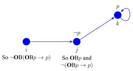
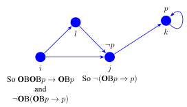

# logic-deontic — supplement（supplement）

> （《logic-deontic》词条补充材料，源：plato.stanford.edu/entries/logic-deontic/supplement.html）

#### Supplement to Deontic Logic

## List of Supplements to Deontic Logic

- A. Mally and Symbolic Deontic Logic
- B. Von Wright’s 1951a System and SDL
- C. Alternative Axiomatization of SDL
- D. Two Counter-Models Regarding Additions to SDL
- E. Non-Performance versus Refraining/Forbearing
- F. The Paradox of Epistemic Obligation (Åqvist 1967)
- G. Collapse of Conflicts into Impossible Obligations
- H. A Puzzle Surrounding Kant’s Law

## A. Mally and Symbolic Deontic Logic

Although it is with von Wright 1951a that symbolic deontic logic takes off as an on-going active academic area of study, we need to note that Mally 1926 was a significant earlier episode that, due at least in part, to serious technical problems, did not serve as a catalyst. Despite the problems with the system he found (notably and notoriously, the collapse of what ought to be into what is the case), Mally was an impressive pioneer of deontic logic. He was apparently uninfluenced by, and thus did not benefit from, early developments of alethic modal logic. This is quite opposed to the later trend in the 1950s when deontic logic reemerged, this time as a full-fledged discipline, deeply influenced by earlier developments in alethic modal logic. Mally was the first to found deontic logic on the syntax of propositional calculus explicitly, a strategy that others quickly returned to after a deviation from this strategy in the very first work of von Wright. Mally was the first in the twentieth century to employ deontic constants in symbolic deontic logic (reminiscent of Kanger and Anderson’s later use of deontic constants, but without their “reduction”; more below). He was also the first to attempt to provide an integrated account of non-conditional and conditional ought statements, one that provided an *analysis* of conditional *oughts* via a monadic deontic operator coupled with a material conditional (reminiscent of similar failed attempts in von Wright 1951a to analyze the dyadic notion of commitment), and allowing for a form of factual detachment (more in Section 4). All in all, this seems to be a remarkable achievement in retrospect. For more information on Mally’s system, including a diagnosis of the source of his main technical mistake, and a sketch of how he might have better avoided it, see the entry on Mally’s deontic logic.

## B. Von Wright’s 1951a System and SDL

It is fair to say that von Wright 1951a launched deontic logic as an area of active research. There was a flurry of responses, and not a year has gone by since without published work in this area. Here, we briefly outline the main differences between von Wright’s 1951a system and SDL.

First, in von Wright’s 1951a system, variables ranged over *act types* instead of propositions. As a result, the deontic operator symbols (e.g., $\OB$) were interpreted as applying not to sentences, but to names of act types (cf. “to attend” or “attending”) to yield a sentence (e.g., “it is obligatory to attend” or “attending is obligatory”). Consequently, iterated deontic sequences (e.g., $\OB \OB A$) were not well-formed formulas and shouldn’t have been on his intended interpretation, since $\OB A$ (unlike $A)$ is a sentence, not an act description, so not suitable for having $\OB$ as a prefix to it (cf. “it is obligatory it is obligatory to run” or “running is obligatory is obligatory”). However, von Wright does think that there can be negations, disjunctions and conjunctions of act types, and so he uses standard connectives to generate not only complex normative sentences (e.g., $\OB A \amp \PE A)$, but complex act descriptions (e.g., $A \amp \neg B)$, and thus complex normative sentences involving them (e.g., $\OB (A \amp \neg B) \rightarrow \PE (A \amp \neg B))$. The standard connectives of PC are thus used in a systematically ambiguous way in von Wright’s initial system with the hope of no confusion, but a more refined approach (as he recognized) would call for the usual truth-functional operators and a second set of act-type-compounding analogues to these.[^note-99] Still in line with this different interpretation, mixed formulas (e.g., $A \rightarrow \OB A)$ were not well-formed in his 1951 system. (Cf. “If to run then it is obligatory to run”.) The standard violation condition for an obligation (e.g., $\OB p \amp \neg p)$ is also not expressible in his system. Finally, von Wright rejected NEC, but otherwise accepts analogues to the basic principles of SDL.

Researchers quickly opted for a syntactic approach where the variables and operators are interpreted propositionally as they are in PC (Prior 1955 [1962], Anderson 1956, Kanger 1957 [1971], and Hintikka 1957), and von Wright soon adopted this course himself in his key revisions of his “old system” (e.g. von Wright 1956, von Wright 1964, von Wright 1965, and the more widely read von Wright 1971 being essentially an amalgamation of the latter two articles). Note that this is essentially a return to the approach in Mally’s deontic logic of a few decades before.

## C. Alternative Axiomatization of SDL

The following alternative axiom system, which is provably equivalent to SDL, “breaks up” SDL into a larger number of “weaker parts” (SDL *à la carte*, as it were). This has the advantage of facilitating comparisons with other systems that reject one or more of SDL’s theses.[^note-100]

| SDL′ | All tautologous formulae of the language | (TAUT) |
| --- | --- | --- |
|   | $\OB (p \amp q) \rightarrow(\OB p \amp \OB q) $ | ($\OB$-M) |
|   | $(\OB p \amp \OB q) \rightarrow \OB (p \amp q) $ | ($\OB$-C) |
|   | $\neg \OB \bot $ | ($\OB$-OD) |
|   | $\OB \top $ | ($\OB$-N) |
|   | If $\vdash p$ and $\vdash p \rightarrow q$, then $\vdash q$ | (MP) |
|   | If $\vdash p \leftrightarrow q$, then $\OB p\leftrightarrow \OB q $ | ($\OB$-RE) |

Regarding SDL’s expressive powers, advocates typically endorse the Traditional Definitional Scheme discussed in Section 1.2. So let us note here that given those definitions of the remaining operators, we can derive a variety of theorems and rules governing them, some suggestive of alternative axiomatizations. For example, given $\PE p \eqdf \neg \OB \neg p$, it is easy to show that $\OB$-K is equivalent to

$$\neg \PE (p \amp \neg q) \rightarrow(\PE \neg q \rightarrow \PE \neg p),$$

NC is equivalent to $\neg \PE p \rightarrow \PE \neg p$, and $\OB$-NEC is equivalent to if $\vdash \neg p$, then $\vdash \neg \PE p$.[^note-101] In fact, we could have used any of our first four normative statuses ($\OB$, $\PE$, $\IM$, $\OM$) from the Traditional Scheme as primitive to given alternative characterizations of SDL, but using $\OB$ is more prevalent.

## D. Two Counter-Models Regarding Additions to SDL

We now provide a counter-model to show that $\OB$-U, $\OB (\OB p \rightarrow p)$, is indeed a genuine (non-derivable) addition to SDL:

*Fig. D.1* [An extended description of figure D.1.]

Here, seriality holds, since each of the three worlds has at least one world acceptable to it (in fact, exactly one), but *secondary* seriality fails, since although $j$ is acceptable to $i, j$ is not acceptable to itself. Now look at the top annotations regarding the assignment of truth or falsity to $p$ at $j$ and $k$. The lower deontic formulae derive from this assignment and the accessibility relations. (The value of $p$ at $i$ won’t matter.) Since $p$ holds at $k$, which exhausts the worlds acceptable to $j, \OB p$ must hold at $j$, but then, since $p$ itself is false at $j$, $(\OB p \rightarrow p)$ must be false at $j$. But $j$ is acceptable to $i$, so not all $i$-acceptable worlds are ones where $(\OB p \rightarrow p)$ holds, so $\OB (\OB p \rightarrow p)$ must be false at $i$.[^note-102] We have already proven that seriality, which holds in this model, automatically validates NC. It is easy to show that the remaining ingredients of SDL hold here as well.[^note-103]

We proved above that $(\OB \OB p \rightarrow \OB p)$ is derivable from $\OB$-U. Here is a model that shows that the converse fails:

*Fig. D.2* [An extended description of figure D.2.]

It is left to the reader to verify that given the accessibility relations and indicated assignments to $p$ at $j$ and $k, \OB \OB p \rightarrow \OB p$ must be (vacuously) true at $i$, while $\OB (\OB p \rightarrow p)$ must be false at $i$.

## E. Non-Performance versus Refraining/Forbearing

Another interesting operator can be defined via a condition involving embedding of “$\BA$”:

$$\RF p \eqdf \BA \neg \BA p.$$

This expresses a widely endorsed analysis of refraining (or “forbearing”).[^note-104] In quasi-English, *it is a case of refraining by our agent that* $p$ if and only if our agent brings it about that she does not bring it about that $p$. The importance of this in agency theory is based on the assumption that refraining from doing something is distinct from simply not doing something. In the current agential framework, this boils down to the denial of the following claim:

$$*: \neg \BA p \rightarrow \RF p.$$

No agent brings about logical truths, but neither does an agent bring it about (by anything she does do) that she doesn’t bring about such logical truths. It has nothing to do with what she does. That \* can’t hold is easily proven given any consistent system with $\BA$-RE and $\BA$-NO. So refraining from $p$ is not equivalent to merely not bringing about $p$. Whether or not it is of great importance in deontic logic itself is a more controversial matter. It would hinge on matters like whether or not there is a difference between being obligated to not bring it about that $p$ and being obligated to bring it about that you don’t bring it about that $p$.

An alternative account sometimes given of refraining is that of inaction coupled with ability: to refrain from bringing it about that $p$ is to be *able* to bring it about that $p$ and to not bring it about that $p$. (See von Wright 1963, on “forbearance”.) This might be expressed as follows:

$$\RF p \eqdf \neg \BA p \amp \AB p,$$

where “$\AB$” is interpreted as an agential *ability* operator, perhaps a compound operator of the broad form “$\Diamond \BA p$”, with “$\Diamond$“ suitably constrained (e.g., as what is now still possible or still possible relative to our agent). In some frameworks, the two proposed analysans of refraining are provably equivalent (e.g., Horty 2001).[^note-105] Informally one might argue that if I am able to bring it about that $p$ and don’t, then I don’t bring it about that $p$ by whatever it is that I do bring about instead, and so I refrain per the first analysis; and if I truly bring it about by what I do that I don’t bring it about that $p$, then I must have been able to bring it about that $p$ even though I didn’t, so I refrain per the second analysis.

## F. The Paradox of Epistemic Obligation (Åqvist 1967)

Consider:

**(1)**

The bank is being robbed.

**(2)**

It ought to be the case that Jones (the guard) knows that the bank is being robbed.

**(3)**

It ought to be the case that the bank is being robbed.

Let us symbolize “Jones knows that the bank is being robbed” by “K$_j$r”, and add the operator K$_j$ to SDL. Then it would appear that a correct way to symbolize (1)–(3) is:

$$\tag{\(1'\)} r $$ $$\tag{\(2'\)} \OB K_j r $$ $$\tag{\(3'\)} \OB r$$

But it is a logical truth that if one knows that $p$, then $p$ is the case—Jones knows the bank is being robbed only if it is being robbed. So $\vdash K_j r \rightarrow r$ would hold in any system augmented with a faithful logic of knowledge. So in such a system, it would follow by RM that $\vdash \OB K_j r \rightarrow \OB r$ From this conditional and (2′), we can derive (3′) by MP.[^note-106] However, it hardly seems to follow from the fact that it is obligatory that the guard knows that the bank is being robbed, that it is likewise obligatory that the bank is being robbed. More generally, it seems that any plausible enrichment of SDL with a knowledge operator has the implausible property that, if an agent is obligated to know that a certain (impermissible) state of affairs obtains, then this state of affairs is itself also obligatory.[^note-107]

## G. Collapse of Conflicts into Impossible Obligations

We saw in Section 3 that Kant’s Law, when represented as $\OB p \rightarrow \Diamond p$, is a theorem of KT*d*. A weaker, and so more plausible, claim than that of Kant’s Law is that something cannot be obligatory unless it is at least *logically* possible. In SDL, this might be expressed by the rule:

If $\vdash \neg p$ then $\vdash \neg \OB p$.

This is easily derivable in SDL from $\OB$-NEC and NC Claiming that Romeo is not obligated to square the circle even if he solemnly promised Juliet is a reasonable stance, and one essential to the vast majority of deontic systems, since they endorse $\OB$-OD (i.e., $\vdash \neg \OB \bot)$.[^note-108]

However, this points to another puzzle for SDL. The rule above is equivalent to $\vdash \OB$-OD in any system with $\OB$-RE, and in fact, in the context of SDL, these are both equivalent to NC. That is, we could replace the latter axiom with either $\OB$-OD or the preceding rule and have a system equivalent to SDL. In particular, in any system with K and RM, $(\OB p \amp \OB \neg p) \leftrightarrow \OB \bot $ is a theorem. The distinction between conflicts of obligation and logically impossible obligations collapses. Separating NC from $\OB$-OD is now quite routine in conflict-allowing deontic logics.[^note-109]

## H. A Puzzle Surrounding Kant’s Law

Consider:[^note-110]

**(1)**

I’m obligated to pay you back \$10 tonight.

**(2)**

I can’t pay you back \$10 tonight (e.g., I just gambled away my last dime).

Since this puzzle typically involves some notion of possibility, let us represent the above sentences in KT*d*, which includes SDL, but also has a possibility operator:

$$\tag{\(1'\)} \OB p $$ $$\tag{\(2'\)} \neg \Diamond p$$

(1) and (2) appear to be consistent. Often, people are unable to fulfill their financial obligations, yet it is a truism that financial obligations are obligations. However in KT*d*, it is a theorem that $\OB p \rightarrow \Diamond p$. So we derive a contradiction from this symbolization and the assumption that (1′) and (2′) are true.

For a variant of this example, consider:

**(1)**

I owe you ten dollars, but I can’t pay you back.

**(2)**

I’m obligated to pay you ten dollars, but I can’t.

(2) seems to follow from (1), and (1) hardly seems contradictory, since owing money clearly does not entail being able to pay the money owed. Thomason 1981b suggests a distinction between deliberative contexts of evaluation and judgmental contexts, where in the latter context evaluations such as (1) above need not satisfy Kant’s law since, roughly, we go back in time and evaluate the present in terms of where things would now be relative to optimal past options that were accessible but no longer are.

## Notes（原文脚注，引自主文）

[^note-99]: 99. Cf. the deontic logic in Meyer 1988, where a set of operators for action (drawn from dynamic logic) are used along with a separate set of propositional operators.

[^note-100]: 100. The interrelationships between the rules and axioms which constitute the equivalence between these systems is taken for granted in work on deontic logic, and is thus useful to know.

[^note-101]: 101. By RE and some PC manipulations, $\OB$-K is equivalent to

$$\neg \neg \OB \neg(p \amp \neg q) \rightarrow(\neg \OB \neg \neg q \rightarrow \neg \OB \neg \neg p),$$

and then by definition of $\PE$, we get

$$\neg \PE (p \amp \neg q) \rightarrow(\PE \neg q \rightarrow \PE \neg p).$$

By PC, NC is equivalent to

$$\neg \neg \OB \neg \neg p \rightarrow \neg \OB \neg p,$$

and this is equivalent by definition to $\neg \PE \neg p \rightarrow \PE p$. Lastly, by PC, $\OB$-NEC is equivalent to if $\vdash \neg p$ then $\vdash \neg \neg \OB \neg p$, and this is equivalent by definition to: if $\vdash \neg p$ then $\vdash \neg \PE p$,

[^note-102]: 102. Note that this is in contrast to $j$ itself, where the latter formula does hold, for the reader can easily verify that $(\OB p \rightarrow p)$ holds at $k$ in this model, and $k$ is the only world acceptable to $j$.

[^note-103]: 103. The remaining items hold independently of seriality. Completing the proof amounts to both a proof of SDL’s soundness with respect to our semantics, and of $\OB$-U’s independence (non-derivability from) SDL.

[^note-104]: 104. It has been most utilized by Belnap and coworkers. See Belnap et al. 2001, and its references to prior papers.

[^note-105]: 105. But not so for the “achievement” agency operator in Belnap et al. 2001.

[^note-106]: 106. The formula (1′) is not really essential here, it just helps to clarify that (2) does not express some strange standing obligation but a transient one that emerges as a result of the *de facto* robbery.

[^note-107]: 107. Theoretically one could claim that we have a conflict of obligations here, but this seems quite implausible. The banks’ being robbed appears to be definitely non-obligatory.

[^note-108]: 108. However see Da Costa & Carnielli 1986 which develops a paraconsistent deontic logic.

[^note-109]: 109. Some early discussions and attempted solutions to this collapse can be found in Chellas 1980 and Schotch & Jennings 1981, both of whom use non-normal modal logics for deontic logic. Brown 1996b uses a similar approach to Chellas’ for modeling conflicting obligations, but with the addition of an ordering relation on obligations to model the relative stringency of obligations, thus moving in the direction of a model addressing Plato’s Dilemma as well.

[^note-110]: 110. More accurately, a weakened version of that law, as here no agential notion of ability is present to make it clear that I am obligated to do the paying back.