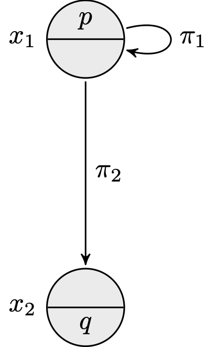
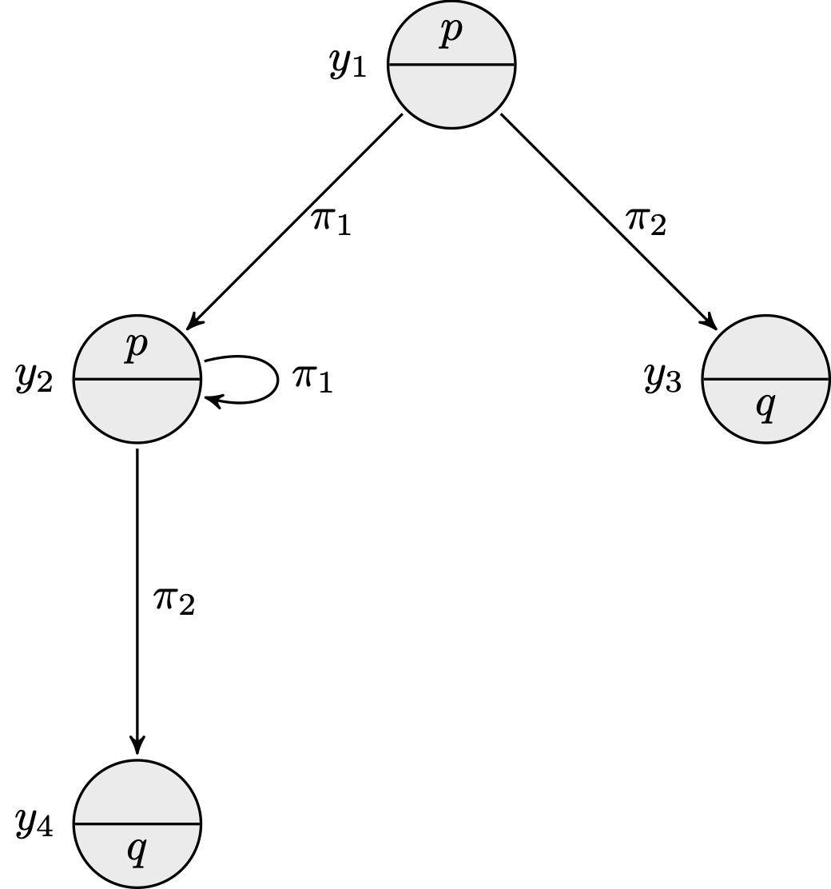

# Propositional Dynamic Logic
**First published Thu Feb 1, 2007; substantive revision Thu Feb 16, 2023**

*Troquard, Nicolas, Balbiani, Philippe*

Logics of programs are modal logics arising from the idea of associating a modality $[\alpha]$ with each computer program $\alpha$ of a programming language. The formula $[\alpha]A$ is then to be read as: $A$ is true after the execution of the program $\alpha$. This idea comes from the line of works by Engeler [1967], Hoare [1969], Yanov [1959], and others who formulated and studied logical languages in which the properties of program connectives can be expressed. The algorithmic logic (AL) first developed by Salwicki [1970] and the dynamic logic (DL) elaborated by Pratt [1976] are proper continuations of these works. We will here concentrate on DL. The numerous papers devoted to DL and its variants as well as its many applications in program verification and data structures show that it constitutes a useful tool for studying the properties of programs. Pratt chose to depict DL on what one might call the first-order level, and it was his work that triggered Fischer and Ladner [1979] to define the propositional variant of DL a couple of years later. This article presents an introduction to PDL, the propositional variant of DL.

## 1. Introduction

Dynamic Logics (DL) are modal logics for representing the states and the events of dynamic systems. The language of DLs is both an assertion language able to express properties of computation states, and a programming language able to express properties of system transitions between these states. DLs are *logics of programs*, and permit to talk and reason about states of affairs, processes, changes, and results.

Pratt’s original dynamic logic of programs was a *first-order* modal logic. *Propositional Dynamic Logic* (PDL) is the propositional counterpart of it. It was presented as a logic in its own right in Fischer and Ladner [1979]. Being propositional, the language of PDL makes no use of terms, predicates, or functions. Thus in PDL, there are two syntactic categories: propositions and programs.

To give meaning to statements in PDL, we typically work with an abstract semantics in terms of Labeled Transition Systems (LTS). LTSs can be seen as a generalization of Kripke models, where transitions between worlds, or states, are “labeled” by names of *atomic* programs. A valuation indicates for every state what *propositions* are true in it. A transition labeled $\pi$ from one state $x$ to a state $y$—noted $xR(\pi)y$, or $(x,y) \in R(\pi)$—indicates that starting in $x$, there is a possible execution of the program $\pi$ that finishes in $y$. If the proposition $A$ is true in $y$, then the formula $\langle\pi\rangle A$ is true in $x$: i.e., in the state $x$ there is a possible execution of the program $\pi$ that ends in a state satisfying $A$. One recognizes in $\langle\pi\rangle$ a modality reminiscent of the modality of possibility (often noted $\Diamond$) of modal logic. Unsurprisingly, there is also a corresponding notion of necessity (whose modality is often noted $\Box$). The formula $[\pi]A$ is true in the state $x$ if $A$ is true in every state reachable from $x$ by a transition labeled $\pi$.

The possible executions of complex programs can be next defined compositionally. For instance, a program “first $\alpha$, then $\beta$” is a complex program, more specifically a *sequence*. A possible execution can be represented in an LTS by composing a two-step transition—a transition which can be signified by $R(\alpha;\beta)$—between the states $x$ and $y$: there is a possible execution in the state $x$ of the program $\alpha$ that finishes in a state $z$ and there is a possible execution in $z$ of the program $\beta$ that finishes in the state $y$. If the proposition $A$ is true in $y$, then the formula $\langle \alpha;\beta\rangle A$ is be true in the state $x$. The programs $\alpha$ and $\beta$ could be complex program themselves. Still more programs can be expressed with more constructs that we will present in due time.

A program is then seen in an extensional way: it is a binary relation between pairs of states of an LTS. Precisely, it is the set of pairs of the form $(x,y)$ such that the program can be executed in the state $x$ and can lead to the state $y$. On the other hand, a proposition is a statement about a state; it is either true or false in a state. A proposition can thus also be seen in an extensional way: the set of states of the LTS where it is true.

With the acronym PDL, we refer here precisely to the propositional dynamic logic with the following program constructs: sequence, non-deterministic choice, unbounded iteration, and test. We present it in section 2, together with some properties and fundamental results. In particular, we will address its axiomatization and its decidability.

The Hoare calculus from Hoare [1969] is a landmark for logics of programs. It concerns the truth of statements of the form $\{A\}\alpha\{B\}$—meaning that with the precondition $A$ the program $\alpha$ always has $B$ as a post-condition—and is defined axiomatically. It comes from a want of rigorous methods to reason about the properties of programs, and thus giving to the activity of programming a certain place in the realm of science. Burstall [1974] saw the analogy between modal logics and reasoning about programs. But the actual work on it started with Pratt [1976] after it was suggested to him by some of the students of a course he was giving, specifically about logics of programs. PDL comes from Pratt’s interpretation of Hoare’s calculus in the formalism of modal logic. An introduction to the genesis of PDL can be found in Pratt [1980b]. The Hoare-triple $\{A\}\alpha\{B\}$ is captured by the PDL formula $A \to [\alpha]B$ meaning literally that if $A$ is true, then every successfully terminating execution of $\alpha$ will end with $B$ being true. With this connection realized, it is a routine to prove the initial rules of Hoare’s calculus using exclusively the axiomatization of PDL. This is something we will do in detail in section 3 which concentrates on the reasoning about the correctness of structured programs.

Additional topics related to PDL include results concerning comparative power of expression, decidability, complexity, and completeness of a number of interesting variants obtained by extending or restricting PDL in various ways. Since its inception, many variants of PDL have received attention. These variants may consider deterministic programs, restricted tests, non-regular programs, programs as automata, complementation and intersection of programs, converse and infinite computations, etc. We will present some of them in section 4, providing some pointers regarding their relative expressivity, their axiomatizations, and their computational complexity.

We conclude in section 5.

## 2. Definitions and fundamental results

We present the syntax and semantics of PDL in section 2.1. The proof theory of PDL is presented in section 2.2 with axiomatizations and pointers to the literature on completeness. We address the problem of decidability and complexity in section 2.3.

### 2.1 Syntax and semantics

Propositional dynamic logic (PDL) is designed for representing and reasoning about propositional properties of programs. Its syntax is based upon two sets of symbols: a countable set $\Phi_0$ of atomic formulas and a countable set $\Pi_0$ of atomic programs. Complex formulas and complex programs over this base are defined as follows.

- Every atomic formula is a formula.
- $0$ (“false”) is a formula.
- If $A$ is a formula then $\lnot A$ (“not $A$”) is a formula.
- If $A$ and $B$ are formulas then $(A\lor B)$ (“$A$ or $B$”) is a formula.
- If $\alpha$ is a program and *A* is a formula then $[\alpha]A$ (“every execution of $\alpha$ from the present state leads to a state where $A$ is true”) is a formula.
- Every atomic program is a program.
- If $\alpha$ and $\beta$ are programs then $(\alpha;\beta)$ (“do $\alpha$ followed by $\beta$”) is a program.
- If $\alpha$ and $\beta$ are programs then $(\alpha\cup\beta)$ (“do $\alpha$ or $\beta$, non-deterministically”) is a program.
- If $\alpha$ is a program then $\alpha^*$ (“repeat $\alpha$ a finite, but non-deterministically determined, number of times”) is a program.
- If $A$ is a formula then $A?$ (“proceed if $A$ is true, else fail”) is a program.

The other Boolean connectives $1$, $\land$, $\to$, and $\leftrightarrow$ are used as abbreviations in the standard way. In addition, we abbreviate $\lnot[\alpha]\lnot A$ to $\langle\alpha\rangle A$ (“some execution of $\alpha$ from the present state leads to a state where $A$ is true”) as in modal logic. We write $\alpha^n$ for $\alpha;\ldots ;\alpha$ with $n$ occurrences of $\alpha$. More formally:

- $\alpha^0 := 1?$
- $\alpha^{n+1} := \alpha;\alpha^n$

Also:

- $\alpha^+ := \alpha;\alpha^*$

is often useful to represent an iteration that is unbounded but occurs at least once. Finally, we adopt the standard rules for omission of parentheses.

Formulas can be used to describe the properties that hold after the successful execution of a program. For example, the formula $[\alpha\cup\beta]A$ means that whenever program $\alpha$ or $\beta$ is successfully executed, a state is reached where $A$ holds, whereas the formula $\langle (\alpha;\beta)^*\rangle A$ means that there is a sequence of alternating executions of $\alpha$ and $\beta$ such that a state is reached where $A$ holds. Semantically speaking, formulas are interpreted by sets of states and programs are interpreted by binary relations over states in a transition system. More precisely, the meaning of PDL formulas and programs is interpreted over Labeled Transition Systems (LTS) $M = (W,R,V)$ where $W$ is a nonempty set of worlds or states, $R$ is a mapping from the set $\Pi_0$ of atomic programs into binary relations on $W$ and $V$ is a mapping from the set $\Phi_0$ of atomic formulas into subsets of $W$.

Informally, the mapping $R$ assigns to each atomic program $\pi\in\Pi_0$ some binary relation $R(\pi)$ on $W$ with the intended meaning that $xR(\pi)y$ iff there exists an execution of $\pi$ from $x$ that leads to $y$, whereas the mapping $V$ assigns to each atomic formula $p\in\Phi_0$ some subset $V(p)$ of $W$ with the intended meaning that $x \in V(p)$ iff $p$ is true in the state $x$. Given our readings of $0$, $\lnot A$, $A\lor B$, $[\alpha]A$, $\alpha;\beta$, $\alpha\cup\beta$, $\alpha^*$ and $A?$, it is clear that $R$ and $V$ must be extended inductively as follows to supply the intended meanings for the complex programs and formulas:

- $xR(\alpha;\beta)y$ iff there exists a world $z$ such that $xR(\alpha)z$ and $zR(\beta)y$
- $xR(\alpha\cup\beta)y$ iff $xR(\alpha)y$ or $xR(\beta)y$
- $xR(\alpha^*)y$ iff there exists a non-negative integer $n$ and there exists a sequence of states $z_0, \ldots, z_n$ such that $z_0 = x$, $z_n = y$ and for all $k = 1 \ldots n$, $z_{k-1}R(\alpha)z_k$
- $xR(A?)y$ iff $x = y$ and $y \in V(A)$
- $V(0) = \emptyset$
- $V(\lnot A) = W \setminus V(A)$
- $V((A\lor B) = V(A) \cup V(B)$
- $V([\alpha]A) = \{x \mid \text{for all worlds } y, \text{ if } xR(\alpha)y \text{ then } y \in V(A)\}$

If $x \in V(A)$ then we say that $A$ is satisfied at state $x$ in $M$, or $\ldquo M, x$ sat $A\rdquo$.

Two Labeled Transition Systems: $M = (W,R,V)$ (left) and $M' = (W',R',V')$ (right)

Call $M$ the LTS depicted above on the left and $M'$ the LTS depicted on the right. Defined formally, we have $M = (W, R, V)$ with $W = \{x_1,x_2\}$, $R(\pi_1) = \{(x_1,x_1)\}$, $R(\pi_2) = \{(x_1,x_2)\}$, $V(p) = \{x_1\}$, $V(q) = \{x_2\}$, and we have $M' = (W',R',V')$ with $W' = \{y_1, y_2, y_3, y_4\}$, $R'(\pi_1) = \{(y_1, y_2), (y_2, y_2)\}$, $R'(\pi_2) = \{(y_1, y_3), (y_2, y_4)\}$, $V'(p) = \{y_1, y_2\}$, $V'(q) = \{y_3, y_4\}$. We have for instance:

- $M,x_1$ sat $p$
- $M,x_2$ sat $q$
- $M,x_1$ sat $\langle \pi_1 \rangle p \land \langle \pi_2 \rangle q$
- $M,x_1$ sat $[\pi_1]p \land [\pi^*_1]p$
- $M',y_1$ sat $\langle \pi^*_1;\pi_2\rangle q$
- $M',y_2$ sat $[\pi^*_1] p$
- $M',y_1$ sat $[\pi_1 \cup \pi_2] (p \lor q)$
- $M',y_3$ sat $[\pi_1 \cup \pi_2] 0$

Now consider a formula $A$. We say that $A$ is valid in $M$ or that $M$ is a model of $A$, or “$M \models A$”, iff for all worlds $x$, $x \in V(A)$. $A$ is said to be valid, or “$\models A$”, iff for all models $M$, $M \models A$. We say that $A$ is satisfiable in $M$ or that $M$ satisfies $A$, or “$M$ sat $A$”, iff there exists a world $x$ such that $x \in V(A)$. $A$ is said to be satisfiable, or “sat $A$”, iff there exists a model $M$ such that $M$ sat $A$. It is notably the case that,

sat $A$ iff not $\models \lnot A$ $\models A$ iff not sat $\lnot A$

Some remarkable formulas of PDL are valid. (The reader may try to prove them formally, or at least start convincing themselves on the few examples displayed above.)

$\models [\alpha ; \beta]A \leftrightarrow [\alpha][\beta]A$ $\models [\alpha \cup \beta]A \leftrightarrow [\alpha]A \land [\beta]A$ $\models [\alpha^*]A \leftrightarrow A \land [\alpha][\alpha^*]A$ $[A?]B \leftrightarrow (A \rightarrow B)$

Equivalently, we can write them under their dual form.

$\langle\alpha ; \beta\rangle A \leftrightarrow \langle\alpha\rangle\langle\beta\rangle A$ $\langle\alpha \cup \beta\rangle A \leftrightarrow \langle\alpha\rangle A \lor \langle\beta\rangle A$ $\langle\alpha^*\rangle A \leftrightarrow A \lor \langle\alpha\rangle \langle\alpha^*\rangle A$ $\langle A?\rangle B \leftrightarrow A \land B$

One interesting notion concerns the information, expressed with PDL formulas, that is contained in an LTS. The behavior of a system described as an LTS is indeed often slightly hidden in its form. For instance, on simple inspection, it is easy to convince oneself that the two LTSs depicted above have the same behavior, and satisfy the same PDL formulas. To finish this section on syntax and semantics we give the theoretical foundation of these claims.

Given two LTSs, one may ask whether they satisfy the same formulas. The notion of bisimulation has become the standard measure for equivalence of Kripke models and Labeled Transition Systems. A *bisimulation* between the LTSs $M = (W,R,V)$ and $M' = (W',R',V')$ is a binary relation $Z$ between their set of states such that for all worlds $x$ in $W$ and for all worlds $x'$ in $W'$, if $xZx'$ then,

- for all atomic formulas $p\in \Phi_0$, we have $x\in V(p)$ iff $x' \in V'(p)$,
- for all atomic programs $\pi \in \Pi_0$ and for all worlds $y \in W$, we have that if $x R(\pi)y$ then there exists a world $y' \in W'$ such that $yZy'$ and $x' R'(\pi)y'$,
- for all atomic programs $\pi \in \Pi_0$ and for all worlds $y' \in W'$, we have that if $x' R'(\pi)y'$ then there exists a world $y \in W$ such that $yZy'$ and $x R(\pi)y$.

We say that two LTSs are *bisimilar* when there exists a bisimulation between them.

It is the case that in two bisimilar LTSs $M = (W,R,V)$ and $M' = (W',R',V')$, for all worlds $x$ in $W$ and for all worlds $x'$ in $W'$, if $xZx'$ then for all PDL formulas $A$, $x \in V(A)$ iff $x' \in V'(A)$. Thus when two LTSs are bisimilar under the definition of bisimulation above, it is the case that, if $xZx'$ then

- for all programs $\alpha$ and for all worlds $y \in W$, we have that if $x R(\alpha)y$ then there exists a world $y' \in W'$ such that $yZy'$ and $x' R'(\alpha)y'$,
- for all programs $\alpha$ and for all worlds $y' \in W'$, we have that if $x' R'(\alpha)y'$ then there exists a world $y \in W$ such that $yZy'$ and $x R(\alpha)y$.

Hence one can simply compare the behaviors of two LTSs by inspecting solely the atomic programs and safely extrapolate on the comparative behavior of these LTSs even for complex programs. We say that the program constructs of PDL are *safe for bisimulation*. See Van Benthem [1998] for precise characterizations of program constructs that are safe for bisimulation.

It is readily seen that the two instances of LTSs above are bisimilar. A bisimulation $Z$ between the two models $M$ and $M'$ depicted in the figures above can be given as: $Z = \{(x_1,y_1), (x_1,y_2), (x_2, y_3), (x_2, y_4)\}$. The states $x_1$ and $y_1$ satisfy exactly the same PDL formulas. So do the states $x_1$ and $y_2$, etc.

### 2.2 Axiomatization and completeness

The purpose of the proof theory is to provide the characterization of validity—the property $\models A$—in terms of axioms and rules of inference. In this section, we define a deducibility predicate $\vdash$ inductively by operations on formulas that depend only on their syntactic structure in such a way that for all formulas $A$,

$\vdash A$ iff $\models A$.

Of course, PDL is an extension of classical propositional logic. We first expect that all propositional tautologies hold, and all propositional reasoning is allowed. In particular, modus ponens is a valid rule: from $A$ and $A \rightarrow B$ infer $B$. For any program $\alpha$, restricting an LTS to the relation $R(\alpha)$ we obtain a Kripke model in which the logic of the modality $[\alpha]$ is the weakest propositional normal modal logic, namely, the logic K. Thus, PDL contains every instance of the familiar distribution axiom schema

**(K)**

$[\alpha](A \rightarrow B) \rightarrow ([\alpha]A \rightarrow [\alpha]B)$

and it is closed under the following rule of inference (*necessitation* rule)

**(N)**

from $A$ infer $[\alpha]A$

A modal logic is normal if it obeys (K) and (N). An important property of normal modal logics is the *distributivity over the conjunction* $\land$: the formula $[\alpha](A \land B) \leftrightarrow ([\alpha]A \land [\alpha]B)$ can be proven using (K), (N), and propositional reasoning. The rule of *monotony* can also be proven using (K), (N), and propositional reasoning: from $A \rightarrow B$ infer $[\alpha]A \rightarrow [\alpha]B$.

PDL is the least normal modal logic containing every instance of the following axiom schemas

**(A1)**

$[\alpha;\beta]A \leftrightarrow [\alpha][\beta]A$

**(A2)**

$[\alpha \cup \beta]A \leftrightarrow [\alpha]A \land [\beta]A$

**(A3)**

$[\alpha^*]A \leftrightarrow A \land [\alpha][\alpha^*]A$

**(A4)**

$[A?]B \leftrightarrow (A \rightarrow B)$

and closed under the following rule of inference (*loop invariance* rule):

**(I)**

from $A \rightarrow [\alpha]A$ infer $A \rightarrow [\alpha^*]A$

If $X$ is a set of formulas and $A$ is a formula then we say that $A$ is $\vdash$-deducible from $X$, or “$X \vdash A$”, if there exists a sequence $A_0, A_1, \ldots A_n$ of formulas such that $A_n = A$ and for all $i \leq n$, $A_i$ is an instance of an axiom schema, or a formula of $X$, or comes from earlier formulas of the sequence by a rule of inference. Further, $\vdash A$ iff $\emptyset \vdash A$; in this case we say that $A$ is $\vdash$-deducible. $X$ is said to be $\vdash$-consistent iff not $X \vdash 0$. It is easy to establish that the rule (I) can be replaced by the following axiom schema (*induction* axiom schema):

**(A5)**

$A \land [\alpha^*](A \rightarrow [\alpha]A) \rightarrow [\alpha^*]A$

Let us first establish that (I) is a derived rule of the proof system based on (A1), (A2), (A3), (A4) and (A5):

| 1. | $A \rightarrow [\alpha]A$ | premise |
| --- | --- | --- |
| 2. | $[\alpha^*](A \rightarrow [\alpha]A)$ | from 1 using (N) |
| 3. | $A \land [\alpha^*](A \rightarrow [\alpha]A) \rightarrow [\alpha^*]A$ | axiom schema (A5) |
| 4. | $[\alpha^*](A \rightarrow [\alpha]A) \rightarrow (A \rightarrow [\alpha^*]A)$ | from 3 using propositional reasoning |
| 5. | $A \rightarrow [\alpha^*]A$ | from 2 and 4 using modus ponens |

Let us next establish that (A5) is $\vdash$-deducible:

| 1. | $[\alpha^*](A \rightarrow [\alpha]A)\ \leftrightarrow\ $ $(A \rightarrow [\alpha]A) \land [\alpha][\alpha^*](A \rightarrow [\alpha]A)$ | axiom schema (A3) |
| --- | --- | --- |
| 2. | $A \land [\alpha^*](A \rightarrow [\alpha]A)\ \rightarrow\ $ $[\alpha](A \land [\alpha^*](A \rightarrow [\alpha]A))$ | from 1 using propositional reasoning and distributivity of $[\alpha]$ over $\land$ |
| 3. | $A \land [\alpha^*](A \rightarrow [\alpha]A)\ \rightarrow\ $ $[\alpha^*](A \land [\alpha^*](A \rightarrow [\alpha]A))$ | from 2 using (I) |
| 4. | $[\alpha^*](A \rightarrow [\alpha]A) \rightarrow (A \rightarrow [\alpha^*]A)$ | from 3 using propositional reasoning and distributivity of $[\alpha^*]$ over $\land$ |
| 5. | $A \land [\alpha^*](A \rightarrow [\alpha]A) \rightarrow [\alpha^*]A$ | from 4 using propositional reasoning |

The axiomatization of PDL based on axiom schemas (A1), (A2), (A3), (A4) and (A5) has been proposed in Segerberg [1977]. It is immediate from the definitions above that $\vdash$ is sound with respect to $\models$, i.e.,

for all formulas $A$, if $\vdash A$, then $\models A$.

The proof proceeds by induction on the length of $A$’s deduction in $\vdash$. The question of the completeness of $\vdash$ with respect to $\models$, i.e.,

for all formulas $A$, if $\models A$, then $\vdash A$,

was pursued by several logicians. The line of reasoning presented in Segerberg [1977] was the first attempt to prove the completeness of $\vdash$. Soon, Parikh came up with a proof, too. When early 1978 Segerberg found a flaw in his argument (which he repaired eventually), Parikh published what can be considered the first proof of the completeness of $\vdash$ in Parikh [1978]. Different proofs of completeness of $\vdash$ have been published since, e.g. Kozen and Parikh [1981]. More details can be found in Pratt [2017].

Different alternative proof theories of PDL have also been sought after. Even early on, notably in Pratt [1978]. Let us then also mention the completeness of related theories by Nishimura [1979] and Vakarelov [1983].

An alternative formulation of a deducibility predicate for PDL exploits an infinitary rule of inference, as for instance in Goldblatt [1992a]. (An infinitary rule of inference takes an infinite number of premises.) Let $\vdash'$ be the deducibility predicate corresponding in the language of propositional dynamic logic to the least normal modal logic containing every instance of the axiom schemas (A1), (A2), (A3) and (A4) and closed under the following infinitary rule of inference:

**(I′)**

from $\{[\beta][\alpha^n]A : n\geq 0\}$ infer $[\beta][\alpha^*]A$

It can be proved that $\vdash'$ is both sound and complete with respect $\models$, i.e.,

for all formulas $A$, $\vdash' A$ iff $\models A$.

In other words, as far as generating the set of all valid formulas is concerned, the proof systems $\vdash$ and $\vdash'$ are equivalent.

### 2.3 Decidability and complexity

The aim of the complexity theory is to establish the computability of the property sat $A$ in terms of resources of time or space. The complexity of a logic $\mathcal{L}$ is often identified with the problem of deciding the satisfiability of its formulas, defined as:

**(L-SAT)**

Given a formula $A$ of $\mathcal{L}$, is $A$ satisfiable?

In this section, we investigate the complexity of the following decision problem:

**(PDL-SAT)**

Given a formula $A$ of PDL, is $A$ satisfiable?

The complete axiomatization of PDL is a recursive definition of the set of valid PDL formulas, or in other words, of the set of formulas whose negation is not satisfiable. Hence, concerning the problem (PDL-SAT), we have a sub-procedure that would answer “no” if the PDL formula $A$ were not satisfiable. The sub-procedure (SP1) consists in enumerating all the formulas $\vdash$-deducible, starting from the axioms and inferring other theorems with the help of the inference rules. Given enough time, if a formula is $\vdash$-deducible, the sub-procedure would find it eventually. Thus, if $A$ is not satisfiable, (SP1) must eventually find $\lnot A$, and answer “no” when it does.

However, if the formula $A$ is satisfiable, then (SP1) would never find $\lnot A$. It would run forever, and one could not be sure about it at any time. But there is a way out of this uncertainty. We can also think of a second sub-procedure that answers “yes” if a PDL formula is satisfiable. Indeed, one of the earliest results on PDL was the proof that PDL has the *finite model property*, i.e.,

For all formulas $A$, if sat $A$ then there exists a finite model $M$ such that $M$ sat $A$.

The finite model property offers a basis for a sub-procedure (SP2) that consists in enumerating one by one the finite models of PDL and testing whether one of them satisfies the formula. (For all formulas $A$ and for all finite models $M$, it is easy to test if $M$ sat $A$ by applying the definition of $V(A)$.) Thus, if $A$ is satisfiable, it must eventually find a model $M$ such that $M$ sat $A$, and answer “yes” when it does. Symmetrically to the first sub-procedure (SP1), if the formula $A$ is not satisfiable, then (SP2) will never find a model satisfying it, it will run forever, and one could not be sure about it at any time.

Now, combining (SP1) and (SP2) together we have a way of deciding whether a PDL formula $A$ is satisfiable. It suffices to run them in parallel: if $A$ is satisfiable then (SP2) will eventually answer “yes”, if $A$ is not satisfiable then (SP1) will eventually answer “no”. The procedure halts when either (SP1) or (SP2) provides an answer.

If the procedure that is obtained is sufficient to conclude that the problem (PDL-SAT) is decidable, it is very inefficient in practice. There is a result—due to Fischer and Ladner [1979] and Kozen and Parikh [1981]— stronger than the finite model property, that is *small model property*:

For all formulas $A$, if sat $A$ then there exists a finite model $M$ of size exponential in $A$ such that $M$ sat $A$.

This means that we would now know when to stop looking for a model satisfying a formula in the procedure (SP2). Hence, we can use (SP2) to test whether a formula is satisfiable, but once we have exhausted all small models, we can conclude that the formula is not satisfiable. This yields a procedure that runs non-deterministically in exponential time (NEXPTIME): guess a model of size at most singly exponential, and check whether it satisfies the formula. But the key results in the complexity theory of PDL come from Fischer and Ladner [1979] and Pratt [1980a]. Observing that a formula of PDL can efficiently describe the computation of a linear space bounded alternating Turing machine, Fischer and Ladner [1979] first established the lower bound of exponential time of (PDL-SAT). The EXPTIME upper bound of (PDL-SAT) has been obtained by Pratt [1980a], who adapted the method of semantic tableaux to PDL. Thus, (PDL-SAT) is EXPTIME-complete. (An algorithm more efficient in practice, although still running in deterministic exponential time in the worst case, is proposed in De Giacomo and Massacci [2000].)

## 3. Structured programming and correctness of programs

Historically, logics of programs stem from the work in the late 1960s of computer scientists interested in assigning meaning to programming languages and finding a rigorous standard for proofs about the programs. For example such proofs may be about the correctness of a program with respect to an expected behavior, or about the termination of a program. A seminal paper is Floyd [1967] which presents an analysis of the properties of structured computer programs using *flowcharts*. Some early work such as Yanov [1959] or Engeler [1967] had advanced and studied formal languages in which the properties of program connectives can be expressed. The formalism of Hoare [1969] was a milestone in the advent of PDL. It was proposed as a rigorous axiomatic interpretation of Floyd’s flowcharts. We often talk about Hoare logic, or Floyd-Hoare logic, or Hoare calculus when referring to this formalism. Hoare calculus is concerned with the truth of statements (“Hoare triples”), such as $\{A\}\alpha\{B\}$ which establishes a connection between a precondition $A$, a program $\alpha$, and a post-condition $B$. It indicates that whenever $A$ holds as a precondition of the execution of $\alpha$, then $B$ holds as a post-condition after the successful execution of $\alpha$.

It was true some decades ago, and it is still the case: validating a program is more often than not done by testing it on a reasonable variety of inputs. When an input does not yield the expected output, the “bug” is fixed. If eventually for every tested input we obtain the expected output, one has a reasonable belief that the program has no error. However, this is a time consuming method of validation, and it leaves place for untested inputs that could fail. Finding these errors after the program has been implemented and gone into use is even more costly in resources. Reasoning about program correctness with formal methods is crucial for critical systems since it offers a way of proving exhaustively that a program has no errors.

### 3.1 Hoare calculus

To illustrate the sort of principles of programs captured by the rules in the Hoare calculus it is enough to consult some of them. (N.B.: the rules mean that if all the statements above the rule line hold—the premises—then also the statement under the rule line—the conclusion— holds.)

$$ \frac{\{A\}\alpha_1 \{B\}\quad\{B\} \alpha_2\{C\}} {\{A\} \alpha_1;\alpha_2\{C\}} \text{ (rule of composition)} $$

The rule of composition captures the elementary sequential composition of programs. As premises, we have two assumptions about the partial correctness of two programs $\alpha_1$ and $\alpha_2$. The first assumption is that when $\alpha_1$ is executed in a state satisfying $A$, then it will finish in a state satisfying $B$, whenever it halts. The second assumption is that when $\alpha_2$ is executed in a state satisfying $B$, then it will finish in a state satisfying $C$, whenever it halts. The conclusion of the rule is about the partial correctness of the program $\alpha_1;\alpha_2$ (i.e., $\alpha_1$ sequentially composed with $\alpha_2$), that follows from the two assumptions. Namely, we can conclude that if $\alpha_1;\alpha_2$ is executed in a state satisfying $A$, then it finishes in a state satisfying $C$, whenever it halts.

The rule of iteration is an important one because it captures the essential ability of programs to execute some portion of code repeatedly until a certain condition ceases to hold.

$$ \frac{\{A \land B\}\alpha\{A\}} {\{A\} \mathsf{while}~B~\mathsf{do}~\alpha \{\lnot B \land A\}} \text{ (rule of iteration)} $$

Finally, the two rules of consequence are fundamental to give a formal basis to intuitively clear reasoning involving weaker post-conditions and stronger preconditions respectively.

$$ \frac{\{A\}\alpha\{B\}\quad B \rightarrow C} {\{A\} \alpha \{C\}} \text{ (rule of consequence 1)} $$ $$ \frac{C\rightarrow A\quad \{A\}\alpha\{B\}} {\{C\}\alpha\{B\}} \text{ (rule of consequence 2)} $$

From the formalism presented in Hoare [1969], we leave out its axiom schemas as it would require a first-order language. Finally, in subsequent work on Hoare logic, more rules are also often added. See Apt [1979] for an early overview.

### 3.2 Hoare calculus and PDL

Dynamic logics come from Pratt’s interpretation of Hoare triples and Hoare calculus in the formalism of modal logic. With the modality $[\alpha]$, we can express formally that all states reachable by executing the program $\alpha$ satisfy the formula $A$. This is done by writing $[\alpha]A$. Thus, the Hoare triple $\{A\}\alpha\{B\}$ is simply captured by the PDL formula

$A \rightarrow [\alpha]B$.

In addition, important programming constructs are easily introduced in PDL by definitional abbreviation:

- $\mathsf{if}~ A ~\mathsf{then}~ \alpha ~\mathsf{else}~ \beta := ((A?;\alpha) \cup (\lnot A?;\beta))$
- $\mathsf{while}~ A ~\mathsf{do}~ \alpha := ((A?;\alpha)^*;\lnot A?)$
- $\mathsf{repeat}~ \alpha ~\mathsf{until}~ A := (\alpha;((\lnot A;\alpha)^*;A?))$
- $\mathsf{abort} := 0?$
- $\mathsf{skip} := 1?$

Thus, it seems that with PDL we are well-equipped to logically prove the correctness of structured programs. Beyond this rather hand-waving connection between PDL and Hoare calculus, perhaps it is not yet clear how they relate formally. PDL is in fact a generalization of Hoare calculus in the sense that all the rules of the Hoare calculus can be proven in the axiomatic system of PDL. (Rigorously, the Hoare calculus contains axioms that would require the extended language of first-order Dynamic Logic.) This is quite remarkable, so we will show how they can be derived.

The proofs start by assuming the premises of the rules. Then by using these assumptions, axioms and rules of PDL, and nothing else, the objective is to establish that the conclusion of the rules logically follows. Hence, for the rule of composition, we start by assuming $\{A\}\alpha_1\{B\}$, that is $A \rightarrow [\alpha_1]B$ in its PDL formulation, and by assuming $\{B\}\alpha_2\{C\}$, that is $B \rightarrow [\alpha_2]C$. The objective is to prove that $\{A\}\alpha_1;\alpha_2\{C\}$. Precisely, we want to establish that $A \rightarrow [\alpha_1;\alpha_2]C$ is $\vdash$-deducible from the set of formulas $\{A \rightarrow [\alpha_1]B, B \rightarrow [\alpha_2]C\}$.

| 1. | $A \rightarrow [\alpha_1]B$ | assumption $\{A\}\alpha_1\{B\}$ |
| --- | --- | --- |
| 2. | $B \rightarrow [\alpha_2]C$ | assumption $\{B\}\alpha_2\{C\}$ |
| 3. | $[\alpha_1]B \rightarrow [\alpha_1][\alpha_2]C$ | from 2 using monotony of $[\alpha_1]$ |
| 4. | $A \rightarrow [\alpha_1][\alpha_2]C$ | from 1 and 3 using propositional reasoning |
| 5. | $[\alpha_1;\alpha_2]C \leftrightarrow [\alpha_1][\alpha_2]C$ | axiom schema (A1) |
| 6. | $A \rightarrow [\alpha_1;\alpha_2]C$ | from 4 and 5 using propositional reasoning |
| — | $\{A\}\alpha_1;\alpha_2\{C\}$ |   |

The proof of the rule of iteration is slightly more involved.

| 1. | $A\land B \rightarrow [\alpha ]A$ | assumption $\{A \land B\}\alpha \{A\}$ |
| --- | --- | --- |
| 2. | $A \rightarrow (B \rightarrow [\alpha ]A)$ | from 1 using propositional reasoning |
| 3. | $[B?][\alpha ]A \leftrightarrow (B \rightarrow [\alpha ]A)$ | axiom schema (A4) |
| 4. | $A \rightarrow [B?][\alpha ]A$ | from 2 and 3 using propositional reasoning |
| 5. | $[B? ; \alpha ]A \leftrightarrow [B?][\alpha ]A$ | axiom schema (A1) |
| 6. | $A \rightarrow [B?;\alpha ]A$ | from 4 and 5 using propositional reasoning |
| 7. | $A \rightarrow [(B?;\alpha )^*]A$ | from 6 using (I) |
| 8. | $A \rightarrow (\lnot B \rightarrow (\lnot B\land A))$ | propositional tautology |
| 9. | $A \rightarrow [(B?;\alpha )^*](\lnot B \rightarrow (\lnot B\land A))$ | from 7 and 8 using monotony of $[(B?;\alpha )^*]$ and propositional reasoning |
| 10. | $[\lnot B?](\lnot B\land A)\ \leftrightarrow\ $ $(\lnot B \rightarrow (\lnot B\land A))$ | axiom schema (A4) |
| 11. | $A \rightarrow [(B?;\alpha )^*][\lnot B?](\lnot B\land A)$ | from 9 and 10 using monotony of $[(B?;\alpha )^*]$ and propositional reasoning |
| 12. | $[(B?;\alpha )^* ; \lnot B?](\lnot B\land A)\ \leftrightarrow\ $ $[(B?;\alpha )^*][\lnot B?](\lnot B\land A)$ | axiom schema (A1) |
| 13. | $A \rightarrow [(B?;\alpha )^* ; \lnot B?](\lnot B\land A)$ | from 12 using propositional reasoning |
| — | $\{A\}\mathsf{while}~ B ~\mathsf{do}~ \alpha \{\lnot B\land A\}$ |   |

In the context of PDL, the two rules of consequence are in fact special cases of the rule of composition. To obtain the first rule, substitute $\alpha_1$ with $\alpha$ and $\alpha_2$ with $\mathsf{skip}$. To obtain the second rule, substitute $\alpha_1$ with $\mathsf{skip}$ and $\alpha_2$ with $\alpha$. It suffices to apply the axiom schema (A4), and to remark that $[\alpha;\mathsf{skip}]A \leftrightarrow [\alpha]A$ and $[\mathsf{skip};\alpha]A \leftrightarrow [\alpha]A$ are also $\vdash$-deducible for all $A$ and all $\alpha$.

### 3.3 Total correctness

By Hoare’s own admission in Hoare [1979], his original calculus was merely a starting point and suffered quite a few limitations. Particularly, it only allows one to reason about *partial* correctness. That is, the truth of a statement $\{A\}\alpha\{B\}$ only makes sure that all executions of $\alpha$ starting in a state satisfying $A$ will end in a state satisfying $B$, *or will not halt*. That is, a partially correct program may have non-terminating executions. (In fact, a program that has no terminating execution will always be partially correct. This is the case for example of the program $\mathsf{while}~ 1 ~\mathsf{do}~ \mathsf{skip}$. The formula $A \rightarrow [\mathsf{while}~1 ~\mathsf{do} ~\mathsf{skip}] B$ is deducible for all formulas $A$ and $B$.) The calculus offers no basis for a proof that a program terminates. It can be modified so as to account for *total* correctness of programs: partial correctness plus termination. It is achieved by amending the rule of iteration. We do not present it here and refer the interested reader to Apt [1981].

Let us first observe that for *deterministic* programs, one can already capture total correctness via formulas of the kind

$A \rightarrow \langle\alpha\rangle B$.

The expression $\langle\alpha\rangle B$ means that there is an execution of $\alpha$ that terminates in a state that satisfies $B$. Moreover, if $\alpha$ is deterministic, this possible terminating execution is the unique execution of $\alpha$. Thus, if one first manages to prove that a program is deterministic, this trick works well enough to prove its total correctness.

A general solution to the problem of total correctness exists in the realm of PDL. But we need to extend it a little. Pratt had already alluded in Pratt [1980b] that PDL is not expressive enough to capture the infinite looping of programs. In reaction, PDL with repeating (RPDL) was introduced by Streett [1982]. It contains, for all programs $\alpha$, the expression $\Delta\alpha$ standing for a new proposition with semantics:

- $V(\Delta\alpha) = \{x: $ there exists an infinite sequence $z_0, z_1, \ldots$ of states such that $z_0 = x$ and for all $n \geq 0, z_n R(\alpha) z_{n+1}\}$.

Streett [1982] conjectured that RPDL can be axiomatized by adding to the proof system of PDL precisely the following axiom schemas.

**(A6)**

$\Delta\alpha \rightarrow \langle\alpha\rangle \Delta\alpha$

**(A7)**

$[\alpha^*](A \rightarrow \langle\alpha\rangle A) \rightarrow (A \rightarrow \Delta\alpha)$

The proof of the conjecture was provided in Sakalauskaite and Valiev [1990]. (A version of the conjecture in the variant of combinatory PDL was also proved in Gargov and Passy [1988].)

It is easy to see that in the Hoare calculus presented above, non termination can only come from the rule of iteration. Analogously, non termination of a PDL program can only come from the use of the unbounded iteration. The expression $\Delta\alpha$ indicates that $\alpha^*$ can diverge, and this is just the kind of notion we need. We can now inductively define a predicate $\infty$ such that for a program $\alpha$, the formula $\infty(\alpha)$ will be true exactly when $\alpha$ can enter a non-terminating computation.

$\infty(\pi) := 0$ where $\pi\in\Pi_0$ $\infty(A?) := 0$ $\infty(\alpha \cup \beta) := \infty(\alpha)\ \lor \infty(\beta)$ $\infty(\alpha ; \beta) := \infty(\alpha) \lor \langle\alpha\rangle \infty(\beta)$ $\infty(\alpha^*) := \Delta\alpha \lor \langle\alpha^*\rangle \infty(\alpha)$

Finally, the total correctness of a program can be expressed via formulas of the kind

$A \rightarrow (\lnot \infty(\alpha) \land [\alpha]B)$,

which means literally that if $A$ is the case, then the program $\alpha$ cannot run forever, and every successful execution of $\alpha$ will end in a state satisfying $B$.

## 4. Some variants

Results concerning comparative power of expression, decidability, complexity, axiomatization and completeness of a number of variants of PDL obtained by extending or restricting its syntax and its semantics constitute the subject of a wealth of literature. We can only say so much and we will address just a few of these variants leaving out big chunks of otherwise important work in dynamic logic.

### 4.1 PDL without tests

The axiom schema $[A?]B \leftrightarrow (A \rightarrow B)$ seems to indicate that for every formula $C$, there exists an equivalent test-free formula $C'$—i.e., there is a test-free formula $C'$ such that $\models C \leftrightarrow C'$. It is interesting to observe that this assertion is untrue. Let PDL₀ be the restriction of PDL to test-free regular programs, i.e., programs which do not contain tests. Berman and Paterson [1981] considered the PDL formula $\langle (p?;\pi)^*;\lnot p?;\pi;p?\rangle 1$, which is

$\langle \mathsf{while}~ p~ \mathsf{do}~ \pi \rangle \langle \pi \rangle p$,

and proved that there is no PDL₀ formula equivalent to it. Hence, PDL has more expressive power than PDL₀. Their argument actually can be generalized as follows. For all $n \geq 0$, let PDL_{*n*+1} be the subset of PDL in which programs can contain tests $A?$ only if $A$ is a PDL_{*n*} formula. For all $n \geq 0$, Berman and Paterson considered the PDL_{*n*+1} formula $A_{n+1}$ defined by

$\langle \mathsf{while}~ A_n~ \mathsf{do}~ \pi_n\rangle \langle \pi_n\rangle A_n$,

where $A_0 = p$ and $\pi_0 = \pi$ and proved that for all $n \geq 0$, there is no PDL_{*n*} formula equivalent to $A_{n+1}$. Hence, for all $n \geq 0$, PDL_{*n*+1} has more expressive power than PDL_{*n*}.

### 4.2 PDL with converse

CPDL is the extension of PDL with converse. It is a construct that has been considered since the beginning of PDL. For all programs $\alpha$, let $\alpha^{-1}$ stand for a new program with semantics

$xR(\alpha^{-1})y$ iff $yR(\alpha)x$.

The converse construct allows us to express facts about states preceding the current one and to reason backward about programs. For instance, $[\alpha^{-1}]A$ means that before executing $\alpha$, $A$ had to hold. We have

$\models A \rightarrow [\alpha]\langle \alpha ^{-1}\rangle A$ $\models A \rightarrow [\alpha ^{-1}]\langle \alpha \rangle A$

The addition of the converse construct does not change the computational properties of PDL in any significant way. By adding every instance of the following axiom schemas

**(A8)**

$A \rightarrow [\alpha ]\langle \alpha^{-1}\rangle A$

**(A9)**

$A \rightarrow [\alpha^{-1}]\langle \alpha \rangle A$

to the proof system of PDL, we obtain a sound and complete deducibility predicate in the extended language. See Parikh [1978] for details. CPDL has the small model property and (CPDL-SAT) is EXPTIME-complete.

It is easy to notice that CPDL has more expressive power than PDL. To see this, consider the CPDL formula $\langle \pi^{-1}\rangle 1$ and the LTSs $M = (W, R, V)$ and $M' = (W', R', V')$ where $W = \{x,y\}$, $R(\pi) = \{(x,y)\}$, $W' = \{y'\}$, $R'(\pi) = \emptyset$ and $V(x) = V(y) = V'(y') = \emptyset$. Since $M, y$ sat $\langle \pi^{-1}\rangle 1$, not $M', y'$ sat $\langle \pi ^{-1}\rangle 1$, and because for all PDL formulas $A$ it is the case that $M, y$ sat $A$ iff $M', y'$ sat $A$, then it is clear that no PDL formula is equivalent to $\langle \pi^{-1}\rangle 1$.

### 4.3 PDL with repeating and looping

We have already exposed the power of repeating in section 3.3 by introducing RPDL. Here, we summarize more results about RPDL and its connection with other variations on the notion of repeating programs.

Concerning the complexity theory of RPDL, Streett [1982] had already established that RPDL had the finite model property; precisely that every RPDL satisfiable formula *A* is satisfiable in a model of size at most triply exponential in the length of *A*. An automata-theoretic argument permitted to conclude that the problem (RPDL-SAT) can be solved in deterministic triple exponential time (3-EXPTIME). The gap between this upper bound for deciding (RPDL-SAT) and the simple exponential-time lower bound for deciding (PDL-SAT) was thus open. The problem found itself greatly connected to the growing interest of computer scientists in establishing the complexity of temporal logics, and more specifically of the (propositional) modal $\mu$-calculus (MMC) due to Kozen [1983], because RPDL has a linear blow-up translation to MMC. In Vardi and Stockmeyer [1985], an upper bound in non-deterministic exponential time was shown. In Emerson and Jutla [1988] and in its final form in Emerson and Jutla [1999], it was shown that (MMC-SAT) and (RPDL-SAT) are EXPTIME-complete. If we add the converse operator of section 4.2 one obtains CRPDL. The complexity of (CRPDL-SAT) remained open for a few years but it can be shown to be EXPTIME-complete, too. This is achieved by combining the techniques of Emerson and Jutla [1988] and Vardi [1985], as in Vardi [1998].

In section 3.3 we have defined a predicate $\infty$, where $\infty(\alpha)$ means that the program $\alpha$ can have a non-terminating computation. We call LPDL the logic obtained by augmenting PDL with the predicate $\infty$. Clearly, RPDL is at least as expressive as LPDL; The inductive definition of $\infty(\alpha)$ in the language of RPDL is the witness of it. RPDL is in fact strictly more expressive than LPDL. This was shown in Harel and Sherman [1982]. As it can be suspected, both RPDL and LPDL have more expressive power than PDL. It is established by proving that some formulas of RPDL and of LPDL have no equivalent expression in PDL. The proof involves the technique of *filtration* which is designed to collapse an LTS to a finite model while leaving invariant the truth or falsity of certain formulas. For some set of PDL formulas $X$, it consists in grouping into equivalence classes the states of an LTS that satisfy exactly the same formulas in $X$. The set of equivalence classes of states thus obtained becomes the set of states of the filtrate model, and a transition is built appropriately over them.

With a carefully chosen set $FL(A)$ that depends on a PDL formula $A$ (the so-called Fischer-Ladner closure of the set of sub-formulas of $A$), a filtration of an LTS $M$ yields a finite filtrate model $M'$, such that $A$ is satisfiable at a world $u$ in $M$ if and only if it is satisfiable in the equivalence class containing $u$ in the filtrate. (See Fischer and Ladner [1979].)

We can now consider the filtration of the LTS $M=(W,R,V)$ such that

- $W = \{(i,j) : j \text{ and } i \text{ integers}, 1 \leq j \leq i\} \cup \{ u \}$
- $(i,j)R(\pi )(i,j-1)$ when $1 \leq j \leq i$
- $uR(\pi )(i,i)$ for every $i$
- $V(p) = \emptyset$ for every $p \in \Phi_0$

In one sentence, what goes on in $M$ is that from the world $u$, there is an infinite number of finite $\pi$-paths of growing length. We have both $M, u$ sat $\lnot\Delta\pi$ and $M, u$ sat $\lnot\infty(\pi^*)$. Yet, for every PDL formula $A$, we will have both $\Delta\pi$ and $\infty(\pi^*)$ that are satisfied at the equivalence class of $u$ in the model obtained by filtration of $M$ with $FL(A)$. Indeed, the filtration must collapse some states of $M$ and create some loops. Thus, there exists no PDL formula that can express $\Delta\pi$ and there exists no PDL formula that can express $\infty(\pi^*)$.

There are other ways of making possible the assertion that a program can execute forever. For instance, Danecki [1984a] proposed a predicate $\mathsf{sloop}$ to qualify programs that can enter in strong loops, that is:

$V(\mathsf{sloop}(\alpha)) = \{x: xR(\alpha)x\}$.

Let us call SLPDL the logic obtained by augmenting PDL with formulas $\mathsf{sloop}(\alpha)$. RPDL and SLPDL are essentially incomparable: the predicate $\Delta$ is not definable in SLPDL, and the predicate $\mathsf{sloop}$ is not definable in RPDL. SLPDL does not possess the finite model property. For example, the formula

$[\pi^*](\langle\pi\rangle 1 \land \lnot\mathsf{sloop}(\pi^+))$

is satisfiable in infinite LTSs only. Nonetheless, Danecki [1984a] established the decidability of (SLPDL-SAT) formulas in deterministic exponential time.

### 4.4 PDL with intersection

Another construct has been studied: the intersection of programs. By adding intersection of programs to PDL, we obtain the logic IPDL. In IPDL, for all programs $\alpha$, $\beta$, the expression $\alpha \cap \beta$ stands for a new program with semantics

$xR(\alpha \cap \beta )y$ iff $xR(\alpha)y$ and $xR(\beta)y$.

For instance, the intended reading of $\langle \alpha \cap \beta \rangle A$ is that if we execute $\alpha$ and $\beta$ in the present state then there exists a state reachable by both programs which satisfies $A$. As a result, we have

$\models \langle \alpha \cap \beta \rangle A \rightarrow \langle \alpha \rangle A \land \langle \beta \rangle A$,

but, in general, we have

not $\models \langle \alpha \rangle A \land \langle \beta \rangle A \rightarrow \langle \alpha \cap \beta \rangle A$.

Although the intersection of programs is important in various applications of PDL to artificial intelligence and computer science (e.g., in the context of concurrency), the proof theory and the complexity theory of PDL with intersection remained unexplored for several years. Concerning the complexity theory of IPDL, difficulties appear when one considers the finite model property. In fact the construct $\mathsf{sloop}(\alpha)$ can be expressed in IPDL. In propositional dynamic logic with intersection it is equivalent to $\langle \alpha \cap 1?\rangle 1$. We can thus adapt the formula of SLPDL of section 4.3, and we have that

$[\pi^*](\langle \pi \rangle 1 \land [\pi^+ \cap 1?]0)$

is satisfiable in infinite LTSs only. In other words, IPDL does not possess the finite model property. Danecki [1984b] investigated the complexity theory of IPDL and showed that deciding (IPDL-SAT) can be done in deterministic double exponential time. (A modern proof is presented in Göller, Lohrey and Lutz [2007].) The complexity gap between this double exponential-time upper bound for deciding (IPDL-SAT) and the simple exponential-time lower bound for deciding (PDL-SAT) obtained by Fischer and Ladner [1979] remained open for more than twenty years. In 2004, Lange [2005] established the lower bound of exponential space of (IPDL-SAT). In 2006, Lange and Lutz [2005] gave a proof of a double exponential-time lower bound of the satisfiability problem for IPDL without tests by a reduction from the word problem of exponentially space-bounded alternating Turing machines. In this reduction, the role of the iteration construct is essential since, according to Massacci [2001], the satisfiability problem for iteration-free IPDL without tests is only PSPACE-complete. Adding the converse construct to IPDL, we obtain ICPDL. The satisfiability problem of ICPDL has been proved to be 2-EXPTIME-complete by Göller, Lohrey and Lutz [2007].

Concerning the proof theory of IPDL, difficulties appear when we realize that no axiom schema, in the language of PDL with intersection, “corresponds” to the semantics $xR(\alpha \cap \beta)y$ iff $xR(\alpha)y$ and $xR(\beta)y$ of the program $\alpha \cap \beta$. That is, not in the same way for example, that the axiom schemas (A1) and (A2) “correspond” to the semantics of the programs $\alpha;\beta$ and $\alpha \cup \beta$, respectively. For this reason, the axiomatization of PDL with intersection was open until the complete proof system developed in Balbiani and Vakarelov [2003].

In another variant of PDL, due to Peleg [1987] and further studied by Goldblatt [1992b], the expression $\alpha \cap \beta$ is interpreted “do $\alpha$ and $\beta$ in parallel”. In this context, the binary relations $R(\alpha)$ and $R(\beta)$ are no longer sets of pairs of the form $(x,y)$ with $x$ and $y$ worlds, but rather sets of pairs of the form $(x, Y)$ with $x$ a world and $Y$ a set of worlds. It was inspired by the Game Logic of Parikh [1985], an intepretation of PDL with “programs as games”. Game Logic provides an additional program construct that dualizes programs, thus permitting to define the intersection of programs as the dual of the non-deterministic choice between programs.

## 5. Conclusion

This article has focused on propositional dynamic logic and some of its significant variants. There are by now a number of books—Goldblatt [1982], Goldblatt [1992a], Harel [1979] and Harel, Kozen and Tiuryn [2000]—and survey papers—Harel [1984], Kozen and Tiuryn [1990], Parikh [1983] —treating PDL and related formalisms. Pratt offers in Pratt [2017] an informal and personal perspective on the development of dynamics logics which also has a historical value. The body of research on PDL is certainly instrumental in developing many logical theories of system dynamics. However, these theories are arguably out of the scope of the present article. Van Eijck and Stokhof [2006] is a more recent overview of topics making use of dynamic logic, addressing various themes that are of certain interest for philosophers: e.g., dynamics of communication, or natural language semantics. Recent books are going in much details on newer topics, such as dynamic logic of knowledge (dynamic epistemic logic) in Van Ditmarsch, Van Der Hoek and Kooi [2007], and the dynamic logic of continuous and hybrid systems (differential dynamic logic) in Platzer [2010]. PDL was conceived primarily for reasoning about programs. There are many other applications of modal logic to the reasoning about programs. Algorithmic logic is closer to PDL since it allows one to talk explicitly about programs. The reader is invited to consult the work presented in Mirkowska and Salwicki [1987]. Temporal logics are now the chief logics in theoretical computer science and have a close connection with logics of programs. They allow one to express the temporal behavior of transition systems with a language that abstracts away from the labels (hence the programs). See for instance Schneider [2004] for an overview of the foundations in this research area.

## References（引用注释）

> 原文参考文献已转为脚注引用：文内“作者-年份”引用组后附 [^key] 标记，完整条目见本文末脚注定义。

## Academic Tools

> |   | [How to cite this entry](https://plato.stanford.edu/cgi-bin/encyclopedia/archinfo.cgi?entry=logic-dynamic). |
> | --- | --- |
> |   | [Preview the PDF version of this entry](https://leibniz.stanford.edu/friends/preview/logic-dynamic/) at the [Friends of the SEP Society](https://leibniz.stanford.edu/friends/). |
> |   | [Look up topics and thinkers related to this entry](https://www.inphoproject.org/entity?sep=logic-dynamic&redirect=True) at the Internet Philosophy Ontology Project (InPhO). |
> |   | [Enhanced bibliography for this entry](https://philpapers.org/sep/logic-dynamic/) at [PhilPapers](https://philpapers.org/), with links to its database. |

## Other Internet Resources

[Please contact the author with suggestions.]

## Related Entries

computability and complexity | computer science, philosophy of | logic: action | logic: and information | logic: modal | logic: temporal

[^apt-1981]: Apt, K., 1981, “Ten years of Hoare’s logic: A survey — Part I”, *ACM Transactions on Programming Languages and Systems*, 3(4): 431–483.

[^balbiani-2003]: Balbiani, P., and D. Vakarelov, 2003, “PDL with intersection of programs: a complete axiomatization”, *Journal of Applied Non-Classical Logics*, 13: 231-276.

[^benthem-1998]: van Benthem, J., 1998, “Program constructions that are safe for bisimulation”, *Studia Logica*, 60: 311–330.

[^berman-1981]: Berman, F., and M. Paterson, 1981, “Propositional dynamic logic is weaker without tests”, *Theoretical Computer Science*, 16: 321–328.

[^burstall-1974]: Burstall, R., 1974, “Program Proving as Hand Simulation with a Little Induction”, *Information Processing 74: Proceedings of IFIP Congress 74*, Amsterdam: North Holland Publishing Company, 308–312.

[^danecki-1984a]: Danecki, R., 1984a, “Propositional dynamic logic with strong loop predicate”, in M. Chytil and V. Koubek, *Mathematical Foundations of Computer Science*, Berlin: Springer-Verlag, 573-581.

[^danecki-1984b]: –––, 1984b, “Nondeterministic propositional dynamic logic with intersection is decidable”, in A. Skowron (ed.), *Computation Theory*, Berlin: Springer-Verlag, 34-53.

[^de-2000]: De Giacomo, G., and F. Massacci, 2000, “Combining deduction and model checking into tableaux and algorithms for converse-PDL”, *Information and Computation*, 160: 109–169.

[^ditmarsch-2007]: van Ditmarsch, H., W. van Der Hoek, and B. Kooi, 2007, *Dynamic epistemic logic*, Dordrecht: Springer-Verlag.

[^eijck-2006]: van Eijck, J., and M. Stokhof, 2006, “The Gamut of Dynamic Logics”, in D. Gabbay and J. Woods (eds.), *The Handbook of History of Logic*, Volume 7—*Logic and the Modalities in the Twentieth Century*, Amsterdam: Elsevier, 499–600.

[^emerson-1988]: Emerson, E., and Jutla, C., 1988, “The Complexity of Tree Automata and Logics of Programs (Extended Abstract)”, in *Proceedings of the 29th Annual Symposium on Foundations of Computer Science*, Los Alamitos, CA: IEEE Computer Society, 328–337.

[^emerson-1999]: –––, 1999, “The Complexity of Tree Automata and Logics of Programs”, in *SIAM Journal of Computing*, 29: 132–158.

[^engeler-1967]: Engeler, E., 1967, “Algorithmic properties of structures”, *Mathematical Systems Theory*, 1: 183–195.

[^fischer-1979]: Fischer, M., and R. Ladner, 1979, “Propositional dynamic logic of regular programs”, *Journal of Computer and System Sciences*, 18: 194–211.

[^floyd-1967]: Floyd, R., 1967, “Assigning meaning to programs”, *Proceedings of the American Mathematical Society Symposia on Applied Mathematics* (Volume 19), Providence, RI: American Mathematical Society, 19–31.

[^gargov-1988]: Gargov, G., and S. Passy, 1988, “Determinism and looping in combinatory PDL”, *Theoretical Computer Science*, Amsterdam: Elsevier, 259–277.

[^goldblatt-1982]: Goldblatt, R., 1982, *Axiomatising the Logic of Computer Programming*, Berlin: Springer-Verlag.

[^goldblatt-1992a]: –––, 1992a, *Logics of Time and Computation*, Stanford: Center for the Study of Language and Information Publications.

[^goldblatt-1992b]: –––, 1992b, “Parallel Action: Concurrent Dynamic Logic with Independent Modalities”, *Studia Logica*, 51: 551–578.

[^göller-2007]: Göller, S., M. Lohrey, and C. Lutz, 2007, “PDL with intersection and converse is 2EXP-complete”, *Foundations of Software Science and Computational Structures*, Berlin: Springer, 198–212.

[^harel-1979]: Harel, D., 1979, *First-Order Dynamic Logic*, Berlin: Springer-Verlag.

[^harel-1983]: –––, 1983, “Recurring dominoes: making the highly undecidable highly understandable”, in M. Karpinski (ed.), *Foundations of Computation Theory*, Berlin: Springer-Verlag, 177–194.

[^harel-1984]: –––, 1984, “Dynamic logic”, in D. Gabbay and F. Guenthner (eds.), *Handbook of Philosophical Logic* (Volume II), Dordrecht: D. Reidel, 497–604.

[^harel-2000]: Harel, D., D. Kozen, and J. Tiuryn, 2000, *Dynamic Logic*, Cambridge, MA: MIT Press.

[^harel-1982]: Harel, D. and Sherman, R., 1982, “Looping vs. Repeating in Dynamic Logic”, *Information and Control*, 55: 175–192.

[^hoare-1969]: Hoare, C., 1969, “An axiomatic basis for computer programming”, *Communications of the Association of Computing Machinery*, 12: 576–580.

[^kozen-1983]: Kozen, D., 1983, “Results on the Propositional μ-Calculus”, *Theoretical Computer Science*, 27: 333–354.

[^kozen-1981]: Kozen, D., and R. Parikh, 1981, “An elementary proof of the completeness of PDL”, *Theoretical Computer Science*, 14: 113–118.

[^kozen-1990]: Kozen, D., and J. Tiuryn, 1990, “Logics of programs”, in J. Van Leeuwen (ed.), *Handbook of Theoretical Computer Science* (Volume B), Amsterdam: Elsevier, 789–840.

[^lange-2005]: Lange, M., 2005, “A lower complexity bound for propositional dynamic logic with intersection”, in R. Schmidt, I. Pratt-Hartmann, M. Reynolds and H. Wansing (eds.), *Advances in Modal Logic* (Volume 5), London: King’s College Publications, 133–147.

[^lange-2005-2]: Lange, M., and C. Lutz, 2005, “2-EXPTIME lower bounds for propositional dynamic logics with intersection”, *Journal of Symbolic Logic*, 70: 1072–1086.

[^lutz-2005]: Lutz, C., 2005, “PDL with intersection and converse is decidable”. In L. Ong (ed.), *Computer Science Logic*, Berlin: Springer-Verlag, 413-427.

[^massacci-2001]: Massacci, F., 2001, “Decision procedures for expressive description logics with intersection, composition, converse of roles and role identity”, in B. Nebel (ed.), *17th International Joint Conference on Artificial Intelligence*, San Francisco: Morgan Kaufmann, 193–198.

[^mirkowska-1987]: Mirkowska, G., and A. Salwicki, 1987, *Algorithmic Logic*, Dordrecht: D. Reidel.

[^nishimura-1979]: Nishimura, H., 1979, “Sequential method in propositional dynamic logic”, *Acta Informatica*, 12: 377–400.

[^parikh-1978]: Parikh, R., 1978, “The completeness of propositional dynamic logic”, in J. Winkowski (ed.), *Mathematical Foundations of Computer Science*, Berlin: Springer-Verlag, 1978, 403-415.

[^parikh-1983]: –––, 1983, “Propositional logics of programs: new directions”, in M. Karpinski (ed.), *Foundations of Computation Theory*, Berlin: Springer-Verlag, 347-359.

[^parikh-1985]: –––, 1985, “The logic of games and its applications”, *Annals of Discrete Mathematics*, 24: 111–140.

[^peleg-1987]: Peleg, D., 1987, “Concurrent dynamic logic”, *Journal of the Association of Computing Machinery*, 34: 450–479.

[^platzer-2010]: Platzer, A., 2010, *Logical Analysis of Hybrid Systems: Proving Theorems for Complex Dynamics*, Berlin: Springer, 2010.

[^pratt-1976]: Pratt, V., 1976, “Semantical considerations on Floyd-Hoare logic”, in *Proceedings of the 17th IEEE Symposium on Foundations of Computer Science*, Los Alamitos, CA: IEEE Computer Society, 109–121.

[^pratt-1978]: –––, 1978, “A practical decision method for propositional dynamic logic”, in *Proceedings of the 10th Annual ACM Symposium on Theory of Computing*, New York, NY: ACM, 326–337.

[^pratt-1980a]: –––, 1980a, “A near-optimal method for reasoning about action”, *Journal of Computer and System Sciences*, 20: 231–254.

[^pratt-1980b]: –––, 1980b, “Application of Modal Logic to Programming”, *Studia Logica*, 39: 257–274.

[^pratt-2017]: –––, 2017, “Dynamic Logic: A Personal Perspective”, *Lecture Notes in Computer Science* (Volume 10669), Cham: Springer, 153–170.

[^sakalauskaite-1990]: Sakalauskaite, J., and M. Valiev, 1990, “Completeness of propositional dynamic logic with infinite repeating”, in P. Petkov (ed.), *Mathematical Logic*, New York: Plenum Press, 339–349.

[^salwicki-1970]: Salwicki, A., 1970, “Formalized algorithmic languages”, *Bulletin de l’Academie Polonaise des Sciences, Serie des sciences mathematiques, astronomiques et physiques*, 18: 227–232.

[^segerberg-1977]: Segerberg, K., 1977, “A completeness theorem in the modal logic of programs”, *Notices of the American Mathematical Society*, 24: 522.

[^schneider-2004]: Schneider, K., 2004, *Verification of Reactive Systems*, Berlin: Springer-Verlag.

[^streett-1982]: Streett, R., 1982, “Propositional dynamic logic of looping and converse is elementary decidable”, *Information and Control*, 54: 121–141.

[^vakarelov-1983]: Vakarelov, D., 1983, “Filtration theorem for dynamic algebras with tests and inverse operator”, in A. Salwicki (ed.), *Logics of Programs and their Applications*, Berlin: Springer-Verlag, 314–324.

[^vardi-1985]: Vardi, M., 1985, “The Taming of Converse: Reasoning about Two-way Computations”, in *Lecture Notes in Computer Science* (Volume 193), Berlin-Heidelberg: Springer, 413–423.

[^vardi-1998]: –––, 1998, “Reasoning about the past with two-way automata”, in *Lecture Notes in Computer Science* (Volume 1443), Berlin-Heidelberg: Springer, 628–641.

[^vardi-1985-2]: Vardi, M., and Stockmeyer, L., 1985, “Improved Upper and Lower Bounds for Modal Logics of Programs: Preliminary Report”, in *Proceedings of the 17th Annual ACM Symposium on Theory of Computing*, New York, NY: ACM, 240–251.

[^yanov-1959]: Yanov, J., 1959, “On equivalence of operator schemes”, *Problems of Cybernetic*, 1: 1–100.
