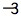

# Intensional Logic
**First published Thu Jul 6, 2006; substantive revision Thu Apr 2, 2015**

*Fitting, Melvin*

There is an obvious difference between what a term designates and what it means. At least it is obvious that there is a difference. In some way, meaning determines designation, but is not synonymous with it. After all, “the morning star” and “the evening star” both designate the planet Venus, but don’t have the same meaning. Intensional logic attempts to study both designation and meaning and investigate the relationships between them.

## 1. What is this about?

If you are not skilled in colloquial astronomy, and I tell you that the morning star is the evening star, I have given you information—your knowledge has changed. If I tell you the morning star is the morning star, you might feel I was wasting your time. Yet in both cases I have told you the planet Venus was self-identical. There must be more to it than this. Naively, we might say the morning star and the evening star are the same in one way, and not the same in another. The two phrases, “morning star” and “evening star” may designate the same object, but they do not have the same meaning. Meanings, in this sense, are often called *intensions*, and things designated, *extensions*. Contexts in which extension is all that matters are, naturally, called *extensional*, while contexts in which extension is not enough are *intensional*. Mathematics is typically extensional throughout—we happily write “$1+4=2+3$” even though the two terms involved may differ in meaning (more about this later). “It is known that…” is a typical intensional context—“it is known that $1+4 = 2 + 3$” may not be correct when the knowledge of small children is involved. Thus mathematical pedagogy differs from mathematics proper. Other examples of intensional contexts are “it is believed that…”, “it is necessary that…”, “it is informative that…”, “it is said that…”, “it is astonishing that…”, and so on. Typically a context that is intensional can be recognized by a failure of the substitutivity of equality when naively applied. Thus, the morning star equals the evening star; you know the morning star equals the morning star; then on substituting equals for equals, you know the morning star equals the evening star. Note that this knowledge arises from purely logical reasoning, and does not involve any investigation of the sky, which should arouse some suspicion. Substitution of co-referring terms in a knowledge context is the problematic move—such a context is intensional, after all. Admittedly this is somewhat circular. We should not make use of equality of extensions in an intensional context, and an intensional context is one in which such substitutivity does not work.

The examples used above involve complex terms, disguised definite descriptions. But the same issues come up elsewhere as well, often in ways that are harder to deal with formally. Proper names constitute one well-known area of difficulties. The name “Cicero” and the name “Tully” denote the same person, so “Cicero is Tully” is true. Proper names are generally considered to be rigid, once a designation has been specified it does not change. This, in effect, makes “Cicero is Tully” into a necessary truth. How, then, could someone not know it? “Superman is Clark Kent” is even more difficult to deal with, since there is no actual person the names refer to. Thus while the sentence is true, not only might one not know it, but one might perfectly well believe Clark Kent exists, that is “Clark Kent” designates something, while not believing Superman exists. Existence issues are intertwined, in complex ways, with intensional matters. Further, the problems just sketched at the ground level continue up the type hierarchy. The property of being an equilateral triangle is coextensive with the property of being an equiangular triangle, though clearly meanings differ. Then one might say, “it is trivial that an equilateral triangle is an equilateral triangle,” yet one might deny that “it is trivial that an equilateral triangle is an equiangular triangle”.

In classical first-order logic intension plays no role. It is extensional by design since primarily it evolved to model the reasoning needed in mathematics. Formalizing aspects of natural language or everyday reasoning needs something richer. Formal systems in which intensional features can be represented are generally referred to as *intensional logics*. This article discusses something of the history and evolution of intensional logics. The aim is to find logics that can formally represent the issues sketched above. This is not simple and probably no proposed logic has been entirely successful. A relatively simple intensional logic that can be used to illustrate several major points will be discussed in some detail, difficulties will be pointed out, and pointers to other, more complex, approaches will be given.

## 2. A Brief History

Recognition that designating terms have a dual nature is far from recent. The Port-Royal Logic used terminology that translates as “comprehension” and “denotation” for this. John Stuart Mill used “connotation” and “denotation.” Frege famously used “Sinn” and “Bedeutung,” often left untranslated, but when translated, these usually become “sense” and “reference.” Carnap settled on “intension” and “extension.” However expressed, and with variation from author to author, the essential dichotomy is that between what a term *means*, and what it *denotes*. “The number of the planets” denotes the number 9 (ignoring recent disputes about the status of bodies at the outer edges of the solar system), but it does not have the number 9 as its meaning, or else in earlier times scientists might have determined that the number of planets was 9 through a process of linguistic analysis, and not through astronomical observation. Of the many people who have contributed to the analysis of intensional problems several stand out. At the head of the list is Gottlob Frege.

### 2.1 Frege

The modern understanding of intensional issues and problems begins with a fundamental paper of Gottlob Frege, (Frege 1892)[^frege-1892]. This paper opens with a recital of the difficulties posed by the notion of equality. In his earlier work, Frege notes, he had taken equality to relate names, or signs, of objects, and not objects themselves. For otherwise, if $a$ and $b$ designate the same object, there would be no cognitive difference between $a = a$ and $a = b$, yet the first is analytic while the second generally is not. Thus, he once supposed, equality relates signs that designate the same thing. But, he now realizes, this cannot be quite correct either. The use of signs is entirely arbitrary, anything can be a sign for anything, so in considering $a = b$ we would also need to take into account the *mode of presentation* of the two signs—what it is that associates them with the things they designate. Following this line of thought, equality becomes a relation between signs, relative to their modes of presentation. Of course the notion of a mode of presentation is somewhat obscure, and Frege quickly shifts attention elsewhere.

A sign has both a reference, and what Frege calls a *sense* —we can think of the sense as being some kind of embodiment of the mode of presentation. From here on in his paper, sense is under discussion, and modes of presentation fade into the background. A name *expresses* its sense, and *designates* its reference. Thus, “morning star” and “evening star” have the same designation, but express different senses, representing different modes of presentation—one is a celestial body last seen in the morning before the sun obscures it, the other is a celestial body first seen in the evening after the sun no longer obscures it. Frege goes on to complicate matters by introducing the *idea* associated with a sign, which is distinct from its sense and its reference. But the idea is subjective, varying from person to person, while both sense and denotation are said by Frege to be not dependent in this way. Consequently the idea also fades into the background, while sense and reference remain central.

Generally when a sign appears as part of a declarative sentence, it is the reference of the sign that is important. Both “Venus” and “the morning star” designate the same object. The sentence “The morning star is seen in the sky near sunrise” is true, and remains true when “the morning star” is replaced with “Venus”. Substitution of equi-designating signs preserves truth. But not always; there are contexts in which this does not happen, *indirect reference* contexts. As a typical example, “George knows that the morning star is seen in the sky near sunrise” may be true while “George knows that Venus is seen in the sky near sunrise” may be false. Besides knowledge contexts, indirect reference arises when a sentence involves “I believe that…”, “I think that…”, “It seems to me that…”, “It is surprising that…”, “It is trivial that…”, and so on. In such contexts, Frege concludes, not designation but sense is central. Then, since “George knows that…” is an indirect reference context, senses are significant. The signs “the morning star” and “Venus” have different senses, we are not replacing a sense by a sense equal to it, and so should not expect truth to be preserved.

Frege notes that an expression might have a sense, but not a reference. An example he gives is, “the least rapidly convergent series.” Of course an object might have several signs that designate it, but with different senses. Frege extends the sense/reference dichotomy rather far. In particular, declarative sentences are said to have both a sense and a reference. The sense is the proposition it expresses, while the reference is its truth value. Then logically equivalent sentences have the same designation, but may have different senses. In indirect contexts sense, and not designation, matters and so we may know the well-ordering principle for natural numbers, but not know the principle of mathematical induction because, while they are equivalent in truth value, they have different senses.

No formal machinery for dealing with sense, as opposed to reference, is proposed in Frege 1892. But Frege defined the terms under which further discussion took place. There are two distinct but related notions, sense and reference. Equality plays a fundamental role, and a central issue is the substitutivity of equals for equals. Names, signs, expressions, can be equal in designation, but not equal in sense. There are both direct or extensional, and indirect or intensional contexts, and reference matters for the first while sense is fundamental for the second.

### 2.2 Church

Frege gave the outline of a theory of intensionality, but no intensional logic in any formal sense. There have been attempts to fill in his outline. Alonzo Church (1951)[^church-1951] went at it quite directly. In this paper there is a formal logic in which terms have both senses and denotations. These are simply taken to be different sorts, and minimal requirements are placed on them. Nonetheless the logic is quite complex. The formal logic that Frege had created for his work on the foundations of mathematics was type free. Russell showed his famous paradox applied to Frege’s system, so it was inconsistent. As a way out of this problem, Russell developed the type theory that was embodied in *Principia Mathematica*. Church had given an elegant and precise formulation of the simple theory of types (Church 1940)[^church-1940], and that was incorporated into his work on intensionality, which is one of the reasons for its formal complexity.

Church uses a notion he calls a *concept*, where anything that is the sense of a name for something can serve as a concept of that something. There is no attempt to make this more precise—indeed it is not really clear how that might be done. It is explicit that concepts are language independent, and might even be uncountable. There is a type $\omicron_{0}$ of the two truth values. Then, there is a type $\omicron_{1}$ of concepts of members of $\omicron_{0}$, which are called *propositional concepts*. There is a type $\omicron_{2}$ of concepts of members of $\omicron_{1}$, and so on. There a type $\iota_{0}$ of individuals, a type $\iota_{1}$ of concepts of members of $\iota_{0}$, a type $\iota_{2}$ of concepts of members of $\iota_{1}$, and so on. And finally, for any two types *α* and *β* there is a type $(\alpha\,\beta )$ of functions from items of type *β* to items of type *α*. Church makes a simplifying assumption concerning functional types. In order to state it easily he introduces some special notation: if *α* is a type symbol, for example $((\iota_{3}\,\omicron_{2})(\omicron_{5}\,\iota_{4}))$, then $\alpha_{1}$ is the result of increasing each subscript by 1, in our example we get $((\iota_{4}\,\omicron_{3})(\omicron_{6}\,\iota_{5}))$. (There is a similar definition for $\alpha_{n}$ for each positive integer $n$, but we will not need it here.) Church’s assumption is that the concepts of members of the functional type $(\alpha\,\beta )$ are the members of the type $(\alpha_{1}\,\beta_{1})$. With this assumption, uniformly the concepts of members of any type *α* are the members of type $\alpha_{1}$.

Quantification and implication are introduced, or rather versions appropriate for the various types are introduced. *λ* abstraction notation is present. And finally, for each type *α* it is assumed there is a relation that holds between a concept of something of type *α* and the thing itself; this is a relation between members of type $\alpha_{1}$ and members of type *α*. This is denoted $\Delta$, with appropriate type-identifying subscripts.

A fundamental issue for Church is when two names, lambda terms, have the same sense. Three alternatives are considered. Common to all three alternatives are the assumptions that sense is unchanged under the renaming of bound variables (with the usual conditions of freeness), and under *β* reduction. Beyond these, Alternative 0 is somewhat technical and is only briefly mentioned, Alternative 1 is fine grained, making senses distinct as far as possible, while Alternative 2 makes two terms have the same sense whenever equality between them is a logical validity. The proper definition of the alternatives is axiomatic, and altogether various combinations of some 53 axiom schemes are introduced, with none examined in detail. Clearly Church was proposing an investigation, rather than presenting full results.

As noted, the primary reference for this work is Church 1951, but there are several other significant papers including Church 1973, Church 1974, and the Introduction to Church 1944, which contains an informal discussion of some of the ideas. In addition, the expository papers of Anderson are enlightening (Anderson 1984, 1998)[^anderson-1984][^anderson-1998]. It should be noted that there are relationships between Church’s work and that of Carnap, discussed below. Church’s ideas first appeared in an abstract (Church 1946)[^church-1946], then Carnap’s book appeared (Carnap 1947)[^carnap-1947]. A few years later Church’s paper expanded his abstract in Church 1951. The second edition of Carnap’s book appeared in 1956. Each man had an influence on the other, and the references between the two authors are thoroughly intertwined.

### 2.3 Carnap

Church simply(!) formalized something of how intensions behaved, without saying what they were. Rudolf Carnap took things further with his method of intension and extension, and provided a semantics in which quite specific model-theoretic entities are identified with intensions (Carnap 1947)[^carnap-1947]. Indeed, the goal was to supply intensions and extensions for every meaningful expression, and this was done in a way that has heavily influenced much subsequent work.

Although Carnap attended courses of Frege, his main ideas are based on Wittgenstein 1921. In the *Tractatus*, Wittgenstein introduced a precursor of possible world semantics. There are *states of affairs*, which can be identified with the set of all their truths, “(1.13) The facts in logical space are the world.” Presumably these facts are atomic, and can be varied independently, “(1.21) Each item can be the case or not the case while everything else remains the same.” Thus there are many possible states of affairs, among them the actual one, the real world. Objects, in some way, involve not only the actual state of affairs, but all possible ones, “(2.0123) If I know an object I also know all its possible occurrences in states of affairs. (Every one of these possibilities must be part of the nature of the object.) A new possibility cannot be discovered later.” It is from these ideas that Carnap developed his treatment.

Carnap begins with a fixed formal language whose details need not concern us now. A class of atomic sentences in this language, containing exactly one of $A$ or $\neg A$ for each atomic sentence, is a *state-description*. In each state-description the truth or falsity of every sentence of the language is determined following the usual truth-functional rules—quantifiers are treated substitutionally, and the language is assumed to have ‘enough’ constants. Thus truth is relative to a state-description. Now Carnap introduces a stronger notion than truth, *L-truth*, intended to be “an explicatum for what philosophers call logical or necessary or analytic truth.” Initially he presents this somewhat informally, “a sentence is $L$-true in a state description $S$ if it is true in $S$ in such a way that its truth can be established on the basis of the semantical rules of the system $S$ alone, without any reference to (extra-linguistic) facts.” But this is quickly replaced by a more precise semantic version, “A sentence is $L$-true if it holds in every state-description.”

One can recognize in $L$-truth a version of necessary truth using possible world semantics. There is no accessibility relation, so what is being captured is more like S5 than like other modal logics. But it is not S5 semantics either, since there is a fixed set of state-descriptions determined by the language itself. (If $P$ is any propositional atom, some state-description will contain $P$, and so $\Diamond P$ will be validated.) Nonetheless, it is a clear anticipation of possible world semantics. But what concerns us here is how Carnap treats designating terms in such a setting. Consider predicates $P$ and $Q$. For Carnap these are intensionally equivalent if $\forall x(Px \equiv Qx)$ is an $L$-truth, that is, in each state-description $P$ and $Q$ have the same extension. Without being quite explicit about it, Carnap is proposing that the intension of a predicate is an assignment of an extension for it to each state-description—intensional identity means identity of extension across all state-descriptions and not just at the actual one. Thus the predicate ‘$H$’, human, and the predicate ‘$FB$’, featherless biped, have the same extension—in the actual state-description they apply to the same beings—but they do not have the same intension since there are other state-descriptions in which their extensions can differ. In a similar way one can model individual expressions, “The extension of an individual expression is the individual to which it refers.” Thus, ‘Scott’ and ‘the author of Waverly’ have the same extension (in the actual state-description). Carnap proposes calling the intension of an individual expression an *individual* *concept*, and such a thing picks out, in each state-description, the individual to which it refers in that state description. Then ‘Scott’ and ‘the author of Waverly’ have different intensions because, as most of us would happily say, they could have been different, that is, there are state-descriptions in which they are different. (I am ignoring the problems of non-designation in this example.)

Carnap’s fundamental idea is that intensions, for whatever entities are being considered, can be given a precise mathematical embodiment as functions on states, while extensions are relative to a single state. This has been further developed by subsequent researchers, of course with modern possible world semantics added to the mix. The Carnap approach is not the only one around, but it does take us quite a bit of the way into the intensional thicket. Even though it does not get us all the way through, it will be the primary version considered here, since it is concrete, intuitive, and natural when it works.

### 2.4 Marcus

Carnap’s work was primarily semantic, and resulted in a logic that did not correspond to any of the formal systems that had been studied up to this point. Axiomatically presented propositional modal logics were well-established, so it was important to see how (or if) they could be extended to include quantifiers and equality. At issue were decisions about what sorts of things quantifiers range over, and substitutivity of equals for equals. Quine’s modal objections needed to be addressed. Ruth Barcan Marcus began a line of development in (Marcus 1946)[^marcus-1946] by formally extending the propositional system S2 of C. I. Lewis to include quantification, and developing it axiomatically in the style of *Principia Mathematica*. It was clear that other standard modal logics besides S2 could have been used, and S4 was explicitly discussed. The Barcan formula, in the form $\Diamond (\exists \alpha )$A $\supset (\exists \alpha )\Diamond$A, made its first appearance in (Marcus 1946)[^marcus-1946],[^note-1] though a full understanding of its significance would have to wait for the development of a possible-world semantics. Especially significant for the present article, her system was further extended in (Marcus 1947)[^marcus-1947] to allow for abstraction and identity. Two versions of identity were considered, depending on whether things had the same properties (abstracts) or necessarily had them. In the S2 system the two versions were shown to be equivalent, and in the S4 system, necessarily equivalent. In a later paper (Marcus 1953)[^marcus-1953] the fundamental role of the deduction theorem was fully explored as well.

Marcus proved that in her system identity was necessary if true, and the same for distinctness. She argued forcefully in subsequent works, primarily (Marcus 1961)[^marcus-1961], that morning star/evening star problems were nonetheless avoided. Names were understood as *tags*. They might have their designation specified through an initial use of a definite description, or by some other means, but otherwise names had no meaning, only a designation. Thus they did not behave like definite descriptions, which were more than mere tags. Well, the object tagged by “morning star ” and that tagged by “evening star ” are the same, and identity between objects is never contingent.

The essential point had been made. One could develop formal modal systems with quantifiers and equality. The ideas had coherence. Still missing was a semantics which would help with the understanding of the formalism, but this was around the corner.

### 2.5 Montague, Tichý, Bressan, and Gallin

Carnap’s ideas were extended and formalized by Richard Montague, Pavel Tichý, and Aldo Bressan, independently. All made use of some version of Kripke/Hintikka possible world semantics, instead of the more specialized structure of Carnap. All treated intensions functionally.

In part, Bressan wanted to provide a logical foundation for physics. The connection with physics is this. When we say something has such-and-such a mass, for instance, we mean that if we had conducted certain experiments, we would have gotten certain results. This does not assume we did conduct those experiments, and thus alternate states (or cases, as Bressan calls them) arise. Hence there is a need for a rich modal language, with an ontology that includes numbers as well as physical objects. In Bressan 1972, an elaborate modal system was developed, with a full type hierarchy including numbers as in *Principia Mathematica*.

Montague’s work is primarily in Montague 1960 and 1970, and has natural language as its primary motivation. The treatment is semantic, but in Gallin 1975 an axiom system is presented. The logic Gallin axiomatized is a full type-theoretic system, with intensional objects of each type. Completeness is proved relative to an analog of Henkin models, familiar for higher type classical logics.

Tichý created a system of intensional logic very similar to that of Montague, beginning, in English, in Tichý 1971, with a detailed presentation in Tichý 1988. Unfortunately his work did not become widely known. Like Montague’s semantics, Tichý’s formal work is based on a type hierarchy with intensions mapping worlds to extensions at each type level, but it goes beyond Montague in certain respects. For one thing, intensions depend not only on worlds, but also on times. For another, in addition to intensions and extensions Tichý also considers *constructions*. The idea is that expressions determine intensions and extensions, and this itself is a formal process in which compound expressions act using the simpler expressions that go into their making; compositionality at the level of constructions, in other words. Using this formal machinery, “$1+4$” and “$2+3$” prescribe different constructions; their meaning is not simply captured by their intensional representation as discussed here.

## 3. A Particular Intensional Logic

As has been noted several times earlier, formal intensional logics have been developed with a full hierarchy of higher types, Church, Montague, Bressan, Tichý for instance. Such logics can be rather formidable, but Carnap’s ideas are often (certainly not always) at the heart of such logics, these ideas are simple, and are sufficient to allow discussion of several common intensional problems. Somehow, based on its sense (intension, meaning) a designating phrase may designate different things under different conditions—in different states. For instance, “the number of the planets” was believed to designate 6 in ancient times (counting Earth). Immediately after the discovery of Uranus in 1781 “the number of the planets” was believed to designate 7. If we take as epistemic states of affairs the universe as conceived by the ancients, and the universe as conceived just after 1781, in one state “the number of the planets” designates 6 and in the other it designates 7. In neither state were people wrong about the concept of planet, but about the state of affairs constituting the universe. If we suppress all issues of how meanings are determined, how meanings in turn pick out references, and all issues of what counts as a possible state of affairs, that is, if we abstract all this away, the common feature of every designating term is that designation may change from state to state—thus it can be formalized by a function from states to objects. This bare-bones approach is quite enough to deal with many otherwise intractable problems.

In order to keep things simple, we do not consider a full type hierarchy—first-order is enough to get the basics across. The first-order fragment of the logic of Gallin 1975 would be sufficient, for instance. The particular formulation presented here comes from Fitting 2004, extending Fitting and Mendelsohn 1998. Predicate letters are intensional, as they are in every version of Kripke-style semantics, with interpretations that depend on possible worlds. The only other intensional item considered here is that of individual concept—formally represented by constants and variables that can designate different objects in different possible worlds. The same ideas can be extended to higher types, but what the ideas contribute can already be seen at this relatively simple level. Intensional logics often have nothing but intensions—extensions are inferred but are not explicit. However, an approach that is too minimal can make life hard, so consequently here we explicitly allow both objects and individual concepts which range over objects. There are two kinds of quantification, over each of these sorts. Both extensional and intensional objects are first-class citizens.

Basic ideas are presented semantically rather than proof-theoretically, though both axiom systems and tableau systems exist. Even so, technical details can become baroque, so as far as possible, we will separate informal presentation, which is enough to get the general idea, from its formal counterpart, which is of more specialized interest. A general acquaintance with modal logic is assumed (though there is a very brief discussion to establish notation, which varies some from author to author). It should be noted that modal semantics is used here, and generally, in two different ways. Often one has a particular Kripke model in mind, though it may be specified informally. For instance, we might consider a Kripke model in which the states are the present instant and all past ones, with later states accessible from earlier ones. Such a model is enlightening when discussing “the King of France” for instance, even though the notion of instant is somewhat vaguely determined. But besides this use of informally specified concrete models, there is formal Kripke semantics which is a mathematically precise thing. If it is established that something, say $\Box (X \supset Y) \supset (\Box X \supset \Box Y)$, is valid in all formal Kripke models, we can assume it will be so in our vaguely specified, intuitive models, no matter how we attempt to make them more precise. Informal models pervade our discussions—their fundamental properties come from the formal semantics.

### 3.1 Propositional Modal Logic

A propositional language is built up from propositional letters, $P, Q,\ldots$, using $\wedge , \vee , \supset , \neg$ and other propositional connectives, and $\Box$ (necessary) and $\Diamond$ (possible) as modal operators. These operators can be thought of as alethic, deontic, temporal, epistemic—it will matter which eventually, but it does not at the moment. Likewise there could be more than one version of $\Box$, as in a logic of knowledge with multiple knowers—this too doesn’t make for any essential differences.

Kripke semantics for propositional modal logic is, by now, a very familiar thing. Here is a quick presentation to establish notation, and to point out how one of Frege’s proposals fits in. A more detailed presentation can be found in the article on modal logic in this encyclopedia.

#### 3.1.1 The Informal Version

A model consists of a collection of states, some determination of which states are relevant to which, and also some specification of which propositional letters hold at which of these states. States could be states of the real world at different times, or states of knowledge, or of belief, or of the real world as it might have been had circumstances been different. We have a mathematical abstraction here. We are not trying to define what all these states might ‘mean,’ we simply assume we have them. Then more complex formulas are evaluated as true or false, relative to a state. At each state the propositional connectives have their customary classical behavior. For the modal operators. $\Box X$, that is, *necessarily* $X$, is true at a state if $X$ itself is true at every state that is relevant to that state (at all *accessible* states). Likewise $\Diamond X$, *possibly* $X$, is true at a state if $X$ is true at some accessible state. If we think of things epistemically, accessibility represents compatibility, and so $X$ is known in a state if $X$ is the case in all states that are compatible with that state. If we think of things alethically, an accessible state can be considered an alternate reality, and so $X$ is necessary in a state if $X$ is the case in all possible alternative states. These are, by now, very familiar ideas.

#### 3.1.2 The Formal Version

A *frame* is a structure $\langle \bG, \bR\rangle$, where $\bG$ is a non-empty set and $\bR$ is a binary relation on $\bG$. Members of $\bG$ are *states* (or *possible worlds*). $\bR$ is an *accessibility relation*. For $\Gamma , \Delta \in \bG, \Gamma \bR \Delta$ is read “$\Delta$ is accessible from *Γ*.” A (*propositional*) *valuation* on a frame is a mapping, $\bV$, that assigns to each propositional letter a mapping from states of the frame to truth values, *true* or *false*. For simplicity, we will abbreviate $\bV(P)(\Gamma )$ by $\bV(P, \Gamma )$. A *propositional model* is a structure $\cM = \langle \bG, \bR, \bV\rangle$, where $\langle \bG, \bR\rangle$ is a frame and $\bV$ is a propositional valuation on that frame.

Given a propositional model $\cM = \langle \bG, \bR, \bV\rangle$, the notion of formula $X$ being true at state *Γ* will be denoted $\cM, \Gamma \vDash X$, and is characterized by the following standard rules, where $P$ is atomic.

$$\begin{align} \cM, \Gamma \vDash P &\Leftrightarrow \bV(P, \Gamma ) = \textit{true} \\ \cM, \Gamma \vDash X \wedge Y &\Leftrightarrow \cM, \Gamma \vDash X \text{ and } \cM, \Gamma \vDash Y \\ \ldots &\Leftrightarrow \ldots \\ \cM, \Gamma \vDash \Box X &\Leftrightarrow \cM, \Delta \vDash X \text{ for every }\Delta \in \bG \text{ with } \Gamma \bR \Delta \\ \cM, \Gamma \vDash \Diamond X &\Leftrightarrow \cM, \Delta \vDash X \text{ for some } \Delta \in \bG \text{ with } \Gamma \bR \Delta \end{align}$$

Suppose we think about formulas using an intensional/extensional distinction. Given a model $\cM$, to each formula $X$ we can associate a function, call it $f_{X}$, mapping states to truth values, where we set $f_{X}(\Gamma )$ = *true* just in case $\cM, \Gamma \vDash X$.

Think of the function $f_{X}$ as the *intensional* meaning of the formula $X$—indeed, think of it as the *proposition* expressed by the formula (relative to a particular model, of course). At a state *Γ*, $f_{X}(\Gamma )$ is a truth value—think of this as the *extensional* meaning of $X$ at that state. This is a way of thinking that goes back to Frege, who concluded that the denotation of a sentence should be a truth value, but the sense should be a proposition. He was a little vague about what constituted a proposition—the formalization just presented provides a natural mathematical entity to serve the purpose, and was explicitly proposed for this purpose by Carnap. It should be clear that the mathematical structure does, in a general way, capture some part of Frege’s idea. Incidentally we could, with no loss, replace the function $f_{X}$ on states with the set $\{ \Gamma \in \bG \mid f_{X}(\Gamma) = \textit{true}\}$. The function $f_{X}$ is simply the characteristic function of this set. Sets like these are commonly referred to as propositions in the modal logic community. In a technical sense, then, Frege’s ideas on this particular topic have become common currency.

### 3.2 The Move To First Order

First we discuss some background intuitions, then introduce a formal semantics. Intensions will be introduced formally in Section 3.3. The material discussed here can be found more fully developed in (Fitting and Mendelsohn 1998, Hughes and Cresswell 1996)[^fitting-1998][^hughes-1996], among other places.

#### 3.2.1 Actualist and Possibilist

If we are to think of an intension as designating different things under different circumstances, we need things. At the propositional level truth values play the role of things, but at the first order level something more is needed. In classical logic each model has a domain, the things of that model, and quantifiers are understood as ranging over the members of that domain. It is, of course, left open what constitutes a thing—any collection of any sort can serve as a domain. That way, if someone has special restrictions in mind because of philosophical or mathematical considerations, they can be accommodated. It follows that the validities of classical logic are, by design, as general as possible—they are true no matter what we might choose as our domain, no matter what our things are.

A similar approach was introduced for modal logics in Kripke 1963. Domains are present, but it is left open what they might consist of. But there is a complication that has no classical counterpart: in a Kripke model there are multiple states. Should there be a single domain for the entire model, or separate domains for each state? Both have natural intuitions.

Consider a version of Kripke models in which a separate domain is associated with each state of the model. At each state, quantifiers are thought of as ranging over the domain associated with that state. This has come to be known as an *actualist* semantics. Think of the domain associated with a state as the things that actually exist at that state. Thus, for example, in the so-called real world the Great Pyramid of Khufu is in the domain, but the Lighthouse of Alexandria is not. If we were considering the world of, say, 1300, both would be in the domain. In an actualist approach, we need to come to some decision on what to do with formulas containing references to things that exist in other states but not in the state we are considering. Several approaches are plausible; we could take such formulas to be false, or we could take them to be meaningless, for instance, but this seems to be unnecessarily restrictive. After all, we do say things like “the Lighthouse of Alexandria no longer exists,” and we think of it as true. So, the formal version that seems most useful takes quantifiers as ranging over domains state by state, but otherwise allows terms to reference members of any domain. The resulting semantics is often called *varying domain* as well as *actualist*.

Suppose we use the actualist semantics, so each state has an associated domain of actually existing things, but suppose we allow quantifiers to range over the members of any domain, without distinction, which means quantifiers are ranging over the same set, at every state. What are the members of that set? They are the things that exist at some state, and so at every state they are the possible existents—things that might exist. Lumping these separate domains into a single domain of quantification, in effect, means we are quantifying over possibilia. Thus, a semantics in which there is a single domain over which quantifiers range, the same for every state, is often called *possibilist* semantics or, of course, *constant domain* semantics.

Possibilist semantics is simpler to deal with than the actualist version—we have one domain instead of many for quantifiers to range over. And it turns out that if we adopt a possibilist approach, the actualist semantics can be simulated. Suppose we have a single domain of quantification, possibilia, and a special predicate, $E$, which we think of as true, at each state, of the things that actually exist at that state. If $\forall$ is a quantifier over the domain of possibilia, we can think of the relativized quantifier, $\forall$x$(E(x) \supset \ldots )$ as corresponding to actualist quantification. (We need to assume that, at each state, $E$ is true of something—this corresponds to assuming domains are non-empty.) This gives an embedding of the actualist semantics into the possibilist one, a result that can be formally stated and proved. Here possibilist semantics will be used, and we assume we have an existence predicate $E$ available.

#### 3.2.2 Possibilist Semantics, Formally

The language to be used is a straightforward first order extension of the propositional modal language. There is an infinite list of *object variables*, $x, y, x_{1}, x_{2},\ldots$, and a list of *relation* *symbols*, $R, P, P_{1}, P_{2},\ldots$, of all arities. Among these is the one-place symbol $E$ and the two-place symbol =. Constant and function symbols could be added, but let’s keep things relatively simple, along with simply relative. If $x_{1}, \ldots ,x_{n}$ are object variables and $P$ is an $n$-place relation symbol, $P(x_{1}, \ldots ,x_{n})$ is an atomic formula. We’ll write $x = y$ in place of = (*x,y*). More complex formulas are built up using propositional connectives, modal operators, and quantifiers, $\forall$ and $\exists$, in the usual way. Free and bound occurrences of variables have the standard characterization.

A *first order model* is a structure $\langle \bG, \bR, \bD_{O}, \bI\rangle$ where $\langle \bG, \bR\rangle$ is a frame, as in Section 3.1, $\bD_{O}$ is a non-empty *object domain*, and $\bI$ is an *interpretation* that assigns to each $n$-place relation symbol $P$ a mapping, $\bI(P)$ from $\bG$ to subsets of $\bD_{O}^{n}$. We’ll write $\bI(P, \Gamma )$ as an easier-to-read version of $\bI(P)(\Gamma )$. It is required that $\bI(=, \Gamma )$ is the equality relation on $\bD_{O}$, for every state *Γ*, and $\bI(E, \Gamma )$ is non-empty, for every *Γ*. A *first-order valuation* in a model is a mapping $v$ that assigns a member of $\bD_{O}$ to each variable. Note that first order valuations are not state-dependent in the way that interpretations are. A first order valuation $w$ is an $x$*-variant* of valuation $v$ if $v$ and $w$ agree on all variables except possibly for $x$. Truth, at a state *Γ* of a model $\cM = \langle \bG, \bR, \bD_{O}, \bI\rangle$, with respect to a first order valuation $v$, is characterized as follows, where $P(x_{1}, \ldots ,x_{n})$ is an atomic formula:

$$\begin{align} \cM, \Gamma \vDash_{v} P(x_{1}, \ldots ,x_{n}) &\Leftrightarrow \langle v(x_{1}), \ldots ,v(x_{n})\rangle \in \bI(P, \Gamma ) \\ \cM, \Gamma \vDash_{v} X \wedge Y &\Leftrightarrow \cM, \Gamma \vDash_{v} X \text{ and } \cM, \Gamma \vDash_{v} Y \\ \ldots &\Leftrightarrow \ldots \\ \cM, \Gamma \vDash_{v} \Box X &\Leftrightarrow \cM, \Delta \vDash_{v} X \text{ for every } \Delta \in \bG \text{ with } \Gamma \bR \Delta \\ \cM, \Gamma \vDash_{v} \Diamond X &\Leftrightarrow \cM, \Delta \vDash_{v} X \text{ for some } \Delta \in \bG \text{ with } \Gamma \bR \Delta \\ \cM, \Gamma \vDash_{v} \forall xX &\Leftrightarrow \cM, \Gamma \vDash_{w} X \text{ for every } x\text{-variant } w \text{ of } v \\ \cM, \Gamma \vDash_{v} \exists xX &\Leftrightarrow \cM, \Gamma \vDash_{w} X \text{ for some } x\text{-variant } w \text{ of } v \end{align}$$

Call a formula *valid* if it is true at every state of every first order model with respect to every first-order valuation, as defined above. Among the validities are the usual modal candidates, such as $\Box (X \supset Y) \supset (\Box X \supset \Box Y)$, and the usual quantificational candidates, such as $\forall xX \supset \exists xX$. We also have mixed cases such as the Barcan and converse Barcan formulas: $\forall x\Box X \equiv \Box \forall xX$, which are characteristic of constant domain models, as was shown in Kripke 1963. Because of the way equality is treated, we have the validity of both $\forall x\forall y(x = y \supset \Box x = y)$ and $\forall x\forall y(x \ne y \supset \Box x \ne y)$. Much has been made about the identity of the number of the planets and 9 (Quine 1963)[^quine-1963], or the identity of the morning star and the evening star (Frege 1892)[^frege-1892], and how these identities might behave in modal contexts. But that is not really a relevant issue here. Phrases like “the morning star” have an intensional aspect, and the semantics outlined so far does not take intensional issues into account. As a matter of fact, the morning star and the evening star are the same object and, as Gertrude Stein might have said, “an object is an object is an object.” The necessary identity of a thing and itself should not come as a surprise. Intensional issues will be dealt with shortly.

Quantification is possibilist—domains are constant. But, as was discussed in Section 3.2.1, varying domains can be brought in indirectly by using the existence predicate, $E$, and this allows us to introduce actualist quantification definitionally. Let $\forall^{E}xX$ abbreviate $\forall x(E(x) \supset X)$, and let $\exists^{E}xX$ abbreviate $\exists x(E(x) \wedge X)$. Then, while $\forall x\phi (x) \supset \phi (y)$ is valid, assuming $y$ is free for $x$ in $\phi (x)$, we do not have the validity of $\forall^{E}x\phi (x) \supset \phi (y)$. What we have instead is the validity of $[\forall^{E}x\phi (x) \wedge E(y)] \supset \phi (y)$.

As another example of possibilist/actualist difference, consider $\exists x\Box P(x) \supset \Box \exists xP(x)$. With possibilist quantifiers, this is valid and reasonable. It asserts that if some possibilia has the $P$ property in all alternative states, then in every alternative state some possibilia has the $P$ property. But when possibilist quantification is replaced with actualist, $\exists^{E}x\Box P(x) \supset \Box \exists^{E}xP(x)$, the result is no longer valid. As a blatant (but somewhat informal) example, say the actual state is *Γ* and $P$ is the property of existing in state *Γ*. Then, at $\Gamma , \exists^{E}x\Box P(x)$ says something that actually exists has, in all alternative states, the property of existing in the state *Γ*. This is true; in fact it is true of *everything* that exists in the state *Γ*. But $\Box \exists^{E}xP(x)$ says that in every alternative state there will be an actually existent object that also exists in the state *Γ*, which need not be the case.

### 3.3 Adding Intensions

In Section 3.2 a first order modal logic was sketched, in which quantification was over objects. Now a second kind of quantification is added, over intensions. As has been noted several times, an intensional object, or individual concept, will be modeled by a function from states to objects, but now we get into the question of what functions should be allowed. Intensions are supposed to be related to meanings. If we consider meaning to be a human construct, what constitutes an intension should probably be restricted. There should not, for instance, be more intensional objects than there are sentences that can specify meanings, and this limits intensions to a countable set. Or we might consider intensions as ‘being there,’ and we pick out the ones that we want to think about, in which case cardinality considerations don’t apply. This is an issue that probably cannot be settled once and for all. Instead, the semantics about to be presented allows for different choices in different models—it is not required that all functions from states to objects be present. It should be noted that, while this semantical gambit does have philosophical justification, it also makes an axiomatization possible. The fundamental point is the same as in the move from first to second order logic. If we insist that second order quantifiers range over all sets and relations, an axiomatization is not possible. If we use Henkin models, in which the range of second order quantifiers has more freedom, an axiomatization becomes available.

Formulas are constructed more-or-less in the obvious way, with two kinds of quantified variables instead of one: extensional and intensional. But there is one really important addition to the syntactic machinery, and it requires some discussion. Suppose we have an intension, $f$, that picks out an object in each state. For example, the states might be various ways the universe could have been constituted, and at each state $f$ picks out the number of the planets which could, of course, be 0. Suppose $P$ is a one-place relation symbol—what should be meant by $P(f)$? On the one hand, it could mean that the intension $f$ has the property $P$, on the other hand it could mean that the object designated by $f$ has the property $P$. Both versions are useful and correspond to things we say every day. We will allow for both, but the second version requires some cleaning up. Suppose $P(f)$ is intended to mean that the object designated by $f$ (at a state) has property $P$. Then how do we read $\Diamond P(f)$? Under what circumstances should we take it to be true at state *Γ*? It could be understood as asserting the thing designated by $f$ at *Γ* (call it $f_{\Gamma })$ has the ‘possible-$P$’ property, and so at some alternative state $\Delta$ we have that $f_{\Gamma }$ has property $P$. This is the *de re* reading, in which a possible property is ascribed to a thing. Another way of understanding $\Diamond P(f)$ takes the possibility operator as primary: to say the formula is true at *Γ* means that at some alternative state, $\Delta$, we have $P(f)$, and so at $\Delta$ the object designated by $f$ (call it $f_{\Delta })$ has property $P$. This is the *de dicto* reading, possibility applies to a sentence. Of course there is no particular reason why $f_{\Gamma }$ and $f_{\Delta }$ should be identical. The *de re* and *de dicto* readings are different, both need representation, and we cannot manage this with the customary syntax.

An abstraction mechanism will be used to disambiguate our syntax. The *de re* reading will be symbolized $[\lambda x\,\Diamond P(x)](f)$ and the *de dicto* will be symbolized $\Diamond [\lambda x\,P(x)](f)$. The (incomplete) expression $[\lambda x\,X]$ is often called a *predicate abstraction*; one can think of it as the predicate abstracted from the formula $X$. In $[\lambda x\,\Diamond P(x)](f)$ we are asserting that $f$ has the possible-$P$ property, while in $\Diamond [\lambda x\,P(x)](f)$ we are asserting the possibility that $f$ has the $P$ property. Abstraction disambiguates. What we have said about $\Diamond$ applies equally well to $\Box$ of course. It should be noted that one could simply think of abstraction as a scope-specifying device, in a tradition that goes back to Russell, who made use of such a mechanism in his treatment of definite descriptions. Abstraction in modal logic goes back to Carnap 1947, but in a way that ignores the issues discussed above. The present usage comes from Stalnaker & Thomason 1968 and Thomason & Stalnaker 1968.

### 3.4 The Semantics Formally

Now the more technical part begins. There are two kinds of variables, *object variables* as before, and *intension variables*, or *individual concept variables*, $f, g, g_{1}, g_{2},\ldots$. With two kinds of variables present, the formation of atomic formulas becomes a little more complex. From now on, instead of just being $n$-place for some $n$, a relation symbol will have a *type* associated with it, where a type is an $n$-tuple whose entries are members of $\{O, I\}$. An atomic formula is an expression of the form $P(\alpha_{1}, \ldots ,\alpha_{n})$ where $P$ is a relation symbol whose type is $\langle t_{1}, \ldots ,t_{n}\rangle$ and, for each $i$, if $t_{i} = O$ then $\alpha_{i}$ is an object variable, and if $t_{i} = I$ then $\alpha_{i}$ is an intension variable. Among the relation symbols we still have $E$, which now is of type $\langle O\rangle$, and we have $=$, of type $\langle O,O \rangle$.

Formulas are built up from atomic formulas in the usual way, using propositional connectives, modal operators, and two kinds of quantifiers: over object variables and over intension variables. In addition to the usual formula-creating machinery, we have the following. If $X$ is a formula, $x$ is an object variable, and $f$ is an intension variable, then $[\lambda x\,X](f)$ is a formula, in which the free variable occurrences are those of $X$ except for $x$, together with the displayed occurrence of $f$.

To distinguish the models described here from those in Section 3.2.2, these will be referred to as *FOIL* models, standing for *first order intensional logic*. They are discussed more fully in (Fitting 2004)[^fitting-2004]. A *FOIL* model is a structure $\cM = \langle \bG, \bR, \bD_{O}, \bD_{i}, \bI\rangle$ where $\langle \bG, \bR, \bD_{O}, \bI\rangle$ meets the conditions of Section 3.2.2, and in addition, $\bD_{i}$ is a non-empty set of functions from $\bG$ to $\bD_{O}$; it is the *intension* *domain*.

A *first-order valuation* in *FOIL* model $\cM$ is a mapping that assigns to each object variable a member of $\bD_{O}$, as before, and to each intension variable a member of $\bD_{i}$. If $f$ is an intension variable, we’ll write $v(f, \Gamma )$ for $v(f)(\Gamma )$. Now, the definition of truth, at a state *Γ* of a model $\cM$, with respect to a valuation $v$, meets the conditions set forth in Section 3.2.2 and, in addition, the following:

$$\begin{align} \cM, \Gamma \vDash_{v} \forall fX \Leftrightarrow &\cM, \Gamma \vDash_{w} X, \mbox{for every 0-variant 1 of 2} \\ \cM, \Gamma \vDash_{v} \exists fX \Leftrightarrow &\cM, \Gamma \vDash_{w} X, \mbox{for some 3-variant 4 of 5} \\ \tag{1}\label{cond1} \cM, \Gamma \vDash_{v} [\lambda x\,X](f) \Leftrightarrow &\cM, \Gamma \vDash_{w} X, \\ &\text{where } w \text{ is like } v \text{ except that } w(x) = v(f, \Gamma). \end{align}$$

Let us agree to abbreviate $[\lambda x\,[\lambda y\,X](g)](f)$ by $[\lambda xy\,X](f, g)$, when convenient. Suppose $f$ is intended to be the intension of “the morning star,” and $g$ is intended to be the intension of “the evening star.” Presumably $f$ and $g$ are distinct intensions. Even so, $[\lambda xy\,x = y]$(*f, g*) is correct in the real world—both $f$ and $g$ do designate the same object.

Here is another example that might help make the *de re* / *de dicto* distinction clearer. Suppose $f$ is the intension of “the tallest person,” and $g$ is the intension of “the oldest person,” and suppose it happens that, at the moment, these are the same people. Also, let us read $\Box$ epistemically. It is unlikely we would say that $\Box [\lambda xy\,x = y]$(*f, g*) is the case. We can read $\Box [\lambda xy\,x = y]$(*f, g*) as saying we know *that* $f$ and $g$ are the same. It asserts that under all epistemic alternatives—all the various ways the world could be that are compatible with what we know—$f$ and $g$ designate the same object, and this most decidedly does not seem to be the case. However, we do have $[\lambda xy\,\Box (x = y)]$(*f, g*), which we can read as saying we know *of* $f$ and $g$, that is, of their denotations, that they are the same, and this could be the case. It asserts that in all epistemic alternative states, what $f$ and $g$ designate in this one will be the same. In the setup described, $f$ and $g$ do designate the same object, and identity of objects carries over across states.

It should be noted that the examples of designating terms just given are all definite descriptions. These pick out different objects in different possible worlds quite naturally. The situation with proper names and with mathematics is different, and will be discussed later in section 3.6.

#### 3.4.1 A Formal Example

Here’s an example to show how the semantics works in a technical way. An intension is *rigid* if it is constant, the same in every state. We might think of a rigid intension as a disguised object, identifying it with its constant value. It should not be a surprise, then, that for rigid intensions, the distinction between *de re* and *de dicto* disappears. Indeed, something a bit stronger can be shown. Instead of rigidity, consider the weaker notion called *local rigidity* in Fitting and Mendelsohn 1998: an intension is locally rigid at a state if it has the same designation at that state that it has at all accessible ones. To say $f$ is locally rigid at a state, then, amounts to asserting the truth of $[\lambda x\,\Box [\lambda y\,x = y](f)](f)$ at that state. Local rigidity at a state implies the *de re* /*de dicto* distinction vanishes at that state. To show how the formal semantics works, here is a verification of the validity of

$$\tag{2}\label{eq2} [\lambda x\,\Box [\lambda y\,x = y](f)](f) \supset ([\lambda x\,\Diamond X](f) \supset \Diamond [\lambda x\,X](f)) $$

In a similar way one can establish the validity of

$$\tag{3}\label{eq3} [\lambda x\,\Box [\lambda y\,x = y](f)](f) \supset [\Diamond [\lambda x\,X](f) \supset [\lambda x\,\Diamond X](f)] $$

and from these two follows the validity of

$$\tag{4}\label{eq4} [\lambda x\,\Box [\lambda y\,x = y](f)](f) \supset ([\lambda x\,\Diamond X](f) \equiv \Diamond [\lambda x\,X](f)) $$

which directly says local rigidity implies the *de re* /*de dicto* distinction vanishes.

Suppose \\eqref{eq2} were not valid. Then there would be a model $\cM = \langle \bG, \bR, \bD_{O}, \bD_{i}, \bI\rangle$, a state *Γ* of it, and a valuation $v$ in it, such that

$$\tag{5}\label{eq5} \cM, \Gamma \vDash_{v} [\lambda x\,\Box [\lambda y\,x = y](f)](f) $$ $$\tag{6}\label{eq6} \cM, \Gamma \vDash_{v} [\lambda x\,\Diamond X](f) $$ $$\tag{7}\label{eq7} \text{not } \cM, \Gamma \vDash_{v} \Diamond [\lambda x\,X](f) $$

From \\eqref{eq6} we have the following, where $w$ is the $x$-variant of $v$ such that $w(x) = v (f, \Gamma )$.

$$\tag{8}\label{eq8} \cM, \Gamma \vDash_{w} \Diamond X $$

By \\eqref{eq8} there is some $\Delta \in \bG$ with $\Gamma \bR \Delta$ such that we have the following.

$$\tag{9}\label{eq9} \cM, \Delta \vDash_{w} X $$

Then, as a consequence of \\eqref{eq7}

$$\tag{10}\label{eq10} \text{not } \cM, \Delta \vDash_{v} [\lambda x\,X](f) $$

and hence we have the following, where $w'$ is the $x$-variant of $v$ such that $w'(x) = v(f, \Delta )$.

$$\tag{11}\label{eq11} \text{not } \cM, \Delta \vDash_{w'} X $$

Now from \\eqref{eq5}, since $w(x) = v(f, \Gamma)$, we have

$$\tag{12}\label{12} \cM, \Gamma \vDash_{w} \Box [\lambda y\,x=y](f) $$

and so

$$\tag{13}\label{eq13} \cM, \Delta \vDash_{w} [\lambda y\,x=y](f) $$

and hence

$$\tag{14}\label{eq14} \cM, \Delta \vDash_{w''} x=y $$

where $w''$ is the $y$-variant of $w$ such that $w''(y) = w(f, \Delta )$.

We claim that valuations $w$ and $w'$ are the same, which means that \\eqref{eq9} and \\eqref{eq11} are contradictory. Since both are $x$-variants of $v$, it is enough to show that $w(x) = w'(x)$, that is, $v(f, \Gamma ) = v(f, \Delta )$, which is intuitively what local rigidity says. Proceeding formally, $v(f, \Gamma ) = w(x) = w''(x)$ since $w''$ is a $y$-variant of $w$ and so they agree on $x$. We also have $v(f, \Delta ) = w''(y)$. And finally, $w''(x) = w''(y)$ by \\eqref{eq14}.

Having reached a contradiction, we conclude that \\eqref{eq2} must be valid.

#### 3.4.2 Possible Extra Requirements

In models the domain of intensions is to be some non-empty set of functions from states to objects. We have deliberately left vague the question of which ones we must have. There are some conditions we might want to require. Here are some considerations along these lines, beginning with a handy abbreviation.

$$\tag{15}\label{eq15} D(f, x) \text{ abbreviates } [\lambda y\,y=x](f) $$

(where $x$ and $y$ are distinct object variables).

Working through the *FOIL* semantics, $\cM, \Gamma \vDash_{v} D(f,x)$ is true just in case $v(f, \Gamma ) = v(x)$. Thus $D(f, x)$ says the intension $f$ designates the object $x$.

The formula $\forall f\exists xD(f, x)$ is valid in *FOIL* models as described so far. It simply says intensions always designate. On the other hand, there is no *a priori* reason to believe that every object is designated by some intension, but under special circumstances we might want to require this. We can do it by restricting ourselves to models in which we have the validity of

$$\tag{16}\label{eq16} \forall x\exists fD(f, x) $$

If we require \\eqref{eq16}, quantification over objects is reducible to intensional quantification:

$$ \tag{17}\label{eq17} \forall x\Phi \equiv \forall f[\lambda x\,\Phi ](f). $$

More precisely, the implication $\eqref{eq16} \supset \eqref{eq17}$ is valid in *FOIL* semantics.

We also might want to require the existence of *choice functions*. Suppose that we have somehow associated an object $d_{\Gamma }$ with each state *Γ* of a model. If our way of choosing $d_{\Gamma }$ can be specified by a formula of the language, we might want to say we have specified an intension. Requiring the validity of the following formula seems as close as we can come to imposing such an existence condition on *FOIL* models. For each formula *Φ*:

$$ \Box \exists x\Phi \supset \exists f\Box [\lambda x\,\Phi ](f). $$

### 3.5 Partial Intensional Objects

“The King of France in 1700” denotes an object, Louis XIV, who does not exist, but did. “The present King of France” does not denote at all. To handle such things, the representation of an intension can be generalized from being a total function from states to objects, to being a *partial* function. We routinely talk about non-existent objects—we have no problem talking about the King of France in 1700. But there is nothing to be said about the present King of France—there is no such thing. This will be our guide for truth conditions in our semantics.

#### 3.5.1 Modifying the Semantics

The language stays the same, but intension variables are now interpreted by *partial* functions on the set of states—functions whose domains may be proper subsets of the set of states. Thus $\cM = \langle \bG, \bR, \bD_{O}, \bD_{i}, \bI\rangle$ is a *partial* *FOIL* model if it is as in Section 3.4 except that members of $\bD_{i}$ are partial functions from $\bG$ to $\bD_{O}$. Given a partial *FOIL* model $\cM$ and a valuation $v$ in it, an intension variable $f$ *designates* at state *Γ* of this model with respect to $v$ if *Γ* is in the domain of $v(f)$.

Following the idea that nothing can be said about the present King of France, we break condition \\eqref{cond1} from Section 3.4 into two parts. Given a partial *FOIL* model $\cM$ and a valuation $v$ in it:

1. If $f$ does not designate at *Γ* with respect to $v$, it is not the case that $\cM, \Gamma \vDash_{v} [\lambda x\,X](f)$
2. If $f$ designates at *Γ* with respect to $v$, $\cM, \Gamma \vDash_{v} [\lambda x\,X](f) \Leftrightarrow \cM, \Gamma \vDash_{w} X$ where $w$ is like $v$ except that $w(x) = v(f, \Gamma )$

Thus designating terms behave as they did before, but nothing can be truly asserted about non-designating terms.

Recall, we introduced a formula \\eqref{eq15} abbreviated by $D(f,x)$ to say $f$ designates $x$. Using that, we introduce a further abbreviation.

$$\tag{18}\label{eq18} D(f) \text{ abbreviates } \exists xD(f, x) $$

This says $f$ designates. Incidentally, we could have used $[\lambda x\,x = x](f)$ just as well, thus avoiding quantification.

It is important to differentiate between existence and designation. As things have been set up here, existence is a property of objects, but designation really applies to terms of the formal language, in a context. To use a temporal example from Fitting and Mendelsohn 1998, in the usual sense “George Washington” designates a person who does not exist, though he once did, while “George Washington’s eldest son,” does not designate at all. That an intensional variable $f$ designates an existent object is expressed by an abstract, $[\lambda x\,E(x)](f)$. We have to be a bit careful about non-existence though. That $f$ designates a non-existent is not simply the denial of the previous expression, $\neg [\lambda x\,E(x)](f)$. After all, $[\lambda x\,E(x)](f)$ expresses that $f$ designates an existent, so its denial says either $f$ does not designate, or it does, but designates a non-existent. To express that $f$ designates, but designates a non-existent, we need $[\lambda x\,\neg E(x)](f)$. The formula $\forall f([\lambda x\,E(x)](f) \vee \neg [\lambda$*x E*$(x)](f))$ is valid, but $\forall f([\lambda x\,E(x)](f) \vee [\lambda x\,\neg E(x)](f))$ is not—one can easily construct partial *FOIL* models that invalidate it. What we do have is the following important item.

$$\tag{19}\label{eq19} \forall f[D(f) \equiv ([\lambda x\,E](f) \vee [\lambda x\,\neg E(x)](f))] $$

In words, intensional terms that designate must designate existents or non-existents.

#### 3.5.2 Definite Descriptions

In earlier parts of this article, among the examples of intensions and partial intensions have been “the present King of France,” “the tallest person,” and “the oldest person.” One could add to these “the number of people,” and “the positive solution of $x^{2} - 9 = 0$.” All have been specified using *definite descriptions*. In a temporal model, the first three determine partial intensions (there have been instants of time with no people); the fourth determines an intension that is not partial; the fifth determines an intension that is rigid.

So far we have been speaking informally, but there are two equivalent ways of developing definite descriptions ideas formally. The approach introduced by Bertrand Russell (Russell 1905, Whitehead and Russell 1925)[^russell-1905][^whitehead-1925] is widely familiar and probably needs little explication here. Suffice it to say, it extends to the intensional setting without difficulty. In this approach, a *term-like* expression, $\atoi y\phi (y)$, is introduced, where $\phi (y)$ is a formula and $y$ is an object variable. It is read, “the $y$ such that $\phi (y)$.” This expression is given no independent meaning, but there is a device to translate it away in an appropriate context. Thus, $[\lambda x\,\psi (x)] \atoi y\phi (y))$ is taken to abbreviate the formula $\exists y[\forall z(\phi (z) \equiv z = y) \wedge \psi (y)]$. (The standard device has been used of writing $\phi (z)$ to represent the substitution instance of $\phi (y)$ resulting from replacing free occurrences of $y$ with occurrences of $z$, and modifying bound variables if necessary to avoid incidental capture of $z$.) The present abstraction notation, using *λ*, is not that of Russell, but he used an equivalent scoping device. As he famously pointed out, Russell’s method allows us to distinguish between “The present King of France is not bald,” which is false because there is no present King of France, and “It is not the case that the present King of France is bald,” which is true because “The present King of France is bald” is false. It becomes the distinction between $[\lambda x\,\neg\textit{Bald}(x)](\atoi y\textit{King}(y))$ and $\neg [\lambda x\textit{Bald}(x)](\atoi y\textit{King}(y))$.

As an attractive alternative, one could make definite descriptions into first-class things. Enlarge the language so that if $\phi (y)$ is a formula where $y$ is an object variable, then $\atoi y\phi (y)$ is an *intension term* whose free variables are those of $\phi (y)$ except for $y$. Then modify the definition of formula, to allow these new intension terms to appear in places we previously allowed intension variables to appear. That leads to a complication, since intension terms involve formulas, and formulas can contain intension terms. In fact, formula and term must be defined simultaneously, but this is no real problem.

Semantically we can model definite descriptions by partial intensions. We say the term $\atoi y\phi (y)$ designates at state *Γ* of a partial *FOIL* model $\cM$ with respect to valuation $v$ if $\cM, \Gamma \vDash_{w} \phi (y)$ for *exactly one* $y$-variant $w$ of $v$. Then the conditions from section 3.5.1 are extended as follows.

1. If $\atoi y\phi (y)$ does not designate at *Γ* with respect to $v$, it is not the case that $\cM, \Gamma \vDash_{v} [\lambda x\,X](\atoi y\phi (y))$
2. If $\atoi y\phi (y)$ designates at *Γ* with respect to $v$, $\cM, \Gamma \vDash_{v} [\lambda x\,X](\atoi y\phi (y)) \Leftrightarrow \cM, \Gamma \vDash_{w} X$ where $w$ is the $y$-variant of $v$ such that $\cM, \Gamma \vDash_{w} \phi (y)$

One can show that the Russell approach and the approach just sketched amount to more-or-less the same thing. But with definite descriptions available as formal parts of the language, instead of just as removable abbreviations in context, one can see they determine intensions (possibly partial) that are specified by formulas.

A property need not hold of the corresponding definite description, that is, $[\lambda x\,\phi (x)](\atoi x\phi (x))$ need not be valid. This is simply because the definite description might not designate. However, if it does designate, it must have its defining property. Indeed, we have the validity of the following:

$$ D(\atoi x\phi (x)) \equiv [\lambda x\,\phi (x)](\atoi x\phi (x)) $$

One must be careful about the interaction between definite descriptions and modal operators, just as between them and negation. For instance, $D(\atoi x\Diamond \phi (x)) \supset \Diamond D(\atoi x\phi (x))$ is valid, but its converse is not. For a more concrete example of modal/description interaction, suppose $K(x)$ is a formula expressing that $x$ is King of France. In the present state, $[\lambda x\,\Diamond E(x)](\atoi xK(x))$ is false, because the definite description has no designation, but $\Diamond [\lambda x\,E(x)](\atoi xK(x))$ is true, because there is an alternative (earlier) state in which the definite description designates an existent object.

### 3.6 Problems With Rigidity

It was noted that for rigid terms the de re/de dicto distinction collapses. Indeed, if $f$ and $g$ are rigid, $[\lambda xy\ x=y](f, g)$, ${\square}[\lambda xy\ x=y](f, g)$ and $[\lambda xy\ {\square}x=y](f, g)$ are all equivalent. This is a problem that sets a limit on what can be handled by the Carnap-style logic as presented so far. Two well-known areas of difficulty are mathematics and proper names, especially in an epistemic setting.

#### 3.6.1 Mathematical Problems

How could someone not know that $1 + 4 = 2 + 3$? Yet it happens for small children, and for us bigger children similar, but more complex, examples of mathematical truths we don’t know can be found. Obviously the designations of “$1 + 4$” and “$2 + 3$” are the same, so their senses must be different. But if we model sense by a function from states to designations, the functions would be the same, mapping each state to 5. If it is necessary truth that is at issue, there is no problem; we certainly want that $1 + 4 = 2 + 3$ is a necessary truth. But if epistemic issues are under consideration, since we cannot have a possible world in which “$1 + 4$” and “$2 + 3$” designate different things, “$1 + 4 = 2 + 3$” must be a known truth. So again, how could one not know this, or any other mathematical truth?

One possible solution is to say that for mathematical terms, intension is a different thing than it is for definite descriptions like “the King of France.” The expression “$1 + 4$” is a kind of miniature computing program. Exactly what program depends on how we were taught to add, but let us standardize on: $x + y$ instructs us to start at the number $x$ and count off the next $y$ numbers. Then obviously, “$1 + 4$” and “$2 + 3$” correspond to different programs with the same output. We might identify the program with the sense, and the output with the denotation. Then we might account for not knowing that $1 + 4 = 2 + 3$ by saying we have not executed the two programs, and so can’t conclude anything about the output.

Identifying the intension of a mathematical term with its computational content is a plausible thing to do. It does, however, clash with what came earlier in this article. Expressions like “the King of France” get treated one way, expressions like “$1 + 4$” another. For any given expression, how do we decide which way to treat it? It is possible to unify all this. Here is one somewhat simple-minded way. If we think of the sense of “$1 + 4$” as a small program, there are certainly states, possible worlds, in which we have not executed the program, and others in which we have. We might, then, think of the intension of “$1 + 4$” as a partial function on states, whose domain is the set of states in which the instructions inherent in “$1 + 4$” have been executed, and mapping those states to 5. Then, clearly, we can have states of an epistemic possible world model in which we do not know that “$1 + 4$” and “$2 + 3$” have the same outputs.

This can be pushed only so far. We might be convinced by some general argument that addition is a total function always defined. Then it is conceivable that we might know “$1 + 4$” designates some number, but not know what it is. But this cannot be captured using the semantics outlined thus far, assuming arithmetic terms behave correctly. If at some state we know $\exists x([\lambda y\ x = y](1 + 4))$, that is, we know “$1 + 4$” designates, then at all compatible states, “$1 + 4$” designates, and since arithmetic terms behave correctly, at all compatible states “$1 + 4$” must designate 5, and hence we must know $[\lambda y\ 5 = y](1 + 4)$ at the original state. We cannot know “$1 + 4$” designates without knowing what.

It is also possible to address the problem from quite a different direction. One does not question the necessity of mathematical truths—the issue is an epistemic one. And for this, it has long been noted that a Hintikka-style treatment of knowledge does not deal with actual knowledge, but with potential knowledge—not what we know, but what we are entitled to know. Then familiar *logical omniscience* problems arise, and we have just seen yet another instance of them. A way out of this was introduced in Fagin and Halpern 1988, called *awareness logic*. The idea was to enrich Hintikka’s epistemic models with an awareness function, mapping each state to the set of formulas we are aware of at that state. The idea was that an awareness function reflects some bound on the resources we can bring to bear. With such semantical machinery, we might know simple mathematical truths but not more complex ones, simply because they are too complex for us.

Awareness, in this technical sense, is a blunt instrument. A refinement was suggested in van Benthem 1991: use *explicit* knowledge terms. As part of a project to provide a constructive semantics for intuitionistic logic, a formal logic of explicit proof terms was presented in Artemov 2001. Later a possible world semantics for it was created in Fitting 2006. In this logic truths are known for explicit reasons, and these explicit reasons provide a measure of complexity. The work was subsequently extended to a more general family of *justification logics*, which are logics of knowledge in which reasons are made explicit.

In justification logics, instead of the familiar $KX$ of epistemic logic we have $t{:}X$, where $t$ is an explicit justification term. The formula $t{:}X$ is read, “$X$ is known for reason $t$.” Justification terms have structure which varies depending on the particular justification logic being investigated. Common to all justification logics is the following minimal machinery. First there are justification constants, intended to be unanalyzed justifications of accepted logical truths. Second, there are justification variables, standing for arbitrary justifications. And finally there are binary operations, minimally $\cdot$ and $+$. The intention is that if $s$ justifies $X \supset Y$ and $t$ justifies $X$, then $s\cdot t$ justifies $Y$, and also $s+t$ justifies anything that $s$ justifies and also anything that $t$ justifies. There are very close connections between justification logics and epistemic logics, embodied in *Realization Theorems*. This is not the appropriate place to go into details; a thorough discussion of justification logics can be found in this encyclopedia's entry on justification logic.

If one follows the justification logic approach one might say, of $1 + 4 = 2 + 3$ or some more complicated mathematical truth, that it is knowable but too hard for us to actually know. That is, the justification terms embodying our reasons for this knowledge are too complex for us. This follows the general idea of awareness logic, but with a specific and mathematically useful measure of the complexity of our awareness.

#### 3.6.2 Proper Names

Proper names are even more of a problem than mathematical expressions. These days proper names are generally understood to be rigid designators but, unlike mathematical terms, they have no structure that we can make use of. Here is a very standard example. Suppose “Hesperus” is used as a name for the evening star, and “Phosphorus” for the morning star. It should be understood that “the evening star” is conventional shorthand for a definite description, “the first heavenly body seen after sunset” and similarly for “the morning star”. Definite descriptions have structure, they pick out objects and in different possible worlds they may pick out different objects. But proper names are not like that. Once the designations of “Hesperus” and “Phosphorus” are fixed—as it happens they both name the planet Venus—that designation is fixed across possible worlds and so they are rigid designators. It follows that while the morning star is the evening star, that identity is not necessary because definite descriptions are not rigid, but Hesperus is Phosphorus and that identity is a necessary one. How, then, could the identity of Hesperus and Phosphorus not be a known truth, known without doing any astronomical research?

There is more than one solution of the dilemma just mentioned. One way is very simple indeed. Possible world models can be used to represent various kinds of modalities. They provide mathematical machinery, but they do not say what the machinery is for. That is up to the user. So, we might want to have such a model to represent necessary truth, or we might want to have such a model to represent epistemic issues. The argument that proper names are rigid designators applies to models representing necessary truth. It does not follow that this is the case for epistemic models too. Here is a quote from (Kripke 1980)[^kripke-1980] that sheds some light on the issue.

> But being put in a situation where we have exactly the same evidence, qualitatively speaking, it could have turned out that Hesperus was not Phosphorus; that is, in a counterfactual world in which ‘Hesperus’ and ‘Phosphorus’ were not used in the way that we use them, as names of this planet, but as names of some other objects, one could have had qualitatively identical evidence and concluded that ‘Hesperus’ and ‘Phosphorus’ named two different objects. But we, using the names as we do right now, can say in advance, that if Hesperus and Phosphorus are one and the same, then in no other possible world can they be different. We use ‘Hesperus’ as the name of a certain body and ‘Phosphorus’ as the name of a certain body. We use them as names of these bodies in all possible worlds. If, in fact, they are the *same* body, then in any other possible world we have to use them as a name of that object. And so in any other possible world it will be true that Hesperus is Phosphorus. So two things are true: first, that we do not know *a priori* that Hesperus is Phosphorus, and are in no position to find out the answer except empirically. Second, this is so because we could have evidence qualitatively indistinguishable from the evidence we have and determine the reference of the two names by the positions of two planets in the sky, without the planets being the same.

In short, proper names are rigid designators in models where the possible worlds represent logically alternative states. They need not be rigid designators in models where the possible worlds represent epistemically alternative states. Hesperus and Phosphorus are the same, necessarily so, but we could have used the names “Hesperus” and “Phosphorus” differently without being able to tell we were doing so—a state in which we did this might be epistemically indistinguishable from the actual one. There can be necessary identities that we do not know because necessary truth and known truth do not follow the same rules.

#### 3.6.3 Non-Carnapian Approaches

The formal machinery behind the discussion above traces back to ideas of Carnap. In this tradition possible worlds are central, and sense or intension is a function from possible worlds to denotations. Senses determine denotations, but detailed machinery accounting for how this happens is not made concrete (except for definite descriptions). One need not do things this way. If the Church approach is followed, one can simply say that “Hesperus” and “Phosphorus” have the same designation rigidly, hence necessarily, but even so they do not have the same sense. This is possible because senses are, in effect, independent and not derived things. Senses can determine the same extension across possible worlds without being identical.

A logic breaking the Carnapian mold, that is thorough and fully developed, can be found in Zalta 1988. In this a class of abstract objects is postulated, some among them being ordinary. A distinction is made between an object *exemplifying* a property and *encoding* it. For instance, an abstract object might perfectly well encode the property of being a round square, but could not exemplify it. A general comprehension principle is assumed, in the form that conditions determine abstract individuals that encode (not exemplify) the condition. Identity is taken to hold between objects if they are both abstract and encode the same properties, or they are both ordinary and exemplify the same properties. In effect, this deals with problems of substitutivity. The formal theory (more properly, theories) is quite general and includes both logical necessity and temporal operators. It is assumed that encoding is not contingent, though exemplifying may be, and thus properties have both an exemplification extension that can vary across worlds, and an encoding extension that is rigid. With all this machinery available, a detailed treatment of proper names can be developed, along with much else.

## 4. Sense as Algorithm

Following Frege, the mathematical expressions “$1+4$” and “$2+3$” have the same denotation but different senses. Frege did not actually say what a sense was, though it was clear that, somehow, sense determined denotation. Earlier we talked of computations associated with “$1+4$” and “$2+3$”, but what we presented was quite simple-minded. Tichý introduced the idea of a *construction* with these two expressions prescribing different constructions. A much more formal version of this appears in a series of papers, (Moschovakis 1994; Moschovakis 2006; Kalyvianaki and Moschovakis 2008)[^kalyvianaki-2008][^moschovakis-1994][^moschovakis-2006], all of which trace back to (Moschovakis 1989)[^moschovakis-1989]. In these is a very sophisticated formalism in which the sense or intension of an expression is an algorithm, and algorithm execution determines denotation. In what follows we sketch the ideas, skimping on most technical details.

To keep things relatively simple we confine our discussion to sentences of a formal language for which, again following Frege, denotation is simply a truth value. Both “there are infinitely many primes” and “there are infinitely many even numbers” agree on denotation—both are true—but clearly have different senses. All the basic ideas of Moschovakis are already present at the sentence level, though the ideas extend broadly. We quote from (Moschovakis 1994)[^moschovakis-1994], on which our presentation is based.

> The mathematical results of the paper are about formal languages, but they are meant to apply also to those fragments of natural language which can be formalized, much as the results of denotational semantics for formal languages are often applied to fragments of natural language. In addition to the language of predicate logic whose sense semantics are fairly simple, the theory also covers languages with description operators, arbitrary connectives and modal operators, generalized quantifiers, indirect reference and the ability to define their own truth predicate.

If sense is to be identified with algorithm, perhaps the most basic question is: what is an algorithm. For Moschovakis, as for many working mathematicians, an algorithm is an abstract mathematical object, in the same way that a number is. Of course one uses special notation to work with a number or an algorithm, but notation is syntactic while mathematical objects are semantic (even ideal). Algorithmic subject matter may vary: an algorithm for baking a cake does not operate in the same space as an algorithm for solving quadratic equations. Some formalism is needed so that algorithms can be specified, and this machinery should be suitable for all subjects, yet as simple as possible. There are several general, but equivalent, approaches to algorithmic specification across a range of subject matters. Moschovakis (1994)[^moschovakis-1994] introduces a very simple, direct mechanism which he calls the *Lower Predicate Calculus with Reflection*, where *reflection* essentially means *self-reference*. Of course not all algorithms terminate, and consequently the underlying truth value space needs some consideration, but a solution along Kripke’s lines in his Theory of Truth works well. We lead up to a general definition via some (for the time being) informal examples.

### 4.1 Motivating Examples

Suppose we have a structure with a given domain and some given relations of various arities, say $\langle \bD, \bR_1, \ldots, \bR_n\rangle$. And suppose we have a first-order language formed in the usual way, with relation symbols, $R_1$, …, $R_n$ whose arities match those of the given relations. We will generally use the typographical convention that $\bR$ is a relation and $R$ is the associated formal symbol interpreted by that relation. In the usual way we can build up a first-order language that talks about the structure, where atomic formulas involve $R_1$, …, $R_n$ and $=$. Constants can be simulated by the use of unary relations that are true of single things. For example, in arithmetic we can have a relation $\bZ$ such that $\bZ(x)$ holds only when $x=0$. In the interests of readability, in such a case we would act as if we had a constant symbol in our language that was interpreted by 0. Such informal simplifications make formula reading a bit easier, while nothing significant is lost.

What is added to the usual first-order machinery is a $\textsf{where}$ construction. We will give a proper definition shortly but first, here is a concrete example. Let us assume we have a structure for arithmetic, $\langle \{0,1,2,\ldots\}, \bS, \bZ\rangle$. Here $\bS$ is the two-place successor relation on the domain, that is, we have $\bS(0,1)$, $\bS(1,2)$, …. We also assume $\bZ$ is true uniquely of 0 and, in accord with what we said above about relations and individual constants, we act as if we had a constant symbol 0 in the formal language. Consider the following formula, where $S$ is a two-place relation symbol interpreted by $\bS$, and $E$ and $O$ are auxiliary one-place relation symbols.

$$\tag{20}\label{evenone} \begin{array}{rl} \even(x) \equiv E(x) \textsf{ where } \{& E(x) \simeq x=0 \lor (\exists y)(S(y,x)\land O(y)),\\ &O(x) \simeq (\exists y)(S(y,x) \land E(y))\} \end{array}$$

For the time being think of $\simeq$ as something like “is defined to be”. This will be discussed further later. Think of $E(x)$ as representing the ‘output’ relation. It is defined in terms $O$, where $O$ is defined in terms of $E$. Mutual recursion is involved. Even at this informal stage it is not hard to see that $\even$ defines the set of even numbers, in the sense that $\even(x)$ evaluates to true for even $x$ and to false for odd $x$. Here is an informal calculation showing that $\even(2)$ evaluates to true. In it we use $\Leftarrow$ for reverse implication. Also we write members of the domain (numbers) directly into formulas, rather than using the machinery of valuations assigning numbers to free variables.

$$\begin{aligned} \even(2) &\equiv E(2)\\ & \simeq 2=0 \lor (\exists y)(S(y,2) \land O(y))\\ & \Leftarrow 2=0 \lor (S(1,2) \land O(1))\\ & \simeq 2=0 \lor (S(1,2) \land (\exists y)(S(y,1) \land E(y)))\\ & \Leftarrow 2=0 \lor (S(1,2) \land (S(0,1) \land E(0)))\\ & \simeq 2=0 \lor (S(1,2) \land (S(0,1) \land (0=0\lor (\exists y)(S(y,0)\land E(y)))))\end{aligned} $$

We used the clause three times, replacing $E(2)$, $O(1)$, and $E(0)$. The final line is true because $S(1,2)$, $S(0,1)$, and $0=0$ are true.

This example is a start, but it is misleadingly simple. The machinery is rich enough to allow formulation of the liar sentence. In the following, $P$ is an auxiliary relation symbol of arity 0, that is, a propositional letter. We have written just $P$ instead of $P()$.

$$\tag{21}\label{liar} \textit{liar} \equiv P \textsf{ where } \{ P \simeq \lnot P\}$$

Clearly an evaluation attempt of the sort shown above will not terminate. A solution to non-termination is familiar from classical recursion theory, and also from work on the theory of truth: allow the relations defined by our formal machinery to be *partial*. Not all instances of a relation have to receive a truth value. But these are semantic issues and before getting to them we need to give a proper syntactic definition of the language within which our formulas will be written.

### 4.2 Syntax

Above we spoke of a first-order language appropriate for a structure $\langle\bD, \bR_1, \ldots, \bR_n\rangle$, enhanced with clauses, but these clauses were only shown via examples. Here is a proper definition. The Lower Predicate Calculus with Reflection (LPCR) for $\langle\bD, \bR_1, \ldots, \bR_n\rangle$ is the language built up using the machinery of ordinary first-order logic with equality, together with the following formation clause. If $\phi_0$, $\phi_1$, …, $\phi_k$ are formulas and $P_1$, …, $P_k$ are (new) auxiliary relation variables, the following is a formula.

$$\tag{22}\label{whereformula} \phi_0 \textsf{ where } \{ P_1(\bx_1) \simeq \phi_1, \ldots, P_k(\bx_k) \simeq \phi_k\}$$

In this each $\bx_i$ is a sequence of variables whose length is the arity of $P_i$. The $P_i$ may appear in the formulas $\phi_0$, …, $\phi_k$ themselves, and so we have a self-referential set of defining equations, with $\phi_0$ as ‘output’. Note that with \\eqref{whereformula} added to the definition of formula, $\textsf{ where }$ conditions can appear in some of the $\phi_i$, and so means of preventing inappropriate interaction between nested conditions is needed. This is done through the familiar machinery of free and bound variables. The symbols $P_1$, …, $P_k$ are taken to be relation *variables*, and are considered to be bound in \\eqref{whereformula}. Likewise the occurrences of individual variables in $\bx_i$ are understood to be bound in $P_i(\bx_i) \simeq \phi_i$. In effect, these are local variables.

Now the language LPCR has been defined, and we turn to notions of sense and reference.

### 4.3 Denotation

We have been discussing sentences and more generally formulas with free variables. The familiar Tarskian semantics provides a basis for understanding here, but we need modifications and extensions to deal with the construct.

A *partial function* on a space $S$ is a function that assigns values to some, but not necessarily to all, members of $S$. Said otherwise, it is a function whose domain is a subset of $S$. For a partial function $f$, $f(x)\simeq y$ means $x$ is in the domain of $f$ and $f(x) = y$. (Finally we have a proper accounting of our use of $\simeq$ in the examples earlier.) *Partial relations* are partial functions from $k$-tuples to $\{{\textsf{t}}, {\textsf{f}}\}$. The *given* relations of our structures are relations in the usual sense, but it is partial relations that we may find ourselves defining.

Assume we have a structure $\langle\bD, \bR_1, \ldots, \bR_n\rangle$, and suppose we have an LPCR language associated with it. A *valuation* $v$ in this structure is a mapping from individual variables to members of $\bD$ and from auxiliary relation symbols to partial relations on $\bD$. We would like to associate with each valuation $v$ a mapping $T_v$ from formulas of LPCR to truth values but since things like the liar sentence are formulable, $T_v$ must be a partial function, and so we must be careful even about familiar things like propositional connectives. Various three valued logics have been developed; perhaps the most common is Kleene’s strong three-valued logic, motivated by recursion theory and familiar from much work on the Theory of Truth. The following table says how connectives and quantifiers behave. Cases that are not explicitly covered are understood to be those for which a truth valuation is left undefined. (For instance, if the truth value of $X$ is undefined, the same is the case for $\lnot X$.)

$$\begin{array}{rc@{\mbox{if\ \ }}l} T_v(\lnot X) \simeq {\textsf{t}}&& T_v(X) \simeq {\textsf{f}}\\ T_v(\lnot X) \simeq {\textsf{f}}&& T_v(X) \simeq {\textsf{t}}\\ T_v(X \land Y) \simeq {\textsf{t}}&& T_v(X) \simeq {\textsf{t}}\mbox{ and } T_v(Y) \simeq {\textsf{t}}\\ T_v(X \land Y) \simeq {\textsf{f}}&& T_v(X) \simeq {\textsf{f}}\mbox{ or } T_v(Y) \simeq {\textsf{f}}\\ T_v(X \lor Y) \simeq {\textsf{t}}&& T_v(X) \simeq {\textsf{t}}\mbox{ or } T_v(Y) \simeq {\textsf{t}}\\ T_v(X \lor Y) \simeq {\textsf{f}}&& T_v(X) \simeq {\textsf{f}}\mbox{ and } T_v(Y) \simeq {\textsf{f}}\\ T_v((\forall x)X) \simeq {\textsf{t}}&& T_{v'}(X) \simeq {\textsf{t}}\mbox{ for all \(x\)-variants \(v'\) of \(v\)}\\ T_v((\forall x)X) \simeq {\textsf{f}}&& T_{v'}(X) \simeq {\textsf{f}}\mbox{ for some \(x\)-variant \(v'\) of \(v\)}\\ T_v((\exists x)X) \simeq {\textsf{t}}&& T_{v'}(X) \simeq {\textsf{t}}\mbox{ for some \(x\)-variant \(v'\) of \(v\)}\\ T_v((\exists x)X) \simeq {\textsf{f}}&& T_{v'}(X) \simeq {\textsf{f}}\mbox{ for all \(x\)-variants \(v'\) of \(v\)} \end{array}$$

This still leaves formulas to deal with. Suppose we have the following.

$$\tag{23}\label{Eexample} \phi_0 \textsf{ where } \{ P_1(\bx_1) \simeq \phi_1, \ldots, P_k(\bx_k) \simeq \phi_k\}$$

We make two simplifying assumptions to keep our discussion from being too intricate. We assume no $\phi_i$ contains a nested $\textsf{ where }$ clause. The basic ideas are amply illustrated with this condition imposed, but everything extends to the general case without too much difficulty. It is a general requirement that the variables in $\bx_i$ are ‘local’ to $P_i(\bx_i) \simeq \phi_i$, that is, they are considered to be bound in this formula. To this we add another simplifying assumption: the variables in $\bx_i$ are the *only* variables that may occur free in $\phi_i$. Roughly this means that we have no parameters, only local variables. This serves to allow us to discuss things with less clutter. Again, everything extends to the more general case with no fundamental changes.

Continuing with \\eqref{Eexample}, consider the following associated set $E$ of equations.

$$\tag{24}\label{equationsE} \begin{align} P_1(\bx_1) &\simeq \phi_1\\ P_2(\bx_2) &\simeq \phi_2\\ &\vdots\\ P_k(\bx_k) &\simeq \phi_k \end{align}$$

The difficulty, of course, is that each $P_i$ is allowed to occur in one or more $\phi_j$, possibly even in $\phi_i$, and so $E$ is self-referential. In many computer programming languages one sees things like $x = x+1$. It is explained to beginning programmers that this takes the current value of $x$, adds 1, and calls the result $x$ again. Occurrences of $x$ on the right have ‘before’ values, occurrences on the left have ‘after’ values. Analogously, let us think of the members of $E$ as (simultaneous) assignment statements. Occurrences of $P_i$ on the right of $\simeq$ are current values, occurrences on the left are next values. Taking all of $P_1$, …, $P_k$ into account, we can think of $E$ as defining a functional that maps $k$-tuples of partial relations (‘before’ values of these relation symbols) to $k$-tuples of partial relations (‘after’ values of these relation symbols). Now here are the details a bit more formally.

Suppose we have a $k$-tuple $\langle\bP_1, \ldots, \bP_k\rangle$ of partial relations, where for each $i$ the arity of $\bP_i$ matches that of the partial relation variable $P_i$. This is our input (‘before’ values). For each $i$ we want to define an output partial relation which we call $\bP'_i$, of the same arity as $\bP_i$, so that $\langle\bP'_1, \ldots, \bP'_k\rangle$ serves as our overall output (‘after’ values). To do this we must say when $\bP'_i(\bd)$ maps to ${\textsf{t}}$, when it maps to ${\textsf{f}}$, and when it is undefined, for each $\bd$ with components from $\bD$. Well, take $v$ to be a valuation assigning to each auxiliary relation symbol $P_i$ the corresponding partial relation $\bP_i$ (this is how ‘before’ values for our partial relation symbols come in), and assigning to the variables in $\bx_i$ the corresponding members of $\bd$. Now, simply let $\bP'_i(\bd)\simeq T_v(\phi_i)$. In this way a new partial relation $\bP'_i$ is specified, and more generally a vector of them, $\langle\bP'_1, \ldots, \bP'_k\rangle$. The set of equations $E$ can be thought of as specifying a *functional* transforming $k$-tuple $\langle\bP_1, \ldots, \bP_k\rangle$ into $\langle\bP'_1, \ldots, \bP'_k\rangle$. Let us call this functional $[E]$, and write $[E](\langle\bP_1, \ldots, \bP_k\rangle) = \langle\bP'_1, \ldots, \bP'_k\rangle$.

If we are to have equations $E$ behave well in a logic setting, each $P_i$ should have the same valuation no matter where we see it—there should be no distinction between what we have been calling left and right sides; $\bP_i$ and $\bP'_i$ should be the same. In other words, we would like to have partial relations $\bP_1$, …, $\bP_k$ to interpret $P_1$, …, $P_k$ so that $[E](\langle\bP_1, \ldots, \bP_k\rangle) = \langle\bP_1, \ldots, \bP_k\rangle$—‘before’ and ‘after’ values agree. This is called a *fixed point* of $[E]$. So, we need to know that $[E]$ has a fixed point, and if it has more than one then there is a plausible candidate we can choose as the best one.

If $f$ and $g$ are two partial functions from a space $S$ to $R$, one writes $f\subseteq g$ to mean that whenever $f(x)\simeq w$ then also $g(x)\simeq w$. Then for two partial relations $\bP$ and $\bQ$ of the same arity, $\bP\subseteq\bQ$ means that whenever $\bP(\bd)$ is defined, so is $\bQ(\bd)$, and both have the same truth value. We can extend this to $k$-tuples by setting $\langle\bP_1, \ldots, \bP_k\rangle\subseteq\langle\bQ_1, \ldots, \bQ_k\rangle$ if $\bP_i\subseteq\bQ_i$ for each $i$. It is not terribly difficult to show that the functional $[E]$ defined above, and based on \\eqref{Eexample}, has the *monotonicity* property: if $\langle\bP_1, \ldots, \bP_k\rangle\subseteq\langle\bQ_1, \ldots, \bQ_k\rangle$ then $[E](\langle\bP_1, \ldots, \bP_k\rangle)\subseteq[E](\langle\bQ_1, \ldots, \bQ_k\rangle)$. There is a very general theory of monotone mappings like this, from which it follows that $[E]$ does have a fixed point. Moreover, if there are more than one then there is a unique one that is least, in the sense that it is in the $\subseteq$ relation to any other. This least fixed point is precisely the best candidate we mentioned above. It contains the information that any fixed point must have.

Now we finish saying how to evaluate the formula \\eqref{Eexample}. First, construct the associated set of equations, $E$. Next, construct the functional $[E]$. There is a least fixed point for $[E]$, let us say it is $\langle\bF_1, \ldots, \bF_k\rangle$. Finally, evaluate $\phi_0$ using $\bF_i$ to interpret $P_i$ for each $i$. The resulting truth value, or undefined, is the value (denotation) associated with \\eqref{Eexample}.

We have now said how to associate a truth value, or undefined, with every formula of LPCR (under our simplifying assumptions). We have (partial) denotations.

### 4.4 Sense

Each formula of LPCR specifies an algorithm for its evaluation, that is, for the determination of its truth value (if possible). Moschovakis identifies the *sense* of a formula with that algorithm. Two formulas that evaluate to the same result, thus having the same denotation, may have different senses because the associated algorithms are different. For example, in \\eqref{evenone} we gave a formula that defines the even numbers. Here is another such formula.

$$\tag{25}\label{eventwo} \even(x) \equiv E(x) \textsf{ where } \{ E(x) \simeq x=0 \lor (\exists y)(S(y,x)\land \lnot E(y))\}$$

We leave it to you to verify that \\eqref{eventwo} also defines the even numbers. It is intuitively plausible that \\eqref{evenone} and \\eqref{eventwo} evaluate using algorithms that differ, and so have different senses. But of course this must be made precise. What is needed is a uniform method of comparison between algorithms. Here we just briefly sketch the ideas.

There is very general machinery, from Moschovakis 1989, called the Formal Language of Recursion, FLR. Using it a thorough exploration of recursive definitions and fixpoints is possible. The language that concerns us here, LPCR, embeds into FLR, even allowing nested clauses and parameters, something we ignored in our discussion of denotation. In FLR there is a method for converting recursive definitions into a normal form, which cannot be further reduced. That normal form has a very simple structure, consisting of a set of self-referential equations with no nesting present at all. Normal forms reveal essential evaluation structure most clearly. When working with a single structure, $\langle\bD, \bR_1, \ldots, \bR_n\rangle$, all normal forms will be built from a common set of functionals. This makes it easy to compare normal forms. The idea is that if two formulas of LPCR, when embedded into FLR, have differing normal forms, the two formulas have different senses. Of course this must be taken with some reasonable flexibility. For instance, two sets of equations that differ only by renaming variables or switching order of equations do not differ in any fundamental way. With this understood, if two LPCR formulas, when embedded into FLR, have truly distinct normal forms, the two LPCR formulas are defined to have different senses. This meets all the informal conditions one wants a notion of sense to have. Moschovakis even proves the important theorem that equality of sense, as just defined, is decidable under natural conditions.

### 4.5 Algorithms Need Not Be Effective

The word “algorithm” suggests something effective, but here it is being used in a more general sense, as a set of instructions that, for reasons of our finitistic limitations, we may not be able to actually carry out. Consider again the paradigm formula, \\eqref{whereformula}. If one of the $\phi_i$ contains an existential quantifier in a positive position (or a universal quantifier in a negative position) it can be thought of as invoking a systematic search through the domain $\bD$ for a verifying witness. This is plausible for reasonable domains. But if $\phi_i$ should contain a universal quantifier in a positive position or an existential quantifier in a negative position, something must be verified for every member of the domain and unless the domain is finite, this is not a human task. Nonetheless, we generally believe we understand quantification. What we are dealing with is algorithms relative to that understanding.

The problem with quantifiers is inescapable for much that we routinely discuss using sense and reference. Consider Russell’s treatment of definite descriptions. In this “the $A$ has property $B$” is replaced by “exactly one thing has property $A$ and it has property $B$”. To say that only one thing has property $A$ one says that something has property $A$ and everything else does not. The first part of this involves an existential quantifier and the second part a universal one. Then if the definite description occurs in a positive location we have a positive occurrence of a universal quantifier, and if it occurs in a negative location we have a negative occurrence of an existential quantifier. Essential problems arise either way. Moschovakis is not claiming to turn sense and reference into something computable, but simply to provide mathematical machinery that can plausibly formalize the ideas involved using a generalized notion of algorithm.

There is a second, related problem where lack of effectiveness comes in. In our discussion of denotation we considered a set $E$ of equations \\eqref{equationsE} and a functional $[E]$ associated with them. Recall that $[E]$ mapped $k$-tuples of partial relations to $k$-tuples of partial relations. We noted that $[E]$ would be *monotone*, and by very general results such functionals always have least fixed points. There is more than one way of showing this. One well-known argument has a decidedly algorithmic flavor to it. It goes as follows. Start with the smallest $k$-tuple of partial relations—this is the one where every partial relation is always undefined. Call this $T_0$. Apply the functional $[E]$ to $T_0$, getting $T_1$. Apply the functional $[E]$ to $T_1$ getting $T_2$, and so on. It is easy to show that $T_0\subseteq T_1\subseteq T_2\subseteq\ldots$. We have that $T_0\subseteq T_1$ because $T_0$ is in the $\subseteq$ relation to every $k$-tuple. By monotonicity we then have $[E](T_0)\subseteq [E](T_1)$, but this says $T_1 \subseteq T_2$. And so on. Continue with this increasing sequence and eventually the least fixed point of $[E]$ will be reached.

But this is very misleading. What does “continue” mean? We have $T_0$, $T_1$, $T_2$, …. None of these may be a fixed point. For instance, suppose we carry out this construction with the functional arising from \\eqref{evenone} for $\even(x)$. Then $T_0$ will be $\langle E_0, O_0\rangle$, where both $E_0$ and $O_0$ are the everywhere undefined 1-place relation. We leave it to you to check that we get successive $T_i=\langle E_i, O_i\rangle$ where we have the following, with cases not displayed being undefined.

$$\begin{array}{c|c|c} i & E_i & O_i\\ \hline 1 & E_1(0) = {\textsf{t}}& O_1(0) = {\textsf{f}}\\ 2 & E_2(0) = {\textsf{t}}& O_2(0) = {\textsf{f}}\\ & E_2(1) = {\textsf{f}}& O_2(1) = {\textsf{t}}\\ 3 & E_3(0) = {\textsf{t}}& O_3(0) = {\textsf{f}}\\ & E_3(1) = {\textsf{f}}& O_3(1) = {\textsf{t}}\\ & E_3(2) = {\textsf{t}}& O_3(2) = {\textsf{f}}\\ \vdots & \vdots & \vdots \end{array}$$

None of $T_0$, $T_1$, $T_2$, …is a fixed point, but there is a clear notion of a limit, called $T_\omega$, that accumulates the results produced along the way. It is the least fixed point in this example.

But iterating and taking a limit may not be sufficient. Consider the following elaboration of \\eqref{evenone}.

$$\tag{26}\label{evenmore} \begin{array}{rl} \phi(x) \equiv A(x) \textsf{ where } \{& E(x) \simeq x=0 \lor (\exists y)(S(y,x)\land O(y)),\\ &O(x) \simeq (\exists y)(S(y,x) \land E(x)),\\ &A(x) \simeq x=1 \land ((\forall y)(E(y)\lor O(y))\} \end{array}$$

The set of equations arising from \\eqref{evenmore} has the two members of \\eqref{evenone}, and one more for $A$. Using these equations, in order to conclude $A(1)$ we must already have one of $E(y)$ or $O(y)$ evaluating to ${\textsf{t}}$ for every number $y$. If we carry out the construction outlined above, we won’t have this for $E$ and $O$ until stage *ω*, and so we must go one more step, to what is called $T_{\omega+1}$, before we reach a fixed point.

More and more extreme examples can be given. The fixed point construction may have to be continued to larger and larger transfinite ordinals. This is a well-known phenomenon, especially in areas like the Theory of Truth. It cannot be avoided. Incidentally, it should be noted that the machinery introduced by Kripke in his treatment of truth has a natural embedding into LPCR, but we do not discuss this here.

## References（引用注释）

> 原文参考文献已转为脚注引用：文内“作者-年份”引用组后附 [^key] 标记，完整条目见本文末脚注定义。

### Additional Reading

## Academic Tools

> |   | [How to cite this entry](https://plato.stanford.edu/cgi-bin/encyclopedia/archinfo.cgi?entry=logic-intensional). |
> | --- | --- |
> |   | [Preview the PDF version of this entry](https://leibniz.stanford.edu/friends/preview/logic-intensional/) at the [Friends of the SEP Society](https://leibniz.stanford.edu/friends/). |
> |   | [Look up topics and thinkers related to this entry](https://www.inphoproject.org/entity?sep=logic-intensional&redirect=True) at the Internet Philosophy Ontology Project (InPhO). |
> |   | [Enhanced bibliography for this entry](http://philpapers.org/sep/logic-intensional/) at [PhilPapers](http://philpapers.org/), with links to its database. |

## Other Internet Resources

- [Intensional Entities](http://pantheon.yale.edu/~gb275/Intensional%20Entities.pdf), preprint of G. Bealer, in E. Craig (Ed.), *Routledge Encyclopedia of Philosophy*, London: Routledge (1998).
- [An Introduction to Pavel Tichý and Transparent Intensional Logic](http://philsci-archive.pitt.edu/1479/), Andrew Holster, 2003.

## Related Entries

logic: classical | logic: modal | logic: temporal | type theory: Church’s type theory

## Notes（原文脚注）

[^note-1]: Actually, in the original 1946 paper, Marcus is working in S2, and she uses the fishhook, , representing “necessary implication”, to formulate the Barcan formula, not material implication. It doesn’t make a difference in the more usual modal logics, but it is important to know how the original was formulated.

[^anderson-1984]: Anderson, C. A. (1984). “General intensional logic,” in D. Gabbay and F. Guenthner (Eds.), *Handbook of Philosophical Logic*, Volume II, Chapter II.7, pp. 355–385, Dordrecht: D. Reidel.

[^anderson-1998]: Anderson, C. A. (1998). “Alonzo Church’s contributions to philosophy and intensional logic,” *The Bulletin of Symbolic Logic*, 4: 129–171.

[^beaney-1997]: Beaney, M. (1997). *The Frege Reader*, Oxford: Blackwell.

[^bressan-1972]: Bressan, A. (1972). *A General Interpreted Modal Calculus*, New Haven: Yale University Press.

[^carnap-1947]: Carnap, R. (1947). *Meaning and Necessity*, Chicago: University of Chicago Press. Enlarged edition 1956.

[^church-1940]: Church, A. (1940). “A formulation of the simple theory of types,” *The Journal of Symbolic Logic*, 5: 56–58.

[^church-1944]: Church, A. (1944). *Introduction to Mathematical Logic, Part I*, Princeton University Press. Revised and enlarged, 1956.

[^church-1946]: Church, A. (1946). “A formulation of the logic of sense and denotation (abstract),” *The Journal of Symbolic Logic*, XI: 31.

[^church-1951]: Church, A. (1951). “A formulation of the logic of sense and denotation,” in P. Henle (Ed.), *Structure, Method and Meaning*, New York: The Liberal Arts Press. pp 3–24.

[^church-1973]: Church, A. (1973). “Outline of a revised formulation of the logic of sense and denotation (part I),” *Noûs*, 7: 24–33.

[^church-1974]: Church, A. (1974). “Outline of a revised formulation of the logic of sense and denotation (part II),” *Noûs*, 8: 135–156.

[^fagin-1988]: Fagin, R. F. and J. Y. Halpern (1988). “Belief, awareness, and limited reasoning,” *Artificial Intelligence*, 34: 39–76.

[^fitting-2004]: Fitting, M. C. (2004). “First-order intensional logic,” *Annals of Pure and Applied Logic*, 127: 171–193.

[^fitting-2005]: Fitting, M. C. (2005). “The logic of proofs, semantically,” *Annals of Pure and Applied Logic*, 132 (1): 1–25.

[^fitting-2006]: Fitting, M. C. (2006), “FOIL axiomatized,” *Studia Logica*, 84: 1–22.

[^fitting-1998]: Fitting, M. C. and R. Mendelsohn (1998). *First-Order Modal Logic*, Dordrecht: Kluwer.

[^frege-1892]: Frege, G. (1892). Über Sinn und Bedutung. *Zeitschrift für Philosophie und philosophische Kritik*, 100: 25–50. English translation as ‘On Sinn and Bedeutung,’ in (Beaney 1997).

[^gallin-1975]: Gallin, D. (1975). *Intensional and Higher-Order Modal Logic*, Amsterdam: North-Holland.

[^hughes-1996]: Hughes, G. E. and M. J. Cresswell (1996). *A New Introduction to Modal Logic*, London: Routledge.

[^kalyvianaki-2008]: Kalyvianaki, E. and Y. N. Moschovakis (2008). Two aspects of situated meaning. In F. Hamm and S. Kepser (Eds.), *Logics for Linguistic Structures*, pp. 57–86. Mouton de Gruyter.

[^kripke-1963]: Kripke, S. (1963). “Semantical considerations on modal logics,” in *Acta Philosophica Fennica*, 16: 83–94.

[^kripke-1980]: Kripke, S. (1980). *Naming and Necessity* (Second edition), Cambridge, MA: Harvard University Press.

[^marcus-1946]: Marcus, R. (1946). “A Functional Calculus of First Order Based on Strict Implication,” *The Journal of Symbolic Logic*, 11: 1–16.

[^marcus-1947]: Marcus, R. (1947). “The Identity of Individuals in a Strict Functional Calculus of Second Order,” *The Journal of Symbolic Logic*, 12: 12–15.

[^marcus-1953]: Marcus, R. (1953). “Strict Implication, Deducibility and the Deduction Theorem,” *The Journal of Symbolic Logic*, 18: 234–236.

[^marcus-1961]: Marcus, R. (1961) “Modalities and intensional Languages,” *Synthese*, XIII: 303–322. Reprinted in *Modalities, Philosophical Essays*, Ruth Barcan Marcus, Oxford University Press, 1993.

[^montague-1960]: Montague, R. (1960). “On the nature of certain philosophical entities,” *The Monist*, 53: 159–194. Reprinted in (Thomason 1974), 148–187.

[^montague-1970]: Montague, R. (1970). “Pragmatics and intensional logic,” *Synthèse*, 22: 68–94. Reprinted in (Thomason 1974), 119–147.

[^moschovakis-1989]: Moschovakis, Y. N. (1989). The formal language of recursion. *54*, 1216–1252.

[^moschovakis-1994]: Moschovakis, Y. N. (1994). Sense and denotation as algorithm and value. In J. Oikkonen and J. Vaananen (Eds.), *Lecture Notes in Logic*, Volume 2, pp. 210–249. Springer. [Full version of proof of Theorem 4.1 from that paper is [available online](http://www.math.ucla.edu/~ynm/papers/thproof.pdf).]

[^moschovakis-2006]: Moschovakis, Y. (2006). “A logical calculus of meaning and synonymy,” *Linguistics and Philosophy*, 29: 27–89.

[^quine-1963]: Quine, W. V. (1963). “Reference and modality,” in *From a Logical Point of View* (second ed.), Chapter VIII, pp. 139–159. New York: Harper Torchbooks.

[^russell-1905]: Russell, B. (1905). “On denoting,” *Mind*, 14: 479–493. Reprinted in Robert C. Marsh, ed., *Logic and Knowledge: Essays 1901-1950, by Bertrand Russell*, London: Allen & Unwin, 1956.

[^stalnaker-1968]: Stalnaker, R. and R. Thomason (1968). “Abstraction in first-order modal logic,” *Theoria*, 34: 203–207.

[^thomason-1968]: Thomason, R. and R. Stalnaker (1968). “Modality and reference,” *Noûs*, 2: 359–372.

[^thomason-1974]: Thomason, R. H. (Ed.) (1974). *Formal Philosophy, Selected Papers of Richard Montague*, New Haven and London: Yale University Press.

[^tichý-1971]: Tichý, P. (1971). “An Approach to Intensional Analysis,” *Noûs*, 5: 273–297.

[^tichý-1988]: Tichý, P. (1988). *The foundations of Frege’s logic*, Berlin and New York: De Gruyter.

[^benthem-1991]: van Benthem, J. (1991). “Reflections on epistemic logic,” *Logique & Analyse*, 133/134: 5–14.

[^whitehead-1925]: Whitehead, A. N. and B. Russell (1925). *Principia Mathematica* (second ed.), Cambridge: Cambridge University Press (three volumes).

[^wittgenstein-1921]: Wittgenstein, L. (1921). *Tractatus Logico-Philosophicus*, London: Routledge and Kegan Paul.

[^zalta-1988]: Zalta, E. (1988). *Intensional Logic and the Metaphysics of Intentionality*, Cambridge, MA: MIT Press.

[^aczel-1989]: Aczel, P. (1989). “Algebraic semantics for intensional logics,” I. In G. Chierchia, B. Partee, and R. Turner (Eds.), *Properties, Types and Meaning. Volume I: Foundational Issues*, pp. 17–45, Dordrecht: Kluwer.

[^bealer-1998]: Bealer, G. (1998). “Intensional entities,” in E. Craig (ed.), *Routledge Encyclopedia of Philosophy*, London: Routledge.

[^fitting-2002]: Fitting, M. (2002). *Types, Tableaus, and Gödel’s God*, Dordrecht: Kluwer.

[^kripke-2008]: Kripke, S. (2008). “Frege’s Theory of Sense and Reference: Some Exegetical Notes,” *Theoria*, 74: 181–218.

[^menzel-1986]: Menzel, C. (1986). “A complete, type-free second order logic and its philosophical foundations,” Technical Report CSLI-86-40, Stanford: Center for the Study of Language and Information Publications.

[^searle-1983]: Searle, R. (1983). *An Essay in the Philosophy of Mind*, Cambridge: Cambridge University Press.

[^svoboda-2004]: Svoboda, V., Jespersen, B., Cheyne, C. (Eds.) (2004): *Pavel Tichý’s Collected Papers in Logic and Philosophy*, Prague: Filosofia, and Dunedin: Otago University Press, Dunedin.

[^thomason-1980]: Thomason, R. (1980). “A model theory for propositional attitudes,” *Linguistics and Philosophy*, 4: 47–70.

[^benthem-1988]: van Benthem, J. (1988). *A Manual of Intensional Logic*, Stanford: CSLI Publications.
