# Linear Logic
**First published Wed Sep 6, 2006; substantive revision Sat Sep 16, 2023**

*Di Cosmo, Roberto, Miller, Dale*

Linear logic is a refinement of classical and intuitionistic logic. Instead of emphasizing *truth*, as in classical logic, or *proof*, as in intuitionistic logic, linear logic emphasizes the role of formulas as *resources*. To achieve this focus, linear logic does not allow the usual structural rules of contraction and weakening to apply to all formulas but only those formulas marked with certain modals. Linear logic contains a fully involutive negation while maintaining a strong constructive interpretation. Linear logic also provides new insights into the nature of proofs in both classical and intuitionistic logic. Given its focus on resources, linear logic has found many applications in Computer Science.

## 1. Introduction

### 1.1 A bit of history

Linear logic was introduced by Jean-Yves Girard in his seminal work (Girard 1987)[^girard-1987]. While the origin of the discovery of this new logic comes from a semantical analysis of the models of System F (or polymorphic $\lambda$-calculus), one can see the whole system of linear logic as a bold attempt to reconcile the beauty and symmetry of classical logic afforded by De Morgan's dualities with the quest for constructive proofs that had led to intuitionistic logic.

Indeed, one could present a fragment of linear logic, known as *multiplicative additive linear logic* (MALL), as the outcome of two simple observations.

- In the sequent calculus presentation of classical logic, the rules for the connectives “*and*” and “*or*”, as well as the Cut rule and the rule for implication may be presented equivalently in an additive form (the context of the premises are the same) or a multiplicative form (the context of the premises are different). These two presentations are equivalent, in classical logic, because of the availability of a few so-called “structural” rules, namely, contraction and weakening.
- Gentzen's use of the sequent calculus to capture proofs for both classical and intuitionistic logics demonstrated that non-constructive proofs made use of one or the other of these structural rules in the conclusion (succedent) of sequents.

So, if we want to eliminate the non-constructive proofs without destroying the symmetry of the sequent calculus, as is done in intuitionistic logic, we can try to eliminate the contraction and weakening rules instead. In doing so, we are left with two different versions of each connective: an additive version and a multiplicative version of conjunction and of disjunction. These different versions of the same connecitve are now no longer equivalent. These new connectives are & (“with”, additive *and*), $\oplus$ (“plus”, additive *or*), $\otimes$ (“tensor”, multiplicative *and*) and $\lpar$ (“par”, multiplicative *or*).

This duplication of the connectives actually leads to a much clearer understanding of the conflict between classical and intuitionistic logic. For example, the law of excluded middle ($A$ *or* not-$A$) is considered valid in the classical world and absurd in the intuitionistic one. But in linear logic, this law has two readings: the additive version $(A \oplus \neg A)$ is not provable and corresponds to the intuitionistic reading of disjunction; the multiplicative version $(A \lpar \neg A)$ is trivially provable and simply corresponds to the tautology $(A$ *implies* $A)$ that is perfectly acceptable in intuitionistic logic too.

Also, the disjunction property, essential in constructivism, is easily established for the additive disjunction.

We find then inside this richer logic a way to represent both the needs of intuitionism and the elegance of classical logic: negation is involutive, sequents are symmetric, and connectives are inter-definable. Contrast these properties with those of intuitionistic logic, where negation is not involutive, sequents are not symmetric, and connectives $\neg, \wedge, \vee, \Rightarrow$ are all not inter-definable.

Notice that once one has eliminated the contraction and weakening rules, formulas no longer behave as truth values. Indeed, if we compose a proof of $A \Rightarrow B$ and a proof of $A$ without these structural rules, we consume them to get a proof of $B$: that is, $A \Rightarrow B$ and $A$ are no longer available after the composition. Linear logic formulas behave more like *resources* that can only be used in restricted ways.

To recover the full expressive power of intuitionistic and classical logic, it is then necessary to add to the MALL fragment two dual modalities, which are usually called *exponentials* in the linear logic literature. In particular, the “of-course” exponential $\bang$ permits contraction and weakening to be applied to the formula $\bang B$ in the left-hand sequent context while the “why-not” exponential $\quest$ permits contraction and weakening to be applied to the formula $\quest B$ on the right-hand sequent context. This leads to the full propositional linear logic and to a very nice connection with computer science.

Notice that besides MALL, there are two other widely used fragments of Linear Logic: Multiplicative Linear Logic (MLL), which is MALL without the additive connectives; and Multiplicative Exponential Linear Logic (MELL), which is Linear Logic without the additive connectives.

Gentzen's sequent calculus proof system for intuitionistic logic was the result of restricting his sequent calculus for classical logic so that all sequents contained at most one formula on the right-hand side of sequents (Gentzen 1935)[^gentzen-1935]. Such a single-conclusion restriction can also be explored in the context of linear logic. Various researchers have considered intuitionistic variants of MLL, MALL, and MELL: for example, IMLL (Lamarche 1996)[^lamarche-1996], IMALL (Lincoln *et al.* 1993)[^lincoln-1993], and IMELL (Dal Lago and Laurent 2008)[^dal-2008]. Schellinx (1991)[^schellinx-1991] provided some general conservativity results of classical linear logic over the corresponding intuitionistic variants: see also (Troelstra 1992)[^troelstra-1992].

Prior to the introduction of linear logic in 1987, various researchers had been working on various kinds of substructural logic in which not all of Gentzen’s structural rules (contraction, weakening, and exchange) are accepted. Lambek studied a sequent calculus proof systems in which none of these structural rules were permitted (Lambek 1958)[^lambek-1958]. Other examples of such logics are relevant logic (in which weakening is not accepted) (Anderson & Belnap 1975, Anderson *et al.* 1992, Avron 1988, Read 1988)[^anderson-1975][^anderson-1975-2][^avron-1988][^read-1988]. and affine logic (in which contraction is not accepted) (Grishin 1981)[^grishin-1981].

### 1.2 Linear logic and computer science

The computer science exploitation of intuitionistic and constructive logic began when people saw the possibility of reading $A \Rightarrow B$ as ‘if you give me an $A$, I will give you a $B$’, which is a significant departure from the classical reading ‘$A$ is false or $B$ is true’.

Linear logic provides a further twist in the interpretation of the implication ‘$A \Rightarrow B$ ’: now it can be read as ‘give me *as many* $A$'s as I might need and I will give you *one* $B$’. The notion of *copy* which is so central to the idea of computation is now wired into the logic. This new viewpoint opens up new possibilities, including:

- *new formulas* expressing refined operational properties like ‘give me $A$ once and I will give you $B$’. Applications here range from refined logic programming where the ability of linear logic to represent states is put to use (Hodas & Miller, 1994)[^hodas-1994], to the analysis of classical logic and computational interpretations thereof (Abramsky 1993)[^abramsky-1993], to the specification of exception mechanisms in programming languages (Miller, 1996)[^miller-1996], and to linearity analysis (Wadler, 1991)[^wadler-1991].
- *new rules* expressing constraints on the use of copies resulting in a fragment of linear logic for polytime computations to mention only the most spectacular application (Baillot & Terui, 2004, Baillot 2015)[^baillot-2015][^baillot-2004].
- *new ways* of representing proofs (Abramsky & Jagadeesan, 1994, Girard 1987)[^abramsky-1994][^girard-1987].

## 2. Proof Systems

The core propositional connectives of linear logic are divided into additive and multiplicative connectives. The classical conjunction and its identity, $\wedge$ and $\top$, split into the additive $\amp$ (with) and $\top$ (top) and the multiplicative $\otimes$ (tensor) and 1 (one). Similarly, the classical disjunction and its identity, $\vee$ and $\bot$, split into the additive $\oplus$ (oplus) and 0 (zero) and the multiplicative $\lpar$ (par) and $\bot$ (bottom). Negation is generally treated in one of two ways in presentations a linear logic. Negation can be viewed as a primitive propositional connective with no restrictions on its occurrences within formulas. Since De Morgan dualities exist between negation and all propositional connectives, exponentials, and quantifiers, it is also possible to treat negation as a special symbol that only occurs applied to atomic formulas. Implications are also commonly introduced into linear logic via definitions: the linear implication $B \limp C$ can be defined as $B^{\bot} \lpar C$, while the intuitionistic implication $B \Rightarrow C$ can be defined as $\bang B \limp C$. The operators $\bang$ and $\quest$ are variously called modals or exponentials. The term “exponential” is particularly appropriate since, following the usual relationship between exponentiation, addition, and multiplication, linear logic supports the equivalences $\bang (B \amp C) \equiv (\bang B \otimes \bang C)$ and $\quest(B \oplus C) \equiv (\quest B \lpar \quest C)$, as well as the 0-ary versions of these equivalences, namely, $(\bang\top \equiv 1)$ and $(\quest 0 \equiv \bot)$. Here, we use the binary equivalence $B \equiv C$ to mean that the formula $(B \limp C) \amp(C \limp B)$ is derivable in linear logic.

### 2.1 Sequent calculus

A two-sided sequent calculus for linear logic is presented in the figure below. Notice here that negation is treated as if it were any other logic connective: that is, its occurrences in formulas are not restricted and there are introduction rules on the left and right for negation. The left and right side of sequents are multiset of formulas: thus, the order of formulas in these contexts does not matter but their multiplicity does matter.

**Identity Rules** $$ \frac{}{B \vdash B}\ \textit{init} \qquad \frac {\Delta_1 \vdash B,\Gamma_1 \qquad \Delta_2,B \vdash \Gamma_2} {\Delta_1,\Delta_2 \vdash \Gamma_1,\Gamma_2}\ \textit{cut} $$

**Negation Rules** $$ \frac{\Delta \vdash B,\Gamma}{\Delta,B^{\perp} \vdash \Gamma}\ (\cdot)^{\perp} L \qquad \frac{\Delta,B \vdash \Gamma}{\Delta \vdash B^{\perp},\Gamma}\ (\cdot)^{\perp} R $$

**Multiplicative Rules** $$\frac{\Delta \vdash \Gamma}{\Delta,\one \vdash \Gamma}\ \one L \qquad \frac{}{\vdash \one}\ \one R $$ $$\frac{}{\bot \vdash}\ \bot L \qquad \frac{\Delta \vdash \Gamma}{\Delta \vdash \bot,\Gamma}\ \bot R $$ $$\frac{\Delta, B_1,B_2 \vdash \Gamma}{\Delta, B_1\ot B_2 \vdash \Gamma}\ \ot L \qquad \frac{\Delta_1 \vdash B_1,\Gamma_1 \qquad \Delta_2 \vdash B_2,\Gamma_2} {\Delta_1, \Delta_2 \vdash B_1\ot B_2,\Gamma_{1},\Gamma_{2}}\ \ot R $$ $$\frac{\Delta_1,B_1 \vdash \Gamma_1 \qquad \Delta_2, B_2 \vdash \Gamma_2} {\Delta_1,\Delta_2, B_1\lpar B_2 \vdash \Gamma_1,\Gamma_2}\ \lpar L \qquad \frac{\Delta \vdash B_1, B_2,\Gamma}{\Delta \vdash B_1\lpar B_2, \Gamma}\ \lpar R $$

**Additive Rules** $$\frac{}{\Delta,\zero \vdash \Gamma}\ \zero L \qquad \frac{}{\Delta \vdash \top,\Gamma}\ \top R $$ $$\frac{\Delta, B_i \vdash \Gamma} {\Delta, B_1\amp B_2 \vdash \Gamma}\ {\amp}L\ (i=1,2) \qquad \frac{\Delta \vdash B_1,\Gamma \qquad \Delta \vdash B_2,\Gamma} {\Delta \vdash B_1\amp B_2,\Gamma}\ {\amp}R $$ $$\frac{\Delta,B_1 \vdash \Gamma \qquad \Delta,B_2 \vdash \Gamma} {\Delta,B_1\oplus B_2 \vdash \Gamma}\ {\oplus}L \qquad \frac{\Delta \vdash B_i,\Gamma} {\Delta \vdash B_1\oplus B_2,\Gamma}\ {\oplus}R\ (i=1,2) $$

**Quantifier Rules** $$\frac{\Delta, B[t/x] \vdash \Gamma}{\Delta,\forall x.B \vdash \Gamma}\ \forall L \qquad \frac{\Delta \vdash B[y/x],\Gamma}{\Delta \vdash \forall x.B,\Gamma}\ \forall R $$ $$\frac{\Delta \vdash B[t/x],\Gamma}{\Delta \vdash \exists x.B,\Gamma}\ \exists R \qquad \frac{\Delta,B[y/x] \vdash \Gamma}{\Delta,\exists x.B \vdash \Gamma}\ \exists L, $$

**Exponential Rules** $$\frac{\Delta \vdash \Gamma}{\Delta, \bang B \vdash \Gamma}\ \bang W \quad \frac{\Delta, \bang B, \bang B \vdash \Gamma}{\Delta, \bang B \vdash \Gamma}\ \bang C \quad \frac{\Delta,B \vdash \Gamma}{\Delta, \bang B \vdash \Gamma}\ \bang D \quad \frac{\bang\Delta \vdash B,\quest\Gamma}{\bang\Delta \vdash \bang B,\quest\Gamma}\ \bang R $$ $$\frac{\Delta \vdash \Gamma}{\Delta \vdash \quest B,\Gamma}\ \quest W \quad \frac{\Delta \vdash \quest B, \quest B,\Gamma}{\Delta \vdash \quest B,\Gamma}\ \quest C \quad \frac{\Delta \vdash B,\Gamma}{\Delta \vdash \quest B,\Gamma}\ \quest D \quad \frac{\bang\Delta,B \vdash \quest\Gamma}{\bang\Delta,\quest B \vdash \quest\Gamma}\ \quest L $$

Notice that the rules of weakening and contraction are available only for formulas marked with the exponential $\bang$ on the left or $\quest$ on the right of the sequent. The $\quest$R and $\bang$L rules are often called “dereliction” rules. The $\quest$L and $\bang$R rules are often called “promotion” rules and are similar to the sequent calculus rules used in the treatment of S4 modal logic (Ono 1998)[^ono-1998]. The usual proviso for the $\forall$-right and $\exists$-left introduction rules is assumed; in particular, the variable $y$ must not be free in the formulas of the lower sequent of those inference rules. Quantification here is assumed to be first-order. Girard presented a higher-order version of linear logic in his 1987 paper.

The cut rule can be eliminated and completeness is still maintained. Dually, the *init* rule can also be eliminated as well except for the occurrences of *init* involving atomic formulas.

### 2.2 Focused proofs

An important normal form theorem for the structure of cut-free proofs was provided by Andreoli (1992)[^andreoli-1992]. He classified a non-atomic formula as *asynchronous* if its top-level logical connective is $\top$, &, $\bot , \lpar$, $\quest$, or $\forall$ or *synchronous* if its top-level logical connective is $0, \oplus , 1, \otimes$, $\bang$, or $\exists$.

When viewing proof search as a computational model, we consider how inference rules can transform a sequent as its *conclusion* into *premises*. As a result, we can see formulas in a sequent as being “agents” that may act independently or in concert with others in their environment. Here, the actions of such agents are determined by reading the introduction rule for them bottom-up. If an asynchronous formula occurs on the right of a sequent, it can evolve without affecting provability and without interacting with its context, i.e., the corresponding introduction rule is invertible. For example, the agent $(B \lpar C)$ becomes (by applying the $\lpar$-right introduction rule) the two agents $B$ and $C$ (now working in parallel). Similarly, the agent $(B \amp C)$ yields (by applying the &-right introduction rule) two different identical worlds (sequents) except that $B$ is in one of these worlds and $C$ is in the other.

On the other hand, if we view a synchronous formula as an agent whose evolution is determined by reading the corresponding right-introduction rule from the bottom up, then it is possible for a provable sequent to evolve to a non-provable sequent (for example, by applying the $\oplus$ right-introduction rule). Also, the instances of such inference rules depend on details of the context of the formula. For example, the success of the 1-right introduction rule requires that the surrounding context is empty and the success of the $\otimes$-right introduction rule depends on how the agent’s surrounding context is divided into two contexts. Thus, the evolution of such agents depends on “synchronizing” with other parts of the context.

Now consider a one-sided sequent calculus presentation of linear logic where the only introduction rules are right-introduction rules. Given the above classification of connectives, it is possible to show that proof search can be structured into the following phases without loss of completeness. The *asynchronous phase* occurs if there is an asynchronous formula present in the sequent. In this phase, right-introduction rules are applied (bottom-up) in any order until there are no further asynchronous formulas. In the *synchronous phase* some synchronous formula is selected and becomes the “focus” of this phase: that is, right-introduction rules are applied (bottom-up) to it and to any synchronous subformula that it might generate.

The following figure presents the focusing proof system for linear logic. Notice that the two phases are represented by different arrows: the up-arrow denotes the asynchronous phase and the down-arrow denotes the synchronous phase. Also, sequents are divided into three *zones* (where the zones are separated by either a semicolon or an up or down-arrow). In particular, to the left of the up-arrow and down-arrow are the two zones. The zone written as $\Psi$ denotes a set of formulas that can be used any number of times in the proof of that sequent. The zone written as $\Delta$ denotes a multiset of formulas. The zone to the right of an up-arrow is also a multiset of formulas while the zone to the right of a down-arrow is a single formula. It is possible to impose an arbitrary order on the formulas to the right of the up-arrow since the introduction of asynchronous formulas can be done in any order. Atoms are given polarity and in the figure below, $A$ stands for positive atoms and the negation of $A$ stands for negative atoms. Proofs built by these inference rules are called *focused* proofs. The completeness of focused proofs for linear logic is proved in Andreoli 1992.

**Asynchronous Phase** $$\frac{\Up{\Psi}{\Delta}{L}}{\Up{\Psi}{\Delta}{\bot,L}}\ [\bot] \qquad \frac{\Up{\Psi,F}{\Delta}{L}} {\Up{\Psi}{\Delta}{\quest F,L}}\ [\quest] $$ $$\frac{} {\Up{\Psi}{\Delta}{\top,L}}\ [\top] \qquad \frac{\Up{\Psi}{\Delta}{F[y/x],L}} {\Up{\Psi}{\Delta}{\forall x.F,L}}\ [\forall] $$ $$\frac{\Up{\Psi}{\Delta}{F_1,F_2,L}} {\Up{\Psi}{\Delta}{F_1\lpar F_2,L}}\ [\lpar] \qquad \frac{\Up{\Psi}{\Delta}{F_1,L}\quad \Up{\Psi}{\Delta}{F_2,L}} {\Up{\Psi}{\Delta}{F_1\amp F_2,L}}\ [\amp] $$ $$\frac{\Up{\Psi}{\Delta,F}{L}}{\Up{\Psi}{\Delta}{F,L}} \ [R\Uparrow]\ \text{provided that $F$ is not asynchronous} $$

**Synchronous Phase** $$\frac{}{\Down{\Psi}{\cdot}{\one}}\ [\one] \qquad \frac{\Down{\Psi}{\Delta_1}{F_1}\quad \Down{\Psi}{\Delta_2}{F_2}} {\Down{\Psi}{\Delta_1,\Delta_2}{F_1\ot F_2}} \ [\ot] \qquad \frac{\Up{\Psi}{\cdot}{F}}{\Down{\Psi}{\cdot}{\bang F}} \ [\bang] $$ $$\frac{\Down{\Psi}{\Delta}{F_i}}{\Down{\Psi}{\Delta}{F_1\oplus F_2}} \ [\oplus_i] \qquad \frac{\Down{\Psi}{\Delta}{F[t/x]}} {\Down{\Psi}{\Delta}{\exists x.F}} \ [\exists] $$ $$\frac{\Up{\Psi}{\Delta}{F}}{\Down{\Psi}{\Delta}{F}} \ [R\Downarrow]\ \text{provided that $F$ is either asynchronous or an atom} $$

**Identity and Decide Rules** $$\frac{}{\Down{\Psi}{A}{A^{\perp}}} \ [I_1] \qquad \frac{}{\Down{\Psi,A}{\cdot}{A^{\perp}}} \ [I_2]\ \text{where } A \text{ is an atom} $$ $$\frac{\Down{\Psi}{\Delta}{F}}{\Up{\Psi}{\Delta,F}{\cdot}} \ [D_1] \qquad \frac{\Down{\Psi}{\Delta}{F}}{\Up{\Psi,F}{\Delta}{\cdot}} \ [D_2]\ \text{where } F \text{ is a positive formula} $$

Focused proof systems have also been designed for classical and intuitionistic logics (Danos *et al*. 1997; Laurent *et al*. 2005; Liang & Miller 2009)[^danos-1997][^laurent-2005][^liang-2009].

### 2.3 Proof nets

Proofs presented using a sequent calculus contain a lot of detail that sometimes is uninteresting: consider for example how many uninterestingly different ways there are to form a proof of $\vdash \Gamma , (A_1\lpar A_2), \ldots ,(A_{n-1}\lpar A_n)$ from a derivation of $\vdash \Gamma , A_1, A_2 , \ldots ,A_n$. This unpleasant fact derives from the sequential nature of proofs in a sequent calculus: if we want to apply a set $S$ of $n$ rules to different parts of a sequent, we cannot apply them in one step, even if they do not interfere with each other! We must *sequentialize* them, i.e., choose a linear order on $S$ and apply the rules in $n$ steps, according to this order.

A natural question arises: “Is there a representation of proofs that abstracts from such uninteresting details?”. A similar question is answered positively in the case of intuitionistic sequent calculus by means of what is known as *natural deduction*, that has, via the Curry-Howard correspondence (Howard 1980)[^howard-1980], a strong connection with the computational device known as $\lambda$-calculus.

For linear logic, this succinct representation of proofs is given by *proof nets*, graph-like structures that enjoy particularly good properties for the MLL fragment of the logic. The first step towards this representation is to convert all the sequent calculus system, using the involutivity of negation, into a one-sided system, where sequents are of the form $\vdash \Gamma$. As a consequence, the number of rules is reduced since we have no left-introduction rules, but we keep the same expressive power, as provability stays the same.

To each sequent calculus proof in MLL, one can inductively associate a proof net with the same *conclusions* as follows:

- To a proof reduced to the axiom rule, we associate an *axiom link*. 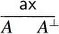
- For a proof obtained by applying the cut rule to two proofs, we first inductively build the proof nets associated to those two proofs, and then we combine them using a *cut link*. 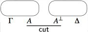
- For a proof obtained by applying the tensor rule to two proofs, we first inductively build the proof nets associated to those two proofs, and then we combine them using a *tensor link*. 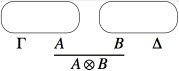
- For a proof obtained by applying the par rule to a proof, first inductively build the proof net associated to that proof, and then we add a “par link”. 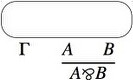

All this can be properly formalized using hypergraphs (formulas are nodes and “links” are oriented hyperedges with hypotheses and conclusions), and we can formally define as a proof net a hypergraph inductively built out of a sequent calculus derivation of MLL. Notice that there are quite a lot of hypergraphs that are not proof nets.

Now if you look at the proof net built from the derivations of $\vdash \Gamma , (A_1\lpar A_2), \ldots ,(A_{n-1}\lpar A_n)$ obtained from $\vdash \Gamma , A_1, A_2 , \ldots ,A_n$, you will see that all trace of the order of application of the rules has disappeared. In a sense, the proof nets are an equivalence class of sequent calculus derivations with respect to the derivation order of rules whose application commute.

Suppose that somebody now comes to you with a huge hypergraph built with axiom, cut, par and tensor links, claiming that it is actually a representation of a proof. How can you verify that it is actually a representation of a proof, and not just a random structure?

Performing this *correctness* check is a challenge that amounts to rebuilding a sequential construction history for your structure, corresponding to a derivation in sequent calculus, and seems at first a very complex problem. The first correctness criterion for MLL proof nets, called the “long trip criterion”, and present in Girard’s original paper, is exponential, as well as the ACC (Acyclic connected) criterion of Danos and Regnier (1989) found later on. Nevertheless, there exists a much more efficient criterion, known as Contractibility, due to Danos and Regnier, that has more recently been reformulated as the following elegant graph parsing criterion by Guerrini, Martini and Masini: a hypergraph is a proof net if and only if it reduces to the singleton node “net” via the following graph reduction rules

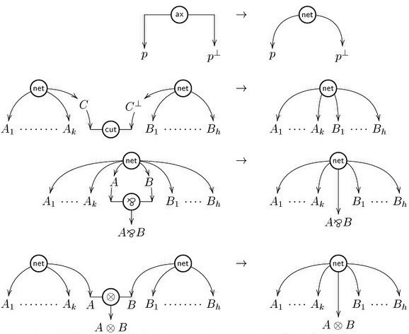

Performing this check naively can take quadratic time (each application of a rule may require an entire lookup of the graph to find the redex, and we need to perform as many steps as there are hyperlinks in the graph). Linear time algorithms have been give by Guerrini (2011)[^guerrini-2011] and by Murawski and Ong (2006).

Another style of correctness criterion for MLL proof nets is given by Retoré (2003)[^retoré-2003] in which a quadratic algorithm is given for MLL.

On proof nets, one can perform cut elimination in a particularly clean way, because of their parallel nature, cuts can be eliminated locally via two simplification rules:

- Axiom move: 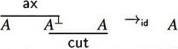
- Multiplicative move: 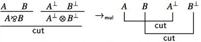

These are actually computation rules over proof nets, and the correctness criteria allow to verify easily that any such rule preserves correctness, and as a consequence, the reduction of a proof net still comes from a sequent calculus proof of the same sequent.

Hence, cut elimination in MLL proof nets can be performed in linear time and gives a simple, elegant cut-elimination result for all of MLL.

The proof nets approach can be extended to larger subsets of linear logic, but then it is less clear how to obtain the same elegant results as for MLL: the original system proposed in Girard 1987 works for MELL, for example, by associating to the four exponential rules the following hypergraph constructions:

- Contraction 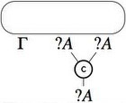
- Weakening 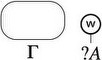
- Dereliction 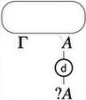
- Promotion, that introduces the notion of “box”, a sequentialization mark around a piece of a proof net materialized in the pictures of the graphs by the rectangle drawn around the proof net of conclusions $A$ and $\quest\Gamma$. 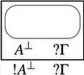

While these constructions and the associated graph reductions bear striking similarity with $\lambda$-calculus with explicit substitutions, as first remarked by Di Cosmo & Kesner (1997), they are too similar to the corresponding sequent calculus rules. The parallelization effect so elegant for MLL does not properly carry on here, and the graph reduction rules involve boxes and are not local.

To recover a satisfactory system, many proposals have been made, starting from the one by Danos & Regnier (1995) but we want to mention here the very elegant approach by Guerrini, Martini and Masini (Guerrini *et al.* 2003)[^guerrini-2003], that neatly shows the connection between two level proof systems for modal logic, proper proof nets for MELL, and optimal reduction in the $\lambda$-calculus.

A recent paper by Heijltjes and Houston (2016) has shown that there can be no satisfactory notion of proof nets for MLL if units are also allowed.

It is possible to provide a canonical treatment of additive connectives, even with first-order quantification (Heijltjes *et al*. 2019). Proof nets for formulas containing both multiplicative and additive connectives have various technical presentations, none of which appears canonical and satisfactory. Their treatment in proof-net-like proof systems is currently a topic of active research. In particular, see (Hughes and van Glabbeek 2005)[^hughes-2005] and (Hughes and Heijltjes 2016)[^heijltjes-2016][^hughes-2016].

## 3. Semantics

Approaching the semantics of linear logic is usually done along two different paths. First, there are various semantic structures available that can be used to map formulas to denotations in such structures. That approach can be used to establish soundness and completeness for various fragments of linear logic. A more novel semantic approach to linear logic involves giving semantics to proofs directly. We describe briefly these two approaches and provide some links to the literature.

### 3.1 Semantics of provability

One approach to attempting a sound and complete semantics for fragments of linear logic associates to a formula the set of all contexts that can be used to prove that formula. Of course, such a collection may need to be more abstract and to be given various closure properties. The *phase semantics* of Girard (1987)[^girard-1987] provides one such semantics: some uses of such semantics have been made in computer science to provide counterexamples and as a tool that can help establish that a given concurrent system cannot evolve into another with certain properties (Fages *et al*. 2001)[^fages-2001]. Phase semantics have also been used to give semantic proofs of cut elimination for both first-order and higher-order versions of linear logic (Okada 1999)[^okada-1999]. Similarly, Kripke-style semantics have been provided in Allwein & Dunn 1993 and Hodas & Miller 1994. Quantales, which are certain kind of partially ordered algebraic structures, have also been used to provide semantic models for parts of linear logic early on (Yetter 1990)[^yetter-1990].

### 3.2 Semantics of proofs

In the formulas-as-types analogy which is so popular and fruitful in theoretical computer science, a logical system is put in correspondence with a typed computational device (like typed $\lambda$-calculus), by associating to each proof of that formula a program having that formula as a type. For example, a proof of the tautology $A \Rightarrow A$ corresponds to the program *fun*$(x:A).x:A\rightarrow A$, the identity function on objects of type $A$. This is why, in constructive logical systems (such as intuitionistic logic and arithmetic), and in linear logic, so much importance is attached to proofs, to the point that building and studying models of proofs gets so much more attention than building and studying models of provability: we are not satisfied to know that a formula is provable, we really want to know the *computational content* of its proof.

Many models of linear logic proofs have been proposed; we consider that, to date, the simplest and most intuitive construction is the one based on the so-called “relational semantics” or “Kripke-style semantics”, where formulas are interpreted as multisets, one-sided sequents are interpreted as tuples of multisets, and proofs are interpreted as relations over the interpretation of sequents (Tortora de Falco 2003, Ehrhard 2012, Melliès 2018)[^ehrhard-2012][^melliès-2018][^tortora-2003]. If one wants to give a purely set-theoretic semantics, without resorting to multisets, it is possible to do it by means of coherence spaces, sets equipped with a special coherence relation, as originally shown by in Girard 1987. There are interesting category theoretical models of linear logic, such as the *-autonomous categories (Barr 1991)[^barr-1991] and hypercoherences (Ehrhard 1993)[^ehrhard-1993].

Another approach to the semantics of proofs is given by Girard’s *Geometry of Interaction*, that allows us to obtain a fully algebraic characterization of proofs. To each proof net, one can associate a partial permutation matrix $\sigma$ corresponding to the cut links, and a proper matrix $M$ corresponding expressions built out of a certain dynamic algebra, that describe the possible paths inside the proof net. It is then possible to fully describe the proof net via the *execution formula*

$$ \mathrm{EX}(\sigma ,M) = (1-\sigma^2) \left(\sum_i M(\sigma M)\right) (1-\sigma^2) $$

which, in the MLL case, is an invariant of the normalization process. Some nice connection to results coming from data-flow theory has been shown in some early work of Abramsky & Jagadeesan (1994).

The area of semantics that has developed around so-called *game semantics* deserves special attention. The strong connection between games and linear logic was pointed out quite early by A. Blass (1992)[^blass-1992]. In fact, there are two different traditions to connecting logic to games. In the tradition of *dialog games* dating back to Lorenzen, one player attempts to prove a formula while a second player attempts to refute it. It is possible to provide MALL with such a dialog game that is completely symmetric for both the prover and the refuter (Delande *et al*. 2010)[^delande-2010]. In another tradition, formulas are interpreted as games, logical connectives as game constructors, and proofs as strategies that describe how a player reacts to opponent moves. By imposing different restrictions on the rules of the game, one can actually provide a precise semantics (technically, a fully abstract model) for various features of actual programming languages, hence the huge interest in this area over the past years. See, for example, Abramsky & Jagadeesan 1994, Abramsky & Melliès 1999, and Hyland & Ong 2000.

## 4. Complexity

For any given logic, it is useful to know whether or not there is an effective procedure to determine, for each sentence in the logic, if it is provable or not. A *decidable* logic—i.e., one for which there is an effective procedure for provability—is often described by its *complexity class*, which characterizes how difficult it is to perform the decision procedure. Extensive research work has been dedicated to the study of the complexity and decidability issues for several fragments of propositional linear logic. It is known that

- MLL provability is NP-complete (Kanovich 1992)[^kanovich-1992] and
- MALL provability is PSPACE-complete (Lincoln *et al*. 1992)[^lincoln-1992].

Here, NP and PSPACE are complexity classes such that NP $\subseteq$ PSPACE. Surprisingly, for those that may forget that the novelty in linear logic lies in the way formulas are managed without the structural rules of contraction and weakening, these results stay the same even if we focus on the fragments of the logics where only the constants, and no propositional variables, are allowed (Lincoln & Winkler 1994)[^lincoln-1994]. Indeed, it is possible to encode arbitrary formulas into constant-only formulas preserving provability.

MELL is a surprisingly expressive logic. For example, the reachability problem in Petri nets can be encoded into MELL (Gunter & Gehlot 1989)[^gunter-1989] and that problem is equivalent to the reachability problem of vector addition systems with states (VASS) (Reutenauer 1989)[^reutenauer-1989]. Furthermore, the decidability problem of MELL is equivalent to the reachability problem for branching VASS (de Groote *et al*. 2004)[^groote-2004] and the latter is known to have a non-elementary lower bound (Lazic and Schmitz 2015)[^lazic-2015]. Thus, if MELL turns out to be decidable, it will be at least TOWER-hard (Lazic and Schmitz 2015)[^lazic-2015]. A proof of the decidability of MELL has been given by Bimbó (2015)[^bimbó-2015] but a gap in that proof has been reported by Straßburger (2019)[^straßburger-2019].

Proofs of the undecidability of propositional linear logic were published in the early 1990s (Lincoln *et al*. 1992, Lincoln 1995)[^lincoln-1995][^lincoln-1992]. Kanovich (2016)[^kanovich-2016] showed that this undecidability result holds for a greatly reduced fragment of propositional linear logic. and a machine checked proof of undecidability has been published in (Forster & Larchey-Wendling, 2019)[^forster-2019]. However, a proof of decidability of propositional linear logic has also been published by Bimbó & Dunn in (2022), who also claim to have found mistakes in the above-mentioned papers.

Linear logic with the unrestricted weakening rule added (also known as *linear affine logic*) is decidable (Kopylov 1995)[^kopylov-1995] and exponential space hard (Urquhart 2000)[^urquhart-2000].

A good overview of complexity results surrounding linear logic can be found in Lincoln 1995.

## 5. Computer science impact

When intuitionistic logic was first proposed early in the last century, it was presented as a challenge to the way traditional mathematicians were supposed to do business. Uses of the excluded middle and of proof-by-contradiction were considered suspect and problematic, particularly in the presence of infinity. As intuitionistic logic concerns were developed into constructive mathematics, new constructive approaches have arisen to topics such as topology, algebra, and analysis. Given that linear logic encompasses the dynamics of proof (algorithm) and resources, its primary impact has been not in traditional mathematics but in computer science. Before overviewing the nature of that impact, we outline the various ways in which logic more generally is used in computer science.

Logic plays different roles in the specification of computations. We can identify the following broad different approaches and note which roles have felt influences from linear logic.

In the *computation-as-model* approach, computations are encoded as mathematical structures and consist of such items as nodes, transitions, and states. Logic is used externally to make statements *about* those structures. That is, computations are used as models for logical expressions. Intensional operators, such as the modals of temporal and dynamic logics or the triples of Hoare logic, are often employed to express propositions about the change in state. This use of logic to represent and reason about computation is probably the most broadly successful use of logic for representing computation. This role for logic has felt little influence from linear logic.

In the *computation-as-deduction* approach, pieces of logic’s syntax (such as formulas, terms, types, and proofs) are used directly as elements of the specified computation. In this more rarefied setting, there are two rather different approaches to how computation is modeled, called the *proof normalization* approach and the *proof search* approach.

We outline below the significant impacts that linear logic has had on both of these different settings.

### 5.1 Proof normalization

The *proof normalization* approach views the state of a computation as a proof term and the process of computing as normalization (known alternatively as $\beta$-reduction or cut-elimination). Functional programming can be explained using proof-normalization as its theoretical basis (Martin-Löf 1982)[^martin-löf-1982] and has been used to justify the design of new functional programming languages, e.g., Abramsky 1993. Linear logic provides this approach to computational specification with new types, new declarative means for statically understanding how resources may be used in a computation, and provided an appealing means for formalizing the duality between a function and the environment that supplies it with arguments.

Another area where linear logic has been a powerful theoretical instrument is that of *optimal reduction*. The problem of building efficient (optimal) interpreters for the $\lambda$-calculus, that stayed open for quite a long time after its original definition by J.J. Lévy, was solved for the first time in Lamping 1990, via a sophisticated sharing graph implementation involving a quite impressive amount of rules. Using ideas and intuition from linear logic, many authors reconstructed Lamping’s solution, simplifying it and leading to a rich theory connected to that of the Geometry of Interaction. For further reading, a good reference is Asperti & Guerrini 1998.

The refinement of intuitionistic logic provided by linear logic and the dualities of linear logic provided a setting in which one could view a function and its environment as similar entities that interact dually. For example, a function with the type $A \limp B$ can be modeled as a process that consumes a value of type $A$ from its environment and transforms it into a value of type $B$. In linear logic, this implication is equivalent to its contrapositive form: the type $B^{\bot} \limp A^{\bot}$ can lead to interpreting the same function as a process that transforms a demand for a value of type $B$ into a demand for a value of type $A$ (notice that this does not happen with functions of intuitionistic type since, for example, input argument may be vacuous) (Curien 2003)[^curien-2003]. The recent successes of using game semantics to model functional computation are similarly related to the dual treatment of function and environment (Abramsky and Jagadeesan 1994, Hyland & Ong 2000)[^abramsky-1994][^hyland-2000].

Finally, we mention that in the area of encoding computation as proof normalization, linear logic has been used to provide a type-based description of polytime recursive functions. For example, M. Hofmann (2003)[^hofmann-2003] introduced a $\lambda$-calculus with modal and linear types that extended the function algebra of Bellantoni & Cook 1992 to higher types. Types based on linear logic have also been used within functional programs: see Guzman & Hudak 1990 and Wadler 1991.

### 5.2 Proof search

The *proof search* approach views the state of a computation as a sequent (a structured collection of formulas) and the process of computing as the process of searching for a proof of a sequent: the changes that take place in sequents capture the dynamics of computation. With this view of computation, we generally read inference rules bottom up, i.e., as a transformation of their conclusion into their premise(s). Logic programming can be explained using proof search as its theoretical basis, and linear logic provides this approach to computational specification with new combinators for building logic programs, new means to capture rich dynamics, and new declarative approaches to specifying concurrent computations. (See Miller 2004 for an overview of linear logic programming languages.)[^miller-2004]

The completeness of focusing proof system can be used to provide a declarative explanation of part of the operational semantics of logic programming within linear logic. Consider, for example, the subset $L$ of formulas of linear logic that are built from only the connectives $\top$, &, $\limp , \Rightarrow$, and $\forall$. (Notice that if one adds $\bot$ to this list, it is possible to encode all connectives of linear logic.) It is possible to see that cut-free proof search in $L$ can be defined into to phases. Given a sequent $\Gamma$; $\Delta \vdash G$, where $\Gamma$ is a set of formulas (which can be contracted and weakened), $\Delta$ is multiset of formulas (which cannot be contracted nor weakened), and $G$ (the “goal” formula) is a single formula (all from $L)$, then proof search proceeds as follows.

1. If $G$ is non-atomic, then only a right introduction rule can be used to conclude this sequent. Given this set of connectives, the right rules are invertible and this *goal-reduction* phase corresponds exactly to the asynchronous phase of focused proofs.
2. If $G$ is atomic, then proof search proceeds by *deciding* on a single formula from a left-hand context.
3. Once a formula is chosen for the *focus*, all left-introduction rules are applied to only that formula and any positive subformulas that arise. This *backchaining* phase corresponds to the asynchronous phase of focused proof construction.

Formally, these various phases can be described using the following inference rules. Here, a new sequent arrow is introduced: this arrow is labeled with the formula that is the result of a left-introduction rule. Notice that the rule for left-introduction of $\limp$ requires splitting the $\Delta$ context into two parts $\Delta_1,\Delta_2$ (when reading the rule bottom up). There are, of course, $2^n$ such splittings if that context has $n \ge 0$ distinct formulas. The syntactic variable $A$ in these inference rules ranges over atomic formulas.

**Goal Reduction Phase** $$ \frac{} {\Gamma;\Delta \vdash \top}\ \top R \qquad \frac{\Gamma;\Delta \vdash B \qquad \Gamma;\Delta \vdash C} {\Gamma;\Delta \vdash B \amp C}\ {\amp}R $$ $$\frac{\Gamma;\Delta, B \vdash C} {\Gamma;\Delta \vdash B \limp C}\ \limp R \qquad \frac{\Gamma,B ;\Delta \vdash C} {\Gamma;\Delta \vdash B \Rightarrow C}\ {\Rightarrow}R \qquad \frac{\Gamma;\Delta \vdash B[y/x]} {\Gamma;\Delta \vdash \forall x. B}\ \forall R $$

**Backchaining Phase** $$ \frac{\Gamma;\Delta \lvdash{D_1} A} {\Gamma;\Delta \lvdash{D_1\amp D_2}\, A} \ {\amp}L \qquad \frac{\Gamma;\Delta \lvdash{D_2} A} {\Gamma;\Delta \lvdash{D_1\amp D_2} A}\ {\amp}L \qquad \frac{\Gamma;\Delta \lvdash{D[t/x]} A} {\Gamma;\Delta \lvdash{\forall_{\tau}x.D} A}\ \forall L $$ $$\frac{\Gamma;\Delta_1 \vdash G \quad \Gamma;\Delta_2 \lvdash{D} A} {\Gamma;\Delta_1,\Delta_2 \lvdash{G\limp D} A} \ {\limp}L \qquad \frac{\Gamma;\cdot \vdash G \quad \Gamma;\Delta \lvdash{D} A} {\Gamma;\Delta \lvdash{G\Rightarrow D} A}\ {\Rightarrow}L $$

**Identity and Decide Rules** $$ \frac{\Gamma,D;\Delta \lvdash{D} A} {\Gamma,D;\Delta \vdash A}\ \textit{decide}{!} \qquad \frac{\Gamma;\Delta \lvdash{D} A} {\Gamma;\Delta,D \vdash A}\ \textit{decide} \qquad \frac{} {\Gamma;\cdot \lvdash{A} A}\ \textit{init} $$

Linear logic restricted to $L$ can be viewed as a linear logic programming language. As a consequence, it can serve as a specification language for computational systems, a role that is also occupied by, say, Petri nets, process calculi, $\lambda$-calculus, etc. Given that linear logic has a proof theory and various kinds of semantics, broad avenues of reasoning about computations specified in $L$ are provided by the meta-theory of linear logic.

Given that the sequent calculus for linear logic uses multisets of formulas, proof search can directly encode *multiset rewriting*. Since many computations can naturally be seen as multiset rewriting, it has been possible to make numerous connections between linear logic and Petri nets (Gunter & Gehlot 1989)[^gunter-1989], process calculi (Andreoli & Pareschi 1991, Kobayashi *et al*. 1999, Miller 1996)[^andreoli-1991][^kobayashi-1999][^miller-1996], and security protocols (Cervesato *et al*. 1999, Miller 2003)[^cervesato-1999][^miller-2003].

## 6. Variations

### 6.1 Different treatments of modality

If one uses traditional sequent calculus presentations, the exponentials are not canonical in the following sense: if you introduce another copy of exponentials, say $\bang'$ and $\quest'$, with the same rules as the original ones, there is no way to prove that $\bang$ is equivalent to $\bang'$, and $\quest$ to $\quest'$, while for the other connectives this is easily established. Various applications of non-canonical exponentials can be found in (Danos et. al., 1993; Nigam & Miller, 2009)[^danos-1993][^nigam-2009]. Although the decidability of MELL is currently being debated (Bimbó 2015, Straßburger 2019)[^bimbó-2015][^straßburger-2019], extending MLL with three pairs of $\bang$ and $\quest$ yields a logic that is undecidable (Chaudhuri 2018)[^chaudhuri-2018]. Martini and Masini 1995 describe a “2-sequent” proof system in which the exponentials are canonical.

The fact that cut-elimination can make proofs in classical and intuitionistic logic grow to enormous size can be analyzed in terms of the application of the contraction rule in those proof systems. If proof systems introduce restrictions on contraction, it is possible to design new logics and proof systems for which cut-elimination has a much-reduced complexity. For example, *elementary linear logic* (ELL) is obtained by replacing the $\bang$ and $\quest$ introduction by a single rule introducing $\bang$ and $\quest$ at the same time. As a consequence, ELL can encode all and only the Kalmar elementary functions (computable in time bounded by a tower of exponentials of fixed height) (Girard 1998, Baillot 2015)[^baillot-2015][^girard-1998]. Still, other variations on the inference rules for the exponentials have been studied. For example, *light linear logic* (Girard 1998)[^girard-1998] and *soft linear logic* (Lafont 2004)[^lafont-2004] both characterize functions computable in polynomial time: see also (Baillot & Terui 2004)[^baillot-2004].

### 6.2 Non-commutative linear logic

While linear logic rejects the universal application of the two structural rules of weakening and contraction, it allows the unrestricted use of the structural rule called *exchange*. A sequent calculus that does not universally employ the exchange rule has sequents whose left and right contexts are lists: the order of formulas within context becomes an expressive element of the logic. In this case, the multiplicative disjunction and conjunction can become non-commutative.

One of the first logics that rejects all three structural rules of the sequent calculus was given in Lambek 1958. While this logic contains *two* implications, it contains neither a negation nor any exponentials. Various papers have proposed extending linear logic to include non-commutative features and, at present, no proposal seems canonical. For a sampling of non-commutative linear logics, see Yetter 1990, Abrusci 1991, Retoré 1997, Abrusci & Ruet 1999, and Guglielmi & Straßburger 2001.

### 6.3 Treatment of unbounded behavior

While the MALL logic is an expressive and novel logic, it is also decidable and, thus, not capable of capturing the unbounded behaviors found in, say, iteration and recursion. As described above, the addition of the exponentials ! and ? enriches MALL to full linear logic and to a setting where unbounded behaviors can be captured. A second approach to extending MALL to capture unbounded behaviors involves the addition of the least and greatest fixed point operators as logical connectives directly into MALL. In order to properly characterize fixed points as being either the least or the greatest, it is necessary for the inference rules for fixed points to be “higher-order” in the sense that they involve invariants. Such an extension to MALL (also with first-order quantification and term equality) has been developed by Baelde (Baelde & Miller, 2007; Baelde 2012)[^baelde-2012][^baelde-2007] and has been used to provide a proof-theoretic foundation for model checking (Heath & Miller 2018)[^heath-2018].

## References（引用注释）

> 原文参考文献已转为脚注引用：文内“作者-年份”引用组后附 [^key] 标记，完整条目见本文末脚注定义。

## Academic Tools

> |   | [How to cite this entry](https://plato.stanford.edu/cgi-bin/encyclopedia/archinfo.cgi?entry=logic-linear). |
> | --- | --- |
> |   | [Preview the PDF version of this entry](https://leibniz.stanford.edu/friends/preview/logic-linear/) at the [Friends of the SEP Society](https://leibniz.stanford.edu/friends/). |
> |   | [Look up topics and thinkers related to this entry](https://www.inphoproject.org/entity?sep=logic-linear&redirect=True) at the Internet Philosophy Ontology Project (InPhO). |
> |   | [Enhanced bibliography for this entry](https://philpapers.org/sep/logic-linear/) at [PhilPapers](https://philpapers.org/), with links to its database. |

## Other Internet Resources

- The [linear logic bibliography](http://www.cs.cmu.edu/~carsten/linearbib/llb.html) (up to 1998).
- Vincent Danos and Roberto Di Cosmo. [The Linear Logic Primer. Course Notes.](http://www.dicosmo.org/CourseNotes/LinLog/) (1992).

## Related Entries

logic: and games | logic: classical | logic: dialogical | logic: intuitionistic | logic: substructural | proof theory

### Acknowledgment

We thank an anonymous reviewer at the SEP for many comments that have helped us revise this article.

[^abramsky-1993]: Abramsky, S., 1993, “Computational interpretations of linear logic”, *Theoretical Computer Science*, 111: 3–57.

[^abramsky-1994]: Abramsky, S., and Jagadeesan, R., 1994, “New Foundations for the Geometry of Interaction”, *Information and Computation*, 111(1): 53–119.

[^abramsky-1999]: Abramsky, S., and Melliès, Paul-André, 1999, “Concurrent Games and Full Completeness”, *14th Annual Symposium on Logic in Computer Science*, Trento: IEEE Computer Society Press., pp. 431–442.

[^abrusci-1991]: Abrusci, V. M., 1991, “Phase semantics and sequent calculus for pure non-commutative classical linear propositional logic”, *Journal of Symbolic Logic*, 56(4): 1403–1451.

[^abrusci-1999]: Abrusci, V.M., and Ruet, P., 1999, “Non-Commutative Logic I: The Multiplicative Fragment”, *Annals of Pure and Applied Logic*, 101(1): 29–64.

[^allwein-1993]: Allwein, G. and Dunn, J.M., 1993, “Kripke Models for Linear Logic”, *Journal of Symbolic Logic*, 58(2): 514–545.

[^anderson-1975]: Anderson, A. R. and Belnap, N. D., 1975, *Entailment: The Logic of Relevance and Necessity* (Volume I), Nuel D. Belnap & J. Michael Dunn (eds.), Princeton, N.J.: Princeton University Press.

[^anderson-1975-2]: Anderson, A. R., Belnap, N. D., and Dunn, J. M., 1975, *Entailment: The Logic of Relevance and Necessity* (Volume II), Princeton, N.J.: Princeton University Press.

[^andreoli-1992]: Andreoli, J.-M., 1992, “Logic programming with focusing proofs in linear logic”, *Journal of Logic and Computation*, 2(3): 297–347.

[^andreoli-1991]: Andreoli, J.-M. and Pareschi, R., 1991, “Linear objects: Logical processes with built-in inheritance”, *New Generation Computing*, 9(3–4): 445–473.

[^asperti-1998]: Asperti, A., and Guerrini, S., 1998, “The Optimal Implementation of Functional Programming Languages”, Cambridge Univ. Press.

[^avron-1988]: Avron, A., 1988, “The Semantics and Proof Theory of Linear Logic”, *Theoretical Computer Science*, 57: 161–184.

[^baelde-2012]: Baelde, D., 2012, “Least and greatest fixed points in linear logic”, ACM Transactions on Computational Logic, 13(1). doi:10.1145/2071368.2071370

[^baelde-2007]: Baelde, D. and Miller, D., 2007, “Least and greatest fixed points in linear logic”, *Logic for Programming, Artificial Intelligence, and Reasoning* (Lecture Notes in Computer Science: Volume 4790), edited by N. Dershowitz and A. Voronkov, pp. 92–106.

[^baillot-2015]: Baillot, P., 2015, “On the expressivity of elementary linear logic: Characterizing Ptime and an exponential time hierarchy”, *Information and Computation*, 241: 3–31.

[^baillot-2004]: Baillot, P., and Terui, K., 2004, “Light Types for Polynomial Time Computation in Lambda-Calculus”, *Proceedings of the Nineteenth Annual IEEE Symposium on Logic in Computer Science*, Turku, Finland, IEEE Computer Society Press, pp. 266–275.

[^barr-1991]: Barr, M., 1991, “*-Autonomous categories and linear logic”, *Mathemathical Structures in Computer Science*, 1(2): 159–178.

[^bellantoni-1992]: Bellantoni, S. and Cook, S., 1992, “A New Recursion-Theoretic Characterization of the Polytime Functions”, *Computational Complexity*, 2: 97–110.

[^bimbó-2015]: Bimbó, K., 2015, “The decidability of the intensional fragment of classical linear logic”, *Theoretical Computer Science*, 597(13): 1–17.

[^bimbó-2022]: Bimbó, K. and J. M. Dunn, 2022, “Modalities in lattice-R”, in *Relevance Logics and other Tools for Reasoning. Essays in Honor of J. Michael Dunn*, London: College Publications, pp. 89–127.

[^blass-1992]: Blass, A., 1992, “A game semantics for linear logic”, *Annals of Pure and Applied Logic*, 56: 183–220.

[^cervesato-1999]: Cervesato, I., Durgin, N., Lincoln, P., Mitchell, J., and Scedrov, A., 1999, “A meta-notation for protocol analysis”, in R. Gorrieri (ed.), *Proceedings of the 12th IEEE Computer Security Foundations Workshop—CSFW 1999*, Los Alamitos, CA: IEEE Computer Society Press, pp. 55–69.

[^chaudhuri-2018]: Chaudhuri, K., 2018, “Encoding additives using multiplicatives and subexponentials”, *Mathematical Structures in Computer Science*, 28(5): 651–666.

[^curien-2003]: Curien, P.-L., 2003, “Symmetry and interactivity in programming”, *Bulletin of Symbolic Logic*, 9(2): 169–180.

[^dal-2008]: Dal Lago, U., and Laurent, O., 2008, “Quantitative Game Semantics for Linear Logic”, *Computer Science Logic* (Lecture Notes in Computer Science: Volume 5213), Michael Kaminski and Simone Martini (eds.), Berlin: Springer, pp. 230–245.

[^danos-1993]: Danos, V., Joinet, J.-P., and Schellinx, H., 1993, “The Structure of Exponentials: Uncovering the Dynamics of Linear Logic Proofs”, pp. 159–171, in *Kurt Gödel Colloquium* (Lecture Notes in Computer Science, Volume 713), edited by G. Gottlob, A. Leitsch, and D. Mundici, Berlin: Springer.

[^danos-1997]: –––, 1997, “A New Deconstructive Logic: Linear Logic”, *Journal of Symbolic Logic*, 62(3): 755–807.

[^danos-1989]: Danos, V. and Regnier, L., 1989, “The Structure of Multiplicatives”, *Archive of Mathematical Logic*, Springer, 28:181–203.

[^danos-1995]: –––, 1995, “Proof-nets and Hilbert space”, in J.-Y. Girard, Y. Lafont, and L. Regnier (eds.), *Advances in Linear Logic*, Cambridge: Cambridge University Press, pp. 307–328.

[^groote-2004]: de Groote, P., Guillaume, B., and Salvati, S., 2004, “Vector addition tree automata”, in *Proceedings of the 19th IEEE Symposium on Logic in Computer Science* (LICS 2004), 14–17 July 2004, Turku, Finland, pp. 64–73.

[^delande-2010]: Delande, O., Miller, D., and Saurin, A., 2010, “Proof and refutation in MALL as a game”, *Annals of Pure and Applied Logic*, 161(5): 654–672.

[^di-1997]: Di Cosmo, R., and Kesner, D., 1997, “Strong normalization of explicit substitutions via cut elimination in proof nets”, (extended abstract) in *Proceedings of the Twelfth Annual IEEE Symposium on Logic in Computer Science*, Los Alamitos, CA: IEEE Computer Society Press, pp. 35–46.

[^ehrhard-1993]: Ehrhard, T., 1993, “Hypercoherences: A Strongly Stable Model of Linear Logic”, *Mathematical Structures in Computer Science*, 3(4): 365–385.

[^ehrhard-2012]: –––, 2012, “The Scott model of linear logic is the extensional collapse of its relational model”, *Theoretical Computer Science*, 13(6): 20–45.

[^fages-2001]: Fages, F., Ruet, P., and Soliman, S., 2001, “Linear Concurrent Constraint Programming: Operational and Phase Semantics”, *Information and Computation*, 165(1): 14–41.

[^forster-2019]: Forster, Y. and D. Larchey-Wendling, 2019, “Certified undecidability of intuitionistic linear logic via binary stack machines and Minsky machines”, *Proceedings of the 8th ACM SIGPLAN International Conference on Certified Programs and Proofs (CPP’19)*, New York: Association of Computing Machinery, pp. 104–117. doi:10.1145/3293880.3294096

[^gentzen-1935]: Gentzen, G., 1935, “Investigations into Logical Deduction”, in M. E. Szabo (ed.), *The Collected Papers of Gerhard Gentzen*, Amsterdam: North-Holland pp. 68–131.

[^girard-1987]: Girard, J.-Y., 1987, “Linear logic”, *Theoretical Computer Science*, 50: 1–102.

[^girard-1998]: –––, 1998, “Light Linear Logic”, *Information and Computation*, 143(2):175–204.

[^grishin-1981]: Grishin, V. N., 1981, “Predicate and set-theoretic calculi based on logic without contraction rules,” (Russian). Izvestiya Akademii Nauk SSSR Seriya Matematicheskaya 45(1): 47–68. 239. Math. USSR Izv., 18, no.1, Moscow.

[^guerrini-2011]: Guerrini, S., 2011, “A linear algorithm for MLL proof net correctness and sequentialization”, *Theoretical Computer Science*, 412: 1958–1978.

[^guerrini-2003]: Guerrini, S., Martini, S., and Masini, A., 2003, “Coherence for sharing proof-nets”, *Theoretical Computer Science*, 294(3): 379–409.

[^guglielmi-2001]: Guglielmi, A., and Straßburger, L., 2001, “Non-commutativity and MELL in the Calculus of Structures”, *Computer Science Logic* (Lecture Notes in Computer Science, Volume 2142), Berlin: Springer Verlag, pp. 54–68.

[^gunter-1989]: Gunter, C. A., and Gehlot, V., 1989, “Nets as Tensor Theories”, in G. De Michelis (ed.), *Proceedings of the Tenth International Conference on Application and Theory of Petri Nets* (Lecture Notes in Computer Science: Volume 616), Bonn: Springer-Verlag, pp. 174–191.

[^guzman-1990]: Guzman, J.C. and Hudak, P., 1990, “Single-threaded polymorphic lambda calculus”, in *Proceedings of the Fifth IEEE Symposium on Logic in Computer Science*, Philadelphia: IEEE Computer Society Press.

[^heath-2018]: Heath, Q. and Miller, D., 2018, “A proof theory for model checking”, *Journal of Automated Deduction*, doi:10.1007/s10817-018-9475-3.

[^heijltjes-2016]: Heijltjes, W. and Houston, R., 2016, “Proof equivalence in MLL is PSPACE-complete”, *Logical Methods in Computer Science* 12(1).

[^heijltjes-2018]: Heijltjes, W. B., Hughes, D. J. D., and Straßburger, L., 2018, “Proof nets for first-order additive linear logic”, *4th International Conference on Formal Structures for Computation and Deduction*, (FSCD 2019: Volume 131), Dagstuhl: Leibniz-Zentrum für Informatik, pp. 22:1–22:22.

[^hodas-1994]: Hodas, J., and Miller, D., 1994, “Logic programming in a fragment of intuitionistic linear logic”, *Information and Computation*, 110(2): 327–365.

[^hofmann-2003]: Hofmann, M., 2003, “Linear types and non-size increasing polynomial time computation”, *Information and Computation*, 183(1): 57–85.

[^howard-1980]: Howard, W.A., 1980, “The formulae-as-type notion of construction, 1969”, in J.P. Seldin and R. Hindley (eds.), *To H. B. Curry: Essays in Combinatory Logic, Lambda Calculus, and Formalism*, New York: Academic Press, pp. 479–490.

[^hughes-2005]: Hughes, D.J.D. and van Glabbeek, R., 2005, “Proof Nets for Unit-Free Multiplicative-Additive Linear Logic”, *ACM Transactions on Computational Logic*, 6: 784–842.

[^hughes-2016]: Hughes, D.J.D. and Heijltjes, W. B., 2016, “Conflict nets: efficient locally canonical mall proof nets”, *31st Annual ACM/IEEE Symposium on Logic in Computer Science* (LICS), 2016.

[^hyland-2000]: Hyland, J.M.E., and Ong, C.-H.L., 2000, “On Full Abstraction for PCF: I. Models, observables and the full abstraction problem, II. Dialogue games and innocent strategies, III. A fully abstract and universal game model”, *Information and Computation*, 163: 285–408.

[^kanovich-1992]: Kanovich, M.I., 1992, “Horn Programming in Linear Logic is NP-Complete”, in *Proceedings of the Seventh Annual Symposium on Logic in Computer Science*, Santa Cruz, IEEE Computer Society Press, pp. 200–210.

[^kanovich-2016]: –––, 2016, “The undecidability theorem for the Horn-like fragment of linear logic (Revisited)”, *Mathematical Structures in Computer Science*, 26: 719–744.

[^kobayashi-1999]: Kobayashi, N., Shimizu, T., and Yonezawa, A., 1999, “Distributed concurrent linear logic programming”, *Theoretical Computer Science*, 227(1–2): 185–220.

[^kopylov-1995]: Kopylov, A. P., 1995, “Decidability of Linear Affine Logic”, Symposium on Logic in Computer Science (LICS’95), IEEE Computer Society Press, pp. 496–505.

[^lafont-2004]: Lafont, Y., 2004, “Soft linear logic and polynomial time”, *Theoretical Computer Science*, 318(1–2): 163–180.

[^lamarche-1996]: Lamarche, F., 1996, “From Proof Nets to Games: extended abstract”, in *Linear Logic 96 Tokyo Meeting*, *Electronic Notes in Theoretical Computer Science*, 3: 107–119.

[^lambek-1958]: Lambek, J., 1958, “The mathematics of sentence structure”, *American Mathematical Monthly*, 65: 154–169.

[^lamping-1990]: Lamping, J., 1990, “An algorithm for optimal lambda-calculus reductions”. 17th Annual Symposium on Principles of Programming Languages, San Francisco, ACM Press, pp. 16–30.

[^laurent-2005]: Laurent, O., Quatrini, M., and Tortora de Falco, L., 2005, “Polarized and focalized linear and classical proofs”, *Annals of Pure and Applied Logic*, 134 (2–3): 217–264.

[^lazic-2015]: Lazic, R. and Schmitz, S., 2015, “Nonelementary complexities for branching VASS, MELL, and extensions”, *ACM Transactions on Computational Logic*, 16(3): pp. 20:1–20:30.

[^liang-2009]: Liang, C. and Miller, D., 2009, “Focusing and Polarization in Linear, Intuitionistic, and Classical Logics”, *Theoretical Computer Science*, 410(46): 4747–4768.

[^lincoln-1993]: Lincoln, P., Scedrov, A., and Shankar, N., 1993, “Linearizing intuitionistic implication”, *Annals of Pure and Applied Logic*, 60(2): 151–177.

[^lincoln-1995]: Lincoln, P., 1995, “Deciding provability of linear logic formulas”, *Proceedings of the Workshop on Advances in Linear Logic*, J.-Y. Girard, Y. Lafont, and L. Regnier (eds.), Cambridge: Cambridge University Press, pp. 197–210.

[^lincoln-1992]: Lincoln, P., Mitchell, J., Scedrov, A., and Shankar, N., 1992, “Decision problems for propositional linear logic”, *Annals of Pure and Applied Logic*, 56: 239–311.

[^lincoln-1994]: Lincoln, P., and Winkler, T., 1994, “Constant-Only Multiplicative Linear Logic is NP-Complete”, *Theoretical Computer Science*, 135: 155–169.

[^martini-1995]: Martini, S. and Masini, A., 1995, “On the fine structure of the exponential rule”, in *Advances in linear logic*, edited by J.-Y. Girard and Y. Lafont and L. Regnier, pp. 197–210, New York: Cambridge University Press.

[^martin-löf-1982]: Martin-Löf, P., 1982, “Constructive Mathematics and Computer Programming”, *Sixth International Congress for Logic, Methodology, and Philosophy of Science*, Amsterdam: North-Holland, pp. 153–175.

[^melliès-2018]: Melliès, P.-A., Tabareau, N. and Tasson, C., 2018, “An explicit formula for the free exponential modality of linear logic”, *Mathematical Structures in Computer Science*, 28(7): 1253–1286.

[^miller-1996]: Miller, D., 1996, “Forum: A multiple-conclusion specification language”, *Theoretical Computer Science*, 165(1): 201–232.

[^miller-2003]: –––, 2003, “Encryption as an abstract data-type: An extended abstract”, in I. Cervesato (ed.), *16th Workshop on Foundations of Computer Security*, Asilomar, IEEE Computing Society, pp. 3–14, 2003.

[^miller-2004]: –––, 2004, “Overview of linear logic programming”, *Linear Logic in Computer Science*, T. Ehrhard, J.-Y. Girard, P. Ruet, and P. Scott (eds.) (London Mathematical Society Lecture Notes: Volume 316), Cambridge: Cambridge University Press, pp. 119–150.

[^murawski-2006]: Murawski, A. S., and Ong, C.-H. L., 2006, “Fast verification of MLL proof nets via IMLL”, *ACM Transactions on Computational Logic*, 7(3): 473–498.

[^nigam-2009]: Nigam, V. and Miller, D., 2009, “Algorithmic specifications in linear logic with subexponentials”, Proceedings of the 11th ACM SIGPLAN conference on Principles and practice of declarative programming (PPDP), 2009, pp. 129–140.

[^okada-1999]: Okada, M., 1999, “Phase Semantic Cut-Elimination and Normalization Proofs of First- and Higher-Order Linear Logic”, *Theoretical Computer Science*, 227(1–2): 333–396.

[^ono-1998]: Ono, H., 1998, “Proof-theoretic methods in nonclassical logic. An Introduction”, in M. Takahashi, M. Okada, and M. Dezani-Ciancaglini (eds.), *Theories of Types and Proofs* (Mathematical Society of Japan Memoirs: Volume 2), 207–254. doi:10.2969/msjmemoirs/00201C060

[^read-1988]: Read, S., 1988, *Relevant Logic*, Oxford: Blackwell.

[^retoré-1997]: Retoré, C., 1997, “Pomset logic: a non-commutative extension of classical linear logic”, *Typed Lambda Calculi and Applications* (Lecture notes in Computer Science: Volume 1210), Berlin: Springer Verlag, pp. 300–318.

[^retoré-2003]: Retoré, C., 2003, “Handsome proof-nets: perfect matchings and cographs”, *Theoretical Computer Science*, 294(3): 473–488.

[^reutenauer-1989]: Reutenauer, C., 1989, “Aspects mathématiques des réseaux de Petri”, Etudes et Recherches en Informatique. Masson.

[^schellinx-1991]: Schellinx, H., 1991, “Some Syntactical Observations on Linear Logic”, *Journal of Logic and Computation*, 1(4): 537–559.

[^tortora-2003]: Tortora de Falco, L., 2003, “Obsessional experiments for linear logic proof-nets”, *Mathematical Structures in Computer Science*, 13(6): 799–855.

[^troelstra-1992]: Troelstra, A. S., 1992, “Lectures on Linear Logic”, *CSLI Lecture Notes* (Number 29), Stanford: CSLI Publications.

[^straßburger-2019]: Straßburger, L., 2019, “On the Decision Problem for MELL”, *Theoretical Computer Science*, 768: 91–98. doi:10.1016/j.tcs.2019.02.022

[^urquhart-2000]: Urquhart, A., 2000, “The Complexity of Linear Logic with Weakening”, *Logic Colloquium ’98* (Lecture Notes in Logic 13), Urbana: Association for Symbolic Logic, pp. 500–515.

[^wadler-1991]: Wadler, P., 1991, “Is there a use for linear logic?”, *Proceedings of ACM/SIGPLAN Workshop Partial Evaluation and Semantics-Based Program Manipulation*, New Haven: ACM Press, pp. 255–273, 1991.

[^yetter-1990]: Yetter, D.N., 1990, “Quantales and (noncommutative) linear logic”, *Journal of Symbolic Logic*, 55(1): 41–64.
