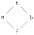
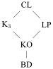
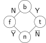

# Many-Valued Logic
**First published Sat Jan 17, 2026; substantive revision Tue Sep 29, 2026**

*Marcos, João, Přenosil, Adam, Egré, Paul*

Many-valued logics, understood in the broadest sense, are systems of logic that generalize the two-valued truth-functional basis of classical logic to any number of truth values. Most of the time, a many-valued logic will involve more than two truth values, so that three-and-beyond is often taken to be constitutive of many-valuedness (see Gottwald 2001)[^gottwald-2001]. However, classical logic itself is a multiple-valued system, and even systems involving fewer than two values are adequately viewed as limit cases in the broader family of many-valued logics.

Classical propositional logic has a simple and elegant compositional semantics, according to which the connectives can be interpreted in terms of operations on a two-element algebra, whose universe may be thought to contain exactly two truth values, ‘True’ and ‘False’, and affording a straightforward definition of validity in terms of the preservation of the value ‘True’. Philosophically, many-valued logics arose from doubts concerning the Principle of Bivalence (section 1), making room for the admission of more values besides True and False, and creating a variety of finite-valued and infinite-valued systems (section 2). Technically, the truth-functional character of two-valued logic and the definition of validity in terms of ‘truth-preservation’ have natural generalizations with the admission of arbitrarily many truth values, as reflected in the framework of matrix semantics (section 3). The resulting systems, however, typically deviate from classical logic in terms of the sentences and the inferences they validate.

This entry starts out with the presentation of some motivations for many-valuedness (section 1), with a review of some influential systems of finite- and infinite-valued logics (section 2), and a presentation of matrix semantics (section 3). It then clarifies several foundational issues regarding the expressiveness and the truth-functional behavior of many-valued logics, including a discussion of bivaluations and supervaluations (section 4). It also considers generalizations of matrix semantics that include non-deterministic matrices for the connectives, and generalized notions of validity that go beyond the paradigm of preservation of designated values (section 5). While most of this entry is concerned with propositional systems of logic, we close with a presentation of many-valued semantics for first-order and modal languages (section 6).

## 1. Bivalence in question

Many-valued logics are systems originating in a rejection of the so-called Principle of Bivalence, according to which every sentence has exactly one of two truth values, either True or False. Around 1910, Jan Łukasiewicz, one of the founding fathers of many-valuedness, questioned both sides of the principle, namely the Law of Excluded Middle (which he expressed in sentential form as $A\vee \neg A$) and the Law of Non-Contradiction (which he expressed as $\neg (A\wedge \neg A)$). On the one hand, requiring truth and falsity to be exhaustive seemed to involve an undesirable rejection of future contingents (see Łukasiewicz 1922 [1961]); on the other hand, guaranteeing truth and falsity to be mutually exclusive seemed much less straightforward than Aristotle had argued (see Łukasiewicz 1910). Similar doubts about the Principle of Bivalence were expressed around the same time by Charles Sanders Peirce, on grounds having to do with vagueness and borderline status, and in a note published much later Peirce proposed several trivalent tables for negation, conjunction, and disjunction (see Fisch & Turquette 1966; Lane 1999; and the entry on Peirce’s deductive logic)[^fisch-1966][^lane-1999].

The first explicit systems of many-valued logics were published by Łukasiewicz in a short note on three-valued logic (1920 [1970]), in which Łukasiewicz offered to use the third value to represent modal possibility, and then by Emil Post in a paper concerned with generalizing the property of functional completeness of two-valued logic to $n$-valued logics (1921). Challenges to bivalence had been raised earlier, however, in particular by Hugh MacColl (1906)[^maccoll-1906] in relation to hypothetical reasoning, by the Russian philosopher Nicolai Vasiliev in an attempt to imagine non-Aristotelian logics analogous to non-Euclidean geometries (see papers in Markin & Zaitsev 2017)[^markin-2017], and even earlier in the tradition of German idealism (see the references in Zawirski 1932; Hyde 2008)[^hyde-2008][^zawirski-1932]. As it turns out, even Boole and Frege, two of the champions and creators of modern two-valued classical logic, acknowledged that some sentences may be other than True or False, in the same breath in which they endorsed the Principle of Bivalence: Frege in 1892 by considering that a sentence with fictional terms lacks a reference and may therefore fail to be True or False, and Boole in 1847, already in relation to future contingents.

Following the seminal works of Łukasiewicz and Post, systematic investigations into many-valued logics started to bloom in the 1930s. They were spurred by the problem of axiomatizing Łukasiewicz’s three-valued logic (Wajsberg, Tarski and Łukasiewicz), and by the question of whether intuitionistic logic, also challenging the Law of Excluded Middle, admits a finite-valued semantics (see Heyting 1930 and Gödel 1932)[^gödel-1932][^heyting-1930], a problem reiterated soon after concerning modal logics (see Dugundji 1940)[^dugundji-1940]. Further developments addressed a wide range of phenomena, which seemed to call for an expansion of the domain of classical logic. These included facts about probability and conditionals (see Łukasiewicz 1913; Reichenbach 1935; Finetti 1936)[^finetti-1936][^reichenbach-1935], partiality in computation (see Kleene 1938)[^kleene-1938], semantic paradoxes (see Bochvar 1938; Halldén 1949)[^bochvar-1938][^halldén-1949], and quantum logics (see Février 1937; Reichenbach 1944)[^février-1937][^reichenbach-1944]. From the 1950s onward, many-valued logics became a domain of wide investigation, notably with Rosser and Turquette’s treatise (1952) on axiomatic systems for many-valued logics, followed by much work in algebraic logic, model theory, and proof theory, developed in different schools around the world, with an ever-growing number of applications in philosophy and in the formal semantics of natural language.

Before presenting systems of many-valued logic, let us briefly examine three of these applications and the ways in which they call into question the Principle of Bivalence. Consider semantic antinomies first, namely sentences such as the Liar, the sentence saying of itself that it is false. In two-valued logic, the Liar cannot be assigned a stable value true or false, on pain of contradiction. For if true, the sentence is what it says, and therefore is false. And if false, the sentence adequately describes itself as such, and so should be true. This suggests that the Liar may be *neither true nor false*, an option already envisaged by Łukasiewicz (see Zawirski 1932)[^zawirski-1932], and articulated independently by Bochvar (1938)[^bochvar-1938], Halldén (1949)[^halldén-1949], and more influentially by Kripke (1975)[^kripke-1975]. Another possibility is for the Liar to be a sentence that is *both true and false*, as explored by Asenjo (1966)[^asenjo-1966] and by Priest (1979)[^priest-1979]. The properties of ‘being neither true nor false’, and ‘being both true and false’ may each be represented by means of a specific semantic value besides True and False, either in a three-valued or a four-valued logic. Different accounts of the paradox will result, depending on the interpretation of the connectives, and on how validity is defined for inferences. What they have in common is the fact that both the Liar and its negation are assigned the same truth value, a possibility foreclosed in bivalent logic.

A second example is provided by the phenomenon of semantic presupposition. In ordinary language, the sentences “Mary has stopped smoking” and “Mary hasn’t stopped smoking” both entail that Mary used to smoke. In classical logic, however, if a sentence $B$ is entailed by a sentence $A$ and by its negation $\neg A$, then it must be a tautology, as pointed out by Van Fraassen (1968). But a sentence such as “Mary used to smoke” is not a tautology. However, an intuition pioneered by Frege and Strawson is that the above entailment relation is based on a presupposition: each sentence can only receive the value true or false if “Mary used to smoke” is true. If Mary never used to smoke, then we feel that both sentences are neither true nor false: they either lack a truth value altogether, or they should get a third, ‘indeterminate’, value. In compound sentences, however, presuppositions are sometimes inherited and sometimes filtered. For instance, “if Mary has stopped smoking, then she can run the marathon” presupposes that Mary used to smoke, but “if Mary used to smoke, then she has stopped smoking” cancels that presupposition. The problem of explaining how presuppositions are inherited by compound sentences is called the ‘projection problem’, and three-valued logics offer a natural framework to deal with it (see Peters 1979; Beaver & Krahmer 2001; George 2014; Spector 2026)[^beaver-2001][^george-2014][^peters-1979][^spector-2026].

A third example, finally, concerns the semantic treatment of vague sentences. These are sentences like “John is old”, where ‘old’ is a predicate whose truth conditions do not specify a precise limit of application (unlike ‘90 years old’). Vague predicates often come with a tolerance intuition, in this case that “if a person is old, then a person born a nanosecond later is old”. In classical logic, however, this principle gives rise to the sorites paradox: given a series of individuals lined up from a person aged 90 to a newborn, such that the birth of consecutive individuals differs by a nanosecond, the tolerance principle will imply that a newborn is old, assuming the individual aged 90 is old. The paradox can be blocked, however, if one assumes a range of ages for which ‘old’ comes out as neither determinately true, nor determinately false, but as *borderline true*, as in various three-valued accounts (see Tye 1994; Field 2008; Cobreros et al. 2015)[^cobreros-2015][^field-2008][^tye-1994], or if one assumes a range of intermediate degrees of truth between perfectly true and perfectly false, as in fuzzy logics (see Zadeh 1975; Smith 2008)[^smith-2008][^zadeh-1975].

The lesson from these examples is that incorporating more truth values than just True and False makes available a richer texture, which allows for a more fine-grained account of inference than what classical logic gives us. Many-valued logics offer several degrees of freedom in that regard, depending on the number of truth values available, the way in which they are ordered, the satisfaction clauses used for the connectives, and then how validity is defined. The next section presents these various parameters in detail.

## 2. Beyond two truth values

Many-valued logics come in many different shapes that depend on the choice of logical connectives, the semantics of these connectives, and the definition of validity. While many-valued logics can be investigated from different angles, including proof systems and relational (Kripke) semantics, in this article we view them primarily through the lens of algebraic semantics in order to put their many-valued character on clear display. This unavoidably leads to overlap with the entry on algebraic propositional logic, where the reader will find some of the technical details which we merely gloss over below. The current entry, however, shall focus (with some exceptions) on logics defined by means of a single algebra of truth values.

A fully general treatment of many-valued logics requires the introduction of so-called logical matrices, which we postpone until the next section. Nonetheless, one can often make do with ordinary algebras instead of logical matrices, as we shall in this section. Using classical propositional logic as a point of reference (section 2.1), the aim of this section is to introduce some simple but well-known examples many-valued logics: three-valued and four-valued logics to begin with (section 2.2 and section 2.3, respectively), followed by infinite-valued logics (section 2.4). This will supply the reader with a stock of examples to keep in mind when reading the remainder of this entry. These examples are then used to illustrate a discussion of the inferential behavior of logical connectives in many-valued logics (section 2.5).

### 2.1 Classical two-valued logic

We shall view logics as consequence relations determining which sets of sentences follow from others. Before defining a logic, one therefore has to choose a set of sentences. The easy part of this task is to pick an infinite set $At$ of *propositional variables*. The more interesting part is to choose a stock of primitive *logical connectives* together with their arities: this is called a *propositional signature*. We assume that these arities are finite and allow for nullary connectives, also called *truth constants*. In this section we shall for the most part restrict ourselves to the signature consisting of the binary connectives $\wedge$ and $\vee$ (conjunction and disjunction), the unary connective $\neg$ (negation), and the truth constants $\top$ (top, or *verum*) and $\bot$ (bottom, or *falsum*), sometimes also adding a binary connective $\rightarrow$ (implication). The set of *sentences* in a given propositional signature, also called *formulas*, is then the smallest set $Fm$ that contains $At$ and that is closed under the chosen logical connectives (in particular, it contains all truth constants). For example, if $p$ and $q$ are propositional variables, then $(p \vee \neg q) \wedge \top$ is a sentence in the above signature.

A *semantics* fixes a set of truth values $V$ and provides a mechanism that extends every assignment $\mathsf{a}\colon \At\to V$ of truth values to propositional variables (an *atomic truth assignment*) to an assignment $v\colon \Fm\to V$ of truth values to arbitrary sentences. The simplest way to achieve this is to equip the set of truth values $V$ with the structure of an *algebra* $\mathbf{V}$ in the given signature. That is, each connective $\copyright$ of arity $n \in \mathbb{N}$ in the signature is interpreted by an $n$-ary function $\copyright^{\mathbf{V}}\colon V^{n} \to V$, and in particular each truth constant is interpreted by an element of $V$. A *valuation* on this algebra $\mathbf{V}$ is then a mapping $v\colon \Fm\to V$ such that, for every connective $\copyright$ of arity $n$,

$$ v(\copyright(\varphi_1,\dots,\varphi_n)) = \copyright^{\mathbf{V}}(v(\varphi_1),\dots,v(\varphi_n)). $$

This condition determines the truth value of any sentence given the truth values of simpler sentences, and ultimately of propositional variables and truth constants. Each atomic truth assignment extends to a unique valuation in this way.

In the case of classical logic, we only have two truth values: True and False. It will be convenient here to identify these with the numbers 1 and 0, respectively. This is a very useful convention, since it allows us to make use of familiar arithmetic operations when defining logical connectives. However, the reader should keep it mind that ultimately this is a mere convention. One may equally well use the labels $\mathsf{t}$ and $\mathsf{f}$ for these truth values, for example.

These two truth values can be equipped with the structure of an algebra $\mathbf{B_2}$ (the *two-element Boolean algebra*) by interpreting the truth constants $\top$ and $\bot$ by the elements 1 and 0, respectively, and by interpreting the remaining connectives as follows:

| $\wedge^{\mathbf{B_2}}$ | 0 | 1 |
| --- | --- | --- |
| 0 | 0 | 0 |
| 1 | 0 | 1 |

| $\vee^{\mathbf{B_2}}$ | 0 | 1 |
| --- | --- | --- |
| 0 | 0 | 1 |
| 1 | 1 | 1 |

|   | $\neg^{\mathbf{B_2}}$ |
| --- | --- |
| 0 | 1 |
| 1 | 0 |

That is, $\wedge^{\mathbf{B_2}}$ is the minimum of the two values, $\vee^{\mathbf{B_2}}$ is the maximum, and $\neg^{\mathbf{B_2}} x = 1 - x$. (Sometimes the truth constants $\top$ and $\bot$ are not included in the signature of Boolean algebras. This does not make much of a difference for our present purposes.) These *truth tables* tell us how to extend an atomic truth assignment $\mathsf{a}\colon \At\to \{ 0, 1 \}$ to a *classical valuation* $v\colon \Fm\to \{ 0, 1 \}$, i.e., to a valuation on the algebra $\mathbf{B_2}$. More explicitly, $v$ is the unique extension of $\mathsf{a}$ such that for all sentences *φ* and *ψ*

$$\begin{align*} v(\varphi \wedge \psi) & = \min(v(\varphi), v(\psi)), \\ v(\varphi \vee \psi) & = \max(v(\varphi), v(\psi)), \\ v(\neg \varphi) & = 1 - v(\varphi), \\ v(\top) & = 1, \\ v(\bot) & = 0. \end{align*}$$

A sentence *φ* is said to be *true* in a classical valuation $v$ if $v(\varphi) = 1$ and *false* if $v(\varphi) = 0$.

It remains to introduce the consequence relation of classical logic. There is a design choice to be made here between the *single-conclusion* and the *multiple-conclusion* frameworks, also called Set-Fmla and Set-Set frameworks (see Shoesmith & Smiley 1978 for an in-depth treatment of the latter framework)[^shoesmith-1978]. The former kind of consequence relation has the form $\Pi \vdash\varphi$, where *Π* is a set of sentences and *φ* is a single sentence, while the latter kind has the form $\Pi \vdash\Sigma$, where $\Sigma$ is a set of sentences. We shall state our definitions in the framework of Set-Set consequence relations here, but the reader who is more familiar with Set-Fmla consequence relations may easily restrict to the case where $\Sigma$ is a singleton, thus obtaining the corresponding Set-Fmla consequence relations. This design choice does not necessarily reflect what is most common throughout the literature; the reader should keep in mind that many of the logics introduced here as Set-Set consequence relations, such as fuzzy and substructural logics, are in fact more commonly studied as Set-Fmla consequence relations.

The consequence relation of classical logic can be defined in a number of equivalent ways. (We will see in the next section that these definitions will in general yield different consequence relations as soon as one leaves the two-valued setting.) The most common definition is the *preservation of truth* from the premise set to the conclusion set. This definition states that a set of sentences $\Sigma$ is a consequence of a set of sentences *Π* in classical logic, in symbols $\Pi \vdash_{\textrm{CL}} \Sigma$, in the following case:

$v(\varphi) = 1$ for all $\varphi \in \Pi$ implies $v(\psi) = 1$ for some $\psi \in \Sigma,$ for every classical valuation $v$.

That is, if all the sentences in the premise set are true in a valuation, then so is some sentence in the conclusion set. (Stated contrapositively: if all the sentences in the conclusion set fail to be true in a valuation, then so does some sentence in the premise set.) Equivalently, the same relation can be described by the *backward preservation of falsity*, namely:

$v(\psi) = 0$ for all $\psi \in \Sigma$ implies $v(\varphi) = 0$ for some $\varphi \in \Pi,$ for every classical valuation $v$.

That is, if all the sentences in the premise set are non-false in a valuation, then so is some sentence in the conclusion set. (Stated contrapositively: if all the sentences in the conclusion set are false in a valuation, then so is some sentence in the premise set.) Finally, we can also use the fact that the two truth values of classical logic come with a natural order: $0 \lt 1$. The above conditions are then equivalent to

$$ \min \{ v(\varphi) \mid \varphi \in \Pi \} \leq \max \{ v(\psi) \mid \psi \in \Sigma \}. $$

That is, the greatest truth value among the sentences in the conclusion set is at least as high as the least truth value among the sentences in the premise set. Whichever definition we choose, the consequence relation $\vdash_{\CL}$ ends up being *finitary*: if $\Pi \vdash_{\CL} \Sigma$, then there are finite sets $\Pi' \subseteq \Pi$ and $\Sigma' \subseteq \Sigma$ such that $\Pi' \vdash_{\CL} \Sigma'$.

Two special cases of classical consequence are important enough to merit their own terminology. A sentence *φ* of classical logic is said to be *valid* (or a *tautology*) in case $\emptyset \vdash_{\CL} \varphi$, and *anti-valid* (or an *antilogy*) in case $\varphi \vdash_{\CL} \emptyset$. This means that a classically valid sentence is true in every valuation, while a classically anti-valid sentence is false in every valuation.

### 2.2 From two to three truth values: gaps and gluts

There are many different ways in which the classical two-valued truth tables can be extended by further values. In order to illustrate the step from two-valued to many-valued logic on concrete examples, in this subsection we focus on three simple ways in which the classical truth tables can be extended by a third value. Broadly speaking, this third value can represent a truth value gap (propositions taking this value will be seen as neither true nor false) or a truth value glut (propositions taking this value will be seen as both true and false). Our choice of examples in this section is not meant to ascribe to them any privileged position among the multitude of many-valued logics introduced over the past century or so. Rather, these three-valued logics will merely serve as convenient illustrations of how many-valued logics can be defined and what kinds of concerns they are meant to address.

One of the simplest three-valued extensions of the classical two-valued truth tables is the one introduced by Kleene (1938, 1952)[^kleene-1938][^kleene-1952], where the definition of a valuation (in terms of minima, maxima, and subtraction) carries over verbatim from classical logic, except that the set of classical truth values $\{ 0, 1 \}$ is replaced by the set of truth values $\{ 0, \sfrac{1}{2}, 1 \}$. More explicitly, we replace the two-element algebra $\mathbf{B_2}$ by the algebra $\mathbf{\KA_3}$ (the *three-element* [*strong*] *Kleene algebra*, also known as $\mathbf{SK}$), where the truth constants $\top$ and $\bot$ are interpreted by the elements 1 and 0 and the remaining connectives are interpreted as follows:

| $\wedge^{\mathbf{\KA_3}}$ | 0 | $\sfrac{1}{2}$ | 1 |
| --- | --- | --- | --- |
| 0 | 0 | 0 | 0 |
| $\sfrac{1}{2}$ | 0 | $\sfrac{1}{2}$ | $\sfrac{1}{2}$ |
| 1 | 0 | $\sfrac{1}{2}$ | 1 |

| $\vee^{\mathbf{\KA_3}}$ | 0 | $\sfrac{1}{2}$ | 1 |
| --- | --- | --- | --- |
| 0 | 0 | $\sfrac{1}{2}$ | 1 |
| $\sfrac{1}{2}$ | $\sfrac{1}{2}$ | $\sfrac{1}{2}$ | 1 |
| 1 | 1 | 1 | 1 |

|   | $\neg^{\mathbf{\KA_3}}$ |
| --- | --- |
| 0 | 1 |
| $\sfrac{1}{2}$ | $\sfrac{1}{2}$ |
| 1 | 0 |

For example, if $v(p) = \sfrac{1}{2}$ and $v(q) = 0$ in a valuation $v$ in $\mathbf{\KA_3}$, then

$$ v((p \wedge \neg p) \vee q) = \max(\min(v(p), 1-v(p)), v(q)) = \sfrac{1}{2}. $$

As in the case of Boolean algebras, the algebra $\mathbf{\KA_3}$ is often also considered without the truth constants $\top$ and $\bot$, resulting in slight variants of the logics introduced below.

The above truth tables do not force any particular reading on the truth value $\sfrac{1}{2}$. Nonetheless, there are two natural ways to interpret the value $\sfrac{1}{2}$ which fit well with them. The first interpretation is to read $\sfrac{1}{2}$ as ‘Neither True nor False’. The second is to read $\sfrac{1}{2}$ as ‘Both True and False’. Here True and False are intended as broad labels which may cashed out in different ways, in particular they may but need not be interpreted in a metaphysically loaded way. For instance, Kleene’s original motivation for introducing these truth tables falls under the former approach. He introduced them in order to reason about partial recursive functions on natural numbers: the value $\sfrac{1}{2}$ was meant to represent a situation where the output of a partial recursive function is undefined, and accordingly (Kleene 1952)[^kleene-1952] denoted the truth values by $\mathbf{t}$, $\mathbf{f}$, and $\mathbf{u}$. Later, Kripke (1975)[^kripke-1975] harnessed Kleene’s truth tables in the service of his influential theory of truth, relying also on the former kind of reading for the value $\sfrac{1}{2}$. In contrast, Priest (1979)[^priest-1979] employed the latter kind of reading in his proposal to resolve various semantic paradoxes such as the Liar Paradox using Kleene’s truth tables. In his approach, the Liar sentence (“This sentence is false”) is taken to be both true and false in a literal sense.

Depending on which of the two broad interpretations of the third value one chooses, the preservation of truth from the premise set to the conclusion set can now be understood in two different ways. Under the first interpretation, there is only one way for a sentence to be true in a valuation, namely it must take the value 1. This naturally leads to *strong Kleene logic* $\K_{3}$:

> $\Pi \vdash_{\K_{3}} \Sigma$ iff for every valuation $v$ in $\mathbf{\KA_3},$
>
> $$v(\varphi) = 1 \text{ for all } \varphi \in \Pi \impliest v(\psi) = 1 \text{ for some } \psi \in \Sigma.$$

The above definition in fact works at a much greater level of generality. Replacing the particular algebra $\mathbf{\KA_3}$ by *any* class of algebras $\mathsf{K}$ in a signature containing the constant $\top$ and replacing valuations in $\mathbf{\KA_3}$ by valuations in arbitrary algebras in $\mathsf{K}$, we obtain the definition of the so-called *assertional logic* of $\mathsf{K}$ (or more explicitly, the *$\top$-assertional logic* of $\mathsf{K}$). This is, as we shall see, a very common way to define logics.

Notice that the definition of an assertional logic in effect translates logical reasoning into equational reasoning. For instance, the Disjunctive Syllogism $p, \neg p \vee q \vdash q$ is valid in $\K_{3}$ because for all $x, y \in \mathbf{\KA_3}$

> if $x = 1$ and $\neg x \vee y = 1,$ then $y = 1$.

Under the second interpretation, there are two ways for a sentence to be true in a valuation, namely it can either take the value 1 or the value $\sfrac{1}{2}$. This interpretation naturally leads to the *Logic of Paradox* LP introduced by Asenjo (1966)[^asenjo-1966] and advanced by Priest (1979)[^priest-1979]:

> $\Pi \vdash_{\mathrm{LP}} \Sigma$ iff for every valuation $v$ in $\mathbf{\KA_3},$
>
> $$v(\psi) = 0 \text{ for all } \psi \in \Sigma \impliest v(\varphi) = 0 \text{ for some } \varphi \in \Pi.$$

This definition also works at a greater level of generality, but the resulting logics, which one might call *anti-assertional logics*, have been studied much less than assertional logics (see Shramko 2019 and Přenosil 2023 and for a discussion of the anti-assertional logic of $\mathbf{\DM_4}$)[^přenosil-2023][^shramko-2019]. Notice that the logic LP can be seen either as the logic of truth preservation when $\sfrac{1}{2}$ is given the reading Both True and False, or equivalently as the logic of backward falsity preservation when $\sfrac{1}{2}$ is given the reading Neither True nor False.

In addition, instead of truth preservation from the premise set to the conclusion set, one can define consequence in terms of the natural order on the algebra $\mathbf{\KA_3}$: $0 \lt \sfrac{1}{2}\lt 1$. This order in effect treats the truth values as ‘degrees of truth’, with the value $\sfrac{1}{2}$ being intermediate between 0 and 1: not quite as true as 1, but more true than 0. This order on $\mathbf{\KA_3}$ is in particular a *lattice* order: each pair of values $a, b$ has a greatest lower bound (meet) $a \wedge b$ and a smallest upper bound (join) $a \vee b$. Because $\mathbf{\KA_3}$ is finite, it is in fact a *complete* lattice order: each *set* of values $X$ has a greatest lower bound (meet) $\bigwedge X$ and a smallest upper bound (join) $\bigvee X$.

A definition of consequence based on degrees of truth then requires that the conjunction of the sentences in the premise set be at least as true as the disjunction of the sentences in the conclusion set. This yields the logic called *Kleene’s logic of order* KO by Rivieccio (2012)[^rivieccio-2012], considered earlier by Makinson (1973)[^makinson-1973] under the name *Kalman implication* and by Field (2008)[^field-2008] under the name *symmetric Kleene logic*:

> $\Pi \vdash_{\mathrm{KO}} \Sigma$ iff for every valuation $v$ in $\mathbf{\KA_3},$
>
> $$\bigwedge \{ v(\varphi) \mid \varphi \in \Pi \} \leq \bigvee \{ v(\psi) \mid \psi \in \Sigma\}.$$

This order-based definition of consequence works for any algebra $\mathbf{A}$ with the structure of a finite distributive lattice in place of $\mathbf{\KA_3}$. Indeed, if we restrict to the Set-Fmla framework, it works for any complete lattice $\mathbf{A}$:

> $\Pi \vdash_{\mathrm{KO}} \psi$ iff for every valuation $v$ in $\mathbf{\KA_3},$
>
> $$ \bigwedge \{ v(\varphi) \mid \varphi \in \Pi \} \leq v(\psi).$$

This is a common way to define logics: it yields the so-called *logic of order* of $\mathbf{A}$. This logic will sometimes coincide with the assertional logic of $\mathbf{A}$ (for example, when $\mathbf{A}$ is a finite totally ordered Heyting algebra), but typically the logic of order and the assertional logic will be distinct.

These three different ways of introducing consequence relations (assertional logics, anti-assertional logics, and logics of order) are natural generalizations of the three definitions of classical consequence which we saw in the previous section. When applied to finite algebras, they always yield finitary consequence relations.

Other interpretations of the third truth value will naturally lead to other truth tables and other logics. For instance, the third value may represent a non-sensical or “junk” value $*$, the intuition being that a complex sentence should take the junk value $*$ if and only if at least one of its subsentences takes this value. Under this reading it is natural to replace the three-element strong Kleene algebra $\mathbf{\KA_3}$ by the algebra $\mathbf{\WK_3}$ (the *three-element weak Kleene algebra*) where the truth constants $\top$ and $\bot$ are interpreted by the elements 1 and 0 and the remaining connectives are interpreted as follows:

| $\wedge^{\mathbf{\WK_3}}$ | 0 | $*$ | 1 |
| --- | --- | --- | --- |
| 0 | 0 | $*$ | 0 |
| $*$ | $*$ | $*$ | $*$ |
| 1 | 0 | $*$ | 1 |

| $\vee^{\mathbf{\WK_3}}$ | 0 | $*$ | 1 |
| --- | --- | --- | --- |
| 0 | 0 | $*$ | 1 |
| $*$ | $*$ | $*$ | $*$ |
| 1 | 1 | $*$ | 1 |

|   | $\neg^{\mathbf{\WK_3}}$ |
| --- | --- |
| 0 | 1 |
| $*$ | $*$ |
| 1 | 0 |

For example, if $v(p) = 1$ and $v(q) = *$ in a weak Kleene valuation $v$ in $\mathbf{\WK_3}$, then

$$ v(p \wedge \neg q) = * = v(p \vee \neg q).$$

This truth table can again be used to define different consequence relations, namely the logic $\mathrm{B}_{3}$ introduced by Bochvar (1938)[^bochvar-1938] and the paraconsistent weak Kleene logic PWK (see Bonzio, Gil-Férez, Paoli, & Peruzzi 2017)[^bonzio-2017] introduced by Halldén (1949)[^halldén-1949], who called it ‘the Logic of Nonsense’:

> $\Pi \vdash_{\mathrm{B}_{3}} \Sigma$ iff for every valuation $v$ in $\mathbf{\WK_3},$
>
> $$ v(\varphi) = 1 \text{ for all } \varphi \in \Pi \impliest v(\psi) = 1 \text{ for some } \psi \in \Sigma,$$
>
> $\Pi \vdash_{\textrm{PWK}} \Sigma$ iff for every valuation $v$ in $\mathbf{\WK_3},$
>
> $$ v(\psi) = 0 \text{ for all } \psi \in \Sigma \impliest v(\varphi) = 0 \text{ for some } \varphi \in \Pi.$$

The algebra $\mathbf{\WK_3}$ does not come with a single natural order, therefore there is no clear analogue of Kleene’s logic of order here. Remarkably, the three-valued logics $\mathrm{B}_{3}$ and PWK can (in the Set-Fmla framework) also be introduced in a completely different way as, respectively, the so-called right and left variable inclusion companions of classical logic (see Bonzio, Paoli, & Pra Baldi 2022)[^bonzio-2022]. For example, in the case of PWK this means that $\Pi \vdash_{\textrm{PWK}} \varphi$ iff there is some set of sentences $\Sigma \subseteq \Pi$ such that $\Sigma \vdash_{\CL} \varphi$ and the set of variables that occur in $\Sigma$ is included in the set of variables that occur in *φ*.

### 2.3 True, False, Neither, and Both

The logics $\K_{3}$ and LP are based on interpreting the third value as a ‘truth value gap’ (Neither True nor False) and a ‘truth value glut’ (Both True and False), respectively. One may go a step further and allow for both of these possibilities. This results in the algebra $\mathbf{\DM_4}$ (the *four-element De Morgan algebra*) where the truth constants $\top$ and $\bot$ are interpreted by the elements $\mathsf{t}$ and $\mathsf{f}$ and the remaining connectives are interpreted as follows:

| $\wedge^{\mathbf{\DM_4}}$ | $\mathsf{t}$ | $\mathsf{f}$ | $\mathsf{n}$ | $\mathsf{b}$ |
| --- | --- | --- | --- | --- |
| $\mathsf{t}$ | $\mathsf{t}$ | $\mathsf{f}$ | $\mathsf{n}$ | $\mathsf{b}$ |
| $\mathsf{f}$ | $\mathsf{f}$ | $\mathsf{f}$ | $\mathsf{f}$ | $\mathsf{f}$ |
| $\mathsf{n}$ | $\mathsf{n}$ | $\mathsf{f}$ | $\mathsf{n}$ | $\mathsf{f}$ |
| $\mathsf{b}$ | $\mathsf{b}$ | $\mathsf{f}$ | $\mathsf{f}$ | $\mathsf{b}$ |

| $\vee^{\mathbf{\DM_4}}$ | $\mathsf{t}$ | $\mathsf{f}$ | $\mathsf{n}$ | $\mathsf{b}$ |
| --- | --- | --- | --- | --- |
| $\mathsf{t}$ | $\mathsf{t}$ | $\mathsf{t}$ | $\mathsf{t}$ | $\mathsf{t}$ |
| $\mathsf{f}$ | $\mathsf{t}$ | $\mathsf{f}$ | $\mathsf{n}$ | $\mathsf{b}$ |
| $\mathsf{n}$ | $\mathsf{t}$ | $\mathsf{n}$ | $\mathsf{n}$ | $\mathsf{t}$ |
| $\mathsf{b}$ | $\mathsf{t}$ | $\mathsf{b}$ | $\mathsf{t}$ | $\mathsf{b}$ |

|   | $\neg^{\mathbf{\DM_4}}$ |
| --- | --- |
| $\mathsf{t}$ | $\mathsf{f}$ |
| $\mathsf{f}$ | $\mathsf{t}$ |
| $\mathsf{n}$ | $\mathsf{n}$ |
| $\mathsf{b}$ | $\mathsf{b}$ |

A more concise way of stating these truth tables is to say that $x \wedge^{\mathbf{\DM_4}} y$ is the greatest lower bound (the *meet*) and $x \vee^{\mathbf{\DM_4}} y$ is the least upper bound (the *join*) of the values $x$ and $y$ in the partial order represented by the following Hasse diagram:

Notice that the truth values are no longer linearly ordered.

The motivation behind the truth tables for $\mathbf{\DM_4}$ is simple: $x \wedge y$ should be true iff $x$ is true and $y$ is true, and likewise $x \wedge y$ should be false iff $x$ is false or $y$ is false. Interpreting “$x$ is true” as $x \in \{ \mathsf{t}, \mathsf{b}\}$ and “$x$ is false” as $x \in \{ \mathsf{f}, \mathsf{b}\}$ now immediately yields the truth table for conjunction. For example, this interpretation tells us that $\mathsf{n}\wedge \mathsf{b}= \mathsf{f}$ holds in $\mathbf{\DM_4}$, since $\mathsf{n}\wedge \mathsf{b}$ must be false (i.e., must lie in $\{ \mathsf{f}, \mathsf{b}\}$) due to the conjunct $\mathsf{b}$ being false, and $\mathsf{n}\wedge \mathsf{b}$ cannot be true (i.e., cannot lie in $\{ \mathsf{t}, \mathsf{b}\}$) due to the conjunct $\mathsf{n}$ not being true. The truth tables for disjunction and negation are motivated by similar reasoning.

Observe that if one restricts in the truth tables for $\mathbf{\DM_4}$ to the set of values $\{ \mathsf{t}, \mathsf{f}, \mathsf{n}\}$ or to the set of values $\{ \mathsf{t}, \mathsf{f}, \mathsf{b}\}$, one obtains the truth tables for $\mathbf{\KA_3}$ (up to a relabelling of the truth values). In algebraic terms, $\mathbf{\DM_4}$ has two subalgebras with universes $\{ \mathsf{t}, \mathsf{f}, \mathsf{n}\}$ and $\{ \mathsf{t}, \mathsf{f}, \mathsf{b}\}$ which are isomorphic to $\mathbf{\KA_3}$. This justifies the interpretation of the value $\sfrac{1}{2}$ in $\mathbf{\KA_3}$ as either the value Neither True nor False or the value Both True and False.

There are again a number of options when it comes to defining a consequence relation based on $\mathbf{\DM_4}$, many of which coincide. Preserving truth (membership in $\{ \mathsf{t}, \mathsf{b}\}$) from the premise set to the conclusion set, preserving non-falsity (membership in $\{ \mathsf{t}, \mathsf{n}\}$) from the premise set to the conclusion set, and comparing the relative order of the sentences on the premise set and in the conclusion set all yield the same consequence relation. This is the four-valued Belnap–Dunn logic BD. More explicitly,

> $\Pi \vdash_{\mathrm{BD}} \Sigma$ iff for every valuation $v$ on $\mathbf{\DM_4},$
>
> $v(\varphi) \in \{\mathsf{t}, \mathsf{b}\} \text{ for all } \varphi \in \Pi$  implies  $v(\psi) \in \{ \mathsf{t}, \mathsf{b}\} \text{ for some } \psi \in \Sigma,$

or equivalently

> $\Pi \vdash_{\mathrm{BD}} \Sigma$ iff for every valuation $v$ on $\mathbf{\DM_4},$
>
> $v(\varphi) \in \{ \mathsf{t}, \mathsf{n}\} \text{ for all } \varphi \in \Pi$  implies  $v(\psi) \in \{ \mathsf{t}, \mathsf{n}\} \text{ for some } \psi \in \Sigma,$

or equivalently

> $\Pi \vdash_{\mathrm{BD}} \Sigma$ iff for every valuation $v$ on $\mathbf{\DM_4},$
>
> $$ \bigwedge \{ v(\varphi) \mid \varphi \in \Pi \} \leq \bigvee \{ v(\psi) \mid \psi \in \Sigma \},$$

where $\leq$ is the partial order depicted in the Hasse diagram above, and $\bigwedge X$ and $\bigvee X$ are, respectively, the greatest lower bound and the least upper bound of a set $X \subseteq \mathbf{\DM_4}$ in this order. In other words, BD is the logic of order of the algebra $\mathbf{\DM_4}$.

The logic BD was introduced by Dunn (1976)[^dunn-1976] under the name First-Degree Entailment (FDE) as a fragment of the so-called logic of entailment, and championed by Belnap (1977a,b) as a logic well-suited for handling incomplete and inconsistent information (see Shramko & Wansing 2011: chs. 3 & 4 for a generalization of this perspective)[^shramko-2011]. Belnap imagined a computer collecting propositional input from users, with no guarantee of consistency between different users. For instance, one user might input the information that $p$ is true and $q$ if false (where $p$ and $q$ are entirely unrelated propositions), while another user might input the information that $p$ as false. If the computer were to naı̈vely use classical logic, it would be forced to deduce that $q$ is true, since $p, \neg p \vdash_{\CL} q$. However, this is not the desired behavior: contradictory information about the entirely unrelated proposition $p$ should not force the computer to throw away perfectly good information about $q$. In other words, if we query the computer about $q$, it should return a negative answer. The computer that uses BD instead of $\CL$ to reason about its information input achieves this, since $p, \neg p \nvdash_{\mathrm{BD}} q$.

Besides BD, the logic of order of the algebra $\mathbf{\DM_4}$, one may also wonder about the assertional logic and the anti-assertional logic of $\mathbf{\DM_4}$. These are the logics determined respectively by the preservation of *exact truth* (the element $\mathsf{t}$) and the backward preservation of *exact falsity* (the element $\mathsf{f}$). The former is the Exactly True Logic ETL (see Marcos 2011 and Pietz & Rivieccio 2013)[^marcos-2011][^pietz-2013]:

> $\Pi \vdash_{\ETL} \Sigma$ iff for every valuation $v$ in $\mathbf{\DM_4},$
>
> $$ v(\varphi) = \mathsf{t} \text{ for all } \varphi \in \Pi \impliest v(\psi) = \mathsf{t} \text{ for some } \psi \in \Sigma,$$

the latter is the logic of Anything But Falsehood ABF (see Marcos 2011 and Shramko 2019)[^marcos-2011][^shramko-2019]:

> $\Pi \vdash_{\mathrm{ABF}} \Sigma$ iff for every valuation $v$ on $\mathbf{\DM_4},$
>
> $$v(\psi) = \mathsf{f} \text{ for all } \psi \in \Sigma \impliest v(\varphi) = \mathsf{f} \text{ for some } \varphi \in \Pi.$$

Notably, unlike all the other logics considered in this section, the logic ABF does not validate the Adjunction rule $x, y \vdash x \wedge y$, while the logic ETL does not validate the dual Abjunction rule $x \vee y \vdash x, y$.

Like all logics over the same set of sentences, the logics introduced above can be ordered in terms of their logical strength. A logic $\L_{1}$ is said to be a *sublogic* of a logic $\L_{2}$ over the same set of sentences, and $\L_{2}$ is said to be an *extension* of $\L_{1}$, in symbols $\L_{1} \leq \L_{2}$, if

$$ \Pi \vdash_{\L_{1}} \Sigma \impliest \Pi \vdash_{\L_{2}} \Sigma \text{ for all } \Pi, \Sigma \subseteq Fm.$$

Extensions of BD are known as super-Belnap logics (see Rivieccio 2012)[^rivieccio-2012]. In particular, this family includes the logics CL, $\K_{3}$, LP, KO, which are ordered by logical strength as follows:

For a more detailed discussion of these logics, we refer the reader to Albuquerque, Přenosil, and Rivieccio (2017); Avron, Arieli, and Zamansky (2018); and Přenosil (2023)[^přenosil-2023]. Because every classical valuation can also be seen as a valuation on $\mathbf{\KA_3}$ or on $\mathbf{\DM_4}$, the logics $\K_{3}$, LP, KO, and BD are sublogics of classical logic. They are *proper* sublogics: there are rules of classical logic that fail in these four non-classical logics. Notably, the Law of Excluded Middle $\emptyset \vdash p \vee \neg p$ holds in CL and in LP but fails in $\K_{3}$ and BD, as witnessed by valuations $v$ with, respectively, $v(p) = \sfrac{1}{2}$ and $v(p) = \mathsf{n}$. On the other hand, the Principle of Explosion expressed as $p \wedge \neg p \vdash\emptyset$ and the Disjunctive Syllogism $p, \neg p \vee q \vdash q$ hold in CL and $\K_{3}$ but they both fail in LP, as witnessed by any valuation $v$ with $v(p) = \sfrac{1}{2}$ and $v(q) = 0$. This shows that $\K_{3}\leq \CL$ and $\mathrm{LP}\leq \CL$ but $\CL\nleq \K_{3}$ and $\CL\nleq \mathrm{LP}$. Finally, the reader may easily verify from their respective definitions that the logic KO is the intersection of the logics $\K_{3}$ and LP, in the sense that

$$ \Gamma \vdash_{\mathrm{KO}} \Delta \text{ iff both } \Gamma \vdash_{\K_{3}} \Delta \andt \Gamma \vdash_{\mathrm{LP}} \Delta.$$

While neither the Law of Excluded Middle nor the Principle of Explosion holds in KO, their combination $p \wedge \neg p \vdash q \vee \neg q$ holds in KO but not in BD. (We encourage the reader to verify the claims made in this paragraph on their own.)

The valid sentences of any of these logics $\L$ are again the sentences *φ* such that $\emptyset \vdash_{\L} \varphi$, while the anti-valid sentences are defined by the condition $\varphi \vdash_{\L} \emptyset$. Notably, the logics $\K_{3}$ and LP agree with classical logic at least on some rules: the same sentences are valid in LP and in CL, while the same sentences are anti-valid in $\K_{3}$ and CL. This illustrates that it is not sufficient to treat logics merely as sets of sentences, be they tautologies or antilogies. In contrast, if we restrict to the constant-free fragment of the language, i.e., to sentences without the truth constants $\top$ and $\bot$, then the logic $\K_{3}$ has no valid sentences, while the logic LP has no anti-valid sentences. Both of these facts are witnessed by the valuation $v$ where every propositional variable takes value $\sfrac{1}{2}$, since then $v(\varphi) = \sfrac{1}{2}$ for every sentence *φ* in the constant-free fragment. Similarly, there are neither valid sentences nor anti-valid sentences in the constant-free fragment of the logic BD.

### 2.4 A continuum of truth values

The previous subsections showed how classical truth-tables can be extended by further truth values to yield various many-valued logics. The examples that we have seen so far were all *finite-valued* logics. However, many-valued logics need not be based on only finitely many truth values. Indeed, a frequent theme in many-valued logic is to replace the two-element set of truth values $\{ 0, 1 \}$ by a continuum of truth values represented by the real unit interval $[0, 1]$. This is in fact one of the characteristic features of fuzzy logics, which form one of the best studied families of many-valued logics (see Hájek 1998 and Cintula, Hájek, & Noguera 2011)[^cintula-2011][^hájek-1998][^hájek-2011]. The motivation for this stems from the idea that truth comes in degrees, in particular that propositions may be partly true to some degree strictly between 0 and 1.

Such logics typically distinguish between two kinds of conjunction. Some, like Łukasiewicz logic, also distinguish between two kinds of disjunction. The familiar *lattice* conjunction $\wedge$ and disjunction $\vee$ (also called *additive* or *extensional* connectives) are interpreted respectively as the minimum and the maximum of two values in $[0, 1]$, and the truth constants $\top$ and $\bot$ are interpreted by 1 and 0. In addition, these logics also feature a *monoidal* conjunction $\odot$ (also called *multiplicative* or *intensional* conjunction), which may combine two truth values in a more complicated way. Often the interpretation of $\odot$ is required to be a so-called *continuous t-norm* (in technical terms: a continuous commutative associative operation having 1 as a neutral element). Each such binary operation $\odot$ on $[0, 1]$ naturally determines a unique implication operation $\rightarrow$, called the *residual* of $\odot$, via the so-called *residuation law*:

$$ x \odot y \leq z \ifft y \leq x \rightarrow z. $$

This gives the unit interval $[0, 1]$ the structure of an algebra $[0, 1]_{\odot}$ with an associated $\top$-assertional logic $\L$:

> $\Pi \vdash_{\L} \Sigma$ iff for every valuation $v$ in $[0, 1],$
>
> $$ v(\varphi) = 1 \text{ for all } \varphi \in \Pi \impliest v(\psi) = 1 \text{ for some } \psi \in \Sigma.$$

As in classical logic, the negation $\neg$ can be defined as $\neg x := x \rightarrow \bot$.

The residuation law connecting $\odot$ and $\rightarrow$ can be thought of as an algebraic counterpart of the deduction theorem. It is the characteristic property of the broad class of so-called substructural logics, which subsumes a number of notable subfamilies besides fuzzy logics, such as so-called *super-intuitionistic* or *intermediate* logics (the axiomatic extensions of intuitionistic logic) and *relevance logics*. The monographs of Galatos, Jipsen, Kowalski, & Ono (2007) and Metcalfe, Paoli, & Tsinakis (2023) treat the family of substructural logics in great detail.

Even staying within the realm of fuzzy logics, different applications call for different choices of t-norms. Indeed, the many-valued logician need not be constrained to the study of one particular t-norm. For instance, Hájek’s so-called *Basic Logic* (BL) is the logic of all continuous t-norms on $[0, 1]$ in the following sense:

> $\Pi \vdash_{\mathrm{BL}} \Sigma$ iff for every continuous t-norm $\odot$ on $[0, 1]$ and every valuation $v$ in $[0, 1]_{\odot},$
>
> $$ v(\varphi) = 1 \text{ for all } \varphi \in \Pi \impliest v(\psi) = 1 \text{ for some } \psi \in \Sigma.$$

Similarly, the *monoidal t-norm logic* $\mathrm{MTL}$ is the logic of all left-continuous t-norms on $[0, 1]$. One common definition of fuzzy logics identifies them as the axiomatic extensions of $\mathrm{MTL}$. In other words, BL is the $\top$-assertional logic determined by the class of all algebras of the form $[0, 1]_{\odot}$, where $\odot$ ranges over continuous t-norms on $[0, 1]$.

Some of the best-known many-valued logics, such as Gödel logic $\G_{\infty}$ (also called Gödel–Dummett logic), *product logic* *Π*, and Łukasiewicz logic $\L_{\infty}$, arise from a continuous t-norm on the unit interval $[0, 1]$. In the case of *Gödel logic*, the intensional conjunction and the associated implication $\rightarrow$ are defined as:

$$ x \odot y := \min(x, y), \qquad x \rightarrow y := \begin{cases} 1 \text{ if } x \leq y, \\ y \text{ if } y \lt x. \end{cases} $$

That is, the intensional conjunction $\odot$ coincides with the lattice conjunction $\wedge$. In the case of *product logic*, the intensional conjunction $\odot$ and the associated implication $\rightarrow$ are defined as:

$$ x \odot y := x \cdot y, \qquad x \rightarrow y := \begin{cases} 1 \text{ if } x \leq y, \\ \frac{y}{x} \text{ if } y \lt x. \end{cases} $$

That is, the intensional conjunction $\odot$ is the ordinary multiplication of real numbers. Finally, in the case of *Łukasiewicz logic*, studied extensively by Cignoli, D’Ottaviano, and Mundici (2000), the intensional conjunction $\odot$ (often called *fusion*) and the associated implication $\rightarrow$ are defined as:

$$ x \odot y := \max(x+y-1,0), \qquad x \rightarrow y := \min(1 - x + y, 1). $$

This definition of $\odot$ and $\rightarrow$ may look baffling at first sight. To see that they are indeed natural definitions of conjunction and implication, it is perhaps more convenient to think of them in terms of the intensional *disjunction* $\oplus$ and negation $\neg$:

$$ x \oplus y := \min(x+y, 1), \qquad \neg x := 1 - x.$$

This continuous version of the disjunction connective is a very natural one: the degree of truth of $x \oplus y$ is the sum of the degrees of truth of $x$ and $y$, capped at 1 as the largest degree of truth. The intensional conjunction $\odot$ is then merely the De Morgan dual of $\oplus$ with respect to the negation, in the sense that $x \odot y = \neg (\neg x \oplus \neg y)$. Equivalently, thinking of $1 - x$ as the degree of falsity of $x$, the definition of $\odot$ in Łukasiewicz logic simply says that the degree of falsity of $x \odot y$ is the sum of the degrees of falsity of $x$ and $y$, again capped at 1. The implication of Łukasiewicz logic is then a natural continuous version of classical implication: $x \rightarrow y = \neg x \oplus y$. A similar distinction between intensional and extensional conjunction and disjunction connectives (related by De Morgan duality) also occurs in Sugihara algebras, which form the algebraic semantics of the relevance logic R-Mingle.

The infinite-valued Gödel and Łukasiewicz logics both have finite-valued relatives. For each natural number $n \geq 1$ the algebra $[0,1]_{\G}$ equipped with the Gödel connectives has a *subalgebra* $\mathbf{G}_{n+1}$ with the universe $\{ 0, \frac{1}{n}, \frac{2}{n}, \dots, 1 - \frac{1}{n}, 1 \}$. That is, the finite algebra $\mathbf{G}_{n+1}$ is obtained from the infinite algebra $[0,1]_{\G}$ by restricting its operations to this subset. For instance, the truth tables for $\mathbf{G_3}$ (excluding the lattice connectives) are the following:

| $\odot^{\mathbf{G_3}}$ | 0 | $\sfrac{1}{2}$ | 1 |
| --- | --- | --- | --- |
| 0 | 0 | 0 | 0 |
| $\sfrac{1}{2}$ | 0 | $\sfrac{1}{2}$ | $\sfrac{1}{2}$ |
| 1 | 0 | $\sfrac{1}{2}$ | 1 |

| $\rightarrow^{\mathbf{G_3}}$ | 0 | $\sfrac{1}{2}$ | 1 |
| --- | --- | --- | --- |
| 0 | 1 | 1 | 1 |
| $\sfrac{1}{2}$ | 0 | 1 | 1 |
| 1 | 0 | $\sfrac{1}{2}$ | 1 |

|   | $\neg^{\mathbf{G_3}}$ |
| --- | --- |
| 0 | 1 |
| $\sfrac{1}{2}$ | 0 |
| 1 | 0 |

Replacing $[0,1]_{\G}$ by $\mathbf{G}_{n+1}$ in the definition of infinite-valued Gödel logic $G_{\infty}$ then yields the family of finite-valued Gödel logics $\G_{n+1}$. Similarly, the algebra $[0,1]_{\L}$ equipped with the Łukasiewicz connectives has a subalgebra $\L_{n+1}$ with the universe $\{ 0, \frac{1}{n}, \frac{2}{n}, \dots, 1 - \frac{1}{n}, 1 \}$. For example, the truth tables for $\L_{3}$ (excluding the lattice connectives) are the following:

| $\odot^{\L_{3}}$ | 0 | $\sfrac{1}{2}$ | 1 |
| --- | --- | --- | --- |
| 0 | 0 | 0 | 0 |
| $\sfrac{1}{2}$ | 0 | 0 | $\sfrac{1}{2}$ |
| 1 | 0 | $\sfrac{1}{2}$ | 1 |

| $\rightarrow^{\L_{3}}$ | 0 | $\sfrac{1}{2}$ | 1 |
| --- | --- | --- | --- |
| 0 | 1 | 1 | 1 |
| $\sfrac{1}{2}$ | $\sfrac{1}{2}$ | 1 | 1 |
| 1 | 0 | $\sfrac{1}{2}$ | 1 |

|   | $\neg^{\L_{3}}$ |
| --- | --- |
| 0 | 1 |
| $\sfrac{1}{2}$ | $\sfrac{1}{2}$ |
| 1 | 0 |

This yields the family of finite-valued Łukasiewicz logics $\L_{n+1}$. In addition to these finite subalgebras, the uncountable algebras $[0,1]_{\G}$ and $[0,1]_{\L}$ also both have a countable subalgebra whose universe is the rational unit interval $[0, 1] \cap \mathbb{Q}$. These rational subalgebras determine the same logic as the full algebra.

Gödel and Łukasiewicz logics are examples of *subclassical* logics: sublogics of classical logic. This is because restricting to valuations which take only the values 0 and 1 yields precisely classical valuations. However, not all substructural logics have this property. An example of this phenomenon is provided by Abelian logic (see Meyer & Slaney 1989)[^meyer-1989], where propositions are evaluated in the lattice-ordered additive group of real numbers, with the designed values being the non-negative numbers. The implication connective in this logic is interpreted as $a \rightarrow b := -a + b$. This logic is *contraclassical* in the sense that it validates some rules, indeed some theorems, which are not valid in classical logic. The canonical illustration is the formula $((p \rightarrow q) \rightarrow q) \rightarrow p$, which is a theorem of Abelian logic, but of course not a theorem of classical logic.

Having seen some examples of infinite-valued logics, let us call attention to two new phenomena which may occur in this context. Firstly, unlike finite algebras, an infinite algebra of truth values may induce a *non-finitary* logic (recall section 2.1 for the definition of finitariness). A notable example is $\L_{\infty}$, as witnessed by the following infinitary rule:

$$ p \rightarrow q, p \rightarrow q^{2}, p \rightarrow q^{3}, \ldots \vdash_{\L_{\infty}} \neg p \vee q.$$

This rule expresses the so-called Archimedean property of $[0,1]_{\L}$, which bans infinitely small quantities.

Secondly, finite-valued logics are *decidable*: there is an algorithm to determine whether $\Pi \vdash \Sigma$ for finite *Π* and $\Sigma$, namely (in the worst case) one can always simply go through all valuations on the finite set of truth values. In contrast, whether or not an infinite-valued logic is decidable is a non-trivial question. For instance, infinite-valued Łukasiewicz and Gödel logics are decidable. In particular, in terms of their computational complexity, the problem of deciding theoremhood (whether a sentence *φ* is a theorem) and the problem of deciding deducibility (whether $\Pi \vdash \Sigma$ holds) are both coNP-complete for $\L_{\infty}$ and $\G_{\infty}$ (see Mundici 1987 and Baaz, Hájek, Krajíček, & Švejda 1998)[^baaz-1998][^hájek-1998][^mundici-1987] as they are for classical logic. The corresponding problems for intuitionistic logic are PSPACE-complete (see Statman 1979)[^statman-1979], while for some logics, such as the Full Lambek calculus with exchange and contraction, they are decidable but with non-primitive recursive complexity (see Urquhart 1999)[^urquhart-1999]. In some logics, such as the Full Lambek calculus with exchange, theoremhood in a given logic is decidable but deducibility is not, while in Full Lambek calculus with contraction neither problem is decidable (see Chvalovský & Horčík 2016 and Lincoln, Mitchell, Scedrov, & Shankar 1992)[^chvalovský-2016][^lincoln-1992]. Theoremhood fails to be decidable also in some prominent systems of relevance logic, such as the logics E, R, and T of entailment, relevant implication, and ticket implication (see Urquhart 1984)[^urquhart-1984].

### 2.5 The inferential behavior of logical connectives

Each of the non-classical consequence relations introduced above can be studied as an object in its own right in much the same way that the consequence relation of classical logic can. These consequence relations will differ from classical logic in many respects. Nonetheless, they often contain connectives which deserve to be called conjunction, disjunction, negation, or implication. These may not validate precisely the same logical rules as their classical counterparts, but one may still observe some characteristic patterns in their deductive behavior, which can moreover be stated independently of the particular choice of logical signature. In this subsection we review the most important of these principles.

In our discussion of these principles, it will be convenient to restrict to a single-conclusion setting. That is, in this subsection and the next one, we shall only consider Set-Fmla consequence relations and we shall use the following abbreviation:

$$ \Pi \vdash^{\amp} \Sigma \ifft \Pi \vdash \alpha \text{ for each } \alpha \in \Sigma.$$

In other words, this notation indicates that the conclusion set is to be interpreted conjunctively rather than disjunctively as in Set-Set consequence relations.

The fundamental property enjoyed by the implication connective of classical logic is the Deduction Theorem, sometimes more explicitly called the Deduction–Detachment Theorem. It states that for all sets of sentences *Π* and all sentences *φ* and *ψ*

$$ \Pi, \varphi \vdash_{\CL} \psi \ifft \Pi \vdash_{\CL} \varphi \rightarrow \psi.$$

This property is shared by intuitionistic and Gödel logic $\G_{\infty}$ as well as the finite-valued Gödel logics $\G_{n}$. In contrast, it fails in both infinite-valued Łukasiewicz logic $\L_{\infty}$ and in $n$-valued Łukasiewicz logics $\L_{n}$ for $n > 2$. For example, $p \vdash_{\L_{n}} p \odot p$ but $\emptyset \nvdash_{\L_{n}} p \rightarrow (p \odot p)$ for $n > 2$. The failure of the above equivalence in $\L_{n}$ for $n > 2$ is, however, merely due to the fact that $x \rightarrow y$ is not the right implication connective for this purpose. The Deduction Theorem can be fixed by shifting our attention from the primitive implication connective $x \rightarrow y$ to the defined binary connective

$$ x \supset y := x^{n} \rightarrow y, \qquad \text{where } x^{n} := \overbrace{x \odot \cdots \odot x}^{n \text{ occurrences of } x},$$

This restores the Deduction Theorem in the following form:

$$ \Pi, \varphi \vdash_{\L_{n}} \psi \ifft \Pi \vdash_{\L_{n}} \varphi \supset \psi.$$

Accordingly, we say that a logic $\L$ has the *Deduction Theorem* if there is some set of sentences in two variables $I(x, y)$ which collectively acts as a well-behaved implication in the sense that

$$ \Pi, \varphi \vdash_{\L} \psi \ifft \Pi \vdash_{\L}^{\amp} I(\varphi, \psi).$$

This principle in particular allows us to reconstruct a finitary consequence relation from its set of theorems. The set of sentences $I(x, y)$, if it exists in a given logic $\L$, is uniquely determined by $\L$ up to interderivability. More precisely, if $J(x, y)$ is another such set of sentences, then the Deduction Theorem immediately implies that $I(x, y) \vdash^{\amp}_{\L} J(x,y)$ and $J(x, y) \vdash^{\amp}_{\L} I(x, y)$.

Implication is not the only logical connective whose essential properties can be abstracted into an equivalence of this kind. The characteristic inferential behavior of classical disjunction (in the Set-Fmla framework), for instance, is expressed by the following equivalence:

$$\Pi, \varphi \vdash_{\CL} \chi \andt \Pi, \psi \vdash_{\CL} \chi \ifft \Pi, \varphi \vee \psi \vdash_{\CL} \chi.$$

Again, we wish to state this principle in a way which is not prejudiced as to the precise syntactic shape the sentence or set of sentences expressing disjunction. Accordingly, a logic $\L$ is said to have the *Proof by Cases Property* if there is some set of sentences in two variables $D(x, y)$ which collectively acts as a well-behaved disjunction in the sense that

$$\Pi, \varphi \vdash_{\L} \chi \andt \Pi, \psi \vdash_{\L} \chi \ifft \Gamma, D(\varphi, \psi) \vdash_{\L} \chi.$$

This equivalence in effect expresses a left introduction and a left elimination rule for disjunction. The set of sentences $D(x, y)$ is again uniquely determined up to interderivability. The Proof by Cases Property in the usual form with $D(x, y) := \{ x \vee y \}$ holds in almost all of the logics we have defined so far. The sole exception is the Exactly True Logic $\ETL$: not only does the connective denoted by the symbol $\vee$ fail to obey the Proof by Cases Property in $\ETL$ (since $p \wedge \neg p \vdash_{\ETL} q$ and $q \vdash_{\ETL}q$ but $(p \wedge \neg p) \vee q \nvdash_{\ETL} q$), but in fact there is no set of sentences $D(x, y)$ obeying this property in $\ETL$. An example of a logic which, in contrast, has the Proof by Cases Property but only for a non-singleton set of sentences $D(x, y)$ is provided by the implicational fragment of Gödel logic $\G_{\infty}$, i.e., its restriction to the signature which only contains $\rightarrow$ (see Cintula & Noguera 2013)[^cintula-2013]. In this fragment, one may take

$$ D(x, y) := \{ (x \rightarrow y) \rightarrow y, (y \rightarrow x) \rightarrow x \}.$$

In comparison, in the implicational fragment of Łukasiewicz logic $\L_{\infty}$ one may take either $D := \{ (x \rightarrow y) \rightarrow y \}$ or $D := \{ (y \rightarrow x) \rightarrow x \}$.

The analogous property for conjunction is trivial (in the Set-Fmla framework) in the sense that in every logic $\L$ there is a set of sentences in two variables $C(x, y)$ such that

$$ \Pi \vdash_{\L} \varphi \andt \Pi \vdash_{\L} \psi \ifft \Gamma \vdash_{\L}^{\amp} C(x, y),$$

or equivalently such that

$$ \Pi, \varphi, \psi \vdash_{\L} \chi \ifft \Pi, C(\varphi, \psi) \vdash_{\L} \chi,$$

or yet equivalently such that

$$ p, q \vdash_{\L} C(p, q)\qquad C(p, q) \vdash_{\L} p \qquad C(p, q) \vdash_{\L} q.$$

Namely, it suffices to take $C(x, y) := \{ x, y \}$. Accordingly, the property of interest when it comes to conjunction is instead whether in the above equivalences we can take $C(x, y) := \{ {\wedge}(x, y) \}$ for some single sentence in two variables $\wedge(x, y)$. In that case we say that $\L$ *has a conjunction*. This property ensures that a finitary Set-Fmla consequence relation can be reconstructed from its Fmla-Fmla restriction as follows:

$$ \gamma_{1}, \dots, \gamma_{n} \vdash_{\L} \varphi \ifft {\wedge}(\gamma_1, {\wedge}(\gamma_2, \ldots {\wedge} (\gamma_{n-1}, \gamma_n) \ldots)) \vdash\varphi.$$

All of the logics considered in the previous sections have a conjunction, except for the four-valued logic of Anything But Falsehood ABF.

Notably, (Set-Fmla) logics which arise as the finitary logics of order of some variety $\mathsf{K}$ of semilattice-ordered algebras can be characterized abstractly as precisely the *self-extensional* finitary logics $\L$ with a conjunction (see Jansana 2006)[^jansana-2006]. This property, also known as *congruentiality*, states that the interderivability relation is a congruence on the algebra of sentences. More explicitly:

$$ \varphi \dashv\vdash_{\L} \psi \impliest \alpha[x\mapsto\varphi] \dashv\vdash_{\L} \alpha[x\mapsto\psi], $$

where $\varphi \dashv\vdash_{\L} \psi$ is shorthand for the conjunction of $\varphi \vdash_{\L} \psi$ and $\psi \vdash_{\L} \varphi$, and $\chi[z\mapsto\gamma]$ denotes the result of uniformly substituting *γ* for all occurrences of the variable $z$ in the sentence *χ*. For example, unlike Kleene’s logic of order KO, the strong Kleene logic $\K_{3}$ and the Logic of Paradox LP are not the logics of order of any class of algebras, since they have a conjunction but

$$\begin{align*} p \wedge \neg p \dashv \vdash_{\K_{3}} q \wedge \neg q &\qquad \text{while} & \neg (p \wedge \neg p) \nvdash_{\K_{3}} \neg (q \wedge \neg q), \\ p \vee \neg p \dashv \vdash_{\mathrm{LP}} q \vee \neg q &\qquad \text{while} & \neg (p \vee \neg p) \nvdash_{\mathrm{LP}} \neg (q \vee \neg q). \end{align*}$$

In some cases the logic of order of the variety $\mathsf{K}$ will coincide with its $\top$-assertional logic. This happens if and only if the assertional logic is self-extensional, or equivalently if and only if the logic of order is a so-called algebraizable logic (Font 2016)[^font-2016].

The above review of various inferential principles merely scratches the surface. We have not touched at all on the topic of negation, for which the analogue of the Deduction Theorem is the so-called Inconsistency Lemma (see Raftery 2013 and Lávička, Moraschini, & Raftery 2022)[^lávička-2022][^raftery-2013]. One also frequently needs to consider the above properties in some suitably generalized form. For example, unlike finite-valued Łukasiewicz logics $\L_{n}$, infinite-valued Łukasiewicz logic $\L_{\infty}$ does not have a Deduction Theorem. However, it does satisfy the following equivalence:

$$ \Pi, \varphi \vdash\psi \ifft \text{there is some}\ n \in \mathbb{N} \ \text{such that}\ \Pi \vdash\varphi^{n} \rightarrow \psi. $$

This is an instance of the so-called Local Deduction Theorem: a weakening of the Deduction Theorem which states that there is a family *Ψ* of sets of sentences in two variables such that

$$ \Gamma, \varphi \vdash\psi \ifft \Gamma \vdash^{\amp} I(\varphi, \psi)\ \text{ for some }\ I(x, y) \in \Psi.$$

Besides the Local Deduction Theorem, so-called Parametrized, Parametrized Local, and Contextual Deduction Theorems have also been studied (see Czelakowski 2001 and Font 2016)[^czelakowski-2001][^font-2016]. For instance, all substructural logics satisfy the Parametrized Local Deduction Theorem, while the three-valued Kleene logic $\K_{3}$ and the Logic of Paradox LP do not satisfy any of these generalizations of the Deduction Theorem (see Albuquerque et al. 2017)[^albuquerque-2017].

The inferential principles listed above are syntactic principles, that is, they are formulated purely in terms of (the algebra of) formulas, as opposed to other algebras. A major theme in algebraic logic has been to formulate semantic counterparts to such principles, which talk about the properties of the algebraic semantics associated with a logic. In full generality this involves the matrix semantics introduced in the next section (for the so-called “matrix method” see also the entry on the modern origins of modal logic). However, in the well-behaved case of so-called algebraizable logics (see Blok & Pigozzi 1989)[^blok-1989], it is sufficient to consider the so-called *algebraic counterpart* of a logic $\L$, which is a class of algebras $\mathop{\textrm{Alg}}\L$ (in the signature of $\L$) naturally associated with $\L$. For instance, the algebraic counterpart of classical logic (CL) is the class of Boolean algebras, the algebraic counterpart of intuitionistic logic (IL) is the class of Heyting algebras, and the algebraic counterpart of Belnap–Dunn logic (BD) is the class of De Morgan algebras.

As an example of what such semantic counterparts look like, the Deduction Theorem corresponds to the algebraic property called the Equational Definability of Principal Relative Congruences (EDPRC). More explicitly, a logic $\L$ has a Deduction Theorem if and only if its algebraic counterpart $\mathop{\mathrm{Alg}}\L$ has EDPRC (see Blok & Pigozzi 2001)[^blok-2001]. This equivalence is a convenient tool when it comes to showing that some logics, such as infinite-valued Łukasiewicz logic $\L_{\infty}$, do not admit a Deduction Theorem. Similarly, a logic $\L$ has a Local Deduction Theorem if and only if $\mathop{\mathrm{Alg}}\L$ has the so-called Relative Congruence Extension Property. Equivalences of this type, connecting a syntactic property of a logic $\L$ with an algebraic property of $\mathop{\mathrm{Alg}}\L$, are called *bridge theorems*. Each of the syntactic principles mentioned in this section has a bridge theorem which gives it a semantic meaning. The reader looking for more details should refer to the dedicated entry on algebraic propositional logic, where bridge theorems are discussed in more detail, or to the monographs of Czelakowski (2001)[^czelakowski-2001], Font (2016)[^font-2016], and Cintula & Noguera (2021).

Bridge theorems are available for many other properties of logics beyond those considered here, notably the Craig interpolation property (see Gabbay & Maksimova 2005)[^gabbay-2005] and the Beth definability property (see Blok & Hoogland 2006)[^blok-2006]. They enable us to apply algebraic methods to the study of these properties, as in the landmark result of Maksimova (1977)[^maksimova-1977] which states that among the uncountably many non-trivial axiomatic extensions of intuitionistic logic (the so-called *intermediate logics*) there are exactly seven which enjoy the Craig interpolation property (see algebraic propositional logic for the definition of this property). For example, this property is enjoyed by classical logic CL, by intuitionistic logic IL, by the infinite-valued Gödel logic $\G_{\infty}$ and by the three-valued Gödel logic $\G_{3}$, but not by $\G_{n}$ for $n > 3$. What Maksimova in fact did was to prove that there are exactly seven non-trivial subvarieties of Heyting algebras with the so-called amalgamation property and then use a bridge theorem (see Metcalfe, Montagna, & Tsinakis 2014)[^metcalfe-2014] relating the amalgamation property and Craig interpolation. The same approach has also been successfully applied to normal modal logics and some families of substructural logics (see Gabbay & Maksimova 2005 and Fussner & Santschi 2026)[^fussner-2026][^gabbay-2005].

## 3. Matrix semantics

This section introduces logical matrices as tools that occupy central stage in the study of many-valued logics. In section 3.1 and section 3.2, the syntactic and the semantic roles of algebraic structures in associating a canonical kind of semantics to a given language are emphasized as implementing a straightforward version of compositionality through truth-functional means. In section 3.3, the finite-valued logics introduced by Post and by Łukasiewicz exemplify important types of functional expressiveness, in that their associated algebras are, respectively, functionally complete and pre-functionally complete; as a result, while the logics of Łukasiewicz constitute notable subclassical logics, the logics of Post allow one to go beyond the ground covered by classical logic. Substitution-invariant consequence relations become the next focus, and the early uses of many-valued semantics in providing independence proofs and maximality results are ventilated in section 3.4.

### 3.1 Exploiting the algebraic structure of sentences

For the sake of illustration, consider in what follows the language $L$ given by a non-empty collection $At$ of propositional variables (a.k.a. *atomic sentences*) and by a propositional signature $\Sigma$ containing a binary symbol $\to$ for the implication connective and a unary symbol $\neg$ for the negation connective. The *sentences* (a.k.a. *formulas*) in this language are organized into a term algebra $\mathbf{Fm}^{\Sigma}(At)$ (henceforth simply referred to as $\mathbf{Fm}_L$), a ‘purely syntactic’ structure whose universe ${Fm}_L$ is freely generated by $At$ over $\Sigma$. In practice, this means that sentences have an algebraic structure that may be recursively exploited, say, in defining various syntactic and semantic notions. Hereupon, all logics will be assumed to have infinitely many variables, unless otherwise stated.

Accordingly, given an algebra $\mathbf{A}$ in the same signature as the algebra of sentences, any mapping $\mathsf{e}$ from $At$ into the universe of $\mathbf{A}$ is uniquely extendable into a homomorphism (i.e., a structure-preserving mapping) ${h}_\mathsf{e}$ from $\mathbf{Fm}_L$ to $\mathbf{A}$. For instance, given a mapping $\mathsf{u}\colon \At\to {Fm}_L$ such that $\mathsf{u}(p_0)=\neg p_1$ and $\mathsf{u}(p_1)=p_1\to p_0$, the unique homomorphism ${\sigma}_\mathsf{u}\colon\mathbf{Fm}_L\to \mathbf{Fm}_L$ that extends it is such that

$$ \begin{align*} \sigma_{\mathsf{u}} (\neg p_0\to\neg(\neg p_1\to p_0)) & = \sigma_{\mathsf{u}} (\neg p_0) \to \sigma_{\mathsf{u}}(\neg(\neg p_1\to p_0)) \\ & = \neg \sigma_{\mathsf{u}} (p_0)\to \neg\sigma_{\mathsf{u}} (\neg p_1\to p_0) \\ & = \neg \sigma_{\mathsf{u}} (p_0) \to \neg(\sigma_{\mathsf{u}} (\neg p_1)\to \sigma_{\mathsf{u}} (p_0)) \\ & = \neg \sigma_{\mathsf{u}}(p_0) \to \neg(\neg\sigma_{\mathsf{u}}(p_1) \to \sigma_{\mathsf{u}} (p_0)) \\ & = \neg\mathsf{u} (p_0)\to\neg(\neg \mathsf{u}(p_1)\to \mathsf{u} (p_0)) \\ & = \neg \neg p_1\to\neg(\neg (p_1\to p_0)\to \neg p_1). \end{align*} $$

Such endomorphisms of $\mathbf{Fm}_L$ are called *substitutions*.

To describe now, as a specific example, an interpretation for classical logic, consider the algebra $\mathbf{B}_{\CL}$ with universe $B=\{0,1\}$ (the set of ‘truth values’) and containing the operations $\to^{\mathbf{B}_{\CL}}$ and $\neg^{\mathbf{B}_{\CL}}$ such that $x\to^{\mathbf{B}_{\CL}}y=0$ iff $x=1$ and $y=0$, and $\neg^{\mathbf{B}_{\CL}}x=0$ iff $x=1$. In general, the *canonical semantics* $\mathbf{Sem}$ for $\mathbf{Fm}_L$ associated to an algebra $\mathbf{A}$ will be given by the collection $\Hom(\mathbf{Fm}_L,\mathbf{A})$ of all homomorphisms from $\mathbf{Fm}_L$ to $\mathbf{A}$. For an example taking $\mathbf{A}$ as $\mathbf{B}_{\CL}$, given a mapping $\mathsf{a}\colon \At\to {B}$ (a so-called *atomic truth assignment*) such that $\mathsf{a}(p_0)=0=\mathsf{a}(p_1)$, the unique $v_\mathsf{a}\in\Hom(\mathbf{Fm}_L,\mathbf{A})$ that extends $\mathsf{a}$ is such that

$$\begin{align*} v_{\mathsf{a}}(\neg p_0\to\neg(\neg p_1\to p_0)) & = {v}_{\mathsf{a}}(\neg p_0) \to^{\mathbf{A}} v_{\mathsf{a}}(\neg(\neg p_1\to p_0))\\ & = \ldots\\ & = \neg^{\mathbf{A}} v_{\mathsf{a}}(p_0) \to^{\mathbf{A}}\neg^{\mathbf{A}}(\neg^{\mathbf{A}} v_{\mathsf{a}}(p_1)\to^{\mathbf{A}} v_{\mathsf{a}}(p_0))\\ & = \neg^{\mathbf{A}} \mathsf{a}(p_0) \to^{\mathbf{A}} \neg^{\mathbf{A}} (\neg^{\mathbf{A}} \mathsf{a}(p_1) \to^{\mathbf{A}} \mathsf{a}(p_0))\\ & = \neg^{\mathbf{A}} 0 \to^{\mathbf{A}} \neg^{\mathbf{A}} (\neg^{\mathbf{A}} 0 \to^{\mathbf{A}} 0)\\ & = 1 \to^{\mathbf{A}} \neg^{\mathbf{A}}(1\to^{\mathbf{A}} 0)\\ & = 1\to^\mathbf{A}\neg^\mathbf{A}0\\ & = 1 \to^{\mathbf{A}} 1\\ & = 1.\\ \end{align*} $$

Such kinds of homomorphisms extending atomic truth assignments so as to cover the whole set of sentences are called $\mathbf{A}$-*valuations*.

While valuations provide a natural class of interpretations accommodating for the underlying structures of the sentences, the notion of ‘truth-functionality of a connective’ may in fact be relativized to other classes of truth assignments, as discussed in the entry on sentence connectives in formal logic. At any rate, there is a clear sense in which a canonical semantics may be called *compositional* (and even *truth-functional*): just observe that the meaning (namely, the truth value) assigned to any given sentence, according to a given valuation, functionally depends on the meaning (namely, the truth value) of its immediate syntactic components and on the mode of combination given by the operation interpreting its main connective. In our present illustration, the language $L$, as interpreted by the algebra $\mathbf{B}_{\CL}$, turns out to be very expressive: any $m$-ary operation on $B$, for $m>0$, may be described by some appropriate sentence containing $m$ propositional variables; this corresponds to (a weak form of) a purely algebraic property known as *functional completeness*.

### 3.2 Logical matrices and the designation-based notion of entailment

So far we have looked at several algebras, but no ‘logic’ is yet in sight. Consider now a *logical matrix* $\mathcal{M}$ for the language $L$ as a structure $\langle\mathbf{A},D\rangle,$ where $\mathbf{A}$ is an algebra with a (non-empty) universe $V$ of ‘truth values’, such as the one illustrated above, and the set $D$ of *designated values* is a subset of $V$; the set $U$ of *undesignated values* corresponds to $V\setminus D$ (see Łukasiewicz & Tarski 1930). *Designation-based* notions of *entailment*, or *validity*, may be defined with the help of a logical matrix and the canonical semantics associated to it as soon as one chooses a particular syntactic framework to work on. For instance, if one chooses the so-called *Set-Set framework* (see Shoesmith & Smiley 1978)[^shoesmith-1978] and considers a ‘multiple-conclusion’ *consecution* (a.k.a. *inference*) to be a pair $(\Pi,\Sigma)$ of sets of sentences, one may say that $\Pi\vdash_\mathcal{M}\Sigma$ (“$\Sigma$ *follows from* *Π*, according to $\mathcal{M}$”, or “*$(\Pi,\Sigma)$ is $\mathcal{M}$-valid*”) if there is no $\mathbf{A}$-valuation $v$ for which $v[\Pi]\subseteq D$ and $v[\Sigma]\subseteq U$. According to such notion of entailment, “no individual valuation makes all sentences in *Π* true and all sentences in $\Sigma$ false”; alternatively, this may also be read as saying that “for each individual valuation, some sentence in *Π* is false or some sentence in $\Sigma$ is true”. In particular, a tautology of the logic induced by $\mathcal{M}$ is a sentence *φ* such that $v(\varphi)\in D$ for every $\mathbf{A}$-valuation $v$ (“*φ* is always true”); equivalently, tautologicality may be established by checking whether $v(\varphi)\not\in U$ for every $\mathbf{A}$-valuation $v$ (“*φ* is never false”). In a bilateralist reading (see Rumfitt 2000; Wansing & Ayhan 2023)[^rumfitt-2000][^wansing-2023], affirming that $\Sigma$ follows from *Π* means that asserting all sentences in *Π* implies not denying all sentences in $\Sigma$; alternatively, it also means that denying all sentences in $\Sigma$ implies not asserting all sentences in *Π*. The designation-based notion of entailment subsumes as special cases the assertional logic and the anti-assertional logic (recall section 2.2). To obtain the assertional and the anti-assertional logic of an algebra $\mathbf{A}$ relative to some constants 1 and 0, one takes $D = \{ 1 \}$ and $D = V \setminus \{ 0 \}$, respectively.

So defined, it is easy to verify that entailment amounts to a *generalized consequence relation* (GCR), that is, the following clauses are respected when we take $\vdash$ as $\vdash_\mathcal{M}$:

**[M]**

if $\Pi\vdash\Sigma$, then $\Pi^\prime\cup\Pi\vdash\Sigma\cup\Sigma^\prime$

**[R]**

if ${\Pi}$ intersects ${\Sigma}$, then $\Pi\vdash\Sigma$

**[T]**

if $\Delta^\prime\cup\Pi\vdash\Sigma\cup(\Delta\setminus\Delta^\prime)$ for every $\Delta^\prime\subseteq\Delta$, then $\Pi\vdash\Sigma$

Following Scott (1974)[^scott-1974], we call those conditions M, R and T, considering that they generalize the Tarskian conditions of Monotonicity, Reflexivity and Transitivity (see Tarski 1956)[^tarski-1956]. In Shoesmith and Smiley (1978), these conditions are called Dilution, Overlap, and Cut (for sets). In the case of finitary GCRs, the last condition is equivalent to:

**[T$_{\mathrm{fin}}$]**

if $\Pi \vdash \Sigma, \varphi$ and $\varphi, \Pi \vdash \Sigma$, then $\Pi \vdash \Sigma$

The proof-theoretically-minded reader will no doubt recognize the latter condition as one of the incarnations of the Cut rule in sequent calculi for classical logic.

For the well-known case of classical logic, one may consider the algebra $\mathbf{B}_{\CL}$, as in the previous section, and fix $D=\{1\}$. Note that, in the GCR $\vdash$ associated to the corresponding logical matrix, $\mathcal{M}_{\CL}$, with its canonical semantics, the statement $\{p_0\to p_1,p_1\}\vdash\{p_0\}$ fails to hold, while $\{\}\vdash\{p_0\to p_0\}$ and $\{\}\vdash\{p_0\to p_1,p_1\to p_0\}$ both hold good. This means, of course, that $p_0\to p_0$ is classically valid, and that the consecution $(\{\},\{p_0\to p_1,p_1\to p_0\})$ is classically valid, while the consecution $(\{p_0\to p_1,p_1\},\{ p_0\})$ is not classically valid. It is worth noting that, if one chooses the so-called *Set-Fmla framework* and constrains $\Sigma$ to be a singleton $\{\varphi\}$, the corresponding ‘single-conclusion’ consecutions of the form $(\Pi,\varphi)$ define a *consequence relation* (CR) by stipulating that $\Pi\vdash_{\mathcal{M}}\varphi$ (“*φ* *follows from Π, according to $\mathcal{M}$*”, or “*$(\Pi,\varphi)$ is $\mathcal{M}$-valid*”) if there is no $\mathcal{M}$-valuation $v$ for which $v[\Pi]\subseteq D$ and $v[\{\varphi\}]\subseteq U$; equivalently, one may say that $\Pi\vdash_{\mathcal{M}}\varphi$ if $v[\Pi]\subseteq D$ implies $v(\varphi)\in D$ for every $\mathcal{M}$-valuation $v$. This naturally gives rise to the well-known *preservation-based* notion of entailment, according to which affirming that *φ* follows from *Π* means that “the sentence *φ* is true whenever the sentences in *Π* are true”; in other words, asserting all sentences in *Π* implies asserting *φ*. It is easy to see that CRs respect the following straightforward specializations of the preceding clauses:

**$[M']$**

if $\Pi\vdash\varphi$, then $\Pi^\prime\cup\Pi\vdash\varphi$

**$[R']$**

if $\varphi\in{\Pi}$, then $\Pi\vdash\varphi$

**$[T']$**

if $\Pi \vdash \delta$ for every $\delta \in \Delta$ and $\Delta \vdash \varphi$, then $\Pi \vdash \varphi$

Note that, under the conjunctive reading of conclusion sets (recall section 2.1), this last condition is a straightforward expression of transitivity: if $\Pi \vdash^{\amp} \Delta$ and $\Delta \vdash^{\amp} \Sigma$, then $\Pi \vdash^{\amp} \Sigma$.

A *logic* $\langle\mathbf{Fm}_L,\vdash_{\mathcal{M}}\rangle$ *induced by* a logical matrix ${\mathcal{M}}$, following one of the above designation-based recipes, will be said to be *determined* by the canonical semantics associated to $\mathcal{M}$. In view of the above, insofar as logics should be concerned with ‘consequence’, the designation-based notion of entailment associated to a logical matrix and its canonical semantics is one way to go, as it introduces a natural notion of validity that applies to the appropriate consecution describing what-follows-from-what.

The idea of a logic admitting a *truth-functional semantics* is commonly equated to the logic being determined by the canonical semantics associated to some logical matrix, whose underlying algebra is said to provide a *truth-tabular* interpretation for the connectives. Accordingly, for any such a logic, an intuitive realization of ‘many-valuedness’ consists in calling the logic *κ-valued* if *κ* is the cardinality of the set of truth values underlying the given logical matrix; when *κ* is finite, the logic may be called *finite-valued*. Given that algebras of truth values lie at the heart of logical matrices, we shall recall in what follows some well-known general results concerning such algebras and some of the logics that originate from them.

### 3.3 The expressive power of many-valued logics

Being two-valued is not exclusive to classical logic. Consider the purely implicative fragment of our main illustration from the previous section (namely, for the originally given algebra of sentences, we consider the reduct thereof to the language containing the symbol for implication but not the one for negation). Keeping the interpretation of implication as before, the resulting two-valued logic is no longer functionally complete: there is no way, in particular, to define within the new logical matrix an operation emulating the behavior that negation had in the original logical matrix. Necessary and sufficient criteria for an arbitrary set of two-valued operations to be functionally complete were provided by Emil Post (1941; see Pelletier & Martin 1990)[^pelletier-1990], who also supplied a full description of the countably infinite lattice of two-valued clones (that is, the collections of two-valued finitary operations containing all projections and closed under composition) ordered by inclusion. On what concerns the two-valued logics associated to logical matrices with a single designated value, corresponding to the clones in Post’s lattice, Wolfgang Rautenberg (1981)[^rautenberg-1981] has shown how to produce Hilbert-style axiomatizations for each of them.

Very early in the course of the contemporary history of many-valued logics, the problem of describing, for each finite *κ*, a functionally complete *κ*-element algebra $\mathbf{P}_\kappa$, was also fully solved by Post (1921)[^post-1921], who actually introduced, based on those algebras, logical matrices $\mathcal{P}_\kappa^\lambda$, where *λ* is the cardinality of the set of designated values. General criteria for the functional completeness of arbitrary collections of *κ*-valued operations, for any fixed *κ*, and procedures for the axiomatization of the associated logics were proposed by Jerzy Słupecki (1939)[^słupecki-1939]. However, in contrast to the two-valued case, the structure of the lattices of *κ*-valued clones, for $\kappa>2$, is known to be quite intricate, and in particular not countable (see Lau 2006)[^lau-2006].

Consider propositional languages $L_a$ and $L_b$ interpreted, respectively, over the algebras $\mathbf{A}_a$ and $\mathbf{A}_b$ sharing the same universe $V$. We say that $\mathbf{A}_a$ and $\mathbf{A}_b$ are *term-equivalent* if each $m$-ary operation of $\mathbf{A}_b$ can be obtained as the interpretation of some $m$-place sentence from $\mathbf{Fm}_{L_a}$ (an algebraist would say: an $m$-ary term), and analogously for the operations of $\mathbf{A}_a$ and appropriate sentences from $\mathbf{Fm}_{L_b}$. This means that every connective interpreted by a primitive operation of one of these algebras is interpretable by a derived operation of the other algebra. Two term-equivalent algebras may thus be understood as being essentially the same, up to the choice of primitive operations. Given two term-equivalent algebras $\mathbf{A}_a$ and $\mathbf{A}_b$ equipped with a shared set $D$ of designated values, we say that the logics induced by the matrices $\langle\mathbf{A}_a,D\rangle$ and $\langle\mathbf{A}_b,D\rangle$ are *definitionally equivalent*. This will mean that such logics might be thought of as being two *versions* of the same logic, as any valid consecution of one of these logics may be converted via syntactic manipulations into a valid consecution of the other logic. For most practical purposes, in the present entry, we shall find little reason to distinguish between term-equivalent algebras, or to distinguish between definitionally equivalent logics.

Given the logical matrices $\mathcal{M}_a=\langle\mathbf{A}_a,D_a\rangle$ and $\mathcal{M}_b=\langle\mathbf{A}_b,D_b\rangle$ interpreting the same propositional signature, we say that $\mathcal{M}_a$ is a *submatrix* of $\mathcal{M}_b$ if $\mathbf{A}_a$ is a subalgebra of $\mathbf{A}_b$ and $D_a=V_a\cap D_b$ (where $V_a$, we recall, is the universe of $\mathbf{A}_a$). This clearly implies that all $\mathcal{M}_b$-valid consecutions are $\mathcal{M}_a$-valid. Accordingly, recall from section 2.3 that we also say, in this case, that the logic $\L_b$ induced by $\mathbf{A}_b$ is a sublogic of the logic $\L_a$ induced by $\mathbf{A}_a$; additionally, recall from section 2.4 that we call subclassical any sublogic of a definitionally equivalent version of classical logic. For a simple example of a subclassical logic, consider the logical matrix $\mathcal{N}_1$ having $\{0,\star,1\}$ as the set of truth values, and assume that 0 is its only undesignated value. On top of that, consider an algebra $\mathbf{N}_1$ that interprets implication and negation by setting:

$$\begin{align*} x \to^{\mathbf{N}_1} y & = \begin{cases} 1 & \text{if either}\ x \neq 1\ \text{or}\ y = 1 \\ 0 & \text{otherwise} \end{cases}\\ \neg^{\mathbf{N}_1} x & = \begin{cases} 1 & \text{if}\ x \neq 1 \\ 0 & \text{otherwise} \end{cases} \end{align*} $$

As the submatrix of $\mathcal{N}_1$ with the universe $\{0,1\}$ is the matrix $\mathcal{M}_{\CL}$ which induces classical logic, every $\mathcal{N}_1$-valid consecution is classically valid. In fact, in this particular example, it is also the case that all classical tautologies are valid according to $\mathcal{N}_1$; however, there are classically valid consecutions, such as $(\{p_1\},\{\neg\neg p_1\})$, that fail to be valid according to the designation-based entailment relation associated to $\mathcal{N}_1$.

Given two propositional signatures $\Sigma_a$ and $\Sigma_b$ such that $\Sigma_a\subseteq\Sigma_b$, interpreted, respectively, by the logical matrices $\mathcal{M}_a=\langle\mathbf{A}_a,D_a\rangle$ and $\mathcal{M}_b=\langle\mathbf{A}_b,D_b\rangle$, a *weak matrix homomorphism* from $\mathcal{M}_b$ to $\mathcal{M}_a$ is a surjective mapping $h\colon{V}_b\to{V}_a$ such that: (i) $h({\copyright^{\mathbf{A}_b}}(x_1,\ldots,x_m))={\copyright^{\mathbf{A}_a}}(h(x_1),\ldots,h(x_m))$ for every $m$-place connective $\copyright$ in $\Sigma_a$ (that is, a homomorphism from the appropriate reduct of $\mathbf{A}_b$ to $\mathbf{A}_a$), and (ii) $h(x)\in D_a$ whenever $x\in D_b$. If the converse of (ii) also holds, we say that $h$ is a *strong matrix homomorphism* (a.k.a. *strict homomorphism*). Let $\L_a$ and $\L_b$ be the logics induced, respectively, by $\mathcal{M}_a$ and $\mathcal{M}_b$. Then, when both logics are compared only over the common language generated by $\Sigma_a$, the existence of a weak matrix homomorphism from $\mathcal{M}_b$ to $\mathcal{M}_a$ guarantees that every formula valid according to $\L_b$ is also valid according to $\L_a$. If the homomorphism is strong, then $\L_a$ and $\L_b$ validate exactly the same consecutions over that common language. For an example of the latter situation, define a logical matrix $\mathcal{N}_2$ that sets $\{a,b,c\}$ as the universe of an algebra $\mathbf{N}_2$, take $c$ as the only undesignated value, and interpret implication and negation by the following truth tables:

| $\to^{\mathbf{N}_2}$ | $a$ | $b$ | $c$ |
| --- | --- | --- | --- |
| $a$ | $a$ | $b$ | $c$ |
| $b$ | $b$ | $b$ | $c$ |
| $c$ | $a$ | $b$ | $a$ |

|   | $\neg^{\mathbf{N}_2}$ |
| --- | --- |
| $a$ | $c$ |
| $b$ | $c$ |
| $c$ | $a$ |

It is easy to check that the mapping that sets $h(a)=h(b)=1$ and $h(c)=0$ provides a strong matrix homomorphism from $\mathcal{N}_2$ to $\mathcal{M}_{\CL}$, and it follows that the logic induced by $\mathcal{N}_2$ has the same set of valid consecutions as classical logic.

Given a logic $\L$ induced by a logical matrix $\mathcal{M}=\langle\mathbf{A},D\rangle$, we shall say that we are dealing with a *fragment* of $\L$ in case some connectives are dropped from its underlying signature and all remaining connectives are interpreted exactly as they originally were, in $\mathcal{M}$ (so, we are taking reducts of both the algebra of sentences and the algebra of truth values). As a side-effect of the compositional character of logics induced by logical matrices, if $\langle\mathbf{Fm}_{L^\prime},\vdash_{\mathcal{M}^\prime}\rangle$ is a fragment of $\langle\mathbf{Fm}_L,\vdash_{\mathcal{M}}\rangle$, then the latter logic is a *conservative expansion* of the former logic, that is, the $\mathcal{M}^\prime$-valid consecutions coincide with the $\mathcal{M}$-valid consecutions over the smaller language. This is a remarkable case in which expanding the language of a given logic never affects the inferences deemed to be valid before the said expansion was performed.

Because the finite algebras described by Post are functionally complete, every logic induced by a finite-valued logical matrix may be thought of as a fragment of some of the logics induced by the logical matrices $\mathcal{P}_\kappa^\lambda$. Some other such fragments also deserve notice. Consider an $m$-ary operation $f_a$ on a domain $V_a$ and an $m$-ary operation $f_b$ on a domain $V_b$ such that $V_a\subseteq V_b$. In case the two operations coincide on all $m$-tuples of elements from $V_a$ (that is, $f_b{\restriction_{V_a}}=f_a$), we shall say that $f_b$ *generalizes* $f_a$. In particular, for each finite $\kappa\geq 2$, Jan Łukasiewicz introduced in the 1920s (see Łukasiewicz 1970), *κ*-element algebras $\mathbf{L}_\kappa$, for $\kappa\geq 2$, that allow for all generalizations of $\{0,1\}$-valued operations to be explicitly defined: typically, the universe of $\mathbf{L}_\kappa$, for each finite $\kappa\geq 2$, is taken to be the set $\{0,\frac{1}{\kappa-1},\ldots,\frac{\kappa-2}{\kappa-1},1\}$, implication is interpreted by setting $x\to^\mathbf{L}y=\min(1,1-x+y)$ and negation is interpreted by setting $\neg^\mathbf{L}x=1-x$, while a disjunction $p_1\lor p_2$ is defined as $(p_1\to p_2)\to p_2$ and a conjunction $p_1\land p_2$ is defined as $\neg(\neg p_1\lor\neg p_2)$. It is worth pointing out that each $\mathbf{L}_\kappa$, for $\kappa>2$, is *pre-functionally complete*, in the sense that the algebra becomes functionally complete as soon as one expands it by any *κ*-valued operation that does not generalize a $\{0,1\}$-valued operation. Note also that classical logic is induced either by Post’s logical matrix $\mathcal{P}_2^1$ or by Łukasiewicz’s logical matrix $\mathcal{L}_2^1=\langle\mathbf{L}_2,\{1\}\rangle$. By the same token, Łukasiewicz’s logical matrices $\mathcal{L}_\kappa^1$, for each $\kappa>2$, are defined using the same set of designated values as $\mathcal{L}_2^1$. This makes it clear, in particular, that each of the associated logics is subclassical. In fact, if we use $\L_\eta$ to refer to the logic induced by $\mathcal{L}_\eta^1$, it is easy to check, by the construction of the corresponding (sub)matrices, that $\L_\lambda$ is a sublogic of $\L_\kappa$ iff $\kappa-1$ divides $\lambda-1$. Łukasiewicz’s $\L_{3}$ has been axiomatized by Mordchaj Wajsberg (1931)[^wajsberg-1931]; a general method for axiomatizing the $\L_\kappa$, for finite *κ*, taking advantage of their functional expressiveness, was introduced by Rosser and Turquette (1945).

Although Łukasiewicz’s logics, along with most (many-valued) logics in the literature, can be viewed as sublogics of fragments of the functionally complete two-valued logic, Post’s *κ*-valued logics, for $\kappa>2$, may be seen as proper expansions of classical logic, allowing for certain expressive limitations of the latter to be transcended. Indeed, each algebra $\mathbf{P}_\kappa$ allows in particular for the definition of a 1-ary cyclic operation $\circlearrowright$ such that $\circlearrowright^\mu$ (namely, the $\mu$-iterated composition of $\circlearrowright$ with itself) is the identity mapping iff $\mu$ is a multiple of *κ*. From the logical viewpoint, this implies that the connective interpreted by $\circlearrowright$ is involutive with period *κ* but not involutive with any period $2\lt\mu\lt\kappa$. However, by the pigeonhole principle, such connectives cannot exist in logics induced by logical matrices whose underlying algebras contain less than *κ* elements. It follows that, if we use $\mathrm{P}_\kappa^\lambda$ to refer to the logic induced by the logical matrix $\mathcal{P}_\kappa^\lambda$, the logic $\mathrm{P}_\mu^\lambda$ is not a sublogic of $\mathrm{P}_{\nu}^\lambda$ for any $\nu\lt\mu$; in particular, none of Post’s logics $\mathrm{P}_\kappa^\lambda$, for $\kappa>2$, is subclassical. Note, indeed, that there are only two 1-ary cyclic two-valued operations, and these correspond to the interpretation of the classical connectives for negation and affirmation (the latter being the connective interpreted by the identity mapping); there is, for that reason, no classical connective $\copyright$ such that $p_1$ and $\copyright p_1$ and $\copyright\copyright p_1$ are pairwise inequivalent, while $p_1$ is equivalent to $\copyright\copyright\copyright p_1$ (yet such connective is of course definable, say, in $\mathrm{P}_3^1$).

The above illustration evidences that many-valuedness allows for the definition of logics that really deviate from classical logic, as such logics may happen to validate consecutions that have no classical counterpart. As another illustration, the logic of conditional negation presented by Cantwell (2008)[^cantwell-2008] is characterized by a three-valued matrix, but it is contraclassical, given that it accepts formulas of the form $\bot \to A$ and their negations $\neg(\bot \to A)$ as theorems without being trivial (see the entry on connexive logic and also the entry on the logic of conditionals for more on this logic and related systems). On the same token, a very simple example of a three-valued contraclassical logic is obtained if we expand $\mathbf{\KA_3}$, say, by the addition of a truth constant $c$ that is interpreted as $\sfrac{1}{2}$, and define validity as in the logic LP: in this case both $c$ and $\neg c$ will happen to be tautological.

### 3.4 Many-valuedness and rule-based approaches

Here is one way in which the ‘formal’ character of the logical notion of consequence is often claimed to be captured. Notice, first, that any canonical semantics $\Hom(\mathbf{Fm}_L,\mathbf{A})$ is *closed for substitutions*, that is, if $v$ is an $\mathbf{A}$-valuation and *σ* is a substitution on $\mathbf{Fm}_L$, then also $v\circ\sigma$ is an $\mathbf{A}$-valuation. If we fix some logical matrix $\mathcal{M}$ based on $\mathbf{A}$ and consider the logic $\langle\mathbf{Fm}_L,\vdash_\mathcal{M}\rangle$ induced by it, it is then clear that the following clause is respected, when we take $\vdash$ as $\vdash_\mathcal{M}$:

**[SI]**

if $\Pi\vdash\Sigma$, then $\sigma[\Pi]\vdash\sigma[\Sigma]$, for every substitution *σ*

The converse also holds, that is, given a collection $\mathbf{Sem}$ of valuations and a designation-based entailment relation $\vdash_\mathbf{Sem}$ induced by it, if $\vdash_\mathbf{Sem}$ satisfies [SI], then $\mathbf{Sem}$ is closed for substitutions. A (generalized) consequence relation respecting [SI] will be called *substitution-invariant*. (We concur with Humberstone 2011: 1.23 in finding it advisable to avoid the original terminology for this property, namely ‘structural’ [see Łoś & Suszko 1958], due to other common current usages for the latter terminology in the logic literature.)[^humberstone-2011]

Substitution-invariant consequence relations have traditionally been studied, in the literature, by way of deductive systems based on customary notions of formal derivation (see the entry on Proof Theory). A consecution, according to such a system, may be read as a (*schematic*) *rule*. For instance, the rule of ‘modus ponens’ refers to all the *substitution instances* $(\{\sigma(p_0\to p_1),\sigma(p_0)\},\{\sigma(p_1)\})$ of the consecution $(\{p_0\to p_1,p_0\},\{p_1\})$, and it is commonly written instead as $\infer{\varphi_1}{\varphi_0\to \varphi_1, \varphi_0}$, omitting braces and using meta-variables rather than the original propositional variables from the object language. A *rule-based* (‘Hilbert-style’) *calculus* may be identified with a collection of rules $\mathcal{R}$; the latter induces a GCR $\vdash_\mathcal{R}$, and indeed, by adding all the valid sentences as axioms, any GCR may be seen as a rule-based calculus (see Shoesmith & Smiley 1978)[^shoesmith-1978]. A rule $\infer{\Delta}{\Gamma}$ is said to be *finite* when both *Γ* and $\Delta$ are finite; a GCR $\vdash$ is called *finitely-based* if it is induced by some finite collection of finite rules (see Wójcicki 1988)[^wójcicki-1988]. Simple finitely-based rule-based calculi for the four-valued logic BD (section 2.3) exist, and any such system may be used as a basis for providing adequate calculi for the three-valued logics $\K_{3}$ and LP. In the case of the latter, it suffices to add an *axiom* (a consecution whose first projection is an empty set of sentences) of the form $\varphi\lor\neg\varphi$; in the case of the former, it suffices to add an *anti-axiom* (a consecution whose second projection is an empty set of sentences) of the form $\varphi\land\neg\varphi$; by simultaneously adding both to BD one obtains a rule-based calculus for classical logic. An intuition that lies behind these examples is that by omitting axioms one would expect the semantics of resulting logics to ‘need more truth values’ (or to be ‘less deterministic’, in the sense explained in section 5.1).

One of the earliest applications of many-valued semantics in the literature, prior even to their being taken seriously as a way of inducing logics on their own right, was to show independence of rules. Indeed, as highlighted in Zach (1999)[^zach-1999], independence proofs for axiomatic systems were introduced by Ernst Schröder as early as in 1890 and were mastered by Paul Bernays in his Habilitationsschrift, in 1918 (see Schröder 1890 and Bernays 1918)[^bernays-1918][^schröder-1890]. The idea is simple to explain, once we make use of logical matrices. A rule $\infer{\Delta}{\Gamma}$ is said to be *sound* for a logical matrix $\mathcal{M}$ if $\Gamma\vdash_\mathcal{M}\Delta$, that is, no valuation $v$ based on $\mathcal{M}$ assigns designated values to all the sentences of *Γ* and undesignated values to all the sentences of $\Delta$; the notion extends naturally to any collection of rules. The converse direction, namely when every $\mathcal{M}$-valid consecution is witnessed by some derivation written in a given rule-based calculus, is called *completeness*. If a calculus is sound and complete for a given logical matrix, the latter is said to *characterize* the former. To check if a certain rule $R_0$ is *independent* of the rules in a certain collection $\mathcal{R}$, it suffices to exhibit a logical matrix for which $\mathcal{R}$ is sound while $R_0$ is not sound. For an example, given any of the usual rule-based calculi for classical logic, there will be some rule—say, axioms of the form $(\gamma\to(\alpha\to\beta))\to((\gamma\to\alpha)\to(\gamma\to\beta))$ or $(\alpha\to(\alpha\to\beta))\to(\alpha\to\beta)$—that will be sound for the logical matrix for classical logic while being unsound for the logical matrix of Łukasiewicz’s $\L_{3}$; and this means that the latter matrix can be used to show that the said axioms are independent of any other sound axioms or rules that might be present in a complete calculus for classical logic. This does not mean, of course, that once such independent rules are deleted the remaining rules will be complete for $\L_{3}$.

In a logical matrix in which all truth values are designated, all consecutions of the form $(\Phi,\{\varphi\})$ are valid; we may call *assertion-trivial* the logic induced by such a structure. Analogously, in a logical matrix in which all truth values are undesignated all consecutions of the form $(\{\varphi\},\Phi)$ are valid; we may call *denial-trivial* the logic induced by such a structure. Whichever logical matrix $\mathcal{M}$ happens to be chosen, the GCR $\vdash_{\mathcal{M}}$ induced by it is never *absolutely trivial* (in the sense of validating each and every consecution); consequently, rule-based calculi that are sound with respect to a semantics given in terms of a non-empty collection of logical matrices are never inconsistent in the sense of allowing all rules to be derived. Classical logic (namely, Łukasiewicz’s $\L_2$, or Post’s $\mathrm{P}_2$) may be said to be maximal with respect to the assertion-trivial logic (a property a.k.a. ‘Post-completeness’), in the sense that classical logic becomes assertion-trivial once one adds any independent new axiom to a sound and complete rule-based calculus for it. A finer notion of maximality applies to sound and complete rule-based calculi for Łukasiewicz’s $\L_{3}$: adding to them as an axiom any sentence that is unsound in the logical matrix for classical logic turns them into an assertion-trivial logic; adding to them as an axiom any theorem of classical logic that is unsound in the logical matrix for $\L_{3}$ makes the latter logic collapse into classical logic itself, in terms of the consecutions that are valid in the Set-Fmla framework. The very same maximality results apply, in fact, to any finite-valued logic $\L_\kappa$ among the systems introduced by Łukasiewicz, as long as $\kappa-1$ is a prime number (see Rose 1952)[^rose-1952].

This much for logics presented in terms of Hilbert-style rules, be they analytic (namely, by taking advantage of some kind of ‘subformula property’ in building proofs) or not. As for a uniform approach to the matter, it is worth observing that any logic determined by a finite logical matrix is axiomatizable by a calculus in the Set-Set framework (see Shoesmith & Smiley 1978)[^shoesmith-1978]; moreover, as soon as some additional simple expressiveness requirements are satisfied, an algorithm is in fact available to produce analytic axiomatizations to all such logics (see Marcelino & Caleiro 2021 and Caleiro & Marcelino 2019 for general results that apply also to non-deterministic logical matrices—for the latter, check section 5.1)[^caleiro-2019][^marcelino-2021]. Clearly, given a particular many-valued logic, certain specific choices of proof-theoretical formalisms might be more or less appealing—or useful—in capturing aspects of interest of its behavior.

Basic general references concerning automated reasoning with many-valued logics are Hähnle (1994)[^hähnle-1994] and Baaz, Fermüller, and Salzer (2001); other basic and instructive references on automatically dealing with the finite-valued cases are Zach (1993)[^zach-1993]; Carnielli (1987)[^carnielli-1987]; Caleiro, Marcos, and Volpe (2015); Avron, Arieli, and Zamansky (2018); and Greati, Greco, Marcelino, Palmigiano, and Rivieccio (2026). As for objective metalogical reasons for a logic to even deserve being called ‘many-valued’, check the next section.

## 4. An abstract characterization of many-valuedness

The present section surveys some general results concerning the consequence-theoretic description of logics induced by logical matrices. We point out in section 4.1 and section 4.2 that while every logic turns out to be characterizable by some class of logical matrices, additional properties of consequence relations may be used to identify logics characterized by a single matrix, as well as to identify finite-valued logics. Such characterization results play an important role in discussing which logics admit truth-functional semantics. Following the so-called ‘Suszko’s Thesis’, and capitalizing on the two-sided distinction between designated and undesignated sets of truth values, we see in section 4.3 that all many-valued logics may in fact be given bivalent characterizations. Such bivalent reductions of many-valued semantics typically yield alternative non-truth-functional semantics for the same logics. In the same vein, in section 4.4, we discuss supervaluations, which can be thought of as kinds of non-truth-functional trivaluations, and we clarify their relation to Boolean valuations.

### 4.1 Which logics admit a truth-functional characterization?

Some general results concerning the consequence-theoretic characterization of logics induced by logical matrices merit being surveyed. To begin with, it is worth pointing out that *the intersection of substitution-invariant GCRs is a substitution-invariant GCR*. Clearly, a sound and complete semantics for the logic corresponding to such an intersection is given by the union of the semantics for the individual logics involved, using the designation-based notion of entailment. This seems to call for a more inclusive notion of ‘many-valuedness’, in which a logic is said to be *characterized by a class of logical matrices* over some fixed language. We already saw this in section 2.4, where the basic fuzzy logic BL was characterized by a family of matrices over the universe $[0, 1]$, in contrast to infinite-valued Łukasiewicz and Gödel logics, which were characterized by a single matrix over this universe. A different kind of example is provided by logics of order (recall section 2.4), where one considers the family of all matrices based on an algebra $\mathbf{A}$ and having sets of designated values that are closed upward in the given order on $\mathbf{A}$. However, such an approach might appear to be too encompassing, in view of the following fact: $\langle\text{LM1}\rangle$ *Every logic based on a substitution-invariant GCR is characterized by some class of logical matrices*. It is worth noticing that the typical proof of $\langle\text{LM1}\rangle$ (see Wójcicki 1988: ch. 4, for the Set-Fmla framework, and see Blasio, Marcos, & Wansing 2017; Chemla & Égré 2019 for the Set-Set framework)[^blasio-2017][^chemla-2019][^wójcicki-1988] makes use of a class of logical matrices based on a fixed algebra; in fact, the logical matrices involved in the proof differ at most in their sets of designated values.

The excessive generality of $\langle\text{LM1}\rangle$ justifies the search for conditions describing logics characterizable by a class made up of a single matrix. Now, this is how it has been achieved, for consequence relations. Given a logic $\L=\langle\mathbf{Fm}_L,\vdash\rangle$, say that two sets of sentences from $\mathbf{Fm}_L$ are *disconnected* if the members of each one of these sets contain no propositional variables occurring in the members of the other set, and say that a set *Ψ* of sentences from $\mathbf{Fm}_L$ is *$\L$-trivializing* if $\Psi\vdash\psi$ for every sentence *ψ*. Consider next the following *cancellation* condition:

**[Cancellation]**

if $\bigcup_{k\in K}\Delta_k\cup\Pi\vdash\varphi$, then $\Pi\vdash\varphi$ whenever all sets of sentences from the family $\{\Delta_k\}_{k\in K}$ are pairwise disconnected, no $\Delta_k$ is $\L$-trivializing, and each $\Delta_k$ is also disconnected from $\Pi\cup\{\varphi\}$

This is meant to capture the ‘compositional’ situation in which a consecution really depends solely on the propositional variables that occur therein. The significance of this clause is indicated by the following general fact (see Shoesmith & Smiley 1971)[^shoesmith-1971]: $\langle\text{LM2}\rangle$ *A logic based on a substitution-invariant CR is characterizable by a single logical matrix iff it respects cancellation*. The result extends to generalized consequence relations by considering a symmetrical version of [Cancellation] and by adding of a further condition concerning the ‘stability’ of consequence (Shoesmith & Smiley 1978: ch. 15)[^shoesmith-1978].

Simple examples of logics that fail the cancellation condition are provided by Haskell Curry’s ‘Logic of Classical Refutability’ (1963: ch. 6), and Ingebrigt Johansson’s ‘Minimal Calculus’ (see Johansson 1937)[^johansson-1937]. Both logics validate the Set-Fmla consecution $(\{p_1,\neg p_1\},\neg p_2)$ while not having $\{p_1,\neg p_1\}$ as a trivializing set of sentences nor having $\neg p_2$ as a theorem; this immediately implies that they fail [Cancellation]. In agreement with the discussion started in section 3.1 and section 3.2 (see also Marcos 2009)[^marcos-2009], we may call such logics non-truth-functional, since they admit no truth-tabular interpretation for the connectives. Along these lines, one might use the cancellation condition to characterize what a truth-functional logic is. It may be noted, however, that the idea of a logic being truth-functional is sometimes understood in a weaker sense, as pertaining only to the interpretation of the connectives, without imposing a fixed set of designated values (see Chemla & Égré 2019, where **KO**, and ‘intersective mixed logics’ more generally—such as ST and TS, see Chemla & Égré 2019 and below—are presented as admitting a truth-functional semantics)[^chemla-2019].

It deserves mention that proofs of the general results on the semantic characterization of substitution-invariant GCRs, whether respecting cancellation or not, are generally suboptimal with respect to the sets of truth values involved: even taking classical logic as input, the logical matrices exhibited by the proofs are infinite-valued. The general characterization result $\langle\text{LM1}\rangle$ is proved by turning syntax into semantics, as often happens in completeness proofs, fixing $V=\textbf{Fm}$ and then considering the class of all logical matrices having *theories* (sets of sentences closed under consequence) as designated values (for a bilateral notion of theory that is appropriate for the Set-Set framework, check Blasio, Caleiro, & Marcos 2021)[^blasio-2021]. For the second characterization result, $\langle\text{LM2}\rangle$, accommodating truth-functional behavior forces one to take $V=2^\textbf{Fm}$. These are surely far too many values in case a logic actually happens to be characterizable by a finite logical matrix. In the next section we will discuss the proper scope of finite-valuedness.

### 4.2 When is a logic finite-valued?

One may say that a truth-functional logic $\L$ is *genuinely κ-valued* whenever *κ* is the cardinality of the smallest set of truth values over which $\L$ can be given a characterization in terms of a single logical matrix and the designation-based notion of entailment. Classical logic, in this sense, is genuinely two-valued, even though it might also be circumstantially characterized by a non-truth-functional semantics or by logical matrices with more than two truth values. A *finite-valued* logic is a logic that is genuinely *κ*-valued for some finite *κ*. Abstract characterizations (in the Set-Fmla framework) of logics characterizable by a single finite logical matrix and of logics characterizable by finite collections of finite logical matrices may be found in Caleiro, Marcelino, and Rivieccio (2018).

A truth-functional logic may fail to be finite-valued. It is no coincidence, indeed, that some well-known logics have been originally proposed over infinite-valued logical matrices: this is the case, for instance, of Łukasiewicz’s $\L_{\infty}$ (see Rose & Rosser 1958)[^rose-1958] and of other logics from the literature on fuzzy logics, such as Gödel-Dummett logic (see Dummett 1959)[^dummett-1959]. Other well-known logics, such as intuitionistic logic, a number of the most common normal modal logics and also various paraconsistent logics, have been proved not to be characterizable by finite-valued truth-tabular semantics (see Gödel 1932; Dugundji 1940; Marcos 2008)[^dugundji-1940][^gödel-1932][^marcos-2008]; however, given that they respect [Cancellation], we know that each of these logics may be characterized by an infinite-valued logical matrix. At any rate, whatever these characterizing logical matrices turn out to be, we also know that they contain $\mathcal{M}_{\CL}$ as a submatrix. One may conclude, accordingly, that intuitionistic implication is a generalization of classical implication, and that modal boxes and diamonds are generalizations of classical affirmation. So, deviant as they might seem to be, there is a clear sense in which these logics may be seen as subclassical.

A logic $\L$ characterized by a truth-tabular semantics—to wit, a logic based on a substitution-invariant consequence relation $\vdash$ that respects [Cancellation]—may perfectly well be given a non-truth-functional semantic characterization, by way of structures that are not alike customary logical matrices. Nonetheless, from a conceptual viewpoint, in view of the above presented consequence-theoretic characterization results, the temptation to call such $\L$ a ‘non-truth-functional logic’ should be resisted (see Marcos 2009)[^marcos-2009].

### 4.3 Are many-valued logics actually bivalent?

As previous sections have shown, a useful ‘many-valued trick’ for producing subclassical logics consists in building a logical matrix in such a way as to ensure that it has the classical two-valued matrix, $\mathcal{M}_{\CL}$, as a submatrix; the presence of additional truth values might actually help in getting rid of some classically valid consecutions, in allowing for valuations that capture subtle distinctions between ‘different ways of being true’ or between ‘different ways of being false’. In all cases, however, logical matrices and the canonical semantics of homomorphisms based on them are built over a partition of the set of truth values into precisely two classes of values: the designated ones, and the undesignated ones. This bipartition suggests that there is a ‘shadow of bivalence’ hanging over logical matrices. In this section we will explain why and how this fact has been used to argue that, in spite of the multitude of truth values allowed by many-valuedness, “there are but two logical values”.

Many-valued logics are often presented as technical devices well designed to defeat the so-called ‘Principle of Bivalence’, according to which every sentence has exactly one truth value, either true or false. The received view explained in section 1, according to which many-valuedness may be seen as an antidote to bivalence, is actually quite contentious. Bearing witness to this, there are a number of papers published by Roman Suszko in the 1970s in which he accused Łukasiewicz of, among other things, being “the chief perpetrator of a magnificent conceptual deceit lasting out in mathematical logic to the present day”, while complaining that “after 50 years we still face an illogical paradise of many truths and falsehoods” (see Suszko 1977)[^suszko-1977].

To help unravel the above issue, following Suszko we may distinguish between the *algebraic valuations* that form the canonical semantics associated to logical matrices, and *bivaluations*, namely, $\{F,T\}$-valued assignments of values that might be associated to the sentences induced by a given language. Given some algebra of sentences, a *bivalent semantics* $\mathbf{Sem}_2$ is any collection of bivaluations over the universe of this algebra, as long as it is closed for substitutions (recall section 3.4). For convenience, we take henceforth bivaluations to be mappings on $\{F,T\}$; from these, the value $T$ is taken to be *designated* and the value $F$ to be *undesignated*.

The following fact has been pointed out (see G. Malinowski 1993: ch. 10.1, and da Costa, Béziau, & Bueno 1996)[^costa-1996][^malinowski-1993] as capturing the essence of Suszko’s Thesis, concerning GCRs: *Every logic has a bivalent semantics*. This claim has a straightforward proof (see Caleiro et al. 2005)[^caleiro-2005]: given the already mentioned exceedingly general result concerning the characterizability of any GCR $\vdash$ by way of some collection of logical matrices, one simply has to construct a bivalent semantics $\mathbf{Sem}_2$ by taking all algebraic valuations associated to such logical matrices and converting them into bivaluations, mapping designated values into $T$ (representing ‘The Truth’) and undesignated values into $F$ (representing ‘The Falsity’); clearly, $\Pi\vdash\Sigma$ if and only if no bivaluation in $\mathbf{Sem}_2$ assigns $T$ to all sentences in *Π* and $F$ to all sentences in $\Sigma$.

To be more specific about the effects of Suszko’s *bivalent reduction* of a logic, say that an arbitrary bivaluation $b\colon\mathbf{Fm}\to\{F,T\}$ is *consistent with* a many-valued logic $\langle \mathbf{Fm},\vdash\rangle$ if there is no consecution $(\Pi,\Sigma)$ such that $\Pi\vdash\Sigma$, while $b(\Pi)\subseteq\{T\}$ and $b(\Sigma)\subseteq\{F\}$. From the viewpoint of the symmetrical notion of consequence provided by GCRs, the semantics $\mathbf{Sem}_2$ produced by the above reduction result contains all and only the bivaluations that are consistent with the initially given logic. That is not the case, however, if one turns to the asymmetrical notion of consequence given by CRs. Indeed, given any collection $\mathbf{Biv}$ of bivaluations, consider the bivaluation $v_{\mathbf{Biv}}$ that maps a sentence *φ* into $T$ if and only if all valuations in $\mathbf{Biv}$ map *φ* into $T$. It is easy to see that any such ‘conjunctive combination’ (following the terminology in Humberstone 2011)[^humberstone-2011] of bivaluations is consistent with the logic induced by $\mathbf{Sem}_2$ in the Set-Fmla framework, but that is not the case, in general, in the Set-Set framework. Indeed, the latter framework is *categorical* in the sense that each logic is characterized by a unique bivalent semantics (see Shoesmith & Smiley 1978; Dunn & Hardegree 2001; Humberstone 2011)[^dunn-2001][^humberstone-2011][^shoesmith-1978]. The failure of categoricity within the Set-Fmla framework had already been recognized as early as in Carnap (1943)[^carnap-1943], particularly in the case where $\mathbf{Biv}=\mathbf{Sem}_2$, and an entirely analogous phenomenon has emerged more recently in the context of ‘supervaluationism’, which we cover in section 4.4.

Suszko drew inspiration from Frege’s distinction between sense and reference (see Suszko 1977)[^suszko-1977] in saying that algebraic truth values allowed logics to be seen as ‘referentially many-valued’, while “obviously any multiplication of logical values is a mad idea”, for the ‘genuine definition’ of a logic by way of ‘logical valuations’ would show it to be ‘inferentially two-valued’ (see Suszko 1975)[^suszko-1975]. Clearly, no genuinely *κ*-valued logic, for $\kappa>2$, can be characterized by a bivalent semantics without loss of its truth-functional behavior, and in that sense one might regard many-valuedness as an algebraic technique that allows for truth-functionality of a logic to be evinced, for the cases in which it happens to serve a good practical purpose.

Suszko’s Thesis, in its turn, can also be given a practical counterpart in terms of an actual reduction technique that allows for finite-valued logics to be all presented in a uniform bivalent fashion (see Caleiro & Marcos 2012)[^caleiro-2012]. An algorithmic procedure for extracting a bivalent description for any such a logic is indeed available, and it has been used, among other things, to help provide uniform two-signed analytic tableau rules that adequately capture the corresponding entailment relations (see Caleiro, Marcos, & Volpe 2015)[^caleiro-2015]. For an example of how a bivalent description of a three-valued logic could look like, consider the case of Łukasiewicz’s $\L_{3}$, analyzed in section 2.4 and section 3.3. Let $\mathbf{Biv}$ be the (non-truth-functional) collection of all bivaluations $b:\mathbf{Fm}_{\L_{3}}\to\{F,T\}$ constrained by the following clauses:

$$\begin{align*} b(\varphi_1\to\varphi_2)=T &\quad \text{iff} && b(\neg\varphi_1)=T \ \text{or} \\ & & & b(\varphi_2)=T \ \text{or} \\ && & (b(\varphi_1)=F \ \text{and} \ b(\neg\varphi_2)=F) \\ b(\neg(\varphi_1\to\varphi_2))=T &\quad \text{iff} && b(\varphi_1)=T\ \text{and}\\ & & & b(\neg\varphi_2)=T \\ b(\neg\neg\varphi_1)=T &\quad \text{iff} && b(\varphi_1)=T \\ b(\neg\varphi_1)=T &\quad \text{only if} && b(\varphi_1)=F \end{align*}$$

The idea underlying the above illustrated characterization is to use $\neg$ as a way of ‘separating’ between the two undesignated values of $\L_{3}$: while the truth value 0 of a formula *φ* is captured by bivaluations that associate the logical value $T$ to $\neg\varphi$, the truth value $\sfrac{1}{2}$ is captured by bivaluations that associate the logical value $F$ to both *φ* and $\neg\varphi$. It is easy to check that a consecution $(\Pi,\Sigma)$ is invalid according to the three-valued logical matrix that determines $\L_{3}$ if and only if there is some $b\in\mathbf{Biv}$ that is inconsistent with $\langle \mathbf{Fm}_{\L_{3}},\vdash_{\L_{3}}\rangle$.

### 4.4 Supervaluations

The examination of bivaluations in the previous section also makes relevant a discussion of supervaluations, which can be thought of as trivaluations along similar lines. The term ‘supervaluation’ was originally introduced by Van Fraassen (1966) in discussing the semantics of fictional terms and of future contingents, but the idea originates in earlier work by Mehlberg (1958)[^mehlberg-1958] on the semantics of vague terms. Further seminal references where supervaluations are deployed include Van Fraassen (1968) on truth and presupposition, Thomason (1970)[^thomason-1970] on temporal logics, Thomason (1972)[^thomason-1972] on sortal incorrectness, and Lewis (1970 [1972]); Fine (1975)[^fine-1975]; Kamp (1975)[^kamp-1975] on vagueness. Moreover, Łukasiewicz’s early treatise (1913) handling probabilities as degrees of truth already introduces a similar idea in relation to the treatment of what Łukasiewicz calls ‘indefinite propositions’.

As its name indicates, the idea of supervaluations is to assign sentences of a given language a semantic value *over and above* the value originally assigned by them in terms of ordinary valuations. For simplicity, we will restrict our presentation here to the case of a propositional language (with negation, conjunction and disjunction), bearing in mind that the main applications are usually presented in quantificational logics (where valuations become models). Relative to a set $\mathcal{V}$ of valuations for a propositional language $\mathcal{L}$, a sentence *φ* is said to be:

$$\begin{cases} \text{super-true} & \text{if every } v \in \mathcal{V} \text{ is such that } v(\varphi) = 1, \\ \text{super-false} & \text{if every } v \in \mathcal{V} \text{ is such that } v(\varphi) = 0, \\ \text{neither} & \text{otherwise}. \end{cases}$$

In the literature, $\mathcal{V}$ is typically assumed to be a set of classical two-valued valuations, although the idea is in principle applicable to other types of valuations. The main motivation, in the case of vagueness for example, is that a vague term like “rich” is one that admits multiple precise interpretations. A sentence involving a vague term will be called super-true exactly when it is true on all of its precise interpretations. In this way, super-truth is meant to capture a notion of determinate truth. Furthermore, a complex sentence can be super-true even when its component parts are not: “Saya is rich or Saya is not rich” is supposed to be true however one interprets “rich”, unlike “Saya is rich”, and “Saya is not rich” (see Fine 1975)[^fine-1975]. Likewise, using this framework “there will be a sea battle tomorrow or there won’t be a sea battle tomorrow” is predicted to be super-true, even when neither disjunct is (see Van Fraassen 1966)[^van-1966].

Supervaluationist validity can be defined based on the preservation of super-truth. In the Set-Fmla framework, and assuming a standard propositional language, set:

> $\Pi \models_{\text{SV}} \varphi$ iff, for every set $\mathcal{V}$ of classical valuations for the language, when all sentences in *Π* are super-true (relative to $\mathcal{V}$), *φ* is super-true (relative to $\mathcal{V}$).

A central motivation for the use of supervaluations has been to preserve classical consequence, and indeed, it is easy to prove that:

$$\Pi \models_{\text{SV}} \varphi \ifft \Pi \models_{\CL} \varphi$$

When the above definition is extended to the Set-Set framework, however, this coincidence breaks down. Set:

> $\Pi \models_{\text{SV}} \Sigma$ iff, for every set $\mathcal{V}$ of classical valuations for the language, when all sentences in *Π* are super-true (relative to $\mathcal{V}$), some sentence in $\Sigma$ is super-true (relative to $\mathcal{V}$).

In this case, we only have that:

$$\Pi \models_{\text{SV}} \Sigma\quad \text{implies}\quad \Pi \models_{\CL} \Sigma$$

Thus, supervaluationist consequence fails the rule of *abjunction*, whereby $\varphi\vee \psi \models_{\CL} \varphi, \psi$, in particular: $p\vee \neg p \not\models_{\text{SV}} p, \neg p$. This makes the supervaluationist logic SV distinct not just from classical logic, but also from the strong Kleene logic $\K_{3}$. However, $\models_{\text{SV}} \varphi \vee \neg \varphi$, that is the Law of Excluded Middle remains valid, and so do all other classical sentential laws.

Because of the trivalent status sentences receive with supervaluations, the supervaluationist logic SV is often viewed as a kind of many-valued logic that is not based on a truth-functional notion of semantic interpretation. The argument against truth-functionality is that a disjunction can be super-true without either of its disjuncts being super-true. Strictly speaking, however, the supervaluationist logic SV is better conceived as a logic based on a value-functional semantics that is Boolean-valued (see Field 2008: 166 and Cobreros & Tranchini 2014)[^cobreros-2014][^field-2008]. Given a set $\mathcal{V}$ of valuations, set:

$$\begin{align*} \llbracket p\rrbracket_{\mathcal{V}} & := \{v \in \mathcal{V} \mid v(p) = 1\} \\ \llbracket \neg \varphi\rrbracket_{\mathcal{V}} & := \mathcal{V} \setminus \llbracket \varphi\rrbracket_{\mathcal{V}} \\ \llbracket \varphi \wedge \psi\rrbracket_{\mathcal{V}} & := \llbracket \varphi\rrbracket_{\mathcal{V}} \cap \llbracket \psi\rrbracket_{\mathcal{V}}\\ \llbracket \varphi \vee \psi\rrbracket_{\mathcal{V}} & := \llbracket \varphi\rrbracket_{\mathcal{V}} \cup \llbracket \psi\rrbracket_{\mathcal{V}} \end{align*}$$

A sentence *φ* is super-true, therefore, when $\llbracket \varphi\rrbracket_{\mathcal{V}}=\mathcal{V}$, super-false when $\llbracket \varphi\rrbracket_{\mathcal{V}}=\emptyset$, and neither super-true nor super-false otherwise. Using this definition, it is immediate that the semantic value of a sentence is value-functional. Besides, we can define supervaluationist validity equivalently as:

> $\Pi \models_{\text{SV}} \Sigma$ iff, for every set $\mathcal{V}$ of classical valuations for the language, whenever $\llbracket \varphi\rrbracket_{\mathcal{V}}=\mathcal{V}$ for every $\varphi\in \Pi$, then $\llbracket \psi\rrbracket_{\mathcal{V}}=\mathcal{V}$ for some $\psi\in \Sigma$.

Now, every power set algebra is a Boolean algebra, and conversely, by Stone’s representation theorem, every Boolean algebra can be represented by a power set algebra. Hence, the supervaluationist value of a sentence can be represented by an element in some Boolean algebra (see Akiba 2017)[^akiba-2017], and just as for classical logic, this need not be a two-element Boolean algebra, but, in the finite case, it will be a $2^n$-element algebra, and will fail to be linearly ordered as soon as $n>1$.

In the literature, and particularly in relation to applications to vagueness, supervaluationism has often been opposed to fuzzy logic and to truth-functional many-valued semantics. Thus, as Field (2008: 169)[^field-2008] points out, “it’s common to distinguish supervaluational approaches to vagueness from degree-theoretic approaches”. But as Field aptly continues: “this is misleading: supervaluational approaches are in effect degree-theoretic, they use Boolean degrees”. Generally speaking, the supervaluationist logic SV and classical logic can therefore both be seen as Boolean many-valued logics, namely as systems in which sentences are interpreted by elements of a Boolean algebra with possibly more than two elements. But the main difference between them concerns the definition of validity.

Supervaluations are one way of producing a trivalent logic, but this is not the only way. In the same manner in which the definition of validity can be dualized in the case of $\K_{3}$ to yield LP, the dualization of supervaluationism corresponds to *subvaluationism*, an approach originating in the work of Jaśkowski (1948)[^jaśkowski-1948], and explored by Varzi (1994)[^varzi-1994], and Hyde (1997)[^hyde-1997]. A sentence is *sub-true*, relative to a set $\mathcal{V}$ of valuations, when it is true in some element $v$ of $\mathcal{V}$, and subvaluationist validity can be defined as the preservation of sub-truth. And as supervaluationist validity fails abjunction, subvaluationism fails *adjunction* (i.e., $\varphi, \psi$ need not entail $\varphi\wedge \psi$). The supervaluationist logic SV has been described by Hyde (2008)[^hyde-2008] as *weakly paracomplete* (while it fails to validate $\psi \models \varphi, \neg \varphi$, it validates $\psi \models\varphi\vee \neg \varphi$), and the corresponding subvaluationist logic sV as *weakly paraconsistent* (while it fails to validate $\varphi, \neg \varphi \models \psi$, it validates $\varphi \wedge \neg \varphi\models \psi$). Just as SV differs from both CL and $\K_{3}$, sV differs from both CL and LP (see Ripley 2013 and Cobreros et al. 2012a for detailed comparisons)[^cobreros-2012a][^ripley-2013], and moreover SV and sV are dual logics, in the same sense in which $\K_{3}$ and LP are dual.

For further work regarding supervaluationism and its departures from classical logic, in particular in the first-order case, we refer to Kremer and Kremer (2003)[^kremer-2003]; Varzi (2007)[^varzi-2007]; and Ripley (2013)[^ripley-2013]. For more information on the algebra of supervaluationism, see Herzberger (1980, 1982)[^herzberger-1980][^herzberger-1982]. Finally, in analogy with the way in which mixed notions of validity are defined for matrix-based many-valued logics (see section 5.2), mixed notions of validity involving both super- and sub-valuationist truth have also been explored (see Bennett 1998; Cobreros et al. 2012a; Porter 2022)[^bennett-1998][^cobreros-2012a][^porter-2022].

## 5. Generalizing logical matrices

While many-valuedness has provided a practical illustration of how truth-functionality can be harnessed from a logical viewpoint, in the literature the latter notion has actually been relaxed in a number of useful ways, through generalizations of the concept of logical matrices. One of these ways (see section 5.1), giving origin to the concept of ‘non-deterministic semantics’ (see Avron & Lev 2005)[^avron-2005], is based on the idea that the truth values of complex sentences are constrained, but not necessarily uniquely determined, by the truth values of their parts. Another way (see section 5.2), giving rise to the concept of ‘inferential many-valuedness’ (see G. Malinowski 1994)[^malinowski-1994], is based on considering logical matrices equipped with at least one additional set of designated values and alternative notions of entailment that are defined so as to take into account such added structure, using *two-dimensional matrices*, or equivalently, so-called *mixed consequence relations*. We briefly explain both generalizations in what follows, pointing out to some of the main related results and applications of philosophical interest.

### 5.1 Non-deterministic semantics

One strategy for relaxing the notion of truth-functionality goes like this. Recall that a language $L$ given by a collection of connectives $\Sigma$ (a propositional signature) and a non-empty collection $At$ of atomic sentences induces a set $Fm$ of sentences (namely, the universe of the algebra $\mathbf{Fm}^\Sigma(At)$ freely generated by $At$ over $\Sigma$). Remember also that a logical matrix $\langle\mathbf{M},D\rangle$ for $L$ provides a domain $V$ of truth values over which each $m$-ary connective $\copyright$ is interpreted by an $m$-ary operation $\copyright^\mathbf{M}$ on $V$, that is, $\copyright^\mathbf{M}$ deterministically picks for each $m$-tuple $x_1,\ldots,x_m$ of elements of $V$ a unique $x\in V$ as a value. Consider now a non-empty $S\subseteq \Fm$ and collect in $At_S$ all atomic sentences that occur in the sentences of $S$ (so, $At_S$ is a subset of the universe $Fm[S]$ of $\mathbf{Fm}^\Sigma(At_S)$). In this case, in view of substitution-invariance (section 3.4) and the cancellation condition (section 4.1), ‘compositionality of meaning’ implies that:

1. Once one knows the values assigned by a (partial) valuation $v$ over $S$, one may always extend such $v$ so as to cover all the sentences in $Fm[S]$; this can be done by recovering the atomic truth assignment on $At_S$ that induces $v$ and then (uniquely) extending it into a full homomorphism, respecting the (deterministic) operations that interpret the connectives.
2. Given that values assigned to atomic sentences that do not occur in $S$ do not interfere with the values assigned to sentences in $At_S$, a valuation over $Fm[S]$ may be extended into a valuation over all sentences in $Fm$.

For instance, by knowing that $w(p_0\to p_1)=0$ and $w(p_0\to \neg p_2)=0$, for a certain classical valuation $w$, one may conclude that this valuation extends an atomic truth assignment $\mathsf{a}$ such that $\mathsf{a}(p_0)=1=\mathsf{a}(p_2)$ and $\mathsf{a}(p_1)=0$; in its turn, this assignment is extendable into a full classical valuation $v_\mathsf{a}$ on $Fm$ that agrees with $w$ on the values assigned to the sentences $p_0\to p_1$ and $p_0\to \neg p_2$, determining thus the value of a sentence such as $\neg p_1\to p_2$, and also allowing for a value to be assigned to a sentence such as $p_3\to p_0$ as soon as a value to be assigned by $\mathsf{a}$ to $p_3$ is chosen.

An intuitive way of generalizing the compositional behavior illustrated just above is obtained by organizing the truth values into multialgebras, rather than algebras. This means that the $m$-ary interpretation of $\copyright$, according to the multialgebra $\mathbf{N}$ is allowed to non-deterministically choose, for each given input, among a certain collection of possible outputs in its universe $V$. So, rather than taking for $\copyright^\mathbf{N}(x_1,\ldots,x_k)$ a fixed value in $V$ and setting $v(\copyright(\varphi_1,\ldots,\varphi_k))=\copyright^\mathbf{N}(v(\varphi_1),\ldots,v(\varphi_k))$, one allows, instead, $\copyright^\mathbf{N}(x_1,\ldots,x_k)$ to pick a non-empty subset of $V$ and sets the constraint according to which $v(\copyright(\varphi_1,\ldots,\varphi_k))\in\copyright^\mathbf{N}(v(\varphi_1),\ldots,v(\varphi_k))$. This time, in order to guarantee that each partial valuation on a set of sentences $S\subseteq \Fm$ is extendable into a full homomorphism on $Fm[S]$ one must in general make sure that $S$ is closed under subsentences. For an example, consider the following ‘non-deterministic truth tables’, which induce the logic called K/2 in Béziau (1999)[^béziau-1999], as well as a fragment of the logic called CLaN in Batens, De Clercq, and Kurtonina (1999):

| $\to^{\mathbf{N}}$ | 0 | 1 |
| --- | --- | --- |
| 0 | $\{1\}$ | $\{1\}$ |
| 1 | $\{0\}$ | $\{1\}$ |

|   | $\neg^{\mathbf{N}}$ |
| --- | --- |
| 0 | $\{0,1\}$ |
| 1 | $\{0\}$ |

Note that there is here a single point of divergence from the deterministic truth tables for classical logic, namely, while $\neg^{\mathbf{B}_{\CL}}0=1$, here we have $\neg^{\mathbf{N}}0\in\{0,1\}$. Going back to the previous example, by knowing that $w(p_0\to p_1)=0$ and $w(p_0\to \neg p_2)=0$, for a certain valuation $w$ respecting the conditions encoded in the above truth tables, one may conclude that $w(p_0)=1$, $w(p_1)=0$, $w(\neg p_0)=0$ and $w(\neg p_2)=0$, but nothing is known, in principle, about $w(p_2)$, or about $w(\neg p_1)$. However, once values for $w(p_2)$ and $w(\neg p_1)$ are agreed upon, according to the constraints set by $\neg^\mathbf{N}$, a value for a sentence such as $\neg p_1\to p_2$ happens to be (in this specific case, uniquely) determined by $\to^\mathbf{N}$, and something analogous occurs to the sentence $p_3\to p_2$ after the value of $w(p_3)$ is also agreed upon. For an example that stresses how valuations are treated under non-deterministic choices, consider the sentence $\neg p_4\to(\neg p_4\to\neg p_5)$. Notice that a partial valuation that assigns the value 0 to both $p_4$ and $p_5$ must of course assign the same value to both occurrences of $\neg p_4$ in the above compound sentence, yet it does not need to assign the same value to $\neg p_4$ and to $\neg p_5$; in this particular case it follows that the value that will be assigned to $\neg p_4\to(\neg p_4\to\neg p_5)$ simply cannot be ascertained under certain atomic truth assignments. In any case, it should be clear that while the truth value assigned to a compound sentence *φ* still depends on the values assigned to the atomic sentences that occur in *φ*, according to the structure of *φ*, the truth value of *φ* is no longer (functionally) determined by such atomic truth assignments.

Foreshadowed by Février (1937)[^février-1937] and fleshed out by Rescher (1962)[^rescher-1962]; Kearns (1981)[^kearns-1981]; Ivlev (1988)[^ivlev-1988]; Crawford and Etherington (1998), the structural change on logical matrices explained above, known as *non-deterministic semantics* (see Avron & Zamansky 2011)[^avron-2011], replaces the algebras of truth values by a generalization thereof, but does not touch the set of designated values, which may be used to define entailment exactly as before. Note that many logics that fail to be characterizable by a finite-valued deterministic semantics (recall section 4.2) are, nonetheless, characterizable by finite-valued non-deterministic semantics (see, for instance, Avron 2009 and Verdée 2021)[^avron-2009][^verdée-2021].

A further natural generalization, known as *partial non-deterministic semantics* (see Baaz, Lahav, & Zamansky 2013)[^baaz-2013], lifts the constraint according to which the subset of $V$ picked by $\copyright^\mathbf{N}(x_1,\ldots,x_k)$ must be non-empty. In this case, to guarantee extensibility of a given partial valuation, that is, to confirm that the extended valuation respects the non-deterministic truth tables, besides the already mentioned requirement that the set on which the initial valuation is defined must be closed under subsentences, it is necessary to also require the image of the extended valuation to be contained in a ‘total component’ of the partial non-deterministic logical matrix, that is, the said valuation should belong to a (non-partial) non-deterministic submatrix of the given matrix. Kleene’s logic of order provides a natural example of a logic that has a straightforward four-valued partial non-deterministic characterization (see Caleiro & Marcelino 2019)[^caleiro-2019], given by $\mathcal{M}_{KO}=\langle\mathbf{KO},\{b,1\}\rangle$, where the universe of **KO** is the set $\{0,a,b,1\}$ and the connectives $\land$, $\lor$ and $\neg$ are interpreted as follows:

| $\land^{\mathbf{KO}}$ | 0 | $a$ | $b$ | 1 |
| --- | --- | --- | --- | --- |
| 0 | $\{0\}$ | $\{0\}$ | $\{0\}$ | $\{0\}$ |
| $a$ | $\{0\}$ | $\{a\}$ | $\emptyset$ | $\{a\}$ |
| $b$ | $\{0\}$ | $\emptyset$ | $\{b\}$ | $\{b\}$ |
| 1 | $\{0\}$ | $\{a\}$ | $\{b\}$ | $\{1\}$ |

| $\lor^{\mathbf{KO}}$ | 0 | $a$ | $b$ | 1 |
| --- | --- | --- | --- | --- |
| 0 | $\{0\}$ | $\{a\}$ | $\{b\}$ | $\{1\}$ |
| $a$ | $\{a\}$ | $\{a\}$ | $\emptyset$ | $\{1\}$ |
| $b$ | $\{b\}$ | $\emptyset$ | $\{b\}$ | $\{1\}$ |
| 1 | $\{1\}$ | $\{1\}$ | $\{1\}$ | $\{1\}$ |

|   | $\neg^{\mathbf{KO}}$ |
| --- | --- |
| 0 | $\{1\}$ |
| $a$ | $\{a\}$ |
| $b$ | $\{b\}$ |
| 1 | $\{0\}$ |

Note that if $p_1$ is assigned the value $a$ and $p_2$ is assigned the value $b$ then there is simply no valuation that gives a value to $p_1\land p_2$, for such an assignment does not belong to any total component of $\mathcal{M}_{KO}$. Indeed, the total components of the above matrices are precisely those that are based on the sets that do not contain, at once, both the values $a$ and $b$. The designation-based entailment relation induced by $\mathcal{M}_{KO}$ characterizes the logic corresponding to the intersection of two logics with three-valued deterministic semantics, namely $\K_{3}$ and LP. The two latter logics may actually be recovered, in fact, as the submatrices that take as truth values, respectively, the sets $\{0,a,1\}$ and $\{0,b,1\}$. Clearly, Kleene’s Logic of Order fails the cancellation property.

Finally, it is also worth noting that partial non-deterministic semantics may be elegantly employed to provide a many-valued semantics to the combination (via fibring) of any two logics (see Caleiro & Marcelino 2024)[^caleiro-2024].

### 5.2 Inferential many-valuedness

A second strategy for generalizing logical matrices leaves the algebras of truth values untouched, but considers multiple sets of designated values and defines entailment in a way that potentially takes all such sets simultaneously into account. In the simplest instance, this ends up giving rise, as we shall see, to ‘inferentially three-valued’ and ‘inferentially four-valued’ logics.

For an illustration of how this goes, fix a language $L$ and an algebra of truth values $\mathbf{A}$ in the same signature as the algebra $\mathbf{Fm}_L$ of sentences induced by $L$. Let $V$ be the universe of $\mathbf{A}$. By selecting an arbitrary subset $D$ of $V$ one defines a (one-dimensional) logical matrix $\mathcal{M}^1=\langle\mathbf{A},D\rangle$, to which a Tarskian-inspired natural notion of entailment (section 3.2) is associated setting $\Pi\vdash_{\mathcal{M}^1}\Sigma$ if there is no $\mathbf{A}$-valuation $v$ for which $v[\Pi]\subseteq D$ and $v[\Sigma]\subseteq U$. In this case one may identify the judgment of ‘assertion’ as characteristic of the set $D$ and identify the judgment of ‘denial’ as characteristic of the set $U=V\setminus D$, giving origin to Suszko’s reduction of the original ‘algebraic values’ into two ‘logical values’ that represent such judgments. Now, let a *two-dimensional logical matrix* $\mathcal{M}^2=\langle\mathbf{A},D_\mathsf{Y},D_\mathsf{N}\rangle$ for the language $L$ have both $D_\mathsf{Y}$ and $D_\mathsf{N}$ independently selected as designated subsets of $V$. One may associate $D_\mathsf{Y}$ with the cognitive attitude of ‘acceptance’, and one may associate $D_\mathsf{N}$ with the cognitive attitude of ‘rejection’. Within such a picture, it makes sense, in general, to consider for their own interest the ‘non-accepted’ values $\overline{D_\mathsf{Y}}=V\setminus D_\mathsf{Y}$ and the ‘non-rejected’ values $\overline{D_\mathsf{N}}=V\setminus D_\mathsf{N}$. Several different natural ‘mixed’ accounts of validity may then be associated to $\mathcal{M}^2$, according to which attitude one chooses as being relevant in evaluating the premise set, and which attitude one chooses as being relevant in evaluating the conclusion set. Some entailment patterns that may arise from such choices are:

1. $\Pi\vdash_{\mathcal{M}^2}^\mathsf{gt}\Sigma$ if there is no $\mathbf{A}$-valuation $v$ for which $v[\Pi]\subseteq D_\mathsf{Y}$ and $v[\Sigma]\subseteq \overline{D_\mathsf{Y}}$ (‘accepting all sentences in *Π* implies accepting some sentence in $\Sigma$’)
2. $\Pi\vdash_{\mathcal{M}^2}^\mathsf{gf}\Sigma$ if there is no $\mathbf{A}$-valuation $v$ for which $v[\Pi]\subseteq \overline{D_\mathsf{N}}$ and $v[\Sigma]\subseteq D_\mathsf{N}$ (‘non-rejecting all sentences in *Π* implies non-rejecting some sentence in $\Sigma$’)
3. $\Pi\vdash_{\mathcal{M}^2}^\mathsf{gq}\Sigma$ if there is no $\mathbf{A}$-valuation $v$ for which $v[\Pi]\subseteq \overline{D_\mathsf{N}}$ and $v[\Sigma]\subseteq \overline{D_\mathsf{Y}}$ (‘non-rejecting all sentences in *Π* implies accepting some sentence in $\Sigma$’)
4. $\Pi\vdash_{\mathcal{M}^2}^\mathsf{gp}\Sigma$ if there is no $\mathbf{A}$-valuation $v$ for which $v[\Pi]\subseteq D_\mathsf{Y}$ and $v[\Sigma]\subseteq D_\mathsf{N}$ (‘accepting all sentences in *Π* implies non-rejecting some sentence in $\Sigma$’)

Note, on the one hand, that choices (a) and (b) reduce, respectively, to the natural entailment relations associated to the one-dimensional logical matrices $\mathcal{M}^1_\mathsf{Y}=\langle\mathbf{A},D_\mathsf{Y}\rangle$ and $\mathcal{M}^1_\mathsf{N}=\langle\mathbf{A},\overline{D_\mathsf{N}}\rangle$. On the other hand, whenever the pair of sets $D_\mathsf{Y}$ and $D_\mathsf{N}$ does not constitute a partition of the universe of truth values $V$, choices (c) and (d) provide accounts of validity that, as we shall point out, go beyond generalized consequence relations.

An upgraded version of Suszko’s Thesis (section 4.3) may then be entertained, according to which one would say that a sentence *φ* is assigned, by a valuation $v$:

1. the logical value $\mathsf{t}$ if it is both accepted and non-rejected (i.e., $v(\varphi)\in D_\mathsf{Y}\cap\overline{D_\mathsf{N}}$)
2. the logical value $\mathsf{b}$ if it is both accepted and rejected (i.e., $v(\varphi)\in D_\mathsf{Y}\cap D_\mathsf{N}$)
3. the logical value $\mathsf{n}$ if it is neither accepted nor rejected (i.e., $v(\varphi)\in \overline{D_\mathsf{Y}}\cap\overline{D_\mathsf{N}}$)
4. the logical value $\mathsf{f}$ if it is both rejected and non-accepted (i.e., $v(\varphi)\in \overline{D_\mathsf{Y}}\cap D_\mathsf{N}$)

Observe that each one of these new *logical values* corresponds to a combination of cognitive attitudes, rather than to a single designated set of truth values from $\mathcal{M}^2$, for the attitudes live at the edges, rather than at the nodes, of the well-known lattice $\mathbf{4}$ (section 2.3):

On what concerns the Tarskian conditions on consequence (section 3.2), it is worth noticing that: in case (ii) where sentences are allowed to take the logical value $\mathsf{b}$ (because $D_\mathsf{Y}\cap D_\mathsf{N}\neq\emptyset$), the overlap condition [R], in the definition of generalized consequence, fails; in case (iii) where sentences are allowed to take the logical value $\mathsf{n}$ (because $\overline{D_\mathsf{Y}}\cap\overline{D_\mathsf{N}}\neq\emptyset$) the cut condition [T], in the definition of generalized consequence, fails. In the general case, as condition [M] is the only one that is guaranteed to hold for the above introduced ‘mixed’ designation-based notion of entailment, what we have is that logics induced by two-dimensional logical matrices correspond precisely to ‘purely monotonic’ binary relations on sets of sentences. In contrast to Suszko’s bivalent reduction of logics respecting conditions [M], [R] and [T], in section 4.3, here we witness a tetravalent reduction of the notion of consequence associated to the present richer semantical framework. For different presentations and perspectives on these tetravalent reductions, see Humberstone (1988)[^humberstone-1988]; J. Malinowski (2004)[^malinowski-2004]; Blasio, Marcos, and Wansing (2017); French and Ripley (2019); Chemla and Égré (2019).

Inferentially three-valued logics have been the object of intense study in recent years, with the help of two-dimensional logical matrices based on three-element algebras. For the sake of concreteness, fix $V=\{0,\sfrac{1}{2},1\}$ as the universe of the latter algebras. In such context, two particular definitional schemas have received more attention, namely:

1. the $\vdash^\mathsf{gq}$ entailment pattern, choosing $D_\mathsf{Y}=\{\sfrac{1}{2},1\}$ and $D_\mathsf{N}=\{0,\sfrac{1}{2}\}$ as designated sets
2. the $\vdash^\mathsf{gp}$ entailment pattern, choosing $D_\mathsf{Y}=\{1\}$ and $D_\mathsf{N}=\{0\}$ as designated sets

Schema 1 was explicitly proposed by G. Malinowski (1990)[^malinowski-1990] to illustrate a way of resisting Suszko’s bivalent reduction, and schema 2 was proposed by Frankowski (2004)[^frankowski-2004] to show how schema 1 could be dualized; both schemas were originally proposed in terms of consequence operators and Set-Fmla consequence relations.

If ones identifies the set $\{\sfrac{1}{2},1\}$ with ‘being tolerantly true’ and identifies the set $\{1\}$ with ‘being strictly true’, one may say that: schema 1 amounts to saying that if all sentences in the premise set are tolerantly true, then at least one sentence in the conclusion set is strictly true; schema 2 amounts to saying that if all sentences in the premise set are strictly true, then at least one sentence in the conclusion set is tolerantly true (see Cobreros et al. 2012b; Zardini 2008)[^cobreros-2012b][^zardini-2008]. Accordingly, in the Set-Set framework, schema 1 is also known as *ts*-consequence, and schema 2 as *st*-consequence. By working on logical matrices based on the algebra $\mathbf{\KA_3}$ (section 2.2), *ts*-consequence and *st*-consequence have been used to define, respectively, particular three-valued logics known as TS and ST (see Cobreros et al. 2012b, 2015; Barrio, Rosenblatt, & Tajer 2015)[^barrio-2015][^cobreros-2012b][^cobreros-2015]. Both logics bear some systematic relations to the logics LP and $\K_{3}$, also based on $\mathbf{\KA_3}$, but with important conceptual differences concerning inferential many-valuedness. These logics, moreover, combine paraconsistent and paracomplete features. ST, for example, validates Explosion like $\K_{3}$, but when augmented with a transparent truth-predicate, validates the Liar and its negation like LP (see Ripley 2012; Cobreros et al. 2013)[^cobreros-2013][^ripley-2012]. The exploration of such ‘mixed consequence’ logics is an active domain of research (see Wintein 2016; Chemla, Égré, & Spector 2017; Chemla & Égré 2021; Fitting 2021; Da Ré et al. 2024; Pailos 2024; Paoli & Přenosil 2024)[^chemla-2021][^chemla-2017][^fitting-2021][^pailos-2024][^paoli-2024][^wintein-2016], with also detailed explorations of higher-order entailment relations (the so-called meta-inferences, for which check Dicher & Paoli 2019; Barrio, Pailos, & Szmuc 2020; Cobreros et al. 2020)[^barrio-2020][^cobreros-2020][^dicher-2019].

Finally, a two-dimensional consequence-theoretic framework for dealing with entailment relations induced by the two-dimensional logical matrix $\mathcal{M}^2$ involves, first of all, changing the shape of consecutions into $(2\times 2)$-place expressions, and dividing both the premise set and the conclusion set in two parts so as to fill this new pattern (see Bochman 1998; Blasio et al. 2017)[^blasio-2017][^bochman-1998]. Next, one may define:

$ \begin{array}{c|c} \Phi_{11} & \Phi_{12}\\\hline \Phi_{21} &\Phi_{22}\\ \end{array} $ is $\mathcal{M}^2$-valid iff

- it is not the case that
- all sentences in $\Phi_{11}$ are non-rejected,
- all sentences in $\Phi_{21}$ are accepted,
- all sentences in $\Phi_{12}$ are non-accepted, and
- all sentences in $\Phi_{22}$ are rejected.

It is clear, then, that the entailment patterns $\vdash_{\mathcal{M}^2}^\mathsf{gt}$ and $\vdash_{\mathcal{M}^2}^\mathsf{gf}$ live at the diagonals, while $\vdash_{\mathcal{M}^2}^\mathsf{gq}$ lives in the upper part and $\vdash_{\mathcal{M}^2}^\mathsf{gp}$ lives in the lower part of the above two-dimensional consecution. In such a Set$^2$-Set$^2$ framework, for instance, it is possible to see that in a logic such as TS, commonly referred to as ‘non-reflexive’, actually respects several forms of reflexivity, such as $\squarear{}{\varphi}{\varphi}{}$, $\squarear{\varphi}{}{}{\varphi}$, and $\squarear{\varphi}{\varphi}{}{}$, while really only failing the following form of reflexivity: $\squarear{}{}{\varphi}{\varphi}.$ Such two-dimensional notion of entailment may also be used to show that an analogous phenomenon happens with the ‘non-transitive’ logic ST.

## 6. Many-valued first-order and modal logics

This entry has focused exclusively on propositional many-valued logics thus far. This is because the main points of difference between classical logic and many-valued logics arise already at the propositional level, and disregarding complications related to quantification brings these differences into sharper focus. In addition, while the study of many-valued propositional logics has reached a mature stage, with a stable and systematic theory that uniformly applies to many families of logics, at the first-order level there is less consensus as to what the right approach is and the existing approaches to first-order many-valued logics are more piecemeal. Nonetheless, an extensive body of research on the topic has accumulated over the last half a century. The motivation behind going first-order is clear: even if many-valued propositional logics overcome some of the limitations of classical logic, a propositional language is insufficiently expressive for many purposes, given that the bulk of mathematical, empirical, and philosophical reasoning takes place at the first-order (or even higher-order) level.

Using again classical first-order logic as a point of reference (section 6.1), we introduce the lattice-based semantics of Mostowski (section 6.2) and the more general semantics of distribution quantifiers (section 6.3). The section concludes with a discussion of many-valued modal logic (section 6.4), which can be thought of as occupying an intermediate level between propositional and first-order logic.

### 6.1 The case of classical first-order logic

As in the case of propositional logics, it will be convenient to use the syntax and semantics of classical first-order logic (without equality) as our point of departure. A *first-order signature* consists of a set of *relation symbols* and a set of *function symbols*, each with a given (non-negative integer) arity. Nullary function symbols are more commonly called *constant symbols*. For example, the signature may contain one binary relation symbol $\lt$, one binary function symbol $+$, and one constant symbol 0. In the following definitions, we assume that we have fixed a first-order signature, as well as an infinite set $Var$ of *variables*. One may more explicitly call these *individual variables*, to contrast them with the *propositional variables* encountered in the previous sections.

The syntax of classical first-order logic consists of two tiers: terms and formulas. The set $Tm$ of *terms* is the smallest set which contains all variables and is closed under the application of function symbols (in particular, it contains all constant symbols). An *atomic formula* has the form $R(t_1, \dots, t_n)$, where $R$ is a relation symbol of arity $n$ and $t_1, \dots,t_n$ are terms. The set $Fm$ of all *formulas* of classical first-order logic is then the smallest set which contains all atomic formulas and is closed under the propositional connectives of classical logic (for the sake of concreteness: the binary connectives $\wedge$, $\vee$, $\rightarrow$, the unary connective $\neg$, and the truth constants $\top$ and $\bot$), and is closed under quantifiers: if *φ* is a formula and $x$ is a variable, then $\forall x \, \varphi$ and $\exists x\, \varphi$ are formulas.

Now for the semantics of classical first-order logic. A *first-order structure* $\mathfrak{M}$ consists of a non-empty set $\textrm{M}$, called the *domain* of $\mathfrak{M}$, an $n$-ary relation $R^{\mathfrak{M}}\subseteq \textrm{M}^{n}$ for each relation symbol $R$ of arity $n$, and an $n$-ary function $f^{\mathfrak{M}}\colon\textrm{M}^{n} \to \textrm{M}$ for each function symbol $f$ of arity $n$. For example, the set of rational numbers $\mathbb{Q}$ together with the standard strict order $\lt$, the standard addition operation $+$, and the constant 0 is a first-order structure.

A *variable assignment* $\mathsf{s}$ on the first-order structure $\mathfrak{M}$ is simply a function $\mathsf{s}\colon \textit{Var}\to \textrm{M}$. Each variable assignment extends uniquely to a *denotation function for terms*, which is a function $v_\mathsf{s}\colon Tm\to \textrm{M}$ such that $v_\mathsf{s}(f(t_1, \dots, t_n)) =f^{\mathfrak{M}}(v_\mathsf{s}(t_1), \dots, v_\mathsf{s}(t_n))$ for each function symbol $f$ of arity $n$ and each $n$-tuple of terms $t_1, \dots, t_n$. It remains to define what it means for a formula *φ* to be *satisfied* in the first-order structure $\mathfrak{M}$ under the variable assignment $\mathsf{s}$, in symbols $\mathfrak{M}, \mathsf{s}\Vdash\varphi$. For atomic formulas, the definition of satisfaction is:

$$ \mathfrak{M}, \mathsf{s}\Vdash R(t_1, \dots, t_n) \ifft \left( v_\mathsf{s}(t_1), \dots, v_\mathsf{s}(t_n) \right) \in R^{\mathfrak{M}}. $$

For formulas which are conjunctions it is:

$$ \mathfrak{M}, \mathsf{s}\Vdash\varphi \wedge \psi \ifft \mathfrak{M}, \mathsf{s}\Vdash\varphi \andt \mathfrak{M}, \mathsf{s}\Vdash\psi.$$

For formulas which are negations it is:

$$ \mathfrak{M}, \mathsf{s}\Vdash\neg \varphi \ifft \mathfrak{M}, \mathsf{s}\not\Vdash\varphi. $$

Other propositional connectives are treated similarly (see the entry on classical first-order logic). Finally, for formulas of the form $\forall x \, \varphi$ the definition of satisfaction is:

$$ \mathfrak{M}, \mathsf{s}\Vdash\forall x \, \varphi \ifft \mathfrak{M}, \mathsf{s}[x{:=}a] \Vdash\varphi \text{ for all } a \in \textrm{M},$$

where $\mathsf{s}[x{:=}a]$ is the variable assignment which agrees with $\mathsf{s}$ on every variable other than $x$ and sends the variable $x$ to the element $a \in \textrm{M}$. Similarly, for formulas of the form $\exists x \, \psi$ the definition of satisfaction is:

$$ \mathfrak{M}, \mathsf{s}\Vdash\exists x \, \varphi \ifft \mathfrak{M}, \mathsf{s}[x{:=}a] \Vdash\varphi \text{ for some } a \in \textrm{M}. $$

A formula *φ* *holds in a first-order structure $\mathfrak{M}$*, in symbols $\mathfrak{M}\Vdash\varphi$, if $\mathfrak{M}, \mathsf{s}\Vdash\varphi$ for every variable assignment $\mathsf{s}$ on $\mathfrak{M}$. For example, the formula $\forall x \, \forall y \, \exists z \, ((x \lt z) \wedge (z \lt y))$, expressing the density of the order $\lt$, holds in the first-order structure $\mathbb{Q}$ of the rational numbers. A formula *φ* is *valid* in classical first-order logic if it is valid in every first-order structure.

The consequence relation of classical first-order logic can be defined in two different ways. One definition states that $\Pi \vdash_{QCL}\Sigma$ if, for every first-order structure $\mathfrak{M}$,

$$ \mathfrak{M}\Vdash\gamma \text{ for all } \gamma \in \Pi \quad\text{implies}\quad \mathfrak{M}\Vdash\delta \text{ for some } \delta \in \Sigma.$$

According to this definition of consequence, $P(x) \vdash_{QCL}P(y)$, where $P$ is a unary relation symbol. The other definition states that $\Pi \vdash_{QCL} \Sigma$ holds if and only if, for every first-order structure $\mathfrak{M}$ and every variable assignment $\mathsf{s}$ on $\mathfrak{M}$,

$$ \mathfrak{M}, \mathsf{s}\Vdash\gamma \text{ for all } \gamma \in \Pi \quad\text{implies}\quad \mathfrak{M}, \mathsf{s}\Vdash\delta \text{ for some } \delta \in \Sigma.$$

According to this definition of consequence $P(x) \nvdash_{QCL}P(y)$, though $\forall x \, P(x) \vdash_{QCL} \forall y \, P(y)$. (The distinction between these two definitions corresponds to the distinction between global vs. local consequence relations in modal logic, discussed later.) For either definition of consequence, a formula *φ* is valid (resp. anti-valid) in classical first-order logic if and only if $\emptyset \vdash_{QCL} \varphi$ (resp. $\varphi \vdash_{QCL} \emptyset$).

### 6.2 Many-valued first-order logics

There are a number of ways in which the semantics of classical first-order logic can be extended to many-valued logics. In this section, we introduce the widely adopted lattice-based semantics proposed by Mostowski (1961)[^mostowski-1961], which interprets universal and existential quantifiers, respectively, by suprema and infima. A more recent account of this semantics, focusing on first-order Gödel andŁukasiewicz logics, can be found in Hájek (1998)[^hájek-1998].

While this is not the most general type of semantics for many-valued first-order logics, it is one of the simplest and it covers many of the best known examples. A more general, matrix-based semantics, will be introduced in the next section. These algebra-based and matrix-based semantics are not the only possible kinds of semantics for non-classical first-order logics. For instance, the semantics of intuitionistic first-order logic is most commonly not given algebraically, but rather in terms of so-called Kripke semantics. First-order Gödel logic admits such a semantics too. A more complicated kind of Kripke semantics also exists for many substructural logics, including first-order relevance logics, which form a prominent family of non-classical first-order logics with a long research tradition (see Anderson, Belnap, & Dunn 1992)[^anderson-1992].

For the sake of concreteness, let us consider the case of first-order infinite-valued Gödel logic without equality, building on our previous discussion of propositional Gödel logic in section 2.4. At the syntactic level, there is no difference compared to classical logic: the formulas of first-order infinite-valued Gödel logic are precisely the same as the formulas of classical first-order logic. At the level of first-order structures, the key observation is that a relation $R^{\mathfrak{M}} \subseteq \textrm{M}^{n}$ may equally well be seen as a two-valued function $R^{\mathfrak{M}}\colon \textrm{M}^{n} \to \{ 0, 1 \}$, namely the characteristic function of $R^{\mathfrak{M}}$ as a subset of $\textrm{M}^{n}$. Accordingly, a *many-valued (Gödel) relation* will be a function $R^{\mathfrak{M}}\colon \textrm{M}^{n} \to [0, 1]$. Replacing ordinary relations by many-valued relations in the definition of classical first-order structures then yields the definition of a *many-valued (Gödel) first-order structure*. As an example, let us define a many-valued first-order structure $\mathbb{Q}_{\G}$ whose universe will again be the set of the rationals $\mathbb{Q}$. We interpret the binary function symbol $+$ and the constant symbol 0 in this first-order structure as expected, but we put a many-valued spin on the binary relation ${\lt}^{\mathbb{Q}_{\G}}$: we define ${\lt}^{\mathbb{Q}_{\G}}(x, y) := \mathsf{tr}(y - x)$, where $\mathsf{tr}$ is the function which takes a rational argument and truncates it at 0 or 1 if it falls outside the unit interval. That is,

$$ \mathsf{tr}(r) := \begin{cases} 1 \text{ if } r \geq 1, \\ r \text{ if } 0 \lt r \lt 1, \\ 0 \text{ if } r \leq 0. \end{cases}$$

For example, the degree to which $1 {\lt}^{\mathbb{Q}_{\G}} 1.3$ holds is 0.3, reflecting the fact that 1.3 is slightly larger than 1, while the degree to which $1.3 {\lt}^{\mathbb{Q}_{\G}} 1$ holds is 0, reflecting the fact that 1 is not larger than 1.3.

The notion of satisfaction needs to be upgraded, in a similar manner, to a *many-valued satisfaction predicate*. While a two-valued satisfaction predicate merely expresses whether or not a formula is true, a many-valued satisfaction predicate expresses the degree of truth of a formula. In other words, the former yields two-valued statements, while the latter yields values in $[0, 1]$. This calls for a change of notation from $\mathfrak{M}, \mathsf{s}\Vdash\varphi$ to $|| \varphi ||^{\mathfrak{M},\mathsf{s}}$. The recursive definition of the many-valued satisfaction predicate $|| \cdot ||^{\mathfrak{M},\mathsf{s}}$ goes as follows. For atomic formulas, the definition of satisfaction is:

$$ || R(t_1, \dots, t_n) ||^{\mathfrak{M},\mathsf{s}} := R^{\mathfrak{M}}(v_\mathsf{s}(t_1), \dots, v_\mathsf{s}(t_n)).$$

For formulas that are conjunctions it is:

$$|| \varphi \wedge \psi ||^{\mathfrak{M},\mathsf{s}} := || \varphi ||^{\mathfrak{M},\mathsf{s}} \wedge^{[0,1]_{\G}} || \psi ||^{\mathfrak{M},\mathsf{s}},$$

where $\wedge^{[0,1]}$ is the meet operation in the algebra of truth values $[0,1]_{\G}$. Other propositional connectives are treated similarly, using the other operations of the algebra $[0,1]_{\G}$ (introduced in section 2.4). Finally, for formulas of the form $\forall x \, \psi$ the satisfaction function is defined as:

$$ || \forall x \, \psi ||^{\mathfrak{M},\mathsf{s}} := \bigwedge \{ || \psi ||^{\mathfrak{M},\mathsf{s}[x{:=}a]} \mid a \in M \}.$$

Similarly, for formulas of the form $\exists x \, \psi$ it is defined as:

$$ || \exists x \, \psi ||^{\mathfrak{M},\mathsf{s}} := \bigvee \{ || \psi ||^{\mathfrak{M},\mathsf{s}[x{:=}a]} \mid a \in M \}. $$

Recall that $\bigwedge X$ and $\bigvee X$ denote respectively the meet (greatest lower bound) and join (least upper bound) of a set $X$ in a lattice. The above definition relies on the fact that the lattice $[0,1]_{\G}$ is *complete*, meaning that these bounds exist in $[0,1]_{\G}$ for each set $X \subseteq [0,1]_{\G}$.

The definition of when a formula *φ* *holds in a many-valued first-order structure* $\mathfrak{M}$ and when it is *valid* in first-order Gödel logic are obtained from the classical definitions if we replace $\mathfrak{M}, \mathsf{s}\Vdash\varphi$ by $|| \varphi ||^{\mathfrak{M},\mathsf{s}} = 1$. The same holds for the two definitions of consequence. For example, the formula $\forall x \, \forall y \, \exists z \, ((x \lt z) \wedge (z \lt y))$ does not hold in the many-valued first-order structure $\mathbb{Q}_{\G}$ according to this definition, but the formula $\forall x \, \forall y \, ((x \lt y) \wedge (y \lt z) \rightarrow (x \lt z))$ does. Similarly, we encourage the reader to verify that these formulas are valid in first-order Gödel logic:

$$\begin{align*} \neg \neg \forall x \, P(x) & \rightarrow \forall x \, \neg \neg P(x), \\ \forall x (P(x) & \rightarrow \exists y \, P(y)), \end{align*}$$

but the following ones are not, in contrast to what happens in classical logic:

$$\begin{align*} \forall x \, \neg \neg P(x) & \rightarrow \neg \neg \forall x \, P(x), \\ \exists x \, (P(x) & \rightarrow \forall y \, P(y)). \end{align*}$$

The latter formulas do, however, hold in each *finite* many-valued (Gödel) first-order structure.

The above semantics clearly works for any algebra that has the structure of a complete lattice in place of $[0,1]_{\G}$. For instance, one may replace the algebra $[0,1]_{\G}$ associated with Gödel logic by the algebra $[0,1]_{\L}$ associated with infinite-valued Łukasiewicz logic $\L_{\infty}$. The only difference is in the stock of propositional connectives available in the two logics: recall that $\L_{\infty}$ distinguishes between the connectives $\wedge$ and $\odot$, so accordingly the set of formulas of first-order Łukasiewicz logic is larger. The reader may verify that for example all four of the above formulas are valid in infinite-valued first-order Łukasiewicz logic, while the following formula is not valid:

$$ \forall x \, (P(x) \odot Q(x)) \rightarrow (\forall x \, P(x) \odot \forall x \, Q(x)).$$

These two logics (Gödel and Łukasiewicz), together with intuitionistic first-order logic, are among the best studied many-valued first-order logics. Nonetheless, some major questions about them remain open, notably whether first-order Gödel logic has the Craig interpolation property.

Though Mostowski’s semantics is a simple generalization of the familiar semantics of classical first-order logic, many-valued first-order logics present challenges which do not arise in the classical case. While at the semantic level, the difference between infinite-valued first-order Gödel and Łukasiewicz logic is just a matter of choosing between the algebras $[0,1]_{\G}$ and $[0,1]_{\L}$, the two logics behave very differently when it comes to their axiomatization. Scarpellini (1962)[^scarpellini-1962], a mere year after Mostowski proposed the above mentioned semantics, showed that first-order Łukasiewicz logic is not recursively axiomatizable, though an axiomatization involving an infinitary rule was soon identified by Hay (1963)[^hay-1963]. This means that, unlike classical first-order logic, first-order Łukasiewicz logic cannot be captured by any proof calculus. In fact, the situation is even worse: almost *no* logic determined by a class of continuous t-norms over the unit interval $[0, 1]$ (recall section 2.4) is recursively axiomatizable (see Hájek, Montagna, & Noguera 2011)[^hájek-2011]. The sole exception is first-order Gödel logic, which has a finite axiomatization due to Horn (1969)[^horn-1969]. However, these early results on axiomatizability notwithstanding, it is in fact only relatively recently that the model theory of many-valued first-order logics has become an object of systematic study, following the seminal articles of Hájek and Cintula (2006) and Cintula, Diaconescu, and Metcalfe (2009), covering results like the Löwenheim–Skolem Theorem (see Dellunde, García-Cerdaña, & Noguera 2016)[^dellunde-2016], Herbrand’s Theorem (see Cintula, Diaconescu, & Metcalfe 2019)[^cintula-2019], the Omitting Types Theorem (see Badia & Noguera 2021a)[^badia-2021a], Lindström’s Theorem (see Caicedo & Iovino 2014 and Badia & Noguera 2021b)[^badia-2021b][^caicedo-2014], and zero–one laws (see Badia & Noguera 2022 and Badia, Caicedo, & Noguera 2025)[^badia-2025][^badia-2022]. So-called continuous model theory (see Ben Yaacov et al. 2008)[^ben-2008] also forms part of the model theory of many-valued logics.

Going beyond complete lattices as algebras of truth values to arbitrary lattice-ordered algebras is possible, at the cost of introducing some technical complications: one has to restrict to so-called *safe* variable assignments, for which at least all meets and joins required to compute the truth values of all first-order formulas exist (see Cintula & Noguera 2015)[^cintula-2015]. This technical step becomes necessary when, instead of fixing a single algebra of truth values, one allows for algebras of truth values ranging over a whole variety of algebras. In this way, one can for instance find a natural first-order counterpart of any propositional substructural logic $\L$ (recall section 2.4). To do so, one specifies for each many-valued first-order structure $\mathfrak{M}$ a particular algebra $\mathbf{A}$ in the algebraic counterpart $\mathop{\mathrm{Alg}}\L$ of $\L$ (or in some subclass of $\mathop{\mathrm{Alg}}\L$, such as the subclass of finitely subdirectly irreducible algebras) such that many-valued relations in $\mathfrak{M}$, and accordingly also formulas evaluated in $\mathfrak{M}$, take values in the algebra $\mathbf{A}$, which is not necessarily a complete lattice. Different many-valued first-order structures, however, may take values in different algebras $\mathbf{A}$. Such logics can be axiomatized in a uniform way given an axiomatization of the propositional substructural logic $\L$ (see Cintula & Noguera 2015)[^cintula-2015].

Some of the design choices made above of course have alternatives. As in the propositional case, different definitions of consequence are possible: above we chose a definition that generalizes the definition of consequence in assertional logics (section 2.2). This is a common choice in the literature, but one could equally combine the same first-order semantics with a definition of consequence corresponding, for instance, to logics of order. One could also work in the context of first-order logic with equality. This involves having a special binary relation symbol $=$ and forcing a particular interpretation on it. In the case of classical first-order logic, it must be interpreted by the identity relation. Beyond the two-valued case, there are again design choices to be made as to which properties a many-valued identity relation must satisfy. One common choice is to replace the binary identity relation (which tells us whether or not two points in a first-order structure coincide) by a metric (which tells us how far apart two points in a first-order structure are).

### 6.3 Logics with distribution quantifiers

Reflection upon Mostowski’s theory of generalized quantifiers (see Mostowski 1957)[^mostowski-1957] shows a simple way in which more general kinds of quantifiers may be interpreted in a many-valued setting. For an example of how this goes, consider a many-valued first-order structure $\mathfrak{M}$ with domain $\textrm{M}$, based on a logical matrix $\mathcal{M}$ with a universe $V$ of truth values and a subset $D$ of designated values. Given a formula *φ* and a variable $x$, we define the *$x$-distribution* of *φ* with respect to a variable assignment $\mathsf{s}$ on $\mathfrak{M}$ as

$$ d^{\mathfrak{M}}_{\mathsf{s}, x}(\varphi) := \{ || \varphi ||^{\mathfrak{M},\mathsf{s}[x := a]} \mid a \in \textrm{M} \}.$$

This definition says that the $x$-distribution of *φ* is the set of all values *φ* may take as the denotation of $x$ ranges over $V$, with the denotation of other variables being fixed. (A further generalization of this semantics, corresponding more directly to Mostowski’s generalized quantifiers, would take the distribution to be a *function* from the universe of $\mathfrak{M}$ to $V$, rather than a subset of $V$.) Each quantifier symbol $\mathsf{Q}$ is then semantically interpreted by a function $\mathsf{Q}^\mathcal{M}$ from the set of all non-empty sets of truth values into the set of truth values. The semantic clause for the quantifier $Q$ then applies $\mathsf{Q}^\mathcal{M}$ to the distribution of *φ* as follows:

$$ || \mathsf{Q}x \, \varphi ||^{\mathfrak{M},\mathsf{s}} := \mathsf{Q}^\mathcal{M}(d^{\mathfrak{M}}_{\mathsf{s}, x}(\varphi)).$$

This in particular covers the lattice-based quantifiers treated in the previous section as a special case if we take $\forall^\mathcal{M}(Z) = \bigwedge Z$ and $\exists^\mathcal{M}(Z) = \bigvee Z$.

In general, *many-valued universal quantifiers* are taken to be quantifiers $\mathsf{Q}$ for which $\mathsf{Q}^\mathcal{M}(Z)\in D$ iff $Z\subseteq D$, and *many-valued existential quantifiers* are taken to be quantifiers $\mathsf{Q}$ for which $\mathsf{Q}^\mathcal{M}(Z)\notin D$ iff $Z\subseteq V\setminus D$. For an illustration of what such quantifiers, called *distribution quantifiers*, may look like in a three-valued setting for $V = \{ 0, \sfrac{1}{2}, 1 \}$, consider the following table:

| $\emptyset\neq Z\subseteq V$ | $\mathsf{Q}_1^\mathcal{M}(Z)$ | $\mathsf{Q}_2^\mathcal{M}(Z)$ | $\mathsf{Q}_3^\mathcal{M}(Z)$ | $\mathsf{Q}_4^\mathcal{M}(Z)$ |
| --- | --- | --- | --- | --- |
| $\{1\}$ | 1 | 1 | 1 | 1 |
| $\{\sfrac{1}{2}\}$ | $\sfrac{1}{2}$ | $\sfrac{1}{2}$ | $\sfrac{1}{2}$ | $\sfrac{1}{2}$ |
| $\{0\}$ | 0 | 0 | 0 | 0 |
| $\{\sfrac{1}{2},1\}$ | $\sfrac{1}{2}$ | 1 | 1 | 1 |
| $\{0,1\}$ | 0 | 1 | 0 | 1 |
| $\{0,\sfrac{1}{2}\}$ | 0 | $\sfrac{1}{2}$ | 0 | 1 |
| $\{0,\sfrac{1}{2},1\}$ | 0 | 1 | 0 | 1 |

Taking $D=\{\sfrac{1}{2},1\}$, the quantifiers $\mathsf{Q}_1$ and $\mathsf{Q}_3$ are both many-valued universal quantifiers, while $\mathsf{Q}_2$ and $\mathsf{Q}_4$ are both many-valued existential quantifiers. The quantifiers $\mathsf{Q}_1$ and $\mathsf{Q}_2$ are the ordinary lattice-based quantifiers we have seen before, but $\mathsf{Q}_3$ and $\mathsf{Q}_4$ are not. As a matter of fact, in Carnielli, Marcos, and de Amo (2000), the pair $\mathsf{Q}_1$ and $\mathsf{Q}_2$ was associated to the first-order version of a well-known three-valued paraconsistent logic called LFI1 (a conservative expansion of LP by a classic-like implication and a unary consistency operator), while the pair $\mathsf{Q}_3$ and $\mathsf{Q}_4$ was associated to the first-order version of a three-valued paraconsistent logic called LFI2 (a.k.a. Ciore). The motivation behind this latter pair of quantifiers is to avoid assigning the value $\sfrac{1}{2}$ to a formula unless necessary: sentences in the propositional fragment of the latter logic take the value $\sfrac{1}{2}$ iff all their atomic components take that same value, and that semantic behavior is directly exported from the conjunction to the universal quantifier, and from the disjunction to the existential quantifier.

Well-behaved proof systems for finite-valued logics with distribution quantifiers may be obtained using the method laid out in Carnielli (1987)[^carnielli-1987]. For semantics based on distributive lattices, in particular, parsimonious axiomatizations may be obtained using the method in Hähnle (1998)[^hähnle-1998].

### 6.4 Many-valued modal logics

An important intermediate level between propositional and first-order logic is occupied by modal logic. The expressive power achieved by adding modalities to a propositional logic does not entirely match that of first-order logic, but it is quite sufficient for many purposes, including epistemic, temporal, and spatial reasoning.

Modal logic can be viewed as a fragment of first-order logic in the sense that each modal formula translates into a first-order formula (see the entry on modal logic or Andréka, Németi, & van Benthem 1998 for more details.)[^andréka-1998] Accordingly, many-valued modal logics may be studied as fragments of many-valued first-order logics. However, they may also be studied in their own right using a many-valued version of Kripke semantics, which we now outline. This semantics is originally due to Fitting (1991, 1992)[^fitting-1991][^fitting-1992] and was later investigated more extensively and at a more general level by Bou, Esteva, Godo, and Rodríguez (2011); though in both cases only the modal operator $\Box$ is considered).

Let us again use the classical case, more precisely the case of so-called normal classical modal logics, as a point of departure. The modal syntax, in one of its common forms, adds two unary operators $\Box$ and $\Diamond$ to the syntax of classical propositional logic. The semantics is based on so-called *Kripke frames*, which are pairs $\mathfrak{F}= \langle W, R \rangle$ consisting of a non-empty set $W$ (of ‘worlds’) and a binary *accessibility* relation $R \subseteq W \times W$. A *valuation* $v$ on a Kripke frame $\mathfrak{F}$ is then a function $v\colon W \times \Fm\to \{ 0, 1 \}$ such that the map $\varphi \mapsto v(w, \varphi)$ is a propositional valuation for each $w \in W$ and moreover

$$\begin{align*} v(w, \Box \varphi) = 1 & \ifft v(w', \varphi) = 1 \text{ for every } w' \text{ such that } w R w', \\ v(w, \Diamond \varphi) = 1 & \ifft v(w', \varphi) = 1 \text{ for some } w' \text{ such that } w R w'. \end{align*}$$

A formula *φ* is *valid in a frame $\mathfrak{F}$* if $v(w, \varphi) = 1$ for every valuation $v$ on $\mathfrak{F}$ and every world $w$ on $\mathfrak{F}$, and it is valid in a class of frames if it is valid in each frame in the class.

When it comes to entailment, there are again two variants to choose from. In *global consequence relation* associated with a class of Kripke frames $\mathsf{K}$ we have $\Pi \vdash \Sigma$ if for every Kripke frame $\mathfrak{F}=\langle W, R \rangle$ in $\mathsf{K}$ and every valuation $v$ on $\mathfrak{F}$

> $(v(w, \gamma) = 1$ for all $w \in W)$ for all $\gamma \in \Pi$ implies
> $(v(w, \delta) = 1$ for all $w \in W)$ for some $\delta \in \Sigma.$

In contrast, in the local consequence relation we have $\Pi \vdash \Sigma$ if for every Kripke frame $\mathfrak{F}=\langle W, R \rangle$ in $\mathsf{K}$, every valuation $v$ on $\mathfrak{F}$, and every $w \in W$

$$ v(w, \gamma) = 1 \text{ for all } \gamma \in \Pi \impliest v(w, \delta) = 1 \text{ for some } \delta \in \Sigma. $$

In particular, taking the class of all Kripke frames yields the global and local versions of the basic normal modal logic $K$, denoted $K^{\mathrm{g}}$ and $K^{\ell}$, while taking the class of all Kripke frames where $R$ is an equivalence relation yields the global and local versions of the modal logic S5. The characteristic difference between global and local consequence is that the former but not the latter validates the Necessitation rule: $p \vdash_{K^{\mathrm{g}}} \Box p$ but $p \nvdash_{K^{\ell}} \Box p$.

Moving on to the many-valued case, we use Łukasiewicz logic, whose propositional version was introduced in section 2.4, as an example. The modal syntax again adds two unary operators $\Box$ and $\Diamond$ to the propositional syntax, this time the propositional syntax of Łukasiewicz logic. A *many-valued (Łukasiewicz) Kripke frame* $\mathfrak{F}$ consists of a set $W$ and a many-valued (Łukasiewicz) binary relation on $W$, i.e., a function $R\colon W \times W \to [0, 1]$. A *valuation* on a many-valued Kripke frame is a function $v\colon W \times \Fm\to [0, 1]$ such that the map $\varphi \mapsto v(w, \varphi)$ is a propositional (Łukasiewicz) valuation for each $w \in W$ and moreover

$$\begin{align*} v(w, \Box \varphi) & = \bigwedge \{ R(w,w') \rightarrow v(w', \varphi) \mid w' \in W \}, \\ v(w, \Diamond \varphi) & = \bigvee \{ R(w,w') \odot v(w', \varphi) \mid w' \in W \}, \end{align*}$$

where the operations on the right-hand side are computed in the algebra $[0,1]_{\L}$. The notion of validity and the global and local consequence relations of the Łukasiewicz modal logic associated to a class of many-valued (Łukasiewicz) Kripke frames are now defined exactly as in the classical case. Clearly the non-modal fragment of any such (non-trivial) logic is just the infinite-valued Łukasiewicz propositional logic.

An important class of many-valued frames are the *crisp frames*, where the accessibility relation is in fact two-valued, i.e., $R(w,w') \in \{ 0, 1 \}$. In that case, the semantic clauses for the modal operators simplify to

$$\begin{align*} v(w, \Box \varphi) & = \bigwedge \{ v(w', \varphi) \mid w' \in W \text{ such that } R(w,w') = 1 \}, \\ v(w, \Diamond \varphi) & = \bigvee \{ v(w', \varphi) \mid w' \in W \text{ such that } R(w,w') = 1 \}. \end{align*}$$

As an example, the sentence $\Box (p \odot p) \rightarrow (\Box p \odot \Box p)$ holds in all crisp (Łukasiewicz) frames, but not in all many-valued frames. Restricting to the class of all crisp frames where accessibility is an equivalence relation yields the natural Łukasiewicz counterpart of the logic S5. This logic is related to first-order Łukasiewicz logic in the same way that S5 is related to classical first-order logic, namely it amounts to its one-variable fragment (see Cintula, Metcalfe, & Tokuda 2024)[^cintula-2024].

The algebra $[0,1]_{\L}$ may of course be replaced by other algebras to obtain other many-valued modal logics, such as Gödel modal logic in the case of the algebra $[0,1]_{\G}$ (see Caicedo & Rodríguez 2015)[^caicedo-2015] or (crisp) modal Belnap–Dunn logic in the case of the algebra $\mathbf{\DM_4}$ (see Odintsov & Wansing 2010)[^odintsov-2010]. Notice that the semantics of general Kripke frames requires the algebra to be equipped with well-behaved operators of implication and fusion, while the semantics of crisp frames merely require the structure of a complete lattice. In some cases, such as the classical and Łukasiewicz cases treated above, the modalities $\Box$ and $\Diamond$ are interdefinable: we can treat $\Diamond \varphi$ as an abbreviation for $\neg \Box \neg \varphi$, or $\Box \varphi$ as an abbreviation for $\neg \Diamond \neg \varphi$. However, they fail to be interdefinable, for instance, in Gödel modal logic.

Many-valued modal logics over an infinite algebra of truth values are frequently worse behaved than the corresponding classical logics. In particular, the task of axiomatizing them is often difficult, and sometimes even impossible. Indeed, axiomatizations of Gödel modal logic and crisp Gödel modal logic have only been obtained fairly recently (see Caicedo & Rodríguez 2015; Rodríguez & Vidal 2021)[^caicedo-2015][^vidal-2021], while in the Łukasiewicz case we only have an axiomatization of the logic of crisp frames, and this axiomatization involves an infinitary rule (see Hansoul & Teheux 2013)[^hansoul-2013]. The best-known modal logics are generally decidable, but this can fail quite badly for some of their many-valued counterparts. For example, although the local consequence relation of the modal logic of all crisp Łukasiewicz frames is decidable (see Vidal 2021)[^vidal-2021], the corresponding global consequence relation does not even enjoy the much weaker property of being recursively axiomatizable (see Vidal 2022)[^vidal-2022]. In contrast, an area where many-valued modal logics exhibit behavior similar to classical modal logic is frame definability. In many finite-valued modal logics, the classes of crisp frames definable by modal formulas are precisely the same as those definable by modal formulas in classical modal logic (see Badia, Caicedo, & Noguera 2023)[^badia-2023].

## References（引用注释）

> 原文参考文献已转为脚注引用：文内“作者-年份”引用组后附 [^key] 标记，完整条目见本文末脚注定义。

### Additional References and Surveys

## Academic Tools

> |   | [How to cite this entry](https://plato.stanford.edu/cgi-bin/encyclopedia/archinfo.cgi?entry=logic-manyvalued). |
> | --- | --- |
> |   | [Preview the PDF version of this entry](https://leibniz.stanford.edu/friends/preview/logic-manyvalued/) at the [Friends of the SEP Society](https://leibniz.stanford.edu/friends/). |
> |   | [Look up topics and thinkers related to this entry](https://www.inphoproject.org/entity?sep=logic-manyvalued&redirect=True) at the Internet Philosophy Ontology Project (InPhO). |
> |   | [Enhanced bibliography for this entry](https://philpapers.org/sep/logic-manyvalued/) at [PhilPapers](https://philpapers.org/), with links to its database. |

## Other Internet Resources

- Gottwald, Siegfried, “Many-Valued Logic”, *Stanford Encyclopedia of Philosophy* (Winter 2025 Edition), Edward N. Zalta & Uri Nodelman (eds.), URL = <[https://plato.stanford.edu/archives/win2025/entries/logic-manyvalued/](https://plato.stanford.edu/archives/win2025/entries/logic-manyvalued/)>. [This was the previous entry on this topic in the *Stanford Encyclopedia of Philosophy* – see the [version history](https://plato.stanford.edu/cgi-bin/encyclopedia/archinfo.cgi?entry=logic-manyvalued).]

## Related Entries

compositionality | connectives: sentence connectives in formal logic | future contingents | generalized quantifiers | logic, history of: modal logic | logic: algebraic propositional | logic: classical | logic: combining | logic: conditionals | logic: fuzzy | logic: intuitionistic | logic: modal | logic: paraconsistent | logic: propositional | logic: relevance | logic: substructural | Łukasiewicz, Jan | negation | Peirce, Charles Sanders: logic | proof theory | quantifiers and quantification | Sorites paradox | truth values

### Acknowledgments

This work was supported by CNPq (Brazil), by the Beatriu de Pinós grant 2021 BP 00212 awarded by AGAUR (Generalitat de Catalunya), by PLEXUS (Grant Agreement no 101086295), a Marie Skłodowska-Curie action funded by the EU under the Horizon Europe Research and Innovation Programme, by the program ECOS-SUD A22H01 (“Logical Consequence and Many-Valued Models”), and by the ANR program HYBRINFOX (ANR-21-ASIA-0003-04). For their help and comments on various aspects of this entry, the authors want to thank, with the usual disclaimer, Quentin Blomet, Carlos Caleiro, Walter Carnielli, Vitor Greati, Lloyd Humberstone, Sérgio Marcelino, Carles Noguera, Rafael Ongaratto, Ellie Ripley, Umberto Rivieccio, Lorenzo Rossi, Rodrigo Stefanes, and Peter Verdée. Finally, we wish to thank three referees, and in particular Guillermo Badia, for their helpful comments and suggestions.

[^akiba-2017]: Akiba, Ken, 2017, “A Unification of Two Approaches to Vagueness: The Boolean Many-Valued Approach and the Modal-Precisificational Approach”, *Journal of Philosophical Logic*, 46(4): 419–441. doi:10.1007/s10992-016-9405-y

[^albuquerque-2017]: Albuquerque, Hugo, Adam Přenosil, and Umberto Rivieccio, 2017, “An Algebraic View of Super-Belnap Logics”, *Studia Logica*, 105(6): 1051–1086. doi:10.1007/s11225-017-9739-7

[^anderson-1992]: Anderson, Alan Ross, Nuel D. Belnap Jr, and J. Michael Dunn, 1992, *Entailment: The Logic of Relevance and Necessity*, Volume 2, Princeton, NJ: Princeton University Press.

[^andréka-1998]: Andréka, Hajnal, István Németi, and Johan Van Benthem, 1998, “Modal Languages and Bounded Fragments of Predicate Logic”, *Journal of Philosophical Logic*, 27(3): 217–274. doi:10.1023/A:1004275029985

[^asenjo-1966]: Asenjo, Florencio G., 1966, “A Calculus of Antinomies”, *Notre Dame Journal of Formal Logic*, 7(1): 103–105. doi:10.1305/ndjfl/1093958482

[^avron-2009]: Avron, Arnon, 2009, “Modular Semantics for Some Basic Logics of Formal Inconsistency”, in *The Many Sides of Logic* (Studies in Logic 21), Walter A. Carnielli, Marcelo E. Coniglio, and Itala M. L. D’Ottaviano (eds), London: College Publications, 15–26.

[^avron-2018]: Avron, Arnon, Ofer Arieli, and Anna Zamansky, 2018, *Theory of Effective Propositional Paraconsistent Logics* (Studies in Logic 75), London: College Publications.

[^avron-2005]: Avron, Arnon and Iddo Lev, 2005, “Non-Deterministic Multiple-Valued Structures”, *Journal of Logic and Computation*, 15(3): 241–261. doi:10.1093/logcom/exi001

[^avron-2011]: Avron, Arnon and Anna Zamansky, 2011, “Non-Deterministic Semantics for Logical Systems”, in *Handbook of Philosophical Logic* second edition, Volume 16, Dov M. Gabbay and Franz Guenthner (eds), Dordrecht: Springer, 227–304. doi:10.1007/978-94-007-0479-4_4

[^baaz-2001]: Baaz, Matthias, Christian G. Fermüller, and Gernot Salzer, 2001, “Automated Deduction for Many-Valued Logics”, in *Handbook of Automated Reasoning*, Alan Robinson and Andrei Voronkov (eds), Amsterdam: Elsevier Science Publishers, 1355–1402.

[^baaz-1998]: Baaz, Matthias, Petr Hájek, Jan Krajíček, and David Švejda, 1998, “Embedding Logics into Product Logic”, *Studia Logica*, 61(1): 35–47. doi:10.1023/A:1005026229560

[^baaz-2013]: Baaz, Matthias, Ori Lahav, and Anna Zamansky, 2013, “Finite-Valued Semantics for Canonical Labelled Calculi”, *Journal of Automated Reasoning*, 51(4): 401–430. doi:10.1007/s10817-013-9273-x

[^badia-2023]: Badia, Guillermo, Xavier Caicedo, and Carles Noguera, 2023, “Frame Definability in Finitely Valued Modal Logics”, *Annals of Pure and Applied Logic*, 174(7): article 103273. doi:10.1016/j.apal.2023.103273

[^badia-2025]: –––, 2025, “Asymptotic Truth-Value Laws in Many-Valued Logics”, *The Journal of Symbolic Logic*, 90(4): 1756–1778. doi:10.1017/jsl.2024.46

[^badia-2021a]: Badia, Guillermo and Carles Noguera, 2021a, “A General Omitting Types Theorem in Mathematical Fuzzy Logic”, *IEEE Transactions on Fuzzy Systems*, 29(6): 1386–1394. doi:10.1109/TFUZZ.2020.2975146

[^badia-2021b]: –––, 2021b, “Lindström Theorems in Graded Model Theory”, *Annals of Pure and Applied Logic*, 172(3): article 102916. doi:10.1016/j.apal.2020.102916

[^badia-2022]: –––, 2022, “A 0-1 Law in Mathematical Fuzzy Logic”, *IEEE Transactions on Fuzzy Systems*, 30(9): 3833–3840. doi:10.1109/TFUZZ.2021.3131200

[^barrio-2020]: Barrio, Eduardo Alejandro, Federico Pailos, and Damian Szmuc, 2020, “A Hierarchy of Classical and Paraconsistent Logics”, *Journal of Philosophical Logic*, 49(1): 93–120. doi:10.1007/s10992-019-09513-z

[^barrio-2015]: Barrio, Eduardo, Lucas Rosenblatt, and Diego Tajer, 2015, “The Logics of Strict-Tolerant Logic”, *Journal of Philosophical Logic*, 44(5): 551–571. doi:10.1007/s10992-014-9342-6

[^batens-1999]: Batens, Diderik, Kristof De Clercq, and Natasha Kurtonina, 1999, “Embedding and Interpolation for Some Paralogics: The Propositional Case”, *Reports on Mathematical Logic*, 33: 29–44. [[Batens, De Clercq, and Kurtonina available online](https://rml.tcs.uj.edu.pl/rml-33/cont-33.htm)]

[^beaver-2001]: Beaver, David and Emiel Krahmer, 2001, “A Partial Account of Presupposition Projection”, *Journal of Logic, Language and Information*, 10(2): 147–182. doi:10.1023/A:1008371413822

[^belnap-1977a]: Belnap, Nuel D., 1977a, “A Useful Four-Valued Logic”, in *Modern Uses of Multiple-Valued Logic* (Episteme 2), J. Michael Dunn and George Epstein (eds), Dordrecht: D. Reidel, 5–37. doi:10.1007/978-94-010-1161-7_2

[^belnap-1977b]: –––, 1977b, “How a Computer Should Think”, in *Contemporary Aspects of Philosophy*, Gilbert Ryle (ed.), Stocksfield, UK/Boston: Oriel Press, 30–56.

[^ben-2008]: Ben Yaacov, Itaï, Alexander Berenstein, C. Ward Henson, and Alexander Usvyatsov, 2008, “Model Theory for Metric Structures”, in *Model Theory with Applications to Algebra and Analysis, Volume 2* (London Mathematical Society Lecture Note Series 350), Zoé Chatzidakis, Dugald Macpherson, Anand Pillay, and Alex Wilkie (eds), Cambridge: Cambridge University Press, 315–427. doi:10.1017/CBO9780511735219.011

[^bennett-1998]: Bennett, Brandon, 1998, “Modal Semantics for Knowledge Bases Dealing with Vague Concepts”, in *Proceedings of the Sixth International Conference on Principles of Knowledge Representation and Reasoning* (KR’98), San Francisco, CA: Morgan Kaufmann, 234–244.

[^bernays-1918]: Bernays, Paul, 1918, *Beiträge zur axiomatischen Behandlung des Logik-Kalküls*, Habilitationsschrift, Universität Göttingen.

[^béziau-1999]: Béziau, Jean-Yves, 1999, “Classical Negation Can Be Expressed by One of Its Halves”, *Logic Journal of the IGPL*, 7(2): 145–151. doi:10.1093/jigpal/7.2.145

[^blasio-2021]: Blasio, Carolina, Carlos Caleiro, and João Marcos, 2021, “What is a Logical Theory? On Theories Containing Assertions and Denials”, *Synthese*, 198(Suppl. 22): 5481–5504. doi:10.1007/s11229-019-02183-z

[^blasio-2017]: Blasio, Carolina, João Marcos, and Heinrich Wansing, 2017, “An Inferentially Many-Valued Two-Dimensional Notion of Entailment”, *Bulletin of the Section of Logic*, 46(3/4): 233–262. doi:10.18778/0138-0680.46.3.4.05

[^blok-2006]: Blok, Willem J. and Eva Hoogland, 2006, “The Beth Property in Algebraic Logic”, *Studia Logica*, 83(1–3): 49–90. doi:10.1007/s11225-006-8298-0

[^blok-1989]: Blok, Willem J. and Don Pigozzi, 1989, *Algebraizable Logics* (Memoirs of the American Mathematical Society 396), Providence, RI: American Mathematical Society.

[^blok-2001]: –––, 2001, “Abstract Algebraic Logic and the Deduction Theorem”, unpublished manuscript based on a series of lectures in 1994/1995. [[Blok and Pigozzi 2001 available online](https://faculty.sites.iastate.edu/dpigozzi/files/inline-files/aaldedth.pdf)]

[^bochman-1998]: Bochman, Alexander, 1998, “Biconsequence Relations: A Four-Valued Formalism of Reasoning with Inconsistency and Incompleteness”, *Notre Dame Journal of Formal Logic*, 39(1): 47–73. doi:10.1305/ndjfl/1039293020

[^bochvar-1938]: Bochvar, Dmitry A., 1938, “Ob odnom trehznachnom ischislenii i ego primenenii k analizu paradoksov klassicheskogo rasshirennogo funkcional’nogo ischislenija”, *Matematicheskii Sbornik*, 4(2): 287–308. Translated in 1981 as “On a three-valued logical calculus and its application to the analysis of the paradoxes of the classical extended functional calculus”, *History and Philosophy of Logic*, 2: 87–112. doi:10.1080/01445348108837023

[^bonzio-2017]: Bonzio, Stefano, José Gil-Férez, Francesco Paoli, and Luisa Peruzzi, 2017, “On Paraconsistent Weak Kleene Logic: Axiomatisation and Algebraic Analysis”, *Studia Logica*, 105(2): 253–297. doi:10.1007/s11225-016-9689-5

[^bonzio-2022]: Bonzio, Stefano, Francesco Paoli, and Michele Pra Baldi, 2022, *Logics of Variable Inclusion* (Trends in Logic 59), Cham: Springer. doi:10.1007/978-3-031-04297-3

[^boole-1847]: Boole, George, 1847, *The Mathematical Analysis of Logic : Being an Essay towards a Calculus of Deductive Reasoning*, Cambridge: Macmillan, Barclay, & Macmillan. [[Boole 1847 available online](https://www.gutenberg.org/ebooks/36884)]

[^bou-2011]: Bou, Félix, Francesc Esteva, Lluís Godo, and Ricardo Oscar Rodríguez, 2011, “On the Minimum Many-Valued Modal Logic over a Finite Residuated Lattice”, *Journal of Logic and Computation*, 21(5): 739–790. doi:10.1093/logcom/exp062

[^caicedo-2014]: Caicedo, Xavier and José N. Iovino, 2014, “Omitting Uncountable Types and the Strength of [0,1]-Valued Logics”, *Annals of Pure and Applied Logic*, 165(6): 1169–1200. doi:10.1016/j.apal.2014.01.005

[^caicedo-2015]: Caicedo, Xavier and Ricardo Oscar Rodríguez, 2015, “Bi-Modal Gödel Logic over [0,1]-Valued Kripke Frames”, *Journal of Logic and Computation*, 25(1): 37–55. doi:10.1093/logcom/exs036

[^caleiro-2005]: Caleiro, Carlos, Walter Carnielli, Marcelo Coniglio, and João Marcos, 2005, “Two’s Company: ‘The Humbug of Many Logical Values’”, in *Logica Universalis*, Béziau, J.-Y. (ed), Basel: Birkhäuser, 169–189. doi:10.1007/3-7643-7304-0_10

[^caleiro-2019]: Caleiro, Carlos and Sérgio Marcelino, 2019, “Analytic Calculi for Monadic PNmatrices”, in *Logic, Language, Information, and Computation: Proceedings of the 26th International Workshop (WoLLIC 2019)* (Lecture Notes in Computer Science 11541), Rosalie Iemhoff, Michael Moortgat, and Ruy De Queiroz (eds), Berlin/Heidelberg: Springer, 84–98. doi:10.1007/978-3-662-59533-6_6

[^caleiro-2024]: –––, 2024, “Modular Many-Valued Semantics for Combined Logics”, *The Journal of Symbolic Logic*, 89(2): 583–636. doi:10.1017/jsl.2023.22

[^caleiro-2018]: Caleiro, Carlos, Sérgio Marcelino, and Umberto Rivieccio, 2018, “Characterizing Finite-Valuedness”, *Fuzzy Sets and Systems*, 345: 113–125. doi:10.1016/j.fss.2017.10.014

[^caleiro-2012]: Caleiro, Carlos and João Marcos, 2012, “Many-Valuedness Meets Bivalence: Using Logical Values in an Effective Way”, *Journal of Multiple-Valued Logic and Soft Computing*, 19(1–3): 51–70.

[^caleiro-2015]: Caleiro, Carlos, João Marcos, and Marco Volpe, 2015, “Bivalent Semantics, Generalized Compositionality and Analytic Classic-like Tableaux for Finite-Valued Logics”, *Theoretical Computer Science*, 603: 84–110. doi:10.1016/j.tcs.2015.07.016

[^cantwell-2008]: Cantwell, John, 2008, “The Logic of Conditional Negation”, *Notre Dame Journal of Formal Logic*, 49(3): 245–260. doi:10.1215/00294527-2008-010

[^carnap-1943]: Carnap, Rudolf, 1943, *Formalization of Logic* (Studies in semantics, II), Cambridge, MA: Harvard University Press.

[^carnielli-1987]: Carnielli, Walter A., 1987, “Systematization of Finite Many-Valued Logics through the Method of Tableaux”, *The Journal of Symbolic Logic*, 52(2): 473–493. doi:10.2307/2274395

[^carnielli-2000]: Carnielli, Walter A., João Marcos, and Sandra De Amo, 2000, “Formal Inconsistency and Evolutionary Databases”, *Logic and Logical Philosophy*, 8: 115–152. doi:10.12775/LLP.2000.008

[^chemla-2019]: Chemla, Emmanuel and Paul Égré, 2019, “Suszko’s Problem: Mixed Consequence and Compositionality”, *The Review of Symbolic Logic*, 12(4): 736–767. doi:10.1017/S1755020318000503

[^chemla-2021]: –––, 2021, “From Many-Valued Consequence to Many-Valued Connectives”, *Synthese*, 198(Suppl 22): 5315–5352. doi:10.1007/s11229-019-02344-0

[^chemla-2017]: Chemla, Emmanuel, Paul Égré, and Benjamin Spector, 2017, “Characterizing Logical Consequence in Many-Valued Logic”, *Journal of Logic and Computation*, 27(7): 2193–2226. doi:10.1093/logcom/exx001

[^chvalovský-2016]: Chvalovský, Karel and Rostislav Horčík, 2016, “Full Lambek Calculus with Contraction is Undecidable”, *The Journal of Symbolic Logic*, 81(2): 524–540. doi:10.1017/jsl.2015.18

[^cignoli-2000]: Cignoli, Roberto, Itala M. L. D’Ottaviano, and Daniele Mundici, 2000, *Algebraic Foundations of Many-Valued Reasoning* (Trends in Logic, v. 7), Dordrecht/Boston: Kluwer Academic. doi:10.1007/978-94-015-9480-6

[^cintula-2019]: Cintula, Petr, Denisa Diaconescu, and George Metcalfe, 2019, “Skolemization and Herbrand Theorems for Lattice-Valued Logics”, *Theoretical Computer Science*, 768: 54–75. doi:10.1016/j.tcs.2019.02.007

[^cintula-2009]: Cintula, Petr, Francesc Esteva, Joan Gispert, Lluís Godo, Franco Montagna, and Carles Noguera, 2009, “Distinguished Algebraic Semantics for t -Norm Based Fuzzy Logics: Methods and Algebraic Equivalencies”, *Annals of Pure and Applied Logic*, 160(1): 53–81. doi:10.1016/j.apal.2009.01.012

[^cintula-2011]: Cintula, Petr, Petr Hájek, and Carles Noguera (eds), 2011, *Handbook of Mathematical Fuzzy Logic, Volume 1* (Studies in Logic: Mathematical Logic and Foundations, v. 37), London: College Publications.

[^cintula-2024]: Cintula, Petr, George Metcalfe, and Naomi Tokuda, 2024, “One-Variable Fragments of First-Order Logics”, *The Bulletin of Symbolic Logic*, 30(2): 253–278. doi:10.1017/bsl.2024.22

[^cintula-2013]: Cintula, Petr and Carles Noguera, 2013, “The Proof by Cases Property and Its Variants in Structural Consequence Relations”, *Studia Logica*, 101(4): 713–747. doi:10.1007/s11225-013-9496-1

[^cintula-2015]: –––, 2015, “A Henkin-Style Proof of Completeness for First-Order Algebraizable Logics”, *The Journal of Symbolic Logic*, 80(1): 341–358. doi:10.1017/jsl.2014.19

[^cintula-2021]: –––, 2021, *Logic and Implication: An Introduction to the General Algebraic Study of Non-Classical Logics* (Trends in Logic, 57), Cham: Springer. doi:10.1007/978-3-030-85675-5

[^cobreros-2012a]: Cobreros, Pablo, Paul Égré, Ellie Ripley, and Robert van Rooij, 2012a, “Tolerance and Mixed Consequence in the S’Valuationist Setting”, *Studia Logica*, 100(4): 855–877. doi:10.1007/s11225-012-9422-y

[^cobreros-2012b]: –––, 2012b, “Tolerant, Classical, Strict”, *Journal of Philosophical Logic*, 41(2): 347–385. doi:10.1007/s10992-010-9165-z

[^cobreros-2013]: –––, 2013, “Reaching Transparent Truth”, *Mind*, 122(488), Oxford University Press: 841–866. doi:10.1093/mind/fzt110

[^cobreros-2015]: –––, 2015, “Vagueness, Truth and Permissive Consequence”, in *Unifying the Philosophy of Truth* (Logic, Epistemology and the Unity of Science 36), Theodora Achourioti, Henri Galinon, José Martínez Fernández, and Kentaro Fujimoto (eds), Dordrecht: Springer, 409–430. doi:10.1007/978-94-017-9673-6_21

[^cobreros-2020]: –––, 2020, “Inferences and Metainferences in ST”, *Journal of Philosophical Logic*, 49(6): 1057–1077. doi:10.1007/s10992-020-09560-x

[^cobreros-2014]: Cobreros, Pablo and Luca Tranchini, 2014, “Supervaluationism: Truth, Value and Degree Functionality”, *Thought: A Journal of Philosophy*, 3(2): 136–144. doi:10.1002/tht3.121

[^crawford-1998]: Crawford, James M. and David W. Etherington, 1998, “A Non-Deterministic Semantics for Tractable Inference”, in *Proceedings of the Fifteenth National Conference on Artificial Intelligence (AAAI-98) and of the Tenth Conference on Innovative Applications of Artificial Intelligence (IAAAI-98)*, American Association for Artificial Intelligence, 286–291. [[Crawford and Etherington 1998 available online](https://aaai.org/papers/00286-aaai98-040-a-non-deterministic-semantics-for-tractable-inference)]

[^curry-1963]: Curry, Haskell B., 1963, *Foundations of Mathematical Logic* (McGraw-Hill Series in Higher Mathematics), New York: McGraw-Hill.

[^czelakowski-2001]: Czelakowski, Janusz, 2001, *Protoalgebraic Logics* (Trends in Logic: Studia Logica Library 10), Dordrecht/Boston: Kluwer Academic Publishers. doi:10.1007/978-94-017-2807-2

[^costa-1996]: da Costa, Newton C. A., Jean-Yves Béziau, and Otávio A. S. Bueno, 1996, “Malinowski and Suszko on Many-Valued Logics: On the Reduction of Many-Valuedness to Two-Valuedness”, *Modern Logic*, 6(3): 272–299. [[da Costa, Béziau, and Bueno 1996 available online](https://projecteuclid.org/journals/modern-logic/volume-6/issue-3/Malinowski-and-Suszko-on-many-valued-logics--on-the/rml/1204835730.full)]

[^da-2024]: Da Ré, Bruno, Damian Szmuc, Emmanuel Chemla, and Paul Égré, 2024, “On Three-Valued Presentations of Classical Logic”, *The Review of Symbolic Logic*, 17(3): 682–704. doi:10.1017/S1755020323000114

[^dellunde-2016]: Dellunde, Pilar, Àngel García-Cerdaña, and Carles Noguera, 2016, “Löwenheim–Skolem Theorems for Non-Classical First-Order Algebraizable Logics”, *Logic Journal of the IGPL*, 24(3): 321–345. doi:10.1093/jigpal/jzw009

[^dicher-2019]: Dicher, Bogdan and Francesco Paoli, 2019, “ST, LP and Tolerant Metainferences”, in *Graham Priest on Dialetheism and Paraconsistency* (Outstanding Contributions to Logic 18), Can Başkent and Thomas Macaulay Ferguson (eds), Cham: Springer, 383–407. doi:10.1007/978-3-030-25365-3_18

[^dugundji-1940]: Dugundji, James, 1940, “Note on a Property of Matrices for Lewis and Langford’s Calculi of Propositions”, *The Journal of Symbolic Logic*, 5(4): 150–151. doi:10.2307/2268175

[^dummett-1959]: Dummett, Michael, 1959, “A Propositional Calculus with Denumerable Matrix”, *The Journal of Symbolic Logic*, 24(2): 97–106. doi:10.2307/2964753

[^dunn-1976]: Dunn, J. Michael, 1976, “Intuitive Semantics for First-Degree Entailments and ‘Coupled Trees’”, *Philosophical Studies*, 29(3): 149–168. doi:10.1007/BF00373152

[^dunn-2001]: Dunn, J. Michael and Gary M. Hardegree, 2001, *Algebraic Methods in Philosophical Logic* (Oxford Logic Guides 41), Oxford/New York: Oxford University Press. doi:10.1093/oso/9780198531920.001.0001

[^égré-2026]: Égré, Paul and Lorenzo Rossi (eds.), 2026, *Handbook of Trivalent Logics*, Cambridge, MA: MIT Press.

[^février-1937]: Février, Paulette, 1937, “Les relations d’incertitude d’Heisenberg et la logique:”, in *Travaux du IXe Congrès International de Philosophie*, Paris: Hermann et Cie, 6: 88–94. doi:10.5840/wcp919376147

[^field-2008]: Field, Hartry H., 2008, *Saving Truth from Paradox*, Oxford/New York: Oxford University Press. doi:10.1093/acprof:oso/9780199230747.001.0001

[^fine-1975]: Fine, Kit, 1975, “Vagueness, Truth and Logic”, *Synthese*, 30(3–4): 265–300. doi:10.1007/BF00485047

[^finetti-1936]: Finetti, Bruno de, 1936, “La logique de la probabilité”, in *Actes du Congrès International de Philosophie Scientifique: IV Induction et probabilité*, Paris: Hermann et Cie, 31–39 (ch. V). [[Finetti 1936 available online](https://gallica.bnf.fr/ark:/12148/bpt6k38367m/f35.item#)]

[^fisch-1966]: Fisch, Max and Atwell Turquette, 1966, “Peirce’s Triadic Logic”, *Transactions of the Charles S. Peirce Society*, 2(2): 71–85.

[^fitting-1991]: Fitting, Melvin C., 1991, “Many-Valued Modal Logics”, *Fundamenta Informaticae*, 15(3–4): 235–254. doi:10.3233/FI-1991-153-404

[^fitting-1992]: –––, 1992, “Many-Valued Modal Logics II”, *Fundamenta Informaticae*, 17(1–2): 55–73. doi:10.3233/FI-1992-171-205

[^fitting-2021]: –––, 2021, “A Family of Strict/Tolerant Logics”, *Journal of Philosophical Logic*, 50(2): 363–394. doi:10.1007/s10992-020-09568-3

[^font-2016]: Font, Josep Maria, 2016, *Abstract Algebraic Logic: An Introductory Textbook* (Studies in Logic Mathematical Logic and Foundations 60), London: College Publications.

[^frankowski-2004]: Frankowski, Szymon, 2004, “Formalization of a Plausible Inference”, *Bulletin of the Section of Logic*, 33(1): 41–52.

[^frege-1892]: Frege, Gottlob, 1892, “Über Sinn und Bedeutung”, *Zeitschrift für Philosophie und philosophische Kritik*, 100: 25–50. Translated in 1948 as “Sense and Reference”, *The Philosophical Review*, 57(3): 209–230. doi:10.2307/2181485

[^french-2019]: French, Rohan and Ellie Ripley, 2019, “Valuations: Bi, Tri, and Tetra”, *Studia Logica*, 107(6): 1313–1346. doi:10.1007/s11225-018-9837-1

[^fussner-2026]: Fussner, Wesley and Simon Santschi, 2026, “Amalgamation in Semilinear Residuated Lattices”, *Studia Logica*, 114: 103–144. doi:10.1007/s11225-025-10206-9

[^gabbay-2005]: Gabbay, Dov M. and Larisa Maksimova, 2005, *Interpolation and Definability: Modal and Intuitionistic Logic* (Oxford Logic Guides 46), Oxford: Oxford University Press. doi:10.1093/acprof:oso/9780198511748.001.0001

[^galatos-2007]: Galatos, Nikolaos, Peter Jipsen, Tomasz Kowalski, and Hiroakira Ono (eds), 2007, *Residuated Lattices: An Algebraic Glimpse at Substructural Logics* (Studies in Logic and the Foundations of Mathematics 151), Amsterdam/Boston: Elsevier.

[^george-2014]: George, Benjamin R., 2014, “Some Remarks on Certain Trivalent Accounts of Presupposition Projection”, *Journal of Applied Non-Classical Logics*, 24(1–2): 86–117. doi:10.1080/11663081.2014.911521

[^gödel-1932]: Gödel, Kurt, 1932, “Zum intuitionistischen Aussagenkalkül”, *Anzeiger Akademie der Wissenschaften Wien, mathematisch-naturwissenschaftliche Klasse*, 69: 65–66.

[^gottwald-2001]: Gottwald, Siegfried, 2001, *A Treatise on Many-Valued Logics* (Studies in Logic and Computation 9), Baldock, UK/Philadelphia, PA: Research Studies Press.

[^greati-2026]: Greati, Vitor, Giuseppe Greco, Sérgio Marcelino, Alessandra Palmigiano, and Umberto Rivieccio, 2026, “Generating Proof Systems for Three-Valued Propositional Logics”, in Égré and Rossi 2026, 593–655. doi:10.48550/ARXIV.2401.03274

[^hähnle-1994]: Hähnle, Reiner, 1994, *Automated Deduction in Multiple-Valued Logics* (International Series of Monographs on Computer Science 10), Oxford/New York: Clarendon Press. doi:10.1093/oso/9780198539896.001.0001

[^hähnle-1998]: –––, 1998, “Commodious Axiomatization of Quantifiers in Multiple-Valued Logic”, *Studia Logica*, 61(1): 101–121. doi:10.1023/A:1005086415447

[^hájek-1998]: Hájek, Petr, 1998, *Metamathematics of Fuzzy Logic* (Trends in Logic, 4), Dordrecht/Boston: Kluwer. doi:10.1007/978-94-011-5300-3

[^hájek-2006]: Hájek, Petr and Petr Cintula, 2006, “On Theories and Models in Fuzzy Predicate Logics”, *The Journal of Symbolic Logic*, 71(3): 863–880. doi:10.2178/jsl/1154698581

[^hájek-2011]: Hájek, Petr, Franco Montagna, and Carles Noguera, 2011, “Arithmetical Complexity of First-Order Fuzzy Logics” (Handbook of Mathematical Fuzzy Logic 38), in *Handbook of Mathematical Fuzzy Logic, Volume 2*, Petr Cintula, Petr Hájek, and Carles Noguera (eds), London: College Publications, 853–908 (ch. 11).

[^halldén-1949]: Halldén, Sören, 1949, *The Logic of Nonsense*, Uppsala: Upsala Universitets Årsskrift.

[^hansoul-2013]: Hansoul, Georges and Bruno Teheux, 2013, “Extending Łukasiewicz Logics with a Modality: Algebraic Approach to Relational Semantics”, *Studia Logica*, 101(3): 505–545. doi:10.1007/s11225-012-9396-9

[^hay-1963]: Hay, Louise Schmir, 1963, “Axiomatization of the Infinite-Valued Predicate Calculus”, *The Journal of Symbolic Logic*, 28(1): 77–86. doi:10.2307/2271339

[^herzberger-1980]: Herzberger, Hans G., 1980, “Supervaluations without Truth-Value Gaps”, *Canadian Journal of Philosophy Supplementary Volume*, 6: 15–27. doi:10.1080/00455091.1980.10715755

[^herzberger-1982]: –––, 1982, “The Algebra of Supervaluations”, *Topoi*, 1(1–2): 74–81. doi:10.1007/BF00157545

[^heyting-1930]: Heyting, Arend, 1930, “Die formale Regeln der intuitionistischen Logik”, English translation by P. Mancosu, “The Formal Rules of Intuitionistic Logic”, in *From Brouwer to Hilbert. The Debate on the Foundations of Mathematics in the 1920s*, P. Mancosu (ed.), New York: Oxford University Press, 311–327.

[^horn-1969]: Horn, Alfred, 1969, “Logic with Truth Values in a Linearly Ordered Heyting Algebra”, *The Journal of Symbolic Logic*, 34(3): 395–408. doi:10.2307/2270905

[^humberstone-1988]: Humberstone, I. Lloyd, 1988, “Heterogeneous Logic”, *Erkenntnis*, 29(3): 395–435. doi:10.1007/BF00183072

[^humberstone-2011]: –––, 2011, *The Connectives*, Cambridge, MA: MIT Press. doi:10.7551/mitpress/9055.001.0001

[^hyde-1997]: Hyde, Dominic, 1997, “From Heaps and Gaps to Heaps of Gluts”, *Mind*, 106(424): 641–660. doi:10.1093/mind/106.424.641

[^hyde-2008]: –––, 2008, *Vagueness, Logic and Ontology* (Ashgate New Critical Thinking in Philosophy), Aldershot, UK/Burlington, VT: Ashgate. doi:10.4324/9781315548524

[^ivlev-1988]: Ivlev, Jurij V., 1988, “A Semantics for Modal Calculi”, *Bulletin of the Section of Logic*, 17(3/4): 114–121.

[^jansana-2006]: Jansana, Ramon, 2006, “Selfextensional Logics with a Conjunction”, *Studia Logica*, 84(1): 63–104. doi:10.1007/s11225-006-9003-z

[^jaśkowski-1948]: Jaśkowski, Stanisław, 1948, “Rachunek zdań dla systemów dedukcyjnych sprzecznych”, *Studia Societatis Scientiarum Torunensis, Sectio A*, 1: 57–74.

[^johansson-1937]: Johansson, Ingebrigt, 1937, “Der Minimalkalkül, ein reduzierter intuitionistischer Formalismus”, *Compositio Mathematica*, 4: 119–136. [[Johansson 1937 available online](https://www.numdam.org/item/CM_1937__4__119_0/)]

[^kamp-1975]: Kamp, Hans [J. A. W.], 1975, “Two Theories about Adjectives”, in *Formal Semantics of Natural Language*, Edward L. Keenan (ed.), Cambridge: Cambridge University Press, 123–155.

[^kearns-1981]: Kearns, John T., 1981, “Modal Semantics without Possible Worlds”, *The Journal of Symbolic Logic*, 46(1): 77–86. doi:10.2307/2273259

[^kleene-1938]: Kleene, Stephen Cole, 1938, “On Notation for Ordinal Numbers”, *The Journal of Symbolic Logic*, 3(4): 150–155. doi:10.2307/2267778

[^kleene-1952]: –––, 1952, *Introduction to Metamathematics* (The University Series in Higher Mathematics), New York: Van Nostrand.

[^kremer-2003]: Kremer, Philip and Michael Kremer, 2003, “Some Supervaluation-Based Consequence Relations”, *Journal of Philosophical Logic*, 32(3): 225–244. doi:10.1023/A:1024240422978

[^kripke-1975]: Kripke, Saul, 1975, “Outline of a Theory of Truth”, *The Journal of Philosophy*, 72(19): 690–716. doi:10.2307/2024634

[^lane-1999]: Lane, Robert, 1999, “Peirce’s Triadic Logic Revisited”, *Transactions of the Charles S. Peirce Society*, 35(2): 284–311.

[^lau-2006]: Lau, Dietlinde, 2006, *Function Algebras on Finite Sets: A Basic Course on Many-Valued Logic and Clone Theory* (Springer Monographs in Mathematics), Berlin: Springer. doi:10.1007/3-540-36023-9

[^lávička-2022]: Lávička, Tomáš, Tommaso Moraschini, and James G. Raftery, 2022, “The Algebraic Significance of Weak Excluded Middle Laws”, *Mathematical Logic Quarterly*, 68(1): 79–94. doi:10.1002/malq.202100046

[^lewis-1970]: Lewis, David, 1970 [1972], “General Semantics”, *Synthese*, 22(1–2): 18–67. Collected in *Semantics of Natural Language* (Synthese Library 40), Donald Davidson and Gilbert Harman (eds), second edition, Dordrecht: Reidel, 1972, 169–218. doi:10.1007/BF00413598 doi:10.1007/978-94-010-2557-7_7

[^lincoln-1992]: Lincoln, Patrick, John Mitchell, Andre Scedrov, and Natarajan Shankar, 1992, “Decision Problems for Propositional Linear Logic”, *Annals of Pure and Applied Logic*, 56(1–3): 239–311. doi:10.1016/0168-0072(92)90075-B

[^jerzy-1958]: Łoś, Jerzy and Roman Suszko, 1958, “Remarks on Sentential Logics”, *Indagationes Mathematicae (Proceedings, Series A)*, 61: 177–183. doi:10.1016/S1385-7258(58)50024-9

[^jan-1910]: Łukasiewicz, Jan, 1910, “Über den Satz des Widerspruchs bei Aristoteles”, *Bulletin Internationale de l’Académie des Sciences de Cracovie*, Class de philologie & Classe d’histoire et de philosophie, 1/2, 15–38. Translated in 1971 as “On the Principle of Contradiction in Aristotle”, Vernon Wedin (trans.), *The Review of Metaphysics*, 24(3): 485–509.

[^jan-1913]: –––, 1913 [1970], *Die logische Grundlagen der Wahrscheinlichkeitsrechnung*, Krakow: Krakow Akademie der Wissenschaften. Translated as “The Logical Foundations of Probability Theory”, O. Wojtasiewicz (trans.), in Łukasiewicz 1970: 16–63.

[^jan-1920]: –––, 1920 [1970], “O logice trójwartościowej”, *Ruch Filozoficzny*, 5: 170–171. Translated as “On Three-Valued Logics”, O. Wojtasiewicz (trans.), in Łukasiewicz 1970: 87–88.

[^jan-1922]: –––, 1922 [1961], “O determinizmie”, collected in *Z zagadnień logiki i filozofii. Pisma wybrane*, J. Słupecki (ed.), Warsaw: PWN, 1961, 114–126. Translated as “On Determinism” in Łukasiewicz 1970: 110–128.

[^jan-1970]: –––, 1970, *Selected Works* (Studies in Logic and the Foundations of Mathematics), L. Borkowski (ed.), Amsterdam/London: North-Holland.

[^jan-1930]: Łukasiewicz, Jan and Alfred Tarski, 1930, “Untersuchungen über den Aussagenkalkül”, *Comptes Rendus des Séances de la Société des Sciences et des Lettres de Varsovie*, Classe III, 23: 30–50. Translated as “Investigations into Sentential Calculus”, in Łukasiewicz 1970: 131–152.

[^maccoll-1906]: MacColl, Hugh, 1906, *Symbolic Logic and Its Applications*, London/New York/Bombay: Longmans, Green.

[^makinson-1973]: Makinson, David C., 1973, *Topics in Modern Logic*, London: Methuen.

[^maksimova-1977]: Maksimova, Larisa L., 1977, “Teorema Kreiga v superintuitsionistskikh logikakh i amalgamiruemye mnogoobraziya psevdobulevykh algebr”, *Algebra i Logika*, 16(6): 643–681. Translated as “Craig’s Theorem in Superintuitionistic Logics and Amalgamable Varieties of Pseudo-Boolean Algebras”, *Algebra and Logic*, 16(6): 427–455. doi:10.1007/BF01670006

[^malinowski-1990]: Malinowski, Grzegorz, 1990, “Q-Consequence Operation”, *Reports on Mathematical Logic*, 24: 49–54.

[^malinowski-1993]: –––, 1993, *Many-Valued Logics* (Oxford Logic Guides 25), Oxford/New York: Clarendon Press. doi:10.1093/oso/9780198537878.001.0001

[^malinowski-1994]: –––, 1994, “Inferential Many-Valuedness”, in *Philosophical Logic in Poland* (Synthese Library 228), Jan Woleński (ed.), Dordrecht: Springer, 75–84. doi:10.1007/978-94-015-8273-5_6

[^malinowski-2004]: Malinowski, Jacek, 2004, “Strawsonian Presuppositions and Logical Entailment”, *Logique et Analyse*, nouvelle série, 47(185/188): 123–138. [[Malinowski 2004 available online](https://www.logiqueetanalyse.be/archive/issues87-220/LA185-188/06malinowski.pdf)]

[^marcelino-2021]: Marcelino, Sérgio and Carlos Caleiro, 2021, “Axiomatizing Non-Deterministic Many-Valued Generalized Consequence Relations”, *Synthese*, 198(Suppl 22): 5373–5390. doi:10.1007/s11229-019-02142-8

[^marcos-2008]: Marcos, João, 2008, “Possible-Translations Semantics for Some Weak Classically-Based Paraconsistent Logics”, *Journal of Applied Non-Classical Logics*, 18(1): 7–28. doi:10.3166/jancl.18.7-28

[^marcos-2009]: –––, 2009, “What is a Non-Truth-Functional Logic?”, *Studia Logica*, 92(2): 215–240. doi:10.1007/s11225-009-9196-z

[^marcos-2011]: –––, 2011, “The Value of the Two Values”, in *Logic without Frontiers: Festschrift for Walter Alexandre Carnielli on the Occasion of His 60th Birthday*, Jean-Yves Béziau and Marcelo Esteban Coniglio (eds), London: College Publications, 409–420.

[^markin-2017]: Markin, Vladimir and Dmitry Zaitsev (eds), 2017, *The Logical Legacy of Nikolai Vasiliev and Modern Logic* (Synthese Library: Studies in Epistemology, Logic, Methodology, and Philosophy of Science, 387), Cham: Springer. doi:10.1007/978-3-319-66162-9

[^mehlberg-1958]: Mehlberg, Henry, 1958, *The Reach of Science*, Toronto: University of Toronto Press.

[^metcalfe-2014]: Metcalfe, George, Franco Montagna, and Constantine Tsinakis, 2014, “Amalgamation and Interpolation in Ordered Algebras”, *Journal of Algebra*, 402: 21–82. doi:10.1016/j.jalgebra.2013.11.019

[^metcalfe-2023]: Metcalfe, George, Francesco Paoli, and Constantine Tsinakis, 2023, *Residuated Structures in Algebra and Logic* (Mathematical Surveys and Monographs 277), Providence, RI: American Mathematical Society. doi:10.1090/surv/277

[^meyer-1989]: Meyer, Robert K. and John K. Slaney, 1989, “Abelian Logic (from A to Z)”, in *Paraconsistent Logic: Essays on the Inconsistent* (Analytica), Graham Priest, Richard Sylvan, and Jean Norman (eds), München/Hamden, CT: Philosophia, 245–288.

[^mostowski-1957]: Mostowski, Andrzej, 1957, “On a Generalization of Quantifiers”, *Fundamenta Mathematicae*, 44(1): 12–36.

[^mostowski-1961]: –––, 1961, “Axiomatizability of Some Many Valued Predicate Calculi”, *Fundamenta Mathematicae*, 50(2): 165–190.

[^mundici-1987]: Mundici, Daniele, 1987, “Satisfiability in Many-Valued Sentential Logic is NP-Complete”, *Theoretical Computer Science*, 52(1–2): 145–153. doi:10.1016/0304-3975(87)90083-1

[^odintsov-2010]: Odintsov, Sergei P. and Heinrich Wansing, 2010, “Modal Logics with Belnapian Truth Values”, *Journal of Applied Non-Classical Logics*, 20(3): 279–301.

[^pailos-2024]: Pailos, Federico, 2024, “On All Pure Three-Valued Logics”, *Journal of Logic and Computation*, 34(1): 161–179. doi:10.1093/logcom/exac087

[^paoli-2024]: Paoli, Francesco and Adam Přenosil, 2024, “Sequent Calculi for First-Order ST”, *Journal of Philosophical Logic*, 53(5): 1291–1320. doi:10.1007/s10992-024-09766-3

[^pelletier-1990]: Pelletier, Francis Jeffry and Norman M. Martin, 1990, “Post’s Functional Completeness Theorem”, *Notre Dame Journal of Formal Logic*, 31(3): 462–475. doi:10.1305/ndjfl/1093635508

[^peters-1979]: Peters, Stanley, 1979, “A Truth-Conditional Formulation of Karttunen’s Account of Presupposition”, *Synthese*, 40(2): 301–316. doi:10.1007/BF00485682

[^pietz-2013]: Pietz, Andreas and Umberto Rivieccio, 2013, “Nothing but the Truth”, *Journal of Philosophical Logic*, 42(1): 125–135. doi:10.1007/s10992-011-9215-1

[^porter-2022]: Porter, Brian, 2022, “Supervaluations and the Strict-Tolerant Hierarchy”, *Journal of Philosophical Logic*, 51(6): 1367–1386. doi:10.1007/s10992-021-09624-6

[^post-1921]: Post, Emil Leon, 1921, “Introduction to a General Theory of Elementary Propositions”, *American Journal of Mathematics*, 43(3): 163–185. doi:10.2307/2370324

[^post-1941]: –––, 1941, *The Two-Valued Iterative Systems of Mathematical Logic* (Annals of Mathematics Studies 5), Princeton, NJ: Princeton University Press. doi:10.1515/9781400882366

[^přenosil-2023]: Přenosil, Adam, 2023, “Logics of Upsets of De Morgan Lattices”, *Mathematical Logic Quarterly*, 69(4): 419–445. doi:10.1002/malq.202100076

[^priest-1979]: Priest, Graham, 1979, “The Logic of Paradox”, *Journal of Philosophical Logic*, 8(1): 219–241. doi:10.1007/BF00258428

[^raftery-2013]: Raftery, James G., 2013, “Inconsistency Lemmas in Algebraic Logic”, *Mathematical Logic Quarterly*, 59(6): 393–406. doi:10.1002/malq.201200020

[^rautenberg-1981]: Rautenberg, Wolfgang, 1981, “2-Element Matrices”, *Studia Logica*, 40(4): 315–353. doi:10.1007/BF00401653

[^reichenbach-1935]: Reichenbach, Hans, 1935, *Wahrscheinlichkeitslehre: eine Untersuchung über die logischen und mathematischen Grundlagen der Wahrscheinlichkeitsrechnung*, Leiden: A. W. Sijthoff’s uitgeversmaatschappij n.v.

[^reichenbach-1944]: –––, 1944, *Philosophic Foundations of Quantum Mechanics*, Berkeley and Los Angeles: University of California press.

[^rescher-1962]: Rescher, Nicholas, 1962, “Quasi-Truth-Functional Systems of Propositional Logic”, *The Journal of Symbolic Logic*, 27(1): 1–10. doi:10.2307/2963674

[^ripley-2012]: Ripley, Ellie, 2012, “Conservatively Extending Classical Logic with Transparent Truth”, *The Review of Symbolic Logic*, 5(2): 354–378. doi:10.1017/S1755020312000056

[^ripley-2013]: –––, 2013, “Sorting out the Sorites”, in *Paraconsistency: Logic and Applications* (Logic, Epistemology and the Unity of Science 26), Koji Tanaka, Francesco Berto, Edwin Mares, and Francesco Paoli (eds), Dordrecht/New York: Springer, 329–348. doi:10.1007/978-94-007-4438-7_18

[^rivieccio-2012]: Rivieccio, Umberto, 2012, “An Infinity of Super-Belnap Logics”, *Journal of Applied Non-Classical Logics*, 22(4): 319–335. doi:10.1080/11663081.2012.737154

[^rodriguez-2021]: Rodriguez, Ricardo Oscar and Amanda Vidal, 2021, “Axiomatization of Crisp Gödel Modal Logic”, *Studia Logica*, 109(2): 367–395. doi:10.1007/s11225-020-09910-5

[^rose-1952]: Rose, Alan, 1952, “The Degree of Completeness of the $m$-Valued Łukasiewicz Propositional Calculus”, *Journal of the London Mathematical Society*, s1-27(1), Oxford University Press: 92–102. doi:10.1112/jlms/s1-27.1.92

[^rose-1958]: Rose, Alan and J. Barkley Rosser, 1958, “Fragments of Many-Valued Statement Calculi”, *Transactions of the American Mathematical Society*, 87(1): 1–53. doi:10.1090/S0002-9947-1958-0094299-1

[^rosser-1945]: Rosser, J. Barkley and Atwell R. Turquette, 1945, “Axiom Schemes for $m$-Valued Propositions Calculi”, *The Journal of Symbolic Logic*, 10(3): 61–82. doi:10.2307/2267026

[^rosser-1952]: –––, 1952, *Many-Valued Logics* (Studies in Logic and the Foundations of Mathematics 7), Amsterdam: North-Holland.

[^rumfitt-2000]: Rumfitt, Ian, 2000, “‘Yes’ and ‘No’”, *Mind*, 109(436): 781–823. doi:10.1093/mind/109.436.781

[^scarpellini-1962]: Scarpellini, Bruno, 1962, “Die nichtaxiomatisierbarkeit des unendlichwertigen Prädikatenkalküls von Łukasiewicz”, *The Journal of Symbolic Logic*, 27(2): 159–170. doi:10.2307/2964111

[^schröder-1890]: Schröder, Ernst, 1890, *Vorlesungen über die Algebra der Logik* (v. 1), Leipzig: Teubner.

[^scott-1974]: Scott, Dana, 1974, “Completeness and Axiomatizability in Many-Valued Logic”, in *Proceedings of the Tarski Symposium* (Proceedings of Symposia in Pure Mathematics 25), Leon Henkin, John Addison, C. C. Chang, William Craig, Dana Scott, and Robert Vaught (eds), Providence, RI: American Mathematical Society, 411–436.

[^shoesmith-1971]: Shoesmith, David J. and Timothy J. Smiley, 1971, “Deducibility and Many-Valuedness”, *The Journal of Symbolic Logic*, 36(4): 610–622. doi:10.2307/2272465

[^shoesmith-1978]: –––, 1978, *Multiple-Conclusion Logic*, Cambridge: Cambridge University Press. doi:10.1017/CBO9780511565687

[^shramko-2019]: Shramko, Yaroslav, 2019, “Dual-Belnap Logic and Anything but Falsehood”, *IfCoLog Journal of Logics and Their Applications*, 6(2): 413–430.

[^shramko-2011]: Shramko, Yaroslav and Heinrich Wansing, 2011, *Truth and Falsehood: An Inquiry into Generalized Logical Values* (Trends in Logic, 36), Dordrecht/New York: Springer. doi:10.1007/978-94-007-0907-2

[^słupecki-1939]: Słupecki, Jerzy, 1939, “Kryterium pelności wielowartościowych systemów logiki zdań”, *Comptes Rendus des Séances de la Societé des Sciences et des Lettres de Varsovie*, Classe III, 32: 102–109. Translated in 1972 as “A Criterion of Fullness of Many-Valued Systems of Propositional Logic”, *Studia Logica*, 30(1): 153–157. doi:10.1007/BF02120845

[^smith-2008]: Smith, Nicholas J. J., 2008, *Vagueness and Degrees of Truth*, Oxford: Oxford University Press. doi:10.1093/acprof:oso/9780199233007.001.0001

[^spector-2026]: Spector, Benjamin, 2026, “Trivalent Logic and Presuppositions”, in Égré and Rossi 2026, 255–317.

[^statman-1979]: Statman, Richard, 1979, “Intuitionistic Propositional Logic Is Polynomial-Space Complete”, *Theoretical Computer Science*, 9(1): 67–72. doi:10.1016/0304-3975(79)90006-9

[^suszko-1975]: Suszko, Roman, 1975, “Remarks on Łukasiewicz’s Three-Valued Logic”, *Bulletin of the Section of Logic*, 4(3):87–90.

[^suszko-1977]: –––, 1977, “The Fregean Axiom and Polish Mathematical Logic in the 1920s”, *Studia Logica*, 36(4): 377–380. doi:10.1007/BF02120672

[^tarski-1956]: Tarski, Alfred, 1956, *Logic, Semantics, Metamathematics: Papers from 1923 to 1938*, J. H. Woodger (trans.), Oxford: Clarendon Press.

[^thomason-1970]: Thomason, Richmond H., 1970, “Indeterminist Time and Truth-Value Gaps”, *Theoria*, 36(3): 264–281. doi:10.1111/j.1755-2567.1970.tb00427.x

[^thomason-1972]: –––, 1972, “A Semantic Theory of Sortal Incorrectness”, *Journal of Philosophical Logic*, 1(2): 209–258. doi:10.1007/BF00650499

[^tye-1994]: Tye, Michael, 1994, “Sorites Paradoxes and the Semantics of Vagueness”, *Philosophical Perspectives*, 8: 189–206. doi:10.2307/2214170

[^urquhart-1984]: Urquhart, Alasdair, 1984, “The Undecidability of Entailment and Relevant Implication”, *The Journal of Symbolic Logic*, 49(4): 1059–1073. doi:10.2307/2274261

[^urquhart-1999]: Urquhart, Alasdair, 1999, “The Complexity of Decision Procedures in Relevance Logic II”, *The Journal of Symbolic Logic*, 64(4): 1774–1802. doi:10.2307/2586811

[^van-1966]: Van Fraassen, Bas C., 1966, “Singular Terms, Truth-Value Gaps, and Free Logic”, *The Journal of Philosophy*, 63(17): 481–495. doi:10.2307/2024549

[^van-1968]: –––, Bas C., 1968, “Presupposition, Implication, and Self-Reference”, *The Journal of Philosophy*, 65(5): 136–152. doi:10.2307/2024557

[^varzi-1994]: Varzi, Achille C., 1994, *Universal Semantics*, PhD thesis, University of Toronto.

[^varzi-2007]: –––, 2007, “Supervaluationism and Its Logics”, *Mind*, 116(463): 633–676. doi:10.1093/mind/fzm633

[^verdée-2021]: Verdée, Peter, 2021, “Obtaining Infinitely Many Degrees of Inconsistency by Adding a Strictly Paraconsistent Negation to Classical Logic”, *Synthese*, 198(Suppl. 22): 5415–5449. doi:10.1007/s11229-020-02638-8

[^vidal-2021]: Vidal, Amanda, 2021, “On Transitive Modal Many-Valued Logics”, *Fuzzy Sets and Systems*, 407: 97–114. doi:10.1016/j.fss.2020.01.011

[^vidal-2022]: –––, 2022, “Undecidability and Non-Axiomatizability of Modal Many-Valued Logics”, *The Journal of Symbolic Logic*, 87(4): 1576–1605. doi:10.1017/jsl.2022.32

[^wajsberg-1931]: Wajsberg, Mordchaj, 1931, “Aksjomatyzacja trójwartościowego rachunku zdań” (An Axiomatization of the Three-Valued Sentential Calculus), *Comptes Rendus des Séances de la Société des Sciences et des Lettres de Varsovie, Classe III*, 24: 126–148.

[^wansing-2023]: Wansing, Heinrich and Sara Ayhan, 2023, “Logical Multilateralism”, *Journal of Philosophical Logic*, 52(6): 1603–1636. doi:10.1007/s10992-023-09720-9

[^wintein-2016]: Wintein, Stefan, 2016, “On All Strong Kleene Generalizations of Classical Logic”, *Studia Logica*, 104(3): 503–545. doi:10.1007/s11225-015-9649-5

[^wójcicki-1988]: Wójcicki, Ryszard, 1988, *Theory of Logical Calculi: Basic Theory of Consequence Operations* (Synthese Library 199), Dordrecht/Boston: Kluwer Academic Publishers. doi:10.1007/978-94-015-6942-2

[^zach-1993]: Zach, Richard, 1993, *Proof Theory of Finite-Valued Logics*, PhD Thesis, Technische Universität Wien. [[Zach 1993 available online](https://philarchive.org/rec/ZACPTO)]

[^zach-1999]: –––, 1999, “Completeness Before Post: Bernays, Hilbert, and the Development of Propositional Logic”, *Bulletin of Symbolic Logic*, 5(3), Cambridge University Press: 331–366. doi:10.2307/421184

[^zadeh-1975]: Zadeh, Lotfi A., 1975, “Fuzzy Logic and Approximate Reasoning: In Memory of Grigore Moisil”, *Synthese*, 30(3–4), Springer: 407–428. doi:10.1007/BF00485052

[^zardini-2008]: Zardini, Elia, 2008, “A Model of Tolerance”, *Studia Logica*, 90(3): 337–368. doi:10.1007/s11225-008-9156-z

[^zawirski-1932]: Zawirski, Sigismond, 1932, “Les logiques nouvelles et le champ de leur application”, *Revue de Métaphysique et de Morale*, 39(4): 503–519.

[^ackermann-2019]: Ackermann, Robert, 2019, *An Introduction to Many-Valued Logics*, New York: Routledge.

[^augusto-2017]: Augusto, Luis M., 2017, *Many-Valued Logics: A Mathematical and Computational Introduction*, 2nd edition, London: College Publications.

[^beall-2003]: Beall, J. C., and B. C. van Fraassen, 2003, *Possibilities and Paradox: An Introduction to Modal and Many-Valued Logic*, Oxford: Oxford University Press.

[^bergmann-2008]: Bergmann, M., 2008, *An Introduction to Many-Valued and Fuzzy Logic: Semantics, Algebras, and Derivation Systems*, Cambridge: Cambridge University Press.

[^bolc-1992]: Bolc, Leonard, and Piotr Borowik, 1992, *Many-Valued Logics: Theoretical Foundations*, volume 1, Berlin: Springer.

[^bessonet-1991]: deBessonet, Cary G., 1991, *A Many-Valued Approach to Deduction and Reasoning for Artificial Intelligence*, volume 129 of SECS, Dordrecht/Boston: Kluwer.

[^dunn-1977]: Dunn, J. Michael, and George Epstein (eds.), 1977, *Modern Uses of Multiple-Valued Logic*, D. Reidel.

[^fitting-2003]: Fitting, Melvin, and Ewa Orlowska (eds.), 2003, *Beyond Two: Theory and Applications of Multiple-Valued Logic*, Berlin: Springer.

[^haack-1996]: Haack, Susan, 1996, *Deviant Logic, Fuzzy Logic: Beyond the Formalism*, Chicago: University of Chicago Press.

[^miller-2008]: Miller, D. Michael, and Mitchell A. Thornton, 2008, *Multiple-Valued Logic: Concepts and Representations*, San Rafael, CA: Morgan & Claypool.

[^omori-2019]: Omori, Hitoshi, and Heinrich Wansing (eds.), 2019, *New Essays on Belnap-Dunn Logic*, Springer.

[^panti-1998]: Panti, Giovanni, 1998, “Multi-valued logics”, in Philippe Smets (ed.), *Quantified Representation of Uncertainty and Imprecision*, Berlin: Springer, 25–74.

[^priest-2008]: Priest, Graham, 2008, *An Introduction to Non-Classical Logic: From If to Is*, 2nd edition, Cambridge: Cambridge University Press.

[^rasiowa-1974]: Rasiowa, Helena, 1974, *An Algebraic Approach to Non-classical Logics*, Amsterdam: North-Holland.

[^rescher-1969]: Rescher, Nicholas (ed.), 1969, *Many-Valued Logic*, Boston: McGraw-Hill.

[^rine-2014]: Rine, David C. (ed.), 2014, *Computer Science and Multiple-Valued Logic: Theory and Applications*, Amsterdam: Elsevier.

[^urquhart-2001]: Urquhart, Alasdair, 2001, “Basic many-valued logic”, in Dov M. Gabbay and Franz Guenthner (eds.), *Handbook of Philosophical Logic*, volume 2, 2nd edition, Dordrecht/Boston: Kluwer, 249–295.

[^zinoviev-1963]: Zinoviev, Aleksandr, 1963, *Philosophical Problems of Many-Valued Logic*, Dordrecht: D. Reidel.
