# Non-monotonic Logic
**First published Tue Dec 11, 2001; substantive revision Sat Nov 23, 2024**

*Strasser, Christian, Antonelli, G. Aldo*

*Non-monotonic logic* (*NML*) is a family of formal logics designed to model and better understand *defeasible reasoning*. Reasoners draw conclusions in a defeasible manner when they retain the right to retract these inferences upon the acquisition of further information. Numerous instances can be found, ranging from inductive generalizations to reasoning based on the best explanation, as well as inferences grounded on expert opinion. Defeasible inferences are prevalent in everyday reasoning, expert reasoning such as medical diagnosis, and scientific reasoning.

Defeasible reasoning can follow complex patterns, patterns that elude classical logic (CL), intuitionistic logic (IL), or other monotonic logics that characterize deductive reasoning. Monotonic logics are not designed for and therefore do not allow for a retraction of inferences. A prime objective within the domain of NML is to model defeasible reasoning with a degree of formal precision and a normative grip, comparable to what CL or IL furnish for mathematical reasoning. Alternatively, some work in NML aims at providing descriptively adequate models of defeasible inference. Formal precision is achieved by adopting formal methods, such as proof-theoretic and semantic ones. In the context of monotonic logics, the principle of truth-preservation, according to which true premises lead to true conclusions, provides a normative standard. Due to the possibility of the retraction, this standard is violated in NMLs. Instead, NML aims at obtaining conclusions that, in view of some premises, hold plausibly, likely, probably, or stereotypically. Defeasible inference may follow different reasoning styles, some of which are, for instance, more risk-taking than others. Depending on the reasoning style, different principles for grounding a normative framework for NMLs have been proposed in the literature.

## 1. Dealing with the dynamics of defeasible reasoning

Defeasible reasoning is dynamic in that it allows for a retraction of inferences. Take, for instance, reasoning on the basis of normality or typicality assumptions. Although we infer that Tweety flies on the basis of the information that Tweety is a bird and the background knowledge that birds usually fly, we have good reasons to retract this inference when learning that Tweety is a penguin or a kiwi.

Another example is abductive reasoning (Aliseda 2017)[^aliseda-2017]. Given the observation that the streets are wet, we may infer the explanation that it has been raining recently. However, recalling that today the streets are cleaned and that the roof tops are dry, we will retract this inference.

As a last example, take probabilistic reasoning where we infer ‘*X* is a *B*’ from ‘*X* is an *A* and most *A*s are *B*s’. Clearly, we may learn that *X* is an exceptional *A* with respect to being a *B*, and in view of this we retract our previous inference.

Our previous examples are instances of *ampliative* reasoning. It is based on inferences for which the truth of the premises does not guarantee or necessitate the truth of the conclusion, as in deductive reasoning. Instead, the premises support the conclusion defeasibly, e.g., the conclusion may hold in most/typical/etc. cases in which the premises hold.

Reasoning may also turn defeasible when applied to an inconsistent stock of information, possibly obtained via different sources. Classical logic is not a viable option in such situations, since it allows us to derive any consequence. A more cautious approach is to consider maximal consistent subsets (with respect to set inclusion) of the given information (Rescher and Manor 1970)[^rescher-1970]. For instance, where $p$, $q$, and $s$ are logical atoms and $\Gamma = \{ p \wedge q, \neg p \wedge q, s\}$, maximal consistent subsets of $\Gamma$ are $\Gamma_1 = \{p \wedge q, s\}$ and $\Gamma_2 = \{\neg p \wedge q, s\}$. Various consequence relations have been defined on the basis of consistent subsets. We give two examples (see Benferhat et al. (1997) for more).

Let $\Sigma$ be a possibly inconsistent set of formulas and let $\mathrm{MCS}(\Sigma)$ be the set of maximal consistent subsets of $\Sigma$. The set $\mathrm{Free}(\Sigma)$ of *innocent bystanders in $\Sigma$* is obtained by intersecting all members of $\mathrm{MCS}(\Sigma)$.

- **Free consequences**. $\phi$ is a free consequence of $\Sigma$, denoted by $\Sigma \nc_{\mathrm{free}} \phi$, if and only if it is (classically) entailed by the set of all the innocent bystanders $\mathrm{Free}(\Sigma)$.
- **Inevitable consequence**. $\phi$ is an inevitable consequence of $\Sigma$, denoted by $\Sigma \nc_{\mathrm{ie}} \phi$, if and only if it is (classically) entailed by each member of $\mathrm{MCS}(\Sigma)$.

In our example, the innocent bystander $s$ is both a free and inevitable consequence, while $q$ is merely an inevitable consequence. In order to highlight the defeasible character of this type of reasoning, consider the situation in which we obtain additionally the information $\neg s$. We now have the additional two maximal consistent subsets $\Gamma_{3} = \{p \wedge q, \neg s\}$ and $\Gamma_{4} = \{p \wedge \neg q, \neg s\}$ in view of which $s$ is neither a free nor an inevitable consequence. E.g., although $\Gamma \nc_{\mathrm{free}} s$ we have $\Gamma \cup \{\neg s\} \nnc_{\mathrm{free}} s$.

This kind of dynamics is characteristic for non-monotonic logics, in fact it is the reason for their name. They violate the Monotony property, which holds for deductive reasoning, for instance, for the relation of logical consequence $\vDash$ of CL (see the entry on classical logic for details on the relation $\vDash$):

- **Monotony**: If $\Sigma \nc \phi$ then also $\Sigma \cup \Sigma' \nc \phi$.

Monotony states that consequence sets are robust under the addition of information: If $\phi$ is a consequence of $\Sigma$ then it is also a consequence of any set containing $\Sigma$ as a subset. Most of scholarly attention has been paid to the type of dynamics underlying defeasible reasoning that results in violations of Montony due to the retraction of inferences in view of conflicting new information. It has been called the *synchronic* (Pollock 2008)[^pollock-2008] or the *external dynamics* (Batens 2004)[^batens-2004] of defeasible reasoning.

Clearly, most forms of defeasible reasoning are externally dynamic and hence most logics for defeasible reasoning violate Monotony: they have non-monotonic consequence relations for which consequences may not persist when new information is obtained. This feature is so central that the formal logical study of defeasible reasoning is often taken to be coextensive with the domain of NML where non-monotonicity is understood as a property of the consequence relation of a logic.

In addition to the external dynamic, defeasible reasoning also comes with *diachronic* (Pollock 2008)[^pollock-2008] or *internal* dynamics (Batens 2004)[^batens-2004]. This kind of dynamics occurs when inferences are retracted, not as a result of obtaining new and defeating information, but if inconsistencies are detected in the process of analyzing the already available information.

Let us return to non-monotonicity as a property of the consequence relation. Given that Monotony is abandoned in NMLs, we are naturally led to the question which formal properties are to replace Monotony and whether some weakened forms of robustness of the consequence set under the addition of new information is also to be expected in the realm of defeasible reasoning. We state here two of the most central properties considered in the literature.

- **Cautious Monotony**: If $\Sigma \nc \psi$ and $\Sigma \nc \phi$, then also $\Sigma \cup \{\phi\} \nc \psi$.
- **Rational Monotony**: If $\Sigma \nc \psi$ and $\Sigma \nnc \neg \phi$, then also $\Sigma \cup \{\phi\} \nc \psi$.

Both Cautious and Rational Monotony are restricted forms of Monotony.

Cautious Monotony is the converse of Cut:

- **Cut**: If $\Sigma \nc \phi$ and $\Sigma \cup \{\phi\} \nc \psi$, then $\Sigma \nc \psi$.

Cautious Montony (resp. Cut) states that adding a consequence $\phi$ to the premise set $\Sigma$ does not lead to any *decrease* (resp. *increase*) in inferential power. Taken together, these principles express that inference is a cumulative enterprise: we can keep drawing consequences that can, in turn, be used as additional premises, without affecting the set of conclusions. In Gabbay (1985) it has been shown that some basic and intuitive assumptions about non-monotonic derivations give rise to consequence relations which satisfy Cautious Monotony, Cut and Reflexivity (If $\phi \in \Sigma$ then $\Sigma \nc \phi$). Consequently, these properties are commonly taken to be central principles of NML.[^note-1]

Rational Monotony states that conclusions of $\Sigma$ are not lost when adding formulas $\phi$ to $\Sigma$ that are not contradicted by $\Sigma$. Rational Monotony is a more controversial property than Cautious Monotony. For instance, Stalnaker (1994) gave a counter-example to it (see the [supplementary document](logic-nonmonotonic.suppl1.md)) in view of which it is clear that not in all application contexts Rational Monotony is a desirable property of defeasible reasoning.

Weaker properties than Rational Monotony have been proposed, such as Disjunctive Rationality (Makinson (1994)). It states that $ \psi $ does not follow from $ \Sigma \cup \{ \phi_1 \vee \phi_2 \} $ if it neither follows from $ \Sigma \cup \{ \phi_1 \} $ nor from $ \Sigma \cup \{ \phi_2 \} $. We state the contraposition formally:

- **Disjunctive Rationality**: If $ \Sigma \cup \{ \phi_1 \vee \phi_2 \} \nc \psi $ then $ \Sigma \cup \{ \phi_1 \} \nc \psi $ or $ \Sigma \cup \{ \phi_2 \} \nc \psi $.

## 2. Dealing with conflicts

An intertwined yet distinct issue from the formal properties of a non-monotonic consequence relation is handling *conflicts* between potential defeasible conclusions.

There are two types of conflict handling in defeasible reasoning. One involves conflict resolution principles such as the Specificity Principle or other measures of argument strength. The other deals with irresolvable conflicts through Credulous and Skeptical reasoning types.

### 2.1 Conflict resolution

There are two different kinds of conflict that can arise in the context of non-monotonic inference: (*i*) conflicts between defeasible conclusions and “hard facts,” some of which are possibly newly learned; and (*ii*) conflicts between defeasible conclusions (many formalisms, for instance, provide some form of defeasible inference rules, and such rules may have conflicting conclusions). When a conflict (of either kind) arises, steps must be taken to preserve or restore consistency.

Conflicts of type (*i*) must be resolved in favor of the hard facts by retracting the conflicting defeasible conclusion. More interesting are mechanisms to resolve conflicts of type (*ii*). In order to analyze these, we will make use of schematic inference graphs (similar to the ones used in Inheritance Networks, see below). For instance, our previous example featuring the bird Tweety is illustrated as follows:

> 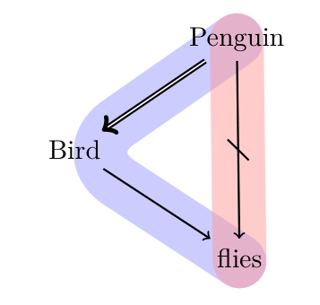

We use the following conventions: double arrows signify deductive or strict (i.e., nondefeasible) inferences, single arrows signify defeasible inferences, and strikethrough arrows signify that the negation of the pointed formula is implied. So, we can read the diagram as follows: Penguins are birds (no exceptions); Birds usually fly; and Penguins usually don’t fly.

We have a conflict between the following two arguments (where the arguments are sequences of inferences): *Penguin* $\Rightarrow$ *Bird* $\rightarrow$ *flies* (highlighted in blue) and *Penguin* $\rightarrow$ *not-flies* (highlighted in red). Both arguments include a final defeasible inference. What is important to note is that a penguin is a specific type of bird since *Penguin* $\Rightarrow$ *Bird* (while not *Bird* $\Rightarrow$ *Penguin*). According to the *Specificity Principle* an inference with a more specific antecedent overrides a conflicting defeasible inference with a less specific antecedent. Concerning the penguin Tweety, we thus infer that she does not fly on the basis of *Penguin* $\rightarrow$ *not-flies*. We resolve the conflict in favor of the inference based on the more specific information.

Logicians distinguish between *strong* and *weak specificity*: according to strong specificity $A \not\rightarrow C$ overrides $A \Rightarrow B \rightarrow C$; according weak specificity $A \not\rightarrow C$ overrides $A \rightarrow B \rightarrow C$. Note that the difference concerns the nature of the link between *A* and *B*.

A preference for one defeasible inference *A* $\rightarrow$ *B* over another conflicting one *C* $\rightarrow$ *D* may depend also on other factors. For example, in an epistemic context we can compare the strengths of *A* $\rightarrow$ *B* and *C* $\rightarrow$ *D* by appealing to the reliability of the source from which the respective conditional knowledge originates. In the context of legal reasoning, we may have the principles *lex superior* resp. *lex posterior*, according to which the higher-ranked, respectively, the later issued law dominates.

Given a way to compare the strength of defeasible inference steps using a preference relation $\prec$, the question remains of how to compare the strength of conflicting sequences of inferences (that is, arguments). We give some examples. For a systematic survey and classification of preference handling mechanisms in NML the interested reader is referred to Delgrande et al. (2004) and to Beirlaen et al. (2018).

According to the *Weakest Link Principle* (Pollock 1991)[^pollock-1991] an argument is preferred over another conflicting argument if its weakest defeasible link is stronger than the weakest defeasible link in the conflicting argument. Take, for example, the situation in the following figure:

> 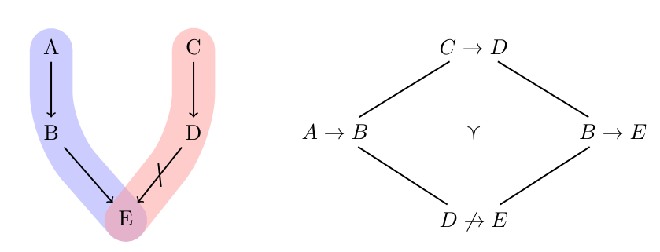

On the left we see an inference graph with two conflicting arguments (highlighted in blue and red). On the right we see the preference ordering. The argument $A \rightarrow B \rightarrow E$ is stronger than $C \rightarrow D \not\rightarrow E$ since for its weakest link $D \not\rightarrow E$ we have $D \not\rightarrow E \prec A \rightarrow B$ and $D \not\rightarrow E \prec B \rightarrow E$.

Another approach to preferences is procedural and greedy (Liao et al 2018)[^liao-2018]. Basically, it instructs to always apply the rule with the highest priority first. (There may be various such rules with highest priority, but for the sake of simplicity, we neglect this possibility in what follows.) Consider the following example that is frequently discussed in the literature. We have the rules

> 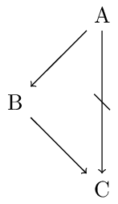

where $A \rightarrow B \prec A \not\rightarrow C \prec B \rightarrow C$ and we take $A$ to be given. We can apply the defeasible rules $A \rightarrow B$ and $A \not\rightarrow C$. If we operate in a “greedy” way, we may apply $A \not\rightarrow C$ to derive $C$ before applying $A \rightarrow B$, since $A \rightarrow B \prec A \not\rightarrow C$. Now only $A \rightarrow B$ is applicable. So we derive $B$. Although the antecedent of $B \rightarrow C$ is already derived, we cannot apply this rule for the sake of consistency. Brewka and Eiter (2000) argue against this greedy approach and in favor of deriving $B$ and $C$. Delgrande and Schaub (2000) argue that the example presents an incoherent set of rules. This is put into question in Horty (2007) where a consistent deontic reading in terms of conditional imperatives is presented which also challenges the procedural approach by favoring the conclusions $B$ and $C$.

Ford (2004) pointed out that the order of strict and defeasible links in arguments matters. For instance, she argues that an argument of the form $A \rightarrow B \Rightarrow D$ may be stronger than an argument of the form $A \Rightarrow C \not\rightarrow D$ (where $A \rightarrow B$ reads “Most *A*s are *B*s” and $A \Rightarrow C$ reads “All *A*s are *C*s.”). The reason is that in the former case it is not possible that no *A* is a *D* while in the second case it is possible that no *A* is a not-*D*. This is illustrated in the following figure:

> 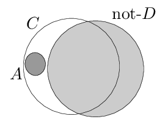 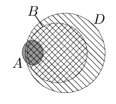

The left diagram demonstrates that there are distributions such that no *A*s are not-*D*s although $A \Rightarrow C$ and $C \not\rightarrow D$ hold. The diagram on the right features a distribution for $A \rightarrow B \Rightarrow D$. Whenever the extension of *A* is non-empty there will be *A*s that are *D*s.

### 2.2 Reasoning with unresolved conflicts

We now discuss questions arising from conflicts that cannot be resolved by any principle. Inferences can be drawn cautiously (skeptical) or boldly (credulous). The skeptical and credulous reasoning styles represent different interpretations of defeasible knowledge and lead to different warranted conclusions. Both are concerned with defeasible inferences that are acceptable to a rational reasoner. While a credulous reasoner considers as consequences those conclusions of inferences that are permissible for a rational reasoner to hold, the skeptical reasoner considers those that a rational reasoner must hold.

To better understand this distinction, let us have a look at a well-known example from the literature, the so-called “Nixon diamond,”. Suppose that our knowledge base contains (defeasible) information to the effect that a given individual, Nixon, is both a Quaker and a Republican. Quakers, by and large, are pacifists, whereas Republicans, by and large, are not. This is illustrated in the following figure:

> 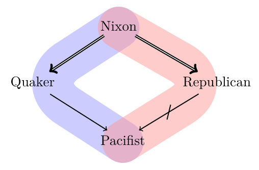

The question is what defeasible conclusions are warranted on the basis of this body of knowledge, and in particular whether we should infer that Nixon is a pacifist or that he is not a pacifist.

Neither the skeptical nor the credulous reasoner have logical grounds to prefer either conclusion (“Nixon is a pacifist”; “Nixon is not a pacifist”). While the credulous reasoner accepts both conclusions, the skeptical reasoner refrains from either.

Since both conclusions are based on contested inferences, neither must be accepted by a rational reasoner, which is why a skeptical reasoning style refrains from both. From the perspective of credulous reasoning, the conclusion according to which Nixon is a pacifist is acceptable, since it is permissible for a rational reasoner to hold. It is permissible since it can be defended from the counterargument based on Nixon being a republican (highlighted in red). In order to defend it, a rational reasoner refers to the fact that Nixon is also a Quaker (the corresponding argument is highlighted in blue). (This is particularly convincing, for a reasoner who considers being Quaker as more diagnostic of being a Pacifist than being a Republican is of not being a pacifist.) For the same reason, the conclusion that Nixon is not a pacifist is credulously acceptable.

A rationale behind the credulous reasoning type is to provide an overview of possible conclusions given the conflicting defeasible inferences in order to subsequently make a choice among them. This is especially interesting in practical reasoning contexts in which the choice determines a course of action and in which extralogical considerations (based on preferences, values, etc.) further narrow down the choice.

In contrast, the rationale behind the skeptical reasoning type is to determine uncontested defeasible conclusions. The purpose may be of a more epistemological nature such as the updating of the agent’s belief or knowledge base with the chosen conclusions.

### 2.3 Some advanced issues for skeptical reasoning

We now discuss some further issues that arise in the context of conflicting arguments. The first issue is illustrated in the following figure:

> 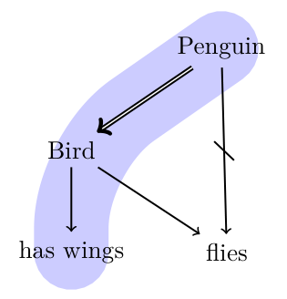

Consider the argument *Penguin* $\Rightarrow$ *Bird* $\rightarrow$ *has wings* (highlighted in blue). Since penguins do not fly, we know that penguins are exceptional birds, at least with respect to the property of flying. A very cautious reasoner may take this to be a reason to be skeptical about attributing other typical properties of birds to penguins. NMLs that do not allow to derive *has wings* are said to suffer from the *Drowning Problem* (Benferhat et al., 1993).

The question whether the exceptional status of *Penguin* relative to *flies* should spread also to other typical properties of *Bird* may depend on relevance relations among these properties. For instance, Koons (2017) proposes that causal relations play a role: whereas *has strong forlimb muscles* is causally related to *flies* and hence should not be attributed to penguins, the situation is different with *is cold-blooded*. Similarly, Pelletier and Elio (1994) argue that explanatory relations play a significant role in the way in which reasoners treat exceptional information in non-monotonic inference.

Another much discussed issue (e.g., Ginsberg 1994, Makinson and Schlechta 1991, Horty 2002)[^ginsberg-1994][^horty-2002][^makinson-1991][^makinson-1991-2] concerns the question whether a conclusion that is derivable via multiple conflicting arguments should be derived. Such conclusions are called *Floating Conclusions*. The following figure illustrates this with an extended version of the Nixon Diamond.

> 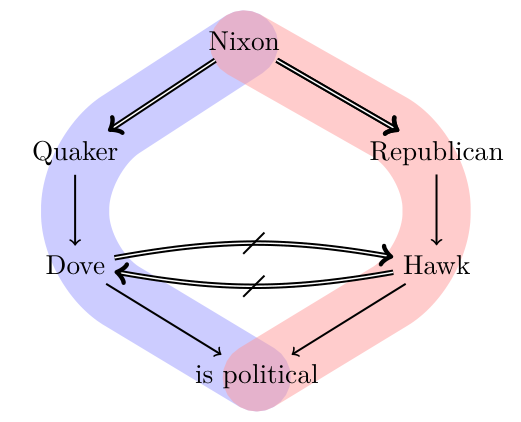

The floating conclusion in question concerns *is political*. It is derivable via the arguments *Nixon* $\Rightarrow$ *Quaker* $\rightarrow$ *Dove* $\rightarrow$ *is political* (highlighted in blue) and via *Nixon* $\Rightarrow$ *Republican* $\rightarrow$ *Hawk* $\rightarrow$ *is political* (highlighted in red). Both arguments are super-arguments of the conflicting *Nixon* $\Rightarrow$ *Quaker* $\rightarrow$ *Dove* and *Nixon* $\Rightarrow$ *Republican* $\rightarrow$ *Hawk*.[^note-2]Horty (1994) argues that floating conclusions are acceptable in reasoning contexts in which “the value of drawing conclusions is high relative to the costs involved if some of those conclusions turn out not to be correct” while they should be avoided “when the cost of error rises” (p. 123).

We conclude our discussion with so-called *Zombie-Arguments* (Makinson and Schlechta 1991, Touretzky et al. 1991)[^makinson-1991][^makinson-1991-2][^touretzky-1991]. Recall that a skeptical reasoner does not commit to a conflicting argument. Makinson and Schlechta (1991) argue that super-arguments of such conflicted arguments —although not acceptable— nevertheless still have the power to undermine the commitment of a reasoner to an otherwise unconflicted argument. We see an example in the following figure:

> 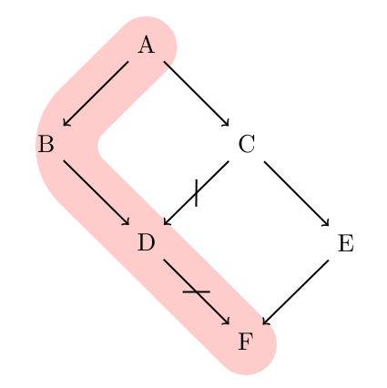

We observe two conflicting arguments concerning $D$: $A \rightarrow B \rightarrow D$ and $A \rightarrow C \not\rightarrow D$. Thus, we have *ambiguous* information concerning $D$. We observe further, that $F$ is a consequence of the (unconflicted) argument $A \rightarrow C \rightarrow E \rightarrow F$. It conflicts with the zombie-argument $A \rightarrow B \rightarrow D \not\rightarrow F$ (highlighted in red), which is a super-argument of the conflicted $A \rightarrow B \rightarrow D$. The name refers to undead beings since an argument such as $A \rightarrow B \rightarrow D \not\rightarrow F$ to which we have no commitment may still have the power to influence our commitment to an otherwise unconflicted argument such as $A \rightarrow C \rightarrow E \rightarrow F$. In the literature we can distinguish two approaches to such scenarios. In *ambiguitiy-propagating* formalisms the ambiguity in $D$ propagates to $F$, while in *ambiguity-blocking* formalisms it does not and so $F$ is considered a consequence in view of the uncontested argument $A \rightarrow C \rightarrow E \rightarrow F$ (Stein 1992)[^stein-1992].

## 3. Some Non-monotonic logics

Pioneering work in the field of NML began with the realization that CL is inadequte to give a mathematically precise characterization of defeasible reasoning. This insight was accompanied by the effort to reproduce the success of CL in the representation of mathematical, or formal, reasoning. Among the pioneers of the field in the late 1970s were J. McCarthy, D. McDermott & J. Doyle, and R. Reiter (see Ginsberg (1987) for a collection of early papers in the field and Gabbay et al. (1994) for a collection of excellent survey papers). In 1980, the *Artificial Intelligence Journal* published an issue (vol. 13, 1980) dedicated to these new formalisms, an event that has come to be regarded as the “coming of age” of NML.

In this section an overview will be provided on some important systems of NML. Since the evolutionary tree of NMLs has grown extraordinarily rich, we will restrict the focus on presenting the basic ideas behind some of the most influential and well-known approaches.

### 3.1 The closed-world assumption

Since one of the goals of non-monotonic logic is to provide an adequate account of defeasible reasoning, it is important to rely on a rich supply of examples to guide and hone intuitions. Database theory was one of the earliest sources of such examples, especially as regards the *closed world assumption*. Suppose a travel agent with access to a flight database needs to answer a client’s query about the best way to get from Oshkosh to Minsk. The agent queries the database, finds not such entry, and responds that there are no direct flights. How does the travel agent know this?

Our agent’s reasoning is based on the tacit assumption that the database is *complete*, and that since the database does not list any direct flights between the two cities, there are none. A useful way to think about this process is as a kind of *minimization*, i.e., an attempt to minimize the extension of the predicate (“flight-between,” in this case).

The idea of minimizing predicates is at the core of one of the earliest non-monotonic formalisms, McCarthy’s *circumscription* (McCarthy 1980)[^mccarthy-1980]. Circumscription makes explicit the intuition that, all other things being equal, extensions of certain predicates should be *minimal*. Consider principles such as “all normal birds fly”. Implicit in this principle is the idea that specimens should not be considered abnormal unless there is positive information to that effect. McCarthy’s idea was to represent this formally using second-order logic (SOL). In SOL, in contrast to first-order logic (FOL), it is allowed to explicitly quantify predicates, forming sentences such as $\exists P \forall x Px$ (“there is a universal predicate”) or $\forall P (Pa \equiv Pb)$ (“*a* and *b* are indiscernible”).

In circumscription, given predicates *P* and *Q*, we abbreviate $\forall x(Px \supset Qx)$ as $P \le Q$; similarly, we abbreviate $P \le Q \wedge \neg(Q \le P)$ as $P < Q$. If $A(P)$ is a formula containing occurrences of a predicate *P*, then the circumscription of *P* in *A* is the second-order sentence $A^{\star}(P)$:

> $A(P) \wedge \neg\exists Q[A(Q) \wedge Q < P]$

$A^{\star}(P)$ expresses that *P* satisfies *A*, and that no smaller predicate does. Let $Px$ be the predicate “*x* is abnormal,” and let $A(P)$ be the sentence “All birds that are not abnormal fly.” Then the sentence “Tweety is a bird,” together with $A^{\star}(P)$ implies “Tweety flies,” for the circumscription axiom forces the extension of *P* to be empty, so that “Tweety is normal” is automatically true.

In terms of consequence relations, circumscription allows us to define, for each predicate *P*, a non-monotonic relation $A(P) \nc \phi$ that holds precisely when $A^{\star}(P) \vDash \phi$. (This basic form of circumscription has been generalized to minimize a predicate’s extension while allowing others to vary.) From an application perspective, circumscription presents a significant computational limitation, inherent to the nature of the second-order language (SOL) in which it is formulated (see the entry on Second-order and Higher-order Logic for details). The issue with SOL, as opposed to first-order logic (FOL), is the absence of a complete inference procedure: the cost of the enhanced expressive capacity of SOL is the lack of complete axiomatizations available in FOL. Consequently, it is impossible to effectively enumerate all the validities of SOL, rendering the determination of $A(P) \nc \phi$ infeasible.

Another influential mechanism realizing the closed world assumption is *Negation as Failure* (or *Default Negation*). It can nicely be explained if we take a look at *Logic Programming*. A logic program consists of a list of rules such as:

> $\tau ~~ \leftarrow ~~ \phi_1, \dotsc, \phi_n, \mathit{not}~ \psi_1, \dotsc, \mathit{not}~ \psi_m$

In basic logic programs $\tau$ is a logical atom and $\phi_1, \dotsc, \phi_n, \psi_1, \dotsc, \psi_m$ are logical literals (i.e., atoms or negated atoms). The logical form or rules in such programs have been generalized in various ways (e.g., Alferes et al. 1995)[^alferes-1995] and many ways of interpreting rules have been proposed. To understand the meaning of the default negation *not* we consider a concrete example of a rule, namely:

> *flies* $~~\leftarrow~~$ *bird*, *not* *penguin*

Such rules read as expected, but with a small twist. As usual, the rule licenses its conclusion if the formulas in the antecedent (right-hand side) hold. The twist is that the falsity of (default) negated formulas such as *penguin* need not be positively established: Their falsity is assumed in the absence of a proof of the opposite. In our example, if *penguin* cannot be proved then *not penguin* is considered to hold (“by default”). A logic program for our Tweety example may consist of the rule above and

> *not-flies* $~~\leftarrow~~$ *penguin*
> *bird* $~~\leftarrow~~$ *penguin*

Suppose first all we know is *bird*. The latter two rules will not be triggered. The first rule will be applicable: *bird* is the case and we have no proof of *penguin* whence *not penguin* is assumed. This allows us to infer *flies*. Now suppose we know *penguin*. In this case, the first rule is not applicable since the default negation of *penguin* is false, but the latter two rules are triggered and we derive *bird* and *not-flies*.

### 3.2 Inheritance networks

In the context of a taxonomically organized body of knowledge, it is natural to assume that subclasses inherit properties from their superclasses: dogs have lungs because they are mammals and mammals have lungs. However, there may be exceptions. For example, mammals, by and large, do not fly; Since bats are mammals, in the absence of any information to the contrary, we are justified in inferring that bats do not fly. But if we learn that bats are exceptional mammals in that they do fly, the conclusion that they do not fly is retracted, and the conclusion that they fly is drawn instead. There are more complicated scenarios. For example, baby bats are exceptional bats in that they do not fly. Our example gives rise to potentially conflicting inferences. When we infer that Stellaluna, being a baby bat, does not fly, we are resolving all these potential conflicts based on the Specificity Principle.

*Non-monotonic inheritance networks* were developed for the purpose of capturing taxonomic examples such as the one above. Such networks are collections of nodes and directed (‘*is-a*’) links that represent taxonomic information. When exceptions are allowed, the network is interpreted *defeasibly*. The following figure gives a network representing this state of affairs:

> 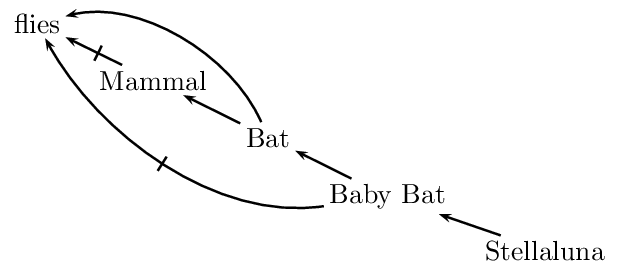

In such a network, links of the form $A \rightarrow B$ represent the fact that, typically and for the most part, *A*s are *B*s, and therefore the information about *A*s is more specific than the information about *B*s. More specific information overrides more generic information. Research on non-monotonic inheritance focuses on the different ways in which one can make this idea precise.

The main issue in defeasible inheritance is to characterize the set of assertions that are supported by a given network. It is of course not enough to devise a representational formalism; one also needs to specify how the formalism is to be interpreted. This characterization is accomplished through the notion of an *extension* of a given network. There are two competing characterizations of extension, one that follows the credulous strategy and one that follows the skeptical one. Both utilize the notion of the *degree* of a path through the network, defined as the length of the longest sequence of links connecting its endpoints. Extensions are then constructed by considering paths in ascending order of their degrees. The specifics will not be detailed here, as many analogous issues are addressed in the context of Default Logic (discussed subsequently), with Horty (1994) offering a comprehensive survey. It is also noteworthy that the notion of degree is applicable solely to acyclic networks, thus posing particular challenges when networks contain cycles (refer to Antonelli (1997) for an analysis of inheritance in cyclic networks).

Although the language of non-monotonic networks is limited by design (in that only links of the form ‘*is-a*’ — and their negations — can be represented), such networks provide a remarkably useful setting in which to test and refine one’s intuitions and methods for handling defeasible information. Such intuitions and methods are then applied to more expressive formalisms.

### 3.3 Argument-based approaches

In *argument-based approaches* to defeasible reasoning the notion of a path through an inheritance network is generalized to the notion of an argument. Abstracting from the specifics and subtleties of formalisms proposed in the literature[^note-3], an *argument* can be thought of in the following way. Given a language $\mathcal{L}$, a set of $\mathcal{L}$-formulas $\Gamma$, a set of strict rules *SRules* of the form $\phi_1, \dotsc, \phi_n \Rightarrow \psi$ (where $\phi_i$ and $\psi$ are $\mathcal{L}$-formulas) and a set of defeasible rules *DRules* of the form $\phi_1, \dotsc, \phi_n \rightarrow \psi$ (where $\phi_i$ and $\psi$ are $\mathcal{L}$-formulas) an *argument* $(\Theta, \theta)$ *for* $\tau$ is a proof of $\tau$ from some $\Theta \subseteq \Gamma$ using the rules in *SRules* and *DRules*.

A central notion in argument-based approaches is an *argumentative attack*. We can, for instance, distinguish between rebuts and undercuts. A *rebut* of an argument $(\Theta, \tau)$ is an argument that establishes that $\tau$ is not the case. An *undercut* of $(\Theta, \tau)$ establishes that $\Theta$ does not support $\tau$. For instance, the argument that concludes that an object is red from the fact that it looks red is undercut by means of the observation that that object is illuminated by red light (Pollock 1995)[^pollock-1995]. Note that in order to undercut an argument for $\tau$ one need not establish that $\tau$ does not hold.

Argument-based approaches are based on the idea of argument *acceptability*. In Dung (1995), an argument is acceptable if it can be defended against argumentative attacks. This means that acceptability can be decided purely on the basis of the attack relations between arguments, abstracting away from the specific structure of the arguments themselves. It gives rise to a two-phase methodology in which arguments and attacks are first generated on the basis of a knowledge base, and then acceptability is determined on the basis of the attack relation between arguments. Given that *Args* represents the set of arguments generated from $\Gamma$ by the rules in *SRules* and *DRules*, we define an attack relation ${\leadsto} \subseteq \mathit{Args} \times \mathit{Args}$ as follows: $a \leadsto b$ if and only if $a$ attacks (e.g., rebuts or undercuts) $b$. This leads to the formulation of a directed graph, termed the *argumentation framework*, where the arguments are depicted as nodes, and the arrows denote the attack relations. (Note that, at the graph level, arguments are treated abstractly and their concrete structures are not represented within the graph.)

Various *argumentation semantics* have been proposed for argumentation frameworks, specifying criteria for selecting sets of arguments that represent stances of rational agents. Clearly, a selected set of arguments $S \subseteq \mathit{Args}$ should satisfy the following requirements:

- $S$ should be *conflict-free*, i.e., for all $a, b \in \mathit{Args}$, $a$ does not attack $b$.
- $S$ should be able to defend itself against all attackers. More precisely, $S$ is *admissible* if and only if $S$ is conflict-free and for every $a \in \mathit{Args}$ that attacks some $b \in S$ there is a $c \in S$ that attacks $a$.

For instance, given the following graph,

> 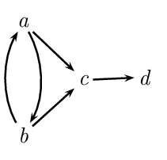

$\{a\}$ is admissible, while $\{a,b\}$ is not conflict-free and $\{d\}$ is not admissible.

Given these basic requirements, we can define, for instance, the following semantics that is frequently adopted in the literature:

- A *preferred* set of arguments $S$ is an admissible set of arguments that is maximal in *Args* relative to set-inclusion.

In our example, $\{a,d\}$ and $\{b,d\}$ are the two preferred sets. This shows that the preferred semantics does not determine a unique selection. In order to define a consequence relation, we can proceed either according to the credulous rationale or according to the skeptical rationale. Considering an abstract argumentation framework based on $\Gamma$, *SRules*, and *DRules*, we give two examples of how a consequence set can be characterized by means of the skeptical approach (Prakken 2010)[^prakken-2010]:

- $\tau$ is a consequence if in each preferred set $S$ of arguments there is an argument *a* for $\tau$.
- $\tau$ is a consequence if there is an argument *a* for $\tau$ that is in every preferred set of arguments $S$.

The second approach is more cautious. Intuitively, it demands that there is a specific argument for $\tau$ contained in each rational stance that a reasoner can take given $\Gamma$, *DRules*, and *SRules*. The first option does not bind the acceptability of $\tau$ to a specific argument: it is sufficient if according to each rational stance there is some argument for $\tau$.

Argumentation-based approaches have been considered a promising unifying framework in NML (Dung 1995)[^dung-1995]. Many other systems of NML have been translated into logical argumentation, such as approaches based on consistent subsets (see Arieli et al. 2019 for an overview)[^arieli-2019] and approaches based on default logic (van Berkel et al. 2024)[^berkel-2024] and its prioritized variants (D’Agostino and Modgil 2018, Liao et al. 2018, Pardo and Straßer 2024)[^d’agostino-2018][^d’agostino-2018-2][^liao-2018][^pardo-2024].

### 3.4 Default logic

In *Default Logic*, the main representational tool is that of a *default rule*, or simply a *default*. A default is a defeasible inference rule of the form

> $(\gamma: \theta) / \tau$

where $\gamma, \theta$, and $\tau$ are sentences in a given language, respectively called the *pre-requisite*, the *justification* and the *conclusion* of the default. The interpretation of the default is that if $\gamma$ is known and there is no evidence that $\theta$ is false, then $\tau$ can be inferred.

The application of a default rule should not result in inconsistency with pre-existing beliefs. The complexity in satisfying this consistency requirement arises from interactions among rules. Specifically, the application of a certain rule may lead to the failure of the consistency condition for another, possibly the same, rule. For example, if $\theta$ equals $\neg\tau$, then applying the rule could be considered self-defeating, as the application of the rule itself leads to the failure of the consistency condition.

Reiter’s default logic (Reiter 1980)[^reiter-1980] uses the notion of an *extension* to make precise the idea that the consistency condition must be met both before and after the rule is applied. Given a set $\Delta$ of defaults, an extension for $\Delta$ represents a set of inferences that can be drawn *reasonably* and *consistently* using defaults from $\Delta$.

An extension is defined relative to a *default theory*. The latter is a pair $(\Gamma, \Delta)$, where $\Delta$ is a (finite) set of defaults, and $\Gamma$ is a set of sentences (a world description). The idea is that $\Gamma$ represents the strict or background information, while $\Delta$ specifies the available defeasible information. We say that $\Xi$ is an *extension* for a default theory $(\Gamma, \Delta)$ if and only if

> $\Xi = \Xi_0 \cup \Xi_1 \cup \ldots \cup \Xi_n \cup \ldots$

where $\Xi_0 = \Gamma$, and

> $\Xi_{i+1} = \mathrm{Cn}(\Xi_i) \cup \bigl\{\tau \mid (\gamma : \theta) / \tau \in \Delta \text{ where } \neg\theta \notin \Xi \text{ and } \gamma \in \Xi_i \bigr\}$

where $\mathrm{Cn}(\cdot)$ is the consequence relation of CL. It is important to notice the occurrence of the limit $\Xi$ in the definition of $\Xi_{i+1}$: the condition above is not a recursive definition of the garden-variety, but a truly circular characterization of extensions.

This circularity can be made explicit by giving an equivalent definition of extension as solution of fixed-point equations. Given a default theory $(\Gamma, \Delta)$, let $\mathsf{S}$ be an operator defined on sets of sentences such that for any such set $\Phi$, $\mathsf{S}(\Phi)$ is the smallest set that satisfies the following three requirements:

- it contains $\Gamma$ ($\Gamma \subseteq \mathsf{S}(\Phi)$),
- it is deductively closed (that is, if $\mathsf{S}(\Phi) \vDash \phi$ then $\phi \in \mathsf{S}(\Phi)$),
- and it is closed under the default rules in $\Delta$: whenever for a default $(\gamma : \theta) / \tau \in \Delta$ both $\gamma \in \mathsf{S}(\Phi)$ and $\neg\theta \notin \Phi$, then $\tau \in \mathsf{S}(\Phi)$.

It can be shown that $\Xi$ is an extension of $(\Gamma,\Delta)$ if and only if $\Theta$ is a fixed-point of $\mathsf{S}$, that is, if $\mathsf{S}(\Xi) = \Xi$.

Neither one of the two characterizations of extension for default logic (i.e. the fixpoint definition and the pseudo-iterative one) provides a way to “construct” extensions by means of an iterative process. Essentially, one has to “guess” a set of sentences $\Xi$, and then verify that it satisfies the definition of an extension.

For any given default theory, extensions need not exist, and even when they exist, they need not be unique. We start with an example of the former situation. Let $\Gamma = \emptyset$ and let $\Delta$ comprise the single default[^note-4]

> $(\top : \theta) / \neg \theta$

If $\Xi$ were an extension, then the justification $\theta$ of the default above would be consistent with $\Xi$ or not, and either case is impossible. For if $\theta$ were consistent with $\Xi$, then the default would be applied to derive $\neg\theta$ in contradiction the consistency of $\Xi$ with $\theta$. Similarly, if $\Xi$ were inconsistent with $\theta$ then $\Xi \vDash \neg \theta$ and hence, by deductive closure, $\neg\theta \in \Theta$. Our default would not be applicable, in which case $\Xi = \Xi_1 = \mathrm{Cn}(\emptyset)$. But then $\neg\theta \notin \Xi$,—a contradiction.

For normal default theories that only consist of *normal defaults*, that is, defaults of the form $(\gamma : \theta) / \theta$, extensions always exist.

Lukaszewicz (1988) presents a modified definition of extension that avoids the previous two problems: it is defined in an iterative way and it warrants the existence of an extension. In a nutshell, the idea is to keep track of the justifications used in the procedure. A default is applied in case its precondition is implied by the current beliefs and its conclusion is consistent with the given beliefs, its own justification, and each of the justifications of previously applied defaults. Additionally, for normal theories, Lukaszewicz’s definition of extensions is equivalent to the definitions from above.

Let us now consider an example of a default theory with multiple extensions. Let $\Gamma = \emptyset$, and suppose that $\Delta$ comprises the following two defaults

> $(\top : \theta) / \neg\tau$ and $(\top: \tau)/\neg\theta$

This theory has exactly two extensions, one in which the first default is applied and one in which the second one is applied. It is easy to see that at least one default has to be applied in any extension and that both defaults cannot be applied in the same extension.

The fact that default theories can have zero, one, or multiple extensions raises the issue of what inferences one is justified in drawing from a given default theory. The problem can be presented as follows: Given a default theory $(\Gamma, \Delta)$, what sentences can be regarded as *defeasible consequences* of the theory?

Sometimes it may be useful to map out all the consequences that can be drawn from *all* the extensions, for instance, in order to identify extensions that give rise to undesired consequences (in view of extralogical considerations). The credulous approach does just that: $(\Gamma, \Delta) \nc \phi$ if and only if $\phi$ belongs to *any* extension of the theory. Note that, in case of multiple extensions the credulous consequence set will not be closed under CL and it may be inconsistent.

Alternatively, one can adopt the skeptical strategy according to which $(\Gamma, \Delta) \nc \phi$ if and only if $\phi$ is contained in *every* extension of $(\Gamma, \Delta)$.

Skeptical consequence, as based on Reiter’s notion of extension, fails to be cautiously monotonic (Makinson 1994)[^makinson-1994]. To see this, consider the default theory $(\emptyset, \Delta)$, where $\Delta$ comprises the following two defaults:

> $(\top: \theta)/\theta$ and $(\theta \vee \gamma : \neg \theta) / \neg \theta$

This theory has only one extension, coinciding with the deductive closure of $\{\theta\}$. Hence, according to skeptical consequence we have $(\emptyset, \Delta) \nc \theta$, as well as $(\emptyset, \Delta) \nc \theta \vee \gamma$ (by the deductive closure of extensions).

Now consider the theory $(\{\theta \vee \gamma\}, \Delta)$. It has two extensions: one is the same as before, but also another one coinciding with the deductive closure of $\{\neg\theta\}$, and hence not containing $\theta$. It follows that the intersection of the extensions no longer contains $\theta$, so that $(\{\theta \vee \gamma\}, \Delta) \nc \theta$ *fails*, against Cautious Monotony. (Notice that the same example establishes a counter-example for Cut for the credulous strategy: for this we consider the extension of $(\{\theta \vee \gamma\}, \Delta)$ that contains $\neg\theta$.)

In Antonelli (1999) a notion of *general extension* for default logic is introduced, showing that this notion yields a well-behaved relation of defeasible consequence $\nc$ that satisfies Supraclassicality (if $\Gamma \vDash \phi$ then $\Gamma \nc \phi$) and the three central requirements for NMLs Reflexivity, Cut, and Cautious Monotony from Gabbay (1985). The idea behind general extensions can be explained in a particularly simple way in the case of *pre-requisite free* default theories (called “categorical” in *Antonelli (1999)*). A general extension for such a default theory is a *pair* $(\Gamma^+, \Gamma^-)$ of sets of defaults (or conclusions thereof) that simultaneously satisfies *two* fixed-point equations. The set $\Gamma^+$ comprises (conclusions of) defaults that are explicitly triggered, and the set $\Gamma^-$ comprises (conclusions of) defaults that are explicitly ruled out. The intuition is that defaults that are not ruled out can still prevent other defaults from being triggered (although they might not be triggered themselves). We thus obtain a “3-valued” approach (not unlike that of Kripke’s theory of truth (Kripke 1975)[^kripke-1975]), in virtue of which general extensions are now endowed with a non-trivial (i.e., not “flat”) algebraic structure. It is then possible to pick out, in a principled way, a particular general extension (for instance, the unique least one, which is always guaranteed to exist) on which to base a notion of defeasible consequence.

A different set of issues arises in connection with the behavior of default logic from the point of view of computation. For a given semi-decidable set $\Phi$ of sentences, the set of all $\phi$ that are a consequence of $\Phi$ in FOL is itself semi-decidable (see the entry on computability and complexity). In the case of default logic, to formulate the corresponding problem one extends (in the obvious way) the notion of (semi-)decidability to sets of defaults. The problem, then, is to decide, given a default theory $(\Gamma,\Delta)$ and a sentence φ whether $(\Gamma,\Delta) \nc \phi$, where $\nc$ is defined, say, skeptically. Such a problem is not even semi-decidable, since, in order to determine whether a default is triggered by a pair of sets of sentences, one has to perform a consistency check, and such checks are not computable.

Default logic as defined above does not prioritize among defaults. In Poole (1985) we find an approach in which the Specificity Principle is considered. In Horty (2007) defaults are ordered by a strict partial order $\prec$ where $(\gamma : \theta)/\tau \prec (\gamma' : \theta') / \tau'$ means that $(\gamma' : \theta') / \tau'$ has priority over $(\gamma : \theta) / \tau$. The ordering $\prec$ may express —depending on the application— specificity relations, the comparative reliability of the conditional knowledge expressed by defaults, etc. An *ordered default theory* is then a triple $(\Gamma, \Delta, \prec)$ where $(\Gamma, \Delta)$ is a default theory. We give an example, but omit a more technical explanation. Take $\Gamma$ = {*bird*, *penguin*}, $\Delta$ = {*bird* $\rightarrow$ *flies*, *penguin* $\rightarrow$ ¬*flies*} and *bird* $\rightarrow$ *flies* $\prec$ *penguin* $\rightarrow$ ¬*flies*, where $\phi \rightarrow \psi$ represents the normal default $(\phi: \psi) / \psi$. We have two extensions of $(\Gamma,\Delta)$, one in which *bird* $\rightarrow$ *flies* is applied and one in which *penguin* $\rightarrow$ ¬*flies* is applied. Since the latter default is $\prec$-preferred over the former, only the latter extension is an extension of $(\Gamma,\Delta,\prec)$.

### 3.5 Autoepistemic logic

An NML closely related to default logic is Moore’s *Autoepistemic Logic* (Moore 1985)[^moore-1985]. It models the reasoning of an ideal agent reflecting on her own beliefs. For instance, sometimes the absence of a belief in $\phi$ may give an agent a reason to infer $\neg\phi$. Moore gives the following example: If I had an older brother, I would know about it. Since I do not, I believe not to have an older brother.

An autoepistemic theory consists of the beliefs of an agent including her reflective beliefs about her beliefs. For the latter an autoepistemic belief operator $\mathsf{B}$ is used. In our example such a theory may contain $\neg \mathsf{B} \mathit{brother} \supset \neg \mathit{brother}$. Autoepistemic logic specifies ideal properties of such theories. Following Stalnaker (1993), an autoepistemic theory $\Gamma$ should be *stable*:

- $\Gamma$ should be closed under classical logic: if $\Gamma \vDash \phi$ then $\phi \in \Gamma$;
- $\Gamma$ should be introspectively adequate:
- if $\phi \in \Gamma$ then $\mathsf{B}\phi \in \Gamma$;
- if $\phi \notin \Gamma$ then $\neg \mathsf{B} \phi \in \Gamma$.

If $\Gamma$ is consistent, stability implies that

- $\phi \in \Gamma$ if and only if $\mathsf{B} \phi \in \Gamma$, and
- $\phi \notin \Gamma$ if and only if $\neg \mathsf{B} \phi \in \Gamma$.

Let us, for instance, consider the two types of consistent stable sets that extend $\Xi_1 = \{ \neg \mathsf{B} \mathit{brother} \supset \neg \mathit{brother} \}$:

1. $\Gamma_1$ for which $\mathit{brother} \in \Gamma_1$ and also by introspection $\mathsf{B} \mathit{brother} \in \Gamma_1$.
2. $\Gamma_2$ for which $\mathit{brother} \notin \Gamma_2$. Hence, $\neg \mathsf{B} \mathit{brother} \in \Gamma_2$ and by closure, $\neg \mathit{brother} \in \Gamma_2$. Thus, by introspection also $\mathsf{B}\neg \mathit{brother} \in \Gamma_2$.

The second option seems more intuitive since given only $\neg \mathsf{B} \mathit{brother} \supset \neg \mathit{brother}$ the belief in $\mathit{brother}$ seems intuitively speaking ungrounded in the context of $\Xi_1$. To make this formally precise, Moore defines

- $\Gamma$ is *grounded in a set of assumptions $\Xi$* if for each $\psi \in \Gamma$, $\Xi \cup \{ \mathsf{B}\phi \mid \phi \in \Gamma\} \cup \{\neg \mathsf{B}\phi \mid \phi \notin \Gamma\} \vDash \psi$.

Stable theories that are grounded in a set of assumptions $\Xi$ are called *stable expansions of $\Xi$* or *autoepistemic extensions of $\Xi$*. Stable expansions $\Gamma$ of $\Xi$ can equivalently be characterized as fixed points:

> $\Gamma = \mathrm{Cn}\bigl( \Xi \cup \{ \mathsf{B}\phi \mid \phi \in \Gamma\} \cup \{\neg \mathsf{B} \phi \mid \phi \notin \Gamma\}\bigr)$

where $\mathrm{Cn}(\cdot)$ is the consequence function of CL.

There is no stable theory that is grounded in $\Xi_1$ and that contains $\mathit{brother}$ and / or $\mathsf{B} \mathit{brother}$ like our $\Gamma_1$ above. The reason is that we fail to derive $\mathit{brother}$ from $\Xi_1 \cup \{\mathsf{B} \psi \mid \psi \in \Gamma_1\} \cup \{\neg \mathsf{B} \psi \mid \psi \notin \Gamma_1\}$. The only stable extension of $\Xi_1$ contains $\neg \mathsf{B} \mathit{brother}$ and $\neg \mathit{brother}$.

Just as in default logic, in autoepistemic logic some sets of assumptions have no stable extensions while some have multiple stable extensions. We demonstrate the former case with $\Xi_2 = \{\neg \mathsf{B} \phi \supset \phi\}$. Suppose there is a stable extension $\Gamma$ of $\Xi_2$. First note that there is no way to ground $\phi$ in view of $\Xi_2$. Hence $\phi \notin \Gamma$ which means that $\neg \mathsf{B} \phi \in \Gamma$. But then $\phi \in \Gamma$ by modus ponens which is a contradiction.

A potentially problematic property of Moore’s notion of groundedness is that it allows for a type of epistemic bootstrapping. Take $\Xi_3 = \{\mathsf{B}\phi \supset \phi\}$. Suppose that an agent adopts the belief that she believes $\phi$, i.e. $\mathsf{B}\phi$. Now she can use $\mathsf{B}\phi \supset \phi$ to derive $\phi$. Hence, on the basis of $\Xi_3$ she can ground her belief in $\phi$ on her belief that she believes $\phi$. In fact, there is a stable extension of $\Xi_3$ that contains $\phi$ and $\mathsf{B} \phi$. In view of this, weaker forms of groundedness have been proposed in Konolige (1988) that do not allow for this form of bootstrapping and according to which we only have the extension of $\Xi_3$ that contains neither $\phi$ nor $\mathsf{B}\phi$.

The centrality of autoepistemic logic in NML is emphasized by the fact that several tight links to other seminal NMLs have been established. Let us mention three such links.

First, there are close connections between autoepistemic logic and logic programming. For instance, Gelfond’s and Lifschitz’s stable model semantics for logic programming with negation as failure which serves as the foundation for the answer set programming paradigm in computer science has been equivalently expressed by means of autoepistemic logic (Gelfond and Lifschitz 1988)[^gelfond-1988]. The result is achieved by translating clauses in logic programming

> $\phi ~~ \leftarrow ~~ \phi_1, \dotsc, \phi_n, \mathit{not}~\psi_1, \dotsc, \mathit{not}~\psi_m$

in such a way that negation as failure ($\mathit{not}~\psi$) gets the meaning “it is not believed that $\psi$” ($\neg \mathsf{B}\psi$):

> $(\phi_1 \wedge \ldots \wedge \phi_{n} \wedge \neg \mathsf{B} \psi_1 \wedge \ldots \wedge \neg \mathsf{B} \psi_m) \supset \psi$

A second link has been established in Konolige (1988) with default logic which has been shown translatable to and equi-expressive with Konolige’s strongly grounded variant of autoepistemic logic. Default rules $(\gamma : \theta) / \tau$ are translated by interpreting consistency conditions $\theta$ by $\neg \mathsf{B} \neg \theta$ which can be read as “$\theta$ is consistent with the given beliefs”:

> $(\mathsf{B} \gamma \wedge \neg \mathsf{B} \neg \theta) \supset \tau$

Especially the latter link is rather remarkable since the subject matter of the given formalisms is quite different. While default logic deals with defeasible rules, i.e. rules that allow for exceptions (such as ‘Birds fly’), the non-monotonicity of autoepistemic logic is rooted in the indexicality of its autoepistemic belief operator (Moore 1984, Konolige 1988)[^konolige-1988][^moore-1984]: it refers to the autoepistemic theory into which it is embeded, and hence its meaning may change when we add beliefs to the theory.

Various modal semantics have been proposed for autoepistemic logic (see the entry on modal logic for more background on modal logics). For instance, Moore (1984) proposes an S5-based Kripkean possible world semantics and Lin and Shoham (1990) propose bi-modal preferential semantics (see Section Selection semantics below) for both autoepistemic logic and default logic. In Konolige (1988) it has been observed that the fixed point characterization of stable expansions can be alternatively phrased only on the basis of the set of formulas $\Gamma_0$ in $\Gamma$ that do not contain occurrences of the modal operator $\mathsf{B}$:

> $ \Gamma = \mathrm{Cn}_{\mathsf{K45}}\bigl( \Xi \cup \{ \mathsf{B}\phi \mid \phi \in \Gamma_0\} \cup \{\neg \mathsf{B}\phi \mid \phi \notin \Gamma_0\}\bigr)$

where $\mathrm{Cn}_{\mathsf{K45}}(\cdot)$ is the consequence function of the modal logic $\mathsf{K45}$.

### 3.6 Selection semantics

In CL a formula $\phi$ is entailed by $\Gamma$ (in signs $\Gamma \vDash \phi$) if and only if $\phi$ is valid in all classical models of $\Gamma$. An influential idea in NML is to define non-monotonic entailment not in terms of *all* classical models of $\Gamma$, but rather in terms of a *selection* of these models (Shoham 1987)[^shoham-1987]. Intuitively, the idea is to read

> $\Gamma \nc \phi$ as “$\phi$ holds in the most normal/natural/etc. models of $\Gamma$.”

#### 3.6.1 The core properties

In the seminal paper Kraus et al. (1990) this idea is investigated systematically. The authors introduce various semantic structures, among them preferential ones. A *preferential structure* $S$ consists of

- a set $\Omega$ of states
- and an irreflexive and transitive relation $\prec$ on $\Omega$.

In the context of preferential structures one may think of states in terms of labelled models $M_s$ of classical propositional logic, where each label $s$ is attached to a unique model $M$ but a model may occur under various labels in $\Omega$.[^note-5] For the ease of demonstration we will henceforth just talk about ‘models in $\Omega$’ and not anymore refer to states or labelled models.

Intuitively, $M \prec M'$ if $M$ is more normal than $M'$. The relation $\prec$ can be employed to formally realize the idea of defining a consequence relation in view of the most normal models, namely by focusing on $\prec$-minimal models. Formally, where $[\psi]$ is the set of all models of $\psi$ in $\Omega$, $\nc^S$, is defined as follows:

> $\psi \nc^S \phi$ if and only if $\phi$ holds in all $\prec$-minimal models in $[\psi]$.

In order to warrant that there are such minimal states, $\prec$ is considered to be *smooth* (also sometimes called *stuttered*), i.e., for each $M$ either $M$ is $\prec$-minimal or there is a $\prec$-minimal $M'$ such that $M' \prec M$.

Preferential structures enjoy a central role in NML since they characterize *preferential consequence relations*, i.e., non-monotonic consequence relations $\nc$ that fulfill the following central properties, also referred to as the *core properties* or the *conservative core* of non-monotonic reasoning systems or as the *KLM-properties* (in reference to the authors of Kraus, Lehmann, Magidor 1990):

- **Reflexivity**: $\phi \nc \phi$.
- **Cut**: If $\phi \wedge \psi \nc \tau$ and $\phi \nc \psi$, then $\phi \nc \tau$.
- **Cautious Monotony**: If $\phi \nc \psi$ and $\phi \nc \tau$ then $\phi \wedge \psi \nc \tau$.
- **Left Logical Equivalence**: If $\vDash \phi \equiv \psi$ and $\phi \nc \tau$, then $\psi \nc \tau$.
- **Right Weakening**: If $\vDash \phi \supset \psi$ and $\tau \nc \phi$, then $\tau\nc \psi$.
- **OR**: If $\phi \nc \psi$ and $\tau \nc \psi$, then $\phi \vee \tau \nc \psi$.

The former three properties are those we have already seen above. According to Left Logical Equivalence, classically equivalent formulas have the same non-monotonic consequences. Where $\psi$ is classically entailed by $\phi$, Right Weakening expresses that whenever $\phi$ is a non-monotonic consequence of $\tau$ then so is $\psi$.

Without further commentary we state two important derived rules:

- **AND**: If $\phi \nc \psi$ and $\phi \nc \tau$ then $\phi \nc \psi \wedge \tau$.
- **S**: If $\phi \wedge \psi \nc \tau$ then $\phi \nc \psi \supset \tau$.

In Kraus et al. (1990) it is shown that a consequence relation $\nc$ is preferential if and only if $\nc = \nc^S$ for some preferential structure $S$.

Given a set of conditional assertions $\mathbf{K}$ of the type $\phi \nc \psi$ one may be interested in investigating what other conditional assertions follow. The following two strategems lead to the same results. The first option is to intersect all preferential consequence relations $\nc$ that extend $\mathbf{K}$ (in the sense that the conditional assertions in $\mathbf{K}$ hold for $\nc$) obtaining the *Preferential Closure* $\nc^{\mathrm{P}}$ of $\mathbf{K}$. The second option is to use the five defining properties of preferential consequence relations as deduction rules for syntactic units of the form $\phi \nc \psi$. This way we obtain the deductive *system P* with its consequence relation $\vdash^{\mathrm{P}}$ for which:

> $\mathbf{K} \vdash^{\mathrm{P}} \phi \nc \psi$ if and only if $\phi \nc^{\mathrm{P}} \psi$.

#### 3.6.2 Various semantics

One of the most remarkable facts in the study of NMLs is that various other semantics have been proposed —often independently and based on very different considerations— that also adequately characterize preferential consequence relations. This underlines the central status of the core properties in the formal study of defeasible reasoning.

Many of these approaches use structures $S = (\Omega, \Pi)$ where $\Omega$ is again a set of classical models and $\Pi$ is a mapping with the domain $\wp(\Omega)$ (the set of subsets of $\Omega$) and an ordered co-domain $(D, <)$. The exact nature of $(D, <)$ depends on the given approach and we give some examples below. The basic common idea is to let $\phi \nc^S \psi$ in case $\Pi([\phi \wedge \psi])$ is preferable to $\Pi([\phi \wedge \neg \psi])$ in view of $<$. The following table lists some proposals which we discuss some more below:

| $\Pi$ | $\phi \nc^S \psi$ iff | Structures |
| --- | --- | --- |
| possibility measure | $\pi([\phi]) = 0$ or | possibilistic structures |
| $\pi: \wp(\Omega) \rightarrow [0,1]$ | $\pi([\phi \wedge \psi]) > \pi([\phi \wedge \neg \psi])$ |   |
| ordinal ranking function | $\kappa([\phi]) = \infty$ or | ordinal ranking structures |
| $\kappa: \wp(\Omega) \rightarrow \{0,1,\dotsc,\infty\}$ | $\kappa([\phi \wedge \psi]) < \kappa([\phi \wedge \neg \psi])$ |   |
| plausibility measure | $\mathrm{Pl}([\phi]) = \bot$ or | plausibility structures |
| $\mathrm{Pl}: \wp(\Omega) \rightarrow D$ | $\mathrm{Pl}([\phi \wedge \psi]) > \mathrm{Pl}([\phi \wedge \neg \psi])$ |   |

Possibility measures assign real numbers in the interval [0,1] to propositions to measure their possibility, where 0 corresponds to impossible states and 1 to necessary states (Dubois and Prade 1990)[^dubois-1990]. Ordinal ranking functions rank propositions via natural numbers closed with ∞ (Goldszmidt and Pearl 1992, Spohn 1988)[^goldszmidt-1992][^spohn-1988]. We may think of $\kappa([\phi])$ as the level of surprise that we would face if $\phi$ holds, where ∞ represents maximal surprise. Finally, plausibility measures (Friedman and Halpern 1996, Rott 2013)[^friedman-1996][^rott-2013] associate propositions with elements in a partially ordered domain with the bottom element $\bot$ and the top element $\top$ in order to compare their plausibilities. Given some simple constraints on $\mathrm{Pl}$ (such as: If $\mathrm{Pl}(X) = \mathrm{Pl}(Y) = \bot$ then $\mathrm{Pl}(X \cup Y) = \bot$) we speak of *qualitative plausibility structures*. The following statements are all equivalent, which emphasizes the centrality of the core properties in the study of NMLs:

- $\mathbf{K} \vdash^P \psi$
- $\phi \nc^S \psi$ for all preferential structures $S$ for which $\nc^S$ extends $\mathbf{K}$
- $\phi \nc^S \psi$ for all possibilistic structures $S$ for which $\nc^S$ extends $\mathbf{K}$
- $\phi \nc^S \psi$ for all ordinal ranking structures $S$ for which $\nc^S$ extends $\mathbf{K}$
- $\phi \nc^S \psi$ for all qualitative plausibility structures $S$ for which $\nc^S$ extends $\mathbf{K}$

Yet another well-known semantics that characterizes preferential consequence relations makes use of *conditional probabilities*. The idea is that $\phi \nc \psi$ holds in a structure if the conditional probability $P(\psi \mid \phi)$ is closer to 1 than an arbitrary $\epsilon$, whence the name $\epsilon$-*semantics* (Adams 1975, Pearl 1989)[^adams-1975][^pearl-1989].

The following example demonstrates that the intuitive idea of using a threshold value such as ½ instead of infinitesimals and to interpret $\phi \nc \psi$ as $P(\psi \mid \phi)$ > ½ does not work in a straightforward way. Let $\alpha$ abbreviate “being a vegan”, $\beta$ abbreviate “being an environmentalist”, and $\gamma$ abbreviate “avoiding the use of palm oil”. Further, let our knowledge base comprise the statements “αs are usually βs,” “$(\alpha \wedge \beta)$s are usually γs”. The following Euler diagram illustrates the conditional probabilities in a possible probability distribution for the given statements.

> 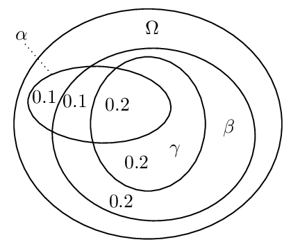

We have for instance: $P(\beta \mid \alpha)$ = ¾, $P(\gamma \mid \alpha \wedge \beta)$ = ⅔ and $P(\gamma \mid \alpha)$ = ½. Hence, under the proposed reading of $\nc$, we get $\alpha \nc \beta$ and $\alpha \wedge \beta \nc \gamma$ while we do not have $\alpha \nc \gamma$. This means that Cut is violated. Similarly, it can be shown that other properties such as Or are violated under this reading (e.g., Pearl 1988)[^pearl-1988].

In view of these difficulties it is remarkable that there is a probabilistic account according to which $\phi \nc \psi$ is interpreted as $P(\psi \mid \phi)$ > ½ and that nevertheless characterizes preferential consequence relations (Benferhat et al. 1999)[^benferhat-1999]. The idea is to restrict the focus to structures $S= (\Omega, P, \prec)$ that have specific probability distributions known as *atomic bound systems* or *big-stepped probabilities*. First, a linear order $\prec$ is imposed on the set of classical models in $\Omega$ over which the probability measure $P$ is defined. Second, $P$ is required to respect this order by “taking big steps”, i.e., in such a way that for any $M \in \Omega$, $P(\{M\}) > \sum\{P(\{M'\}) \mid M' \prec M\}$. This warrants that $\phi \nc \psi$ holds if and only if the unique $\prec$-maximal model in $[\phi]$ validates $\psi$ (in signs, $\max[\phi] \models \psi$).[^note-6] Here is how this helps us with the problematic example above: $\alpha \nc \beta$ means that $\max[\alpha] \models \beta$ and hence that $\max[\alpha] = \max[\alpha \wedge \beta]$. $\alpha \wedge \beta \nc \gamma$ means that $\max[\alpha \wedge \beta] \models \gamma$ and hence $\max[\alpha] \models \gamma$ which implies $\alpha \nc \gamma$.

In Gilio (2002) an approach, is presented in which conditionals $\alpha \nc \beta$ are characterized by *imprecise conditional probabilities* $0 \le \tau_1 \le P(\beta \mid \alpha) \le \tau_2 \le 1$ with a lower bound $\tau_1$ and an upper bound $\tau_2$ on the conditional probabilities. In this approach it is possible to determine how the probability bounds degrade in view of applications of specific inference rules. In Ford (2004) this is used to distinguish argument strengths (see above).

#### 3.6.3 Beyond the core properties

Preferential consequence relations do not in general validate

- **Rational Monotony**: If $\phi \nc \tau$ and $\phi \nnc \neg \psi$, then $\phi \wedge \psi \nc \tau$.

A preferential consequence relation $\nc$ that satisfies Rational Monotony is called a *rational consequence relation*. These are characterized by *ranked structures* which are preferential structures $S = (\Omega, \prec)$ for which $\prec$ is *modular*, that is, for all $M, M', M'' \in \Omega$, if $M \prec M'$ then $M'' \prec M'$ or $M \prec M''$. One can picture this as follows: models in $\Omega$ are arranged in linearly ordered levels, and the level of a model reflects its degree of normality (its rank).

The seminal Kraus et al. (1990) inspired a huge variety of subsequent work. We briefly highlight some contributions.

While in Kraus et al. (1990) the standard of deduction was classical propositional logic, in Arieli and Avron (2000) also nonclassical monotonic core logics and variants with multiple conclusions are considered. Various publications investigate the preferential and rational consequence relations in a first-order language (e.g., Lehmann and Magidor 1990, Delgrande 1998, Friedman et al. 2000)[^delgrande-1998][^friedman-2000][^lehmann-1990]. Given the problematic status of Rational Monotony (see our discussion in Section 1), alternative semantics have been investigated that validate weaker properties such as Disjunctive Rationality (if $\phi_1 \vee \phi_2 \nc \psi$ then $\phi_1\nc\psi$ or $\phi_2\nc\psi$) (e.g., in Freund 1993, Rott 2014, Booth and Varzinczak 2021)[^booth-2021][^freund-1993][^rott-2014]

As we have seen, the properties of preferential or rational consequence relations may also serve as deductive rules for syntactic units of the form $\phi \nc \psi$ under the usual readings such as “If $\phi$ then usually $\psi$.” This approach can be generalized to gain *conditional logics* by allowing for formulas where a conditional assertion $\phi \nc \psi$ is within the scope of classical connectives such as $\wedge, \vee, \neg$, etc. (see e.g., Delgrande 1987, Asher and Morreau 1991, Friedman and Halpern 1996, Giordano et al. 2009, Egre et al. forthcoming, and Parent 2021 for an overview on conditional deontic logics)[^asher-1991][^delgrande-1987][^friedman-1996][^giordano-2009][^parent-2021].

We state one remarkable result obtained in Boutilier (1990) that closely links the study of NMLs to the study of modal logics in the Kripkean tradition. Suppose we translate the deduction rules of system P into Hilbert-style axiom schemes such that, for instance, Cautious Monotony becomes

> $\vdash \bigl( ( \phi \nc \psi) \wedge (\phi \nc \tau) \bigr) \supset \bigl( ( \phi \wedge \psi) \nc \tau \bigr)$

Conditional assertions are shown to be expressible in standard Kripkean modal frames in such a way that system P (under this translation) corresponds to a fragment of the well-known modal logic S4. An analogous result is obtained for the modal logic S4.3 and the system that results from the strengthening system P with an axiom scheme for Rational Monotony.

Various contributions are specifically devoted to problems related to relevance. Consider some of the conditional assertions in the Nixon Diamond: $\mathbf{K}$ = {*Quaker* $\nc$ *Pacifist*, *Republican* $\nc$ ¬*Pacifist*}. It seems desirable to derive e.g. *Quaker* $\wedge$ *worker* $\nc$ *Pacifist* since in view of $\mathbf{K}$, being a worker is *irrelevant* to the assertion *Quaker* $\nc$ *Pacifist*. Intuitively speaking, *Quaker* $\nc$ ¬*worker* should fail in which case Rational Monotony yields *Quaker* $\wedge$ *worker* $\nc$ *Pacifist* in view of *Quaker* $\nc$ *Pacifist*. Hence, prima facie we may want to proceed as follows: let $\nc^{R}$ be the result of intersecting all rational consequence relations $\nc$ that extend $\mathbf{K}$ (in the sense that the conditional assertions in $\mathbf{K}$ hold for $\nc$). Unfortunately it is *not* the case that *Quaker* $\wedge$ *worker* $\nc^{R}$ *Pacifist*. The reason is simply that there are rational consequence relations for which *Quaker* $\nc$ ¬*worker* and whence Rational Monotony does not yield the desired *Quaker* $\wedge$ *worker* $\nc$ *Pacifist*. Moreover, it has been shown that $\nc^R$ is identical to the preferential closure $\nc^P$.

In Lehmann and Magidor (1992) a *Rational Closure* for conditional knowledge bases such as $\mathbf{K}$ is proposed that yields the desired consequences. We omit the technical details. The basic idea is to assign natural numbers, so-called ranks, to formulas that indicate how exceptional they are relative to the given knowledge base $\mathbf{K}$. Then the ranks of formulas are minimized, which means that each formula is interpreted as normally as possible. A conditional assertion $\phi \nc \psi$ is in the Rational Closure of $\mathbf{K}$ if the rank of $\phi \wedge \psi$ is strictly less than the rank of $\phi \wedge \neg \psi$ (or $\phi$ has no rank). The rank of a formula $\alpha$ is calculated iteratively. Let $m(\mathbf{K}') = \{ \phi \supset \psi \mid \phi \nc \psi \in \mathbf{K}'\}$ denote the material counterpart of a given set of conditional assertions $\mathbf{K}'$. Let $\mathbf{K}_0 = \mathbf{K}$. $\alpha$ has rank 0 if it is consistent with $m(\mathbf{K}_0)$. Let $\mathbf{K}_{i+1}$ be the set of all members $\phi \nc \psi$ of $\mathbf{K}_i$ for which the rank of $\phi$ is not less or equal to $i$. $\alpha$ has rank $i+1$ if it doesn’t have a rank smaller or equal to $i$ and it is consistent with $m(\mathbf{K}_{i+1})$.

In our example *Quaker $\wedge$ worker* has rank 0, just like *Quaker*. This is strictly less than rank 1 of *Quaker $\wedge$ ¬Pacifist* and *Quaker $\wedge$ worker $\wedge$ ¬Pacifist*. This means that the desired *Quaker* $\wedge$ *worker* $\nc$ *Pacifist* is in the Rational Closure of our $\mathbf{K}$.

A system equivalent to Rational Closure has been independently proposed under the name system **Z** based on $\epsilon$-semantics in Pearl (1990). A weaker version of Rational Closure has been proposed in Booth and Varzinczak (2021): it invalidates Rational Monotony, but validates Disjunctive Rationality.

One may consider it a drawback of Rational Closure that it suffers from the Drowning Problem (see above). To see this, consider the following conditional knowledge base **KL**:

> 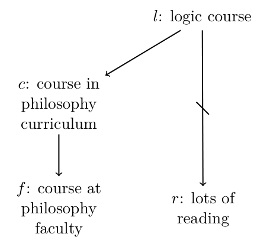

We have the following ranks:

| formula | $l$ | $c$ | $r$ | $f$ | $l \wedge f$ | $l \wedge \neg f$ |
| --- | --- | --- | --- | --- | --- | --- |
| rank | 1 | 0 | 0 | 0 | 1 | 1 |

Since the ranks of $l \wedge f$ and $l \wedge \neg f$ are equal, $l\nc f$ is not in the rational closure of $\mathbf{KL}$.

This problem has been tackled in Lehmann (1995) with the formalism *Lexicographic Closure*. Rougly the idea is to compare models by measuring the severity of violations of assertions in the given conditional knowledge base to which they give rise. $\phi \nc \psi$ is entailed by $\mathbf{K}$ if the best models of $\phi \wedge \psi$ are better than the best models of $\phi \wedge \neg \psi$. A model $M$ violates a conditional assertion $\phi \nc \psi$ if it validates $\phi$ but not $\psi$. The severity of a violation is proportional to the rank of $\phi$. For instance, in our example we have the following models of $l \wedge f$ resp. of $l \wedge \neg f$:

| $l$ | $f$ | $r$ | $c$ | model | violation:rank |
| --- | --- | --- | --- | --- | --- |
| 1 | 1 | 1 | 1 | $M_1$ | $l \nc \neg r: 1$ |
| 1 | 1 | 1 | 0 | $M_2$ | $l \nc \neg r : 1$, $l \nc c : 1$ |
| 1 | 1 | 0 | 1 | $M_3$ | $c \nc r: 0$ |
| 1 | 1 | 0 | 0 | $M_4$ | $l \nc c: 1$ |
| 1 | 0 | 1 | 1 | $M_5$ | $l\nc \neg r:1$, $c \nc f: 0$ |
| 1 | 0 | 1 | 0 | $M_6$ | $l \nc \neg r : 1$, $l \nc c: 1$ |
| 1 | 0 | 0 | 1 | $M_7$ | $c \nc r : 0$, $c \nc f : 0$ |
| 1 | 0 | 0 | 0 | $M_8$ | $l \nc c:1$ |

The best model of $l \wedge f$ is $M_3$ since it does not violate any conditional assertion of rank higher than 0, while all other models of $l \wedge f$ do. For the same reason $M_7$ is the best model of $l \wedge \neg f$. Moreover, $M_3$ violates less conditional assertions of rank 0 than $M_7$ and is thus the preferred interpretation. Hence, $l \nc f$ is in the Lexicographic Closure. Altogether, what avoids the drowning problem in Lehmann’s approach is a combination between specificity handling and a *quantitative rationale* according to which interpretations are preferred that violate less conditionals.

To highlight the latter, consider a knowledge base $\mathbf{K}$ consisting of

- *Party* $\nc$ *Anne*,
- *Party* $\nc$ *Phil*, and
- *Party* $\nc$ *Frank*.

We expect from each, Anne, Phil, and Frank to come to the party. Suppose, moreover, we know that *Party* $\wedge$ ((¬ *Anne* $\wedge$ ¬ *Phil*) $\vee$ ¬ *Frank*). In view of this fact, not all three assertions are valid. At best, either the former two hold or the latter. If we try to validate as many conditional assertions as possible, we will prefer the situation in which only the latter is violated. This occurs in the Lexicographic Closure of $\mathbf{K}$ which contains

- *Party* $\wedge$ ((¬ *Anne* $\wedge$ ¬ *Phil*) $\vee$ ¬ *Frank*) $\nc$ ¬*Frank* and
- *Party* $\wedge$ ((¬ *Anne* $\wedge$ ¬ *Phil*) $\vee$ ¬ *Frank*) $\nc$ *Anne* $\wedge$ *Phil*.

Similar quantitative considerations play a role in the *Maximum Entropy Approach* in Goldzsmidt et al. (1993) which is based on $\epsilon$-semantics. The basic idea is similar to Lexicographic Closure: $\phi \nc \psi$ is entailed by $\mathbf{K}$ if $\min(\{\kappa(M) \mid M \models \phi \wedge \psi\}) < \min (\{\kappa(M) \mid M \models \phi \wedge \neg \psi\})$, where $\kappa(M)$ outputs a weigthed sum of violations in $M$ and where weights are attributed to violations in view of specificity considerations. Similar to Lexicographic Closure the violation of more specific conditionals weigh heavier than violations of more general conditionals. As a consequence, just like in Lexicographic Closure, $l \nc f$ is entailed in our example and so the drowning problem is avoided. A difference to Lexicographic Closure is, for instance, that $l \wedge \neg f \nc c$ is not entailed according to the maximal entropy approach. The reason is that the violation of several less specific assertions may in sum counter-balance the violation of a more specific assertion. For instance, while model $M_7$ is preferred over model $M_8$ in the Lexicographic approach, in the Maximum Entropy both models turn out to be equally good and the best models of $l \wedge \neg f$.

### 3.7 Assumption-based approaches

In a family of approaches, defeasible inferences are encoded as material inferences with explicit assumptions:

> [†]    $(\phi \wedge \mathsf{as}) \supset \psi$

expresses that $\phi$ defeasibly implies $\psi$ on the assumption that $\mathsf{as}$ holds. The assumptions are interpreted as valid “as much as possible”. There are various ways to give a more precise meaning to this.

One such approach is offered by *Adaptive Logics* (Batens 2007, Straßer 2014)[^batens-2007][^straßer-2014]. An adaptive logic AL is given by a triple consisting of

- a *lower limit logic* LLL with a consequence relation $\vdash$ that is reflexive, monotonic, satisfies Cut, and is compact (If $\Gamma \vdash \phi$ then there is a finite $\Gamma' \subseteq \Gamma$ such that $\Gamma' \vdash \phi$);
- a set of *abnormalities* $\Omega$ containing formulas which are to be interpretated “as false as much as possible”; and
- an *adaptive strategy* in view of which the phrase “as false as much as possible” will be disambiguated.

LLL defines the deductive core of AL: all LLL-valid inferences are AL-valid. AL strengthens LLL by allowing for defeasible inferences by means of the following scheme:

> [‡]    Where $\mathsf{ab}$ is an abnormal formula in $\Omega$: if $\phi\vdash \psi \vee \mathsf{ab}$ then $\psi$ follows defeasibly from $\phi$ on the assumption that $\mathsf{ab}$ is false (or, equivalently, that $\neg \mathsf{ab}$ is true).

Where $\mathsf{as} = \neg \mathsf{ab}$, the antecedent of [‡] is equivalent to $\vdash (\phi \wedge \mathsf{as}) \supset \psi$ which is [†] above (under the classical meaning of $\neg, \wedge$, and $\vee$).

Examples of concrete classes of adaptive logics are:

- *Inconsistency-Adaptive Logics* (Batens 1980, Batens 1999, Priest 1991)[^batens-1980][^batens-1999][^priest-1991]: In domains in which contradictions may occur it is useful to work with a paraconsistent core logic LLL that has a negation $\sim$ that is non-explosive ($p, {\sim} p \nvdash q$) and for which disjunctive syllogism doesn’t hold ($\phi \vee \psi, {\sim} \phi \nvdash \psi$). Let $\Omega$ consist of $\sim$-contradictions in logical atoms ($p \wedge {\sim} p$). Then we have $p \vee q, {\sim} p \vdash q \vee \mathsf{ab}$ where $\mathsf{ab} = p \wedge {\sim}p$. This means, disjunctive syllogism can be applied on the assumption that there is no $\sim$-contradiction in $p$. This way LLL is significantly strengthened in a non-monotonic way.
- *Adaptive Logics of Inductive Generalizations*: Let LLL be CL and consider a $\Omega$ that contains, for instance, formulas of the form $\exists x P(x) \wedge \neg \forall x P(x)$. Then we have, for example, $P(a) \vdash \forall x P(x) \vee \mathsf{ab}$ where $\mathsf{ab} = \exists x P(x) \wedge \neg \forall x P(x)$. This means we inductively generalize from $P(a)$ to $\forall x P(x)$ based on the assumption that the abnormality $\mathsf{ab}$ does not hold. (This is a simplified account compared to the more subtle logics presented in Batens (2011).)
- There are numerous adaptive logics for other defeasible reasoning forms such as abductive reasoning, normative reasoning, belief revision, diagnosis, etc.

Adaptive logics implement the idea behind [‡] syntactically in terms of a *dynamic proof theory*. A dynamic proof from the premise set $\{P(a), \neg P(b)\}$ for an adaptive logic of inductive generalizations may look as follows:

| 1. | $P(a)$ | PREM | ∅ |
| --- | --- | --- | --- |
| ✓2. | $\forall x P(x)$ | 1; RC | $\{\exists x P(x) \wedge \neg \forall x P(x)\}$ |
| 3. | $\neg P(b)$ | PREM | ∅ |
| 4. | $\exists x P(x) \wedge \neg \forall x P(x)$ | 1,3; RU | ∅ |

The last column of each line of the proof contains its condition, that is, a set of abnormalities $\mathrm{COND} \subseteq \Omega$ that encode the assumptions used to derive the formula in the second column of the line: each $\mathsf{ab} \in \mathrm{COND}$ is assumed to be false. The generic rule RU (rule unconditional) represents any inference that is licensed by LLL. The generic rule RC (rule conditional) follows scheme [‡] where $\mathsf{ab}$ is pushed to the condition of the line. Sometimes there are good reasons to consider assumptions violated, in which case the corresponding lines are ✓-*marked* as retracted. This is clearly the case if the condition of a line is $\mathrm{COND}$ while for a $\{\mathsf{ab}_1, \dotsc, \mathsf{ab}_n\} \subseteq \mathrm{COND}$, $\mathsf{ab}_1 \vee \mathsf{ab}_2 \vee \ldots \vee \mathsf{ab}_n$ is derived without defeasible steps (i.e., on the condition ∅). This means that (at least) one of the formulas in $\mathrm{COND}$ is false. Thus, line 2 is marked as retracted when we reach line 4 of the proof. In view of this behavior, dynamic proofs are internally dynamic: Even if no new premises are introduced, the addition of new lines may cause the retraction of previous lines of a proof.

Not all cases of retraction are of this straightforward kind. Various *adaptive strategies* come with marking mechanisms to handle more complicated cases, such as the one in the following proof:

| 1. | $P(a)$ | PREM | ∅ |
| --- | --- | --- | --- |
| 2. | $Q(a)$ | PREM | ∅ |
| 3. | $\neg P(b) \vee \neg Q(c)$ | PREM | ∅ |
| 4. | $\forall x P(x) \vee \forall x Q(x)$ | 1; RC | $\{\exists x P(x) \wedge \neg \forall x P(x)\}$ |
| 5. | $\forall x P(x) \vee \forall x Q(x)$ | 2; RC | $\{\exists x Q(x) \wedge \neg \forall x Q (x)\}$ |
| 6. | $(\exists x P(x) \wedge \neg \forall x P(x)) \vee ( \exists x Q(x) \wedge \neg \forall x Q(x))$ | 1–3; RU | ∅ |

The formula $\forall x P(x) \vee \forall x Q(x)$ is derived at line 4 and 5 on two respective conditions: $\{\exists x P(x) \wedge \neg \forall x P(x)\}$ and $\{\exists x Q(x) \wedge \neg \forall x Q(x)\}$. Neither $\exists x P(x) \wedge \neg \forall x P(x)$ nor $\exists x Q(x) \wedge \neg \forall x Q(x)$ is derivable on the condition ∅. However, both are part of the (minimal) disjunction of abnormalities derived at line 6. According to one strategy, the *minimal abnormality strategy*, the premises are interpreted in such a way that as many abnormalities as possible are considered to be false, which leaves us with two interpretations: one in which $\exists x P(x) \wedge \neg \forall x P(x)$ holds while $\exists x Q(x) \wedge \neg \forall x Q(x)$ is false, and another one in which $\exists x Q(x) \wedge \neg \forall x Q(x)$ holds while $\exists x P(x) \wedge \neg \forall x P(x)$ is false. In both interpretations either the assumption of line 4 or the assumption of line 5 holds which means that in either interpretation the defeasible inference to $\forall x P(x) \vee \forall x Q(x)$ goes through. Thus, according to the minimal abnormality strategy neither line 4 nor line 5 is marked (we omit the technical details). Another strategy, the *reliability strategy*, is more cautious. According to it any line that involves an abnormality in its condition that is part of a minimal disjunction of abnormalities derived on the condition ∅ is marked. This means that in our example, lines 4 and 5 are marked.

Lines may get marked at specific stages of a proof just to get unmarked at later stages and vice versa. This mirrors the internal dynamics of defeasible reasoning. In order to define a consequence relation, a stable notion of derivability is needed. A formula derived at an unmarked line *l* in an adaptive proof from a premise set $\Gamma$ is considered a *consequence of $\Gamma$* if any extension of the proof in which *l* is marked is further extendable so that the line is unmarked again.

Such a consequence relation can equivalently be expressed semantically in terms of preferential semantics (see Section Selection semantics). Given an LLL-model $M$ we can identify its *abnormal part* $Ab(M) = \{\mathsf{ab} \in \Omega \mid M \models \mathsf{ab}\}$ to be the set of all abnormalities that hold in $M$. The selection semantics for minimal abnormality can be phrased as follows. We order the LLL-models by $M \prec M'$ if and only if $Ab(M) \subset Ab(M')$. Then we define that $\phi$ is a semantic consequence of $\Gamma$ if and only if for all $\prec$-minimal LLL-models $M$ of $\Gamma$, $M\models \phi$. (We omit selection semantics for other strategies.)

A similar system to adaptive logics makes use of maximally consistent sets. In Makinson (2003) it was developed under the name *default assumptions*. Given a set of assumptions $\Xi$,

> $\Gamma \nc[\Xi] \phi$ if and only if $\Xi' \cup \Gamma \vDash \phi$ for all $\Xi' \subseteq \Xi$ that are maximally consistent with $\Gamma$ (i.e., $\Xi' \cup \Gamma$ is consistent and there is no $\Xi'' \subseteq \Xi$ for which $\Xi' \subset \Xi''$ and $\Xi'' \cup \Gamma$ is consistent).

If we take $\Xi$ to be $\{\neg \mathsf{ab} \mid \mathsf{ab} \in \Omega\}$ then we have an equivalent characterization of adaptive logics with the minimal abnormality strategy and the set of abnormalities $\Omega$ (Van De Putte 2013)[^van-2013].

*Conditional Entailment* is another assumption-based approach (Geffner and Pearl 1992)[^geffner-1992]. Suppose that we start with a theory $T = (\Delta, \Gamma, \Lambda)$ where $\Delta = \{\phi_i \rightarrow \psi_i \mid i \in I\}$ consists of default rules, $\Gamma$ consists of necessary facts, while $\Lambda$ consists of contingent facts. It is translated into an *assumption-based theory* $T' = (\Delta', \Gamma', \Lambda)$ as follows:

- For each $\phi_i \rightarrow \psi_i \in \Delta$ we introduce a designated assumption constant $\pi_i$ and encode $\phi_i \rightarrow \psi_i$ by $\phi_i \wedge \pi_i \supset \psi_i$. The former is just our scheme [†] while the latter makes sure that assumptions are —by default— considered to hold.
- The set of defaults $\Delta'$ is $\{\phi_i \rightarrow \pi_i \mid i \in I\}$ and our background knowledge becomes $\Gamma' = \Gamma \cup \{\phi_i \wedge \pi_i \supset \psi_i \mid i \in I\}$.

Just as in the adaptive logic approach, models are compared with respect to their abnormal parts. For a classical model $M$ of $\Gamma' \cup \Lambda$, $Ab(M)$ is the set of all $\pi_i$ for which $M \models \neg \pi_i$. One important aspect that distinguishes conditional entailment from adaptive logics and default assumptions is the fact that it implements the Specificity Principle. For this, the assumptions are ordered by means of a (smooth) relation <. The models are then compared as follows:

> $M \lessdot M'$ if and only if $Ab(M) \neq Ab(M')$ and for all $\pi_i \in Ab(M)\setminus Ab(M')$ there is a $\pi_j \in Ab(M') \setminus Ab(M)$ for which $\pi_i < \pi_j$.

The idea is: $M$ is preferred over $M'$ if every assumption $\pi_i$ that does not hold in $M$ but that holds in $M'$ is ‘compensated for’ by a more specific assumption $\pi_j$ that holds in $M$ but that does not hold in $M'$.

For this to work, < has to include specificity relations among assumptions. Such orders < are called *admissible* relative to the background knowledge $\Gamma'$ if they satisfy the following property: for every set of assumptions $\Pi \subseteq \{\pi_i \mid i \in I\}$, if $\Pi$ violates some default $\phi_j \rightarrow \pi_j$ in view of the given background knowledge $\Gamma'$ (in signs, $\Pi, \phi_j, \Gamma' \models \neg \pi_j$) then there is a $\pi_k \in \Pi$ for which $\pi_k < \pi_j$.

This is best understood when put into action. Take the case with Tweety the penguin. We have $\Delta' = \{ p \rightarrow \pi_1, b \rightarrow \pi_2\}$, $\Gamma' = \{ p \supset b, p \wedge \pi_1 \supset \neg f, b \wedge \pi_2 \supset f\}$, and $\Lambda = \{p\}$. Let $\Pi = \{\pi_2\}$. Then $\Pi, \Gamma', p \models \neg \pi_1$ and thus for < to be admissible, $\pi_2 < \pi_1$. We have two types of models of $\Gamma' \cup \Lambda$: models $M_1$ for which $M_1 \models \pi_1$ and therefore $M_1 \models \neg f$ and models $M_2$ for which $M_2 \models \pi_2$ and thus $M_2 \models f$. Note that $M_1 \lessdot M_2$ since for the only assumption in $Ab(M_1)$ —namely $\pi_2$— there is $\pi_1 \in Ab(M_2) \setminus Ab(M_1)$ and $\pi_2 < \pi_1$.

Analogous to adaptive logics with the minimal abnormality strategy, conditional entailment is defined via $\lessdot$-minimal models:

> $(\Delta', \Gamma', \Lambda) \nc \phi$ if and only if for each admissible < (relative to $\Gamma'$) and all $\lessdot$-minimal models $M$ of $\Gamma' \cup \Lambda$, $M \models \phi$.

In our example, $\neg f$ is a conditionally entailed since all $\lessdot$-minimal models have the same abnormal part as $M_1$.

A consequence of expressing defeasible inferences via material implication in assumption-based approaches is that defeasible inferences are *contrapositable*. Clearly, if $\phi \wedge \pi \supset \psi$ then $\neg \psi \wedge \pi \supset \neg \phi$. As a consequence, formalisms such as default logic have a more greedy style of applying default rules. We demonstrate this with conditional entailment. Consider a theory consisting of the defaults $p_1 \rightarrow p_2$, $p_2 \rightarrow p_3$, $p_3 \rightarrow p_4$ and the factual information $\Lambda = \{p_1, \neg p_4\}$ (where $p_i$ are logical atoms). In assumption-based approaches such as conditional entailment the defeasible rules will be encoded as $p_1 \wedge \pi_1 \supset p_2$, $p_2 \wedge \pi_2 \supset p_3$, and $p_3 \wedge \pi_3 \supset p_4$. It can easily be seen that < = ∅ is an admissible ordering which means that for instance a model $M$ with $Ab(M) = \{\pi_1\}$ is $\lessdot$-minimal. In such a model we have $M \models \neg p_3$ and $M \models \neg p_2$ by reasoning backwards via contraposition from $\neg p_4 \wedge \pi_3$ to $\neg p_3$ and from $\neg p_3 \wedge \pi_2$ to $\neg p_2$. This means that neither $p_2$ nor $p_3$ is conditionally entailed.

The situation is different in default logic where both $p_2$ and $p_3$ are derivable. The reasoning follows a greedy policy in applying default rules: whenever a rule is applicable (that is, its antecedent holds by the currently held beliefs $\Xi$ and its consequent does not contradict with $\Xi$) it is applied. There is disagreement among scholars on whether and when contraposition is a desirable property for defeasible inferences (e.g., Caminada 2008, Prakken 2012)[^caminada-2008][^prakken-2012].

## 4. Non-monotonic logic and human reasoning

In view of the fact that test subjects seem to perform very poorly in various paradigmatic reasoning tests (e.g., Wason’s Selection Task (Wason 1966)[^wason-1966] or the Supression Task (Byrne 1989)[^byrne-1989]), main streams in the psychology of reasoning have traditionally ascribed to logic at best a subordinate role in human reasoning. In recent years this assessment has been criticized as the result of evaluating performances in tests against the standard of classical logic, whereas other standards based on probabilistic considerations or on NMLs have been argued to be more appropriate.

This resulted in the rise of a new probabilistic paradigm (Oaksford and Chater 2007, Pfeifer and Douven 2014)[^oaksford-2007][^pfeifer-2014] where probability theory provides a calculus for rational belief update. Although the program is sometimes phrased in decidedly anti-logicist terms,[^note-7] logic is here usually understood as monotonic and deductive. The relation to NML is less clear and it has been argued that there are close connections especially to probabilistic accounts of NML (Over 2009, Pfeifer and Kleiter 2009)[^over-2009][^pfeifer-2009]. Politzer and Bonnefon 2009 warn against the premature acceptance of the probabilistic paradigm in view of the rich variety of alternatives such as possibility measures, plausibility measures, etc.).

Another argument for the relevance of NML is advocated in Stenning and Van Lambalgen (2008) who distinguish between reasoning *to* and reasoning *from* an interpretation. In the former process, agents establish a logical form that is relative to both the specific context in which the reasoning takes place and to the agent’s goals. When establishing a logical form, agents choose—inter alia—a formal language, a semantics (e.g., extensional vs. intensional), a notion of validity, etc. Once a logical form is established, agents engage in law-like rule-based inferences which are based on this form. It is argued that in the majority of cases in standard reasoning tasks, subjects use non-monontonic logical forms that are based on closed world assumptions.

Non-monotonic logicians often state that their motivation stems from observing the defeasible structure of actual commonsense reasoning. Empirical studies have been explicitly cited as both inspiration for working on NMLs and as standards against which to evaluate NMLs. However, it has also been noted that logicians often rely too much on their own intuitions without critically assessing them against the background of empirical studies (Pelletier and Elio 1997)[^pelletier-1997].

Various studies investigate their test subjects’ tendency to reason according to specific inference principles of NMLs. Most studies support the descriptive adequacy of the rules of system P. However, there are some open or controversial issues. For instance, while some studies report results suggestive of the adequacy of weakened monotony principles such as Cautious Monotony (Schurz 2005, Neves et al. 2002, Pfeifer and Kleiter 2005)[^neves-2002][^pfeifer-2005][^schurz-2005] and Rational Monotony (Neves et al. 2002)[^neves-2002], Benferhat et al. (2005) report mixed results. Specificity considerations play a role in the reasoning process of test subjects in Schurz (2005), whereas according to Ford and Billington (2000) they do not. Benferhat et al. (2005) are specifically interested in the question whether the responses of their test subjects corresponded better to Lexicographic Closure or Rational Closure. Although the results were not fully conclusive, they still suggest a preference for the former.

Pelletier and Elio (1994) investigate various relevant factors that influence subjects’ reasoning about exceptions of defaults or inheritance relations. Their study makes use of the benchmark problems for defeasible reasoning proposed in Lifschitz (1989). For example, it is observed that the exceptional status of an object *A* with respect to some default is more likely to spread to other objects if they share properties with *A* that may play a role in explaining the exceptional status. For example, when confronted with a student club that violates the default that student clubs only allow for student members, subjects are more likely to ascribe this exceptional status also to another club if they learn that both clubs have been struggling to maintain minimum membership requirements.

The question of the descriptive adequacy of NMLs for human reasoning is also related to questions concerning the nature and limits of cognitive modules in view of which agents are capable of logical reasoning. For instance, the question arises whether such modules could be realized on a neurological level. Concerning the former question there are successful representations of NMLs in terms of neural networks (see Stenning and Van Lambalgen (2008), Garcez et al (2009), Hölldobler and Kalinke (1994) for logic programming with closed world assumptions, Besold et al (2017) for input/output logic, and Leitgeb (2001) for NMLs in the tradition of Selection semantics).

Human reasoning is constrained by limited computational resources, available information, and time, leading it to rely on heuristic shortcuts. Some scholars argue that nonmonotonic reasoning serves as an adaptive evolutionary strategy for humans (Schurz 2005, Gabbay and Woods 2008)[^gabbay-2008][^schurz-2005]. With respect to the limitations of human reasoning capabilities, the logics discussed here are idealized, often assuming logical closure, among other things. Recently, research into resource-bounded models of defeasible inference has been gaining momentum (e.g. D’Agostino and Modgil 2018, Beierle and Kutsch 2019, Ehab and Ismail 2021)[^beierle-2019][^d’agostino-2018][^d’agostino-2018-2][^ehab-2021].

## 5. Conclusion

There are three main issues connected with the development of logical frameworks that can adequately represent defeasible reasoning: (*i*) material adequacy; (*ii*) formal properties; and (*iii*) complexity. A non-monotonic formalism is materially adequate to the extent to which it captures examples of defeasible reasoning and to the extent to which it has intuitive properties. The question of formal properties has to do with the degree to which the formalism gives rise to a consequence relation that satisfies desirable theoretic properties such as the above-mentioned Reflexivity, Cut, and Cautious Monotony. The third set of issues has to do with the computational complexity of the most basic questions concerning the framework.

There is a potential tension between (*i*) and (*ii*): the desire to capture a broad range of intuitions can lead to *ad hoc* solutions that can sometimes undermine the desirable formal properties of the framework. In general, the development of NMLs and related formalisms has been driven, since its inception, by consideration (*i*) and has relied on a rich and well-chosen array of examples. Of course, there is some question as to whether any single framework can aspire to be universal in this respect.

More recently, researchers have started paying attention to consideration (*ii*), looking at the extent to which NMLs have generated well-behaved relations of logical consequence. As Makinson (1994) points out, practitioners of the field have encountered mixed success. In particular, one abstract property, Cautious Monotony, appears at the same time to be crucial and elusive for many of the frameworks to be found in the literature. This is a fact that is perhaps to be traced back, at least in part, to the above-mentioned tension between the requirement of material adequacy and the need to generate a well-behaved consequence relation.

The complexity issue appears to be the most difficult among the ones that have been highlighted. NMLs appear to be stubbornly intractable with respect to the corresponding problem for classical logic. This is clear in the case of default logic, given the ubiquitous consistency checks. But in addition to consistency checks, there are other, often overlooked, sources of complexity that are purely combinatorial. Other forms of non-monotonic reasoning, besides default logic, are far from immune from these combinatorial roots of intractability. Although some important work has been done trying to make various non-monotonic formalisms more tractable, this is perhaps the problem on which progress has been slowest in coming.

## References（引用注释）

> 原文参考文献已转为脚注引用：文内“作者-年份”引用组后附 [^key] 标记，完整条目见本文末脚注定义。

## Academic Tools

> |   | [How to cite this entry](https://plato.stanford.edu/cgi-bin/encyclopedia/archinfo.cgi?entry=logic-nonmonotonic). |
> | --- | --- |
> |   | [Preview the PDF version of this entry](https://leibniz.stanford.edu/friends/preview/logic-nonmonotonic/) at the [Friends of the SEP Society](https://leibniz.stanford.edu/friends/). |
> |   | [Look up topics and thinkers related to this entry](https://www.inphoproject.org/entity?sep=logic-nonmonotonic&redirect=True) at the Internet Philosophy Ontology Project (InPhO). |
> |   | [Enhanced bibliography for this entry](https://philpapers.org/sep/logic-nonmonotonic/) at [PhilPapers](https://philpapers.org/), with links to its database. |

## Other Internet Resources

[Please contact the author with suggestions.]

## Related Entries

artificial intelligence | artificial intelligence: logic-based | computability and complexity | logic: classical | logic: modal | model theory: first-order | reasoning: defeasible

## Notes（原文脚注）

[^note-1]: Note though that in some formalisms some input may be treated in a defeasible way so that Reflexivity need not hold. For instance, in corrective approaches such as the Free Consequences contradictory premises are not consequences.

[^note-2]: We speak about *super-arguments* in the intuitive sense that e.g., $A_1 \rightarrow \ldots \rightarrow A_n$ is a super-argument of $A_1 \rightarrow \ldots \rightarrow A_m$ where $m \lt n$.

[^note-3]: Some pioneering systems in this tradition are the OSCAR system (Pollock (1995)), Defeasible Logic (Nute (1994)), or the formalisms in (Simari and Loui (1992)) and (Verheij (1996)). For a overview articles see Prakken and Vreeswijk (2002)) and Prakken (2018). More recent work in logical formal argumentation includes Arieli and Straßer (2015), Besnard and Hunter (2009), Bochman (2018), Dung et al. (2009), Modgil and Prakken (2013).

[^note-4]: In this and the following examples we suppose that $\top$ is an arbitrary tautology and the formulas $\theta , \tau$, etc. appearing in the default rules are contingent (neither they nor their negations are tautologies).

[^note-5]: One may think about a classical model M as follows: M is uniquely characterized by an assignment $v$ of the truth-values 0 and 1 to the logical atoms. Whether a formula $\phi$ holds in M (in signs, M $\models \phi)$ can then be determined recursively on the basis of $v$ by means of the classical truth tables for $\neg , \wedge$, etc.

[^note-6]: We show one direction. Suppose $\max[\phi] \models \psi$. Hence, since big-stepped probabilities are used, $\rP(\{\max[\phi]\}) \gt \sum \{\rP(\{M\}) \mid M \prec \max[\phi]\} \ge \rP([\phi \wedge \neg \psi]) = \sum \{\rP(\{M\}) \mid M \in[\phi \wedge \neg \psi]\}$. Since max[$\phi] \models \psi$ also $\rP([\phi \wedge \psi]) \ge \rP(\{\max[\phi]\})$ and hence $\rP([\phi \wedge \psi]) \gt \rP([\phi \wedge \neg \psi])$ which implies $\rP(\psi \mid \phi) \gt \frac{1}{2}$.

[^note-7]: For instance, “We thus argue that human rationality, and the coherence of human thought, is defined *not by logic*, but by probability.” (emphasis added, Oaksford and Chater (2009), p. 69)

[^adams-1975]: Adams, Ernest W., 1975. *The Logic of Conditionals*. Dordrecht: D. Reidel Publishing Co.

[^alferes-1995]: Alferes, Jose Julio, Damasio, Carlos Viegas, & Pereira, Luis Moniz, 1995. A Logic Programming System for Non-monotonic Reasoning. *Journal of Automated Reasoning*, 14(1): 93–147.

[^aliseda-2017]: Aliseda, Atocha, 2017. The logic of abduction: An introduction. In *Springer Handbook of Model-Based Science*, Magnani, Lorenzo and Bertolotti, Tommaso (Edts.). pp. 219–230.

[^aliseda-1997]: –––, 1997. Defeasible inheritance on cyclic networks. *Artificial Intelligence*, 92(1): 1–23.

[^antonelli-1999]: Antonelli, Gian Aldo, 1999. A directly cautious theory of defeasible consequence for default logic via the notion of general extension. *Artificial Intelligence*, 109(1): 71–109.

[^arieli-2000]: Arieli, Ofer, & Avron, Arnon, 2000. General Patterns for Nonmonotonic Reasoning: From Basic Entailments to Plausible Relations. *Logic Journal of the IGPL*, 8: 119–148.

[^arieli-2019]: Arieli, Ofer, Borg, AnneMarie, and Heyninck, Jesse, 2019. A review of the relations between logical argumentation and reasoning with maximal consistency. *Annals of Mathematics and Artificial Intelligence*, 87(3), 187–226.

[^arieli-2021]: Arieli, Ofer, Borg, AnneMarie, Heyninck, Jesse and Straßer, Christian, 2021. Logic-based approaches to formal argumentation. *Journal of Applied Logics-IfCoLog Journal*, 8(6): 1793–1898.

[^arieli-2015]: Arieli, Ofer and Straßer, Christian, 2015. Sequent-Based Logical Argumentation. *Argument and Computation*, 1(6): 73–99.

[^asher-1991]: Asher, Nicholas, & Morreau, Michael, 1991. Commonsense entailment: A modal theory of nonmonotonic reasoning. In *Logics in AI*, Berlin: Springer, pp. 1–30.

[^batens-1980]: Batens, Diderik, 1980. Paraconsistent extensional propositional logics. *Logique at Analyse*, 90–91: 195–234.

[^batens-1999]: –––, 1999. Inconsistency-Adaptive Logics. In *Logic at Work. Essays Dedicated to the Memory of Helena Rasiowa*, Heidelberg, New York: Physica Verlag (Springer), pp. 445–472.

[^batens-2004]: –––, 2004. The need for adaptive logics in epistemology. In *Logic, epistemology, and the unity of science*. Berlin: Springer, pp. 459–485.

[^batens-2007]: –––, 2007. A Universal Logic Approach to Adaptive Logics. *Logica Universalis*, 1: 221–242.

[^batens-2011]: –––, 2011. Logics for qualitative inductive generalization. *Studia Logica*, 97(1): pp. 61–80.

[^beierle-2019]: Beierle, Christoph and Kutsch, Steven, 2019. Computation and comparison of nonmonotonic skeptical inference relations induced by sets of ranking models for the realization of intelligent agents. *Applied Intelligence*, 49: 28–42.

[^beirlaen-2018]: Beirlaen, Mathieu, Heyninck, Jesse, Pardo, Pere, & Straßer, Christian, 2018. Argument strength in formal argumentation. *IfCoLog Journal of Logics and their Applications*, 5(3): 629–675.

[^benferhat-1993]: Benferhat, Salem, Cayrol, Claudette, Dubois, Didier, Lang, Jerome, & and Prade, Henri, 1993. Inconsistency management and prioritized syntax-based entailment. In *Proceedings of IJCAI 1993*, pp. 640–645.

[^benferhat-1997]: Benferhat, Salem, Dubier, Didier, & Prade, Henri, 1997. Some Syntactic Approaches to the Handling of Inconsistent Knowledge Basis: A Comparative Study. Part I: The Flat Case. *Studia Logica*, 58: 17–45.

[^benferhat-1999]: –––, 1999. Possibilistic and standard probabilistic semantics of conditional knowledge bases. *Journal of Logic and Computation*, 9(6): 873–895.

[^benferhat-2005]: Benferhat, Salem, Bonnefon, Jean F., & da Silva Neves, Rui, 2005. An overview of possibilistic handling of default reasoning, with experimental studies. *Synthese*, 146(1–2): 53–70.

[^berkel-2024]: van Berkel, Kees, Straßer, Christian and Zhou, Zheng, 2024. Towards an Argumentative Unification of Default Reasoning. *Proceedings of COMMA*, Chris Reed, Matthias Thimm, and Tjitze Rienstra (eds.), Amsterdam: IOS Press, 313–324.

[^besnard-2009]: Besnard, P. and A. Hunter 2009. Argumentation based on classical logic. In *Argumentation in Artificial Intelligence*, I. Rahwan and G. Simari (eds.), Berlin: Springer.

[^besold-2017]: Besold, Tarek R., Garcez, Artur d’Avila, Stenning, Keith, van der Torre, Leendert, Lambalgen, Michiel van, 2017. Reasoning in Non-Probabilistic Uncertainty: Logic Programming and Neural-Symbolic Computing As Examples. *Minds and Machines*, 27(1): 37–77.

[^bochman-2018]: Bochman, Alexander, 2018. Argumentation, Nonmonotonic Reasoning and Logic. In *Handbook of Formal Argumentation* Vol. 1. Eds. P. Baroni, D. Gabbay, M. Giacomin, & L. van der Torre. pp.2887–2926

[^booth-2021]: Booth, Richard and Varzinczak, Ivan, 2021. Conditional Inference Under Disjunctive Rationality. *Proceedings of the AAAI Conference on Artificial Intelligence.*, 35(7): 6227–6234.

[^boutilier-1990]: Boutilier, Craig, 1990. Conditional Logics of Normality as Modal Systems. *AAAI* (Volume 90), pp. 594–599.

[^brewka-2000]: Brewka, Gerhard, & Eiter, Thomas, 2000. Prioritizing Default Logic. In *Intellectics and Computational Logic*, Applied Logic Series (Volume 19), Dordrecht: Kluwer, 27–45.

[^byrne-1989]: Byrne, Ruth M.J., 1989. Suppressing valid inferences with conditionals. *Cognition*, 31(1): 61–83.

[^caminada-2008]: Caminada, M., 2008. On the issue of contraposition of defeasible rules. *Frontiers in Artificial Intelligence and Applications*, 172: 109–115.

[^d’agostino-2018]: D’Agostino, Marcello and Modgil, Sanjay, 2018. A Study of Argumentative Characterisations of Preferred Subtheories. *Proceedings of the Twenty-Seventh International Joint Conference on Artificial Intelligence* (IJCAI 2018), J. Lang (ed.), International Joint Conferences on Artificial Intelligence, 1788–1794.

[^d’agostino-2018-2]: D’Agostino, Marcello and Modgil, Sanjay, 2018. Classical logic, argument and dialectic. *Artificial Intelligence*, 262: 15–51.

[^delgrande-2004]: Delgrande, James, Schaub, Torsten, Tompits, Hans, & Wang, Kewen, 2004. A classification and survey of preference handling approaches in nonmonotonic reasoning. *Computational Intelligence*, 20(2): 308–334.

[^delgrande-1987]: Delgrande, James P., 1987. A first-order conditional logic for prototypical properties. *Artificial Intelligence*, 33(1): 105–130.

[^delgrande-1998]: –––, 1998. On first-order conditional logics. *Artificial Intelligence*, 105(1): 105–137.

[^delgrande-2000]: Delgrande, James P, & Schaub, Torsten, 2000. Expressing preferences in default logic. *Artificial Intelligence*, 123(1): 41–87.

[^dubois-1990]: Dubois, Didier, & Prade, Henri, 1990. An introduction to possibilistic and fuzzy logics. In *Readings in Uncertain Reasoning*. San Francisco: Morgan Kaufmann Publishers Inc., pp. 742–761.

[^dung-1995]: Dung, Phan Minh, 1995. On the Acceptability of Arguments and its Fundamental Role in Nonmonotonic Reasoning, Logic Programming and n-Person Games. *Artifical Intelligence*, 77: 321–358.

[^dung-2009]: Dung, P.M., Kowalski, R.A., & Toni, F., 2009. Assumption-based argumentation. *Argumentation in Artificial Intelligence*, 199–218.

[^ehab-2021]: Ehab, Nourhan and Ismail, Haythem O., 2021. Log$_A$G: An algebraic non-monotonic logic for reasoning with graded propositions. *Annals of Mathematics and Artificial Intelligence*, 89: 103–158.

[^egré-nd]: Egré, Paul, Rossi, Lorenzo and Sprenger, Jan, forthcoming. Certain and Uncertain Inference with Indicative Conditionals. *Australasian Journal of Philosophy*.

[^elio-1994]: Elio, Renée, & Pelletier, Francis Jeffry, 1994. On Relevance in Nonmonotonic Reasoning: Some Empirical Studies. In Russ, Greiner, & Devika, Subramanian (eds.), *Relevance: AAAI 1994 Fall Symposium Series*. Palo Alto: AAAI Press, pp. 64–67.

[^ford-2004]: Ford, Marilyn, 2004. System LS: A Three-Tiered Nonmonotonic Reasoning System. *Computational Intelligence*, 20(1): 89–108.

[^ford-2000]: Ford, Marilyn, & Billington, David, 2000. Strategies in human nonmonotonic reasoning. *Computational Intelligence*, 16(3): 446–468.

[^freund-1993]: Freund, Michael, 1993. Injective Models and Disjunctive Relations. *Journal of Logic and Computation*, 3(3), 231–247.

[^friedman-1996]: Friedman, Nir, & Halpern, Joseph Y., 1996. Plausibility measures and default reasoning. *Journal of the ACM*, 48: 1297–1304.

[^friedman-2000]: Friedman, Nir, Halpern, Joseph Y., & Koller, Daphne, 2000. First-order conditional logic for default reasoning revisited. *ACM Trans. Comput. Logic*, 1(October): 175–207.

[^gabbay-1985]: Gabbay, Dov M., 1985. Theoretical foundations for non-monotonic reasoning in expert systems. *Logics and models of concurrent systems*. New York: Springer-Verlag, pp. 439–457.

[^gabbay-1994]: Gabbay, Dov, Hogger, C., & Robinson, J. (eds.), 1994. *Handbook of Logic in Artificial Intelligence and Logic Programming* (Volume 3), Oxford and New York: Oxford University Press.

[^gabbay-2008]: Gabbay, Dov and Woods, John, 2008. Resource-origins of nonmonotonicity. *Studia Logica*, 88: 85–112.

[^garcez-2009]: Garcez, Artur S. d’Avila, Lamb, Luís C., Gabbay, Dov, 2009. Neural-symbolic cognitive reasoning. Springer.

[^geffner-1992]: Geffner, Hector, & Pearl, Judea, 1992. Conditional entailment: bridging two approaches to default reasoning. *Artifical Intelligence*, 53(2–3): 209–244.

[^gelfond-1988]: Gelfond, Michael, & Lifschitz, Vladimir, 1988. The stable model semantics for logic programming. In *ICLP/SLP* (Volume 88), pp. 1070–1080.

[^gilio-2002]: Gilio, Angelo, 2002. Probabilistic reasoning under coherence in System P. *Annals of Mathematics and Artificial Intelligence*, 34(1–3): 5–34.

[^ginsberg-1994]: Ginsberg, Matthew L., 1994. *Essentials of Artificial Intelligence*. San Francisco: Morgan Kaufmann Publishers Inc.

[^ginsberg-1987]: ––– (ed.), 1987. *Readings in nonmonotonic reasoning*. San Francisco: Morgan Kaufmann.

[^giordano-2009]: Giordano, Laura, Gliozzi, Valentina, Olivetti, Nicola, & Pozzato, Gian Luca, 2009. Analytic tableaux calculi for KLM logics of nonmonotonic reasoning. *ACM Transactions on Computational Logic (TOCL)*, 10(3): 18.

[^goldszmidt-1992]: Goldszmidt, Moisés, & Pearl, Judea, 1992. Rank-based Systems: A Simple Approach to Belief Revision, Belief Update, and Reasoning about Evidence and Actions. In *Proceedings of the Third International Conference on Knowledge Representation and Reasoning*. San Francisco: Morgan Kaufmann, pp. 661–672.

[^goldzsmidt-1993]: Goldzsmidt, Moisés, Morris, Paul, & Pearl, Judea, 1993. A Maximum Entropy Approach to Nonmonotonic Reasoning. *IEEE Transactions on Pattern Analysis and Machine Intelligence*, 15(3): 220–232.

[^hölldobler-1994]: Hölldobler, Steffen and Kalinke, Yvonne, 1994. Towards a new massible parallel computational model for logic programming. In *Proceedings of the Workshop on Combining Symbolic and Connectionist Processing ECAI*, pp. 68–77.

[^horty-1994]: Horty, John F., 1994. Some direct theories of nonmonotonic inheritance. In Gabbay, Dov M., Hogger, Christopher J., & Robinson, J. A. (eds.), *Handbook of Logic in Artificial Intelligence and Logic Programming, Volume 3: Nonmonotonic Reasoning and Uncertain Reasoning*. Oxford: Oxford University Press, pp. 111–187.

[^horty-2002]: –––, 2002. Skepticism and floating conclusions. *Artifical Intelligence*, 135(1–2): 55–72.

[^horty-2007]: –––, 2007. Defaults with Priorities. *Journal of Philosophical Logic*, 36: 367–413.

[^konolige-1988]: Konolige, Kurt, 1988. On the relation between default and autoepistemic logic. *Artifical Intelligence*, 35(3): 343–382.

[^koons-2017]: Koons, Robert, 2017. Defeasible Reasoning. In *The Stanford Encyclopedia of Philosophy* (Spring 2017 Edition), Edward N. Zalta (ed.), URL = <[https://plato.stanford.edu/archives/win2017/entries/reasoning-defeasible/](https://plato.stanford.edu/archives/win2017/entries/reasoning-defeasible/)>.

[^kraus-1990]: Kraus, Sarit, Lehmann, Daniel, & Magidor, Menachem, 1990. Nonmonotonic Reasoning, Preferential Models and Cumulative Logics. *Artifical Intelligence*, 44: 167–207.

[^kripke-1975]: Kripke, Saul, 1975. Outline of a Theory of Truth. *Journal of Philosophy*, 72: 690–716.

[^lehmann-1995]: Lehmann, Daniel J., 1995. Another Perspective on Default Reasoning. *Annals of Mathematics and Artificial Intelligence*, 15(1): 61–82.

[^lehmann-1990]: Lehmann, Daniel J., & Magidor, Menachem, 1990. Preferential logics: the predicate calculus case. In *Proceedings of the 3rd conference on Theoretical aspects of reasoning about knowledge*, San Francisco: Morgan Kaufmann Publishers Inc., pp. 57–72.

[^lehmann-1992]: –––, 1992. What does a conditional knowledge base entail? *Artificial Intelligence*, 55(1): 1–60.

[^leitgeb-2001]: Leitgeb, Hannes, 2001. Nonmonotonic reasoning by inhibition nets. *Artifical Intelligence*, 128(May): 161–201.

[^liao-2018]: Liao, Beishui, Oren, Nir, van der Torre, Leendert, & Villata, Serena, 2018. Prioritized norms in formal argumentation. *Journal of Logic and Computation*, 29(2): 215–240.

[^lifschitz-1989]: Lifschitz, Vladimir, 1989. Benchmark problems for formal nonmonotonic reasoning. In *Non-Monotonic Reasoning*. Berlin: Springer, pp. 202–219.

[^lin-1990]: Lin, Fangzhen, & Shoham, Yoav, 1990. Epistemic semantics for fixed-points non-monotonic logics. In *Proceedings of the 3rd Conference on Theoretical Aspects of Reasoning About Knowledge (TARK’90)*, Pacific Grove, CA: Morgan Kaufmann Publishers Inc, pp. 111–120.

[^lukaszewicz-1988]: Lukaszewicz, Witold, 1988. Considerations on default logic: an alternative approach. *Computational intelligence*, 4(1): 1–16.

[^makinson-1994]: Makinson, David, 1994. General patterns in nonmonotonic reasoning. In: *Handbook of Logic in Artificial Intelligence and Logic Programming, vol. III*, D. Gabbay, C. Hogger, J.A. Robinson (eds.), pp. 35–110, Oxford: Oxford University Press.

[^makinson-2003]: –––, 2003. Bridges between classical and nonmonotonic logic. *Logic Journal of IGPL*, 11(1): 69–96.

[^makinson-1991]: Makinson, David, & Gärdenfors, Peter, 1991. Relations between the logic of theory change and nonmonotonic logic. *The logic of theory change*, Berlin: Springer, pp. 183–205.

[^makinson-1991-2]: Makinson, David, & Schlechta, Karl, 1991. Floating conclusions and zombie paths: two deep difficulties in the “directly skeptical” approach to defeasible inheritance nets. *Artifical Intelligence*, 48(2): 199–209.

[^mccarthy-1980]: McCarthy, J., 1980. Circumscription – A Form of Non-Monotonic Reasoning. *Artifical Intelligence*, 13: 27–29.

[^modgil-2013]: Modgil, Sanjay and Prakken, Henry, 2013. A general account of argumentation with preferences. *Artificial Intelligence*, 195, 361–397.

[^moore-1984]: Moore, Robert C., 1984. Possible-World Semantics for Autoepistemic Logic. In *Proceedings of the Workshop on non-monotonic reasoning*, AAAI, pp. 344–354.

[^moore-1985]: –––, 1985. Semantical considerations on nonmonotonic logic. *Artifical Intelligence*, 25(1): 75–94.

[^neves-2002]: Neves, Rui Da Silva, Bonnefon, Jean-François, & Raufaste, Eric, 2002. An empirical test of patterns for nonmonotonic inference. *Annals of Mathematics and Artificial Intelligence*, 34(1–3): 107–130.

[^nute-1994]: Nute, D., 1994. Defeasible logics. In *Handbook of Logic in Artificial Intelligence and Logic Programming* (Vol. 3). Oxford: Oxford University Press, pp. 353–395.

[^oaksford-2007]: Oaksford, Mike, & Chater, Nick, 2007. *Bayesian rationality the probabilistic approach to human reasoning*. Oxford: Oxford University Press.

[^oaksford-2009]: –––, 2009. Précis of Bayesian rationality: The probabilistic approach to human reasoning. *Behavioral and Brain Sciences*, 32(01): 69–84.

[^orlowska-1999]: Orlowska, Ewa (ed.), 1999. *Logic at Work. Essays Dedicated to the Memory of Helena Rasiowa*. Heidelberg, New York: Physica Verlag (Springer).

[^over-2009]: Over, David E., 2009. New paradigm psychology of reasoning. *Thinking & Reasoning*, 15(4): 431–438.

[^pardo-2024]: Pardo, Pere and Straßer, Christian, 2024. Modular orders on defaults in formal argumentation. *Journal of Logic and Computation*, 34(4), 665–697.

[^parent-2021]: Parent, Xavier, 2021. *Preference semantics for Hansson-type dyadic deontic logic: a survey of results*. *Handbook of deontic logic and normative systems* (Volume 2), D. Gabbay *et al*. (eds.), London: College Publications, 7–70.

[^pearl-1988]: Pearl, Judea, 1988. *Probabilistic reasoning in intelligent systems: networks of plausible inference*. San Francisco: Morgan Kaufmann.

[^pearl-1989]: –––, 1989. Probabilistic semantics for nonmonotonic reasoning: a survey. In *Proceedings of the first international conference on Principles of knowledge representation and reasoning*. San Francisco: Morgan Kaufmann Publishers, pp. 505–516.

[^pearl-1990]: –––, 1990. System Z: a natural ordering of defaults with tractable applications to nonmonotonic reasoning. In *TARK ’90: Proceedings of the 3rd conference on Theoretical aspects of reasoning about knowledge*. San Francisco: Morgan Kaufmann Publishers, pp. 121–135.

[^pelletier-1997]: Pelletier, Francis Jeffry, & Elio, Renée, 1997. What should default reasoning be, by default? *Computational Intelligence*, 13(2): 165–187.

[^pfeifer-2014]: Pfeifer, Niki, & Douven, Igor, 2014. Formal Epistemology and the New Paradigm Psychology of Reasoning. *Review of Philosophy and Psychology*, 5(2): 199–221.

[^pfeifer-2005]: Pfeifer, Niki, & Kleiter, Gernot D., 2005. Coherence and nonmonotonicity in human reasoning. *Synthese*, 146(1–2): 93–109.

[^pfeifer-2009]: Pfeifer, Niki, & Kleiter, Gernot D., 2009. Mental probability logic. *Behavioral and Brain Sciences*, 32(01): 98–99.

[^politzer-2009]: Politzer, Guy, & Bonnefon, Jean-François, 2009. Let us not put the probabilistic cart before the uncertainty bull. *Behavioral and Brain Sciences*, 32(01): 100–101.

[^pollock-1991]: Pollock, John, 1991. A Theory of Defeasible Reasoning. *International Journal of Intelligent Systems*, 6: 33–54.

[^pollock-1995]: –––, 1995. *Cognitive Carpentry*, Cambridge, MA: Bradford/MIT Press.

[^pollock-2008]: –––, 2008. Defeasible Reasoning. In *Reasoning: Studies of Human Inference and its Foundations*, J. E. Adler and L. J. Rips (eds.), Cambridge: Cambridge University Press, pp. 451–470.

[^poole-1985]: Poole, David, 1985. On the Comparison of Theories: Preferring the Most Specific Explanation. In *IJCAI* (Volume 85), pp. 144–147.

[^prakken-2010]: Prakken, Henry, 2010. An abstract framework for argumentation with structured arguments. *Argument & Computation*, 1(2): 93–124.

[^prakken-2012]: –––, 2012. Some reflections on two current trends in formal argumentation. In A. Artikis, et al. (ed.), *Logic Programs, Norms and Action*. Dordrecht: Springer, pp. 249–272.

[^prakken-2018]: –––, 2018. Historical overview of formal argumentation. In *Handbook of formal argumentation* (Vol. 1). Eds. P. Baroni, D. Gabbay, M. Giacomin, & L. van der Torre. London: College Publications. pp.43–141

[^prakken-2002]: Prakken, Henry, & Vreeswijk, Gerard A. W., 2002. *Logics for Defeasible Argumentation* (Vol. 4), Dordrecht: Kluwer, pp. 219–318.

[^priest-1991]: Priest, Graham, 1991. Minimally inconsistent LP. *Studia Logica*, 50(2): 321–331.

[^reiter-1980]: Reiter, Raymond, 1980. A Logic for Default Reasoning. *Artifical Intelligence*, 13: 81–132.

[^rescher-1970]: Rescher, Nicholas & Manor, Ruth, 1970. On inference from inconsistent premises. *Theory and Decision*, 1: 179–217

[^rott-2013]: Rott, Hans, 2013. Two concepts of plausibility in default reasoning. *Erkenntnis*, 79(S6): 1219–1252.

[^rott-2014]: Rott, Hans, 2014. Four floors for the theory of theory change: The case of imperfect discrimination. *Logics in Artificial Intelligence* (14th European Conference, JELIA 2014, Funchal, Madeira, Portugal, September 24–26, 2014, Proceedings), E. Fermé and J. Leite (eds.), Cham: Springer, 368–382.

[^schurz-2005]: Schurz, Gerhard, 2005. Non-monotonic reasoning from an evolution-theoretic perspective: Ontic, logical and cognitive foundations. *Synthese*, 146(1–2): 37–51.

[^shoham-1987]: Shoham, Yoav, 1987. A Semantical Approach to Nonmonotonic Logics. In Ginsberg, M. L. (ed.), *Readings in Non-Monotonic Reasoning*. Los Altos, CA: Morgan Kaufmann, pp. 227–249.

[^simari-1992]: Simari, Guillermo R, & Loui, Ronald P., 1992. A mathematical treatment of defeasible reasoning and its implementation. *Artificial intelligence*, 53(2): 125–157.

[^spohn-1988]: Spohn, Wolfgang, 1988. Ordinal conditional functions: A dynamic theory of epistemic states. In *Causation in Decision, Belief Change and Statistics*, W. L. Harper, & B. Skyrms (Eds.), Springer, pp. 105–134.

[^stalnaker-1993]: Stalnaker, Robert, 1993. A note on non-monotonic modal logic. *Artificial Intelligence*, 64(2): 183–196.

[^stalnaker-1994]: –––, 1994. What is a nonmonotonic consequence relation? *Fundamenta Informaticae*, 21(1): 7–21.

[^stein-1992]: Stein, Lynn Andrea, 1992. Resolving ambiguity in nonmonotonic inheritance hierarchies. *Artificial Intelligence*, 55(2): 259–310.

[^stenning-2008]: Stenning, Keith, & Van Lambalgen, Michiel, 2008. *Human reasoning and cognitive science*. Cambridge, MA: MIT Press.

[^straßer-2014]: Straßer, Christian, 2014. *Adaptive Logic and Defeasible Reasoning. Applications in Argumentation, Normative Reasoning and Default Reasoning* (Trends in Logic, Volume 38). Dordrecht: Springer.

[^touretzky-1991]: Touretzky, David S., Thomason, Richmond H., & Horty, John F., 1991. A Skeptic’s Menagerie: Conflictors, Preemptors, Reinstaters, and Zombies in Nonmonotonic Inheritance. In *IJCAI*, pp. 478–485 of.

[^van-2013]: Van De Putte, Frederik, 2013. Default Assumptions and Selection Functions: A Generic Framework for Non-monotonic Logics. In *Advances in Artificial Intelligence and Its Applications*, Dordrecht: Springer, pp. 54–67.

[^verheij-1996]: Verheij, Bart, 1996. *Rules, Reasons, Arguments. Formal Studies of Argumentation and Defeat*, Ph.D. thesis, Universiteit Maastricht.

[^wason-1966]: Wason, P. C., 1966. Reasoning. in B. Foss (ed.), *New horizons in psychology I*, Harmondsworth: Penguin, pp. 135–151.
