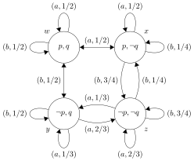

# Logic and Probability
**First published Thu Mar 7, 2013; substantive revision Thu Aug 17, 2023**

*Demey, Lorenz, Kooi, Barteld, Sack, Joshua*

Logic and probability theory are two of the main tools in the formal study of reasoning, and have been fruitfully applied in areas as diverse as philosophy, artificial intelligence, cognitive science and mathematics. This entry discusses the major proposals to combine logic and probability theory, and attempts to provide a classification of the various approaches in this rapidly developing field.

## 1. Combining Logic and Probability Theory

The very idea of combining logic and probability might look strange at first sight (Hájek 2001)[^hájek-2001]. After all, logic is concerned with absolutely certain truths and inferences, whereas probability theory deals with uncertainties. Furthermore, logic offers a *qualitative* (structural) perspective on inference (the deductive validity of an argument is based on the argument’s formal structure), whereas probabilities are *quantitative* (numerical) in nature. However, as will be shown in the next section, there are natural senses in which probability theory *presupposes* and *extends* classical logic. Furthermore, historically speaking, several distinguished theorists such as De Morgan (1847), Boole (1854), Ramsey (1926), de Finetti (1937), Carnap (1950), Jeffrey (1992) and Howson (2003, 2007, 2009) have emphasized the tight connections between logic and probability, or even considered their work on probability as a part of logic itself.

By integrating the complementary perspectives of qualitative logic and numerical probability theory, probability logics are able to offer highly expressive accounts of inference. It should therefore come as no surprise that they have been applied in all fields that study reasoning mechanisms, such as philosophy, artificial intelligence, cognitive science and mathematics. The downside to this cross-disciplinary popularity is that terms such as ‘probability logic’ are used by different researchers in different, non-equivalent ways. Therefore, before moving on to the actual discussion of the various approaches, we will first delineate the subject matter of this entry.

The most important distinction is that between *probability logic* and *inductive logic*. Classically, an argument is said to be *(deductively) valid* if and only if it is impossible that the premises of $A$ are all true, while its conclusion is false. In other words, deductive validity amounts to *truth preservation*: in a valid argument, the truth of the premises guarantees the truth of the conclusion. In some arguments, however, the truth of the premises does not fully guarantee the truth of the conclusion, but it still renders it highly likely. A typical example is the argument with premises ‘The first swan I saw was white’, …, ‘The 1000th swan I saw was white’, and conclusion ‘All swans are white’. Such arguments are studied in *inductive logic*, which makes extensive use of probabilistic notions, and is therefore considered by some authors to be related to probability logic. There is some discussion about the exact relation between inductive logic and probability logic, which is summarized in the introduction of Kyburg (1994). The dominant position (defended by Adams and Levine (1975), among others), which is also adopted here, is that probability logic entirely belongs to deductive logic, and hence should not be concerned with inductive reasoning. Still, most work on inductive logic falls within the ‘probability preservation’ approach, and is thus closely connected to the systems discussed in Section 2. For more on inductive logic, the reader can consult Jaynes (2003), Fitelson (2006), Romeijn (2011), and the entries on the problem of induction and inductive logic of this encyclopedia.

We will also steer clear of the philosophical debate over the exact nature of probability. The formal systems discussed here are compatible with all of the common interpretations of probability, but obviously, in concrete applications, certain interpretations of probability will fit more naturally than others. For example, the modal probability logics discussed in Section 4 are, by themselves, neutral about the nature of probability, but when they are used to describe the behavior of a transition system, their probabilities are typically interpreted in an objective way, whereas modeling multi-agent scenarios is accompanied most naturally by a subjective interpretation of probabilities (as agents’ degrees of belief). This topic is covered in detail in Gillies (2000), Eagle (2010), and the entry on interpretations of probability of this encyclopedia.

A recent trend in the literature has been to focus less on integrating or combining logic and probability theory into a single, unified framework, but rather to establish bridges between the two disciplines. This typically involves trying to capture the qualitative notions of logic in the quantitative terms of probability theory, or the other way around. We will not be able to do justice to the wide variety of approaches in this booming area, but interested readers can consult Leitgeb (2013, 2014), Lin and Kelly (2012a, 2012b), Douven and Rott (2018), and Harrison-Trainor, Holliday and Icard (2016, 2018). A ‘contemporary classic’ in this area is Leitgeb (2017), while van Benthem (2017) offers a useful survey and some interesting programmatic remarks.

Finally, although the success of probability logic is largely due to its various applications, we will not deal with these applications in any detail. For example, we will not assess the use of probability as a formal representation of belief in philosophy (Bayesian epistemology) or artificial intelligence (knowledge representation), and its advantages and disadvantages with respect to alternative representations, such as generalized probability theory (for quantum theory), $p$-adic probability, and fuzzy logic. For more information about these topics, the reader can consult Gerla (1994), Vennekens et al. (2009), Hájek and Hartmann (2010), Hartmann and Sprenger (2010), Ilić-Stepić et al. (2012), and the entries on formal representations of belief, Bayesian epistemology, defeasible reasoning, quantum logic and probability theory, and fuzzy logic of this encyclopedia.

With these clarifications in place, we are now ready to look at what *will* be discussed in this entry. The most common strategy to obtain a concrete system of probability logic is to start with a classical (propositional/modal/etc.) system of logic and to ‘probabilify’ it in one way or another, by adding probabilistic features to it. There are various ways in which this probabilification can be implemented. One can study probabilistic semantics for classical languages (which do not have any explicit probabilistic operators), in which case the consequence relation itself gets a probabilistic flavor: deductive validity becomes ‘probability preservation’, rather than ‘truth preservation’. This direction will be discussed in Section 2. Alternatively, one can add various kinds of probabilistic operators to the syntax of the logic. In Section 3 we will discuss some initial, rather basic examples of probabilistic operators. The full expressivity of modal probabilistic operators will be explored in Section 4. Finally, languages with first-order probabilistic operators will be discussed in Section 5.

## 2. Propositional Probability Logics

In this section, we will present a first family of probability logics, which are used to study questions of ‘probability preservation’ (or dually, ‘uncertainty propagation’). These systems do not extend the language with any probabilistic operators, but rather deal with a ‘classical’ propositional language $\mathcal{L}$, which has a countable set of atomic propositions, and the usual truth-functional (Boolean) connectives.

The main idea is that the premises of a valid argument can be uncertain, in which case (deductive) validity imposes no conditions on the (un)certainty of the conclusion. For example, the argument with premises ‘if it will rain tomorrow, I will get wet’ and ‘it will rain tomorrow’, and conclusion ‘I will get wet’ is valid, but if its second premise is uncertain, its conclusion will typically also be uncertain. Propositional probability logics represent such uncertainties as probabilities, and study how they ‘flow’ from the premises to the conclusion; in other words, they do not study *truth preservation*, but rather *probability preservation*. The following three subsections discuss systems that deal with increasingly more general versions of this issue.

### 2.1 Probabilistic Semantics

We begin by recalling the notion of a probability function for the propositional language $\mathcal{L}$. (In mathematics, probability functions are usually defined for a $\sigma$-algebra of subsets of a given set $\Omega$, and required to satisfy countable additivity; cf. Section 4.3. In logical contexts, however, it is often more natural to define probability functions ‘immediately’ for the logic’s object language (Williamson 2002)[^williamson-2002]. Because this language is finitary—all its formulas have finite length—, it also suffices to require finite additivity.) A *probability function (for $\mathcal{L}$)* is a function $P: \mathcal{L}\to \mathbb{R}$ satisfying the following constraints:

**Non-negativity.** $P(\phi)\geq 0$ for all $\phi\in\mathcal{L}.$

**Tautologies.** If $\models\phi$, then $P(\phi)=1.$

**Finite additivity.** If $\models\neg(\phi\wedge\psi)$, then $P(\phi\vee\psi) = P(\phi)+P(\psi).$

In the second and third constraint, the $\models$-symbol denotes (semantic) validity in classical propositional logic. The definition of probability functions thus requires notions from classical logic, and in this sense probability theory can be said to *presuppose* classical logic (Adams 1998, 22)[^adams-1998]. It can easily be shown that if $P$ satisfies these constraints, then $P(\phi)\in [0,1]$ for all formulas $\phi\in\mathcal{L}$, and $P(\phi) = P(\psi)$ for all formulas $\phi,\psi\in\mathcal{L}$ that are logically equivalent (i.e. such that $\models\phi\leftrightarrow\psi$).

We now turn to probabilistic semantics, as defined in Leblanc (1983). An argument with premises $\Gamma$ and conclusion $\phi$—henceforth denoted as $(\Gamma,\phi)$—is said to be *probabilistically valid*, written $\Gamma\models_p\phi$, if and only if:

for all probability functions $P:\mathcal{L}\to\mathbb{R}$: if $P(\gamma) = 1$ for all $\gamma\in\Gamma$, then also $P(\phi) = 1$.

Probabilistic semantics thus replaces the valuations $v:\mathcal{L}\to\{0,1\}$ of classical propositional logic with probability functions $P:\mathcal{L}\to \mathbb{R}$, which take values in the real unit interval $[0,1]$. The classical truth values of *true* (1) and *false* (0) can thus be regarded as the endpoints of the unit interval $[0,1]$, and likewise, valuations $v:\mathcal{L}\to\{0,1\}$ can be regarded as degenerate probability functions $P:\mathcal{L}\to[0,1]$. In this sense, classical logic is a special case of probability logic, or equivalently, probability logic is an *extension* of classical logic.

It can be shown that classical propositional logic is (strongly) sound and complete with respect to probabilistic semantics:

$$\Gamma \models_p \phi \text{ if and only if } \Gamma \vdash\phi.$$

Some authors interpret probabilities as generalized truth values (Reichenbach 1949, Leblanc 1983)[^leblanc-1983][^reichenbach-1949]. According to this view, probability logic is just a particular kind of many-valued logic, and probabilistic validity boils down to ‘truth preservation’: truth (i.e. probability 1) carries over from the premises to the conclusion. Other logicians, such as Tarski (1936) and Adams (1998, 15), have noted that probabilities cannot be seen as generalized truth values, because probability functions are not ‘extensional’; for example, $P(\phi\wedge\psi)$ cannot be expressed as a function of $P(\phi)$ and $P(\psi)$. More discussion on this topic can be found in Hailperin (1984).

Another possibility is to interpret a sentence’s probability as a measure of its (un)certainty. For example, the sentence ‘Jones is in Spain at the moment’ can have any degree of certainty, ranging from 0 (maximal uncertainty) to 1 (maximal certainty). (Note that 0 is actually a kind of certainty, viz. certainty about falsity; however, in this entry we follow Adams’ terminology (1998, 31) and interpret 0 as maximal uncertainty.) According to this interpretation, the following theorem follows from the strong soundness and completeness of probabilistic semantics:

**Theorem 1.** Consider a deductively valid argument $(\Gamma,\phi)$. If all premises in $\Gamma$ have probability 1, then the conclusion $\phi$ also has probability 1.

This theorem can be seen as a first, very partial clarification of the issue of probability preservation (or uncertainty propagation). It says that if there is no uncertainty whatsoever about the premises, then there cannot be any uncertainty about the conclusion either. In the next two subsections we will consider more interesting cases, when there is non-zero uncertainty about the premises, and ask how it carries over to the conclusion.

Finally, it should be noted that although this subsection only discussed probabilistic semantics for classical propositional logic, there are also probabilistic semantics for a variety of other logics, such as intuitionistic propositional logic (van Fraassen 1981b, Morgan and Leblanc 1983)[^fraassen-1981b][^leblanc-1983][^morgan-1983][^morgan-1983-2], modal logics (Morgan 1982a, 1982b, 1983, Cross 1993)[^cross-1993][^morgan-1982a], classical first-order logic (Leblanc 1979, 1984, van Fraassen 1981b)[^fraassen-1981b][^leblanc-1979], relevant logic (van Fraassen 1983)[^fraassen-1983] and nonmonotonic logic (Pearl 1991)[^pearl-1991]. All of these systems share a key feature: the logic’s semantics is probabilistic in nature, but probabilities are *not* explicitly represented in the object language; hence, they are much closer in nature to the propositional probability logics discussed here than to the systems presented in later sections.

Most of these systems are not based on unary probabilities $P(\phi)$, but rather on conditional probabilities $P(\phi,\psi)$. The conditional probability $P(\phi,\psi)$ is taken as primitive (rather than being defined as $P(\phi\wedge\psi)/P(\psi)$, as is usually done) to avoid problems when $P(\psi)=0$. Goosens (1979) provides an overview of various axiomatizations of probability theory in terms of such primitive notions of conditional probability.

### 2.2 Adams’ Probability Logic

In the previous subsection we discussed a first principle of probability preservation, which says that if all premises have probability 1, then the conclusion also has probability 1. Of course, more interesting cases arise when the premises are less than absolutely certain. Consider the valid argument with premises $p\vee q$ and $p\to q$, and conclusion $q$ (the symbol ‘$\to$’ denotes the truth-conditional material conditional). One can easily show that

$$P(q) = P(p\vee q) + P(p\to q) - 1.$$

In other words, if we know the probabilities of the argument’s premises, then we can calculate the exact probability of its conclusion, and thus provide a complete answer to the question of probability preservation for this particular argument (for example, if $P(p \vee q) = 6/7$ and $P(p\to q) = 5/7$, then $P(q) = 4/7$). In general, however, it will not be possible to calculate the *exact* probability of the conclusion, given the probabilities of the premises; rather, the best we can hope for is a (tight) upper and/or lower *bound* for the conclusion’s probability. We will now discuss Adams’ (1998) methods to compute such bounds.

Adams’ results can be stated more easily in terms of *uncertainty* rather than *certainty* (probability). Given a probability function $P:\mathcal{L}\to [0,1]$, the corresponding *uncertainty function* $U_P$ is defined as

$$U_P:\mathcal{L}\to[0,1]: \phi\mapsto U_P(\phi):= 1-P(\phi).$$

If the probability function $P$ is clear from the context, we will often simply write $U$ instead of $U_P$. In the remainder of this subsection (and in the next one as well) we will assume that all arguments have only finitely many premises (which is not a significant restriction, given the compactness property of classical propositional logic). Adams’ first main result, which was originally established by Suppes (1966), can now be stated as follows:

**Theorem 2.** Consider a valid argument $(\Gamma,\phi)$ and a probability function $P$. Then the uncertainty of the conclusion $\phi$ cannot exceed the sum of the uncertainties of the premises $\gamma\in\Gamma$. Formally:

$$U(\phi) \leq \sum_{\gamma\in\Gamma}U(\gamma).$$

First of all, note that this theorem subsumes Theorem 1 as a special case: if $P(\gamma) = 1$ for all $\gamma\in\Gamma$, then $U(\gamma)=0$ for all $\gamma\in\Gamma$, so $U(\phi)\leq \sum U(\gamma) = 0$ and thus $P(\phi) = 1$. Furthermore, note that the upper bound on the uncertainty of the conclusion depends on $|\Gamma|$, i.e. on the number of premises. If a valid argument has a small number of premises, each of which only has a small uncertainty (i.e. a high certainty), then its conclusion will also have a reasonably small uncertainty (i.e. a reasonably high certainty). Conversely, if a valid argument has premises with small uncertainties, then its conclusion can only be highly uncertain if the argument has a large number of premises (a famous illustration of this converse principle is Kyburg’s (1965) *lottery paradox*, which is discussed in the entry on epistemic paradoxes of this encyclopedia). To put the matter more concretely, note that if a valid argument has three premises which each have uncertainty 1/11, then adding a premise which also has uncertainty 1/11 will not influence the argument’s validity, but it *will* raise the upper bound on the conclusion’s uncertainty from 3/11 to 4/11—thus allowing the conclusion to be more uncertain than was originally the case. Finally, the upper bound provided by Theorem 2 is *optimal*, in the sense that (under the right conditions) the uncertainty of the conclusion can coincide with its upper bound $\sum U(\gamma)$:

**Theorem 3.** Consider a valid argument $(\Gamma,\phi)$, and assume that the premise set $\Gamma$ is consistent, and that every premise $\gamma\in\Gamma$ is relevant (i.e. $\Gamma-\{\gamma\}\not\models\phi$). Then there exists a probability function $P:\mathcal{L}\to[0,1]$ such that

$$U_P(\phi) = \sum_{\gamma\in\Gamma}U_P(\gamma).$$

The upper bound provided by Theorem 2 can also be used to define a probabilistic notion of validity. An argument $(\Gamma,\phi)$ is said to be *Adams-probabilistically valid*, written $\Gamma\models_a\phi$, if and only if

for all probability functions $P:\mathcal{L}\to\mathbb{R}$: $U_P(\phi)\leq \sum_{\gamma\in\Gamma}U_P(\gamma)$.

Adams-probabilistic validity has an alternative, equivalent characterization in terms of probabilities rather than uncertainties. This characterization says that $(\Gamma,\phi)$ is Adams-probabilistically valid if and only if the conclusion’s probability can get arbitrarily close to 1 if the premises’ probabilities are sufficiently high. Formally: $\Gamma\models_a\phi$ if and only if

for all $\epsilon>0$ there exists a $\delta>0$ such that for all probability functions $P$: if $P(\gamma)>1-\delta$ for all $\gamma\in\Gamma$, then $P(\phi)> 1-\epsilon$.

It can be shown that classical propositional logic is (strongly) sound and complete with respect to Adams’ probabilistic semantics:

$$\Gamma \models_a \phi \text{ if and only if } \Gamma \vdash\phi.$$

Adams (1998, 154) also defines another logic for which his probabilistic semantics is sound and complete. However, this system involves a non-truth-functional connective (the *probability conditional*), and therefore falls outside the scope of this section. (For more on probabilistic interpretations of conditionals, the reader can consult the entries on conditionals and the logic of conditionals of this encyclopedia.)

Consider the following example. The argument $A$ with premises $p,q,r,s$ and conclusion $p\wedge(q\vee r)$ is valid. Assume that $P(p) = 10/11, P(q) = P(r) = 9/11$ and $P(s) = 7/11$. Then Theorem 2 says that

$$\begin{align} &U(p\wedge(q\vee r)) \leq \\ &\quad\frac{1}{11} + \frac{2}{11} + \frac{2}{11} + \frac{4}{11} = \frac{9}{11}. \end{align}$$

This upper bound on the uncertainty of the conclusion is rather disappointing, and it exposes the main weakness of Theorem 2. One of the reasons why the upper bound is so high, is that to compute it we took into account the premise $s$, which has a rather high uncertainty ($4/11$). However, this premise is irrelevant, in the sense that the conclusion already follows from the other three premises. Hence we can regard $p\wedge (q\vee r)$ not only as the conclusion of the valid argument $A$, but also as the conclusion of the (equally valid) argument $A'$, which has premises $p,q,r$. In the latter case Theorem 2 yields an upper bound of $1/11 + 2/11 + 2/11 = 5/11$, which is already much lower.

The weakness of Theorem 2 is thus that it takes into account (the uncertainty of) *irrelevant* or inessential premises. To obtain an improved version of this theorem, a more fine-grained notion of ‘essentialness’ is necessary. In argument $A$ in the example above, premise $s$ is absolutely irrelevant. Similarly, premise $p$ is absolutely relevant, in the sense that without this premise, the conclusion $p\wedge(q\vee r)$ is no longer derivable. Finally, the premise subset $\{q,r\}$ is ‘in between’: together $q$ and $r$ are relevant (if both premises are left out, the conclusion is no longer derivable), but each of them separately can be left out (while keeping the conclusion derivable).

The notion of essentialness is formalized as follows:

**Essential premise set.** Given a valid argument $(\Gamma,\phi)$, a set $\Gamma' \subseteq \Gamma$ is *essential* iff $\Gamma - \Gamma' \not\models\phi$.

**Degree of essentialness.** Given a valid argument $(\Gamma,\phi)$ and a premise $\gamma\in\Gamma$, the *degree of essentialness* of $\gamma$, written $E(\gamma)$, is $1/|S_\gamma|$, where $|S_\gamma|$ is the cardinality of the smallest essential premise set that contains $\gamma$. If $\gamma$ does not belong to any minimal essential premise set, then the degree of essentialness of $\gamma$ is 0.

With these definitions, a refined version of Theorem 2 can be established:

**Theorem 4.** Consider a valid argument $(\Gamma,\phi)$. Then the uncertainty of the conclusion $\phi$ cannot exceed the weighted sum of the uncertainties of the premises $\gamma\in\Gamma$, with the degrees of essentialness as weights. Formally:

$$U(\phi) \leq \sum_{\gamma\in\Gamma}E(\gamma)U(\gamma).$$

The proof of Theorem 4 is significantly more difficult than that of Theorem 2: Theorem 2 requires only basic probability theory, whereas Theorem 4 is proved using methods from linear programming (Adams and Levine 1975; Goldman and Tucker 1956)[^adams-1975][^goldman-1956]. Theorem 4 subsumes Theorem 2 as a special case: if all premises are relevant (i.e. have degree of essentialness 1), then Theorem 4 yields the same upper bound as Theorem 2. Furthermore, Theorem 4 does not take into account irrelevant premises (i.e. premises with degree of essentialness 0) to compute this upper bound; hence if a premise is irrelevant for the validity of the argument, then its uncertainty will not carry over to the conclusion. Finally, note that since $E(\gamma)\in [0,1]$ for all $\gamma\in\Gamma$, it holds that

$$\sum_{\gamma\in\Gamma}E(\gamma)U(\gamma) \leq\sum_{\gamma\in\Gamma}U(\gamma),$$

i.e. Theorem 4 yields in general a tighter upper bound than Theorem 2. To illustrate this, consider again the argument with premises $p,q,r,s$ and conclusion $p \wedge (q\vee r)$. Recall that $P(p)=10/11, P(q) = P(r)=9/11$ and $P(s)=7/11$. One can calculate the degrees of essentialness of the premises: $E(p) = 1, E(q) = E(r) = 1/2$ and $E(s) = 0$. Hence Theorem 4 yields that

$$\begin{align} &U(p \wedge (q\vee r))\leq \\ &\quad\left(1\times \frac{1}{11}\right) + \left(\frac{1}{2} \times \frac{2}{11}\right) + \left(\frac{1}{2} \times \frac{2}{11}\right) + \left(0 \times \frac{4}{11}\right) = \frac{3}{11}, \end{align}$$

which is a tighter upper bound for the uncertainty of $p\wedge(q \vee r)$ than any of the bounds obtained above via Theorem 2 (viz. $9/11$ and $5/11$).

### 2.3 Further Generalizations

Given the uncertainties (and degrees of essentialness) of the premises of a valid argument, Adams’ theorems allow us to compute an *upper* bound for the uncertainty of the conclusion. Of course these results can also be expressed in terms of probabilities rather than uncertainties; they then yield a *lower* bound for the probability of the conclusion. For example, when expressed in terms of probabilities rather than uncertainties, Theorem 4 looks as follows:

$$P(\phi)\geq 1 - \sum_{\gamma\in\Gamma}E(\gamma)(1 - P(\gamma)).$$

Adams’ results are restricted in at least two ways:

- They only provide a *lower* bound for the probability of the conclusion (given the probabilities of the premises). In a sense this is the most important bound: it represents the conclusion’s probability in the ‘worst-case scenario’, which might be useful information in practical applications. However, in some applications it might also be informative to have an *upper* bound for the conclusion’s probability. For example, if one knows that this probability has an upper bound of 0.4, then one might decide to refrain from certain actions (that one would have performed if this upper bound were (known to be) 0.9).
- They presuppose that the premises’ exact probabilities are known. In practical applications, however, there might only be partial information about the probability of a premise $\gamma$: its exact value is not known, but it *is* known to have a lower bound $a$ and an upper bound $b$ (Walley 1991)[^walley-1991]. In such applications it would be useful to have a method to calculate (optimal) lower and upper bounds for the probability of the conclusion in terms of the upper and lower bounds of the probabilities of the premises.

Hailperin (1965, 1984, 1986, 1996) and Nilsson (1986) use methods from linear programming to show that these two restrictions can be overcome. Their most important result is the following:

**Theorem 5.** Consider an argument $(\Gamma,\phi)$, with $|\Gamma| = n$. There exist functions $L_{\Gamma,\phi}: \mathbb{R}^{2n} \to \mathbb{R}$ and $U_{\Gamma,\phi}: \mathbb{R}^{2n} \to \mathbb{R}$ such that for any probability function $P$, the following holds: if $a_i \leq P(\gamma_i) \leq b_i$ for $1\leq i\leq n$, then:

1. $L_{\Gamma,\phi}(a_1,\dots,a_n,b_1,\dots,b_n) \leq P(\phi) \:\leq$ $U_{\Gamma,\phi}(a_1,\dots,a_n,b_1,\dots,b_n)$.
2. The bounds in item 1 are optimal, in the sense that there exist probability functions $P_L$ and $P_U$ such that $a_i \leq P_L(\gamma_i),$ $P_U(\gamma_i)\leq b_i$ for $1\leq i\leq n$, and $L_{\Gamma,\phi}(a_1,\dots,a_n,b_1,\dots,b_n) = P_L(\phi)$ and $P_U(\phi) = U_{\Gamma,\phi}(a_1,\dots,a_n,b_1,\dots,b_n)$.
3. The functions $L_{\Gamma,\phi}$ and $U_{\Gamma,\phi}$ are effectively determinable from the Boolean structure of the sentences in $\Gamma \cup \{\phi\}$.

This result can also be used to define yet another probabilistic notion of validity, which we will call *Hailperin-probabilistic validity* or simply *h-validity*. This notion is not defined with respect to formulas, but rather with respect to *pairs* consisting of a formula and a subinterval of $[0,1]$. If $X_i$ is the interval associated with premise $\gamma_i\in \Gamma$ and $Y$ is the interval associated with the conclusion $\phi$, then the argument $(\Gamma,\phi)$ is said to be *h*-valid, written $\Gamma\models_h\phi$, if and only if for all probability functions $P$:

$$ \text{ if } P(\gamma_i) \in X_i \text{ for } 1\leq i\leq n, \text{ then } P(\phi)\in Y $$

In Haenni et al. (2011) this is written as

$$\gamma_1^{X_1},\dots,\gamma_n^{X_n}|\!\!\!\approx \phi^Y$$

and called the *standard probabilistic semantics*.

Nilsson’s work on probabilistic logic (1986, 1993) has sparked a lot of research on probabilistic reasoning in artificial intelligence (Hansen and Jaumard 2000; chapter 2 of Haenni et al. 2011)[^haenni-2011][^hansen-2000]. However, it should be noted that although Theorem 5 states that the functions $L_{\Gamma,\phi}$ and $U_{\Gamma,\phi}$ are *effectively* determinable from the sentences in $\Gamma\cup\{\phi\}$, the *computational complexity* of this problem is quite high (Georgakopoulos et al. 1988, Kavvadias and Papadimitriou 1990)[^georgakopoulos-1988][^kavvadias-1990], and thus finding these functions quickly becomes computationally unfeasible in real-world applications. Contemporary approaches based on probabilistic argumentation systems and probabilistic networks are better capable of handling these computational challenges. Furthermore, probabilistic argumentation systems are closely related to Dempster-Shafer theory (Dempster 1968; Shafer 1976; Haenni and Lehmann 2003)[^dempster-1968][^haenni-2003][^shafer-1976]. However, an extended discussion of these approaches is beyond the scope of (the current version of) this entry; see (Haenni et al. 2011)[^haenni-2011] for a recent survey.

## 3. Basic Probability Operators

In this section we will study probability logics that extend the propositional language $\mathcal{L}$ with rather basic probability operators. They differ from the logics in Section 2 in that the logics here involve probability operators in the object language. Section 3.1 discusses *qualitative* probability operators; Section 3.2 discusses *quantitative* probability operators.

### 3.1 Qualitative Representations of Uncertainty

There are several applications in which qualitative theories of probability might be useful, or even necessary. In some situations there are no frequencies available to use as estimates for the probabilities, or it might be practically impossible to obtain those frequencies. Furthermore, people are often willing to *compare* the probabilities of two statements (‘$\phi$ is more probable than $\psi$’), without being able to assign explicit probabilities to each of the statements *individually* (Szolovits and Pauker 1978, Halpern and Rabin 1987)[^halpern-1987][^szolovits-1978]. In such situations qualitative probability logics will be useful.

One of the earliest qualitative probability logics is Hamblin’s (1959). The language is extended with a unary operator $\Box$, which is to be read as ‘probably’. Hence a formula such as $\Box\phi$ is to be read as ‘probably $\phi$’. This notion of ‘probable’ can be formalized as *sufficiently high (numerical) probability* (i.e. $P(\phi)\geq t$, for some threshold value $1/2 < t \leq 1$), or alternatively in terms of *plausibility*, which is a non-metrical generalization of probability. Burgess (1969) further develops these systems, focusing on the ‘high numerical probability’-interpretation. Both Hamblin and Burgess introduce additional operators into their systems (expressing, for example, metaphysical necessity and/or knowledge), and study the interaction between the ‘probably’-operator and these other modal operators. However, the ‘probably’-operator already displays some interesting features on its own (independent from any other operators). If it is interpreted as ‘sufficiently high probability’, then it fails to satisfy the principle $(\Box\phi\wedge\Box\psi) \to \Box(\phi\wedge\psi)$. This means that it is not a *normal* modal operator, and cannot be given a Kripke (relational) semantics. Herzig and Longin (2003) and Arló Costa (2005) provide weaker systems of *neighborhood semantics* for such ‘probably’-operators, while Yalcin (2010) discusses their behavior from a more linguistically oriented perspective.

Another route is taken by Segerberg (1971) and Gärdenfors (1975a, 1975b), who build on earlier work by de Finetti (1937), Kraft, Pratt and Seidenberg (1959) and Scott (1964). They introduce a *binary* operator $\geq$; the formula $\phi\geq\psi$ is to be read as ‘$\phi$ is at least as probable as $\psi$’ (formally: $P(\phi)\geq P(\psi)$). The key idea is that one can completely axiomatize the behavior of $\geq$ without having to use the ‘underlying’ probabilities of the individual formulas. It should be noted that with comparative probability (a binary operator), one can also express some absolute probabilistic properties (unary operators). For example, $\phi\geq \top$ expresses that $\phi$ has probability 1, and $\phi\geq\neg\phi$ expresses that $\phi$ has probability at least 1/2. More recently, Delgrande and Renne (2015) and Delgrande, Renne, and Sack (2019) further extend the qualitative approach, by allowing the arguments of $\geq$ to be finite *sequences* of formulas (of potentially different lengths). The formula $(\phi_1,\dots,\phi_n) \geq (\psi_1,\dots,\psi_m)$ is informally to be read as ‘the sum of the probabilities of the $\phi_i$’s is at least as high as the sum of the probabilities of the $\psi_j$’s’. The resulting logic can be axiomatized completely, and can capture any rational quantity, making it as expressive as some *quantitiative* probability logics. However, it is still distinct from quantitative probability logics, as there are no numbers in the language. In the following sections, we direct our attention to quantitative probability logics.

### 3.2 Sums and Products of Probability Terms

Propositional probability logics are extensions of propositional logic that express numerical relationships among probability terms $P(\varphi)$. A simple propositional probability logic adds to propositional logic formulas of the form $P(\varphi)\ge q$, where $\varphi$ is a propositional formula and $q$ is a number; such a formula asserts that the probability of $\varphi$ is at least $q$. The semantics is formalized using models consisting a probability function $\mathcal{P}$ over a set $\Omega$, whose elements are each given a truth assignment to the atomic propositions of the propositional logic. Thus a propositional formula is true at an element of $\Omega$ if the truth assignment for that element makes the propositional formula true. The formula $P(\varphi)\ge q$ is true in the model if and only if the probability $\mathcal{P}$ of the set of elements of $\Omega$ for which $\varphi$ is true is at least $q$. See Chapter 3 of Ognjanović et al. (2016) for an overview of such a propositional probability logic.

Some propositional probability logics include other types of formulas in the object language, such as those involving sums and products of probability terms. The appeal of involving sums can be clarified by the additivity condition of probability functions (see Section 2.1), which can be expressed as $P(\phi \vee \psi) = P(\phi)+P(\psi)$ whenever $\neg (\phi \wedge \psi)$ is a tautology, or equivalently as $P(\phi \wedge \psi) + P(\phi \wedge \neg \psi) = P(\phi)$. Probability logics that explicitly involve sums of probabilities tend to more generally include linear combinations of probability terms, such as in Fagin et al. (1990). Here, propositional logic is extended with formulas of the form $a_1P(\phi_1) + \cdots + a_n P(\phi_n) \ge b$, where $n$ is a positive integer that may differ from formula to formula, and $a_1,\ldots,a_n$, and $b$ are all rational numbers. Here are some examples of what can be expressed.

- $P(\phi) \le q$ by $-P(\phi) \ge -q$,
- $P(\phi) < q$ by $\neg (P(\phi) \ge q)$,
- $P(\phi) = q$ by $P(\phi)\ge q \wedge P(\phi) \le q$.
- $P(\phi) \ge P(\psi)$ by $P(\phi)-P(\psi) \ge 0$.

**Expressive power with and without linear combinations:** Although linear combinations provide a convenient way of expressing numerous relationships among probability terms, a language without sums of probability terms is still very powerful. Consider the language restricted to formulas of the form $P(\phi) \ge q$ for some propositional formula $\phi$ and rational $q$. We can define

$$P(\phi) \le q \text{ by } P(\neg\phi) \ge 1-q,$$

which is reasonable considering that the probability of the complement of a proposition is equal to 1 minus the probability of the proposition. The formulas $P(\phi) <q$ and $P(\phi) = q$ can be defined without linear combinations as we did above. Using this restricted probability language, we can reason about additivity in a less direct way. The formula

$$[P(\phi \wedge \psi) = a \wedge P(\phi \wedge \neg \psi) = b] \to P(\phi) = a+b$$

states that if the probability of $\phi \wedge \psi$ is $a$ and the probability of $\phi\wedge \neg \psi$ is $b$, then the probability of the disjunction of the formulas (which is equivalent to $\phi$) is $a+b$. However, while the use of linear combinations allows us to assert that the probabilities of $\varphi\wedge\psi$ and $\varphi\wedge\neg\psi$ are additive by using the formula $P(\varphi\wedge \psi)+P(\varphi\wedge\neg\psi) = P(\varphi)$, the formula without linear combinations above only does so if we choose the correct numbers $a$ and $b$. A formal comparison of the expressiveness of propositional probability logic with linear combinations and without is given in Demey and Sack (2015). While any two models agree on all formulas with linear combinations if and only if they agree on all formulas without (Lemma 4.1 of Demey and Sack (2015)), it is not the case that any class of models definable by a single formula with linear combinations can be defined by a single formula without (Lemma 4.2 of Demey and Sack (2015)). In particular, the class of models defined by the formula $P(p)- P(q)\ge 0$ cannot be defined by any single formula without the power of linear combinations.

**Probabilities belonging to a given subset:** Ognjanović and Rašković (1999) extend the language of probability logic by means of a new type of operator: $Q_F$. Intuitively, the formula $Q_F\phi$ means that the probability of $\phi$ belongs to $F$, for some given set $F \subseteq [0,1]$. This $Q_F$-operator cannot be defined in terms of formulas of the form $P(\phi) \ge a$. Ognjanović and Rašković (1999) provide a sound and complete axiomatization of this type of logical system. The key bridge principles, which connect the $Q_F$-operator to the more standard $P$-operator, are the axioms $P(\phi) = a \to Q_F\phi$ for all $a \in F$, as well as the infinitary rule that specifies that from $P(\phi) = a \to \psi$ for all $a \in F$, one can infer $Q_F\phi\to\psi$.

**Polynomial weight formulas:** Logics with polynomial weight formulas (involving both weighted sums and products of probability terms), can allow for formulas of the form $P(\phi)P(\psi)-P(\phi\wedge \psi) = 0$, that is, the probability of both $\phi$ and $\psi$ is equal to the product of the probabilities of $\phi$ and $\psi$. This formula captures what it means for $\phi$ and $\psi$ to be *statistically independent*. Such logics were investigated in Fagin et al. (1990), but mostly with first-order logic features included, and then again in a simpler context (without quantifiers) in Perović et al. (2008).

**Compactness and completeness:** Compactness is a property of a logic where a set of formulas is satisfiable if every finite subset is satisfiable. Propositional probability logics lack the compactness property, as every finite subset of $\{P(p)>0\}\cup\{P(p)\leq a\,|\,a>0\}$ is satisfiable, but the entire set is not.

Without compactness, a logic might be weakly complete (every valid formula is provable in the axiomatic system), but not strongly complete (for every set $\Gamma$ of formulas, every logical consequence of $\Gamma$ is provable from $\Gamma$ in the axiomatic system). In Fagin et al. (1990), a proof system involving linear combinations was given and the logic was shown to be both sound and weakly complete. In Ognjanović and Rašković (1999), a sound and strongly complete proof system is given for propositional probability logic without linear combinations. In Heifetz and Mongin (2001), a proof system for a variation of the logic without linear combinations that uses a system of types to allow for iteration of probability formulas (we will see in Section 4 how such iteration can be achieved using possible worlds) was given and the logic was shown to be sound and weakly complete. They also observe that no finitary proof system for such a logic can be strongly complete. Ognjanović et al. (2008) present some qualitative probabilistic logics with infinitary derivation rules (which require a countably infinite number of premises), and prove strong completeness. Goldblatt (2010) presents a strongly complete proof system for a related coalgebraic logic. Perović et al. (2008) give a proof system and proof of strong completeness for propositional probability logic with polynomial weight formulas. Finally, another strategy for obtaining strong completeness involves restricting the range of the probability functions to a fixed, finite set of numbers; for example, Ognjanović et al. (2008) discuss a qualitative probabilistic logic in which the range of the probability functions is not the full real unit interval $[0,1]$, but rather the ‘discretized’ version $\{0,\frac{1}{n},\frac{2}{n},\dots,\frac{n-1}{n},1\}$ (for some fixed number $n\in\mathbb{N}$). See Chapter 7 of Ognjanović et al. (2016) for an overview of completeness results.

## 4. Modal Probability Logics

Many probability logics are interpreted over a single, but arbitrary probability space. *Modal probability logic* makes use of many probability spaces, each associated with a possible world or state. This can be viewed as a minor adjustment to the relational semantics of modal logic: rather than associate to every possible world a set of accessible worlds as is done in modal logic, modal probability logic associates to every possible world a probability distribution, a probability space, or a set of probability distributions. The language of modal probability logic allows for embedding of probabilities within probabilities, that is, it can for example reason about the probability that (possibly a different) probability is $1/2$. This modal setting involving multiple probabilities has generally been given a (1) *stochastic* interpretation, concerning different probabilities over the next states a system might transition into (Larsen and Skou 1991)[^larsen-1991], and (2) a *subjective* interpretation, concerning different probabilities that different agents may have about a situation or each other’s probabilities (Fagin and Halpern 1988)[^fagin-1988]. Both interpretations can use exactly the same formal framework.

A basic modal probability logic adds to propositional logic formulas of the form $P (\phi)\ge q$, where $q$ is typically a rational number, and $\phi$ is any formula of the language, possibly a probability formula. The reading of such a formula is that the probability of $\phi$ is at least $q$. This general reading of the formula does not reflect any difference between modal probability logic and other probability logics with the same formula; where the difference lies is in the ability to embed probabilities in the arguments of probability terms and in the semantics. The following subsections provide an overview of the variations of how modal probability logic is modeled. In one case the language is altered slightly (Section 4.2), and in other cases, the logic is extended to address interactions between qualitative and quantitative uncertainty (Section 4.4 and Section 4.5) or dynamics (Section 4.6).

### 4.1 Basic Finite Modal Probability Models

Formally, a *Basic Finite Modal Probabilistic Model* is a tuple $M=(W,\mathcal{P},V)$, where $W$ is a finite set of possible worlds or states, $\mathcal{P}$ is a function associating a distribution $\mathcal{P}_w$ over $W$ to each world $w\in W$, and $V$ is a ‘valuation function’ assigning atomic propositions from a set $\Phi$ to each world. The distribution is additively extended from individual worlds to sets of worlds: $\mathcal{P}_w(S) = \sum_{s\in S}\mathcal{P}_w(s)$. The first two components of a basic modal probabilistic model are effectively the same as a Kripke frame whose relation is decorated with numbers (probability values). Such a structure has different names, such as a directed graph with labelled edges in mathematics, or a probabilistic transition system in computer science. The valuation function, as in a Kripke model, allows us to assign properties to the worlds.

The semantics for formulas are given on pairs $(M,w)$, where $M$ is a model and $w$ is an element of the model. A formula $P(\phi) \ge q$ is true at a pair $(M,w)$, written $(M,w)\models P(\phi)\ge q$, if and only if $\mathcal{P}_w(\{w'\mid (M,w')\models \phi\}) \ge q$.

### 4.2 Indexing and Interpretations

The first generalization, which is most common in applications of modal probabilistic logic, is to allow the distributions to be indexed by two sets rather than one. The first set is the set $W$ of worlds (the base set of the model), but the other is an index set $A$ often to be taken as a set of actions, agents, or players of a game. Formally, $\mathcal{P}$ associates a distribution $\mathcal{P}_{a,w}$ over $W$ for each $w\in W$ and $a\in A$. For the language, rather than involving formulas of the form $P(\phi)\ge q$, we have $P_a(\phi)\ge q$, and $(M,w)\models P_a(\phi)\ge q$ if and only if $\mathcal{P}_{a,w}(\{w'\mid (M,w')\models \phi\}) \ge q$.

**Example:** Suppose we have an index set $A = \{a, b\}$, and a set $\Phi = \{p,q\}$ of atomic propositions. Consider $(W,\mathcal{P},V)$, where

- $W = \{w,x,y,z\}$
- $\mathcal{P}_{a,w}$ and $\mathcal{P}_{a,x}$ map $w$ to $1/2$, $x$ to $1/2$, $y$ to $0$, and $z$ to $0$. $\mathcal{P}_{a,y}$ and $\mathcal{P}_{a,z}$ map $y$ to $1/3$, $z$ to $2/3$, $w$ to $0$, and $x$ to $0$. $\mathcal{P}_{b,w}$ and $\mathcal{P}_{b,y}$ map $w$ to $1/2$, $y$ to $1/2$, $x$ to $0$, and $z$ to $0$. $\mathcal{P}_{b,x}$ and $\mathcal{P}_{b,z}$ map $x$ to $1/4$, $z$ to $3/4$, $w$ to $0$, and $y$ to $0$.
- $V(p) = \{w,x\}$ $V(q) = \{w,y\}$.

We depict this example with the following diagram. Inside each circle is a labeling of the truth of each proposition letter for the world whose name is labelled right outside the circle. The arrows indicate the probabilities. For example, an arrow from world $x$ to world $z$ labeled by $(b,3/4)$ indicates that from $x$, the probably of $z$ under label $b$ is $3/4$. Probabilities of 0 are not labelled.

*Figure*

Figure

**Stochastic Interpretation:** Consider the elements $a$ and $b$ of $A$ to be actions, for example, pressing buttons on a machine. In this case, pressing a button does not have a certain outcome. For instance, if the machine is in state $x$, there is a $1/2$ probability it will remain in the same state after pressing $a$, but a $1/4$ probability of remaining in the same state after pressing $b$. That is,

$$(M,x) \models P_a(p\wedge \neg q) = 1/2 \wedge P_b(p\wedge \neg q) = 1/4.$$

A significant feature of modal logics in general (and this includes modal probabilistic logic) is the ability to support *higher-order reasoning*, that is, the reasoning about probabilities of probabilities. The importance of higher-order probabilities is clear from the role they play in, for example, *Miller’s principle*, which states that $P_1(\phi\mid P_2(\phi) = b) = b$. Here, $P_1$ and $P_2$ are probability functions, which can have various interpretations, such as the probabilities of two agents, logical and statistical probability, or the probabilities of one agent at different moments in time (Miller 1966; Lewis 1980; van Fraassen 1984; Halpern 1991)[^fraassen-1984][^halpern-1991][^lewis-1980][^miller-1966]. Higher-order probability also occurs for instance in the *Judy Benjamin Problem* (van Fraassen 1981a)[^fraassen-1981a] where one conditionalizes on probabilistic information. Whether one agrees with the principles proposed in the literature on higher-order probabilities or not, the ability to represent them forces one to investigate the principles governing them.

To illustrate higher-order reasoning more concretely, we return to our example and see that at $x$, there is a $1/2$ probability that after pressing $a$, there is a $1/2$ probability that after pressing $b$, it will be the case that $\neg p$ is true, that is,

$$(M,x)\models P_a(P_b(\neg p)= 1/2)=1/2.$$

**Subjective Interpretation:** Suppose the elements $a$ and $b$ of $A$ are players of a game. $p$ and $\neg p$ are strategies for player $a$ and $q$ and $\neg q$ are both strategies for player $b$. In the model, each player is certain of her own strategy; for instance at $x$, player $a$ is certain that she will play $p$ and player $b$ is certain that she will play $\neg q$, that is

$$(M,x)\models P_a(p) = 1 \wedge P_b(\neg q) = 1.$$

But the players randomize over their opponents. For instance at $x$, the probability that $b$ has for $a$’s probability of $\neg q$ being $1/2$ is $1/4$, that is

$$(M,x)\models P_b(P_a(q)=1/2)=1/4.$$

### 4.3 Probability Spaces

Probabilities are generally defined as measures in a measure space. A measure space is a set $\Omega$ (the sample space) together with a $\sigma$-algebra (also called $\sigma$-field) $\mathcal{A}$ over $\Omega$, which is a non-empty set of subsets of $\Omega$ such that $A\in \mathcal{A}$ implies that $\Omega-A\in \mathcal{A}$, and $A_i\in \mathcal{A}$ for all natural numbers $i$, implies that $\bigcup_i A_i\in \mathcal{A}$. A measure is a function $\mu$ defined on the $\sigma$-algebra $\mathcal{A}$, such that $\mu(A) \ge 0$ for every set $A \in\mathcal{A}$ and $\mu(\bigcup_i A_i) = \sum_i\mu(A_i)$ whenever $A_i\cap A_j = \emptyset$ for each $i,j$.

The effect of the $\sigma$-algebra is to restrict the domain so that not every subset of $\Omega$ need have a probability. This is crucial for some probabilities to be defined on uncountably infinite sets; for example, a uniform distribution over a unit interval cannot be defined on all subsets of the interval while also maintaining the countable additivity condition for probability measures.

The same basic language as was used for the basic finite probability logic need not change, but the semantics is slightly different: for every state $w\in W$, the component $\mathcal{P}_w$ of a modal probabilistic model is replaced by an entire probability space $(\Omega_w,\mathcal{A}_w,\mu_w)$, such that $\Omega_w\subseteq W$ and $\mathcal{A}_w$ is a $\sigma$-algebra over $\Omega_w$. The reason we may want entire spaces to differ from one world to another is to reflect uncertainty about what probability space is the right one. For the semantics of probability formulas, $(M,w)\models P(\phi) \ge q$ if and only if $\mu_w(\{w'\mid (M,w')\models \phi\})\ge q$. Such a definition is not well defined in the event that $\{w'\mid (M,w')\models \phi\}\not\in \mathcal{A}_w$. Thus constraints are often placed on the models to ensure that such sets are always in the $\sigma$-algebras.

### 4.4 Combining Quantitative and Qualitative Uncertainty

Although probabilities reflect quantitative uncertainty at one level, there can also be qualitative uncertainty about probabilities. We might want to have qualitative and quantitative uncertainty because we may be so uncertain about some situations that we do not want to assign numbers to the probabilities of their events, while there are other situations where we do have a sense of the probabilities of their events; and these situations can interact.

There are many situations in which we might not want to assign numerical values to uncertainties. One example is where a computer selects a bit 0 or 1, and we know nothing about how this bit is selected. Results of coin flips, on the other hand, are often used as examples of where we would assign probabilities to individual outcomes.

An example of how these might interact is where the result of the bit determines whether a fair coin or a weighted coin (say, heads with probability $2/3$) be used for a coin flip. Thus there is qualitative uncertainty as to whether the action of flipping a coin yields heads with probability $1/2$ or $2/3$.

One way to formalize the interaction between probability and qualitative uncertainty is by adding another relation to the model and a modal operator to the language as is done in Fagin and Halpern (1988, 1994). Formally, we add to a basic finite probability model a relation $R\subseteq W^2$. Then we add to the language a modal operator $\Box$, such that $(M,w)\models \Box\phi$ if and only if $(M,w')\models \phi$ whenever $w R w'$.

Consider the following example:

- $W = \{(0,H),(0,T),(1,H),(1,T)\}$,
- $\Phi = \{h,t\}$ is the set of atomic propositions,
- $R = W^2$,
- $\mathcal{P}$ associates with $(0,H)$ and $(0,T)$ the distribution mapping $(0,H)$ and $(0,T)$ each to $1/2$, and associates with $(1,H)$ and $(1,T)$ the distribution mapping $(1,H)$ to $2/3$ and $(1,T)$ to $1/3$,
- $V$ maps $h$ to the set $\{(0,H),(1,H)\}$ and $t$ to the set $\{(0,T),(1,T)\}$.

Then the following formula is true at $(0,H)$: $\neg \Box h \wedge (\neg \Box P(h)= 1/2) \wedge (\Diamond P(h) = 1/2)$. This can be read as *it is not known that $h$ is true, and it is not known that the probability of $h$ is $1/2$, but it is possible that the probability of $h$ is $1/2$.*

### 4.5 Constraints on Quantitative and Qualitative Interaction

We go into more detail about how to relate quantitative and qualitative uncertainties. Much of this is similar to the goal of the entry on formal representations of belief, but here we focus on the connections between the qualitative and quantitative tools, such as epistemic relations $R$ and probability spaces $\mathcal{P}_w = (\Omega_w,\mathcal{A}_w,\mu_w)$, discussed above.

Rather than allowing quantitative and qualitative uncertainty interact freely, it may be realistic to involve constraints between the two. Some constraints were proposed in Fagin and Halpern (1994). One constraint, called consistency, ensures that the locally defined sample space $\Omega_w$ is contained in the set of all worlds the agent qualitatively considers possible. Another, called uniformity, ensures that all worlds within a sample space $\Omega_w$ agree on the probability space. These two constraints are satisfied in the example in Section 4.4 concerning qualitative uncertainty about the probability assignment.

Another approach to constraining the relationship between quantitative and qualitative uncertainty is to *define* qualitative belief from quantitative uncertainty. A natural approach is to define belief in $A$ to be quantitative certainty in $A$ (assigning $A$ probability 1). This can arise from an epistemic relation $R$ defined by

$$ (w,v)\in R \text{ if and only if } \mu_w(\{v\})\gt 0. $$

Rather than having the sample space $\Omega_w$ be contained in the set of qualitative possibilities, it is more the other way around; the sample space here is often the set of all possible worlds, and the set an agent considers possible is a subset of that. For the rest of this subsection, we assume all worlds agree on a single probability space $\mathcal{P} = (W,\mathcal{P}, \mu)$.

We may wish to allow for a form of belief to be weaker than having probability 1. For example, someone might ‘believe’ her positive medical test result while acknowledging a non-zero chance of a false positive, and hence falling short of certainty that she has the condition being tested. Such belief, although weaker than probabilistic certainty, may be particularly relevant if it leads to decisions and actions. A natural way to define such a weak belief is the ‘Lockean thesis’ which defines belief in an event $A$ to having $\mu(A)\ge r$, where $r$ some threshold less than 1 (see the entry on formal representations of belief for more details about the Lockean thesis), though it is not always possible for such belief to arise from an epistemic relation. Alternatively, one can define an epistemic relation $R$ from the probability function $\mu$ and a threshold $q$ by

$$ (w,v) \in R \text{ if and only if } \mu(\{v\})\ge q. $$

As we are assuming every world agrees on the probability space, the relation $R$ satisfies the KD45 axioms of belief (see entry on epistemic logic for KD45 axioms). The threshold $q$ for possibility is typically very small; it is the lowest likelihood for a possibility to be considered reasonably likely and to be incorporated into the epistemic relation $R$. In contrast, the Lockean threshold $r$ is between 0.5 and 1. While a belief operator defined according to the Lockean thesis need not correspond to any epistemic relation, there are special cases where it does. If there is a $q$ such that $K = \{w\mid \mu(\{w\})\gt q\}$ is $P$-stable (where a subset $K$ of $W$ is $P$-stable if for all $w\in K$, $\mu(\{w\})\gt\mu(W\setminus K)$), then the epistemic relation $R$, defined by $(w,v)\in R$ if and only if $v\in K$, gives rise to a modal belief operator that satisfies the Lockean thesis for threshold $r=P(K)$ (See Leitgeb 2013 and Delgrande 2022)[^delgrande-2022][^leitgeb-2013][^leitgeb-2013-2].

### 4.6 Dynamics

We have discussed two views of modal probability logic. One is temporal or stochastic, where the probability distribution associated with each state determines the likelihood of transitioning into other states; another is concerned with subjective perspectives of agents, who may reason about probabilities of other agents. A stochastic system is dynamic in that it represents probabilities of different transitions, and this can be conveyed by the modal probabilistic models themselves. But from a subjective view, the modal probabilistic models are static: the probabilities are concerned with what currently is the case. Although static in their interpretation, the modal probabilistic setting can be put in a dynamic context.

Dynamics in a modal probabilistic setting is generally concerned with simultaneous changes to probabilities in potentially all possible worlds. Intuitively, such a change may be caused by new information that invokes a probabilistic revision at each possible world. The dynamics of subjective probabilities is often modeled using conditional probabilities, such as in Kooi (2003), Baltag and Smets (2008), and van Benthem et al. (2009). The probability of $E$ conditional on $F$, written $P(E\mid F)$, is $P(E\cap F)/P(F)$. When updating by a set $F$, a probability distribution $P$ is replaced by the probability distribution $P'$, such that $P'(E)= P(E \mid F)$, so long as $P(F)\neq 0$. Let us assume for the remainder of this dynamics subsection that every relevant set considered has positive probability.

Using a probability logic with linear combinations, we can abbreviate the conditional probability $P(\phi\mid \psi)\ge q$ by $P(\phi \wedge \psi) - qP(\psi)\ge 0$. In a modal setting, an operator $[!\psi]$ can be added to the language, such that $M,w\models [!\psi]\phi$ if and only if $M',w\models \phi$, where $M'$ is the model obtained from $M$ by revising the probabilities of each world by $\psi$. Note that $[!\psi](P(\phi)\ge q)$ differs from $P(\phi\mid \psi)\ge q$, in that in $[!\psi](P(\phi)\ge q)$, the interpretation of probability terms inside $\phi$ are affected by the revision by $\psi$, whereas in $P(\phi\mid \psi)\ge q$, they are not, which is why $P(\phi\mid \psi)\ge q$ nicely unfolds into another probability formula. However, $[!\psi]\phi$ does unfold too, but in more steps:

$$[!\psi](P(\phi)\ge q) \leftrightarrow (\psi\to P([!\psi]\phi \mid \psi) \ge q).$$

For other overviews of modal probability logics and its dynamics, see Demey and Kooi (2014), Demey and Sack (2015), and appendix L on probabilistic update in dynamic epistemic logic of the entry on dynamic epistemic logic.

## 5. First-order Probability Logic

In this section we will discuss first-order probability logics. As was explained in Section 1 of this entry, there are many ways in which a logic can have probabilistic features. The models of the logic can have probabilistic aspects, the notion of consequence can have a probabilistic flavor, or the language of the logic can contain probabilistic operators. In this section we will focus on those logical operators that have a first-order flavor. The first-order flavor is what distinguishes these operators from the probabilistic modal operators of the previous section.

Consider the following example from Bacchus (1990):

More than 75% of all birds fly.

There is a straightforward probabilistic interpretation of this sentence, namely when one *randomly selects* a bird, then the probability that the selected bird flies is more than 3/4. First-order probabilistic operators are needed to express these sort of statements.

There is another type of sentence, such as the following sentence discussed in Halpern (1990):

The probability that Tweety flies is greater than $0.9$.

This sentence considers the probability that Tweety (a particular bird) can fly. These two types of sentences are addressed by two different types of semantics, where the former involves probabilities over a domain, while the latter involves probabilities over a set of possible worlds that is separate from the domain.

### 5.1 An Example of a First-order Probability Logic

In this subsection we will have a closer look at a particular first-order probability logic, whose language is as simple as possible, in order to focus on the probabilistic quantifiers. The language is very much like the language of classical first-order logic, but rather than the familiar universal and existential quantifier, the language contains a probabilistic quantifier.

The language is built on a set of of *individual variables* (denoted by $x, y, z, x_1, x_2, \ldots$), a set of *function symbols* (denoted by $f, g, h, f_1, \ldots$) where an arity is associated with each symbol (nullary function symbols are also called *individual constants*), and a set of *predicate letters* (denoted by $ R, P_1, \ldots$) where an arity is associated with each symbol. The language contains two kinds of syntactical objects, namely *terms* and *formulas*. The terms are defined inductively as follows:

- Every individual variable $x$ is a term.
- Every function symbol $f$ of arity $n$ followed by an $n$-tuple of terms $(t_1,\ldots,t_n)$ is a term.

Given this definition of terms, the formulas are defined inductively as follows:

- Every predicate letter $R$ of arity $n$ followed by an $n$-tuple of terms $(t_1,\ldots,t_n)$ is a formula.
- If $\phi$ is a formula, then so is $\neg \phi$.
- If $\phi$ and $\psi$ are formulas, then so is $(\phi \wedge \psi)$.
- If $\phi$ is a formula and $q$ is a rational number in the interval $[0,1]$, then so is $Px (\phi) \geq q$.

Formulas of the form $Px (\phi) \geq q$ should be read as: “the probability of selecting an $x$ such that $x$ satisfies $\phi$ is at least $q$”. The formula $Px(\phi) \leq q$ is an abbreviation of $Px(\neg \phi) \geq 1-q$ and $Px(\phi)=q$ is an abbreviation of $Px(\phi) \geq q \wedge Px(\phi) \leq q$. Every free occurrence of $x$ in $\phi$ is bound by the operator.

This language is interpreted on very simple first-order models, which are triples $M=(D,I,P)$, where the *domain of discourse* $D$ is a finite nonempty set of objects, the *interpretation* $I$ associates an $n$-ary function on $D$ with every $n$-ary function symbol occurring in the language, and an $n$-ary relation on $D$ with every $n$-ary predicate letter. $P$ is a *probability function* that assigns a probability $P(d)$ to every element $d$ in $D$ such that $\sum_{d \in D} P(d)=1$.

In order to interpret formulas containing free variables one also needs an *assignment* $g$ which assigns an element of $D$ to every variable. The interpretation $[\![t]\!]_{M,g}$ of a term $t$ given a model $M=(D,I,P)$ and an assignment $g$ is defined inductively as follows:

- $[\![ x ]\!]_{M,g}=g(x)$
- $[\![ f (t_1,\ldots,t_n)]\!]_{M,g}= I(f) ([\![t_1]\!], \ldots, [\![t_n]\!])$

Truth is defined as a relation $\models$ between models with assignments and formulas:

- $M,g \models R(t_1,\ldots,t_n)$ iff $([\![t_1]\!], \ldots, [\![t_n]\!]) \in I(R)$
- $M,g \models \neg \phi$ iff $M,g \not \models \phi$
- $M,g \models (\phi \wedge \psi)$ iff $M,g \models \phi$ and $M,g \models \psi$
- $M,g \models Px(\phi) \geq q$ iff $\sum_{d :M,g[x \mapsto d] \models \phi} P(d) \geq q$

As an example, consider a model of a vase containing nine marbles: five are black and four are white. Let us assume that $P$ assigns a probability of 1/9 to each marble, which captures the idea that one is equally likely to pick any marble. Suppose the language contains a unary predicate $B$ whose interpretation is the set of black marbles. The sentence $Px(B(x)) = 5/9$ is true in this model regardless of the assignment.

The logic that we just presented is too simple to capture many forms of reasoning about probabilities. We will discuss three extensions here.

#### 5.1.1 Quantifying over More than One Variable

First of all one would like to reason about cases where more than one object is selected from the domain. Consider for example the probability of first picking a black marble, putting it back, and then picking a white marble from the vase. This probability is 5/9 $\times$ 4/9 = 20/81, but we cannot express this in the language above. For this we need one operator that deals with multiple variables simultaneously, written as $Px_1,\ldots x_n (\phi) \geq q$. The semantics for such operators will then have to provide a probability measure on subsets of $D^n$. The simplest way to do this is by simply taking the product of the probability function $P$ on $D$, which can be taken as an extension of $P$ to tuples, where $P(d_1,\ldots d_n)= P(d_1) \times \cdots \times P(d_n)$, which yields the following semantics:

- $M,g \models Px_1\ldots x_n (\phi) \geq q$ iff $\sum_{(d_1,\ldots,d_n) :M,g[x_1 \mapsto d_1, \ldots, x_n \mapsto d_n] \models \phi} P(d_1,\ldots,d_n) \geq q$

This approach is taken by Bacchus (1990) and Halpern (1990), corresponding to the idea that selections are independent and with replacements. With these semantics the example above can be formalized as $Px,y (B(x) \wedge \neg B(y))= 20/81$. There are also more general approaches to extending the measure on the domain to tuples from the domain such as by Hoover (1978) and Keisler (1985).

#### 5.1.2 Conditional Probability

When one considers the initial example that more than 75% of all birds fly, one finds that this cannot be adequately captured in a model where the domain contains objects that are not birds. These objects should not matter to what one wishes to express, but the probability quantifiers, quantify over the whole domain. In order to restrict quantification one must add conditional probability operators $Px (\phi | \psi) \geq q$ with the following semantics:

- $M,g \models Px (\phi | \psi) \geq q$ iff if there is a $d \in D$ such that $M,g[x \mapsto d] \models \psi$ then $$ \frac{\sum_{d : M,g[x\mapsto d] \models \phi \wedge \psi} P(d)} {\sum_{d: M,g [x \mapsto d] \models \psi} P(d)} \geq q. $$

With these operators, the formula $Px(F(x) \mid B(x)) > 3/4$ expresses that more than 75% of all birds fly.

#### 5.1.3 Probabilities as Terms

When one wants to compare the probability of different events, say of selecting a black ball and selecting a white ball, it may be more convenient to consider probabilities to be terms in their own right. That is, an expression $Px(\phi)$ is interpreted as referring to some rational number. Then one can extend the language with arithmetical operations such as addition and multiplication, and with operators such as equality and inequalities to compare probability terms. One can then say that one is twice as likely to select a black ball compared to a white ball as $Px(B(x))=2 \times Px (W(x))$. Such an extension requires that the language contains two separate classes of terms: one for probabilities, numbers and the results of arithmetical operations on such terms, and one for the domain of discourse which the probabilistic operators quantify over. We will not present such a language and semantics in detail here. One can find such a system in Bacchus (1990).

### 5.2 Possible World First-order Probability Logic

In this subsection, we consider a first-order probability logic with a possible-world semantics (which we abbreviate FOPL). The language of FOPL is similar to the example we gave in Section 5.1 related to that of Bacchus, except here we have full quantifier formulas of the form $(\forall x)\phi$ for any formula $\phi$, and instead of probability formulas of the form $Px(\phi)\ge q$, we have probability formulas of the form $P(\phi)\ge q$ (similar to the probability formulas in propositional probability logic).

The models of FOPL are of the form $M = (W,D,I,P)$, where $W$ is a set of *possible worlds*, $D$ is a *domain of discourse*, $I$ is a localized interpretation function mapping every $w\in W$ to a interpretation function $I(w)$ that associates to every function and predicate symbol, a function or predicate of appropriate arity, and $P$ is a probability function that assign a probability $P(w)$ to every $w$ in $W$.

Similarly to the simple example before, we involve an assignment function $g$ mapping each variable to an element of the domain $D$. To interpret terms, for every model $M$, world $w\in W$, and assignment function $g$, we map each term $t$ to domain elements as follows:

- $[\![ x ]\!]_{M,w,g} =g(x)$
- $[\![ f (t_1,\ldots,t_n)]\!]_{M,w,g} = I(w)(f) ([\![t_1]\!], \ldots, [\![t_n]\!])$

Truth is defined according to a relation $\models$ between pointed models (models with designated worlds) with assignments and formulas as follows:

- $M,w,g \models R(t_1,\ldots,t_n)$ iff $([\![t_1]\!], \ldots, [\![t_n]\!]) \in I(w)(R)$
- $M,w,g \models \neg \phi$ iff $M,w,g \not \models \phi$
- $M,w,g \models (\phi \wedge \psi)$ iff $M,w,g \models \phi$ and $M,w,g \models \psi$
- $M,w,g\models (\forall x)\varphi$ iff $M,w,g[x/d]\models \varphi$ for all $d\in D$, where $g[x/d]$ is the same as $g$ except that it maps $x$ to $d$.
- $M,w,g\models P(\varphi)\ge q$ iff $P(\{w'\mid (M,w',g)\models \varphi\})\ge q$.

As an example, consider a model where there are two possible vases: 4 white marbles and 4 black marbles were put in both possible vases. But then another marble, called , was placed in the vase, but in one possible vase, was white, and in the other it was black. Thus in the end, there are two possible vases: one with 5 black marbles and 4 white marbles, and the other with 4 black marbles and 5 white marbles. Suppose $P$ assigns $1/2$ probability to the two possible vases. Then $P(B(\mathsf{last})) = 1/2$ is true for this variable assignment, and if any other variable assignment were chosen, the formula $(\exists x) P(B(x)) = 1/2$ would still be true.

### 5.3 Metalogic

Generally it is hard to provide proof systems for first-order probability logics, because the validity problem for these logics is generally undecidable. It is even not the case, as it is the case in classical first-order logic, that if an inference is valid, then one can find out in finite time (see Abadi and Halpern (1994)).

Nonetheless there are many results for first-order probability logic. For instance, Hoover (1978) and Keisler (1985) study completeness results. Bacchus (1990) and Halpern (1990) also provide complete axiomatizations as well as combinations of first-order probability logics and possible-world first-order probability logics respectively. In Ognjanović and Rašković (2000), an infinitary complete axiomatization is given for a more general version of the possible-world first-order probability logic presented here.

## References（引用注释）

> 原文参考文献已转为脚注引用：文内“作者-年份”引用组后附 [^key] 标记，完整条目见本文末脚注定义。

## Academic Tools

> |   | [How to cite this entry](https://plato.stanford.edu/cgi-bin/encyclopedia/archinfo.cgi?entry=logic-probability). |
> | --- | --- |
> |   | [Preview the PDF version of this entry](https://leibniz.stanford.edu/friends/preview/logic-probability/) at the [Friends of the SEP Society](https://leibniz.stanford.edu/friends/). |
> |   | [Look up topics and thinkers related to this entry](https://www.inphoproject.org/entity?sep=logic-probability&redirect=True) at the Internet Philosophy Ontology Project (InPhO). |
> |   | [Enhanced bibliography for this entry](http://philpapers.org/sep/logic-probability/) at [PhilPapers](http://philpapers.org/), with links to its database. |

## Other Internet Resources

[Please contact the author with suggestions.]

## Related Entries

Bayes’ Theorem | belief, formal representations of | conditionals | epistemology: Bayesian | induction: problem of | logic: conditionals | logic: fuzzy | logic: inductive | probabilities, imprecise | probability, interpretations of | quantum theory: quantum logic and probability theory | reasoning: defeasible

### Acknowledgments

We would like to thank Johan van Benthem, Joe Halpern, Jan Heylen, Jan-Willem Romeijn and the anonymous referees for their comments on this entry.

[^abadi-1994]: Abadi, M. and Halpern, J. Y., 1994, “Decidability and Expressiveness for First-Order Logics of Probability,” *Information and Computation*, 112: 1–36.

[^adams-1975]: Adams, E. W. and Levine, H. P., 1975, “On the Uncertainties Transmitted from Premisses to Conclusions in Deductive Inferences,” *Synthese*, 30: 429–460.

[^adams-1998]: Adams, E. W., 1998, *A Primer of Probability Logic*, Stanford, CA: CSLI Publications.

[^arló-2005]: Arló Costa, H., 2005, “Non-Adjunctive Inference and Classical Modalities,” *Journal of Philosophical Logic*, 34: 581–605.

[^bacchus-1990]: Bacchus, F., 1990, *Representing and Reasoning with Probabilistic Knowledge*, Cambridge, MA: The MIT Press.

[^baltag-2008]: Baltag, A. and Smets, S., 2008, “Probabilistic Dynamic Belief Revision,” *Synthese*, 165: 179–202.

[^benthem-2017]: van Benthem, J., 2017, “Against all odds: when logic meets probability”, in *ModelEd, TestEd, TrustEd. Essays Dedicated to Ed Brinksma on the Occasion of His 60th Birthday*, J. P. Katoen, R. Langerak and A. Rensink (eds.), Cham: Springer, pp. 239–253.

[^benthem-2009]: van Benthem, J., Gerbrandy, J., and Kooi, B., 2009, “Dynamic Update with Probabilities,” *Studia Logica*, 93: 67–96.

[^boole-1854]: Boole, G., 1854, *An Investigation of the Laws of Thought, on which are Founded the Mathematical Theories of Logic and Probabilities*, London: Walton and Maberly.

[^burgess-1969]: Burgess, J., 1969, “Probability Logic,” *Journal of Symbolic Logic*, 34: 264–274.

[^carnap-1950]: Carnap, R., 1950, *Logical Foundations of Probability*, Chicago, IL: University of Chicago Press.

[^cross-1993]: Cross, C., 1993, “From Worlds to Probabilities: A Probabilistic Semantics for Modal Logic,” *Journal of Philosophical Logic*, 22: 169–192.

[^delgrande-2015]: Delgrande, J. and Renne, B., 2015, “The Logic of Qualitative Probability,” in *Proceedings of the Twenty-Fourth International Joint Conference on Artificial Intelligence (IJCAI 2015)*, Q. Yang and M. Wooldridge (eds.), Palo Alto, CA: AAAI Press, pp. 2904–2910.

[^delgrande-2019]: Delgrande, J., Renne, B., and Sack, J., 2019, “The logic of qualitative probability,” *Artificial Intelligence*, 275: 457–486.

[^delgrande-2022]: Delgrande, J., Sack, J., Lakemeyer, G., and Pagnucco, M., 2022, “Epistemic Logic of Likelihood and Belief,” in *Proceedings of the Thirty-First International Joint Conference on Artificial Intelligence* (IJCAI-22), published by the International Joint Conferences on Artificial Intelligence, pp. 2599–2605. [[Delgrande et al. 2022 available online](https://www.ijcai.org/proceedings/2022/0360.pdf)

[^demey-2014]: Demey, L. and Kooi, B., 2014, “Logic and Probabilistic Update,” in A. Baltag and S. Smets (eds.), *Johan van Benthem on Logic and Information Dynamics*, pp. 381–404.

[^demey-2015]: Demey, L. and Sack, J., 2015, “Epistemic Probabilistic Logic,” in the *Handbook of Epistemic Logic*. H. van Ditmarsch, J. Halpern, W. van der Hoek and B. Kooi (eds.), London: College Publications, pp. 147–202.

[^dempster-1968]: Dempster, A., 1968, “A Generalization of Bayesian Inference,” *Journal of the Royal Statistical Society*, 30: 205–247.

[^de-1847]: De Morgan, A., 1847, *Formal Logic*, London: Taylor and Walton.

[^finetti-1937]: de Finetti, B., 1937, “La Prévision: Ses Lois Logiques, Ses Sources Subjectives”, *Annales de l’Institut Henri Poincaré*, 7: 1–68; translated as “Foresight. Its Logical Laws, Its Subjective Sources,” in *Studies in Subjective Probability*, H. E. Kyburg, Jr. and H. E. Smokler (eds.), Malabar, FL: R. E. Krieger Publishing Company, 1980, pp. 53–118.

[^douven-2018]: Douven, I. and Rott, H., 2018, “From probabilities to categorical beliefs: Going beyond toy models,” *Journal of Logic and Computation*, 28: 1099–1124.

[^eagle-2010]: Eagle, A., 2010, *Philosophy of Probability: Contemporary Readings*, London: Routledge.

[^fagin-1988]: Fagin, R. and Halpern, J. Y., 1988, “Reasoning about Knowledge and Probability,” in *Proceedings of the 2nd conference on Theoretical aspects of reasoning about knowledge*, M. Y. Vardi (ed.), Pacific Grove, CA: Morgan Kaufmann, pp. 277–293.

[^fagin-1994]: –––, 1994, “Reasoning about Knowledge and Probability,” *Journal of the ACM*, 41: 340–367.

[^fagin-1990]: Fagin, R., Halpern, J. Y., and Megiddo, N., 1990, “A Logic for Reasoning about Probabilities,” *Information and Computation*, 87: 78–128.

[^fitelson-2006]: Fitelson, B., 2006, “Inductive Logic,” in *The Philosophy of Science: An Encyclopedia*, J. Pfeifer and S. Sarkar (eds.), New York, NY: Routledge, pp. 384–394.

[^fraassen-1981a]: van Fraassen, B., 1981a, “A Problem for Relative Information Minimizers in Probability Kinematics,” *British Journal for the Philosophy of Science*, 32:375–379.

[^fraassen-1981b]: –––, 1981b, “Probabilistic Semantics Objectified: I. Postulates and Logics,” *Journal of Philosophical Logic*, 10: 371–391.

[^fraassen-1983]: –––, 1983, “Gentlemen’s Wagers: Relevant Logic and Probability,” *Philosophical Studies*, 43: 47–61.

[^fraassen-1984]: –––, 1984, “Belief and the Will,” *Journal of Philosophy*, 81: 235–256.

[^gärdenfors-1975a]: Gärdenfors, P., 1975a, “Qualitative Probability as an Intensional Logic,” *Journal of Philosophical Logic*, 4: 171–185.

[^gärdenfors-1975b]: –––, 1975b, “Some Basic Theorems of Qualitative Probability,” *Studia Logica*, 34: 257–264.

[^georgakopoulos-1988]: Georgakopoulos, G., Kavvadias, D., and Papadimitriou, C. H., 1988, “Probabilistic Satisfiability,” *Journal of Complexity*, 4: 1–11.

[^gerla-1994]: Gerla, G., 1994, “Inferences in Probability Logic,” *Aritificial Intelligence*, 70: 33–52.

[^gillies-2000]: Gillies, D., 2000, *Philosophical Theories of Probability*, London: Routledge.

[^goldblatt-2010]: Goldblatt, R. (2010) “Deduction systems for coalgebras over measurable spaces.” *Journal of Logic and Computation* 20(5): 1069–1100

[^goldman-1956]: Goldman, A. J. and Tucker, A. W., 1956, “Theory of Linear Programming,” in *Linear Inequalities and Related Systems. Annals of Mathematics Studies 38*, H. W. Kuhn and A. W. Tucker (eds.), Princeton: Princeton University Press, pp. 53–98.

[^goosens-1979]: Goosens, W. K., 1979, “Alternative Axiomatizations of Elementary Probability Theory,” *Notre Dame Journal of Formal Logic*, 20: 227–239.

[^hájek-2001]: Hájek, A., 2001, “Probability, Logic, and Probability Logic,” in *The Blackwell Guide to Philosophical Logic*, L. Goble (ed.), Oxford: Blackwell, pp. 362–384.

[^hájek-2010]: Hájek, A. and Hartmann, S., 2010, “Bayesian Epistemology,” in *A Companion to Epistemology*, J. Dancy, E. Sosa, and M. Steup (eds.), Oxford: Blackwell, pp. 93–106.

[^haenni-2003]: Haenni, R. and Lehmann, N., 2003, “Probabilistic Argumentation Systems: a New Perspective on Dempster-Shafer Theory,” *International Journal of Intelligent Systems*, 18: 93–106.

[^haenni-2011]: Haenni, R., Romeijn, J.-W., Wheeler, G., and Williamson, J., 2011, *Probabilistic Logics and Probabilistic Networks*, Dordrecht: Springer.

[^hailperin-1965]: Hailperin, T., 1965, “Best Possible Inequalities for the Probability of a Logical Function of Events,” *American Mathematical Monthly*, 72: 343–359.

[^hailperin-1984]: –––, 1984, “Probability Logic,” *Notre Dame Journal of Formal Logic*, 25: 198–212.

[^hailperin-1986]: –––, 1986, *Boole’s Logic and Probability*, Amsterdam: North-Holland.

[^hailperin-1996]: –––, 1996, *Sentential Probability Logic: Origins, Development, Current Status, and Technical Applications*, Bethlehem, PA: Lehigh University Press.

[^halpern-1987]: Halpern, J. Y. and Rabin, M. O., 1987, “A Logic to Reason about Likelihood”, *Artificial Intelligence*, 32: 379–405.

[^halpern-1990]: Halpern, J. Y., 1990, “An analysis of first-order logics of probability”, *Artificial Intelligence*, 46: 311–350.

[^halpern-1991]: –––, 1991, “The Relationship between Knowledge, Belief, and Certainty,” *Annals of Mathematics and Artificial Intelligence*, 4: 301–322. Errata appeared in *Annals of Mathematics and Artificial Intelligence*, 26 (1999): 59–61.

[^halpern-2003]: –––, 2003, *Reasoning about Uncertainty*, Cambridge, MA: The MIT Press.

[^hamblin-1959]: Hamblin, C.L., 1959, “The modal ‘probably’”, *Mind*, 68: 234–240.

[^hansen-2000]: Hansen, P. and Jaumard, B., 2000, “Probabilistic Satisfiability,” in *Handbook of Defeasible Reasoning and Uncertainty Management Systems. Volume 5: Algorithms for Uncertainty and Defeasible Reasoning*, J. Kohlas and S. Moral (eds.), Dordrecht: Kluwer, pp. 321–367.

[^harrison-trainor-2016]: Harrison-Trainor M., Holliday, W. H., and Icard, T., 2016, “A note on cancellation axioms for comparative probability”, *Theory and Decision*, 80: 159–166.

[^harrison-trainor-2018]: –––, 2018, “Inferring probability comparisons”, *Mathematical Social Sciences*, 91: 62–70.

[^hartmann-2010]: Hartmann, S. and Sprenger J., 2010, “Bayesian Epistemology,” in *Routledge Companion to Epistemology*, S. Bernecker and D. Pritchard (eds.), London: Routledge, pp. 609–620.

[^heifetz-2001]: Heifetz, A. and Mongin, P., 2001, “Probability Logic for Type Spaces”, *Games and Economic Behavior*, 35: 31–53.

[^herzig-2003]: Herzig, A. and Longin, D., 2003, “On Modal Probability and Belief,” in *Proceedings of the 7th European Conference on Symbolic and Quantitative Approaches to Reasoning with Uncertainty (ECSQARU 2003)*, T.D. Nielsen and N.L. Zhang (eds.), Lecture Notes in Computer Science 2711, Berlin: Springer, pp. 62–73.

[^hoover-1978]: Hoover, D. N., 1978, “Probability Logic,” *Annals of Mathematical Logic*, 14: 287–313.

[^howson-2003]: Howson, C., 2003, “Probability and Logic,” *Journal of Applied Logic*, 1: 151–165.

[^howson-2007]: –––, 2007, “Logic with Numbers,” *Synthese*, 156: 491–512.

[^howson-2009]: –––, 2009, “Can Logic be Combined with Probability? Probably,” *Journal of Applied Logic*, 7: 177–187.

[^ilić-stepić-2012]: Ilić-Stepić, Ognjanović, Z., Ikodinović, N., Perović, A., (2012), “A $p$-adic probability logic,” *Mathematical Logic Quarterly* 58(4–5): 63–280.

[^jaynes-2003]: Jaynes, E. T., 2003, *Probability Theory: The Logic of Science*, Cambridge: Cambridge University Press.

[^jeffrey-1992]: Jeffrey, R., 1992, *Probability and the Art of Judgement*, Cambridge: Cambridge University Press.

[^jonsson-2001]: Jonsson, B., Larsen, K., and Yi, W., 2001 “Probabilistic Extensions of Process Algebras,” in *Handbook of Process Algebra*, J. A. Bergstra, A. Ponse, and S. A. Smolka (eds.), Amsterdam: Elsevier, pp. 685–710.

[^kavvadias-1990]: Kavvadias, D. and Papadimitriou, C. H., 1990, “A Linear Programming Approach to Reasoning about Probabilities,” *Annals of Mathematics and Artificial Intelligence*, 1: 189–205.

[^keisler-1985]: Keisler, H. J., 1985, “Probability Quantifiers,” in *Model-Theoretic Logics*, J. Barwise and S. Feferman (eds.), New York, NY: Springer, pp. 509–556.

[^kooi-2003]: Kooi B. P., 2003, “Probabilistic Dynamic Epistemic Logic,” *Journal of Logic, Language and Information*, 12: 381–408.

[^kraft-1959]: Kraft, C. H., Pratt, J. W., and Seidenberg, A., 1959, “Intuitive Probability on Finite Sets,” *Annals of Mathematical Statistics*, 30: 408–419.

[^kyburg-1965]: Kyburg, H. E., 1965, “Probability, Rationality, and the Rule of Detachment,” in *Proceedings of the 1964 International Congress for Logic, Methodology, and Philosophy of Science*, Y. Bar-Hillel (ed.), Amsterdam: North-Holland, pp. 301–310.

[^kyburg-1994]: –––, 1994, “Uncertainty Logics, ” in *Handbook of Logic in Artificial Intelligence and Logic Programming*, D. M. Gabbay, C. J. Hogger, and J. A. Robinson (eds.), Oxford: Oxford University Press, pp. 397–438.

[^larsen-1991]: Larsen, K. and Skou, A., 1991, “Bisimulation through Probabilistic Testing,” *Information and Computation*, 94: 1–28.

[^leblanc-1979]: Leblanc, H., 1979, “Probabilistic Semantics for First-Order Logic,” *Zeitschrift für mathematische Logik und Grundlagen der Mathematik*, 25: 497–509.

[^leblanc-1983]: –––, 1983, “Alternatives to Standard First-Order Semantics,” in *Handbook of Philosophical Logic, Volume I*, D. Gabbay and F. Guenthner (eds.), Dordrecht: Reidel, pp. 189–274.

[^leitgeb-2013]: Leitgeb, H., 2013, “Reducing belief simpliciter to degrees of belief,” *Annals of Pure and Applied Logic*, 164: 1338–1389.

[^leitgeb-2014]: –––, 2014, “The stability theory of belief,” *Philosophical Review*, 123: 131–171.

[^leitgeb-2017]: –––, 2017, *The Stability of Belief. How Rational Belief Coheres with Probability*, Oxford: Oxford University Press.

[^leitgeb-2013-2]: Leitgeb, H., 2013, “Reducing Belief Simpliciter to Degrees of Belief,” *Annals of Pure and Applied Logic*, 164: 1338–1389.

[^lewis-1980]: Lewis, D., 1980, “A Subjectivist’s Guide to Objective Chance,” in *Studies in Inductive Logic and Probability. Volume 2*, R. C. Jeffrey (ed.), Berkeley, CA: University of California Press, pp. 263–293; reprinted in *Philosophical Papers. Volume II*, Oxford: Oxford University Press, 1987, pp. 83–113.

[^lin-2012a]: Lin, H. and Kelly, K. T., 2012a, “A geo-logical solution to the lottery paradox, with applications to conditional logic,” *Synthese*, 186: 531–575.

[^lin-2012b]: –––, 2012b, “Propositional reasoning that tracks probabilistic reasoning,” *Journal of Philosophical Logic*, 41: 957–981.

[^miller-1966]: Miller, D., 1966, “A Paradox of Information,” *British Journal for the Philosophy of Science*, 17: 59–61.

[^morgan-1982a]: Morgan, C., 1982a, “There is a Probabilistic Semantics for Every Extension of Classical Sentence Logic,” *Journal of Philosophical Logic*, 11: 431–442.

[^morgan-1982b]: –––, 1982b, “Simple Probabilistic Semantics for Propositional K, T, B, S4, and S5,” *Journal of Philosophical Logic*, 11: 443–458.

[^morgan-1983]: –––, 1983, “Probabilistic Semantics for Propositional Modal Logics”. in *Essays in Epistemology and Semantics*, H. Leblanc, R. Gumb, and R. Stern (eds.), New York, NY: Haven Publications, pp. 97–116.

[^morgan-1983-2]: Morgan, C. and Leblanc, H., 1983, “Probabilistic Semantics for Intuitionistic Logic,” *Notre Dame Journal of Formal Logic*, 24: 161–180.

[^nilsson-1986]: Nilsson, N., 1986, “Probabilistic Logic,” *Artificial Intelligence*, 28: 71–87.

[^nilsson-1993]: –––, 1993, “Probabilistic Logic Revisited,” *Artificial Intelligence*, 59: 39–42.

[^ognjanović-1999]: Ognjanović, Z. and Rašković, M., 1999, “Some probability logics with new types of probability operators,” *Journal of Logic and Computation* 9 (2): 181–195.

[^ognjanović-2000]: Ognjanović, Z. and Rašković, M., 2000, “Some first-order probability logics,” *Theoretical Computer Science* 247 (1–2): 191–212.

[^ognjanović-2016]: Ognjanović, Z., Rašković, M., and Marković, Z., 2016, *Probability Logics: Probability-Based Formalization of Uncertain Reasoning*, Springer International Publishing AG.

[^ognjanović-2008]: Ognjanović, Z., Perović, A., and Rašković, M., 2008, “Logics with the Qualitative Probability Operator,” *Logic Journal of the IGPL* 16 (2): 105–120.

[^paris-1994]: Paris, J. B., 1994, *The Uncertain Reasoner’s Companion, A Mathematical Perspective*, Cambridge: Cambridge University Press.

[^parma-2007]: Parma, A. and Segala, R., 2007, “Logical Characterizations of Bisimulations for Discrete Probabilistic Systems,” in *Proceedings of the 10th International Conference on Foundations of Software Science and Computational Structures (FOSSACS)*, H. Seidl (ed.), Lecture Notes in Computer Science 4423, Berlin: Springer, pp. 287–301.

[^pearl-1991]: Pearl, J., 1991, “Probabilistic Semantics for Nonmonotonic Reasoning,” in *Philosophy and AI: Essays at the Interface*, R. Cummins and J. Pollock (eds.), Cambridge, MA: The MIT Press, pp. 157–188.

[^perović-2008]: Perović, A., Ognjanović, Z., Rašković, M., Marković, Z., 2008, “A probabilistic logic with polynomial weight formulas”. In Hartmann, S., Kern-Isberner, G. (eds.) *Proceedings of the Fifth International Symposium Foundations of Information and Knowledge Systems*, FoIKS 2008, Pisa, Italy, 11–15 February 2008. *Lecture Notes in Computer Science*, vol. 4932, pp. 239–252. Springer.

[^ramsey-1926]: Ramsey, F. P., 1926, “Truth and Probability”, in *Foundations of Mathematics and other Essays*, R. B. Braithwaite (ed.), London: Routledge and Kegan Paul, 1931, pp. 156–198; reprinted in *Studies in Subjective Probability*, H. E. Kyburg, Jr. and H. E. Smokler (eds.), 2nd ed., Malabar, FL: R. E. Krieger Publishing Company, 1980, pp. 23–52; reprinted in *Philosophical Papers*, D. H. Mellor (ed.) Cambridge: Cambridge University Press, 1990, pp. 52–94.

[^reichenbach-1949]: Reichenbach, H., 1949, *The Theory of Probability*, Berkeley, CA: University of California Press.

[^romeijn-2011]: Romeijn, J.-W., 2011, “Statistics as Inductive Logic,” in *Handbook for the Philosophy of Science. Vol. 7: Philosophy of Statistics*, P. Bandyopadhyay and M. Forster (eds.), Amsterdam: Elsevier, pp. 751–774.

[^scott-1964]: Scott, D., 1964, “Measurement Structures and Linear Inequalities,” *Journal of Mathematical Psychology*, 1: 233–247.

[^segerberg-1971]: Segerberg, K., 1971, “Qualitative Probability in a Modal Setting”, in *Proceedings 2nd Scandinavian Logic Symposium*, E. Fenstad (ed.), Amsterdam: North-Holland, pp. 341–352.

[^shafer-1976]: Shafer, G., 1976, *A Mathematical Theory of Evidence*, Princeton, NJ: Princeton University Press.

[^suppes-1966]: Suppes, P., 1966, “Probabilistic Inference and the Concept of Total Evidence,” in *Aspects of Inductive Logic*, J. Hintikka and P. Suppes (eds.), Amsterdam: Elsevier, pp. 49–65.

[^szolovits-1978]: Szolovits, P. and Pauker S.G., 1978, “Categorical and Probabilistic Reasoning in Medical Diagnosis,” *Artificial Intelligence*, 11: 115–144.

[^tarski-1936]: Tarski, A., 1936, “Wahrscheinlichkeitslehre und mehrwertige Logik”, *Erkenntnis*, 5: 174–175.

[^vennekens-2009]: Vennekens, J., Denecker, M., and Bruynooghe, M., 2009, “CP-logic: A Language of Causal Probabilistic Events and its Relation to Logic Programming,” *Theory and Practice of Logic Programming*, 9: 245–308.

[^walley-1991]: Walley, P., 1991, *Statistical Reasoning with Imprecise Probabilities*, London: Chapman and Hall.

[^williamson-2002]: Williamson, J., 2002, “Probability Logic,” in *Handbook of the Logic of Argument and Inference: the Turn Toward the Practical*, D. Gabbay, R. Johnson, H. J. Ohlbach, and J. Woods (eds.), Amsterdam: Elsevier, pp. 397–424.

[^yalcin-2010]: Yalcin, S., 2010, “Probability Operators,” *Philosophy Compass*, 5: 916–937.
