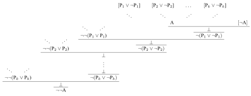

# Propositional Logic
**First published Thu May 18, 2023**

*Franks, Curtis*

Propositional logic is the study of the meanings of, and the inferential relationships that hold among, sentences based on the role that a specific class of logical operators called the propositional connectives have in determining those sentences’ truth or assertability conditions. As early as Aristotle it was observed that propositional connectives have a logical significance, and over many centuries piecemeal observations about some of their properties were made. But propositional logic *per se* did not emerge until the nineteenth century with the appreciation of the value of studying the behavior of propositional connectives in isolation of other operators.

For example, a variation of the famous canonical syllogism where A is the sentence “All men are mortal, and Socrates is a man”, and B is the sentence “Socrates is mortal” can give rise to a plurality of questions about the relationship between A and B. Whether B follows logically from A ought not depend, it is thought, on what words like “mortal” or “man” mean. But one could reasonably ask either of the questions,

> Does B follow from A purely by virtue of the meaning of the words “and”, “is”, “are”, “all”, and “a”?

and

> Does B follow from A purely by virtue of the meaning of the word “and”?

Intuitively, the answer to the first question is “yes”, and the answer to the second question is “no”.

The example suggests that there is a right way to ask the question, for surely B does follow logically from A. So when we want to ask if a sentence follows logically, we should attend to the role of all words such as “and”, “is”, “are”, “all”, and “a”. Consider, however, if C is the sentence “All men are mortal” and D is the sentence “Socrates is a man”, that C also follows from A, but the meanings of the words “is”, “are”, “all”, and “a” play no role in the intuitive verification of that fact. (Because A is just the sentence “C and D”, nothing beyond an understanding of the meaning of the word “and” is needed to see that A cannot be true without C also being true.) It seems significant that B and C not only each follow from A, but that they do so in different ways. The inference from A to C is not only simpler or more direct than the inference to B. In whatever sense B follows from A, so too does C, whereas there is a stricter sense in which C, but not B, follows from A: Although both B and C follow “logically” from A, the logical bond between C and A is stronger than that between B and A. This highlights the importance, not just of determinations about whether one sentence follows from another, but of what standard of logicality underwrites that determination.

Propositional logic is the study of just such a specification of a standard of logicality, wherein only the meanings of the propositional connectives (e.g., “and” in the example above, but not “is”, “all”, etc.) are considered in evaluating things such as the cogency of a deduction or a sentence’s truth conditions.

A sentential connective is a linguistic particle that binds sentences to create a new compound sentence or that inflects a single sentence to create a new sentence. Among the sentential connectives, a propositional connective has the characteristic feature that when the original sentences it operates on are (or express) propositions, the new sentence that results from its application also is (or expresses) a proposition. There are, as one would expect, many competing theories about what a proposition is, and propositional logic originated as a scientific discipline independent of that debate. For this reason, the precise demarcation of which linguistic particles qualify as propositional connectives is somewhat vague and even contentious. But the general heuristic is that a propositional connective must create from some original sentences a new sentence that makes a claim of the same order. Intuitively, because “A and B” is just an affirmation of the content of A and the content of B, and “not A” is just a denial of the content of A, “and” and “not” are serving as propositional connectives. “It is necessary that A”, on the other hand, is a claim not about the content of A but about the sentence A itself. Similarly, “A implies B” is a claim about the sentences A and B, that they stand in an implication relationship with one another, rather than a claim about the sort of thing that A and B themselves are claims about. For this reason, the necessity qualifier and the implication relation are typically not thought of as propositional connectives but as modal operators. The conditional operator in such expressions as “If A, then B” has not received a consensus: On some analyses, this has been treated as a propositional connective, but on others it cannot be.

In presenting propositional logic, we will not assume any particular theory of propositions. As we will see, the development of and plurality of systems of propositional logic can only be appreciated when no particular conception of proposition is in place. The only stipulations are that the connectives operate always on whole sentences and never on sub-sentential items like predicates or terms, and that they create sentences in the same evaluation class as the ones they operate on, never higher-order expressions about the sentences in that class.

## 1. Basic Framework

The formal language of propositional logic consists of “atomic” propositional variables, $p_1$, $p_2$, $p_3$, …, and propositional connectives, $c_1^1$, $c_2^1$, $c_3^1$, …, $c_1^2$, $c_2^2$, $c_3^2$, …, $c_1^3$, …. The expressions’ subscripts are used to distinguish them from one another; the fact that we use natural numbers indicates the typical convention that the vocabulary be countable. The propositional connectives’ superscripts indicate their “arity”, i.e., the number of propositions that they operate on in order to create a new proposition. The formulas of propositional logic are defined recursively by

1. Atomic propositional variables are formulas.
2. If $c_n^m$ is a propositional connective, and $\langle$A, B, C, …$\rangle$ is a sequence of *m*, possibly but not necessarily atomic, possibly but not necessarily distinct, formulas, then the result of applying $c_n^m$ to $\langle$A, B, C, …$\rangle$ is a formula.

The result of applying $c_n^m$ to $\langle$A, B, C, …$\rangle$ is customarily written in functional notation: $c_n^m$(A, B, C, …). Examples of formulas are

- $p_4$
- $c_1^2(p_7, p_3)$
- $c_2^2(c_1^1(p_1), c_1^1(c_1^2(p_2, p_3)))$
- $c_5^3(p_2, c_3^2(c_4^1(c_6^2(p_3, p_3)), p_5), c_9^1(p_2))$

This recursive definition of the formulas of propositional logic justifies the use of the label “atomic” for the propositional variables: Every formula is built up stepwise from atoms through a finite application of propositional connectives. It can be helpful to think of the connectives as “propositional functions” that take propositions (denoted by formulas) as input and return propositions as output. The space of propositions is then given as the free algebra on the atomic formulas generated by these functions, and the specification of a proposition is given by the standard “composition of functions” notation. This terminology is not common, however, because the expression “propositional function” has a quite different use of high currency (see the entry on Bertrand Russell).

It is customary to indicate the specific connectives one is studying with special characters, typically $\wedge$, $\vee$, $\supset$, $\neg$, to use infix notation for binary connectives, and to display parentheses only when there would otherwise be ambiguity. It is also common to investigate properties of propositional formulas that do not depend on the occurrence of atoms fundamentally, in which case formula variables A, B, C, etc. appear in the expression in place of sentence letters. Thus if $c_1^1$ is relabeled $\neg$, $c_1^2$ is relabeled $\wedge$, and $c_2^2$ is relabeled $\vee$, then in place of the third formula listed above one would write $\neg\rA\vee\neg(\rB\wedge\rC)$.

## 2. The Classical Interpretation

The logical analysis of propositional formulas proceeds from an association of some meaning with the connectives, and there are several ways of doing this. Because the original motivation for studying propositional logic is the observation that some particles in natural language often behave like propositional connectives, a natural first move is to try to specify formal rules of inference or precise assertability conditions that capture or approximate the role that these natural language predicates serve in informal reasoning. Two of the earliest specifications were in terms of truth functions and in terms of axiomatic deduction systems. After considering these in turn, we will compare the more sophisticated specifications given by Gentzen’s calculi.

### 2.1 Truth-functionality

If $\calV$ is a set of truth values, a function $\calV^n\longrightarrow\calV$ mapping *n*-tuples of truth values to truth values is called an *n*-ary truth function. The number of values in $\calV$ is called the valence of the function space. In the bivalent case, the truth values are denoted $\bT$ and $\bF$, and one has the classical theory of truth. Observe that in this classical function space are two 0-ary truth functions which, following the conventions on indices for propositional connectives we could denote $f_1^0$ and $f_2^0$, but are conventionally denoted $\top$ and $\bot$, defined by $\top=\bT$ and $\bot=\bF$, and four unary truth functions defined by

$$ \begin{aligned} f_1^1(\bT)&=f_1^1(\bF)=\bT,\\ f_2^1(\bT) &=\bT, \\ f_2^1(\bF) &=\bF, \\ f_3^1(\bT) &=\bF, \\ f_3^1(\bF) &=\bT, \\ f_4^1(\bT) &=f_4^1(\bF)=\bF. \\ \end{aligned} $$

One sees that $f_1^1$ performs no operation on its input and is essentially the same as $\top$. $f_4^1$ is similarly an impostor: $\bot$ dressed up as a unary function. One can quickly check that the number of *n*-ary truth functions is $2^{2^n}$—there being 2 possible output values on each of the $2^n$ possible *n*-tuples of input values, and that at each stage, a number of truth functions are impostors from lower arity. A case of special interest are the sixteen binary truth functions, which one can fully individuate by specifying their range on the 4 possible input values:

| input | $\langle\bT, \bT\rangle$ | $\langle\bT, \bF\rangle$ | $\langle\bF, \bT\rangle$ | $\langle\bF, \bF\rangle$ |
| --- | --- | --- | --- | --- |
| $f_1^2$ | $\bT$ | $\bT$ | $\bT$ | $\bT$ |
| $f_2^2$ | $\bT$ | $\bT$ | $\bT$ | $\bF$ |
| $f_3^2$ | $\bT$ | $\bT$ | $\bF$ | $\bT$ |
| $f_4^2$ | $\bT$ | $\bT$ | $\bF$ | $\bF$ |
| $f_5^2$ | $\bT$ | $\bF$ | $\bT$ | $\bT$ |
| $f_6^2$ | $\bT$ | $\bF$ | $\bT$ | $\bF$ |
| $f_7^2$ | $\bT$ | $\bF$ | $\bF$ | $\bT$ |
| $f_8^2$ | $\bT$ | $\bF$ | $\bF$ | $\bF$ |
| $f_9^2$ | $\bF$ | $\bT$ | $\bT$ | $\bT$ |
| $f_{10}^2$ | $\bF$ | $\bT$ | $\bT$ | $\bF$ |
| $f_{11}^2$ | $\bF$ | $\bT$ | $\bF$ | $\bT$ |
| $f_{12}^2$ | $\bF$ | $\bT$ | $\bF$ | $\bF$ |
| $f_{13}^2$ | $\bF$ | $\bF$ | $\bT$ | $\bT$ |
| $f_{14}^2$ | $\bF$ | $\bF$ | $\bT$ | $\bF$ |
| $f_{15}^2$ | $\bF$ | $\bF$ | $\bF$ | $\bT$ |
| $f_{16}^2$ | $\bF$ | $\bF$ | $\bF$ | $\bF$ |

One immediately recognizes the impostors $f_1^2 = \top$, $f_4^2 = f_2^1$ acting on the first input value, $f_6^2 = f_2^1$ acting on the second input value, $f_{11}^2 = f_3^1$ acting on the second input value, $f_{13}^2 = f_3^1$ action on the first value, and $f_{16}^2 = \bot$, leaving ten essentially new binary truth functions.

The truth-functional analysis of propositional logic proceeds by associating *n*-ary truth functions with the *n*-ary propositional connectives. The classical case considered thus far, where the truth value space is bivalent, admits a strikingly simple analysis. Observe first that the functions $f_1^3$, $f_2^2$, and $f_2^8$ approximate the truth conditions of some uses of the natural language particles “not”, “or”, and “and” (another use of the particle “or” is arguably approximated by $f_2^7$). Thus if we associate these functions with the three connectives labeled earlier $\neg$, $\vee$, and $\wedge$, we could compute the truth value of complex formulas such as $\neg\rA\vee\neg(\rB\wedge\rC)$ given different possible assignments of truth values to the sentence letters A, B, and C, according to the composition of functions indicated in the formula’s propositional structure. One can check that this formula takes the value **F** precisely when each of A, B, and C is assigned **T** and takes the value **T** otherwise. Under this interpretation, one can define

1. A is a **classical propositional validity** if it evaluates as **T** on every possible assignment of values to its atomic propositional variables;
2. A is **classically satisfiable** if it evaluates as **T** on at least one possible assignment of values to its atomic propositional variables (and is **classically unsatisfiable** otherwise);
3. A is a **classical propositional consequence** of B if on no assignment of values to the atoms that occur in A and B on which B, evaluates as **T** does A evaluate as **F**;
4. A is a **classical propositional equivalent** of B if A and B evaluate as **T** on precisely the same assignments of values to atoms.

In this way, the language of propositional logic restricted to the connectives $\neg$, $\vee$, and $\wedge$ corresponds with the formulas of the familiar two element Boolean algebra of complementation, union, and intersection. The familiar Boolean laws of

- **interchange**: If A and B are equivalent, and A occurs as a subformula of $\rC_1$, then the result of replacing an occurrence of A in $\rC_1$ with B is a formula $\rC_2$ that is equivalent to $\rC_1$.
- **substitution**: If A and $\rB_1$ and $\rC_1$ are any formulas whatsoever, then the result of replacing *each* occurrence of the propositional variable $p$ in $\rB_1$ and $\rC_1$ with A are formulas $\rB_2$ and $\rC_2$ with the properties: $\rB_2$ is valid if $\rB_1$ is; $\rB_2$ is unsatisfiable if $\rB_1$ is; $\rB_2$ is a consequence of $\rC_2$ if $\rB_1$ is a consequence of $\rC_1$; $\rB_2$ and $\rC_2$ are equivalent if $\rB_1$ and $\rC_1$ are.
- **complementation**: $\rA\vee\neg\rA$ is a classical validity (called the “law of excluded middle” (lem) in propositional logic).
- **double complementation**: $\neg\neg\rA$ is equivalent to A.
- **commutativity**: $\rA\wedge\rB$ is equivalent to $\rB\wedge\rA$, and $\rA\vee\rB$ is equivalent to $\rB\vee\rA$.
- **associativity**: $(\rA\wedge\rB)\wedge\rC$ is equivalent to $\rA\wedge (\rB\wedge\rC)$, and $(\rA\vee\rB)\vee\rC$ is equivalent to $\rA\vee (\rB\vee\rC)$.
- **distribution**: $\rA\vee (\rB_1\wedge\rB_2\wedge \ldots \wedge\rB_n)$ is equivalent to $(\rA\vee\rB_1)\wedge (\rA\vee\rB_2)\wedge \ldots \wedge (\rA\vee\rB_n)$ and $\rA\wedge (\rB_1\vee\rB_2\vee \ldots \vee\rB_n)$ is equivalent to $(\rA\wedge\rB_1)\vee (\rA\wedge\rB_2)\vee \ldots \vee (\rA\wedge\rB_n)$.
- **De Morgan equivalence**: $\neg(\rB_1\wedge\rB_2\wedge \ldots \wedge\rB_n)$ is equivalent to $\neg\rB_1\vee\neg\rB_2\vee \ldots \vee\neg\rB_n$ and $\neg(\rB_1\vee\rB_2\vee \ldots \vee\rB_n)$ is equivalent to $\neg\rB_1\wedge\neg\rB_2\wedge \ldots \wedge\neg\rB_n$.

therefore apply to this language of “Boolean propositional formulas”.

#### 2.1.1 Normal forms

Consider any other propositional connective denoted $\star$, of any arity, say 3, and suppose that with it too is associated an arity-3 truth function. As before let us specify this truth function by indicating its output on each of the $2^3$ possible input values.

| input | $\star$ |
| --- | --- |
| $\langle$**T**, **T**, **T**$\rangle$ | **T** |
| $\langle$**T**, **T**, **F**$\rangle$ | **T** |
| $\langle$**T**, **F**, **T**$\rangle$ | **F** |
| $\langle$**T**, **F**, **F**$\rangle$ | **F** |
| $\langle$**F**, **T**, **T**$\rangle$ | **F** |
| $\langle$**F**, **T**, **F**$\rangle$ | **T** |
| $\langle$**F**, **F**, **T**$\rangle$ | **F** |
| $\langle$**F**, **F**, **F**$\rangle$ | **F** |

There is a simple algorithm for constructing a Boolean formula that is equivalent to $\star$(A, B, C): For each row of the defining table for $\star$ in which the output value is **T**, construct a conjunction of each propositional variable that is assigned **T** and the negation of each propositional variable that is assigned **F** in that row’s input: in our case, $\rA\wedge\rB\wedge\rC$ from row 1, $\rA\wedge\rB\wedge\neg\rC$ from row 2, and $\neg\rA\wedge\rB\wedge\neg\rC$ from row 3. Then disjoin these conjunctions. In our case the final formula is

$$(\rA\wedge \rB\wedge\rC)\vee (\rA\wedge\rB\wedge\neg\rC)\vee (\neg \rA\wedge \rB\wedge\neg\rC).$$

It is clear that this formula will evaluate as **T** on all the rows that $\star$(A, B, C) did and as false on all the other rows. Suppose, now, that one is given a propositional formula with any arbitrary composition of connectives, and that under the classical interpretation these connectives are associated with truth-functional connectives of the appropriate arity. This formula will be equivalent to some simple formula with a single connective whose arity is equal to the total number of propositional variables in the original formula. By the construction just rehearsed, that simple formula is again equivalent to a Boolean formula of a certain form. Thus we have verified the Disjunctive Normal Form (DNF) theorem:

**Theorem 1**. *Any formula of propositional logic under the classical interpretation is equivalent to a disjunction of conjunctions of propositional variables and negated propositional variables.*

Similar reasoning can be used to verify equivalence to a “conjunctive normal formula”, a conjunction of disjunctions of propositional variables and negated propositional variables.

#### 2.1.2 Truth-functional completeness

One corollary of the DNF theorem is that Boolean logic—the fragment of propositional logic with only the connectives $\neg$, $\wedge$, and $\vee$—is in a sense just as expressive as full classical propositional logic with infinitely many connectives of infinitely many arities. This fact is often expressed by saying that the set of connectives $\{\neg, \wedge, \vee\}$ on the classical interpretation is “truth-functionally complete”: the other connectives aren’t all exactly impostors in the above used sense, but they can each be viewed as an abbreviation of some combination of Boolean connectives. Algebraically, one can think of the infinite function space as being fully spanned by the Boolean functions.

The idea of truth-functional completeness can be pressed further with the simple observation that $\rA\wedge\rB$ is the classical equivalent of $\neg (\neg\rA\vee\neg\rB)$, so that it too can be viewed as an abbreviation. So the pair $\{\vee, \neg\}$ is truth-functionally complete. Likewise, $\rA\vee\rB$ abbreviates $\neg (\neg\rA\wedge\neg\rB)$: $\{\wedge, \neg\}$ is truth-functionally complete. In 1913, Henry Sheffer rediscovered an unpublished observation of Charles Sanders Peirce that the functions $f_9^2$ and $f_{15}^2$ approximating the truth conditions of the natural language expressions “not both …and …” and “neither …nor …” each individually span the entire space of bivalent truth-functions.

#### 2.1.3 Realization in switching circuits

More productive than reducing the number of connectives to the smallest possible truth-functionally complete set, though, has been the selection of connectives that convey the greatest perspicuity into the structure of deductive inference. We have already indicated that the Boolean connectives, by closely approximating the truth conditions of the ordinary language particles “not”, “and”, and “or”, provide a formal mechanism for evaluating contentful human inference. Another merit of the Boolean selection is its natural realization in the description of relay and switching circuits. In 1940 Claude Shannon described an interpretation of propositional logic in which sentence letters stand for circuits: atomic circuits are nodes $n_1$ and $n_2$ connected by a gated path which, when closed, allows a current to pass between $n_1$ to $n_2$ and, when open, does not. $\rA\wedge\rB$ represents the serial connection of circuits A and B, $\rA\vee\rB$ represents their parallel connection, and $\neg\rA$ represents a circuit that is closed if A is open and open if A is closed (this is a theoretical posit: the interpretation alone provides no predetermined way to construct such a circuit). Letting the value 0 represent a circuit being closed and the value 1 represent a circuit being open, one sees that the formulas of propositional logic represent all the possible ways of constructing electrical circuits, and their classical truth functional analysis determines exactly whether a circuit so represented is open: open circuits evaluate as **T**, closed circuits as **F**.

Because of the simplicity of classical propositional logic, Shannon’s thesis greatly facilitated circuit design. Immediately, one sees that any circuit is equivalent to (i.e., opens and closes under the same conditions as) a circuit described by a disjunctive normal formula. Thus one could be given complex circuits A, B, and C, connect A and B in series ($\rA\vee\rB$), then connect this in parallel to C ($(\rA\vee\rB)\wedge\rC$), and finally desire a circuit that is closed when this is open: $\neg ((\rA\vee\rB)\wedge\rC)$. This formula describes the conditions under which the circuit you are after will be closed, but it does not specify a way of constructing it. The DNF theorem tells us that there is a “normal” circuit with the same closure conditions. Because all switches in such normal circuits apply at the atomic level, there is a known way to construct them. More, there are systematic methods for simplifying disjunctive normal formulas to equivalent formulas with the fewest number of occurrences of atoms (Quine 1955 presents an algorithm originally discovered by Samson and Mills 1954)[^quine-1955][^samson-1954]. Combined with Shannon’s result, this shows not only that symbolic manipulation provides a guide for how to construct a circuit with desired closure conditions but that it can be used to design the least complicated and resource demanding one.

#### 2.1.4 The material conditional

Another important feature of the classical interpretation is the special role played by the binary truth function $f_5^2$, which always returns the value **T** unless given the input $\langle$**T**, **F**$\rangle$. This truth function is often described, controversially, as giving the truth conditions for the indicative mood conditional connective “if …, then …”, or even, erroneously, for the relation “implies”. It is important to underscore the error in attributing truth functionality to the implication relation. To say that one proposition implies another is to say that under any conditions in which the first is true, the second is also true. To suggest that this relation is truth-functional is to suggest that simply knowing whether A and B are true is enough to determine whether A implies B. This suggestion is untenable because the truth or falsity of A and B indicate nothing about other conditions. B could be true but, for all that, not be implied by A because under some other situation A could be true while B is false. As emphasized above, the implication relation is not ordinarily thought of as a propositional connective at all, but a relation that two propositions might bear to one another.

What is more interesting is the thesis that $f_5^2$ captures the truth conditions of, at least some uses of, conditional expressions in the indicative mood. The binary connective given this truth-functional interpretation is known as the “material conditional” and is often denoted $\supset$. One can readily check that $\rA\supset\rB$ is equivalent to the Boolean expression $\neg\rA\vee\rB$. There is a vast literature about the tenability of the claim that ordinary language conditional expressions are truth-functional. The claim itself is apparently ancient, attributed to Philo of Melaga and referenced in Chrysippus’s early systematization of propositional logic. It has been defended in a modern context by Charles Peirce, H. P. Grice, and Frank Jackson. But its detractors have been many (see the entry on indicative conditionals).

Of special interest is the suggestion, originally due to Frank Ramsey, that expressions of the form “If A, then B” in the indicative mood are best understood in terms of conditional probabilities as “The probability of B given A is nearly certain ($\bP_\rA (\rB) > 0.95$)”. In 1976 David Lewis proved that the conditional expressions, so understood, not only fail to be truth-functional but in fact are not even propositions. Dorothy Edgington (1995: 280)[^edgington-1995] provided the following simple argument for Lewis’s result: Suppose $\bP_\rA (\rB)$ measured the probability of some (not necessarily truth functional) proposition $\rA\cdot\rB$. If $\rA\supset\rB$ implies $\rA\cdot\rB$, then $\rA\cdot\rB$ is true whenever A is false. Therefore, $\rA\cdot\rB$ cannot be unlikely when A is unlikely. But the unlikelihood of A certainly does not prevent $\bP_\rA (\rB)$ from being very low. If, on the other hand, $\rA\supset\rB$ does not imply $\rA\cdot\rB$, then $\rA\cdot\rB$ could be false when $\neg(\rA\wedge\neg \rB)$ is true, and certainty about $\neg(\rA\wedge\neg \rB)$ would still leave room for doubt about $\rA\cdot\rB$. But being certain of $\neg(\rA\wedge\neg\rB)$ suffices for $\bP_A (\rB)=1$. It follows that $\rA\supset\rB$ neither implies nor doesn’t imply $\rA\cdot\rB$, and the only way this could happen is for $\rA\cdot\rB$ not to have truth-conditions at all, for $\bP_\rA (\rB)$ not to measure the probability of any proposition.

This example highlights again the delicacy of the problem of determining which connectives can be analyzed under the purview of propositional logic. On some interpretations (including the truth-functional one), indicative mood conditionals can be, but on Ramsey’s interpretation they cannot. In 1982, W. V. O. Quine anticipated Lewis’s result by expressing the caution, which he attributed to Philip Rhinelander, not to confuse the statement of a conditional “If A, then B” with the statement of B on condition A. The latter, he held, is typically the proper way of understanding an expression of the form “If A, then B”, which, because it is a non-statement in the absence of the condition A, cannot be understood as a proposition at all.

Gottlob Frege is often counted among the defenders of the material conditional, but his attitude towards the connective is nuanced. His systematization of propositional logic did feature a connective with the truth conditions given by $f_5^2$, but Frege rejected the idea that this connective expressed the indicative conditional of natural language. He wrote, “the causal connection implicit in the word ‘if’ …is not expressed by our symbols” (1972: 116). It is a matter of ongoing debate whether Frege believed that the material conditional failed even to capture the truth conditions of ordinary language indicative conditionals or if he meant only that although it captures those conditionals’ truth conditions, the material conditional fails to capture other, non truth-conditional aspects of meaning. What is clear is that whatever mismatch he detected between ordinary conditional statements and the material conditional did not dissuade him from placing the latter in the center of his logical investigations.

Given the plurality of truth-functionally complete sets of connectives, why would Frege or anyone else select the material conditional as a primitive connective for classical logic? Frege saw that the value of selecting the material conditional as a primitive connective not from its approximation of ordinary language expression but from its role internal to logical theory. Let us write $\dturnstile{\CTT} \rB$ to indicate that the formula B is valid in the classical theory of truth. Generalizing this turnstile notation, one also writes $\rA \dturnstile{\CTT} \rB$ to indicate that B is a classical propositional consequence of A, and where $\calS$ is a set of propositional formulas, $\calS \dturnstile{\CTT} \rB$ to indicate that B is a classical propositional consequence of all the formulas in $\calS$. A fundamental fact, readily verifiable with a truth table, is that $\calS\cup\{\rA\}\dturnstile{\CTT} \rB$ if, and only if, $\calS\dturnstile{\CTT} \rA\supset\rB$. In the case that $\calS$ is empty, $\rA\dturnstile{\CTT} \rB$ exactly when $\dturnstile{\CTT} \rA\supset\rB$. Earlier we emphasized that the material conditional cannot be understood as an expression of logical implication. The relation of classical logical consequence, on the other hand, is in fact a (particularly strict sort of) logical implication relation, one to which the material conditional is in fact directly related: $\rA\supset\rB$ does not express any implication relation between A and B, but the claim that $\rA\supset\rB$ is a classical propositional validity is such an expression of implication.

#### 2.1.5 Decidability

A logic is said to be decidable if there is a reliable method for determining whether a formula is satisfiable. Classical propositional logic is readily seen to be decidable: Given an arbitrary formula, simply enumerate in the tabular method used above each of the possible sequences of truth values that can be input to its atomic propositional variables, and compute the composition of functions on each of these inputs. Because formulas are finite strings of symbols, each contains only a finite number, say *n*, of atoms, so that the truth-table will have exactly $2^n$ rows. Completing the truth table is therefore a finite determinate task, at the end of which one will have discovered whether or not the formula is satisfiable.

#### 2.1.6 NP-completeness

The problem of determining whether a formula of classical propositional logic is satisfiable is known as sat. Although decision procedures exists for sat, all known procedures for making this determination in a predetermined manner for every possible formula are in a precise sense tedious and inefficient: no procedure has been discovered which returns an answer after a number of computation steps polynomially bounded by the size of the formula one tests, i.e., it is unknown whether sat is in the complexity class **P** of problems solvable by a deterministic procedure in polynomial time. It is known that sat is in the complexity class **NP**—those questions that can be answered by a non-deterministic procedure in polynomial time. In 1971, Steven Cook proved that sat is “**NP**-complete”: any problem in the class **NP** is reducible in polynomial time to sat. A corollary of Cook’s theorem is that if sat is in the class **P**, then **NP** = **P**. It is generally believed that **NP** is a strictly larger class of problems than **P** and, for this reason, that no “efficient” procedure for solving sat in the sense of polynomial time computability exists. In the decades since Cook’s discovery, a wide range of problems have been shown to be **NP**-complete. But classical propositional logic figured prominently in the context of the discovery of **NP**-completeness. Its perspicuity was particularly suited to stage the concept’s formation.

#### 2.1.7 Compactness

A fundamental fact about classical propositional logic is that it is “compact”. To motivate the idea of compactness, consider the set of formulas $\calS = \{p_1, p_2, p_3, \neg (p_1\wedge p_2\wedge p_3) \}$. Every proper subset of $\calS$ is “simultaneously satisfiable”, i.e., given any such proper subset, there is a single assignment of truth values to atoms under which each of the subset’s formulas are true. However, $\calS$ itself is not simultaneously satisfiable: Making each of $p_1$, $p_2$, and $p_3$ true guarantees the falsity of $\neg (p_1\wedge p_2\wedge p_3)$. What if another set $\calT$ contains infinitely many formulas? Our observation about $\calS$ might well foster the intuition that every proper subset of $\calT$ could be simultaneously satisfiable despite there being no assignment of truth values to atoms that satisfies every formula in $\calT$. What if, instead of knowing that every *proper* subset of $\calT$ is simultaneously satisfiable, one were told only that each *finite* subset of $\calT$ is? Because most proper subsets of $\calT$ are infinite, the intuition that $\calT$ could nevertheless fail to be simultaneously satisfiable is only strengthened.

The Compactness Theorem (Gödel 1930)[^gödel-1930] tells us that this intuition is misleading:

**Theorem 2**. *If each finite subset of $\calT$ is simultaneously satisfiable, then so is $\calT$.*

Notice that by “relaxing” the hypothesis from “proper subset” to “finite subset”, the Compactness Theorem is true and in fact trivial when $\calT$ is finite: $\calT$ is one of its own finite subsets. When $\calT$ is infinite, though, relaxing the hypothesis dramatically increases the theorem’s strength (In the language of quantification theory, the theorem involves a strong quantifier switch: From the fact that, given any finite subset of $\calT$, one can always find an interpretation that satisfies it (potentially a different interpretation for each finite subset), one may infer the existence of a single interpretation that satisfies every possible finite subset of $\calT$ one might ever be given).

For a striking corollary of compactness, suppose that A is the classical propositional consequence of the infinite set of formulas $\calU$ ($\calU \dturnstile{\CTT} \rA$). If every finite subset of $\calU\cup\{\neg\rA\}$ were simultaneously satisfiable, then by compactness, $\calU\cup \{\neg\rA\}$ would be simultaneously satisfiable, contrary to the our supposition. Therefore, some finite subset of $\calU\cup\{\neg\rA\}$ is not simultaneously satisfiable—for some finite subset $\calV$ of $\calU$, there is no assignment of truth values to atoms that makes every formula in $\calV$ true and A false. Classical propositional consequence is always “finitely determined”: If $\calU \dturnstile{\CTT} \rA$, then for some finite subset $\calV$ of $\calU$, $\calV \dturnstile{\CTT} \rA$.

### 2.2 Deduction

Formal deduction systems, introduced by Gottlob Frege in 1879, provide an alternative specification of the meanings of propositional connectives. Such systems are characterized by a finite set of formulas called axioms and a finite set of inference rules. The propositional axioms in Frege’s system are

$$ \begin{align} \rA&\supset (\rB\supset\rA) \tag*{axiom 1}\\ (\rC\supset (\rB\supset\rA))&\supset ((\rC\supset\rB)\supset (\rC\supset\rA)) \tag*{axiom 2}\\ (\rB\supset\rA)&\supset (\neg\rA\supset \neg\rB) \tag*{axiom 3}\\ \rA&\supset \neg\neg\rA \tag*{axiom 4}\\ \neg\neg\rA&\supset\rA \tag*{axiom 5}\\ \end{align} $$

The inference rules of are

- *modus ponens*: $\begin{prooftree} \AxiomC{\(\rA\supset\rB$}\AxiomC{$\rA$}\BinaryInfC{$\rB$} \end{prooftree}\)
- substitution: If $p$ is an atomic variable in B, and C is any formula whatsoever, then let $\rB'$ be the result of replacing every occurrence of $p$ with C, and from B infer $\rB'$.

A proof is defined as a finite sequence of formulas, each one of which either is an axiom or follows from previous entries in the sequence by an application of an inference rule. A theorem is a formula which occurs as the final entry in a proof, and we denote the theoremhood of a formula A by $\turnstile{\CPC} \rA$—here cpc stands for “the classical propositional calculus”. We have presented the formal deduction system found in Frege 1879, but cpc is meant to label any equivalent system. Frege’s system is in two senses adequate for representing classical propositional logic: Because the pair $\{\neg, \supset\}$ is truth-functionally complete, any formula expressible with any combination of bivalent truth-functional connectives whatsoever can be translated into a formula in Frege’s system. Moreover, the system is complete in the sense that all and only the classical propositional tautologies are theorems. The verification of this propositional completeness theorem below uses a different deductive system for cpc due to Hilbert and Bernays. As Jean Nicod (1917)[^nicod-1917] was the first to observe, there are even presentations of cpc using only the single “not both …and …” connective $|$, e.g., with the lone axiom

$$((\rA | (\rB | \rC)) | ((\rE | (\rE | \rE)) | ((\rD | \rB) | ((\rA | \rD) | (\rA | \rD)))))$$

and rules of inference

- *Nicod’s inference*: $\begin{prooftree} \AxiomC{\(\rA$} \AxiomC{$\rA|(\rB|\rC)$} \BinaryInfC{$\rC$} \end{prooftree}\)
- substitution: If $p$ is an atomic variable in B, and C is any formula whatsoever, then let B’ be the result of replacing every occurrence of $p$ with C, and from B infer B’.

In parallel to the truth-functional framework for classical logic, one can also introduce the notion of deduction from hypotheses: If $\calS$ is a set of formulas, then a sequence of formulas whose last entry is A and in which every entry either is an axiom, a member of $\calS$, or the result of an application of a inference rule from earlier entries is called a derivation of A from $\calS$. In formulating this notion for cpc, however, some care is needed. One does not want, for example, every formula to be deducible from a propositional variable, and yet the substitution rule allows one to infer anything from $p_1$. In moving from pure axiomatic provability to the idea of deduction from arbitrary hypotheses, therefore, the substitution rule is restricted to be applicable only to axioms. One can easily show that this restriction does not affect the set of theorems. With this restriction in place, we can denote the derivability of A from the set $\calS$ by $\calS \turnstile{\CPC} \rA$.

#### 2.2.1 The Deduction Theorem

In 1910 Frege pointed out, but did not prove, that $\calS\cup\{\rA\}\turnstile{\CPC} \rB$ if, and only if, $\calS\turnstile{\CPC} \rA\supset\rB$. The first recorded proofs are in Herbrand 1930 and Tarski 1933. Whereas the analogous observation in the case of the truth-functional interpretation is trivial, this result of Herbrand and Tarski is more complex. One direction is readily verified: Any $\calS$-derivation $\calD$ of $\rA\supset\rB$ is obviously also a $\calS\cup\{\rA\}$-derivation. To construct a $\calS\cup\{\rA\}$-derivation of $\rB$, simply append the two formulas $\rA$ and $\rB$ to the end of $\calD$.

The other direction is known as the Deduction Theorem. It’s proof uses induction on the length of the $\calS\cup\{ \rA\}$-derivation of $\rB$:

**Theorem 3**. *$\calS\cup\{ \rA\}\turnstile{\CPC}\rB$ only if $\calS \turnstile{\CPC}\rA\supset\rB$*

*Proof.* (base step) If there is a one-line derivation of $\rB$ from $\calS\cup\{ \rA\}$, then it is possible to construct a $\calS$-derivation of $\rA\supset\rB$. To see this, notice that there are only three types of one-line derivations:

1. $\rB$ is in the set $\calS$
2. $\rB$ is $\rA$
3. $\rB$ is an axiom

The following three $\calS$-derivations exhibit the fact that $\calS \turnstile{\CPC}\rA\supset\rB$ in case 1, 2, and 3, respectively:

$$\begin{array}{c|c|c} \rB & (\rB\supset ((\rC\supset\rB)\supset\rB))\supset ((\rB\supset (\rC\supset\rB))\supset(\rB\supset\rB)) & \rB \\ \rB\supset (\rA\supset\rB) & \rB\supset ((\rC\supset\rB)\supset\rB) & \rB\supset (\rA\supset\rB) \\ \rA\supset\rB & (\rB\supset (\rC\supset\rB))\supset(\rB\supset\rB)) & \rA\supset\rB \\ & \rB\supset (\rC\supset\rB) & \\ & \rB\supset\rB & \end{array}$$

It is easy to check that each line of each derivation is either a member of $\calS,$ an axiom, or the result of an application of *modus ponens*. (The middle sequence qualifies as a $\calS$-derivation of $\rA\supset\rB$ because of the assumption that $\rA$ is $\rB$.)

(induction step) Assume that whenever there is a $\calS\cup\{ \rA\}$-derivation of $\rB$ that is *n* or fewer lines long, there is a $\calS$-derivation of $\rA\supset\rB$. Now suppose there is an $n+1$ line long $\calS\cup\{ \rA\}$-derivation $\calD$ of $\rB$. It is possible that the justification for line $n+1$ is one of the possibilities from the base case—that $\rB$ is an axiom, is from the set $\calS$, or is identical to $\rA$. In any of those cases, the $\calS$-derivation of $\rA\supset\rB$ would be constructed as in the base case. In the novel case that the last line is the result of an application of *modus ponens*, the formulas $\rC\supset\rB$ and $\rC$ occur as earlier lines in $\calD$. Therefore $\calS\cup\{ \rA\}$-derivations that are *n* lines long or shorter of $\rC\supset\rB$ and $\rC$ appear as subsequences of $\calD$. The induction hypothesis then guarantees the existence of $\calS$-derivations of $\rA\supset (\rC\supset\rB)$ and of $\rA\supset\rC$. Let

$$\calD_1 = \langle\rS_1, \rS_2, \ldots, \rA\supset (\rC\supset\rB)\rangle$$

and

$$\calD_2 = \langle\rT_1, \rT_2, \ldots, \rA\supset\rC\rangle$$

be examples of such derivations, and consider the sequence:

$$\begin{array}{c} \calD_1\\ \calD_2\\ (\rA\supset (\rC\supset\rB))\supset ((\rA\supset\rC)\supset (\rA\supset\rB))\\ (\rA\supset\rC)\supset (\rA\supset\rB)\\ \rA\supset\rB \end{array}$$

This is a $\calS$-derivation of $\rA\supset\rB$. ◻

Because this verification of the Deduction Theorem depends only on the first two of Frege’s axioms, it applies also in many non-classical contexts including, importantly, a large class of constructive propositional logics.

#### 2.2.2 Basic meta-theory

Another analogue to the evident facts from the truth-functional framework, this time the DNF theorem, played a historical role in the metatheoretical analysis of axiomatic systems. Hilbert showed how to associate with every formula A a disjunctive normal formula $\rA_{\dnf}$ and a conjunctive normal formula $\rA_{\cnf}$ such that

$$\begin{aligned} &\turnstile{\CPC} \rA \supset\rA_{\dnf},\\ &\turnstile{\CPC} \rA_{\dnf} \supset\rA, \\ &\turnstile{\CPC} \rA \supset\rA_{\cnf}, \text{ and }\\ &\turnstile{\CPC} \rA_{\cnf} \supset\rA. \end{aligned} $$

In particular, applying the Deduction Theorem, A and $\rA_{\cnf}$ are inter-derivable.

Frege’s axiomatization obviously depends on the expressive adequacy of the pair $\{\supset, \neg\}$, about which one cannot really be certain unless one has in mind some account of the meaning of the connectives other than that provided by the deduction system itself. Russell and Whitehead in *Principia Mathematica* and Hilbert and Ackermann in 1928 followed Frege in working with a small set of basic connectives and using others as abbreviations. In 1926, Bernays questioned “the predominant tendency …to reduce the number of basic connectives and therewith the number of axioms”, observing that “one can, on the other hand, sharply distinguish the various connectives” and thereby not presuppose equivalences such as $\neg\rA\vee\rB = \rA\supset\rB$ that do not appear in the axiomatic framework itself. Such an approach allows one to explore modifications of an axiom system in which certain equivalences do not hold, and to compare them with one another. The axiomatic framework is generally a crude device for such comparative studies; the spirit of Bernays’s insight reached its maturation in the natural deduction and sequent calculi of Gentzen (1934–35) wherein the meaning of each connective is fully specified, in terms of characterizing inference rules, in isolation of the other connectives.

The axiomatic framework with minimal signature (following Russell and Whitehead, Hilbert used only $\{\vee, \neg\}$) nevertheless submitted to the Hilbert school’s profound metatheoretical analysis in terms of consistency, independence, maximality, and completeness proofs. In order to preserve the context of discovery, the following retraces the original proofs provided in Hilbert’s lectures “Prinzipien der Mathematik” from 1917.

##### 2.2.2.1 Consistency

An formal deductive system S is *consistent* if for no formula A is $\turnstile{\rS} \rA$ and $\turnstile{\rS} \neg\rA$. To prove consistency of cpc, Hilbert reasoned as follows: Let the sentence letters range over the numbers 1 and 0, interpret the disjunction symbol as multiplication and the negation symbol as the function $1 - x$. In this interpretation, every formula is a function on 0 and 1 composed of multiplication and $1 - x$. Hilbert observed that the axioms are each interpreted as functions that return the value 0 on every input, and that the rules of inference each preserve this property (so that every theorem is constant 0). Furthermore, the negation of any theorem is constant 1 and therefore unprovable. Thus, no formula is provable if its negation also is, so the system is consistent.

##### 2.2.2.2 Maximality

A formal deductive system is *maximal* if any proper extension of it is inconsistent. Hilbert used the same interpretation from his consistency argument to show:

**Theorem 4**. cpc is maximal.

*Proof.* As above, a formula is provable only if it is constant 0 under the interpretation, which, in the case of a conjunctive normal formula, occurs precisely when each of its conjuncts contains both a negated and unnegated occurrence of some propositional variable. Now let A be any unprovable formula. Its associated formula $\rA_{\cnf}$ must also be unprovable and therefore must contain a conjunct C with no propositional variable appearing both negated and unnegated. To show that cpc+A (cpc augmented with A as an additional axiom) is inconsistent, let B be any formula whatsoever, and label D the result of substituting, into $\rA_{\cnf}$, B for every propositional variable that occurs unnegated in C and $\neg\rB$ for every propositional variable that occurs negated in C. It is easy to show that

$$\begin{aligned} &\turnstile{\CPC+\rA} \rA, \\ &\turnstile{\CPC} \rA\supset\rA_{\cnf},\\ &\turnstile{\CPC} \rA_{\cnf}\supset\rD, \text{ and}\\ &\turnstile{\CPC} \rD\supset\rB.\\ \end{aligned} $$

Thus $\turnstile{\CPC+\rA} \rB$ for any formula B. ◻

Hilbert and others called this same property “completeness”, in analogy to the completeness axiom from Hilbert’s foundational studies of plane geometry and number theory. But as completeness has come to mean something else in the logical domain, this property is now commonly referred to as “Post-completeness” (after Post 1921 who rediscovered this property of cpc)[^post-1921] or, as here, as “maximality”.

##### 2.2.2.3 Completeness

The Completeness Theorem describes an exact correspondence between the truth-functional and deductive frameworks:

**Theorem 5**. *$\turnstile{\CPC} \rA$ if, and only if, $\dturnstile{\CTT} \rA$.*

*Proof.* This result is often described as difficult to establish, but in Hilbert’s 1917 lectures, it is an immediate corollary of maximality. Already it was observed in the consistency argument that only formulas interpreted as constant 0 functions are provable. Suppose that some formula A were constant 0 but unprovable in cpc. Then the same consistency argument as before would carry through for cpc+A, contradicting the maximality result just proved. It follows that every formula interpreted as a constant 0 function is a theorem of cpc. The formulas interpreted as constant 0 functions are just the valid formulas on the classical truth-functional interpretation. ◻

A direct route to the Completeness Theorem is also possible. A famous proof from Kalmár 1935 begins with two observations:

**K1**

$\turnstile{\CPC} (\rA\supset \rB)\supset ((\neg \rA\supset \rB)\supset \rB)$

**K2**

Let A be any formula with propositional variables $p_1$, $p_2$, …, $p_n$, and let $\mathit{v}$ be an assignment of truth values to propositional variables. Define $\rC_k = p_1$ if $\mathit{v}(p_1) = \mathbf{T}$, $\neg p_1$ if $\mathit{v}(p_k) = \mathbf{F}$. Then if $\mathit{v}(\rA) = \mathbf{T}$, $\rC_1, \rC_2, \ldots, \rC_n \turnstile{\CPC} \rA$.

*Proof.* Suppose now that T is a classical validity with propositional variables $p_1$, $p_2$, …, $p_n$. Then by K2, for every assignment $\mathit{v}$ of truth values to propositional variables, $\mathit{v}(\rT) = \mathbf{T}$ and $\rC_1, \rC_2, \ldots, \rC_n \turnstile{\CPC} \rT$. Let $\mathit{u}$ and $\mathit{w}$ be assignments of truth values that differ only in that $\mathit{u}(p_n) = \mathbf{T}$ whereas $\mathit{w}(p_n) = \mathbf{F}.$

$$\rC_1, \rC_2, \ldots, \rC_{n-1}, p_n \turnstile{\CPC} \rT$$

and

$$\rC_1, \rC_2, \ldots, \rC_{n-1}, \neg p_n \turnstile{\CPC} \rT.$$

By the Deduction Theorem,

$$\rC_1, \rC_2, \ldots, \rC_{n-1} \turnstile{\CPC} p_n\supset \rT,$$

and

$$\rC_1, \rC_2, \ldots, \rC_{n-1} \turnstile{\CPC} \neg p_n\supset \rT.$$

By K1,

$$\rC_1, \rC_2, \ldots, \rC_{n-1} \turnstile{\CPC} (p_n\supset \rT)\supset ((\neg p_n\supset \rT)\supset \rT).$$

Two applications of *modus ponens* yield

$$\rC_1, \rC_2, \ldots, \rC_{n-1} \turnstile{\CPC} \rT.$$

Repeating this same reasoning for $p_{n-1}$ yields

$$\rC_1, \rC_2, \ldots, \rC_{n-2} \turnstile{\CPC} \rT,$$

and after *n* repetitions $\turnstile{\CPC} \rT$ is established. ◻

Proving completeness directly in this manner allows a different argument for maximality:

*Proof.* For suppose $\centernot{\turnstile{\CPC}} \rA$. Then by completeness, $\centernot{\dturnstile{\CTT}} \rA$. So there is some assignment $\mathit{v}$ of truth values to propositional variables on which A evaluates as **F**. Let $\rA'$ be the result of replacing every propositional variable assigned **T** by $\mathit{v}$ with $p_1\supset p_1$ and every propositional variable assigned **F** by $\mathit{v}$ with $p_1\supset\neg p_1$. $\rA'$ is unsatisfiable. Therefore $\neg \rA'$ is valid. So $\turnstile{\CPC+\rA} \neg\rA'$. But $\turnstile{\CPC+\rA} \rA$ and, by substitution, $\turnstile{\CPC+\rA} \rA'$. So cpc+A is inconsistent. ◻

##### 2.2.2.4 Completeness as semi-decidability

The set of theorems of a formal deductive system can be seen to be recursively enumerable. To construct a simple enumeration, let us add to the language of propositional logic the symbol “;” as a sequential location demarcator so that the language consists of $p_1, p_2, \ldots, (, ), \supset, \neg, \hbox{and} ;$. Then we can list all possible sequences of symbols in stages:

- Stage 1: list all strings of symbols of length 1 using only the propositional variable $p_1$.
- Stage 2: list all strings of symbols of length 1 or 2 using only propositional variables $p_1$ and $p_2$.
- ...

At each stage, the vocabulary is finite, so there are only finitely many strings of symbols to list. But every proof is a finite string of symbols and therefore gets listed at some stage or another. Therefore, given a formula A, one can begin searching for a proof one stage at a time, checking only finitely many strings at each stage. If A is valid, then by completeness it is provable, and one will discover a proof of it after examining some finite number of strings. On the other hand, if A is not valid, the search will never halt.

Completeness results are often described as valuable because they make evident the recursive enumerability of a logic’s validities. In the case of classical propositional logic, validity is already known to be recursively enumerable and even decidable by a much simpler and more efficient method of truth table evaluation. The Completeness Theorem’s value derives instead from the fact that two vastly different conceptions of logicality—formal provability and truth-functional validity—coincide. The situation is different with other logical systems. The most famous example is first-order classical quantification theory, which Church and Turing proved to be undecidable in 1936. Here, the Completeness Theorem of Gödel 1930 is especially insightful: the set of quantificational validities is not recursive, but it is at least recursively enumerable. In fact, the completeness results for classical propositional logic and quantification theory were the historical occasion for the clarification of the distinction between recursive and recursively enumerable sets—a distinction seen as elementary today but the source of considerable confusion in the first decades of the twentieth century.

Completeness results can play a role for many alternative systems of propositional logic similar to the one they play for classical quantification theory: Urquhart 1984 showed that the systems e and r of relevance logic are undecidable; Lincoln et al. 1992 showed that full propositional linear logic ll is undecidable. In these arenas, a complete formal derivation system can provide some concrete access to the space of valid formulas whose abstract definition is not otherwise readily navigable.

##### 2.2.2.5 Independence

The style of reasoning exhibited in the consistency argument can be generalized to show independence results. The idea of the consistency argument was first to describe a property P such that

1. all the axioms have P, and
2. if an inference rule is applied to a formula with P, then the formula that results from its application also has P

and then to show that certain formulas do not have P. Because all theorems either are axioms or are generated from axioms by iterated applications of inference rules, those latter formulas cannot be theorems.

In the consistency proof, P is the property of being interpreted as a constant 0 function, and the formulas that do not have P are the negations of theorems. The reasoning can be generalized, though. Suppose P were some other property that all but one of the axioms have and that is similarly preserved by the inference rules. By verifying this one could show that the one axiom is not derivable from the others and therefore that the deductive system would have fewer theorems without it. For example, the classical interpretation of $\supset$ is a function that returns 1 on the input $\langle 0, 1\rangle$ and 0 otherwise, and the classical interpretation of $\neg$ is the function that returns 1 on the input 0 and returns 0 on the input 1. All five of Frege’s axioms are constant 0 on this interpretation. If we modify the interpretation so that $\supset$ is unchanged but $\neg$ returns 1 on the input 1 and returns 0 on the input 0, then axioms 1, 2, 4, and 5 are still interpreted as constant 0 functions, whereas axiom 3 returns 1 on the input $\langle 0, 1\rangle$. The inference rules still preserve the property of being constant 0 on this modified interpretation, so we know that axiom 3 cannot be proved using only axioms 1, 2, 4, and 5 and that without axiom 3 Frege’s system would not be complete.

For a more interesting example, consider the interpretation of $\supset$ and $\neg$ in terms of trivalent functions given by the following tables:

| A | B | $\rA\supset\rB$ |
| --- | --- | --- |
| 0 | 0 | 0 |
| 1 | 0 | 0 |
| 2 | 0 | 0 |
| 0 | 1 | 1 |
| 1 | 1 | 0 |
| 2 | 1 | 0 |
| 0 | 2 | 2 |
| 1 | 2 | 2 |
| 2 | 2 | 0 |

| A | $\neg\rA$ |
| --- | --- |
| 0 | 2 |
| 1 | 2 |
| 2 | 0 |

If P is the property of being a constant 0 function on this interpretation, then one can verify that

1. axioms 1, 2, 3, and 4 each have P
2. P is preserved by *modus ponens* and substitution
3. axiom 5 evaluates as 1 on the input 1 and so does not have property P

and that axiom 5 is therefore independent of the first four axioms.

The use of non-classical (typically higher valence) truth-functional interpretations to define properties to be used in independence proofs dates back to Schröder 1890. It was pursued in full generality by Łukasiewicz, who also proved results about the scope of this technique.

### 2.3 Gentzen’s calculi

In 1934–35, Gerhard Gentzen introduced two alternative frameworks for presenting deductive inference that have led to particularly refined analyses of propositional logic. We will look first at Gentzen’s system of natural deduction and later consider his sequent calculus.

#### 2.3.1 Natural deduction

In lectures from early 1920, David Hilbert remarked that a formal deduction system’s inference rules can be thought of as providing the meanings of the connectives they govern (Hilbert 2013: 323)[^hilbert-2013]. Hilbert’s idea is given a profound realization in Gentzen’s natural deduction calculus. Natural deduction is an early and emblematic achievement in “proof-theoretic semantics”: the tradition of specifying definitions in inferential, rather than denotational, terms.

In systems like cpc the only inference rule responsible specifically to a connective is *modus ponens*. What would it mean for this rule not only to describe a deductively valid pattern of inference but in fact to provide a definition of the connective $\supset$? If one understands *modus ponens* not just as one among many patterns of valid inference but as saying that it is *definitive* of the conditional $\rA\supset\rB$ that it licenses the inference from $\rA$ to $\rB$, then part of what one means is that any sentence that, together with $\rA$, allows the inference to $\rB$ expresses something equivalent to or stronger than $\rA\supset\rB$. To illustrate this, let us rewrite *modus ponens* in the turnstile notation as

$$\begin{aligned} \rA\supset\rB, \rA \vdash \rB \end{aligned}$$

Understood as a definition of $\supset$, this determines the following form of the Deduction Theorem, stating that $\rA\supset\rB$ can be inferred from any other formula that similarly licenses the inference from A to B:

$$ \hbox{for all }\rC, \hbox{if } \rC, \rA \vdash \rB, \hbox{then } \rC\vdash \rA\supset\rB $$

In Gentzen’s terminology, rules like *modus ponens* that describe the definitive way of reasoning from a sentence governed by a certain connective are called “elimination rules”. The Deduction Theorem, in describing the definitive pattern of reasoning whose conclusion is governed by a certain connective, is an example of an “introduction rule”. Gentzen wrote:

> The introductions represent …the “definitions” of the symbols concerned, and the eliminations are no more, in the final analysis, than the consequences of these definitions. …By making these ideas more precise it should be possible to display the Elim-rules as unique functions of their corresponding Intro-rules. (1934–35: §II 5.13)

The precisification Gentzen foresaw is this: Elimination rules are not “consequences” of their corresponding introduction rules; neither are introduction rules “consequences” of their corresponding elimination rules; but rules of the one type do follow from the conception of their corresponding rules of the other type as definitions. When conditionalization is understood as an operation that maps $\rA$ and $\rB$ to the proposition that together with $\rA$ licenses an inference to $\rB$, *modus ponens* captures the part about licensing this inference, and the Deduction Theorem captures the part about being *the thing* that so licenses it, so that any other proposition that allows an inference from $\rA$ to $\rB$ only does so *via* $\rA\supset\rB$ (see Franks 2021)[^franks-2021].

To take another example, consider the inferences $\rA\wedge\rB\vdash \rA$ and $\rA\wedge\rB\vdash \rB$. One might think of these as definitive of the logical conjunction: To know $\rA\wedge\rB$ is to be in a position to immediately infer both A and B. If so, then simply being in the position to immediately infer both A and B should suffice to allow one to conclude $\rA\wedge\rB$: For all $\rC$, if $\rC\vdash \rA$ and $\rC\vdash \rB$, then $\rC\vdash \rA\wedge\rB$. Here again, Gentzen labeled the first pair of inferences the elimination rule for $\wedge$ and the latter inference its introduction rule.

Gentzen’s system of natural deduction is a presentation of logic in terms of an intro/elim pair of rules, related as are *modus ponens* and the Deduction theorem, providing an inferential definition of each logical particle. His natural deduction system of propositional logic has such pairs of rules for the propositional connectives $\supset$, $\wedge$, $\vee$, and $\neg$, which he presented in two-dimensional inference figures:

$$\hspace{-10em} \begin{prooftree} \AxiomC{\(\rA\supset\rB\)} \AxiomC{\(\rA\)} \RightLabel{\({\supset}\text{elim}\)} \BinaryInfC{\(\rB\)} \end{prooftree} \hspace{4em} \begin{prooftree} \AxiomC{\([\rA]\)} \noLine\UnaryInfC{\(\vdots\)} \noLine\UnaryInfC{\(\rB\)} \RightLabel{\({\supset}\text{intro}\)} \UnaryInfC{\(\rA\supset\rB\)} \end{prooftree} $$ $$\hspace{-4em} \begin{prooftree} \AxiomC{\(\rA\wedge\rB\)} \UnaryInfC{\(\rA\)} \end{prooftree} \quad \begin{prooftree} \AxiomC{\(\rA\wedge\rB\)} \RightLabel{\({\wedge}\text{elim}\)} \UnaryInfC{\(\rB\)} \end{prooftree} \hspace{4em} \begin{prooftree} \AxiomC{\(\rA\)} \AxiomC{\(\rB\)} \RightLabel{\({\wedge}\text{intro}\)} \BinaryInfC{\(\rA\wedge\rB\)} \end{prooftree}$$ $$\hspace{-3em} \begin{prooftree} \AxiomC{\(\rA\vee\rB\)} \AxiomC{[\(\rA\)]} \noLine\UnaryInfC{\(\vdots\)} \noLine\UnaryInfC{\(\rC\)} \AxiomC{[\(\rB\)]} \noLine\UnaryInfC{\(\vdots\)} \noLine\UnaryInfC{\(\rC\)} \RightLabel{\({\vee}\text{elim}\)} \TrinaryInfC{\(\rC\)} \end{prooftree} \hspace{7em} \begin{prooftree} \AxiomC{\(\rA\)} \UnaryInfC{\(\rA\vee\rB\)} \end{prooftree} \quad \begin{prooftree} \AxiomC{\(\rB\)} \RightLabel{\({\vee}\text{intro}\)} \UnaryInfC{\(\rA\vee\rB\)} \end{prooftree}$$ $$\hspace{-10em} \begin{prooftree} \AxiomC{\(\neg\rA\)} \AxiomC{\(\rA\)} \RightLabel{\({\neg}\text{elim}\)} \BinaryInfC{\(\bot\)} \end{prooftree} \hspace{6em} \begin{prooftree} \AxiomC{\([\rA]\)} \noLine\UnaryInfC{\(\vdots\)} \noLine\UnaryInfC{\(\bot\)} \RightLabel{\({\neg}\text{intro}\)} \UnaryInfC{\(\neg A\)} \end{prooftree}$$

Notice the appearance of the arity-0 connective $\bot$ in the $\neg$ rules, which has no inferential definition of its own.

Natural deduction proofs are trees constructed by iterating these rules. When all the assumptions in such a proof are discharged by the application of a rule, the formula in the tree’s single root node is said to be proved; otherwise it is said to be derived from the set of assumptions that remain open at leaf nodes. Let us write $\turnstile{\ND} \rA$ when there is a natural deduction proof of A.

Gentzen observed that the natural deduction calculus with intro/elim pairs of rules for the connectives $\supset$, $\wedge$, $\vee$, and $\neg$ is *not* equivalent to classical propositional logic: $\turnstile{\ND} \rA$ only if $\dturnstile{\CTT} \rA$, but, for example, $\dturnstile{\CTT} \rA\vee\neg\rA$ whereas $\centernot{\turnstile{\ND}} \rA\vee\neg\rA$. “The law of excluded middle, which the intuitionists reject”, Gentzen wrote, “occupies a special position” in natural deduction. Gentzen’s framework revealed that the specification of the meanings of the propositional connectives in terms of binary truth functions does not correspond with the “inferential” specification of their meanings in terms of the intro/elim rule scheme. In fact, Johansson pointed out in 1937 that the introduction and elimination rules of Gentzen’s natural deduction cannot even derive the rule of disjunctive syllogism

$$ \begin{prooftree} \AxiomC{\(\rA\vee\rB\)}\AxiomC{\(\neg\rB\)}\BinaryInfC{\(\rA\)} \end{prooftree} $$

This elementary inference that Chrysippus famously attributed to hunting dogs cannot be justified by the inferential meaning of the $\neg$ and $\vee$ connectives alone. To derive the disjunctive syllogism rule, one needs the additional primitive inference figure

$$ \begin{prooftree} \AxiomC{\(\bot\)}\UnaryInfC{A} \end{prooftree} \qquad(\textit{ex falso quodlibet});$$

to derive the principle of excluded middle, one needs in addition the double negation rule

$$ \begin{prooftree} \AxiomC{\(\neg\neg\rA\)}\UnaryInfC{\(\rA\)} \end{prooftree}. $$

These rules can be used together with the introduction and elimination rules for the propositional connectives to construct natural deduction systems nd+$\frac{\bot}{\rA}$ for intuitionistic propositional logic and nd+$\frac{\neg\neg\rA}{\rA}$ for classical propositional logic, but Gentzen observed, such inference schemata “fall outside the intro/elim framework …”. (Classical propositional logic is often given a natural deduction presentation nd+$\frac{\bot}{\rA}$+$\frac{\neg\neg\rA}{\rA}$, but the *ex falso quodlibet* rule is redundant in that system because $\bot \turnstile{\ND+({\neg\neg\rA}/{\rA})} \rB$.)

The distinction between classical and intuitionistic logic predates Gentzen’s work. But with its inferential definition of propositional connectives, natural deduction sheds new light on the distinction: classical, intuitionist, and other logicians can agree to the same definitions of the propositional connectives, the differences between their conceptions of logic having to do with the acceptability of principles like the law of excluded middle that are independent of the connectives’ meanings.

#### 2.3.2 Sequent calculus

This same point is brought out in a different way in Gentzen’s propositional sequent calculi. These calculi present logical inference in the form of sequents: expressions of the form “$\Gamma \Lrightarrow \Delta$” in which Greek letters stand for (possibly empty) finite sequences of formula. The sequences to the left and to the right of the coordinating “sequent arrow” $\Lrightarrow$ are called the antecedent and succedent. The sequent calculus again associates with each propositional connective a pair of rules, this time “left” and “right” rules:

$$\hspace{1em} \begin{prooftree} \def\fCenter{\Lrightarrow} \Axiom$\rA, \rB, \Gamma \fCenter \Delta$ \RightLabel{ $\wedge$(L)} \UnaryInf$\rA \wedge \rB, \Gamma\fCenter \Delta$ \end{prooftree} \hspace{2em} \begin{prooftree} \AxiomC{\(\Gamma\Lrightarrow\Theta, \rA\)} \AxiomC{\(\Gamma\Lrightarrow\Theta, \rB\)} \RightLabel{ $\wedge$(R)} \BinaryInfC{\(\Gamma\Lrightarrow\Theta, \rA \wedge \rB\)} \end{prooftree} $$ $$\hspace{-3em} \begin{prooftree} \AxiomC{\(\rA, \Gamma\Lrightarrow\Theta\)} \AxiomC{\(\rB, \Gamma\Lrightarrow\Theta\)} \RightLabel{ $\vee$(L)} \BinaryInfC{\(\rA \vee \rB, \Gamma\Lrightarrow\Theta\)} \end{prooftree} \hspace{2em} \begin{prooftree} \def\fCenter{\Lrightarrow} \Axiom$\Gamma \fCenter \Delta, \rA, \rB$ \RightLabel{ $\vee$(R)} \UnaryInf$\Gamma \fCenter \Delta, \rA \vee \rB$ \end{prooftree} $$ $$\hspace{-2em} \begin{prooftree} \def\fCenter{\Lrightarrow} \Axiom$\Gamma\fCenter \Theta, \rA$ \RightLabel{$\neg\text{(L)}$} \UnaryInf$\neg\rA, \Gamma\fCenter \Theta$ \end{prooftree} \hspace{6em} \begin{prooftree} \def\fCenter{\Lrightarrow} \Axiom$\rA, \Gamma\fCenter \Theta$ \RightLabel{$\neg\text{(R)}$} \UnaryInf$\Gamma\fCenter \Theta, \neg\rA$ \end{prooftree} $$ $$\hspace{-3em} \begin{prooftree} \def\fCenter{\Lrightarrow} \Axiom$\Gamma\fCenter \Theta, \rA$ \Axiom$\rB, \Gamma\fCenter \Theta$ \RightLabel{${\supset}\text{(L)}$} \BinaryInf$\rA \supset \rB, \Gamma\fCenter \Theta$ \end{prooftree} \hspace{2em} \begin{prooftree} \def\fCenter{\Lrightarrow} \Axiom$\rA, \Gamma\fCenter \Theta, \rB$ \RightLabel{${\supset}\text{(R)}$} \UnaryInf$\Gamma\fCenter \Theta, \rA \supset \rB$ \end{prooftree} $$

In the sequent calculi, these left/right rules for the propositional connectives function alongside another set of rules of structural reasoning. The classical calculus pk has seven:

$$ \begin{prooftree} \def\fCenter{\Lrightarrow} \Axiom$\Gamma\fCenter \Theta$ \RightLabel{\(\text{thinning(L)}\)} \UnaryInf$\rD,\Gamma\fCenter \Theta$ \end{prooftree} \qquad \begin{prooftree} \def\fCenter{\Lrightarrow} \Axiom$\Gamma\fCenter \Theta$ \RightLabel{\(\text{thinning(R)}\)} \UnaryInf$\Gamma\fCenter \Theta, \rD$ \end{prooftree} $$ $$ \begin{prooftree} \def\fCenter{\Lrightarrow} \Axiom$\rD, \rD, \Gamma\fCenter \Theta$ \RightLabel{\(\text{contraction(L)}\)} \UnaryInf$\rD, \Gamma\fCenter \Theta$ \end{prooftree} \qquad \begin{prooftree} \def\fCenter{\Lrightarrow} \Axiom$\Gamma\fCenter \Theta, \rD, \rD$ \RightLabel{\(\text{contraction(R)}\)} \UnaryInf$\Gamma\fCenter \Theta, \rD$ \end{prooftree} $$ $$ \begin{prooftree} \def\fCenter{\Lrightarrow} \Axiom$\Delta, \rD, \rE, \Gamma\fCenter \Theta$ \RightLabel{\(\text{exchange(L)}\)} \UnaryInf$\Delta, \rE, \rD, \Gamma\fCenter \Theta$ \end{prooftree} \qquad \begin{prooftree} \def\fCenter{\Lrightarrow} \Axiom$\Gamma\fCenter \Theta, \rE, \rD, \Delta$ \RightLabel{\(\text{exchange(R)}\)} \UnaryInf$\Gamma\fCenter \Theta, \rD, \rE, \Delta$ \end{prooftree} $$ $$ \begin{prooftree} \def\fCenter{\Lrightarrow} \Axiom$\Gamma\fCenter \Theta, \rD$ \Axiom$\rD, \Delta\fCenter \Lambda$ \RightLabel{\(\text{cut}\)} \BinaryInf$\Gamma, \Delta\fCenter \Theta, \Lambda$ \end{prooftree} $$

A proof in pk is a finite branching tree built from iterations of these logical and structural rules, each leaf node of which is an basic sequent of the form $p_i\Lrightarrow p_i$. The sequent with which the root node is labeled is called the endsequent. When the endsequent of a pk proof has the form $\Lrightarrow \rA$, we write $\turnstile{\PK} \rA$. Gentzen made several observations about pk:

1. $\turnstile{\PK} \rA$ if, and only if, $\turnstile{\CPC} \rA$ if, and only if, $\turnstile{\ND+\sfrac{\neg\neg\rA}{\rA}} \rA$
2. If one modifies pk by requiring the righthand side of the sequent arrow to have at most one formula and accordingly rewrites the $\vee(\rR)$ rule as $$ \begin{prooftree} \def\fCenter{\Lrightarrow} \Axiom$\Gamma\fCenter \rA$ \RightLabel{\(\vee\text{(R)}\)} \UnaryInf$\Gamma\fCenter \rB \vee \rA$ \end{prooftree} \qquad \begin{prooftree} \def\fCenter{\Lrightarrow} \Axiom$\Gamma\fCenter \rA$ \RightLabel{\(\vee\text{(R)}\)} \UnaryInf$\Gamma\fCenter \rA \vee \rB$ \end{prooftree} $$ the resulting calculus pi is such that $\turnstile{\text{PI}} \rA$ if, and only if, $\turnstile{\IPC} \rA$ if, and only if, $\turnstile{\ND+\sfrac{\bot}{\rA}} \rA$, where ipc stands for Heyting’s formal deduction system for propositional intuitionistic logic and its equivalents. (Obviously the rules exchange(R) and contraction(R) play no role in pi and can be omitted.)
3. Cut Elimination Theorem: If one modifies pk and pi simply by removing the rule “cut”, the resulting calculi pk- and pi- are such that $\turnstile{\PK} \rA$ if, and only if, $\turnstile{\text{PK-}} \rA$, and $\turnstile{\text{PI}} \rA$ if, and only if, $\turnstile{\text{PI-}} \rA$.
4. All the formulas that appear anywhere in a pk- or pi- proof are subformulas of the formulas that appear in the endsequent. (This “subformula property” clearly does not hold of pk and pi proofs.)

Observation 2 provides yet another perspective on the way logicians could disagree about the validity of principles like the law of excluded middle without disagreeing about the meanings of the propositional connectives. The treatment of $\vee$ and $\neg$ is identical in pk and pi; the only difference between them is in the background structure of reasoning.

Observation 1 allows one immediately to conclude that pk is complete with respect to the classical truth functional interpretation of propositional logic. Gentzen did not draw this conclusion because he had a different understanding of completeness made possible by the sequent calculus: Because the rule “cut” can be shown to fully capture the general concept of logical consequence—something Gentzen took himself to have demonstrated in 1932—, observation 3, that “cut” is eliminable from pk, shows that the left/right rules for the propositional connectives are complete in the sense that no logical consequence of formulas provable with them is itself unprovable with them (see Franks 2010)[^franks-2010]. This way of framing completeness has the further advantage that pi can be said to be complete in the same sense.

#### 2.3.3 Constructive completeness of pk and of pi

Because of observation 4, however, it is possible to prove the completeness of pk in the usual sense very simply.

*Proof.* Let us call a sequent $\Gamma\Lrightarrow \Delta$ valid if the formula $\bigwedge\Gamma\supset\bigvee\Delta$ is valid on the classical truth-functional interpretation. As one expects, it is easy to check that all the rules of pk preserve validity. More surprisingly, the same rules, except for thinning, preserve validity when read backwards. Call such inference figures “invertible”. Suppose now that one is given a sequent $\Gamma\Lrightarrow \Delta$ containing *n* logical connectives. A straightforward mathematical induction demonstrates that, if $\Gamma\Lrightarrow \Delta$ is valid, then there is a pk-proof of it. Suppose first that $n=0 (\Gamma\Lrightarrow \Delta$ contains no logical connectives). Then there must be some atom $p_i$ that appears in both its antecedent and its succedent. Obviously $\Gamma\Lrightarrow \Delta$ can be proved from $p_i \rightarrow p_i$ by a series of thinning and exchange inferences. Now with the induction hypothesis that $\Gamma\Lrightarrow \Delta$ is provable when $n=k$, suppose $n=k+1$. Select any formula in $\Gamma\Lrightarrow \Delta$ that is not atomic and identify its main connective. Suppose, for example, that it is in *Γ* and its main connective is $\supset$. Then we can begin building a proof from the bottom up, using $\rA\supset\rB$ as our selected formula and *Θ* to stand for *Γ* with the selected occurrence of the formula $\rA\supset\rB$ deleted:

$$\begin{prooftree} \AxiomC{\(\Theta \Lrightarrow \Delta, \rA\)} \AxiomC{\(\rB, \Theta \Lrightarrow \Delta\)} \RightLabel{ $\supset$(L)} \BinaryInfC{\(\dfrac{\rA \supset \rB, \Theta\Lrightarrow \Delta} {\phantom{\rA \supset \rB,\,}\Gamma\Lrightarrow \Delta}\)} \end{prooftree} \kern-5em\lower 1.5em \text{exchange(L)}$$

Because of the invertibility of $\supset$*(L)* both leaf nodes of this tree are labeled with valid sequents containing k connectives. The induction hypothesis guarantees that they have pk-proofs. Therefore $\Gamma\Lrightarrow \Delta$ has a pk-proof. An analogous argument applies for each connective. In the special case that *Γ* is empty and $\Delta$ contains a single (valid) formula, this construction shows that $\turnstile{\text{PK-}} \rA$ if $\dturnstile{\CTT} \rA.$ ◻

As was mentioned, Gentzen did not present this very simple version of the completeness theorem. Because he was interested in cut-elimination as an expression of the completeness of his rules, he pursued that instead, providing an elaborate proof transformation technique. Knowledge of the completeness of pk-, though, leads to an alternate verification of cut-elimination: Suppose $\turnstile{\PK} \rA$. Because all basic sequents are valid and all pk rules preserve validity, $\dturnstile{\CTT} \rA$. But pk- is complete, so $\turnstile{\PK\text{-}} \rA$ .

Reflection on the construction implicit in this completeness argument in fact shows that an arbitrary formula can in this way be tested for validity and therefore provides a new decision procedure for classical logic: The end result of the construction will either be a proof or will be a tree whose leaf nodes indicate how to construct a falsifying interpretation for $\Gamma\Lrightarrow \Delta.$

A version of the same argument applies also to pi, not—of course—to show that it is complete with respect to its classical truth-functional interpretation, but to show that it is complete with respect to another sort of interpretation based on Kripke frames. The interesting thing about this approach to an analysis of intuitionistic logic is that one need not have in mind in advance what sort of interpretation one wants to show pi complete with respect to. Just setting out algorithmically to build a cut-free pi proof will either succeed or will indicate the sort of falsifying interpretation that applies in the intuitionistic case (see Takeuti 1987 [2013])[^takeuti-1987].

## 3. Non-Classical Interpretations

Classical propositional logic is evidently a valuable framework not only for organizing principles of reasoning but for providing a fairly simple setting for showcasing basic theoretical phenomena such as completeness, formal consistency, axiomatic independence, and the like. But a considerable measure of the value of its systematic development lies in the indications, along the way, of ways to deviate from the classical framework and devise alternative interpretations of the propositional connectives. We have touched on a few indications already: the independence of the principle of excluded middle from the other axioms in Frege’s formal deduction system, the implausibility of the material conditional as an analysis of the truth conditions of ordinary indicative mood “if …then” statements, etc. Here we survey some of the most prevalent alternative systems of propositional logic.

### 3.1 Multi-valued logics

Already we indicated how truth-functional interpretations with valence greater than 2 can be utilized to provide independence proofs for axiom systems. Gödel (1932)[^gödel-1932] defined a sequence $\{S_n\}_{n=2}^\infty$ of *n*-valued logics that generalize the classical interpretation:

$$\begin{align} v(\neg\rA) &= \begin{cases} 0 & v(\rA) = n-1\\ n-1 & \text{otherwise} \end{cases}\\ v(\rA\wedge\rB) &= \mathbf{max}\{v(\rA), v(\rB)\}\\ v(\rA\vee\rB) &= \mathbf{min}\{v(\rA), v(\rB)\}\\ v(\rA\supset\rB) &= \begin{cases} v(\rB) & v(\rA) < v(\rB)\\ 0 & \text{otherwise} \end{cases}\\ v(\bot) &= n-1 \end{align}$$

with $\dturnstile{S_n}\rA$ if $v(\rA) = 0$ for all assignments of values from $\{0, 1, \ldots, n-1\}$ to atomic formulas.

$S_2$ is just the classical theory of truth. $S_3$ was used above to demonstrate the independence of Frege’s fifth axiom. Gödel used the whole sequence in a demonstration that intuitionistic logic is not complete with respect to any finite-valued truth-functional interpretation.

Beyond such utilitarian roles, multi-valued logics have attracted interest in their own right. Important examples are the (strong and weak) Kleene 3-valued logics, which are meant to assign truth values to propositions about partial recursive functions. Other 3-valued logics have been proposed as improvements on the material conditional as interpretations of indicative mood conditionals (see Cobreros et al 2014)[^cobreros-2014]. 4-valued logics have been used to model computation on databases containing conflicting information—here the values correspond with the information states “true”, “false”, “both”, and “neither” (see Belnap 1977)[^belnap-1977]. Graham Priest 1992 has applied the same framework in the development of a system of relevance logic, again offering an improved formalization of conditional language.

Another important class of multi-valued logics are the infinitely-valued “fuzzy logics”. These have been used in order to provide an analysis of propositions with vague terms, which can be thought of as admitting degrees of truth.

### 3.2 Constructive logics

We have already noted that simply rejecting the lem leads to a subtle deviation from the classical interpretation: The classical truth functional interpretation falls away, but the inferential definition of the connectives evident in natural deduction can be preserved. The intuitionistic propositional calculus ipc has been studied in great depth. Among its prominent features are:

1. The “disjunction property”: the fact that $\turnstile{\IPC} \rA\vee\rB$ only if either $\turnstile{\IPC} \rA$ or $\turnstile{\IPC} \rB$. Gödel (1932, 1933a)[^gödel-1932][^gödel-1933a] contain the first observations that ipc has the disjunction property. The first recorded proof is in Gentzen 1934–35, where it is a trivial consequence of cut elimination for pi: The only way a pi- proof can have the endsequent $\Lrightarrow \rA\vee\rB$ is for the last inference to be a thinning(R) or $\vee(\rR)$. If the inference were thinning(R), then the previous sequent would be $\Lrightarrow$. Because pi is consistent, that is impossible. Therefore, the previous sequent must either be $\Lrightarrow \rA$ or $\Lrightarrow \rB$.

At one time it was conjectured that ipc can be characterized as the strongest propositional logic with the disjunction property (an example of a weaker logic is Johansson’s mpc, corresponding to the pure system of natural deduction nd). In 1957, Kreisel and Putnam studied the “independence of premises (IndPrem)” inference

$$ \begin{prooftree} \AxiomC{$\neg\rA\supset(\rB\vee\rC)$}\UnaryInfC{($\neg\rA\supset\rB)\vee(\neg\rA\supset\rC)$} \end{prooftree} $$

and observed that

$$\neg\rA\supset(\rB\vee\rC)\centernot{\turnstile{\IPC}} (\neg\rA\supset\rB)\vee(\neg\rA\supset\rC)$$

although the logic kp = ipc+IndPrem also has the disjunction property. Today it is known that there are infinitely many distinct logical systems intermediate in strength between ipc and cpc, and that infinitely many of them have the disjunction property.

2. The failure of truth-functionality: The intuitive understanding of intuitionism is to replace the idealistic concept of truth with the notion of having been constructively verified. Some authors suggested that in the propositional case, this might lead to a 3-valued logic: one value indicating that a statement was constructively verified, another value indicating that it had been constructively refuted, and a third value indicating that neither of these is the case. This seems at least to accord with ipc’s rejection of lem. However, because there are only a small number of 3-valued semantic environments, others were able to rule out this possibility case-by case. This led to speculation that the right semantics might have valence 4 or possibly 5. Gödel’s 1932 proof rules out all truth-functional interpretations of any finite valence.

Because of the failure of truth-functionality, a new framework for understanding ipc validity is needed. Adequate topological, algebraic, and Kripke-frame semantics have been introduced, and completeness results demonstrating a correspondence between these frameworks and various proof systems abound. We have already indicated that the completeness argument for the intuitionistic sequent calculus pi with respect to Kripke frames is a variation of the simple constructive completeness theorem for pk with respect to the classical theory of truth. Again, the argument shows that pi is decidable: Given a formula A, the algorithm either returns a pi-proof of A or a falsifying Kripke frame.

There is also an informal, intuitive understanding of ipc theoremhood called the BHK interpretation. According to this interpretation, the disjunction property is a formal analogue of the definition of the $\vee$ symbol: To have a proof of $\rA\vee\rB$ just means that either $\rA$ or $\rB$ has been proved. In a similar fashion, to have a proof of $\rA\wedge\rB$ means that both $\rA$ and $\rB$ have been proved; a proof of $\rA\supset\rB$ is a construction that allows any proof of A to be transformed into a proof of B; a proof of $\neg\rA$ is a construction that allows any proof of A to be transformed into a proof of $\bot$. In this specification of the meanings of the connectives, “provability” refers to informal provability by any means whatsoever, rather than to formal provability within a specific system.

Because the BHK interpretation specifies, not what expressions like $\rA\vee\rB$ and $\rA\supset\rB$ mean, but what it means to say that such expressions are provable, the $\supset$ connective is typically referred to in the intuitionistic setting as the “implication” operator. This is sometimes misread as a disagreement with the classical distinction between the conditional connective and the implication relation. But as we have seen, on the classical conception, too, the expression $\vdash \rA\supset\rB$ represents implication, i.e., truth of the conditional claim on every assignment. On the intuitionistic conception, however, the connectives are understood primitively in terms of what it means for expressions governed by them to be provable. The same conception figures into the understanding of connectives in relevance logic, where again $\supset$ is typically described as an implication operator (and its classical treatment is faulted for engendering the “paradoxes of material implication”, not the “paradoxes of material conditionalization”.)

3. A striking feature of ipc is the presence of inference rules like IndPrem that are not derivable

$$\neg\rA\supset(\rB\vee\rC) \centernot{\turnstile{\IPC}} (\neg\rA\supset\rB)\vee(\neg\rA\supset\rC)$$

but that nevertheless preserve the property of ipc-provability. Other examples of such rules are

$$ \begin{prooftree} \AxiomC{$(\rA\supset\rB)\supset (\rA\vee\rC)$} \RightLabel{ Mints’s rule} \UnaryInfC{(($\rA\supset\rB)\supset\rA)\vee((\rA\supset\rB)\supset\rC)$} \end{prooftree}$$ $$\begin{prooftree} \AxiomC{$(\neg\neg\rA\supset\rA)\supset (\neg\neg\rA\vee\neg\rA)$} \RightLabel{ Rose’s rule} \UnaryInfC{$\neg\neg\rA\vee\neg\rA$} \end{prooftree}$$

Is it right to say that such rules are valid patterns of intuitionistic inference? The question is ambiguous in a way that experience with classical logic desensitizes one to. For it can be shown that any rule that preserves the property of being a classical validity is also derivable in cpc itself. The fact that the rules under whose application the set of ipc theorems is closed properly extends the ipc-derivable rules leads to a new concept: the former rules are called “admissible”. The intuitionsitic study of propositional logic thereby reveals a fundamental distinction in the basic concept of deductive validity, between a rule licensing legitimate inferences from theorems and it applying also to arbitrary hypotheses.

Because the primitive understanding of logical connectives from the intuitionist perspective is in terms of the conditions of the provability of statements containing them, one might, and many authors have, maintained that admissibility is the proper precisification of the concept of deductive validity for ipc. On the other hand, what distinguishes ipc from mpc is the derivability of the rule *ex falso quodlibet*. That rule (as well as the disjunctive syllogism) is admissible already in mpc, so the decision to include it explicitly as a derivable inference in ipc indicates some recognition of the importance of derivability. What can be said definitely is that the distinction between derivability and admissibility is important in constructive logics in a way that it is not in cpc.

4. Three of the De Morgan inferences are derivable in ipc, but the inference $\frac{\neg(\rA\wedge\rB)}{\neg\rA\vee\neg\rB}$ is not. ipc therefore serves as a background theory from which the strength of this inference can be measured. One might conjecture that ipc+$\frac{\neg(\rA\wedge\rB)}{\neg\rA\vee\neg\rB}$ is fully classical, but in fact this system still does not prove lem. It does, however, prove the so-called weak law of excluded middle (wlem): $\neg\rA\vee\neg\neg\rA$. Moreover, all De Morgan’s inferences are derivable in ipc+wlem, so that wlem and $\frac{\neg(\rA\wedge\rB)}{\neg\rA\vee\neg\rB}$ can be said to be equivalent over the base theory ipc. The logic ipc+$\frac{\neg(\rA\wedge\rB)}{\neg\rA\vee\neg\rB}$, sometimes called De Morgan logic or Jankov’s logic, occupies a unique place in the hierarchy of systems intermediate in strength between ipc and cpc. It has a natural realization in the Medvedev lattice of degrees of solvability. The setting is Baire space $\omega^\omega$ (the set of functions from *ω* to *ω*) and the problem of producing an element of a given subset of this space. Subsets of Baire space are called mass problems, and their elements are called solutions. One mass problem is said to reduce to another if there is an effective procedure for transforming solutions of the second into solutions of the first. If one defines the lattice $\calM$ of degrees of reducibility of mass problems, the set of identities of $\calM$ corresponds to the set of theorems De Morgan logic (Sorbi 1991)[^sorbi-1991], so that the theory of mass problems provides a constructive interpretation of this logic. (This is like a constructive analogue to the way switching circuits are a realization of cpc.) Unlike ipc, however, no rule admissible in De Morgan logic is underivable (Prucnal 1976)[^prucnal-1976]. Thus one sees that wlem, standing in the place of full lem, allows for a constructive interpretation without exhibiting underivable admissible rules.

5. We have observed how the Gentzen calculi highlight certain relationships between ipc and cpc. Translation schemes of Kolmogorov, Glivenko, Gödel, and Gentzen make evident other relationships between these and other systems. We begin with a result of Valérii Glivenko (1929)[^glivenko-1929]:

**Theorem 6**. *If $\turnstile{\CPC}\rA$, then $\turnstile{\IPC}\neg\neg\rA$.*

*Proof.* First observe three simple facts about nd+$\frac{\bot}{\rA}$, the natural deduction equivalent of ipc:

$$\tag*{V1} \turnstile{\ND+\sfrac{\bot}{\rA}}\neg\neg(\rB\vee\neg\rB) $$

$$\tag*{V2} \neg\neg\rB\turnstile{\ND+\sfrac{\bot}{\rA}+ (\rC\vee\neg\rC)}\rB $$

$$\tag*{V3} \neg\neg\neg\rB\turnstile{\ND+\sfrac{\bot}{\rA}}\neg\rB $$

For the proof of the main theorem, suppose $\turnstile{\CPC}\rA$. Then by V2 we have $\turnstile{\ND+\sfrac{\bot}{\rA}+ (\rC\vee\neg\rC)}\rA$, hence a proof in nd+$\frac{\bot}{\rA}$+$(\rC\vee\neg\rC)$:

$$ \begin{prooftree} \AxiomC{$\text{P}_{1}\vee\neg\text{P}_{1}$} \noLine \UnaryInfC{$\ddots$} \AxiomC{$\text{P}_{2}\vee\neg\text{P}_{2}$} \noLine \UnaryInfC{$\ddots$} \AxiomC{$\cdots$} \noLine \UnaryInfC{\(\iddots\)} \AxiomC{$\text{P}_{k}\vee\neg\text{P}_{k}$} \noLine \UnaryInfC{\(\iddots\)} \noLine \QuaternaryInfC{$\rA$} \end{prooftree} $$

By V1, there exist nd+$\frac{\bot}{\rA}$proofs:

$$ \begin{prooftree} \AxiomC{$\ddots$} \AxiomC{$\iddots$} \noLine \BinaryInfC{$\neg\neg (\text{P}_{1}\vee\text{P}_{1}$)} \end{prooftree} \qquad \begin{prooftree} \AxiomC{$\ddots$} \AxiomC{$\iddots$} \noLine \BinaryInfC{$\neg\neg (\text{P}_{2}\vee\text{P}_{2}$)} \end{prooftree} \ldots \begin{prooftree} \AxiomC{$\ddots$} \AxiomC{$\iddots$} \noLine \BinaryInfC{$\neg\neg (\text{P}_{k}\vee\text{P}_{k}$)} \end{prooftree} $$

From these pieces one can construct a nd+$\frac{\bot}{\rA}$proof:

That completes the proof of the main theorem. ◻

We observe two corollaries:

**V4**

If $\turnstile{\CPC}\neg\rA$, then $\turnstile{\IPC}\neg\rA$. This follows immediately from the main theorem and V3.

**V5**

cpc is inconsistent only if ipc is. For if cpc is inconsistent, then there is a formula $\rA$ such that $\turnstile{\CPC}\rA$ and $\turnstile{\CPC}\neg\rA$. But then $\turnstile{\IPC}\neg\neg\rA$ and $\turnstile{\IPC}\neg\rA$.

Glivenko’s theorem provides a simple translation $t_\rV$ of classical logic into intuitionistic logic defined by $t_\rV (\rA) = \neg\neg\rA$ for all formulas A. It is a translation in the sense that $\turnstile{\CPC}\rA$ if, and only if, $\turnstile{\IPC}t_\rV(\rA$). This translation is limited in that it does not extend to quantification theory. Kolmogorov (1925)[^kolmogorov-1925] provided a variation $t_\rK$ as follows:

- $t_\rK(p)$ is $\neg\neg p$, for all propositional variables
- $t_\rK(\neg\rA)$ is $\neg t_\rK(\rA)$
- $t_\rK(\rB\wedge\rC)$ is $\neg\neg(t_\rK(\rB)\wedge t_\rK(\rC))$
- $t_\rK (\rB\vee\rC)$ is $\neg\neg (t_\rK(\rB)\vee\ t_\rK(\rC))$
- $t_\rK(\rB\supset\rC)$ is $\neg\neg (t_\rK(\rB)\supset t_\rK(\rC)$

The Gödel/Gentzen (1933) translation $t_\rG$ is defined by:

- $t_\rG(p)$ is $\neg\neg p$, for all propositional variables
- $t_\rG(\neg\rA)$ is $\neg t_\rG(\rA)$
- $t_\rG(\rB\wedge\rC)$ is $t_\rG(\rB)\wedge t_\rG(\rC)$
- $t_\rG (\rB\vee\rC)$ is $\neg (\neg t_\rG(\rB)\wedge\neg t_\rG(\rC))$
- $t_\rG(\rB\supset\rC)$ is $t_\rG(\rB)\supset t_\rG(\rC)$

It is easy to show that $\turnstile{\CPC}\rA$ if, and only if, $\turnstile{\IPC}t_\rK(\rA$) if, and only if, $\turnstile{\IPC}t_\rG(\rA$). Unlike $t_\rV$, the schemes of Kolmogorov and of Gödel/Gentzen can be extended to quantifiers. The latter can be further extended to theories of arithmetic and to set theory (see Troelstra & van Dalen 1988)[^troelstra-1988].

In 1933b, Gödel provided similar translation from ipc to the modal logic S4. S4 is cpc supplemented with a new primitive symbol $\Box$ so that, if A is a formula, then $\Box\rA$ is a formula, a new rule of inference

1. $\dfrac{\rA}{\Box\rA}$

and three new axioms

1. $\Box\rA\supset\rA$
2. $\Box\rA\supset (\Box (\rA\supset\rB)\supset\Box\rB)$
3. $\Box\rA\supset\Box\Box\rA$

Gödel defined a translation $t_\Box$ of formulas from ipc into the language of S4 by:

- $t_\Box(\neg\rA) \text{ is } \Box\neg\Box t_\Box(\rA)$
- $t_\Box(\rA\supset\rB) \text{ is } \Box t_\Box(\rA)\supset\Box t_\Box(\rB)$
- $t_\Box(\rA\vee\rB) \text{ is } \Box t_\Box(\rA)\vee\Box t_\Box(\rB)$
- $t_\Box(\rA\wedge\rB) \text{ is } \Box t_\Box(\rA)\wedge\Box t_\Box(\rB)$

and stated, without proof:

$$\turnstile{\IPC}\rA \text{ if, and only if, } \turnstile{\text{S4}} t_\Box(\rA).\tag{*}$$

Gödel further declared both that “the translation of $\rA\vee\neg\rA$ is not derivable in S4” and also that “neither in general is any formula of the form $\Box\rA\vee\Box\rB$ for which neither $\Box\rA$ nor $\Box\rB$ is already provable in S4”:

$$\turnstile{\text{S4}}\Box\rA\vee\Box\rB \text{ only if either }\turnstile{\text{S4}}\Box\rA \text{ or } \turnstile{\text{S4}}\Box\rB\tag{**}$$

(*) and (**) together obviously entail the disjunction property for ipc.

### 3.3 Relevance and connexive logics

Returning to the problem of approximating natural language expressions, some writers have proposed overcoming the apparent inadequacies of the material conditional by stipulating stronger conditions on the truth of propositions of the form $\rA\supset\rB$. Relevance logicians suggest that many of the features exhibited by the material conditional that seem like departures from speakers’ intuitions about the truth of conditional expressions stem from ascriptions of truth to conditionals whose antecedents are irrelevant to their consequents. As a formal measure to ensure relevance, they propose a “variable sharing condition”. Variable sharing is generally thought to be only a necessary condition for relevance, however, and the project of describing sufficient formal conditions is ongoing.

Connexive logicians aim instead to make good of the intuition that for a conditional statement to be true, the negation of its consequent should be incompatible with its antecedent. This requirement on the truth of conditional statements has a formidable history, appearing in logical manuscripts of the Stoic philosophers Chrysippus and Sextus Empiricus and evidently garnering more support at the time than the contrary opinion of Philo of Melaga. A related idea appears already in the *Prior Analytics*, where Aristotle claimed that it is impossible that if not A, then A. This, “Aristotle’s thesis”, can be formalized as $\neg (\neg\rA\supset\rA)$, which is obviously invalid both classically and intuitionistically. Sometimes instead the formula $\neg (\rA\supset\neg\rA)$ is called Aristotle’s thesis. Systems of connexive logic accept both as axioms, as well as the principles $(\rA\supset\rB)\supset\neg(\rA\supset\neg\rB)$ and $(\rA\supset\neg\rB)\supset\neg(\rA\supset\rB)$, which purport to formalize the original idea attributed to Chrysippus above. (These latter two principles are interderivable, over the base theory ipc, with Aristotle’s theses).

By including as theorems principles that are classically invalid, such logics risk trivialization because of the maximality of cpc. Some approaches address this problem by rejecting classical principles such as the $\wedge$-elimination rule of natural deduction, avoiding thereby any formula and its negation being theorems. Other approaches are “paraconsistent”, i.e., they allow theorems A and $\neg\rA$ but do not allow the derivation of arbitrary formulas from this contradiction. Paraconsistent approaches are often interpretable with the 4-valued truth-assignment mentioned above.

### 3.4 Linear logic

If many departures from the classical framework are motivated by wanting to study connectives that more closely approximate the truth conditions of ordinary language expressions, linear logic (introduced in Girard 1987)[^girard-1987] can be thought of as a push in the opposite direction. Just as Frege saw logical significance in the material conditional despite (maybe even because of) its lack of correspondence with ordinary “if …then” statements for reasons internal to logical theory, linear logic can be thought of as an attempt to discover in the fine structure of formal logic those propositional connectives that play specific inference-tracking roles that ordinary expressions might be too crude to articulate.

We saw earlier how in the sequent calculus classical and intuitionistic logic differ not in the inference rules governing the propositional connectives but in the background structure of reasoning—specifically, in the presence or absence of multiple formulas in succedents. Linear logic analyzes this relationship further through adjustments to other structural aspects of reasoning. It is well known that the operational rules of pk can be written either in a “context-sharing” or “context-independent” form. The operational rules were given a context-sharing presentation above, but for example the rule

$$ \begin{prooftree} \def\fCenter{\Lrightarrow} \Axiom$\Gamma\fCenter \Theta, \rA$ \Axiom$\rB, \Gamma\fCenter \Theta$ \RightLabel{\({{\supset}\text{(L)-cs}}\)} \BinaryInf$\rA \supset \rB, \Gamma\fCenter \Theta$ \end{prooftree} $$

could instead be given a context-independent presentation:

$$ \begin{prooftree} \def\fCenter{\Lrightarrow} \Axiom$\Gamma\fCenter \Theta, \rA$ \Axiom$\rB, \Delta\fCenter \Lambda$ \RightLabel{\({\supset}\text{(L)-ci}\)} \BinaryInf$\rA \supset \rB, \Gamma, \Delta\fCenter \Lambda, \Theta$ \end{prooftree} $$

The equivalence of these presentations is easy to verify:

$$ \xlongequal[{\Large \rA \,\supset\, \rB, \Gamma \,\Lrightarrow\, \Theta}] {\Large \begin{prooftree} \def\fCenter{\Lrightarrow} \Axiom$\Gamma\fCenter \Theta, \rA$ \Axiom$\rB, \Gamma\fCenter \Theta$ \BinaryInf$\rA \,\supset\, \rB, \Gamma, \Gamma \fCenter \Theta, \Theta$ \end{prooftree} } \raise 1.6em {{\supset}\text{(L)-ci}} \kern -3.5em \text{\}exchanges and contractions} $$ $$\frac{ \xlongequal[{\Large \Gamma,\Delta \,\Lrightarrow\, \Lambda,\Theta,\rA}]{{\Large \Gamma \,\Lrightarrow\, \Theta,\rA}} \text{\}thinnings and exchanges\{} \xlongequal[{\Large\rB,\Gamma, \Delta \,\Lrightarrow\, \Lambda,\Theta}]{{\Large \rB, \Delta \,\Lrightarrow\, \Lambda}} }{ \rA \supset \rB, \Gamma, \Delta \,\Lrightarrow\, \Lambda, \Theta } {\supset}\text{(L)-cs} $$

but we see that their equivalence depends on the presence of the structural rules thinning and contraction.

In propositional linear logic, there are two conjunction-like operators, $\otimes$ and $\amp$, and two disjunction-like operators $\oplus$ and $\parr$. $\oplus$ is given a context-sharing left rule and a right rule with “built-in thinning” like the intuitionistic version of $\vee(\rR)$. $\parr$ is its structural dual: its left rule is context-independent and its right rule is just like the classical $\vee(\rR)$. Similarly, $\otimes(\rR)$ is context-independent and $\otimes$(L) is just like the classical $\wedge$(L), whereas $\&(\rR)$ is context-sharing and $\&$(L) has built in thinning. The connectives $\&$ and $\oplus$ with context-sharing rules are called “additives”; $\otimes$ and $\parr$ with context-independent rules are called “multiplicatives”. But there are no structural rules for thinning and contraction, so the additive and multiplicative rules are not equivalent.

Disambiguating the logical conjunction and disjunction into additive and multiplicative versions lends great perspicuity to the relationship between classical and intuitionistic logic. For example, there are two versions of lem. The additive version $\rA\oplus\neg\rA$ can be thought of as based on the intuitionsitic disjunction: Since neither of its disjuncts is provable, neither is it. The multiplicative version $\rA\parr\neg\rA$, on the other hand, corresponds to the classical understanding and is readily provable (“linear implication” $\rA\multimap\rB$ is defined as $\neg\rA\parr\rB$, so the multiplicative lem corresponds with the linear identity $\rA\multimap\rA$).

In the absence of contraction and weakening, formulas of linear logic stand for something more like resources than permanent statements or constructions. Just as intuitionistic logic replaced the classical understanding of a conditional $\rA\supset\rB$ “either A is false or B is true” with a procedural claim “Given A, I can produce B”, linear logic is able to distinguish claims “Given one copy of A, I can produce one copy of B” from “Given three copies of A, I can produce one copy of B”. This allows modeling of propositions about resource use in computation, and much of the attention directed towards linear logic has arisen because of its natural realization in computational models such as Petri nets.

The fragment of linear logic presented so far is called mall (for multiplicative/additive linear logic). In order to preserve its distinctive properties but also be able to express claims interpretable as, for example, the intuitionistic implication, the linear modalities are introduced. These are unary connectives for which restricted forms of weakening and contraction apply. They are called “modalities” for a reason, though: They are governed by the same left and right rules as the necessity and possibility operators of modal logic S4. This makes it unclear whether full linear logic ll with their inclusion qualifies as a propositional logic.

This is no fault of linear logic, but rather one of its main contributions to the study of propositions. As stressed in the introduction to this article, a helpful attitude for the development of propositional logic is to bracket questions about the nature of propositions and simply require that the propositional connectives return expressions of the same order as those they operate on. From this perspective, the idea of “persistent factual truth” or “reusable construction”, which is the basic starting point of classical and intuitionistic logic, is related to linear logic’s basic unit of “limited resource” just as the modalities “necessary truth” and “possible truth” are related to the category of “persistent factual truth” or “reusable construction”.

## References（引用注释）

> 原文参考文献已转为脚注引用：文内“作者-年份”引用组后附 [^key] 标记，完整条目见本文末脚注定义。

### References（引用注释）

> 原文参考文献已转为脚注引用：文内“作者-年份”引用组后附 [^key] 标记，完整条目见本文末脚注定义。

### More Readings

Most textbooks treat propositional logic as an elementary step *en route* to quantification theory or another more general topic. A notable exception is:

- Schechter, Eric, 2005, *Classical and Nonclassical Logics: An Introduction to the Mathematics of Propositions*, N.J: Princeton University Press.

Another sensitive treatment of propositional logic with attention to non-classical interpretations is:

- Gamut, L. T. F., 1990, *Logic, Language, and Meaning, Volume 1: Introduction to Logic*, Chicago, IL: University of Chicago Press. Translation of *Logica, taal en betekenis I: inleiding in de logica*, Utrecht: Het Spectrum, 1982. (L. T. F. Gamut is a collective name for Johan van Benthem, J. A. G. Groenendijk, D. H. J. de Jongh, M. J. B. Stokhof, and H. J. Verkuyl.)

Among standard textbook treatments, standout presentations of propositional logic can be found in Quine 1982 and in:

- Buss, Samuel R., 1998, “An Introduction to Proof Theory”, in *Handbook of Proof Theory*, Samuel R. Buss (ed.), (Studies in Logic and the Foundations of Mathematics 137), Amsterdam: Elsevier, 1–78. doi:10.1016/S0049-237X(98)80016-5
- Kleene, Stephen Cole, 1952, *Introduction to Metamathematics*, (The University Series in Higher Mathematics), New York: Van Nostrand.
- Mendelson, Elliott, 2015, *Introduction to Mathematical Logic*, sixth edition, (Textbooks in Mathematics), Boca Raton, FL: CRC Press.
- Von Plato, Jan, 2013, *Elements of Logical Reasoning*, Cambridge/New York: Cambridge University Press. doi:10.1017/CBO9781139567862

An excellent presentation of the rapid historical development of the subject in the early twentieth century is:

- Mancosu, Paolo, Richard Zach, and Calixto Badesa, 2009, “The Development of Mathematical Logic from Russell to Tarski, 1900–1935”, in *The Development of Modern Logic*, Leila Haaparanta (ed.), Oxford/New York: Oxford University Press, 318–470. doi:10.1093/acprof:oso/9780195137316.003.0029

## Academic Tools

> |   | [How to cite this entry](https://plato.stanford.edu/cgi-bin/encyclopedia/archinfo.cgi?entry=logic-propositional). |
> | --- | --- |
> |   | [Preview the PDF version of this entry](https://leibniz.stanford.edu/friends/preview/logic-propositional/) at the [Friends of the SEP Society](https://leibniz.stanford.edu/friends/). |
> |   | [Look up topics and thinkers related to this entry](https://www.inphoproject.org/entity?sep=logic-propositional&redirect=True) at the Internet Philosophy Ontology Project (InPhO). |
> |   | [Enhanced bibliography for this entry](https://philpapers.org/sep/logic-propositional/) at [PhilPapers](https://philpapers.org/), with links to its database. |

## Other Internet Resources

[Please contact the author with suggestions.]

## Related Entries

Boolean algebra: the mathematics of | computational complexity theory | conditionals | logic: algebraic propositional | logic: connexive | logic: fuzzy | logic: intuitionistic | logic: linear | logic: many-valued | logic: paraconsistent | logic: relevance | proof theory: development of | Russell, Bertrand | semantics: proof-theoretic

[^belnap-1977]: Belnap, Nuel D., 1977, “A Useful Four-Valued Logic”, in *Modern Uses of Multiple-Valued Logic*, J. Michael Dunn and George Epstein (eds.), Dordrecht/Boston: D. Reidel, 5–37. doi:10.1007/978-94-010-1161-7_2

[^bernays-1926]: Bernays, Paul, 1926, “Axiomatische Untersuchung des Aussagen-Kalkuls der *Principia Mathematica*”, *Mathematische Zeitschrift*, 25: 305–320. doi:10.1007/BF01283841

[^cook-1971]: Cook, Stephen A., 1971, “The Complexity of Theorem-Proving Procedures”, in *Proceedings of the Third Annual ACM Symposium on Theory of Computing*, New York: ACM Press, 151–158. doi:10.1145/800157.805047

[^cobreros-2014]: Cobreros, Pablo, Paul Égré, David Ripley, and Robert van Rooij, 2014, “Foreword: Three-Valued Logics and Their Applications”, *Journal of Applied Non-Classical Logics*, 24(1–2): 1–11. doi:10.1080/11663081.2014.909631

[^church-1936]: Church, Alonzo, 1936, “An Unsolvable Problem of Elementary Number Theory”, *American Journal of Mathematics*, 58(2): 345–353. doi:10.2307/2371045

[^edgington-1995]: Edgington, Dorothy, 1995, “On Conditionals”, *Mind*, 104(414): 235–329. doi:10.1093/mind/104.414.235

[^franks-2010]: Franks, Curtis, 2010, “Cut as Consequence”, *History and Philosophy of Logic*, 31(4): 349–379. doi:10.1080/01445340.2010.522365

[^franks-2021]: –––, 2021, “The Deduction Theorem (Before and After Herbrand)”, *History and Philosophy of Logic*, 42(2): 129–159. doi:10.1080/01445340.2021.1889117

[^frege-1879]: Frege, Gottlob, 1879, *Begriffsschrift, eine der arithmetischen nachgebildete Formelsprache des reinen Denkens*, Halle: L. Nebert. Translated as *Conceptual Notation: a formula language of pure thought modeled upon the formula language of arithmetic* in Frege 1972:: 101–208.

[^frege-1910]: –––, 1910 [1980], “Letter to Jourdain”, translated and reprinted in his *Philosophical and Mathematical Correspondence*, G. Gabriel, et al. (eds.), Chicago: University of Chicago Press, 1980.

[^frege-1972]: –––, 1972, *Conceptual Notation, and Related Articles*, Terrell Ward Bynum (trans.), Oxford: Clarendon Press.

[^gentzen-1932]: Gentzen, Gerhard, 1932, “Über die Existenz unabhängiger Axiomensysteme zu unendlichen Satzsystemen”, *Mathematische Annalen* 107: 329–50. Translated as “On the Existence of Independent Axiomsystems for Infinite Sentence Systems”, in Gentzen 1969: 29–52. doi:10.1007/BF01448897 (de)

[^gentzen-1934]: –––, 1934–35, “Untersuchungen über das logische Schließen”, Gentzen’s doctoral thesis at the University of Göttingen, translated as “Investigations into Logical Deduction”, in Gentzen 1969: 68–131.

[^gentzen-1969]: –––, 1969, *The Collected Papers of Gerhard Gentzen*, M. E. Szabo (ed.), (Studies in Logic and the Foundations of Mathematics 55), Amsterdam: North-Holland.

[^girard-1987]: Girard, Jean-Yves, 1987, “Linear Logic”, *Theoretical Computer Science*, 50(1): 1–101. doi:10.1016/0304-3975(87)90045-4

[^glivenko-1929]: Glivenko, Valéry, 1929, “Sur quelques points de la logique de M. Brouwer”, *Académie royale de Belgique, Bulletin de la classe des sciences*, series 5, 15: 183–188.

[^gödel-1930]: Gödel, Kurt, 1930 [1986], “Die Vollständigkeit der Axiome des logischen Funktionenkalküls”, *Monatshefte für Mathematik und Physik*, 37: 349–360. Translated by S. Bauer-Mengelberg as “The completeness of the axioms of the functional calculus of logic” reprinted in Gödel 1986: 102–23. doi:10.1007/BF01696781

[^gödel-1932]: –––, 1932 [1986], “Zum intuitionistischen Aussagenkalkül”, *Anzeiger der Akademie der Wissenschaftischen in Wien*, 69: 65–66. Translated by J. Dawson as “On the intuitionistic propositional calculus”, in Gödel 1986: 223–25.

[^gödel-1933a]: –––, 1933a [1986], “Eine Interpretation des intuitionistischen Aussagenkalküls”, *Ergebnisse eines mathematischen Kolloquiums*, 4: 39–40. Translated as “An Interpretation of the Intuitionistic Propositional Calculus”, in Gödel 1986: 301–302.

[^gödel-1933b]: –––, 1933b [1986], “Zur intuitionistischen Arithmetik und Zahlentheorie”, *Ergebnisse eines mathematischen Kolloquiums*, 4: 34–38. Translated as “On Intuitionistic Arithmetic and Number Theory”, in Gödel 1986: 287–295.

[^gödel-1986]: –––, 1986, *Collected Works, Volume I: Publications 1929–1936*, Solomon Feferman, John W. Dawson Jr, Stephen C. Kleene, Gregory H. Moore, Robert M. Solovay, and Jean van Heijenoort (eds.), Oxford/New York: Clarendon Press.

[^herbrand-1930]: Herbrand, Jacques, 1930, *Recherches sur la théorie de la démonstration*, Herbrand’s doctoral thesis at the University of Paris. Translated by W. Goldfarb, except pp. 133–88 translated by B. Dreben and J. van Heijenoort, as “Investigations in proof theory” in Herbrand 1968 [1971: 44–202].

[^herbrand-1968]: –––, 1968 [1971], *Écrits Logigues*, Jean van Heijenoort (ed.), (Bibliothèque de Philosophie Contemporaine. Logique et Philosophie Des Sciences), Paris: Presses universitaires de France. Translated as *Logical Writings*, Warren D. Goldfarb (trans.), Dordrecht, Holland: D. Reidel, 1971.

[^hilbert-2013]: Hilbert, David, 2013, *David Hilbert’s Lectures on the Foundations of Arithmetic and Logic 1917–1933* (David Hilbert’s Lectures on the Foundations of Mathematics and Physics, 1891–1933, vol. 3), William Ewald and Wilfried Sieg (eds.), Berlin, Heidelberg: Springer Berlin Heidelberg. doi:10.1007/978-3-540-69444-1

[^hilbert-1928]: Hilbert, David and W. Ackermann, 1928, *Grundzüge der theoretischen Logik*, (Die Grundlehren der mathematischen Wissenschaften 27), Berlin: J. Springer.

[^johansson-1937]: Johansson, Ingebrigt, 1937, “Der Minimalkalkül, ein reduzierter Intuitionistischer Formalismus”, *Compositio Mathematica*, 4: 119–136. [[Johansson 1937 available online](http://www.numdam.org/item/CM_1937__4__119_0/)]

[^kalmár-1935]: Kalmár, László, 1935, “Über die Axiomatisierbarkeit des Aussagenkalküls”, *Acta Scientiarum Mathematicarum*, 7(4): 222–43.

[^kolmogorov-1925]: Kolmogorov [Kolmogoroff], Andrey N., 1925 [1967], “О принцип tertium non datur”, *Matematicheskii Sbornik*, 32(4): 646–667. Translated as “On the Principle of Excluded Middle”, in *From Frege to Gödel A Source Book in Mathematical Logic, 1879–1931*, Jean van Heijenoort (ed.), Cambridge, MA: Harvard University Press, 1967, 416–437.

[^kreisel-1957]: Kreisel, Georg and Hilary Putnam, 1957, “Eine Unableitbarkeitsbeweismethode für den Intuitionistischen Aussagenkalkül”, *Archiv für Mathematische Logik und Grundlagenforschung*, 3(3–4): 74–78. doi:10.1007/BF01988049

[^lewis-1976]: Lewis, David, 1976, “Probabilities of Conditionals and Conditional Probabilities”, *The Philosophical Review*, 85(3): 297–315. doi:10.2307/2184045

[^lincoln-1992]: Lincoln, Patrick, John Mitchell, Andre Scedrov, and Natarajan Shankar, 1992, “Decision Problems for Propositional Linear Logic”, *Annals of Pure and Applied Logic*, 56(1–3): 239–311. doi:10.1016/0168-0072(92)90075-B

[^nicod-1917]: Nicod, J. G. P., 1917, “A Reduction in the Number of Primitive Propositions of Logic”, *Proceedings of the Cambridge Philosophical Society*, 19: 32–41.

[^post-1921]: Post, Emil L., 1921, “Introduction to a General Theory of Elementary Propositions”, *American Journal of Mathematics*, 43(3): 163–185. doi:10.2307/2370324

[^priest-1992]: Priest, Graham, 1992, “What is a non-normal world?”, *Logique & Analyse*, 139–140: 291–302.

[^prucnal-1976]: Prucnal, Tadeusz, 1976, “Structural Completeness of Medvedev’s Propositional Calculus”, *Reports on Mathematical Logic*, 6: 103–105.

[^quine-1955]: Quine, W. V. O., 1955, “A Way to Simplify Truth Functions”, *The American Mathematical Monthly*, 62(9): 627–631. doi:10.1080/00029890.1955.11988710

[^quine-1982]: –––, 1982, *Methods of Logic*, fourth edition, Cambridge, MA: Harvard University Press.

[^samson-1954]: Samson, E. and B. Mills, 1954, “Circuit minimization: algebra and algorithms for new Boolean canonical expressions”, Technical Report 54–21, Air Force Cambridge Research Center.

[^schröder-1890]: Schröder, Ernst, 1890, *Vorlesungen über die Algebra der Logik (exakte Logik)*, volume 1, Leipzig: B. G. Teubner. Reprinted 1966, New York: Chelsea.

[^shannon-1940]: Shannon, Claude Elwood, 1940, “A Symbolic Analysis of Relay and Switching Circuits”, Thesis (M.S.), Massachusetts Institute of Technology, Dept. of Electrical Engineering. [[Shannon 1940 available online](https://dspace.mit.edu/handle/1721.1/11173)]

[^sheffer-1913]: Sheffer, Henry Maurice, 1913, “A Set of Five Independent Postulates for Boolean Algebras, with Application to Logical Constants”, *Transactions of the American Mathematical Society*, 14(4): 481–488. doi:10.1090/S0002-9947-1913-1500960-1

[^sorbi-1991]: Sorbi, Andrea, 1991, “Some Quotient Lattices of the Medvedev Lattice”, *Zeitschrift für Mathematische Logik und Grundlagen der Mathematik*, 37(9–12): 167–182. doi:10.1002/malq.19910370905

[^takeuti-1987]: Takeuti, Gaisi, 1987 [2013], *Proof Theory*, second edition, (Studies in Logic and the Foundations of Mathematics 81), Amsterdam/New York: North-Holland. Reprinted New York: Dover, 2013.

[^tarski-1933]: Tarski, Alfred, 1933, “Einige Betrachtungen über die Begriffe der ω-Widerspruchsfreiheit und der ω-Vollständigkeit”, *Monatshefte für Mathematik und Physik*, 40(1): 97–112. doi:10.1007/BF01708855

[^troelstra-1988]: Troelstra, A. S. and D. van Dalen, 1988, *Constructivism in Mathematics, Volume 1: An Introduction*, (Studies in Logic and the Foundations of Mathematics 121), Amsterdam: North-Holland.

[^turing-1936]: Turing, A. M., 1936, “On Computable Numbers, with an Application to the Entscheidungsproblem”, *Proceedings of the London Mathematical Society*, series 2, 42(1): 230–265. doi:10.1112/plms/s2-42.1.230

[^urquhart-1984]: Urquhart, Alasdair, 1984, “The Undecidability of Entailment and Relevant Implication”, *Journal of Symbolic Logic*, 49(4): 1059–1073. doi:10.2307/2274261

[^whitehead-1925]: Whitehead, Alfred North and Bertrand Russell, 1925–27, *Principia Mathematica, Volumes 1, 2 and 3*, 2nd Edition, Cambridge: Cambridge University Press.
