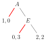
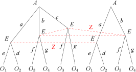
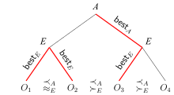
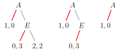
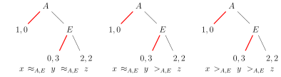
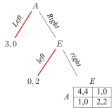

# Logics for Analyzing Games
**First published Mon Mar 4, 2019; substantive revision Mon Dec 19, 2022**

*van Benthem, Johan, Klein, Dominik*

In light of logic’s historical roots in dialogue and argumentation, games and logic are a natural fit. Argumentation is a game-like activity that involves taking turns, saying the right things at the right time, and, in competitive settings, has clear pay-offs in terms of winning and losing. Pursuing this connection, specialized logic games have already been used in the middle ages as a tool for logic training (Hamblin 1970)[^hamblin-1970]. The modern area augmented this picture with formal dialogue games as foundation for logic, relating winning strategies in argumentation to cogent proofs (Kamlah 1973 [1984])[^kamlah-1973]. Today, connections between logic and game theory span across a great number of different strands, involving the interface with game theory, but also linguistics, computer science, and further fields.

Themes from the extensive and growing area surrounding logic and games occur in various entries of this Encyclopedia, in particular on uses of games in logic, epistemic foundations of game theory, formal approaches to social procedures, logics for analyzing powers of agents, and game semantics for programming and process languages. These entries differ in their emphasis, which may be on logic, game theory, or foundations of computer science. The present entry is concerned with logics for analyzing games, broadly speaking. It makes reference to other perspectives in this Encyclopedia where relevant.

## 1. Overview

The present entry provides a comprehensive survey of logics for analyzing games, arranged under a number of unifying themes and perspectives. Also, occasional connections are made with other strands at the interface of logic and games covered elsewhere in this Encyclopedia. This overview section is a brief *tour d’horizon* for topics that will return in more detail later on.

### 1.1 Logic of Games

Specific games stand for significant recurrent patterns of social interaction. In a perspective called ‘logic of games’, notions and results from logic are used to analyze the structure of various games. In fact, much classic reasoning about games involves notions that are familiar from logic.

**Example** Game solution reasoning.

Consider the following game tree for two players *A*, *E*, with turns marked, and with pay-offs written with the value for *A* first. Alternatively, these values can be interpreted as encoding players’ qualitative (or ordinal) preferences between outcomes.

*Figure 1.* ⓘ

Here is how players might reason. At her turn, *E* faces a standard decision problem, with two available actions and the outcome of action *left* better for her than that of *right*. So she will choose left. Knowing this, *A* expects that his choosing *right* will give him outcome 0, while going *left* gives him outcome 1, so he chooses left. As a result, both players are worse off than they would have been, had they played *right*/*right*. The reasoning in this scenario, in short, leads to an outcome that is not Pareto-optimal.

The example raises the question just why players should act this way, and whether, say, a more cooperative behavior could also be justified. An answer obviously depends on the players’ information and style of reasoning. Here it becomes of interest to probe the structure of the example. Looking more closely, many notions are involved in the above scenario: actions and their results, players knowledge about the structure of the game, their preferences about its results, but also how they believe the game will proceed. There are even counterfactual conditionals in the background, such as *A*’s explaining his choice afterwards by saying that “if I had played *right*, *E* would have played *left*”. These notions, moreover, are entangled in subtle ways. For instance, *A* does not choose *left* because it dominates *right* in the standard sense of always being better for him, but rather because *left* dominates *right* according to his beliefs. How these beliefs are formed, in turn, depends on many other features of the game, including the nature of the players.

In short, even a very simple game like the one discussed brings together large parts of the agenda of philosophical logic in one very concrete setting. This entry will zoom in on the aspects mentioned here, with Section 3 dedicated to players’ preferences and beliefs, while Section 4 addresses reasoning styles and the dynamics of attitudes as the game proceeds.

The analysis is structured by a few broad distinctions. Intuitively, games involve several phases that involve logic in different ways: deliberation prior to the game, as many game-theoretic solution concepts are in fact deliberation procedures that create initial expectations about how a game will go on. Observation and belief revision during game play, including reactions to deviations from prior expectations. And finally, post-game analysis, say, to settle what can be learnt from a defeat, or to engage in spin about one’s performance. Moreover all this can be considered in two modes, assuming either a first-person participant or a third-person observer view of games and play.

### 1.2 Logic and Game Theory

In many of the above topics, logics meets game theory. One such interface area is epistemic game theory where game play and solution concepts are analyzed and justified in light of various assumptions about players and their epistemic states, such as common knowledge or common belief in rationality. Epistemic game theory may be viewed as a joint offspring of logic and game theory, a form of progeny which constitutes a reliable sign of success of an interdisciplinary contact.

There are also other viable logical perspectives. In particular, one can look at game theory the way mathematical logicians look at any branch of mathematics. Following the style of the famous Erlangen Program, one can discuss the structures studied in that field and look for structural invariance relations and matching logical languages. Game theory is rich in structure, as it has several different natural notions of invariance. The tree format of extensive games offers a detailed view of what happens step by step as players make their moves, whereas the matrix format of strategic form games offers a high-level view that centers on outcomes. Yet other formats, to be discussed below, focus on players’ control over the various outcomes. All these different levels of game structure come with their own logical systems, as will be detailed in Section 2. Moreover, these different logics do not just provide isolated snapshots: they can be related in a systematic manner.

In this way, the usual logical techniques can be brought to bear. For instance, formal languages can express basic properties of games, while model-checking techniques can determine efficiently whether these hold in given concrete games (cf. Clarke, Grumberg, & Peled 1999)[^clarke-1999].

**Example** Winning strategies.

Consider the following game tree, with move relations for both players, and propositional letters $\win_{i}$ marking winning positions for player *i*.

*Figure 2.* ⓘ

Clearly, player *E* has a winning strategy against player *A*, i.e., a recipe that guarantees her to win, no matter what *A* does. This is expressed by a modal formula capturing exactly the right dynamics:

$$[\move_A]\langle \move_E\rangle \win_E$$

Here $[\move_A]$ is the universal modality “for all moves by player *A*”, and $\langle \move_E\rangle$ is the existential modality “for some move by player *E*”. This two-step modality- or quantifier-based response pattern is typical for strategic powers of players in arbitrary games, as it captures the essence of sequential interaction. Crucially, logical laws can acquire game-theoretic import. For instance, the law of Excluded Middle applied to the above formula yields:

$${[\move_A]\langle \move_E\rangle \win_E} \lor {\neg[\move_A]\langle \move_E\rangle \win_E}$$

or in a logically equivalent formulation:

$$ {[\move_A]\langle \move_E\rangle \win_E} \lor {\langle \move_A\rangle [\move_E]\neg \win_E}$$

In two-step games like the above, where exactly one player wins (i.e., $\win_A\leftrightarrow\neg\win_E$), the latter formula expresses that either player *E* or player *A* has a winning strategy. More generally, this disjunctive assertion is a special case of Zermelo’s theorem, stating that every finite full information game is determined.

Having established the connection to logical languages, further model-theoretic themes can be applied fruitfully to games. Language based reasoning allows, for instance, to examine the preservation of properties between different games, based on the exact syntactic shape of their definition. Besides, logical syntax also supports logical proof theory. Hence, the latter’s rich pool of proof calculi may help to analyze basic results in game theory. This entry illustrates major recurring patterns of reasoning about interaction that come to light in this way.

Game theory also has a further natural level of representation, suppressing details of local moves and choices. The most familiar format for this are games in *strategic form*. In the simplest case of only two players, these correspond to a two-dimensional matrix, with rows standing for some player’s strategies, and columns for the other’s. Individual cells of such matrix hence correspond to the different possible *strategy profiles* of the game. Typically, all cells are labeled with information about the *outcomes* resulting from playing the corresponding strategies against one another. This labeling specifies players’ attitudes to outcome in terms of pay-offs, more abstract utilities, or ordinal markers for players’ preferences orders among outcomes.

Strategic form games, too, can model significant social scenarios. Here is an illustration from the philosophical literature on the evolution of social behavior.

**Example** The following game in matrix form is the *Stag Hunt* of Skyrms (2003)[^skyrms-2003], going back to ideas of David Hume. It serves as a metaphor for the social contract.

|   |   | *E* |   |
| --- | --- | --- | --- |
|   |   | H | S |
| *A* | H | 1,1 | 1,0 |
| S | 0,1 | 2,2 |   |

Each agent must decide between pursuing their own little project, hunting a hare, or joining in a larger collective endeavor, hunting stag. The former gives a moderate but guaranteed income, no matter what others do. The collective endeavor, on the other hand, can only succeed if all contribute, in which case everybody receives a high profit. If, however, some do not join, all contributions are lost and no contributor receives anything. In the corresponding strategic form game, all players have to decide on what to do in parallel, without knowing the actions of others.

The Stag Hunt game has two pure strategy Nash equilibria: *every contributes*, and *nobody contributes*. Which of these stable outcomes ensues will crucially depend on the players’ reasoning, their expectations about each other, and perhaps even further information stemming, for instance, from pre-game communication.

Clearly, analyzing strategic games involves agentive information, reasoning and expectations. All these aspects have tight connections to logic. Viewing outcomes as possible worlds, three relevant relations emerge between these. Within the matrix above, relating all cells in the same row fixes a unique choice already made by the row player *A*, while leaving *E*’s move completely open. In short, each horizontal row lists all possible choices of the column player *E* which *A* has to take into account. The corresponding modality may hence be said to describe *A*’s knowledge about the outcomes of the game given his choice. Still assuming the row player’s perspective, relating cells vertically rather than horizontally corresponds to *A*’s freedom of choice among his available strategies. Of course, one could also assume player *E*’s perspective instead, viewing the horizontal direction as *E*’s freedom of movement, while the vertical directions captures her epistemic uncertainty.

Thus, a bimodal logic arises for matrix games with laws such as

$${K_{E}K_{A}\varphi} \leftrightarrow {K_{A}K_{E}\varphi},$$

capturing the grid structure of matrix games. For more than two players, this logic gains some additional options and subtleties to be discussed in Section 2.6.

The crucial third relation is that of player’s preferences among outcomes. These, again, have matching modalities, now taken from preference logic (Hansson 2001)[^hansson-2001]. With the help of some auxiliary devices, the three modalities can define the central game-theoretic notion of a Nash equilibrium (Harrenstein 2004; van der Hoek & Pauly 2007)[^harrenstein-2004][^hoek-2007].

Logics for matrix games differ from those for extensive games, as grids behave quite differently from trees in terms of complexity. Yet, both fall under the same general methodology. Towards a common understanding, one might view the logic of matrix games as capturing the basic laws of parallel, rather than sequential action.

### 1.3 Computation and Agency

Philosophical logic and mathematical logic are not the only illuminating perspectives on games. A third relevant viewpoint is that of computational logic. In modern computation, the paradigm is no longer single Turing machines but interacting systems of multiple processors. These processors may cooperate, but they might also compete for resources. In general, hence, it is useful to study multiple agents engaging in computation, be it within human, artificial or mixed societies. Though doing so, games become a natural model for computation, too. In fact, games are rich multi-agent systems where agents process information, communicate, and engage in actions, all driven by their respective preferences and goals. In the converse direction, computer science themes such as complexity and algorithmics have entered game theory, resulting in the area of computational game theory (Nisan et al. 2007)[^nisan-2007]. For a richer survey of computational logics of agency and games, see van der Hoek and Pauly (2007) and Shoham and Leyton-Brown (2008)[^leyton-brown-2008]. The present entry contains occasional links to computation. These are especially prominent for reasoning about temporally extended games and their strategies (Sections 4.2, 4.4) and in the context of gamification (Section 6), where games are explored as a novel semantics for classical logical systems.

### 1.4 Games in Logic

Finally, recall the start of this section, but with reverse perspective: instead of asking what logic can do for games, ask what games can do for logic. Argumentation and dialogue are basic notions for logic. Both can be studied using techniques and results from game theory (Lorenzen & Lorenz 1978; Hamblin 1970)[^hamblin-1970][^lorenzen-1978]. In this perspective, logical validity of consequence rests on there being a winning strategy for a Proponent claiming the conclusion against an Opponent granting the premises in a game where moves are regulated by the logical constants. Many games have found uses in modern logic since the 1950s, with Ehrenfeucht-Fraïssé games for model comparison being a paradigmatic example. Besides these, also semantic verification or model construction can be cast as natural logic games.

This raises an intricate issue within in the philosophy of logic, concerning the nature of logic and in particular that of logical constants. A ‘weak thesis’ would hold that games constitute a natural technique for analyzing logical notions, as well as a didactic tool for teaching logic that appeals directly to vivid intuitions. Parts of the literature, however, also defend a ‘strong thesis’, suggesting that the primary semantics of certain logical systems may be procedural and game-theoretic, rather than denotational in a standard sense. This perspective, sometimes called ‘logic as games’, occurs in some attractive semantics for first-order languages (Hintikka & Sandu 1997)[^hintikka-1997], as well as in game semantics for programming languages.

The theme of logic as games will appear only briefly in the present entry, which is mainly directed toward logics of games. Section 6 will discuss which questions arise from joining both perspectives on the interface of logic and games.

As it happens, the logic-as-games perspective is of broader relevance. Logic games were originally designed for particular tasks inside logic. Yet, taken to reality, they can help analyze or streamline actual lines of argumentation. As such they may be compared to designed parlor games that challenge reasoning skills. A game like *Clue* involves an intriguing mix of logical deduction, new information from drawing cards or public observation of moves, but also private communication acts by players (van Ditmarsch 2000)[^ditmarsch-2000]. Other parlor games, such as *Nine Men Morris* (Gasser 1996)[^gasser-1996] are graph games (Grädel, Thomas, & Wilke 2002)[^grädel-2002] with added chance moves that serve to diminish the risk of finding a repeatable simple strategy on the fixed board. The logical study of playable designed games for bounded agents, and the design of new such games, is a natural sequel to this entry (cf. van Benthem & Liu 2019)[^benthem-2019].

### 1.5 Probability

Game theory may be understood as generalized interactive decision theory. A major vehicle for the latter, just as for standard decision theory, is probability theory. Within games, probability can assume many roles. It may, for instance, express players’ degrees of belief quantitatively, but it can also enrich the space of actions with mixed strategies, thereby laying the ground for general equilibrium results. Probability can even play a role in the very definition of certain important games, especially in evolutionary game theory (Osborne & Rubinstein 1994)[^osborne-1994]. In this entry, probability is only mentioned in passing. Section 5, however, maps some combinations of logic and probability that are suggested by the study of games.

### 1.6 Zooming In

Games have a natural interface with logic in all its varieties, including mathematical, philosophical, and computational logic. In one direction of contact, logic can provide new abstract notions underneath game theory. Conversely, game-theoretic notions can also serve to enrich logical analysis. The present entry mainly concentrates on the first of these directions, the use of logic for analyzing games. It does so mostly from a semantic perspective, the dominant paradigm so far in the area. Though proof-theoretic approaches will be mentioned occasionally. The sections to follow elaborate on this theme along several dimensions. Specific perspectives include logics for game structures (Section 2), logical analysis of the nature of players (Section 3) and of the process of game play (Section 4). Additional spotlights are put on the relationship between logic and probability in the context of games (Section 5) and the endeavor of Gamification (Section 6). Each section forms a free-standing exposition, which results in some unavoidable, and perhaps useful, overlap. Throughout the exposition, some familiarity is assumed with the basic concepts of logic and game theory. In particular, notions of game theory left unexplained here can be found in the corresponding entry and in Leyton-Brown and Shoham (2008)[^shoham-2008].

## 2. Game Structure and Game Logics

This first spotlight section focuses on game structures in a narrow sense. *Game forms* leave aside agents and notions typical for these, such as preferences or information. Players, as well as the temporal progression of play will be added in later sections. Even so, there is already a good deal of structure in game forms to be studied by logical techniques.

### 2.1 Levels of Representation

The starting point of any logical analysis is to fix its perspective on games. This section will review several major candidates for doing so, starting with the two most prominent perspectives. The first of these makes the temporal structure of a game explicit, representing it as a tree in the standard mathematical sense.

**Example** A two-player extensive form game.

*Figure 3.* ⓘ

A game in *extensive form* is a tree where each non-terminal node or *state* specifies which player is to move next, while edges correspond to the players’ possible moves. The leaves of the tree, finally, denote the possible outcomes *O* of game play. There are many possible variations on these stipulations for states and moves, but they do not affect the essentials of a logical analysis.

The second major perspective on games emphasizes the players’ available strategies. Suppressing all information about temporal structure, a game in *strategic form* yields the matrix pictures known from game theory. In its classic interpretation, a game in strategic form represents a set of players that each select a complete strategy for the entire game without knowledge of the other players’ choices. Each strategy profile, i.e., combination of one strategy per player, then induces an outcome $O_i$. The motivation for this structure might seem complex on first sight. Yet, it can also be viewed as something quite simple: a one-step game with parallel rather than sequential moves, which is the simplest case of simultaneous action.

**Example** A two-player strategic form game.

|   |   | *E* |   |
| --- | --- | --- | --- |
|   |   | *a* | *b* |
| *A* | *c* | $O_1$ | $O_2$ |
| *d* | $O_3$ | $O_4$ |   |

Extensive and strategic forms differ in their focus. The former emphasize the sequential temporal structure of a game, while the latter highlights strategy choice prior to play. One can freely switch between both when appropriate to the purpose at hand. Besides these two, there are other natural dimensions, highlighting players’ powers for influencing outcomes (cf. Section 2.5) or players’ information about the game (cf. Section 3.6).

**Remark** While all examples so far concerned two-player games, no such restriction is needed. Both extensive games and strategic form games work for any number of players, although occasional subtleties may occur. A few will be mentioned below. Moreover, with more players, possible coalitions enter the picture, a topic that will not be treated in this entry. Finally, selected aspects of agency may sometimes enter through the back door. Many scenarios in real life contain external chance events outside of any player’s control, such as a roll of a die, weather conditions, or technical malfunctions. Such factors can usually be incorporated into a logical analysis by admitting Nature as additional player.

### 2.2 Invariance Relations Between Games

With different ways of representing a game at hand, there is a natural follow up question concerning equivalence. Given two game structures, when are they representations of the same underlying game? The answer is that it very much depends on what aspects one is interested in.

**Example** The same game, or not?

*Figure 4.* ⓘ

Consider the two game forms above. If one cares about exact sequences of moves or the choices players have along the way, these games are different. The game to the left has *A* move first, while *E* begins in the game on the right. In the game on the right, *A* may face a choice between *p* and *q*. This cannot happen on the left.

Caring about exact moves as done here constitutes a fine-grained perspective on games. There are others. When focusing on players’ powers for bringing about certain outcomes, for instance, the analysis changes. In the game on the left, *A* has a strategy (playing *left*) that ensures the game to end up in an outcome satisfying *p*, and one (playing *right*) that restricts possible outcomes to those satisfying $q \lor r$. With this second strategy, the further choice which of $q or r$ gets realized is left up to player *E*. Also the second player, *E*, has two strategies in the game on the left, one (playing *left*) ensuring the outcome to satisfy $p\lor q$, the other (playing *right*) guaranteeing that the outcome satisfies $p \lor r$.

Performing the same calculations for the game on the right, virtually the same player powers emerge. More precisely, *A*’s uniform strategies *left-left* and *right-right* yield *p* and $q\lor r$ respectively, exactly the same powers as in the left game. The two remaining strategies *left-right* and *right-left* yield $p\lor q$ and $p\lor r$, both of which are mere weakenings of *A*’s power to achieve *p*. Thus, at the level of players’ powers, the above two game forms should be considered the same.

As this example illustrates, there are several legitimate ways of comparing games. When taking a fine-grained focus on the internal structure of a game, a natural candidate is the notion of a *bisimulation* (cf. Blackburn, de Rijke, & Venema 2001)[^blackburn-2001]. A bisimulation $Z\subseteq G_1\times G_2$ relates states of two game forms $G_1$ and $G_2$ subject to four conditions: States *m* and *n* may only be related when (*i*) the same player is to move in *m* and *n*, (*ii*) *m* and *n* do not differ in any of their basic local properties, while (*iii*a) whenever there is an available move of type *a* in $G_1$ leading to a state $m'$, there is a matching available move of type *a* in $G_2$ leading to a state $n'$ with $m'Zn'$, and vice versa (*iii*b) whenever there is a move in $G_2$ that leads to a state $n'$, there there is a move of the same type in $G_1$ leading to a state $m'$ with $m'Zn'$.

**Example** A bisimulation between games.

*Figure 5.* ⓘ

This particular notion of bisimulation is not the only invariance that makes sense for games. A more coarse-grained perspective, for instance, might not distinguish moves by their particular action types, but merely by which player is to perform them. A corresponding bisimulation can be defined by omitting references to particular action types in conditions (*iii*a) and (*iii*b) above.

Further notions of bisimulation take an even coarser perspective on the games’ move structure, for instance by allowing to contract zones where the same player moves several times in a row. Finally, dropping all information about players and their choices, games can be compared by the sequences of moves they admit. This purely observational notion, known as *trace equivalence* in computation, may, however, be less relevant in the context of games. An alternative approach to coarsening focuses on the players’ powers to control outcomes, cf. Section 2.5 and van Benthem, Bezhanishvili and Enqvist (2019a).

While most notions of invariance discussed so far related to extensive form games, a similar style of analysis applies to games in strategic form. Van Benthem, Pacuit, and Roy (2011) define modal bisimulations that connect outcome states of different matrices, and apply bisimulation’s back-and-forth conditions to the relevant relations of players’ choice, freedom, and preference.

This may be a good point to stress once more that the present section is concerned with game forms only, omitting any player related aspect such as preferences between outcomes. When these are added, identifying appropriate notions of invariance becomes more challenging, as will be discussed in Section 3 below.

### 2.3 Languages Matching Invariance Relations

The choice of invariance relations mirrors which structure is deemed relevant within a given perspective on games. A central tool for bringing out such relevant aspects is the existence of a logical language matching some invariance relation. In general, the more fine-grained the invariance perspective, the more distinctions a matching language should be able to make.

For a start, if one is interested in the properties a player can bring about through moves, a good choice of language is based on modalities $\langle \move_i\rangle \varphi$, expressing that at least one of *i*’s available moves leads to a next stage satisfying $\varphi$. The following illustrates how this language works in a given extensive form game.

**Example** Modal game language.

*Figure 6.* ⓘ

The modal formula $[\move_A]\langle \move_E\rangle \win_E$, true at root *r*, expresses that *E* has a strategy that ensures her a win in two steps: whatever *A* does, *E* can react in such a way that she ends up in a node where she wins. In a more fine-grained perspective, the modal language could add expressions $[a],[b]\ldots$ for specific move types $a,b,\ldots$. In this language, the coarse-grained modality $\langle \move_i\rangle \varphi$ is definable by the disjunction $\bigvee_{a\text{ is a move for }i}\langle a \rangle\varphi$, making the new language a refinement of the old.

In this way, general results of modal logic apply to games. For instance, take pointed models such as game trees with an indicator for the current moment. Whenever two such pointed models $\G,m$ and $\G',m'$ are bisimilar in the first sense defined above, the equivalence $\G, m\vDash\varphi$ iff $\G', m'\vDash\varphi$ holds for all formulas $\varphi$ in a sufficiently rich modal language with modalities $[a]$ for each move label. Thus, one can switch between syntactic, language based perspectives and semantic invariance relations, depending on what is convenient for a given perspective on games. Entirely similar points hold for bisimulations and modal languages for power perspectives, or for strategic form games.

Finally, modal languages do not have exclusive rights. If still more fine-grained perspectives are needed, more expressive first-order or higher-order languages become serious contenders for describing games.

### 2.4 Modal Logic of Extensive Games

A language for games facilitates both, defining properties of games and reasoning about them. An example are winning strategies for players in a two-step extensive game as just discussed. More generally, for any finite extensive game, there are formulas $\varphi_j$ for each agent *j* that are true iff *j* has a winning strategy:

$$\varphi_j:=[\move_i]\langle \move_j\rangle[\move_i]\ldots \win_j$$

where the number of operators in the formula corresponds to the depth of the tree.

Thus, logical laws governing reasoning with such formulas acquire game-theoretic content. For instance, the negation of the statement that one player, *A*, has a winning strategy is provably equivalent to saying that the other player, *E*, has a winning strategy, at least in those cases where *A* wins if and only if *E* does not:

$$\begin{aligned} \neg \varphi_A &= \neg\langle \move_A\rangle [\move_E]\langle \move_E\rangle\ldots \win_A \\ & \leftrightarrow [\move_A]\langle \move_E\rangle[\move_E]\ldots \neg \win_A\\ & \leftrightarrow [\move_A]\langle \move_E\rangle[\move_E]\ldots \win_E=\varphi_E \end{aligned}$$

Hence, the logical law of excluded middle in its modal guise corresponds to Zermelo’s theorem, stating determinacy for finite games.

Yet, there are limitations to such characterizations of game-theoretic properties in terms of logical laws. Formulas stating whether some player has a winning strategy change from model to model, as the number of modal operators depends on the size of the game tree. In fact, there is no uniform formula in the basic modal language expressing that player *i* can win in an arbitrary finite extensive form game. Such a formula can only be found in the modal μ-calculus (Venema 2008)[^venema-2008], where the statement that *i* has winning strategy can be expressed with the fixed-point formula

$$\mu p. \, (\win_{i} \lor\, (\turn_i\land \langle i\rangle p)\lor\bigwedge_{j\neq i}(\turn_j\land\, [j]p)$$

The more general point here is that the recursive nature of game-theoretic equilibria and solution concepts reflects naturally in logics with fixed-point operators for induction and recursion.

In this setting, known results about modal logic acquire a new significance. In the realm of finite models, for instance, having the same modal formulas true at two states is *equivalent* to there being a bisimulation connecting those two states (cf. Blackburn, de Rijke, & Venema 2001)[^blackburn-2001]. Hence, whenever two finite games satisfy the same modal propositions in their respective roots they are equivalent in the sense of bisimulation. For infinite models, such results are less direct. A full equivalence between bisimulation and satisfying the same formulas, for instance, only holds for an extended modal language with infinite conjunctions and disjunctions. Other relevant results include the existence of modal formulas that define given pointed models up to bisimulation. Such formulas sometimes exist in the basic modal language, sometimes in the μ-calculus, and always in the infinitary modal language. Applied to concrete games *G*, these modal definitions can be viewed as complete descriptions of all properties of *G* at the relevant level of invariance.

Finally, modal logic has many complete proof systems for capturing the valid consequences on various classes of models (Blackburn, de Rijke, & Venema 2001)[^blackburn-2001]. These calculi of reasoning also apply to games, where they can capture aspects of specialized game-theoretic argumentation. Proof-theoretic perspectives are not the focus of this entry, but a number of strands will be mentioned where appropriate.

### 2.5 Modal Neighborhood Logic for Powers

Besides extensive form games, standard modal logic is also suitable for the power perspective on game structure. Sometimes, one ignores the internal mechanisms of a game altogether, merely viewing it as a black box social mechanisms where players control outcomes to a certain extent. In this perspective, a player can *force* the outcome of the game to be in some set *X* if she commands a strategy that ensures the game to end up in an outcome of *X*, no matter what the other players do (van der Hoek & Pauly 2007)[^hoek-2007]. Similarly, a player can force that some proposition $\varphi$ holds if she has the power to enforce that the game ends in a $\varphi$ state. The collection of all sets of outcomes an agent can force are often called her *forcing powers*. In classical game theory, these forcing powers sometimes go by the name of *effectivity functions* (Peleg 1997)[^peleg-1997], which are often also studied for coalitions of players (see Pauly 2001; Goranko, Jamroga, & Turrini 2013; and the entry on logics for analyzing power in normal form games)[^goranko-2013][^pauly-2001].

**Example** Powers in extensive games.

*Figure 7.* ⓘ

Notably, forcing powers are not closed under conjunction. In the game above, agent *A* can force *p* and *q* individually without being able to force $p \land q$. In modal logic terms, forcing powers give rise to a *neighborhood logic* (Pacuit 2017)[^pacuit-2017][^pacuit-2017-2], where the neighborhood functions list the set of outcomes players can enforce from a given state. Reasoning about forcing powers can then employ a logical language with forcing modalities $\{i\}$ for each player:

$\{i\}\varphi$: agent *i* can force the outcome of the game to satisfy $\varphi$.

These modalities can be interpreted over the extended game forms with neighborhood functions described above. On the semantic side, a generalization of the above neighborhood models support a generalized notion of *power bisimulation*, see van Benthem, Pacuit, and Roy (2011).

The modal logic of powers allows to reason about games at a global level of description. The modal logic of neighborhood models validates the standard modal monotonicity principle

$$\{i\}\varphi\rightarrow\{i\}(\varphi\lor\psi),$$

as follows already from the truth definition of forcing modalities. However, as forcing powers are not closed under intersection, the aggregation law fails:

$$(\{i\}\varphi\land\{i\}\psi)\not\rightarrow\{i\}(\varphi\land\psi).$$

Instead, the logic contains new valid principles relating forcing modalities for different players. For instance, if *i* can force the truth of $\varphi$, then no other player *j* can force its falsity. Thus,

$$\{i\}\varphi\rightarrow\neg\{j\}\neg\varphi$$

is a valid principle of ‘consistency of powers’ in the logic of forcing powers. The converse of this principle for games with two players $i, j$

$$\neg\{j\}\neg\varphi \rightarrow \{i\}\varphi$$

expresses the notion of determinacy from the last section. This formula is not generally valid, but is an axiom for the special class of determined games.

Finally, there also is an alternative, more algebraic perspective on powers, assuming an earlier-mentioned perspective of logic games. The two games depicted in the core example of Section 2.2 may be seen as evaluation games for propositional formulas

$$p \land (q \lor r) \quad \text{and} \quad (p \land q) \lor (p \land r).$$

Their equivalence *qua* powers, described earlier, then matches the standard propositional law of distribution. This algebraic perspective will return in Section 2.9.

More recent views of forcing and powers re-interpret the sets *X* of outcomes employed in the above definitions as referring to both players: one player restricts the total set of outcomes, while the other players can achieve all outcomes within that set. This balance between constraint and freedom significantly impacts the corresponding notions of game equivalence, as well as the modal languages used (van Benthem, Bezhanishvili, & Enqvist 2019b)[^benthem-2019b].

### 2.6 Modal Logic for Strategic Games

In the strategic perspective on games, players select actions simultaneously, without having learned about their opponents’ choices of actions. This requires an additional level of analysis. Besides the various possible moves, an adequate representation must also track players’ uncertainty about how their opponents might act.

In terms of matching logical languages, this suggest a *multi-modal* approach, with $[\approx_i]$ ranging over *i*’s possible choices, and $[\equiv_i]$ representing her uncertainty about the opponents, see van Benthem, Pacuit, and Roy (2011). Moreover, when considering games rather than game forms, this picture needs to be enriched with a third feature, viz. preference modalities $[\preceq_i]$, see Section 3.

Games in strategic form can be viewed naturally as models for a modal language of choice and uncertainty, where each *state* *m* consists of a strategy profiles, i.e., a sequence $(m_1,m_2\ldots)$ listing each player’s choice of action. For convenience, the preference modality has been included:

| $\G,m\vDash[\approx_i]\varphi$ | Given the opponents’ actions, $\varphi$ holds whatever *i* does. |
| --- | --- |
| $\G,m\vDash[\equiv_i]\varphi$ | Given *i*’s choice, $\varphi$ holds whatever the opponents do. |
| $\G,m\vDash[\preceq_i]\varphi$ | $\varphi$ holds in all states at least as good as the current one. |

This multi-modal language can express a variety of statements about strategic form games, such as:

| ${\langle\approx_i\rangle\langle\equiv_i\rangle} \varphi$ | $\varphi$ is a possible outcome of the game |
| --- | --- |
| ${[\approx_i][\equiv_i]}\varphi$ | all outcomes of the game satisfy $\varphi$ |
| $[\preceq_i]\langle\preceq_i\rangle\varphi$ | some optimal states for player *i* satisfy $\varphi$ |

In the case of two players, one agent’s choices corresponds to the other’s uncertainty and vice versa. This shows in the validity of principles such as

$$[\equiv_i]\varphi\leftrightarrow[\approx_j]\varphi$$

More generally, the logic of matrix games includes the $\mathsf{S}5$ axioms for both $[\approx_i]$ and $[\equiv_i]$, but also the commutation law

$$[\approx_i] [\equiv_i]\varphi\leftrightarrow[\equiv_i][\approx_i]\varphi$$

expressing the grid-like structure of matrix games. This logic bears some resemblance to STIT-type logics of actions (Herzig & Lorini 2010)[^herzig-2010]. Technically, a grid structure in models allows for encoding of undecidable computational problems (Blackburn, de Rijke, & Venema 2001)[^blackburn-2001], rendering it an open problem whether expressive modal logics of game matrices are decidable.

The step from two to more players, often routine in epistemic logics, can be delicate in the logic of matrix games. Accessibility relations of type $[\approx_i]$, interpreted as identity of profiles except for the $i^{}$-coordinate, yield a product logic akin to the three-variable fragment of first-order logic which is known to be undecidable (Bezhanishvili 2006)[^bezhanishvili-2006]. However, with only relations of identity at the *i*-coordinate, i.e., $[\equiv_i]$, the logic remains decidable (Venema 1998; Van De Putte, Tamminga, & Duijf 2017; Lomuscio, van der Meyden, & Ryan 2000)[^lomuscio-2000][^putte-2017][^venema-1998].

### 2.7 Strategies as Logical Objects

There is further structure in extensive games than just single moves. In game trees, a player’s *strategy* specifies what to do at each turn, whether this turn will ever be reached or not. An increasing body of work examines such strategies and their underlying formats, see van Benthem, Ghosh, and Verbrugge (2015) for an overview of various logical frameworks for reasoning about strategies.

In one concrete perspective, a strategy is akin to a program that instructs the agent on how to navigate a game tree. Hence, a natural logic of strategies uses the language of propositional dynamic logic of programs PDL, an approach that will return later. As programs are in general non-deterministic, such logics let a strategy recommend one or more actions the agent should take at each turn. In this perspective, strategies resemble plans that might remain partial.

In a program format, strategies start with basic actions, representing individual moves in a game tree. From there, complex programs $\pi$ can be created using operations including sequential compositions $\pi_{1} \,;\pi_{2}$ ($\pi_{1}$ is to be performed followed by $\pi_{2}$), or choice $\pi_{1}\, \cup_{i} \pi_{2}$ (agent *i* is to pick between actions $\pi_{1}$ and $\pi_{2}$ ). Moreover, a test operation $?\varphi$ for checking whether $\varphi$ holds, enables strategies to react to properties of states or opponents’ past actions. Finally, to describe continuous execution of a strategy along a game tree, it makes sense to have an operation $\pi^{*}$ of program iteration, stating that $\pi$ be executed arbitrarily often.

The language of PDL then has modal operators $[\pi]$ for every program $\pi$ that can be defined from the basic actions and the operations just described. A simple such strategy advises player *i* to do *a* whenever it is her turn. The following formula states that this strategy ensures that $\varphi$ holds throughout:

$$ [((?\turn_i \mathbin{;} a)\, \cup \, (?\turn_j \mathbin{;} \move_j))^{*}]\varphi $$

Program definitions for strategies given here are closely related to the use of finite automata for defining strategies in computer science and game theory (Osborne & Rubinstein 1994; Grädel, Thomas, & Wilke 2002; Ramanujam & Simon 2008)[^grädel-2002][^osborne-1994][^ramanujam-2008].

### 2.8 Simultaneous Moves and Imperfect Information

In the extensive form games of Section 2.1, players move in sequence and can base their decisions on full information of what has happened so far. The other extreme were games in strategic form, where agents move in parallel or, in the interpretation of strategy selection, have no means of picking up information during actual play. There are ample scenarios in between these extremes. Public good games with optional retribution against non-cooperators (Andrighetto et al. 2013)[^andrighetto-2013], for instance, combine moments where some or all players make simultaneous moves with information collection along the way. Such parallel action can be mimicked in sequential games by limiting the information available to players at various states of the game. The resulting games of imperfect information will be discussed in Section 3, alongside other sources of imperfect information.

Further well-known logical approaches to parallel action employ STIT logic (Horty & Belnap 1995; Broersen 2009)[^broersen-2009][^horty-1995], and temporal logics such as ATL (Alur, Henzinger, & Kupferman 2002)[^alur-2002] or its epistemic variant ATEL (van der Hoek & Wooldridge 2003)[^hoek-2003].

### 2.9 Game Algebra and Dynamic Logic of Computation

So far, games were treated as monolithic entities that agents reason about in their entirety. This can be at odds with how real life agents conceptualize games. To facilitate reasoning, games are often broken up into smaller tasks that are easier to handle separately. A chess player, for instance, may know how to solve different end games. Rather than reasoning about every possible situation until its end, she will evaluate different options in mid-play by considering which of these end games they will, most likely, lead up to. In this perspective, complex games are constructed out of simpler games that may profit from separate analysis. Games then form an algebra with operations that construct complex games from simpler ones. This style of thinking is reinforced when games are viewed as scenarios for interactive computation, where again algebraic methods are used widely (Bergstra, Ponse, & Smolka 2001)[^bergstra-2001].

Here is an illustration of this approach. For simplicity, consider only two players, *A* and *E*, the latter of which starts the game. One influential game algebra has the following operations, cf. Parikh (1985)[^parikh-1985].

| $G\,\cup G'$ | Agent *E* has the choice between playing *G* and $G'$, i.e., represented by a choice node with two outcomes *G* and $G'$ |
| --- | --- |
| $G\,;G'$ | *G* is played first, followed by $G'$ |
| $(\cdot)^d$ | The roles of the players *A* and *E* are interchanged |
| $?\varphi$ | Test game whether some property $\varphi$ holds. |

For instance, take a chess player in mid-game reasoning. For simplicity, restrict the possible end games to $G_{F_1}$ and $G_{F_2}$. The player can then conceptualize mid-play as a game $G_{mid}$ with end nodes labeled by propositions $p_1$ or $p_2$, describing which of the two end games follows. The full remaining chess tree is then given by

$$G_{\textit{complete}}=G_{\textit{mid}};((?p_1;G_{F_1})\cup (?p_2;G_{F_2}))$$

Equational axiomatizations for this game algebra can be found in Goranko (2003)[^goranko-2003] and Venema (2003)[^venema-2003]. However, following the analogy of propositional dynamic logic for an algebra of programs, there also is a *dynamic game logic* for this algebra of games, (Parikh 1985)[^parikh-1985]. It adds a modality $\{G\}\varphi$ for each game *G*, with $\{G\}\varphi$ expressing that in game *G*, the first player *E* has a strategy to force the truth of $\varphi$. For the case of non-determined games, the language will be extended further to include separate modalities $\{G, i\}\varphi$, one for each player *i*. Dynamic game logic shows in a perspicuous manner how strategic abilities for complex games supervene on abilities in simpler games. This is done by means of reduction laws such as

$$\{G;G'\}\varphi\leftrightarrow \{G\}\{G'\}\varphi, \quad \{G\cup G'\}\varphi\leftrightarrow\{G\}\varphi\lor\{G'\}\varphi$$

For a complete list of reduction laws, as well as open problems in this dynamic game logic see Pauly (2001)[^pauly-2001], van Benthem (2014)[^benthem-2014][^benthem-2014-2][^benthem-2014-3]. For other styles of game algebra, including also forms of parallel composition, cf. Abramsky (1997)[^abramsky-1997].

It should be said that imperfect information challenges this approach to game algebra. For instance, one may have to decompose a larger game into smaller subgames where agents need not know which of these subgames they are in. Game algebras with imperfect information have been studied in the context of Boolean Games (Harrenstein et al. 2001)[^harrenstein-2001]. A recent power-based game algebra with operations encoding imperfect information, showing some analogies with IF logic (Mann, Sandu, & Sevenster 2011)[^mann-2011] can be found in van Benthem, Bezhanishvili, and Enqvist (2019b).

### 2.10 Special Topics

**Coalitions and Networks** Nothing has been said so far about social or structural relations between players: they move individually and in interaction with all other players. However, in many games, groups of players can team up to jointly pursue goals, possibly in competition with other groups. Coalitions are a natural, but non-trivial extension of the logical frameworks introduced here, as strategic abilities of groups may exceed those of all members combined, see Peleg (1997)[^peleg-1997], Van de Putte & Klein (2021, 2022), and the entry on coalition powers in games. In other studies of social phenomena, the set of players is equipped with an additional network structure. An agents’ outcome or behavior will then depend upon what network neighbors do (Baltag et al. 2019; Christoff 2016)[^baltag-2019][^christoff-2016]. Lastly, games on networks are closely related to information flows in social networks, as studied in depth by Liu, Seligman, and Girard (2014) and Seligman and Thompson (2015) from a logical perspective.

**Tracking** This section contains a wide variety of perspectives on games. These differ in their invariance relations and their matching languages, offering different foci such as outcomes, powers, or the detailed temporal evolution of games. Even further perspectives will no doubt keep emerging. This diversity may seem overwhelming, making the field rather scattered. But here, another role of logic shows, by not just proliferating systems, but also as connecting them. Various logical translations exist between the languages and levels involved. Often, reasoning about games in a logic for some level can be mirrored precisely under translation into the logic of another level. Moreover, these translations can often keep track of changes in games under actions of information updates, a topic to be taken up in Section 3. Tracking of this kind is defined and studied in general logical terms in van Benthem (2016)[^benthem-2016] and Cinà (2017)[^cinà-2017], and in category-theoretic terms in Ye (2022).

**Infinite games** So far, games were tacitly assumed finite in length. This assumption is innocuous for many real life scenarios, yet there are notable exceptions. A prominent example are safety games, where one of the players, the guard, has to ensure a system to never leave a certain state, while the opponent attempts to deviate. Many technical tools for finite games also work for infinite games. There is, however, a number of conceptual and logical discontinuities. Since infinite games have no last moments, for instance, outcomes must be attached to complete histories of game play, rather than leaves of a tree. Reasoning about games then requires temporal modalities for a given history, but also modalities ranging over all open future histories. For analyzing powers, then, temporal versions of forcing modalities are needed. With these modifications, a logical style of analysis still applies. For instance, it is well-known that determinacy fails for infinite games (Jech 2003)[^jech-2003]. However, what holds for all games is a law of ‘weak determinacy’ stating that, if *i* has no strategy to force a set of histories satisfying $\varphi$, her opponent *j* can ensure that *i* will never obtain such a $\varphi$-strategy in the future. The difference between standard determinacy and weak determinacy is captured by the following two formulas, that are entirely in line with this section’s style of analysis: $\{i\}\varphi\,\lor\,\{j\}\neg\varphi$ (determinacy) versus $\{i\}\varphi\lor\{j\}G\neg\{i\}\varphi$ (weak determinacy), where *G* is the temporal modality of ‘always in the future on the current history’. A more radical use of infinite games is found in coalgebra (Abramsky 1997; Jacobs 2016)[^abramsky-1997][^jacobs-2016], where infinite processes are modeled that can only be observed from the outside, but not built up finitely from ground elements.

## 3. The Nature of Players

Game forms may be seen as spaces where players can operate. A game, however, is not fully determined by its game form alone. Rather, the players involved may import additional features relevant for game play. Players can, for instance, be limited in their powers of observation, either by aspects of the game structure or through cognitive limitations. The most striking added feature, however, is that players have preferences. Agents not only observe the world or act in it. While these describe mere kinematics of a game, agents also evaluate current state and various possible futures. Being driven by preferences, it is such evaluations that are the moving force behind player’s choices. Preference, hence, take a prominent explanatory role for true game dynamics.

This section places its focus on the preferential and epistemic dimensions of players. Such factors are essential to notions of rationality where information, action, and preference are often entangled. In game theory, a harmony between these is often sought in notions of equilibrium for strategy profiles.

### 3.1 Preference and Equilibria

Game trees and game matrices specify the moves available to players at different moments in time. They also indicate all possible outcomes, either as cells in a matrix, or as leaf nodes in an extensive game. However, to study what players *should* or *will* do in a game, a further component is needed: players’ preferences. Such preferences need not only reflect material pay-offs or other features of outcome states. Rather, they may also relate to the process of play itself, and which moves lead to a certain outcome. Moreover, preferences may contain irreducibly subjective elements. Even when assuming the same role in a game, different players may disagree about the relative desirability of certain outcomes (Fehr & Schmidt 1999)[^fehr-1999].

Within a static, outcome-oriented perspective on games, a major emphasis is on equilibria: strategy combinations where all players do the best they can in light of their preferences and the opponents’ strategies. A further, dynamic perspective focuses on how such equilibria relate to the individual players’ stepwise local reasoning on how to act in light of their beliefs and desires. This perspective is taken up in Section 4.

### 3.2 Preference Logics for Games

For reasoning about preferences, it must first be specified what it is that agents’ preferences apply to. The orthodox account lets preferences exclusively range over possible outcomes (Osborne & Rubinstein 1994)[^osborne-1994]. However, a growing trend in the logical literature assumes agents to rather care about the truth value of general propositions than can describe both the progression or outcome of a game. While not equivalent, the two perspectives are compatible. Both will be discussed in this section.

In the classical picture, player *i*’s preferences on a game tree are represented by a preference relation $\prec_i$ ranging over the set of outcomes. Such a relation is usually assumed transitive and reflexive, but need not be total.

**Example** A game tree with preferences.

*Figure 8.* ⓘ

Just as with the earlier modal logics for game forms, a relatively simple logical formalism can already express relevant aspects of agency in games. It offers a low-complexity language for stating basic features of action and information, without going into details of the underlying quantitative mechanisms. More precisely, games with preferences naturally support a logic with modal operators $[\preceq_i]$ interpreted as:

**$[\preceq_i]\varphi$**

$\varphi$ holds in all states at least as good as the current one to agent *i*.

Logics of this type can express various properties relevant to games. They can, for instance, say that all states better than the current one are $\varphi$ states, making moving towards $\varphi$ states a necessary condition for maximizing utility. They can also express, that all best states are $\varphi$ states, with the formula

$$\langle\preceq_i\rangle[\preceq_i]\varphi$$

For more on modal preference logics, see Hansson (1990, 2001)[^hansson-1990][^hansson-2001],Girard (2008)[^girard-2008] and van der Torre (1997)[^torre-1997].

Modal preference logic has further extensions with natural connections to games. In a refined perspective, for instance, preferences may derive from reasons, say, criteria or goals various agents want to achieve. This gives rise to a duality between preference relations among outcome states and priority orders over formulas, describing the agents’ goals. Dynamic accounts, finally, track how preference can change under various input events. For more on both of these issues, see Liu (2011)[^liu-2011].

However, modal preference logics, construed either way, are not yet rich enough to express one of the essential notions of game theory. Further extensions are needed to deal with *best responses*, expressing that the current move of a player is the best she can do in light of her opponent’s actions.

Best response moves are the main ingredient for game equilibria. Formally, a *Nash equilibrium* is a strategy profile, fixing a unique choice for each player, where nobody can improve by unilaterally changing strategy when all others maintain theirs. There are several ways of defining this property in extended modal preference languages. One possibility is to simply introduce a new atom $b_i$, stating that the current world is the best player *i* could have achieved in light of the opponents’ actions. In this language, Nash equilibrium are characterized by

$$\bigwedge_{i\in \text{Players}}b_i.$$

More explicit definitions exist, building on the strict preference modalities of van Benthem, Girard, and Roy (2009). Yet, perhaps the simplest illuminating approach uses an *intersection modality* from hybrid logic (Areces and ten Cate 2007)[^areces-2007] combining the agent’s preference relation with her uncertainty between the opponent’s action to characterize best responses and Nash equilibria (cf. Section 2.6):

$$\bigwedge_{i\in \text{Players}}[\prec_i\cap\equiv_i]\bot$$

Expressing Nash equilibrium has served as a benchmark for logics of strategic games (van der Hoek & Pauly 2007)[^hoek-2007]. Yet there are other desiderata, often connected to analyzing standard game-theoretic solution concepts for games. These are usually designed to find Nash equilibria or at least narrow down the strategy profiles to those compatible with certain requirements of rationality. Well-known methods of this kind are Backward Induction for extensive games and Iterated Removal of Strictly Dominated Strategies for strategic form games (Osborne & Rubinstein 1994)[^osborne-1994]. These will be discussed now, as they raise intriguing further logical issues.

### 3.3 Backward Induction in Extensive Form Games

Here is a high-level description of Backward Induction. In extensive game forms, the aim is to introduce a new preference-based relation $\best_i$, denoting that some move is the best a player can do at some given state. Thus, $\best_i$ is a subset of player *i*’s total move relation, to be defined in a suitable manner.

For final moves, standard decision theory suggests that a choice is best for the active player if no other move leads to a better outcome. When extending the analysis to earlier positions of the game, things depend crucially on players’ expectations about their opponents’ future behavior. Several possible policies exist, depending on the types of player involved. A widespread assumption in epistemic game theory is common belief in rationality, i.e., that all players involved are rational, believe their opponents to be rational, believe their opponents to believe that opponents are rational, and so on. In line with this assumption, the following algorithm extends the $\best_i$ relation recursively to non-terminal nodes:

> Whenever player *i* is to move at state *s*, possible choices are assessed by comparing what would happen if, after that move, everybody followed their $\best$ relation. A possible move at *s* is included in *i*’s $\best$ relation if the best outcome of this move followed by repeated $\best$ moves by all players is at least as good as every other move *i* could make at *s*, followed by $\best$ moves by all players.

Here is how this bottom-up procedure works in practice.

**Example** Backward Induction.

*Figure 9.* ⓘ

This procedure is a qualitative version of classic game theory’s Backward Induction, which is based on utility values rather than preference relations (Leyton-Brown & Shoham 2008)[^leyton-brown-2008][^shoham-2008].

Backward Induction and the resulting $\best$ relation is a prime example for the complex entanglement of preferences, information and action. A key modal axiom governing this relation was identified by van Benthem, van Otterloo, and Roy (2006). $\best^*$ denotes here the transitive closure of the union of all $\best_i$ relations.

$$ (\turn_i\land\langle \best\rangle[ \best^*](\operatorname{end}\rightarrow p))\rightarrow[\move_i]\langle \best^*\rangle(\operatorname{end}\land\langle \preceq_i\rangle p) $$

Describing the limit of a dynamic process with a static property, this equivalence exemplifies a family of *characterization theorems* that play a crucial role within the logical analysis of games. Other dynamic perspectives can be analyzed in a similar logical style (Liu 2011)[^liu-2011].

### 3.4 Iterated Removal of Dominated Strategies

Iterative reasoning strategies akin to Backward Induction also exist for games in strategic form. Rather than defining a new unary move-predicate $\best$, however, these procedures work by eliminating suboptimal actions. An action *a* is labeled suboptimal or *dominated* if there is some other available action, *b*, that guarantees a better result than *a*, no matter what the opponents do. In this case a rational player should drop *a* from her space of admissible acts, as she would never play it.

Just as Backward Induction, dominance reasoning has an iterative flavor. Assuming common belief of rationality, players can expect their opponents to also drop dominated actions from consideration. Doing so reduces the game and might render further moves dominated, as is illustrated in the following example. Within the left-to-right temporal progression, moves are greyed out as they get discarded. Players’ preferences are represented with numerical values with 1 the best and 4 the worst.

|   | *c* | *d* |
| --- | --- | --- |
| *a* | 1,1 | 4,3 |
| *b* | 2,2 | 3,4 |

|   | *c* | *d* |
| --- | --- | --- |
| *a* | 1,1 | 4,3 |
| *b* | 2,2 | 3,4 |

|   | *c* | *d* |
| --- | --- | --- |
| *a* | 1,1 | 4,3 |
| *b* | 2,2 | 3,4 |

The fact that further strategies may become dominated suggests to repeat the procedure, turning removal of dominated strategies into an iterated process. When games are finite, this process is guaranteed to converge in finite time. Iterated removal of dominated strategies on binary preference relations is a qualitative variant of the version employed in classical game theory, where cardinal utility values are assumed (Leyton-Brown & Shoham 2008)[^leyton-brown-2008][^shoham-2008].

A closely related process is iterated removal of *weakly dominated* strategies, where some move *a* is deleted if there exists a *b* that outperforms *a* on some of the opponents’ moves, while being at least as good on the remaining ones. Unlike its strict counterpart, iterated removal of weakly dominated strategies suffers from a number of technical and conceptual intricacies, such as order dependence of iterated deletion (Samuelson 1992; Pacuit & Roy 2011)[^pacuit-2011][^samuelson-1992].

### 3.5 Goals

Generalizing the concept of winning or losing, agents can be assigned goals they pursue in a game. Restricting to a single goal per agent retains a binary perspective: A goal is reached or not. Goals, however, allow for additional flexibility. Besides pure competition as in win-lose games, these can also express pure coordination games, with everybody pursuing the same goal, or mixed motive games with partial overlap between different players’ goals.

The concept of goal functions is particularly prominent in the logical framework of Boolean games (Harrenstein 2004)[^harrenstein-2004]. There, each agent is given control over some atomic propositions, permitting her to freely decide on their truth value. Goals are then formulated as propositional formulas over the set of all players’ atoms. Crucially, a player’s goal formula might hence involve atoms that are not under her control. In iterated extensive Boolean games, goal formulas might also refer to properties of histories of play defined in temporal logics (Gutierrez, Harrenstein, & Wooldridge 2015)[^gutierrez-2015]

### 3.6 Knowledge, Belief, and Limits of Information

There are various types of information players can possess or lack about a game. First and foremost, players can be uncertain about the types of opponents they face: their preferences, their reasoning about the game and how they expect the game to unfold. Second, agents’ uncertainty can extend to the game itself. Players, of course’ won’t know their opponents choices in a simultaneous move game. Besides, agents might also have limited information about past moves and events. Such uncertainty can arise from the game structure eschewing certain observations, but also from failing to record past information properly. In yet more extreme cases, agents might even be unsure about the moves available to their opponents.

Given the various limitations to their knowledge, players may entertain beliefs to structure their uncertainty. Such beliefs may, naturally, change over time, as players communicate or observe the game unfold. The importance of beliefs in the logical analysis of games has been emphasized in Stalnaker (1998)[^stalnaker-1998], who was the first to highlight the role of belief revision in analyzing reasoning about game solution.

#### 3.6.1 Uncertainty about moves

In one sense of uncertainty, even highly idealized agents might have but limited information of what has happened so far. In certain cases, the game’s structure may limit some players’ observational powers of their opponents’ moves. In other instances, agents may suffer under cognitive limitations restricting their perspective on the game. Or, sometimes, agents might simply fail to record some of the moves made by themselves or others.

Within *extensive games with imperfect information*, all such cases are represented by indistinguishability relations $-\,-\,-\,-_A$ between states $m,m'$, expressing that agent *A* cannot distinguish between being at *m* and $m'$. Notably, this does not preclude the player from learning later on in the game whether he has been at *m* or $m'$.

**Example** A game with imperfect information.

*Figure 10.* ⓘ

While allowing agents to lack information of various kinds, the above analysis makes one structural assumption about players: they always know which moves are available to them at a given node. In extensive games with imperfect information, this translates to the requirement that whenever two states are indistinguishable to some agent, they coincide on the set of her possible actions.

The move from perfect to imperfect information has major implications for strategic reasoning. In the game depicted above, player *A* cannot distinguish between being at *m* and $m'$. When at the former, she may, for all she knows, be at $m'$ instead. Hence *A*’s decision needs to account for both possibilities; she cannot base her choice on any property that holds at only of those locations. In particular, *A* has no available strategy that guarantees her ending up in a $\win_A$ node. Since *E* cannot ensure a win either, no player has a winning strategy. This is a central difference with finite perfect information games, where it is guaranteed that one of the players has a winning strategy, cf. Section 2.4.

#### 3.6.2 The logic of imperfect information

Reasoning about imperfect information requires to extended languages for extensive form games with epistemic modalities. For each player *i*, modality $K_i\varphi$ represents *i*’s knowledge. The usual semantics of epistemic logic relates this to uncertainty, as encoded by the players’s indistinguishability relation:

$\mathcal{M},m\vDash K_i\varphi\quad$ all states $m' \text{ with } m\,-\,-\,-\,-_i\,m'$ satisfy $\mathcal{M},m'\vDash\varphi$

This language is best illustrated with the above game tree. To this end, interpret the tree as the classic children’s game where one player, *A*, has to guess in which hand her opponent, *E*, hides some little token. Once *E* has hidden the token in, say, her right hand (move $h_R$), the guessing player has a winning move *de re*: she should pick *right* ($p_R$). However, as the token was placed in secret, she may not know that picking *right* is a winning move: the player has no winning strategy *de dicto*. This is expressed by:

$$\mathcal{M},m\vDash [p_R]\win_A\land\neg K_A[p_R] \win_A.$$

In a game theoretic setting, the *de re* vs. *de dicto* distinction has been studied by Horty and Pacuit (2017)[^pacuit-2017][^pacuit-2017-2] and van Benthem (2001)[^benthem-2001].

In light of these considerations, many logics for defining strategies involve epistemic elements. It seems reasonable to demand that agents cannot base their choice of strategy on everything that has happened before, but only on what they know, i.e., their current information (Pacuit, Parikh, & Cogan 2006)[^pacuit-2006]. The resulting *uniform strategies* (Maubert 2014)[^maubert-2014], can be defined by the knowledge programs of Fagin, Halpern et al. (1997). Further restrictions are possible, for instance granting agents limited memory that only reaches back a fixed number of moves (Gutierrez, Harrenstein, & Wooldridge 2015)[^gutierrez-2015].

The epistemic action language can express many further phenomena in imperfect information games. The following game is an illustration.

*Figure 11.* ⓘ

Once player *E* arrives at node *n*, she cannot discern that actual situation from node $n'$. However, *E* must have possessed information earlier on that distinguishes *n* from $n'$: to arrive at *n*, she must have played *a* as her first choice, while $n'$ can only be reached after playing *b*. Thus, *E* can only be uncertain between these two nodes if she forgot about her own previous actions.

The epistemic action language can distinguish between such scenarios with memory loss and those without. The property of *Perfect Recall* states that players retain full memory of all moves they observed. This can be expressed by the following axiom scheme (Halpern & Vardi 1986; Bonanno 2004)[^bonanno-2004][^halpern-1986]

$$K_i[a]\varphi\rightarrow[a]K_i\varphi.$$

Also the converse of this scheme admits a natural interpretation:

$$[a]K_i\varphi\rightarrow K_i[a]\varphi.$$

This *No Miracles* property expresses that players can only learn by observing moves, not by any other methods extraneous to the game.

Of course, logic does not presuppose that all players have perfect memory, or that they cannot pick up any information outside the progression of play. Epistemic action language can equally well be employed to analyze more general scenarios where the above axioms do not hold. Especially within dynamic-epistemic versions, epistemic logics can produce modified versions that cover many more cases than those described here (van Benthem 2014)[^benthem-2014][^benthem-2014-2][^benthem-2014-3]. Moreover, further modalities from epistemic logic make sense, in particular, those for common or distributed knowledge in groups of players (Fagin, Halpern et al. 1995; Meyer & van der Hoek 1995)[^fagin-1995][^meyer-1995].

An epistemic component with operators $K_i$ fits with many logical perspectives on games. In particular, epistemic extensions are as compatible with coarse logics such as the earlier-mentioned $[\move_i]$-setting with a single move-modality per player, as with fine logics where each individual action type is represent by a distinct modality $[a]$. In fact, in Section 2.6, epistemic operators were used for analyzing games in strategic form, where modalities naturally relate to uncertainty about the other players’ strategies.

#### 3.6.3 Uncertainty about options and preferences

In more general settings, uncertainty does not stop at the opponents’ informational states. In international relations or economic bargaining, also the players’ motivations and preferences are not fully known to all parties involved. Within the corresponding extended form games, players may be uncertain about their opponents’ preferences and strategic options, whether they can afford a certain move or whether they actually possess the information they threatened to reveal. Obviously, uncertainty about preferences or available options will impact reasoning about the equilibria of a game. Strategic players might even try to exploit such uncertainties, for instance by pretending to have options they do not possess.

In a first pass, this type of uncertainty can be expressed by introducing nature as hypothetical player, with a first move that determines the preferences and available options for all players. A simple example is the game depicted below. At the start, *A* is uncertain whether *E* can reply to *A*’s move *f* by playing *e*. Likewise, she lacks information on whether *E* prefers $O_3$ over $O_4$, or vice versa.

*Figure 12.* ⓘ

From a logical point of view, this miraculous initial move by Nature is not needed. Standard epistemic models can represent the above scenario, and many more complex ones, by means of the indistinguishability relations introduced above. Technically, this requires to move beyond standard imperfect information trees to so-called *epistemic forests* (van Benthem, Gerbrandy, Hoshi, & Pacuit 2009)[^benthem-2009][^benthem-2009-2][^benthem-2009-3], sets of trees linked by epistemic relations. In particular, the above game tree transforms into

*Figure 13.* ⓘ

The epistemic action language for trees works just as well on epistemic forests. However, in suitably expressive languages, the logic of forests is weaker than that of trees, as the set of validities on the class of *n*-player trees is a strict superset of the validities on *n*-player forests.

#### 3.6.4 Imperfect information and beliefs

Further enrichments of the logical framework add semantic structure to the agents’ uncertainty. When unable to determine the exact situation, players may classify options with respect to plausibility. To this end, epistemic models have been equipped with plausibility orderings $\geq_i$ for players *i* (Boutilier 1994; Stalnaker 1968; Baltag & Smets 2008)[^baltag-2008][^boutilier-1994][^stalnaker-1968].

In the preceding example, plausibility order might work as follows:

*Figure 14.* ⓘ

This richer structure is reflected by introducing new modalities for agents’ beliefs, determined by the most plausible states:

$\mathcal{M},w\vDash B_i^{\phantom{\psi}}\varphi\quad$ $\varphi$ holds in all $\geq_i$-maximal states in *i*’s epistemic range.

Conditional belief, important to players’ planning within a game, can be interpreted in the same style:

$\mathcal{M},w\vDash B_i^\psi\varphi\quad$ $\varphi$ holds in all $\geq_i$-maximal $\psi$-states in *i*’s epistemic range.

These clauses are intended to work in finite as well as in infinite settings. However, in the latter case minor modifications might be needed akin to those in conditional logic. These have been proposed in various alternatives. Notably, this enriched epistemic-doxastic logic allows for further, less standard interpretations beyond those illustrated so far. Examples are ‘strong belief’, expressing that all relevant $\varphi$-states are more plausible than all relevant $\neg\varphi$ states, or ‘safe belief’ saying that $\varphi$ holds at all states that are at least as plausible as the current one. See van Benthem and Smets (2015) for an overview of plausibility semantics and its connections to conditional logic, belief revision theory, dynamic-epistemic logic, and a wide range of philosophical and technical issues.

### 3.7 Higher Order Uncertainty and Type Spaces

In various scenarios, agents reason not only about the opponents’ preferences or admissible moves, but also about their beliefs about the game and others’ behavior therein. In fact, such higher-order reasoning can have a major impact on game play. A prime example is the Backward Induction procedure of Section 3.3, where the construction of a best move relation crucially relied on common knowledge of rationality. More generally, agent’s best moves frequently depend upon what they expect others to do. This phenomenon is especially prominent for simultaneous move games, where it occurs in both coordinative scenarios (Skyrms 2003; Lewis 2002)[^lewis-2002][^skyrms-2003] as well as competitive ones (Hotelling 1929)[^hotelling-1929]. More details can be found in the entry on epistemic game theory.

Arbitrary first and higher order levels of knowledge and belief can be represented with the above relational models, the standard tool in epistemic and doxastic logic. For information in extensive form games, the epistemic-doxastic perspective on states can be combined with $\move$-relations in exactly the way described before. The result are *epistemic-doxastic trees* or *forests* that can represent most types of knowledge or belief players might have about the game, including its exact shape, previous moves, opponents’ preferences or opponents’ first- and higher-order beliefs on any of these matters.

Outside of logic, higher-order information has also been modeled in classical game theory. Quantitative frameworks represent information as probability distributions over a given event space. In this setting, higher-order information corresponds to probability distributions over probability distributions of the right kind. More specifically, $n^{\textrm{th}}$ order information corresponds to a probability distribution over the space of $(n-1)^{\textrm{th}}$ order beliefs. As shown by Harsanyi (1967–1968), the limit of specifying higher and higher levels of information can be represented as a type space, where each agents’ type is a probability distribution over states of nature and the other players’ types. In an abstract sense to be discussed below, these types correspond to states in standard models of modal logic.

In addition to standard modal models, logic also has a straightforward analogue to probabilistic type spaces: *logical type spaces.* In a formal framework first introduced by Fagin, Geanakoplos et al. (1999), an *n*-type is a sequence $\mathfrak{f}_n=\langle f_0,f_1\ldots,f_{n}\rangle$ where $f_0$ specifies the state of nature, i.e., a valuation recording which atomic propositions are true or false, and $f_1$ lists for all players the states of nature they consider possible. $f_m$ for $m\geq 0$ then specifies for all players which $(m-1)$-types, i.e., sequences $\langle g_0,\ldots,g_{m-1}\rangle$ they consider possible. In this way, an *n*-type fixes the player’s higher-order beliefs up to level *n*. These types are, of course, subject to coherence conditions: the agents’ *k*-types for different *k* must fit together. For instance, whenever some agent considers a *k*-type $\mathfrak{f}_k$ possible, she must also consider any initial segment $\mathfrak{f}_{k'}$ for $k'<k$ possible. Conversely, any $k'$ type the agent considers must be the initial segment of *some* *k* type the agent holds possible. Type spaces offer a semantics for the epistemic language: Inductively, for a formula $\varphi$ of modal depth *m*, $K_i\varphi$ is true at a type $\mathfrak{f}_n$ if all $g_{m}\in f_{m+1}(i)$ satisfy $\varphi$ or if $m>n$.

Alternatively, the set of *n*-types allows for a natural interpretation as relational models with accessibility relations defined by

$\langle f_0,\ldots f_n\rangle R_i\langle g_0,\ldots g_n\rangle\quad$ For all $m\leq n$ holds $g_{m-1}\in f_m(i)$

Interpreting the set of *n*-types as a relational model yields a second way of evaluating the epistemic language on logical type spaces. For formulas of modal depth less than *n* the two interpretations coincide. Hence, up to finite depths, type spaces and their associated relational models are two perspectives on the same informational situation.

To fix all of the agents’ beliefs, the analysis moves to types $\mathfrak{f}=\langle f_0,f_1,\ldots\rangle$, containing some $f_n$ for every natural number *n*. In this extended framework the situation becomes more complicated. The space of all such types is universal in the following sense: every relational model can be mapped in a truth-preserving manner to the space of all types by sending each state to a full description of the agents’ corresponding first- and higher-order informational attitudes. This map, however, is usually not a modal bisimulation. In fact, the process of type construction could be continued indefinitely, yielding a transfinite hierarchy of mutually non-bisimilar type spaces (Heifetz & Samet 1998)[^heifetz-1998]. Such transfinite types can become relevant when the epistemic language is enriched with modalities for common group knowledge, in which case a full description of all expressible attitudes involves infinite hierarchies of higher-order information (Fagin, Geanakoplos et al. 1999)[^fagin-1999]. A recent logical study of type spaces including their probabilistic structure can be found in Bjorndahl and Halpern (2017).

The tight connection between type spaces and relational models is compatible with additional assumptions that might be imposed on the players’ mental states. Fagin, Geanakoplos et al. (1999) characterizes when type spaces give rise to $S5$ models, while Galeazzi & Lorini (2016) do the same for multi-agent *KD45* belief.

While relational models and logical type spaces represent exactly the same information, their main differences is in perspective. Relational models take a third person bird’s eye view on possible worlds. Their starting point is a set of worlds rich enough to contain all states considered possible by the relevant agents, together with accessibility relations modeling players’ information. From there, agents’ first-order beliefs at the various worlds can be read off and, subsequently, also all higher levels of information. *Logical type spaces*, by contrast, assume a first person perspective. They take a full description of first and higher-order beliefs as primitive and treat indistinguishability as a derived relation.

Finally, it should be noted that type spaces assume a static perspective on games. No provisions are taken for representing moves or strategies explicitly, nor for incorporating updates of knowledge and belief that occur as a game in extensive form unfolds, cf. the discussion in Section 4. Thus, there is some distance between type spaces and the earlier epistemic-doxastic forest models for extensive games. As a first step towards filling this gap, it has been shown how type spaces can accommodate product updates from dynamic epistemic logic (Klein & Pacuit 2014)[^klein-2014].

### 3.8 Reasoning, Bounded Agency, and Player Types

Besides variations in preferences and beliefs, a third crucial aspect of players is their styles of information processing, decision making, and reasoning. Real cognitive agents are bounded in their information processing, as both their memory and reasoning capacities are limited. In particular, players may not be able to represent the entire game they are in, nor reason until the end of the game. This phenomenon of *short sight* has been studied in Grossi and Turrini (2012) and Turrini (2016)[^turrini-2016]. Moreover, in real-life iterated social interaction, payoffs are generated along the game, and may not be clear beforehand, (Axelrod & Hamilton 1981)[^axelrod-1981]. In such contexts, the best strategy in terms of short-term payoffs need not be optimal in the long run, but bounded agents may miss this longer horizon, (Klein, Marx, & Scheller 2021).

Logical literature on bounded agency is too broad to be surveyed here. For a few research lines relevant to games, see Fagin and Halpern (1987) and Heifetz, Meier, and Schipper (2006) on epistemic logics with awareness, Artemov (2008)[^artemov-2008] on justification logics, van Benthem and Pacuit (2011)[^pacuit-2011] on evidence logics, and Hansson (1998)[^hansson-1998] and Lorini (2018)[^lorini-2018] on doxastic logics with computationally tractable belief bases.

In the game theoretic literature, bounded agents have often been represented as finite state machines (Gutierrez, Harrenstein, & Wooldridge 2015; Binmore & Samuelson 1992)[^binmore-1992][^gutierrez-2015][^samuelson-1992]. Limitations on reasoning capacities or memory size then translate into bounds on the machine size. The resulting hierarchy allows for a fine grained analysis of information processing, reasoning, and thus bounded players of different types. This perspective fits well with the logical study of agency in computer science, (Grädel, Thomas, & Wilke 2002; Wooldridge 2009)[^grädel-2002][^wooldridge-2009].

In an integrated perspective, preferences, beliefs and reasoning styles can all be subsumed under the game-theoretic notion of a *player type*. For reasoning about the future course of a game, players will hence often entertain beliefs about each others’ types. A simple example is Backward Induction, where players assume all opponents fully rational throughout. In more complex settings, individual actors may attempt to rationalize various moves observed and derive predictions about their opponents’ future behavior by taking a broader range of options into account. Such players may start by assuming the counter-player to be a simple machine, and only move up to more complex views when required by evidence. In particular, there is no reason to assume uniformity of players or views. Within a given scenario, a diversity of player types might be present (Liu 2009; Liu & Wang 2013; Paul & Ramanujam 2011; Ghosh & Verbrugge 2018; Bergwerff et al. 2014)[^bergwerff-2014][^ghosh-2018][^liu-2009][^liu-2013][^paul-2011]. For some game-theoretic proposals concerning most frequently occurring player types, see Camerer (2003)[^camerer-2003].

### 3.9 Thin and Thick Models for Players

This section has outlined a variety of ways for incorporating players and agency into game forms. These come in a hierarchy of richness, ranging from annotated game trees to epistemic forests, type spaces, or yet more abstract models of games.

At the thinner end, the focus is on structural aspects of the game, incorporating players’ preferences, but not necessarily their beliefs. Such frameworks are typically just rich enough to represent equilibria or backward induction paths, and to reason about these in logics of action and preference. Thin models leave much information about players’ knowledge, beliefs, or their *modus operandi* unspecified, and put less emphasis on the actual dynamics of game play.

At the thicker end, models for games have lush worlds encoding players’ preferences, information, beliefs, and perhaps even their complete types, including memory and reasoning capacities. Typical models of this kind are found in Stalnaker (1998)[^stalnaker-1998] and Halpern (2001)[^halpern-2001]. When applied to extensive games rather than strategic-form games, thick models can anticipate anything that can happen in one large temporal universe, allowing to derive a full prediction about how play will proceed.

The distinction between thick and thin logical models seems folklore in applied logic. In fact, it occurred already in the earlier-mentioned choice between local logics with single step modalities versus temporal logics built over a complete universe of histories. Yet, there does not seem to be a unique best perspective. Rather, the choice between thick and thin models often depends on the exact goals pursued. A central consideration in this trade off is where the dynamics of stepwise play should be located: Thick models pre-encoded such dynamics, whereas thin models allow for an external dynamic logics for updates (Baltag, Smets, and Zvesper 2009)[^baltag-2009][^baltag-2009-2]. The next section will highlight a number of ways for complementing a thin perspective with dynamic information on game play through representations of actions and updates.

### 3.10 Special Topics

**Deontic reasoning** Preference is closely related to obligation and permission. This shows in particular on the formal side, where preference logic in both static and dynamic variants (Hansson 1990; van Benthem, Grossi, & Liu 2014)[^benthem-2014][^benthem-2014-2][^benthem-2014-3][^hansson-1990][^liu-2014] has clear analogies with deontic logic. Moreover, deontic and game-theoretic perspectives have given rise to many fruitful connections. In one direction, deontic notions may be seen as high-level descriptions of optimal actions given the information and obligations of agents (Kooi & Tamminga 2008; Anglberger, Gratzl, & Roy 2015)[^anglberger-2015][^kooi-2008]. Conversely, an agent’s goals and intentions may be derived from their obligations (Klein & Marra 2020)[^klein-2020][^klein-2020-2][^klein-2020-3]. More generally, game solution procedures can enrich accounts of deontic notions (Başkent, Loohuis and Parikh 2012; Horty 2018)[^başkent-2012][^horty-2018]. The connection between games and deontic reasoning may also highlight new topics, for instance on the relation between individual and collective preferences (Duijf, Tamminga & Van De Putte 2021)[^duijf-2021][^putte-2021]. Lastly, in artificial intelligence, deontic perspectives arise in tracking the behavior of a distributed system in relation to its goals, (Ågotnes & Wooldridge 2010)[^ågotnes-2010].

**Mathematical foundations** Incorporating players raises new questions about game equivalence. When agency matters, adequate notions of equivalence cannot stop at preserving properties of the underlying game form. Rather, *player-dependent equivalences* will also require preservation of players’ beliefs, preferences or reasoning types. Incorporating such additional parameters makes it harder for two games to be equivalent, as new space for variation comes into play. On the other hand, agent limitations might also create new simpler game equivalences that can be studied by the tools of this entry.

## 4. Analyzing Play

The term ‘game theory’ suggests that everything of interest is captured in the format of a game with its moves and outcomes. The present entry reassembles this perspective, considering additional structure. A first extension was offered in Section 3, treating the nature of players as a topic in its own right. This sections puts a spotlight on a second topic, game play in a wider sense.

Many themes in the literature on logic and games fall into three phases connected to play. Certain activities can already be conducted *before* the actual game. Examples are assessing the opponent or forming a plan. Most relevant choices and decisions, however, take place *during* the game — at least unless one thinks of players as automata blindly following preset strategies. Lastly, also *after* a game significant activities occur. These involve learning about opponent types, identifying crucial mistakes made, or rationalizing the moves taken. In what follows, examples will be presented of each phase.

### 4.1 Game Solution and Pregame Deliberation

When viewing games as static structures, rationality can be defined in terms of coherence between players’ beliefs, preferences and choices or intentions (Elster 1988)[^elster-1988]. However, rationality also describes a quality of behavior, related to how players act or what they take advantage of when deliberating about a game. The relation between both perspectives can be made concrete when interpreting game solution procedures as styles of pregame deliberation. To follow is a dynamic analysis of Backward Induction (cf. Section 3.3) that differs conceptually from characterization theorems in terms of static properties such as common knowledge or common belief. In the dynamic analysis, these group properties are not assumed as preconditions. Rather, they are produced through the logic of deliberation.

#### 4.1.1 Backward Induction via public announcement

The Backward Induction algorithm is usually presented in a quantitative setting, where each outcome is associated with utility values for all players. (Leyton-Brown and Shoham 2008)[^leyton-brown-2008][^shoham-2008]. However, the same algorithm also works in a qualitative setting, with attitudes expressed by a preference relation between outcomes.

**Backward Induction** Backward Induction computes optimal moves for players. More specifically, at each choice node of an extensive form game, one or more of the available moves is labeled as optimal. For each player this set of optimal moves often forms a strategy in the usual game-theoretic sense, i.e., a function selecting a unique action to take at each of her choice nodes. Yet, there are degenerate cases where backward induction merely creates a relational strategy, restricting the available moves, while still leaving some choices to the player.

The principle driving the Backward Induction algorithm is that no player should ever select a move that is dominated by another move available at the same moment. Dominance here works in a recursive manner. Move *a* dominates move *b* if the corresponding player prefers each final outcome reachable from *a* by following Backward Induction moves to every outcome reachable from *b* by Backward Induction moves.

**Public announcement of rationality** In one perspective, Backward Induction can be understood as a process of prior-to-play deliberation, executed by players whose minds proceed in harmony. Deliberation steps are repeated public announcements ($!\rat$) of rationality-at-nodes:

**$\rat $**

no player arrived at the current node via a strictly dominated move

Dominance here is a relation between the outcomes available after a certain move has been made. In one interpretation, some move *a* dominates another move *b* if every outcome that remains obtainable after *a* is preferred to any outcome reachable after a *b* move. However, there is a dynamic twist: crucially, the game tree considered, and hence the outcomes available, changes during the deliberation procedure.

The semantics of announcement updates works by trimming models. $!\varphi$ transforms a model *M* into a sub-model $M_{|\varphi}$ consisting of all those points in *M* that satisfy $\varphi$, while deleting all $\neg\varphi$ nodes. Relations on $M_{|\varphi}$ are those inherited from *M*. Crucially, deletion may change the truth value of formulas: after announcing $!\varphi$, some nodes in $M_{|\varphi}$ may satisfy $\neg\varphi$. In particular, with *M* the set of points in a game tree, the set of available histories may keep shrinking as successive announcements are made. Hence, repeated announcements of $!\rat $ make sense. In finite games, this process always reaches a limit, a smallest subgame where no move is dominated by another.

**Example** Solving games through iterated assertions of rationality.

Consider the following game, already introduced in Section 1.1. Iterated announcements of $!\rat $ removes nodes that can only be reached by dominated moves as long as this can be done. The trace of this procedure is:

*Figure 15.* ⓘ

Here, the Backward Induction solution emerges step by step. Stage 1 of the procedure rules out the leaf labeled with ($2,2$) as the only point where $\rat $ fails. Stage 2 then rules out *E*’s choice node as new node where $\rat$ fails. In the resulting game tree, $\rat $ holds throughout.

More generally, let $(!\varphi, M)^\#$ be the limit (i.e., the first fixed point) of *M* under repeatedly announcing $\varphi$ as long as it still true. In any game tree, the fixed-point $(!\rat , M)^\#$ has $\rat$ true throughout. Its nodes contain the actual play computed by the Backward Induction algorithm (van Benthem 2014)[^benthem-2014][^benthem-2014-2][^benthem-2014-3].

**Limit behavior** Rationality is ‘self-fulfilling’ in the limit: if players commit to it in deliberation for long enough, they prune away all irrational moves and, *a fortiori*, all moves incompatible with common belief of rationality. The final outcome is a model with rational play at every point, a form of common knowledge of rationality. However, iterated announcements can also yield a different type of limit behavior: self-refutation. A prime example for this is the classic Muddy Children puzzle (Gierasimczuk & Szymanik 2011)[^gierasimczuk-2011] where repeatedly communicating ignorance leads to knowledge in the end. Also within game theory, a number of situations exist where (credible) announcements of future irrationality can leave some player better off than the Backward Induction solution (Leyton-Brown & Shoham 2008)[^leyton-brown-2008][^shoham-2008]. Limit behavior of announcements in infinite games is studied in Baltag, Bezhanishvili & Fernández-Duque (2022), linking up with Cantor’s derivative in classical topology.

#### 4.1.2 Backward Induction via belief revision

**Iterated belief revision.** A different perspective of pre-game deliberation is couched in terms of belief instead of knowledge. The driving force here is rationality-in-belief:

$\rat^*$

players never chose any move dominated by another in light of their beliefs how play will proceed from then on.

In this setting, the game tree itself remains invariant during deliberation: no histories are removed or ruled out. What may change instead is the relative plausibility of occurrence players assign to end nodes or, in infinite games, histories.

In plausibility semantics (briefly introduced in Section 3.6), an agent believes propositions that hold true in all those epistemically accessible worlds that are maximal in her plausibility order. The corresponding dynamics of deliberation does not proceed by point deletion, but by *soft updates* modifying the agents’ plausibility ordering. For Backward Induction, a ‘radical upgrade’ $\Uparrow\varphi$ suffices, that moves all $\varphi$-worlds above all $\neg\varphi$-worlds states while maintaining the ordering within these two sets (Baltag & Smets 2008)[^baltag-2008].

Here is how this mechanism works in a game setting. Start with all end nodes equiplausible for all players. Since upgrades proceed by public announcement, all players will share the same beliefs throughout. In the procedure to follow, a move *x* is *dominated in belief* by a move *y* of the same choice node if, in the acting agent’s plausibility ordering, the most plausible end nodes reachable after *y* are all better for her than each most plausible end node compatible with move *x*. Now perform radical upgrades of type

$\Uparrow\rat^*$

If *y* is dominated in belief by *x*, make all end nodes following *x* more plausible than those after *y*.

**Example** Backward Induction, soft version.

Here are the stages for the new procedure in the preceding example, where the letters $x, y, z$ stand for end nodes or histories of the game:

*Figure 16.* ⓘ

In the top node of the leftmost tree, going right is not dominated in beliefs for player *A* by going left. So, $\rat ^*$ only affects *E*’s turn, and radical upgrade with $\Uparrow\rat ^*$ makes $(0, 3)$ more plausible than $(2,2)$ . After this change, going right has become dominated in beliefs in the top node, and a new upgrade takes place, making *A*’s going left most plausible.

Iterated upgrade with $\rat ^*$ always stabilizes to a fixed plausibility order, which is the same for all players. Identifying each history of a game with its end node allows for a belief analysis of Backward Induction (van Benthem & Gheerbrant 2010)[^benthem-2010]. On finite trees, the histories emerging when all players resort to their Backward Induction strategies exactly correspond to the most plausible end nodes created by iterated radical upgrade with rationality-in-belief. An alternative dynamic-epistemic characterization of Backward Induction, using similar ideas in a different mix, can be found in Baltag, Smets, and Zvesper (2009).

Stabilization cannot be taken for granted. For other assertions $\varphi$, iterated upgrades $\Uparrow\varphi$ can lead to oscillating or divergent plausibility orders. However, this divergence is limited. While cycles can occur for conditional beliefs, every truthful iterated sequence of radical upgrades eventually stabilizes all propositional beliefs (Baltag & Smets 2009)[^baltag-2009][^baltag-2009-2].

**Fixed-point logic** In a more technical perspective, Backward Induction strategies can be defined as largest subrelation of the total $\move$ relation that has at least one successor at each non-terminal node, while satisfying a confluence property between action and preference:

**$CF(s)$**

$\forall x\forall y(( \turn_i(x)\land xsy)\rightarrow\forall z (x\, \move\, z\rightarrow$ $\exists u\exists v(\sfend(u)\land \sfend(v)\land y s^* v\land z s^* u\land u\leq_i v)))$

This fact is the basis for proving that Backward Induction is definable in First Order Fix point logic *LFP(FFO)* (van Benthem & Gheerbrant 2010)[^benthem-2010]. Results in this line of research connect game solution and game-theoretic equilibria with fixed-point logics of computation. In simple settings, such as that of Zermelo’s Theorem mentioned earlier, modal fixed-point logics akin to μ-calculus suffice.

#### 4.1.3 Iterated removal of strictly dominated strategies

Further game solution concepts can be analyzed with logics of iterated update. In particular, iterated updates are not restricted to extensive form games, but can also provide insights for games in strategic form. A paradigmatic algorithm is Iterated Removal of Strictly Dominated Strategies $(SD^\infty)$. In this setting, a strategy is considered dominated if there exists another strategy that yields a strictly higher payoff against any of the opponent’s actions.

**Example** Iterated removal of strictly dominated strategies $(SD^\infty)$.

Consider the following matrix. As usual, pairs list *A*’s utility first, *E*’s second.

|   |   | *E* |   |   |
| --- | --- | --- | --- | --- |
|   |   | *a* | *b* | *c* |
| *A* | *d* | 2, 3 | 2, 2 | 1, 1 |
| *e* | 0, 2 | 4, 1 | 1, 0 |   |
| *f* | 0, 1 | 1, 4 | 2, 0 |   |

First remove the right-hand column, i.e., *E*’s action *c* which is dominated by either of *a* and *b*. With *c* being removed, *A*’s action *f* has become strictly dominated. After its removal, *E*’s action *b* becomes strictly dominated, and after that, *A*’s action *e*. At the end of the process, iterated removal leaves nothing but the state $(d,a)$, the game’s unique Nash equilibrium. In general, the resulting game matrix after all removals is guaranteed to contain all Nash equilibria of the original game, but it may also contain further strategy combinations.

In this setting, the formal dynamic apparatus involves assertions appropriate to the matrix games of Section 2. In fact, various different types of rationality can be defined in logics for matrix games. Here is an illustration for two-player games, involving announcements of ‘Weak Rationality’:

*WR*

Each player thinks that, compared with each of her available alternative actions, her current move might be at least as good for her.

This statement is the negation, for each player, of her current action being strongly dominated. Naturally, this property can be expressed formally with suitable epistemic action modalities. Yet, even as it stands, it is clear that Weak Rationality can be announced to prune away strategy profiles, and that in a iterated manner. The strategic game will change every time weak rationality is announced, initiating a stepwise process that resembles the earlier iterative announcements of rationality for Backward Induction. As observed there, limits of public announcements are always reached eventually, as models can only get smaller. For announcing Weak Rationality, these limits match the outcome of $SD^\infty$ precisely (van Benthem 2007)[^benthem-2007].

A similar style of analysis can be extended to other notions of rationality. For instance, taking $B_i$ to stand for ‘the current action of player *i* is best for her against all actions of the opponent’, the following formula may be dubbed strong rationality *SR*

$$\langle E\rangle B_E\land \langle A\rangle B_A$$

Briefly, the formula expresses that both players have a reasonable hope of doing well. *Strong Rationality* in this sense is related to the rationalizability program for game solution (Pearce 1964; de Bruin 2005)[^bruin-2005], where actions are discarded if a better response exists under all circumstances. Strong Rationality, too, drives a game solution method.

**Example** Updates with iterated announcements of strong rationality (*SR*).

Consider a slight variation on the previous example. Below is the sequence of updates for iterated announcements of strong rationality $(\textit{SR}^\omega)$

| 2, 3 | 2, 2 | 1, 1 |
| --- | --- | --- |
| 0, 2 | 4, 1 | 1, 0 |
| 1, 1 | 3, 4 | 2, 0 |

| 2, 3 | 2, 2 |
| --- | --- |
| 0, 2 | 4, 1 |
| 1, 1 | 3, 4 |

| 2, 3 | 2, 2 |
| --- | --- |
| 0, 2 | 4, 1 |

| 2, 3 |
| --- |
| 0, 2 |

| 2, 3 |
| --- |

Each box may be viewed as an epistemic game model, as explained earlier. Again, every step of announcement increases players’ knowledge, until a fixed-point is reached, constituting an equilibrium where each player knows as much as they can.

Strong rationality is a more demanding condition than weak rationality. While *SR* implies *WR*, there can be moves that satisfy weak but not strong rationality. This shows in the following difference between the current and the previous example. In the present matrix, announcing Weak Rationality stops after the first step elimination of action *c*. The reason is that, in the second matrix, the row player’s bottom move is not strictly dominated by any other action, so this row remains after re-announcing *WR*. However, under no possible circumstance is the row player’s bottom action best for her. This contradicts strong rationality and hence that row is eliminated by the next *SR* announcement. More generally, the game matrix resulting from $(\textit{SR})^\infty$ is a sub-matrix of that produced by $(\textit{WR})^\infty$. Notably, this is not entirely obvious, as the two update sequences may produce different epistemic models satisfying different formulas. A proof can be found in van Benthem (2014)[^benthem-2014][^benthem-2014-2][^benthem-2014-3].

Just as with Backward Induction, there are connections between iterated announcements and fixed-point logics. The set of strategy profiles that survive iterated announcements of strong rationality can be defined in modal μ-calculi (Kozen 1983; Venema 2008)[^kozen-1983][^venema-2008]. If announcements are generalized to arbitrary formulas, so-called deflationary fixed-point logics are needed for studying limit behavior (Ebbinghaus & Flum 1995; Dawar, Grädel, & Kreutzer 2004)[^dawar-2004][^ebbinghaus-1995].

Further game solution concepts have been analyzed in a similar dynamic update style. The iterated regret minimization of Halpern and Pass (2012), for instance, has been captured in terms of iterated announcements (Cui & Luo 2013)[^cui-2013].

It should be noted, that there are also more deductive takes on solution concepts, where successive inferences assume the role of the semantic updates above. A systematic proof-theoretic perspective on game-theoretic reasoning toward solution can be found in de Bruin (2005)[^bruin-2005]. Lastly, alternative analyses of Strong and Weak Rationality as well as other game solution concepts, in an abstract rewriting format of computational logic can be found in Apt (2005)[^apt-2005].

**Digression: comparing across representation levels** Different iterative announcement procedures lead to different analyses of games. Moreover when comparing various procedures across different frameworks, surprises may occur. For an illustration, take Backward Induction. Its dynamic analysis produced a new ‘best move’ relation or plausibility order on an extensive form game. The resulting strategy profiles may differ from a Nash equilibrium analysis of the associated strategic form game:

**Example** Backward Induction and Nash equilibria.

Consider the following game. *E* has no preferences between any outcomes, but *A* does, as marked by the utility values.

*Figure 17.* ⓘ

In the earlier BI analysis, neither move for *A* dominates the other in beliefs, so no move is eliminated. Now consider the two possible strategy profiles of each player and compute Nash equilibria:

(*Left, right*) is not a Nash equilibrium, since *A* would do better by playing *Right*, but *(Left, left)* is.

This illustrates differences in logical perspective on strategic and extensive form games. Primitive elements of the former, strategies, are complex objects in the latter’s game tree that cannot be identified completely at the level of individual nodes alone. A related point of connecting perspectives in classic game theory gave rise to the concept of subgame perfect Nash equilibria (Selten 1975)[^selten-1975].

**Further scenarios** Casting game solution in terms of deliberation renders it an internal mental process: normally opponents do not sit down together to discuss their game play in advance, but reason about the opponents’ possible actions and considerations. However, the deliberative techniques introduced above also apply to real conversational scenarios. An example related to game theory is the topic of disagreement, first introduced in an epistemic setting by Aumann’s 1976 seminal agreeing to disagree result. Dégremont and Roy (2012) investigate this topic with techniques of dynamic logic, building on classical results from Geanakoplos and Polemarchakis (1982). In this framework, any dialogue where agents keep stating whether or not they believe some formula $\varphi$ leads to agreement in the limit model, where updates no longer have any effect. Briefly said, agents cannot disagree forever, at least when starting with different hard information, while sharing a well-founded plausibility order.

### 4.2 Information Flow, Knowledge, and Belief During Play

Game play is a dynamic process, where players repeatedly obtain new information about other players. Certain aspects of information collection are hard-wired into the game’s structure, such as observing moves, or, in settings of imperfect observation, changing from one information state to another. Other updates may be extraneous, such as signals about the type of opponent one is dealing with. As of now, there is no general logical theory encompassing all these phenomena. Yet, instructive samples exist. The first topic to address concerns the players’ knowledge, the second their belief.

#### 4.2.1 Epistemic update and imperfect information

In one perspective, games annotated with imperfect information cells can be interpreted as recording a process of actual play. However, an imperfect information tree does not suffice to fully specify the trace of a real game. This raises the question on how to tease out what has really happened. One style of analysis involves techniques from dynamic-epistemic logic. In this approach, players are assumed to have perfect recall, they do not forget anything they once knew, while also satisfying No Miracles: observation of actual game play is their only source of information, (cf. Section 3.6).

In a first approximation, every move triggers a public announcement, informing all players what just happened. Many games, however, include partially observable moves, where some players merely learn that an act has been performed, but not necessarily which. In this case, information processing requires *product updates* from dynamic-epistemic logic (cf. Baltag & Moss 2004)[^baltag-2004], allowing for an appropriate mixture of knowledge and uncertainty.

**Example** Decorating a game tree by updates.

The left-hand side of the following diagram displays the game’s bare action structure, without any information on observability. However, when moving, players can distinguish their own actions, but not all moves of their opponents. Their precise observational powers are described by *event models* for the individual moves (cf. van Ditmarsch, van der Hoek, & Kooi 2007)[^ditmarsch-2007][^hoek-2007].

*Figure 18.* ⓘ

The observational structure on possible moves is encoded by relations between the corresponding nodes, as described for games of imperfect information (Section 3.6). Here are the successive updates that create the uncertainty links in the tree:

*Figure 19.* ⓘ

The resulting annotated tree is the following imperfect information game:

*Figure 20.* ⓘ

A similar analysis applies to infinite trees as well as to epistemic forests (cf. Section 3.6). More generally, any imperfect information structure can arise from information updates, provided players satisfy perfect recall and no miracles, and moves in the game have logically definable preconditions governing their availability. Precise formulations and proofs can be found in van Benthem, Gerbrandy, Hoshi, and Pacuit (2009). A generalization to game play without assumption of synchronicity is provided in Dégremont, Löwe, and Witzel (2011).

No miracles and perfect recall are typical assumptions for most types of agents in game theory. However, certain scenarios require modifications, (cf. Osborne & Rubinstein 1994 on the ‘drunken driver’ scenario)[^osborne-1994]. Moreover, if players are represented as finite automata, (cf. Section 3.8), perfect recall fails, and quite different patterns of uncertainty become possible. Characterizations results for memory-free and memory-bounded players can be found in Liu (2011)[^liu-2011].

In addition to observational restrictions built into the game setup, product updates can also model extraneous communication or other information flow parallel to actual play. Some such scenarios will be listed under Further Directions below.

#### 4.2.2 Belief revision and Forward Induction

Certain types of information may be judged inconclusive or not fully reliable. While unsuitable for advancing knowledge, such information may prompt agents to alter some of their beliefs. Such inconclusive evidence often concerns expectations concerning opponents’ player types. Leaving aside the possibility of mere mistakes, all moves can be assumed to result from intentional, strategic considerations. By interpreting opponents’ past moves, agents may hence infer about their beliefs, preferences, risk attitudes or reasoning types. Naturally, most such observations are not fully conclusive. The corresponding updates hence cannot delete any alternatives. Rather, they merely change the agent’s plausibility ordering $\leq_i$ among different options. Formally, this can be handled with the plausibility updates introduced for Backward Induction. However, the interpretation differs. Here, these updates do not represent steps in pregame deliberation, but result from actual moves during the game. Besides the radical upgrade introduced above, a number of further updating policies reflecting different attitudes to the information acquired are defined in Baltag and Smets (2008). The epistemic-plausibility patterns that can arise from systematic plausibility update in games have been identified in Dégremont (2010)[^dégremont-2010], using two counterparts of the earlier perfect recall and no miracles properties: ‘Plausibility Revelation’ and ‘Plausibility Propagation’.

These results refer to but one aspect of belief in games. There are others. A further type of belief describes agents prior attitudes to the game, generated by past experience or deliberation. Another refers to the agents’ beliefs about where they are located in the game tree, based on previous observations during play. To keep these notions separate, one might distinguish between more local ‘beliefs’ during play and future-oriented ‘expectations’ about the game’s progression. Plausibility orders created by Backward Induction, for instance, describe expectations about future game play. These are not based on observations already made in the present game, and significantly, fail to satisfy the properties of plausibility revelation and propagation. Here is a particular strand of logical belief and its revision that is of independent game-theoretic interest.

**Forward Induction** Suppose some player has deviated from her Backward Induction strategy as computed in pre-game deliberation. What are others to make of this? Answers offered in the literature range from interpreting the deviation as an error without any future implications (Aumann 1995)[^aumann-1995] to treating it as significant in various ways (Bicchieri 1993)[^bicchieri-1993]. In the latter vein, the deviation could be a signal for cooperation (believable or not), a sign of limited resources, or it could reveal other relevant information about the player’s type.

More explicitly, the situation has the following aspects. At any stage of a game, players have several types of information, including their prior expectations of how the game would proceed and the perhaps surprising observations made along the way. If the game is to continue further, as in the state marked below, agents need to integrate both into expectations about the future course of the game.

*Figure 21.* ⓘ

**Rationalizing** There is no unique best way of integrating information of the various kinds. Yet, a natural option is to maintain the assumption of opponents’ rationality, taken in the earlier sense. Assuming preferences to be common knowledge, observed moves hence provide new information about the opponent’s belief. More specifically, these beliefs have two components: expectations about what other players will do, and intentions about their own future actions. The driving principle will then be

*Rationalizing*      By playing a move, a rational player communicates that this move is not strictly dominated-in-beliefs for her.

Clearly, rationalizing can only be maintained as long as the player does not choose a move that is strictly dominated under all circumstances. In that case, one must ascend a ladder of further hypotheses about the opponent, including the possibility of her making mistakes.

Reasoning policies of the above type are called *Forward Induction*. Battigalli and Siniscalchi (2002) and Brandenburger (2007)[^brandenburger-2007], analyze Forward Induction in extensive form games based on its known tight connection with Iterated Removal of Weakly Dominated Strategies in strategic form games. The following example involving explicit reasoning is from Perea (2012)[^perea-2012].

**Example** A Forward Induction scenario.

*Figure 22.* ⓘ

In the matrix game, no move dominates any other. Hence *E* should consider all outcomes possible. In this case, going *left* is safer for her than going *right*, and hence *A* should play *Left* at the start. However, if *E* rationalizes, and observes *A* going *Right*, she has extra information available at her choice node. Following the rationality assumption, *A* expects to do better than 3, which is only possible if he intends to play *Up* in the matrix game. Now this tells *E* to proceed to the matrix and play the *left* column therein. *E*’s results in a better payoff than the 2 of her original safe option.

From a logical perspective, a study of Forward Induction requires epistemic-doxastic models with ternary world-dependent plausibility relations, combined with the public announcement updates or plausibility upgrade described above (Section 4.1.2; see. also van Benthem 2014)[^benthem-2014][^benthem-2014-2][^benthem-2014-3]. No definitive logical analysis of Forward Induction has been published so far.

#### 4.2.3 Post-game rationalization

Comparatively little attention has been paid in the literature to what players do after a game. Yet, these follow up-activities are often crucial, for instance to establish general lessons learned that may be valuable for future game play. Such interpretations are especially prominent in small or isolated groups, where the same opponent might be encountered again in the future.

**Preference change after a game** At a simple level, post-game activity can consist in setting, or altering, the second input parameter of rational choice beside belief: the players’ preferences. Several folklore results relate to this option. For instance, when playing against a given strategy of another player with known preferences, any strategy can be rationalized by choosing suitable preferences among outcomes. Liu (2011)[^liu-2011] discusses several preference based rationalization algorithms using dynamic logics of preference change.

Preference change can also occur during a game. Players may receive new information about the game’s end states and their properties. They may also follow a command or a suggestion from an authority, establishing a preference or reversing an earlier one. Relatedly, players may change their external goals pursued in the game, or they may adjust their preferences for more internal reasons, as in the phenomenon of ‘sour grapes’ (Elster 1983)[^elster-1983].

#### 4.2.4 Play in a long-term temporal perspective

The main focus of this section is the local dynamics of what happens before, during and after a single game. There is also a broader perspective of time, in which all these activities are embedded in an extended temporal universe, large enough to include all possible trajectories of the game, finite or just as well infinite. In evolutionary game theory, in particular, infinite games typically arise from iterated play of finite games, with Lewis’ signaling games (2002) as prominent example in philosophy.

Assuming an extended infinite temporal perspective raises additional questions about players’ strategic foresight and adaptation (Christoff 2016)[^christoff-2016]. Various long-term perspectives differ drastically in this respect, ranging from the minimal rationality assumptions typical of evolutionary game theory to high reasoning complexities of agents anticipating the long term effects of their choices.

**Temporal logics** While infinite game forms were briefly alluded to in Section 2.10, infinite play focuses on agency over time. A host of temporal logics for this end have been put forward, including interpreted systems (Fagin, Halpern et al. 1995)[^fagin-1995], epistemic-temporal logic (Parikh & Ramanujam 2003)[^parikh-2003], STIT (Belnap & Perloff 1988; Horty & Belnap 1995)[^belnap-1988][^horty-1995], ATL (Alur, Henzinger, & Kupferman 2002; van der Hoek & Wooldridge 2003)[^alur-2002][^hoek-2003], and others. Many of these systems combine multiple modalities. Consequentially, their complexity can be very high (undecidable, non-axiomatizable, or even non-arithmetical), as Halpern & Vardi (1986) show in a pioneering study for the case of combining time and knowledge. Surveying this area is beyond the scope of this entry, cf. the entry on temporal logics. A unifying view of connections between the various paradigms is presented in van Benthem and Pacuit (2006)[^pacuit-2006].

*Figure 23.* ⓘ

Just as with finite games, players’ preferences must be specified for studying equilibria in potentially infinite games. In lack of outcome nodes or final moments to attach preferences to, these are naturally thought of in terms of players’ goals, expressed as properties the game’s histories should satisfy. Such goals can be local propositional facts true at some particular moment. But goals can also concern global properties of histories such as avoiding or reaching the same position some specified number of times, or more abstractly, achieving safety or fairness in some appropriate sense. All such properties can be specified in temporal logics. For the case of Linear Temporal Logic (*LTL*), the ‘Boolean games’ of Gutierrez, Harrenstein, and Wooldridge (2015) have developed the temporal goal based approach in depth. Notably, this framework validates a logical version of the ‘folk theorem’ for iterated games, cf. Osborne & Rubinstein (1994): Under natural conditions on goals, iterated games can have novel equilibria not supervenient on the base game’s Nash equilibria. Further significant uses of temporal logics connect game theory with belief revision theory (Battigalli & Bonanno 1999; Perea 2012; Stalnaker 1998)[^battigalli-1999][^perea-2012][^stalnaker-1998].

**Evolutionary game theory and dynamical systems** A prominent application of iterated games occurs in evolutionary game theory (Maynard Smith 1982; Hofbauer & Sigmund 1998; Gintis 2000)[^gintis-2000][^hofbauer-1998][^maynard-1982], a framework that has many applications in biology, formal sociology, but also linguistics and philosophy (Lewis 2002; Skyrms 2010; Alexander 2007; Clark 2012)[^alexander-2007][^clark-2012][^lewis-2002][^skyrms-2010].

Little work has been done so far on the logical analysis of evolutionary games along the dimensions of this entry. In fact, there are striking conceptual differences between evolutionary games and the style of analysis pursued here that might be dubbed ‘high rationality’-oriented. Rather than incorporating intentional, strategic actors, evolutionary games work by temporal progression of a dynamical system which is driven by individuals’ fitness values derived from game-like encounters with others. Within such systems, behavior is not driven by belief updates or complex strategic considerations. Rather, players typically display ‘low rationality, following certain hard-wired strategies. Much of the evolutionary system’s dynamics is then driven by changes in the population’s composition of strategy types.

Even so, evolutionary game theory does invite connections to logic. The evolutionary success of simple strategies like Tit-for-Tat (Axelrod & Hamilton 1981)[^axelrod-1981] raises the question of just when complex logically based high-rationality strategies can be replaced by equally efficient alternatives simple enough to be played by automata or similar models of bounded agents, (Grädel, Thomas, & Wilke 2002)[^grädel-2002]. At a higher level of abstraction, there also is an incipient line of research into the connection between logic and dynamical systems, a standard tool for analyzing evolutionary games. This strand includes a bimodal topological logic of time (Kremer & Mints 2007)[^kremer-2007], fixed-point logics of oscillation (van Benthem 2015)[^benthem-2015][^benthem-2015-2][^benthem-2015-3], and a systematic linkage between dynamic-epistemic update logics and dynamical systems over metric spaces (Klein & Rendsvig 2019; 2020)[^klein-2019]. At a much concreter level, one important species of evolutionary games are signaling games (Lewis 2002; Cho & Kreps 1987; Osborne & Rubinstein 1994; Skyrms 2010: van Rooy 2004)[^cho-1987][^lewis-2002][^osborne-1994][^rooy-2004][^skyrms-2010], where agents send and receive signals about the state of the world. Signaling games match up naturally with the earlier dynamics logic of information flow during play.

### 4.3 Conclusion: Theory of Play

Topics discussed in this section are less standard in the literature than those of the sections before. In an orthodox reading, various of the aspects addressed would not be considered part of game theory proper. The extended agenda followed here has been embraced by van Benthem, Pacuit, and Roy (2011) as a larger program for logic, going under the heading ‘Theory of Play’. The underlying line of reasoning is that games do not fully determine their outcomes, as they allow for various styles of play. Hence, it might be the process of play itself, including players’ types and how they change over time, that might the best focus for understanding interaction, rather than mere games or game forms alone. Similar lines of argument can be found in the foundations of computation where it has been proposed that the essential topic of study should be *behavior* (Abramsky 2008)[^abramsky-2008].

### 4.4 Further Directions

**Belief revision and learning theory** Belief revision in repeated games bears natural resemblance to limit learning of formal learning theory (Kelly 1996)[^kelly-1996]. Baltag, Gierasimczuk, and Smets (2011) analyze learning in terms of initial epistemic-doxastic models over which finite histories of signals trigger the learner to revise beliefs, represented as changes in epistemic accessibility or plausibility order. It turns out that both iterated public announcement and iterated radical upgrade as discussed above are universal learning methods, though only the latter maintains this property in the presence of (finitely many) errors in the input stream.

**Goal dynamics and intentions** While preferences and goals have so far been assumed fixed and universally known, this is by no means necessary. van Otterloo (2005)[^otterloo-2005] presents a dynamic logic of strategic powers, where information about players’ intentions and preferences can be announced during play. Roy (2008)[^roy-2008] uses announcements of intentions to obtain simplified solution procedures for strategic games. More concrete scenarios of extraneous information flow are found in Parikh, Taşdemı̇r, and Witzel (2013), where agents manipulate the knowledge of others during play.

**Game change** In many real life scenarios, players do not know the full game tree they are playing. Even if they did, it might change during play. Or, at least, players may attempt to change the game. A concrete example is provided by the game tree in Section 4.1.1. There, the inefficient Backward induction outcome $(1, 0)$ could be avoided by *E* promising not to go left. When made binding (for instance through imposing a fine) this announcement eliminates histories and, consequentially, a new backward Induction outcome of $(2,2)$ results. Hence, both players can be made better off by restricting the freedom of one. Game theory has sophisticated analyses of such scenarios, including an analysis of ‘cheap talk’ (Osborne & Rubinstein 1994)[^osborne-1994], asking when such announcements are credible. On the logical side, this suggests an analysis of signaling games (van Rooy 2004)[^rooy-2004]. We are not aware of any logical work done in this direction.

**Real games** The discrepancy between specification of a game and the realities of play is especially striking in real game play, either of the ‘natural kind’ in common parlor games (van Ditmarsch & Kooi 2015)[^ditmarsch-2015], or of the artificial kind found in the laboratory experiments of experimental game theory (Camerer 2003)[^camerer-2003]. Little work has been done by logicians in this realm, though there is a broad tradition of computational analysis of games (Schaeffer & van der Herik 2002; Kurzen 2011)[^kurzen-2011][^schaeffer-2002]. Any adequate logical analysis would clearly need to incorporate the considerations on bounded agency discussed in Section 3.

**Mathematical foundations** Logic of play as discussed here raises issues of how to interfaces local with global dynamics. This shows in particular with logical limit behavior, where observations and assertions are made repeatedly. Limit models of public announcement, as described earlier, can be ‘self-fulfilling’ or ’self-refuting’. In the first case, the property asserted becomes common knowledge among all agents, whereas in the second it eventually becomes false at the actual world. With soft update on plausibility models, a third option arises, namely, infinite oscillation, or even divergence (Baltag & Smets 2009)[^baltag-2009][^baltag-2009-2]. To date, there is no general logical theory of these phenomena, but see van Benthem (2011)[^benthem-2011][^benthem-2011-2][^benthem-2011-3] on the use of fixed-point logics for limit models, Miller and Moss (2005) on the high complexity of public announcement logic with finitely iterated announcements, and Klein and Rendsvig (2017) on limit behavior of product updates.

The topic of limit behavior also raises the issue of how local dynamic logics of agency relate to the global temporal logics discussed in Section 4.2.4. Towards clarifying the connection, van Benthem, Gerbrandy, Hoshi, and Pacuit (2009), show how dynamic-epistemic logics can be seen as decidable fragments of more expressive temporal logics. Baltag, Smets, and Zvesper (2009) discuss the related theme of how dynamic representations can decrease complexity by shifting information from the temporal universe to dynamic events.

## 5. Interfacing Logic and Probability in Games

Probabilities are central to game theory, where they serve two prominent roles. First, they structure players’ uncertainty about various aspects of the game, including the state of nature, the type of opponent faced, and past, present, and future moves of other players. Second, ever since the origins of Game Theory (von Neumann & Morgenstern 1944), probabilistic randomization has served to expand the agents’ space of possible actions. While the interpretation of such mixed strategies has been the subject of extensive debate (Sugden 1991)[^sugden-1991], it is uncontroversial that randomized moves add significant depth to the analysis of games. In fact, the concept of mixed strategies is vital for a number of seminal results in classic game theory including the existence of Nash equilibria in finite games of imperfect information.

Probability and its logic is a major topic in both mathematics and philosophy, as discussed in the entries on interpretations of probability, and logic and probability. The current section merely outlines a few key connections between probability and the logical analysis of games. The following presentation assumes all state spaces to be finite, ignoring important technical and conceptual issues around the transition from finite to infinite state spaces.

### 5.1 Probabilities and Beliefs

Probabilistic methods are widely employed to represent beliefs of agents within and outside of games, witness Bayesian epistemology. Typically, a probabilistic belief model consists of two components: a space of possible states that the agent’s beliefs range over, plus a quantitative probability function denoting how probable the agent judges different propositions or states to be. In qualitative logical models, on the other hand, agentive belief is represented in varying degree of detail. The coarsest approach only distinguishes states the agent considers possible from those she rules out. This is the perspective of standard epistemic-doxastic logics, such as multi-agent S5 and KD45 discussed in Section 3.6. More fine-grained perspectives are employed in the plausibility models of Boutilier (1994)[^boutilier-1994] and Baltag and Smets (2008), where the range of epistemic options is structured further by plausibility orderings encoding which options agents take to be less or more likely. See also Sections 3.6.4 and 4.2.

Both probabilistic and plausibilistic perspectives can express that some alternative is more likely than another. However, there are also conceptual differences between the two frameworks. Probabilistic models can aggregate, allowing their logic to express, for instance, whether many low-probability events combined can outweigh even the highest-probability worlds. Aggregated probabilities play a key role, for instance, in calculations of expected utility. Yet no such thing can be expressed in plausibility semantics. For another striking difference, plausibility models lead to a notion of belief that is closed under conjunction. This conjunction closure typically fails for probabilistic accounts of belief. See however Leitgeb (2017)[^leitgeb-2017] for a sophisticated bridge between both types of modeling.

### 5.2 From Logic to Probability and Back

On a received view, logical and probabilistic frameworks emphasize different aspects of belief. Logic emphasizes coherence properties between the propositions believed, such as closure under logical implications or conjunction. Probabilistic reasoning, on the other hand, stresses graded information and attitudes towards uncertain events such as lotteries. Even so, there is a variety of approaches attempting to unify the two types of reasoning by constructing bridges between the frameworks.

**From qualitative to quantitative probability** Early attempts in this direction go back to Finetti (1970 [1974]), striving for a purely qualitative axiomatization of probability theory. A step further towards logical reasoning are various theories of qualitative probability (Kyburg 1994)[^kyburg-1994], often based on the assumption that classical quantitative notions of probability are too demanding for real-life agents. In this line of research agents need only reason with partial, comparative probability assessments, rather than having fully specified probabilities for all events. Logical frameworks for qualitative probability include Segerberg (1971)[^segerberg-1971], Fagin, Halpern, and Megiddo (1990), and Delgrande and Renne (2015). While differing in detail, all logics in this line have in common that they allow for expressions of the form $\varphi\preceq\psi$, indicating that $\psi$ is judged at least as probable at $\varphi$. Recent frameworks add various additional refinements to this language. Similarly, Heifetz and Mongin (2001) expand the axiomatic analysis of probabilistic beliefs to higher order reasoning, working on probabilistic type space akin to those introduced in Section 3.7.

Yet, the concept of qualitative probability is sometimes considered flawed: a complete set of probabilistic-logical principles guaranteeing that every complete description in the logical language corresponds to a unique probability measure turns out to require a complex calculus, involving an opaque infinite rule (Kraft, Pratt, & Seidenberg 1959; Scott 1964)[^kraft-1959][^scott-1964]. A new angle has been proposed in Harrison-Trainor, Holliday, and Icard (2016) and Ding, Holliday, and Icard (2021) through axiomatizing a low-complexity qualitative probabilistic logic that emerges from relaxing the above unique correspondence requirement to merely requiring compatibility with all probability measures of a certain family.

However, none of the frameworks described here are specific for games. In fact, it remains to be seen whether qualitative probabilistic logics, old or recent, can be used for a qualitative analysis of game-theoretic solution concepts.

**From quantitative to qualitative probability** While the preceding line of research aims at recovering quantitative probability from qualitative notions, a converse project shows how ubiquitous qualitative patterns might arise naturally within a quantitative probabilistic setting. Building on what is sometimes dubbed the Lockean Thesis, *threshold approaches* connect probability to logic by stipulating that some $\varphi$ is to be believed simpliciter if the probability of $\varphi$ is above some appropriate numerical threshold *t*. For most choices of threshold *t*, such translations do not square well with standard logical desiderata, as beliefs will in general not be closed under conjunction. However, in recent work Leitgeb (2017)[^leitgeb-2017] and Lin and Kelly (2012) have identified conditions under which one can do better. Building on ideas of Skyrms (1977)[^skyrms-1977], Leitgeb identifies strong, context-dependent ‘robustness conditions’ on thresholds that guarantee the defined belief operator to satisfy the KD45 axioms after all. Lin and Kelly, on the other hand, work with non-uniform thresholds for transitioning between logical and probabilistic notions of belief, allowing to derive coherence between different forms of belief dynamics on the two sides. For a recent study of the mathematical foundations and limits of these approaches, as well as the conditional logics they generate see Mierzewski (2020)[^mierzewski-2020].

### 5.3 Updating and Tracking Probabilities

In the dynamic perspective of game play, every move constitutes a new piece of information agents have to take into account. Besides, players may also change their beliefs about the game upon deliberation, through communication or any other signals they receive, be they reliable or not ( cf. Section 4). All such dynamic events raise the question of how new information is to be incorporated into the agents’ beliefs and when probabilistic updates have corresponding logical revisions or vice versa.

If the new information is of the hard type, accepted as irrevocably true by all agents, the probabilistic counterpart of logical public announcements is Bayesian conditioning. Both notions track each other at a semantic level, meaning that their outputs amount to the same thing. Computing beliefs after a public announcement means recomputing in the submodel consisting of all states where the information received was true. This is exactly the same mechanism as for recalculating probabilities in Bayesian update. Moreover, for reasoning about updates, both approaches require conditional notions: conditional belief and conditional probability respectively. The quantitative notion of conditional belief relates to the logical notion of conditional belief $B(\varphi|\psi)$, with the slight caveat that the latter also allows for epistemic or doxastic operators inside either argument. More refined logical notions of conditional belief arise in the earlier-mentioned plausibility semantics of Section 4.1.2, (Baltag & Smets 2008)[^baltag-2008].

Given the co-existence of qualitative and quantitative perspectives, it makes sense to ask whether one can *track* the other. In a static sense, tracking asks whether different notions of belief can be translated into each other by omitting or transforming some of the semantic details involved. A dynamic interpretation expands on this by asking whether updating, either in the hard or soft varieties of Section 4, is compatible with these translations in a commutative diagram: Information update in a new perspective after translation should yield same result as first performing a matching update in the old perspective and then translating (van Benthem 2016)[^benthem-2016]. In games, the topic of tracking may refer not just to information update, but also to solution concepts or moves in game play described at the various levels considered in Section 2.

The existence of tracking maps depends on the exact type of update considered. By now there is a wide variety of updating policies on plausibility models (van Benthem & Smets 2015)[^benthem-2015][^benthem-2015-2][^benthem-2015-3], not all of which have obvious probabilistic counterparts. Likewise, for well-known varieties of probabilistic update, such as Jeffrey update, where the probability of selected propositions can be reset at will, plausibility counterparts are not easy to find, though the attempt of van Benthem, Gerbrandy, and Kooi (2009) modifies dynamic-epistemic logic to allow for Jeffrey update and other generalized probabilistic policies.

### 5.4 Specializing to Games

Virtually all aspects of game theory provide contacts between logical and probabilistic perspectives. Clearly, this is true for the different representations of knowledge, beliefs and their dynamics just discussed. Other contacts occur at the level of game forms, cf. Section 2, where probabilities enrich the space of strategies. The resulting mixed moves require players to expand their preferences to mixed outcomes, cf. Section 3. Finally, at the level of reasoning about game play, cf. Section 4, probabilistic beliefs play a role in solution techniques such as dominance or expected utility based reasoning.

**Available actions and mixed strategies** Probabilistic mixtures of pure strategies are prominent in game theory, as they can secure outcomes and payoffs that no pure strategy alone could guarantee.

**Example** Matching Pennies.

Consider the well-known game of matching pennies in matrix form:

|   |   | Bob |   |
| --- | --- | --- | --- |
|   |   | *x* | *y* |
| Ann | *a* | 1,−1 | −1, 1 |
| *b* | −1,1 | 1,−1 |   |

For Ann, a mixed strategy of playing *a* exactly half of the time guarantees an expected outcome of 0, no matter what Bob does. No pure strategy could have achieved this.

From a logical point of view, mixed strategies can be conceptualized as new primitive actions in the earlier logics of games ( cf. Section 2). Yet, this treatment immediately renders the set of available actions infinite. A cautiously refined logical language, extending logical approaches to qualitative probability, can allow for expressions such as an agent playing action *a* with probability at least *q*, (Delgrande and Renne 2015)[^delgrande-2015].

A more challenging general question is how to relate classic probabilistic approaches with their fixed-point results and ensuing equilibrium existence theorems, with the logical fixed-point approaches mentioned at several places in this entry. The latter operate with step-by-step ordinal iterations, as opposed to the gradual, approximative procedures that underlie the Brouwer or Kakutani fixed-point theorems relevant for classical game theory. A related question is just how much logic is needed to reproduce probabilistic existence theorems within a qualitative framework.

**Adding players’ preferences** Once preferences are added, mixed strategies trigger additional intricacies. A strategy profile where some players pursue mixed strategies does not produce a unique outcome, but a weighted combination of outcomes. Thus, permitting mixed strategies requires lifting preference relations to probabilistic mixtures of outcomes or strategy profiles. Incorporating such mixtures may implicitly depart from the standard, purely qualitative perspective on outcomes (Ramsey 1931; Savage 1954)[^ramsey-1931][^savage-1954].

**Example** Extended preference comparison.

The following two games are equivalent in terms of qualitative (i.e., ordinal) preferences between outcomes for both players. However, they differ in preferences between mixed outcomes, with

$$0.5(b,x)+0.5(b,y)\succeq_A (a,x)$$

holding in the game to the left, but not in that to the right.

|   | *x* | *y* |
| --- | --- | --- |
| *a* | 1,0 | 2,1 |
| *b* | 0,1 | 4,0 |

|   | *x* | *y* |
| --- | --- | --- |
| *a* | 1,0 | 2,1 |
| *b* | −10,1 | 4,0 |

Going this way poses some logical challenges. For example, consider a preference relation over probabilistic mixtures of outcomes, where $m^t(a,b)$ stands for obtaining *a* with a probability of *t*, and *b* otherwise. This setting is in the scope of von Neumann and Morgenstern’s 1944 well-known ‘continuity axiom’ that is characterized by an implicit infinite disjunction:

$$ {a \preceq b\preceq c} \Rightarrow {\exists t \in(0,1):\ m^t(a,c)\preceq b \preceq m^{1-t}(a,c)} $$

This seems well beyond the expressive power of standard probabilistic logics.

**Solution concepts and game play** Probabilization also impact the process of game play and its reasoning dynamics, for instance by changing the earlier-mentioned calculus of weak and strong dominance (Section 3.4). Consider the following game, cf. de Bruin (2005)[^bruin-2005]:

|   |   | B |   |
| --- | --- | --- | --- |
|   |   | *x* | *y* |
| A | *a* | 0, 5 | 5, 0 |
| *b* | 5, 0 | 0, 5 |   |
| *c* | 1, 1 | 1, 1 |   |

None of *A*’s strategies are dominated in terms of pure strategies. However, in terms of expected outcomes, *c* is dominated by an equal mixture of *a* and *b*. Thus, solution procedures analyzed earlier such as iterated removal of weakly or strongly dominated strategies may provide different and incompatible outcomes, depending on whether mixed strategies are considered or not. No satisfactory logical analysis of the earlier kind seems to exist for this setting.

### 5.5 Further Challenges for a Logical Approach

Further challenges to the interplay of logic and probabilistic reasoning abound. By way of conclusion, here is a dimension that seems hard to capture in purely qualitative logical terms. A characteristic feature of game- and decision-theoretic reasoning is that beliefs and preferences are *entangled* in various ways (Liu 2011)[^liu-2011]. For instance, the crucial notion of expected utility entangles probability, representing beliefs, with utilities, standing for preferences. Players faced with probabilistic uncertainty about the opponent’s present and future actions are often advised to maximize expected utility (von Neumann & Morgenstern 1944; Savage 1954)[^savage-1954]. Hence, even if one has found qualitative counterparts for probabilistic belief and cardinal utility separately, entanglement poses the additional difficulty of merging these two qualitative analyses in a way that matches what the quantitative side achieves easily by forming some arithmetical combination of both components.

## 6. Gamification

The main topic of this entry is a logical approach to game theory, bringing classical notions and methods from logic to bear upon games. This project is sometimes called ‘logic of games’. There also is a converse direction of ‘logic as games’, where game theoretic concepts are employed to elucidate basic notions of logic. This section presents a brief discussion on this direction as a natural counterpoint to the main lines of the entry. For an extensive survey see the entries on logic and games and games, abstraction and completeness.

### 6.1 Logic Games

Many notions in logic have been analyzed in game-theoretic terms

**Evaluation games** There are well-known two-player games for evaluating a first-order formula $\varphi$ within a given logical model. These games are played between Verifier and Falsifier, who can both test atomic assertions, and specify the value of variables from a given domain (Hintikka 1973)[^hintikka-1973]. The schedule of the game is determined from the syntactic structure of the formula $\varphi$. Disjunctions and existential quantifiers require choices of the Verifier, conjunctions and universal quantifiers of the Falsifier, and negations trigger a role switch between the two players. The result is the following match between winning strategies and the ordinary semantic notion of truth:

Formula $\varphi$ is true in model *M* under assignment *s* iff the Verifier has a winning strategy in the associated game $game(M, s, \varphi)$.

Correspondingly, Falsifier has a winning strategy if the formula $\varphi$ is false in the model. Evaluation games turn out to be an extremely flexible tool. By suitably modulating rules and winning conventions, adequate evaluation games can be found for most logical systems. Doing so, however, can be a highly non-trivial task, as witnessed by the intricate infinite ‘parity games’ corresponding to fixed-point logics such as the modal μ-calculus (Venema 2008)[^venema-2008]. For the present purpose, it should be noted that this style of analysis ties the very logical operations, conjunctions, disjunctions, modal operators, to natural moves in a game. Similarly, the notion of truth is linked to the fundamental game-theoretic notion of a strategy in an extensive form game (cf. Section 2): a complex, structured object which may here be understood as a reason or an explanation for the truth or falsity of the formula.

The links between both perspectives are so close, that valid principles of logic come to express game-theoretic facts. For instance, after a little analysis, the law of excluded middle implies that always either Verifier or Falsifier has a winning strategy, cf. Section 2.4. In other words, logical evaluation games for classical logic are determined in the game-theoretic sense. In fact, This property extends to most games for non-classical logics.

**Further logic games** Logic games exist for many other purposes. Ehrenfeucht-Fraïssé games serve model comparison (Ehrenfeucht 1961; Ebbinghaus & Flum 1995)[^ebbinghaus-1995][^ehrenfeucht-1961], Lorenzen games perform proof analysis (Kamlah 1973 [1984])[^kamlah-1973] and tableau games execute model construction (Hodges 1985)[^hodges-1985]. In each case, strategies in the game match important logical notions. In Lorenzen dialogue games, for instance, winning strategies for the Proponent of a claim correspond to proofs of that claim from premises granted by the Opponent, whereas winning strategies for the Opponent are constructions of counter-models. Thus, proofs and models, two quite distinct notions in logic, co-exist within a single game.

There exists an alternative, game-theoretic way of interpreting these connective results. Suppose the game under study is fixed, and associated with some sort of ‘game board’ representing major features of the game’s general state (think of Chess, though more abstract game boards may occur). Then the above equivalences suggest that winning strategies, i.e., a typical game-theoretic notion defined in terms of the complete extensive game tree, is equivalent to a simpler ‘invariant’ that can be defined entirely in terms of some game board associated with the tree’s nodes. Identifying useful such invariants is a well-known art in the analysis of concrete games. In terms of a main theme of this entry, invariants can live at different levels of representation associated with a given class of games.

**Game semantics** One can view logic games as mere didactic devices analyzing logical notions that were already well-understood. Or, in other terms, as offering a concrete way of teaching logic that draws on game-theoretic intuitions. However, logic games have more to offer. First of all, new logics are suggested by pursuing natural variations in winning conventions, moves, or scheduling within existing logic games. Moreover, viewing logical operations as game constructors suggests a new, refined view on logical constants. Conjunction, for instance, now splits naturally into a sequential and a parallel version. Similar examples of parallelism also exist in logics of computation. Moreover, associating quantifiers with object picking, as in evaluation games, turns quantifiers into special types of atomic games that connect to the following formula by an abstract operation of game composition. The general logic of this abstract composition operation combined with propositional operations of choice and switch has been shown decidable, providing a new decidable core logic inside first-order logic whose existence had not been suspected (van Benthem 2014)[^benthem-2014][^benthem-2014-2][^benthem-2014-3]. Games, hence, can offer a fresh perspective on existing logical systems.

A major source of independent, game-theoretic perspectives on logic is the game semantics of computational logics (Abramsky 1997)[^abramsky-1997]. In this setting, the status of logic games may change. Rather than being a mere pedagogical or exploratory device, to some, these games are considered the true meaning of logical constants. In this setting, infinite games are often the paradigm, standing for ongoing processes, rather than finite terminating games. This shows in the importance of infinite parity games for the modal μ-calculus, Venema (2008)[^venema-2008], as well as in the earlier-mentioned co-algebraic perspective on games. Baltag, van Benthem & Westerståhl (forthcoming) discuss the outside-in perspective of co-algebraic game semantics as a viable general paradigm for linguistic meaning representing a significant shift in standard discussions of compositionality.

### 6.2 Other Logic-Related Games

The distinction between game logics and logic games is not always sharp. Recent literature has seen a number of games whose design is connected to logic, yet they are not meant to analyze logical notions per se. Many of these games are played on graphs, as underlying game boards where players can perform different moves. Graph games are widely used in the computational literature for analyzing logical and algorithmic tasks ( Flum, Grädel & Wilke 2007)[^flum-2007]. However, in this section, we merely highlight one particular kind of graph game for its fruitful connections with logic which suggests a number of unusual issues.

**Example** Sabotage Games.

Sabotage games were proposed to analyze algorithmic tasks in adverse circumstances. Consider the below network between some European cities:

*Figure 24.* ⓘ

It is easy to travel either way between Amsterdam and the German town of Saarbruecken. Now, let a malevolent Demon start canceling connections in the network. At every stage, let the Demon take out one link, while the Traveler can afterwards follow one of the remaining links. This turns a one-agent planning problem into a two-player sabotage game. Zermelo-style reasoning shows that, from Saarbruecken, a German Traveler still has a winning strategy, while in Amsterdam, the Demon has the winning strategy against the Dutch Traveler, by first cutting a link close to Saarbruecken. The symmetry of the original search problem is broken.

The sabotage game has been applied to a variety of scenarios, including learning (Gierasimczuk, Kurzen, & Velázquez-Quesada 2009)[^gierasimczuk-2009], and communication networks (Aucher, van Benthem, & Grossi 2018)[^aucher-2018][^benthem-2018]. On finite graphs, the game is clearly determined, with the computational complexity of identifying who has a winning strategy being Pspace-complete (Löding & Rohde 2003)[^löding-2003].

The existence of this winning strategy can be expressed by a first-order formula. More specifically, winning conditions can be defined in a bimodal logic that combines a standard modality for travel steps with a new modality for one-step arrow deletion, interpreted in models $M = (W, R, V)$:

$M, s \vDash [{-}]\varphi\quad$ For each edge $(u, v)$ in $R:\, \, (W, R {-} \{(u. v)\}, V) \vDash \varphi$

This logic fits the sabotage game closely. On top, it is a natural fragment of the first-order language of graphs. Surprisingly, this logic is undecidable (Löding & Rohde 2003)[^löding-2003], making it one of the simplest examples of an undecidable modal logic over arbitrary models.

Further graph games in a similar spirit exist, including the poison game of Duchet and Meyniel (1993), where the Demon poisons nodes, rather than deleting edges. Extensive studies of modal logics for changing graphs, and μ-calculi for defining generic solutions to graph games are given in Areces, Figueira et al. (2011); Areces, Fervari, and Hoffmann (2015); and Aucher, van Benthem & Grossi (2018). A classification of graph games including the effects of complex goal formulas and imperfect information is found in van Benthem and Liu (2019).

One perspective on such logics for reasoning about model change is the semantic games approach of Section 6.1. In standard evaluation games, the initial model does not change. Modalities for model change, however, require a process of formula evaluation where the model of evaluation changes as, say, witnesses for quantifiers are not replaced (unlike in standard semantics for first-order logic), or moves change facts by causing damage to accessibility relations. In other contexts, similar modalities are justified by physical measurements that change the phenomenon under investigation, (Hintikka 2002; Renardel 2001; Ågotnes & Wáng 2017)[^ågotnes-2017][^hintikka-2002][^renardel-2001], while another natural example are the dynamic-epistemic logics for information update mentioned in the discussion of game play (Baltag & Renne 2016)[^baltag-2016][^baltag-2016-2]. Such generalized form of semantics are of independent logical interest.

**Example** Knowledge Games.

New logical games also arise naturally within the dynamics of information, knowledge or belief as triggered by the process of game play (cf. Section 4). In particular, information update suggests conversation games between participants with similar or different goals. These games may be cooperative, with players aiming to pool their information, thereby turning distributed knowledge into common knowledge (Meyer & van der Hoek 1995)[^meyer-1995]. But they can also be competitive, say, when players strive to be the first to know whether some relevant proposition holds. Mixtures between both modes also occur, for instance with some players aiming to communicate a fact that outsiders should not learn about (van Ditmarsch 2003)[^ditmarsch-2003].

A concrete example are the ‘announcement games’ of Ågotnes and van Ditmarsch (2011). Players speak simultaneously and only once, while pursuing goal that are specified as epistemic formulas. Speaking is modeled by public announcement, and players preferences are binary. They prefer final models where their goal formula holds over those where it is false.

These games are conducted under imperfect information, as players may not know the true state of their epistemic model. Accordingly, the relevant strategies need to be uniform. Players must say the same thing in all states they cannot distinguish. In general, then, many solution concepts produce mixed strategy outcomes. In fact, it can be shown that there exists simple announcement games without any unique equilibrium in pure strategies. However, there is a relevant role for logic to play. Suppose that the goal statements are all ‘universal’, i.e., constructed from literals by applying only conjunction, disjunction, knowledge operators, and dynamic modalities with universal announcements. Truth of such formulas is preserved when transitioning from a model to a submodel. Consequently, epistemic uncertainty becomes less harmful and knowledge games with universal goals have equilibria in pure strategies. Recently, knowledge games have been expanded further to include both questions and answers as separate actions of issue change and information change (Ågotnes, van Benthem et al. 2012)[^ågotnes-2012][^benthem-2012].

**Example** Boolean games.

A third example of game design in between game logics and logic games are the Boolean games of Harrenstein et al. (2001) and Gutierrez, Harrenstein, and Wooldridge (2015) that have been mentioned several times already. Each player is handed control over a subset of the propositional variables, and can pick truth values for these at will. Using goals specified in temporal logics, these games can model a large number of relevant scenarios of agency. By now, a growing body of work addresses various aspects of Boolean games including their computational characteristics (both single-shot and iterated), their game-theoretic properties and equilibria (Gutierrez, Harrenstein, & Wooldridge 2015)[^gutierrez-2015], and their connections with games played on social networks (Seligman & Thompson 2015)[^seligman-2015]. Further discussion can be found in the entry on coalitional powers.

### 6.3 Special Topics

**Back and forth between game logics and logic games** The topic of this section suggests cycles between the two perspectives on logic and games. Given a logical system, one can design logical games for it, which can then again be studied using some appropriate game logic. Conversely, given a game, one can introduce a logic for describing it, and then introduce evaluation games for that logic, and so on. Sometimes these cycles reach fixed-points, where, say, the evaluation game for a formula describing some game is isomorphic to that game itself. But sometimes, the cycling continues. For discussion, see Rebuschi (2006)[^rebuschi-2006] and van Benthem (2014)[^benthem-2014][^benthem-2014-2][^benthem-2014-3].

**Imperfect information** Logic games naturally support imperfect information, where players do not have complete access to what their opponents do. Epistemic variations can have far-reaching consequences for the corresponding logics. A particularly prominent framework among this lines is the independence friendly logic of Hintikka and Sandu (1989), see also Hintikka and Sandu (1997) and Mann, Sandu, and Sevenster (2011).

**Argumentation games and graph games** Another strand of game analysis with a connection to logic is the study of argumentation networks (Dung 1995; Caminada & Gabbay 2009)[^caminada-2009][^dung-1995], with uses in AI and philosophy (Grossi 2013; Shi 2018)[^grossi-2013][^shi-2018]

**Computational logic** The material in this section is closely connected to games in computational logic, which serve to analyze expressive power of languages. For relevant results and connections with automata theory, see Grädel, Thomas, and Wilke (2002) and van Benthem (2014)[^benthem-2014][^benthem-2014-2][^benthem-2014-3].

**Gaming and mechanism design** Game design is a well-known aspect in the area of gaming (Rouse 2000)[^rouse-2000]. Likewise, mechanism design is an established topic in game theory (Nisan & Ronen 2001; Osborne & Rubinstein 1994)[^nisan-2001][^osborne-1994]. For connections between between logic, game design and planning, see (Löwe, Pacuit, & Witzel 2011; Löwe 2008)[^löwe-2008][^löwe-2011][^pacuit-2011].

## 7. Discussion and Further Directions

This entry presents an overview of current work at the interface of logic and games. The topics surveyed fall in a number of strands including current logical analysis of games in the broadest sense, contacts between logic and classical game theory, connections with probability and with computation, and, lastly, the game-theoretic content of logic itself.

All this produced a perhaps bewildering variety of logical systems at the interface with games. Yet, this entry also shows a certain unity in approach, since the same sort of (modal) logics turn out suitable to deal with quite different aspects of game structure and game play. Moreover, when we step back a little, broader perspectives across the specific systems surveyed here arise.

One noteworthy phenomenon is the existence of two different styles of logical analysis. Some logical systems ‘zoom in’ on particular aspects of an activity or reasoning practice, providing more detail than what is usually found in standard mathematical or philosophical analysis. Other logical systems do the opposite, and ‘zoom out’ to general patterns that may not have been visible at the more detailed level of the original practice.

Most of the logical systems in this entry are of the fine-grained ‘zooming-in’ variety. Even so, coarse-grained logics of the ‘zooming-out’ variety are interesting, too, as they may highlight laws or general patterns in social behavior that lie beyond the details attended to by games and game theory. One example is the current interest in logics for the abstract notion of dependence (Väänänen 2007; Baltag 2016)[^baltag-2016][^baltag-2016-2][^väänänen-2007]. Many forms of dependence and independence permeate social life. Baltag and van Benthem (2021) present a simple modal base logic of functional dependence and independence which fits this perspective, suggesting an analysis of strategies in extensive games as dynamic devices that create dependencies among players. Chen, Shi & Wang (2022, Other Internet Resources) then combine this framework, applied to strategic games, with the modal preference logic discussed above to find a common logical structure underlying both competitive and cooperative games. Another example of the logical search for generality in games is the proof-theoretic analysis of Hu and Kaneko (2012) of the general postulates for social interaction in Johansen (1982)[^johansen-1982].

The interface area of logic and games still is *in statu nascendi*. Correspondingly, there are obvious gaps and desiderata on the logic side, which are reflected in the material in this entry.

In particular, one fundamental theme are syntactic perspectives on game-theoretic reasoning. Samples of a proof-theoretic style of analysis for play can be found in de Bruin (2005)[^bruin-2005]. More concretely, Zvesper (2010)[^zvesper-2010] analyzes classical results in epistemic game theory, (cf. Tan & Werlang 1988; Aumann 1999)[^aumann-1999][^tan-1988], in terms of abstract modalities for belief and optimality, showing how a few simple proof rules from modal μ-calculus can capture the essence of famous results in epistemic game theory. Proof-theoretic aspects of logic have so far been overshadowed by semantic analyses, although this situation is changing slowly (Artemov 2014; Kaneko 2002; Kaneko & Suzuki 2003)[^artemov-2014][^kaneko-2002][^kaneko-2003]. Model-based reasoning provides abstract semantic perspectives on games that can aid conceptual clarification, and the discovery of general laws. But it might turn out to be proof theory that governs the concrete reasoning used in the semantics, and that may be able to guide the context of justification in establishing general facts about games.

A further contact with logic that has been ignored in this entry is the rich interface between games and descriptive set theory (Woodin 2010; Kanamori 2003)[^kanamori-2003][^woodin-2010].

It should be stressed once more that logic is not the only formal discipline that throws light on games. Quantitative probability enters the study of games in many ways, both in classical and in evolutionary game theory. The interface of logic and games may well profit from the many old and new contacts between logic and probability (Leitgeb 2017; Lin & Kelly 2012; Harrison-Trainor, Holliday, & Icard 2016)[^harrison-trainor-2016][^leitgeb-2017][^lin-2012].

Another link that remained underrepresented in this entry are computational aspects. The study of games, play and players has natural connections with computation and agency in computer science and AI (Grädel, Thomas, & Wilke 2002; Abramsky 2008; Halpern 2013; Perea 2012; Brandenburger 2014)[^abramsky-2008][^brandenburger-2014][^grädel-2002][^perea-2012]. The proper perspective on what has been presented here may well turn out to be a triangle of interfaces between logic, games, and computation.

As for still broader connections, we have not done justice to all links between logic, games and philosophy, of which more are found in Stalnaker (1996, 1999)[^stalnaker-1996][^stalnaker-1999]. The same is true for links to linguistics and psychology (Clark 2012)[^clark-2012]. In this language-oriented connection, one should also mention the work of Bjorndahl, Halpern, and Pass (2017) on the natural language used in specifying games and reasoning about them, thus making game analysis more description-dependent.

Finally, the main thrust of this entry is theoretical and foundational. However, there also is a more practical aspect to logic and games. Logic plays a role in cognitive psychology and experimental game theory, if only to identify testable hypotheses related to Theory of Mind or strategic reasoning (Ghosh, Meijering, & Verbrugge 2014; Ghosh & Verbrugge 2018; Bicchieri 1993; Fagin, Halpern et al. 1995)[^bicchieri-1993][^fagin-1995][^ghosh-2014][^ghosh-2018]. Lastly, some work at the interface of logic and games suggests outreach to the world of actual parlor games (van Ditmarsch & Kooi 2015; van Benthem & Liu 2019)[^benthem-2019][^ditmarsch-2015].

All in all, the claim of this entry is a modest one. Logic and games form a natural combination, that may reveal interesting things when pursued explicitly. Even so, too much logic may import too much of a formal apparatus, which may end up strangling the games perspective: logical systems are infinite machineries that can easily overwhelm a concrete game of interest. In short, the contact has to be managed with care.

## References（引用注释）

> 原文参考文献已转为脚注引用：文内“作者-年份”引用组后附 [^key] 标记，完整条目见本文末脚注定义。

## Academic Tools

> |   | [How to cite this entry](https://plato.stanford.edu/cgi-bin/encyclopedia/archinfo.cgi?entry=logics-for-games). |
> | --- | --- |
> |   | [Preview the PDF version of this entry](https://leibniz.stanford.edu/friends/preview/logics-for-games/) at the [Friends of the SEP Society](https://leibniz.stanford.edu/friends/). |
> |   | [Look up topics and thinkers related to this entry](https://www.inphoproject.org/entity?sep=logics-for-games&redirect=True) at the Internet Philosophy Ontology Project (InPhO). |
> |   | [Enhanced bibliography for this entry](https://philpapers.org/sep/logics-for-games/) at [PhilPapers](https://philpapers.org/), with links to its database. |

## Other Internet Resources

- Chen, Qian, Chenwei Shi, and Yiyan Wang, 2022, “[Reasoning about Dependence, Preference and Coalitional Power](https://arxiv.org/abs/2209.08213)”, preprint available at arXiv.org.

## Related Entries

decision theory | epistemology: Bayesian | games: abstraction and completeness | game theory | game theory: epistemic foundations of | game theory: evolutionary | learning theory, formal | logic: and games | logic: and probability | logic: conditionals | logic: deontic | logic: dependence | logic: dynamic epistemic | logic: epistemic | logic: for analyzing power in normal form games | logic: independence friendly | logic: justification | logic: modal | logic: propositional dynamic | logic: temporal | probability, interpretations of | social procedures, formal approaches

[^abramsky-1997]: Abramsky, Samson, 1997, “Semantics of Interaction: An Introduction to Game Semantics”, in *Semantics and Logics of Computation*, Andrew M. Pitts and Peter Dybjer (eds.) (Publications of the Newton Institute 14), Cambridge: Cambridge University Press, 1–32. doi:10.1017/CBO9780511526619.002

[^abramsky-2008]: –––, 2008, “Information, Processes and Games”, in *Philosophy of Information*, (Handbook of the Philosophy of Science 8), Amsterdam: North Holland, 483–549.

[^ågotnes-2012]: Ågotnes, Thomas, Johan van Benthem, Hans van Ditmarsch, and Stefan Minica, 2012, “Question–Answer Games”, *Journal of Applied Non-Classical Logics*, 21(3–4): 265–288. doi:10.3166/jancl.21.265–288

[^ågotnes-2011]: Ågotnes, Thomas and Hans van Ditmarsch, 2011, “What Will They Say?—Public Announcement Games”, *Synthese*, 179(S1): 57–85. doi:10.1007/s11229-010-9838-8

[^ågotnes-2017]: Ågotnes, Thomas and Yì N. Wáng, 2017, “Resolving Distributed Knowledge”, *Artificial Intelligence*, 252(November): 1–21. doi:10.1016/j.artint.2017.07.002

[^ågotnes-2010]: Ågotnes, Thomas and Michael Wooldridge, 2010, “Optimal Social Laws”, in *Proceedings of the 9th International Conference on Autonomous Agents and Multiagent Systems, (AAMAS ’10)*, Richland, SC: International Foundation for Autonomous Agents and Multiagent Systems, 1: 667–674.

[^alexander-2007]: Alexander, J. McKenzie, 2007, *The Structural Evolution of Morality*, Cambridge: Cambridge University Press. doi:10.1017/CBO9780511550997

[^alexander-2009]: –––, 2009, “Evolutionary Game Theory”, *The Stanford Encyclopedia of Philosophy* (Fall 2009 Edition), Edward N. Zalta (ed.), URL = <[https://plato.stanford.edu/archives/fall2009/entries/game-evolutionary/](https://plato.stanford.edu/archives/fall2009/entries/game-evolutionary/)>.

[^alur-2002]: Alur, Rajeev, Thomas A. Henzinger, and Orna Kupferman, 2002, “Alternating-Time Temporal Logic”, *Journal of the ACM*, 49(5): 672–713. doi:10.1145/585265.585270

[^andrighetto-2013]: Andrighetto, Giulia, Jordi Brandts, Rosaria Conte, Jordi Sabater-Mir, Hector Solaz, and Daniel Villatoro, 2013, “Punish and Voice: Punishment Enhances Cooperation When Combined with Norm-Signalling”, *PLoS ONE*, 8(6): e64941. doi:10.1371/journal.pone.0064941

[^anglberger-2015]: Anglberger, Albert J.J., Nobert Gratzl, and Olivier Roy, 2015, “Obligation, Free Choice, and the Logic of Weakest Permissions”, *The Review of Symbolic Logic*, 8(4): 807–827. doi:10.1017/S1755020315000209

[^apt-2005]: Apt, Krzysztof R., 2005, “Order Independence and Rationalizability”, in *TARK ’05 Proceedings of the 10th Conference on Theoretical Aspects of Rationality and Knowledge*, Ron van der Meyden (ed.), Singapore: National University of Singapore, 22–38.

[^areces-2015]: Areces, Carlos, Raul Fervari, and Guillaume Hoffmann, 2015, “Relation-Changing Modal Operators”, *Logic Journal of IGPL*, 23(4): 601–627. doi:10.1093/jigpal/jzv020

[^areces-2011]: Areces, Carlos, Diego Figueira, Santiago Figueira, and Sergio Mera, 2011, “The Expressive Power of Memory Logics”, *The Review of Symbolic Logic*, 4(2): 290–318. doi:10.1017/S1755020310000389

[^areces-2007]: Areces, Carlos and Balder ten Cate, 2007, “Hybrid Logics”, in *Handbook of Modal Logic*, Patrick Blackburn, Johan van Benthem, and Frank Wolter (eds.) (Studies in Logic and Practical Reasoning 3), Amsterdam: Elsevier, 821–868. doi:10.1016/S1570-2464(07)80017-6

[^arlo-costa-2016]: Arlo-Costa, Horacio, 2016, “The Logic of Conditionals”, *The Stanford Encyclopedia of Philosophy* (Winter 2016 Edition), Edward N. Zalta (ed.), URL = <[https://plato.stanford.edu/archives/win2016/entries/logic-conditionals/](https://plato.stanford.edu/archives/win2016/entries/logic-conditionals/)>

[^artemov-2008]: Artemov, Sergei, 2008, “The Logic of Justification”, *The Review of Symbolic Logic*, 1(4): 477–513. doi:10.1017/S1755020308090060

[^artemov-2014]: –––, 2014, “On Definitive Solutions of Strategic Games”, in *Johan van Benthem on Logic and Information Dynamics*, Alexandru Baltag and Sonja Smets (eds.), Cham: Springer International Publishing, 487–507. doi:10.1007/978-3-319-06025-5_17

[^artemov-2016]: Artemov, Sergei and Melvin Fitting, “Justification Logic”, *The Stanford Encyclopedia of Philosophy* (Winter 2016 Edition), Edward N. Zalta (ed.), URL = <[https://plato.stanford.edu/archives/win2016/entries/logic-justification/](https://plato.stanford.edu/archives/win2016/entries/logic-justification/)>

[^aucher-2018]: Aucher, Guillaume, Johan van Benthem, and Davide Grossi, 2018, “Modal Logics of Sabotage Revisited”, *Journal of Logic and Computation*, 28(2): 269–303. doi:10.1093/logcom/exx034

[^aumann-1976]: Aumann, Robert J., 1976, “Agreeing to Disagree”, *The Annals of Statistics*, 4(6): 1236–1239. doi:10.1214/aos/1176343654

[^aumann-1995]: –––, 1995, “Backward Induction and Common Knowledge of Rationality”, *Games and Economic Behavior*, 8(1): 6–19. doi:10.1016/S0899-8256(05)80015-6

[^aumann-1999]: –––, 1999, “Interactive Epistemology I: Knowledge”, *International Journal of Game Theory*, 28(3): 263–300. doi:10.1007/s001820050111

[^axelrod-1981]: Axelrod, Robert and William Hamilton, 1981, “The Evolution of Cooperation”, *Science*, 211(4489): 1390–1396. doi:10.1126/science.7466396

[^baltag-2016]: Baltag, Alexandru, 2016, “To Know is to Know the Value of a Variable.”, in *Proceedings of Advances in Modal Logic* (*AIML2016*), Lev Beklemishev, Stéphane Demri, and András Máté, (eds.) (Advances in Modal Logic 11), London: College Publications, 11: 135–155.

[^baltag-2021]: Baltag, Alexandru, and Johan van Benthem, 2021, “A Simple Logic of Functional Dependence”, *Journal of Philosophical Logic*, 50: 939–1005. doi:10.1007/s10992-020-09588-z

[^baltag-nd]: Baltag, Alexandru, Johan van Benthem and Dag Westerståhl, forthcoming, “Compositionality in Context”, in *Volume in Honor of Samson Abramsky* (Outstanding Contributions to Logic series), Alessandra Palmigiano and Mehrnoosh Sadrzadeh (eds.), Dordrecht: Springer

[^baltag-2022]: Baltag, Alexandru, Nick Bezhanishvili, and David Fernández-Duque, 2022, “The Topology of Surprise”, in *Proceedings of the 19th International Conference on Principles of Knowledge Representation and Reasoning*, Gabriele Kern-Isberner, Gerhard Lakemeyer, and Thomas Meyer, (eds.), IJCAI Organization, 33–42. doi:10.24963/kr.2022/4

[^baltag-2019]: Baltag, Alexandru, Zoé Christoff, Rasmus K. Rendsvig, and Sonja Smets, 2019, “Dynamic Epistemic Logics of Diffusion and Prediction in Social Networks”, *Studia Logica*, 107: 489–531. doi:10.1007/s11225-018-9804-x

[^baltag-2011]: Baltag, Alexandru, Nina Gierasimczuk, and Sonja Smets, 2011, “Belief Revision as a Truth-Tracking Process”, in *Proceedings of the 13th Conference on Theoretical Aspects of Rationality and Knowledge—TARK XIII*, Groningen, Netherlands: ACM Press, 187–190. doi:10.1145/2000378.2000400

[^baltag-2004]: Baltag, Alexandru, and Larry S. Moss, 2004, “Logics for Epistemic Programs”, *Synthese*, 139(2): 165–224. doi:10.1023/B_SYNT.0000024912.56773.5e

[^baltag-2016-2]: Baltag, Alexandru and Bryan Renne, 2016, “Dynamic Epistemic Logic”, *The Stanford Encyclopedia of Philosophy* (Winter 2016 Edition), Edward N. Zalta (ed.), URL = <[https://plato.stanford.edu/archives/win2016/entries/dynamic-epistemic/](https://plato.stanford.edu/archives/win2016/entries/dynamic-epistemic/)>

[^baltag-2008]: Baltag, Alexandru and Sonja Smets, 2008, “A Qualitative Theory of Dynamic Interactive Belief Revision”, in Bonanno, van der Hoek, and Wooldridge 2008: 11–58.

[^baltag-2009]: –––, 2009, “Group Belief Dynamics under Iterated Revision: Fixed Points and Cycles of Joint Upgrades”, in *Proceedings of the 11th Conference on Theoretical Aspects of Rationality and Knowledge — TARK ’09*, New York: ACM Press, 41–50. doi:10.1145/1562814.1562824

[^baltag-2009-2]: Baltag, Alexandru, Sonja Smets, and Jonathan Alexander Zvesper, 2009, “Keep ‘Hoping’ for Rationality: A Solution to the Backward Induction Paradox”, *Synthese*, 169(2): 301–333. doi:10.1007/s11229-009-9559-z

[^başkent-2012]: Başkent, Can, Loes Olde Loohuis, and Rohit Parikh, 2012, “On Knowledge and Obligation”, *Episteme*, 9(2): 171–188. doi:10.1017/epi.2012.7

[^battigalli-1999]: Battigalli, Pierpaolo and Giacomo Bonanno, 1999, “Recent Results on Belief, Knowledge and the Epistemic Foundations of Game Theory”, *Research in Economics*, 53(2): 149–225. doi:10.1006/reec.1999.0187

[^battigalli-2002]: Battigalli, Pierpaolo and Marciano Siniscalchi, 2002, “Strong Belief and Forward Induction Reasoning”, *Journal of Economic Theory*, 106(2): 356–391. doi:10.1006/jeth.2001.2942

[^belnap-1988]: Belnap, Nuel and Michael Perloff, 1988, “Seeing to It That: A Canonical Form for Agentives”, *Theoria*, 54(3): 175–199. doi:10.1111/j.1755-2567.1988.tb00717.x

[^benthem-2001]: Benthem, Johan van, 2001, “Games in Dynamic-Epistemic Logic”, *Bulletin of Economic Research*, 53(4): 219–248. doi:10.1111/1467-8586.00133

[^benthem-2003]: –––, 2003, “Logic Games are Complete for Game Logics”, *Studia Logica*, 75(2): 183–203 doi:10.1023/A:1027306910434

[^benthem-2007]: –––, 2007, “Rational Dynamics and Epistemic Logic in Games”, *International Game Theory Review*, 09(01): 13–45. doi:10.1142/S0219198907001254

[^benthem-2011]: –––, 2011, *Logical Dynamics of Information and Interaction*, Cambridge: Cambridge University Press. doi:10.1017/CBO9780511974533

[^benthem-2014]: –––, 2014, *Logic in Games*, Cambridge, MA: The MIT Press.

[^benthem-2015]: –––, 2015, “Oscillations, Logic, and Dynamical Systems”, in *The Facts Matter. Essays on Logic and Cognition in Honour of Rineke Verbrugge*, Sujata Ghosh and Jakub Szymanik (eds.) (Tributes 25), London: College Publications, 9–22.

[^benthem-2016]: –––, 2016, “Tracking Information”, in *J. Michael Dunn on Information Based Logics*, Katalin Bimbó (ed.), Cham: Springer International Publishing, 8:363–389. doi:10.1007/978-3-319-29300-4_17

[^benthem-2019a]: Benthem, Johan van, Nick Bezhanishvili, and Sebastian Enqvist, 2019a, “A New Game Equivalence, Its Logic and Algebra”, *Journal of Philosophical Logic*, 48: 649–684. doi:10.1007/s10992-018-9489-7

[^benthem-2019b]: –––, 2019b, “A Propositional Dynamic Logic for Instantial Neighborhood Semantics”, *Studia Logica*, 107: 719–751 doi:10.1007/s11225-018-9825-5

[^benthem-2010]: Benthem, Johan van and Amélie Gheerbrant, 2010, “Game Solution, Epistemic Dynamics and Fixed-Point Logics”, *Fundamenta Informaticae*, 100(1–4): 19–41.

[^benthem-2014-2]: Benthem, Johan van, David Fernández-Duque, and Eric Pacuit, 2014, “Evidence and Plausibility in Neighborhood Structures”, *Annals of Pure and Applied Logic*, 165(1): 106–133. doi:10.1016/j.apal.2013.07.007

[^benthem-2009]: Benthem, Johan van, Jelle Gerbrandy, Tomohiro Hoshi, and Eric Pacuit, 2009, “Merging Frameworks for Interaction”, *Journal of Philosophical Logic*, 38(5): 491–526. doi:10.1007/s10992-008-9099-x

[^benthem-2009-2]: Benthem, Johan van, Jelle Gerbrandy, and Barteld Kooi, 2009, “Dynamic Update with Probabilities”, *Studia Logica*, 93(1): 67–96. doi:10.1007/s11225-009-9209-y

[^benthem-2015-2]: Benthem, Johan van, Sujata Ghosh, and Rineke Verbrugge (eds.), 2015, *Models of Strategic Reasoning*, (Lecture Notes in Computer Science 8972), Berlin, Heidelberg: Springer Berlin Heidelberg. doi:10.1007/978-3-662-48540-8

[^benthem-2009-3]: Benthem, Johan van, Patrick Girard, and Olivier Roy, 2009, “Everything Else Being Equal: A Modal Logic for *Ceteris Paribus* Preferences”, *Journal of Philosophical Logic*, 38(1): 83–125. doi:10.1007/s10992-008-9085-3

[^benthem-2014-3]: Benthem, Johan van, Davide Grossi, and Fenrong Liu, 2014, “Priority Structures in Deontic Logic”:, *Theoria*, 80(2): 116–152. doi:10.1111/theo.12028

[^benthem-2012]: Benthem, Johan van, and Fenrong Liu, 2012, “Dynamic Logic of Preference Upgrade”, *Journal of Applied Non-Classical Logics*, 17(2): 157–182. doi:10.3166/jancl.17.157–182

[^benthem-2018]: –––, 2018, “Deontic Logic and Changing Preferences”, in *Handbook of Philosophical Logic*, Dov M. Gabbay and Franz Guenthner (eds.), second edition, Cham: Springer International Publishing, 18: 1–49. doi:10.1007/978-3-319-97755-3_1

[^benthem-2019]: –––, 2019, “Interaction between Graph Game Design and Modal Logics”, *Journal of Tsinghua University (Philosophy and Social Sciences)*, 34(2): 131–139.

[^benthem-2020]: –––, 2020, “Graph Games and Logic Design”, in *Knowledge, Proof and Dynamics: The Fourth Asian Workshop on Philosophical Logic*, Fenrong Liu, Hiroakira Ono, and Junhua Yu (eds.), Beijing: Springer, 125–146. doi:10.1007/978-981-15-2221-5_7

[^benthem-2006]: Benthem, Johan van, Sieuwert van Otterloo, and Olivier Roy, 2006, “Preference Logic, Conditionals and Solution Concepts in Games”,*Uppsala Philosophical Studies*, 53: 61–77. [[van Benthem, van Otterloo, & Roy 2006 available online](https://www.semanticscholar.org/paper/Preference-logic-%2C-conditionals-and-solution-in-Benthem-Otterloo/31a0ab58078cf614d79b31667edc213c71728277)]

[^benthem-2006-2]: Benthem, Johan van and Eric Pacuit, 2006, “The Tree of Knowledge in Action: Towards a Common Perspective”, in *Proceedings of Advances in Modal Logic (AIML2006)*, Guido Governatori, Ian Hodkinson, and Yde Venema (eds.) (Advances in Modal Logic 6), London: College Publications, 87–106. [[van Benthem and Pacuit 2006 available online (pdf)](https://pacuit.org/api/files/pubs/proceedings/vanBenthem-Pacuit-AiML.pdf)]

[^benthem-2011-2]: –––, 2011, “Dynamic Logics of Evidence-Based Beliefs”, *Studia Logica*, 99(1–3): 61–92. doi:10.1007/s11225-011-9347-x

[^benthem-2011-3]: Benthem, Johan van, Eric Pacuit, and Olivier Roy, 2011, “Toward a Theory of Play: A Logical Perspective on Games and Interaction”, *Games*, 2(1): 52–86. doi:10.3390/g2010052

[^benthem-2015-3]: Benthem, Johan van and Sonja Smets, 2015, “Dynamic Logics of Belief Change”, in *Handbook of Epistemic Logic*, Hans van Ditmarsch, Joseph Y. Halpern, Wiebe van der Hoek, and Barteld Kooi (eds.), London: College Publications, 313–394.

[^benz-2006]: Benz, Anton, Gerhard Jäger, and Robert van Rooij (eds.), 2006, *Game Theory and Pragmatics*, (Palgrave Studies in Pragmatics, Language, and Cognition), London: Palgrave Macmillan UK. doi:10.1057/9780230285897

[^bergstra-2001]: Bergstra, J.A., A. Ponse, and S.A. Smolka (eds.), 2001, *Handbook of Process Algebra*, Amsterdam: Elsevier. doi:10.1016/B978-0-444-82830-9.X5017-6

[^bergwerff-2014]: Bergwerff, Gerben, Ben Meijering, Jakub Szymanik, Rineke Verbrugge, and Stefan Wierda, 2014, “Computational and Algorithmic Models of Strategies in Turn-Based Games”, *Proceedings of the Annual Meeting of the Cognitive Science Society*, 36: 1778–1783.

[^bezhanishvili-2006]: Bezhanishvili, Nick, 2006, “Lattices of Intermediate and Cylindric Modal Logics”, Ph.D. thesis, Amsterdam: Institute for Logic, Language and Computation, Universiteit van Amsterdam. [[Bezhanishvili 2006 available online](http://hdl.handle.net/11245/1.262305)]

[^bicchieri-1993]: Bicchieri, Cristina, 1993, *Rationality and Coordination*, (Cambridge Studies in Probability, Induction, and Decision Theory), Cambridge: Cambridge University Press.

[^bicchieri-2005]: –––, 2005, *The Grammar of Society: The Nature and Dynamics of Social Norms*, Cambridge: Cambridge University Press doi:10.1017/CBO9780511616037

[^binmore-1992]: Binmore, Kenneth G. and Larry Samuelson, 1992, “Evolutionary Stability in Repeated Games Played by Finite Automata”, *Journal of Economic Theory*, 57(2): 278–305. doi:10.1016/0022-0531(92)90037-I

[^bjorndahl-2017]: Bjorndahl, Adam and Joseph Y. Halpern, 2017, “From Type Spaces to Probability Frames and Back, via Language”, in *Proceedings Sixteenth Conference on Theoretical Aspects of Rationality and Knowledge (TARK 2017)*, Jérôme Lang (ed.), 75–87. doi:10.4204/EPTCS.251.6

[^bjorndahl-2013]: Bjorndahl, Adam, Joseph Y. Halpern, and Rafael Pass, 2013, “Language-Based Games”, in *Proceedings Fourteenth Conference on Theoretical Aspects of Rationality and Knowledge (TARK 2013)*, Burkhard C. Schipper (ed.). [[Bjorndahl et al. 2013 available online](http://arxiv.org/abs/1310.6408)]

[^bjorndahl-2017-2]: –––, 2017, “Reasoning about Rationality”, *Games and Economic Behavior*, 104(July): 146–164. doi:10.1016/j.geb.2017.03.006

[^blackburn-2001]: Blackburn, Patrick, Maarten de Rijke, and Yde Venema, 2001, *Modal Logic*, (Cambridge Tracts in Theoretical Computer Science ), Cambridge: Cambridge University Press. doi:10.1017/CBO9781107050884

[^bobbio-2018]: Bobbio, Federico and Jianying Cui, 2018, “A Plausibility Model for Regret Games”, in *Multi-Agent Systems and Agreement Technologies: 15th European Conference, EUMAS 2017*, Francesco Belardinelli and Estefanía Argente (eds.), Cham: Springer International Publishing, 10767:187–200. doi:10.1007/978-3-030-01713-2_14

[^bonanno-2004]: Bonanno, Giacomo, 2004, “Memory and Perfect Recall in Extensive Games”, *Games and Economic Behavior*, 47(2): 237–256. doi:10.1016/j.geb.2003.06.002

[^bonanno-2008]: Bonanno, Giacomo, Wiebe van der Hoek, and Michael Wooldridge (eds.), 2008, *Logic and the Foundations of Game and Decision Theory (LOFT 7)*, (Texts in Logic and Games 3), Amsterdam: Amsterdam University Press.

[^boutilier-1994]: Boutilier, Craig, 1994, “Modal Logics for Qualitative Possibility Theory”, *International Journal of Approximate Reasoning*, 10(2): 173–201. doi:10.1016/0888-613X(94)90015-9

[^brandenburger-2007]: Brandenburger, Adam, 2007, “The Power of Paradox: Some Recent Developments in Interactive Epistemology”, *International Journal of Game Theory*, 35(4): 465–492. doi:10.1007/s00182-006-0061-2

[^brandenburger-2014]: –––, 2014, *The Language of Game Theory: Putting Epistemics into the Mathematics of Games*, (World Scientific Series in Economic Theory 5), Singapore: World Scientific. doi:10.1142/8844

[^broersen-2009]: Broersen, Jan, 2009, “A Complete STIT Logic for Knowledge and Action, and Some of Its Applications”, in *Declarative Agent Languages and Technologies VI*, Matteo Baldoni, Tran Cao Son, M. Birna van Riemsdijk, and Michael Winikoff (eds.), Berlin, Heidelberg: Springer Berlin Heidelberg, 47–59. doi:10.1007/978-3-540-93920-7_4

[^bruin-2005]: de Bruin, Boudewijn, 2005, “Game Theory in Philosophy”, *Topoi*, 24(2): 197–208. doi:10.1007/s11245-005-5055-3

[^camerer-2003]: Camerer, Colin, 2003, *Behavioral Game Theory: Experiments in Strategic Interaction*, (The Roundtable Series in Behavioral Economics), New York/Princeton, NJ: Russell Sage Foundation/Princeton University Press.

[^caminada-2009]: Caminada, Martin W. A. and Dov M. Gabbay, 2009, “A Logical Account of Formal Argumentation”, *Studia Logica*, 93(2–3): 109–145. doi:10.1007/s11225-009-9218-x

[^cardone-2017]: Cardone, Felice, 2017, “Games, Full Abstraction and Full Completeness”, *The Stanford Encyclopedia of Philosophy* (Winter 2017 Edition), Edward N. Zalta (ed.), URL = <[https://plato.stanford.edu/archives/win2017/entries/games-abstraction/](https://plato.stanford.edu/archives/win2017/entries/games-abstraction/)>

[^cho-1987]: Cho, In-Koo and David M. Kreps, 1987, “Signaling Games and Stable Equilibria”, *The Quarterly Journal of Economics*, 102(2): 179–222. doi:10.2307/1885060

[^christoff-2016]: Christoff, Zoé Laure, 2016, “Dynamic Logics of Networks: Information Flow and the Spread of Opinion”, Ph.D. thesis, Institute for Logic, Language and Computation, University of Amsterdam. [[Christoff 2016 available online](http://hdl.handle.net/11245/1.525481)]

[^cinà-2017]: Cinà, Giovanni, 2017, “Categories for the Working Modal Logician”, Ph.D. thesis, Institute for Logic, Language and Computation, University of Amsterdam. [[Cinà 2017 available online](http://hdl.handle.net/11245.1/4331b708-f95f-4929-b4dd-6d6707162bfb)]

[^clark-2012]: Clark, Robin Lee, 2012, *Meaningful Games: Exploring Language with Game Theory*, Cambridge, MA: MIT Press.

[^clarke-1999]: Clarke, Edmund M., Orna Grumberg, and Doron A. Peled, 1999, *Model Checking*, Cambridge, MA: MIT Press.

[^cui-2013]: Cui, Jianying and Xudong Luo, 2013, “A Unified Epistemic Analysis of Iterated Elimination Algorithms from Regret Viewpoint”, in *Logic, Rationality, and Interaction*, (LORI 2013, Hangzhou, China), Davide Grossi, Olivier Roy and Huaxin Huang (eds.) (Lecture Notes in Computer Science 8196), Berlin, Heidelberg: Springer Berlin Heidelberg, 82–95. doi:10.1007/978-3-642-40948-6_7

[^dawar-2004]: Dawar, Anuj, Erich Grädel, and Stephan Kreutzer, 2004, “Inflationary Fixed Points in Modal Logic”, *ACM Transactions on Computational Logic*, 5(2): 282–315. doi:10.1145/976706.976710

[^dégremont-2010]: Dégremont, Cédric, 2010, “The Temporal Mind: Observations on the Logic of Belief Change in Interactive Systems”, Phd thesis, Amsterdam: Institute for Logic, Language and Computation, University of Amsterdam.[[Dégremont 2010 available online (pdf)](https://www.illc.uva.nl/Research/Publications/Dissertations/DS-2010-03.text.pdf)]

[^dégremont-2011]: Dégremont, Cédric, Benedikt Löwe, and Andreas Witzel, 2011, “The Synchronicity of Dynamic Epistemic Logic”, in *Proceedings of the 13th Conference on Theoretical Aspects of Rationality and Knowledge—TARK XIII*, Groningen, Netherlands: ACM Press, 145–152. doi:10.1145/2000378.2000395

[^dégremont-2012]: Dégremont, Cédric and Oliver Roy, 2012, “Agreement Theorems in Dynamic-Epistemic Logic”, *Journal of Philosophical Logic*, 41(4): 735–764. doi:10.1007/s10992-012-9236-4

[^delgrande-2015]: Delgrande, James P. and Bryan Renne, 2015, “The Logic of Qualitative Probability”, in *Proceedings of the 24th International Conference on Artificial Intelligence, (IJCAI’15), Buenos Aires, Argentina*, AAAI Press, 2904–2910.

[^demey-2017]: Demey, Lorenz, Barteld Kooi, and Joshua Sack, 2017, “Logic and Probability”, *The Stanford Encyclopedia of Philosophy* (Summer 2017 Edition), Edward N. Zalta (ed.), URL = <[https://plato.stanford.edu/archives/sum2017/entries/logic-probability/](https://plato.stanford.edu/archives/sum2017/entries/logic-probability/)>

[^ditmarsch-2000]: Ditmarsch, Hans P. van, 2000, “Knowledge Games”, Ph.D. thesis, Amsterdam: Institute for Logic, Language and Computation, University of Amsterdam. [ Ditmarsch 2000 available online](http://www.illc.uva.nl/Research/Publications/Dissertations/DS-2000-06.text.pdf)

[^ditmarsch-2003]: –––, 2003, “The Russian Cards Problem”, *Studia Logica*, 75(1): 31–62. doi:10.1023/A:1026168632319

[^ditmarsch-2015]: Ditmarsch, Hans van and Barteld Kooi, 2015, “One Hundred Prisoners and a Light Bulb”, in their *One Hundred Prisoners and a Light Bulb*, Cham: Springer International Publishing, 83–94. doi:10.1007/978-3-319-16694-0_9

[^ditmarsch-2007]: Ditmarsch, Hans van, Wiebe van der Hoek, and Barteld Kooi, 2007, *Dynamic Epistemic Logic*, (Studies In Epistemology, Logic, Methodology, and Philosophy of Science 337), Dordrecht: Springer Netherlands. doi:10.1007/978-1-4020-5839-4

[^ding-2021]: Ding, Yifeng, Wesley H. Holliday, and Thomas F. Icard, 2021, “Logics of imprecise comparative probability”, *International Journal of Approximate Reasoning*, 132: 154–180. doi:10.1016/j.ijar.2021.02.004

[^duchet-1993]: Duchet, P. and H. Meyniel, 1993, “Kernels in Directed Graphs: A Poison Game”, *Discrete Mathematics*, 115(1–3): 273–276. doi:10.1016/0012-365X(93)90496-G

[^duijf-2021]: Duijf, Hein, Allard Tamminga and Frederik Van De Putte, 2021, “An impossibility result on methodological individualism”, *Philosophical Studies*, 178(12): 4165–4185. doi:10.1007/s11098-021-01642-z

[^dung-1995]: Dung, Phan Minh, 1995, “On the Acceptability of Arguments and Its Fundamental Role in Nonmonotonic Reasoning, Logic Programming and *n*-Person Games”, *Artificial Intelligence*, 77(2): 321–357. doi:10.1016/0004-3702(94)00041-X

[^ebbinghaus-1995]: Ebbinghaus, Heinz-Dieter and Jörg Flum, 1995, *Finite Model Theory* (Springer Monographs in Mathematics), Berlin, Heidelberg: Springer Berlin Heidelberg. doi:10.1007/3-540-28788-4

[^ehrenfeucht-1961]: Ehrenfeucht, A., 1961, “An Application of Games to the Completeness Problem for Formalized Theories”, *Fundamenta Mathematicae*, 49(2): 129–141. [[Ehrenfeucht 1961 available online](http://pldml.icm.edu.pl/pldml/element/bwmeta1.element.bwnjournal-article-fmv49i2p129bwm)]

[^eijck-2017]: van Eijck, Jan and Rineke (L.C.) Verbrugge, 2017, “Formal Approaches to Social Procedures”, *The Stanford Encyclopedia of Philosophy* (Spring 2017 Edition), Edward N. Zalta (ed.), URL = <[https://plato.stanford.edu/archives/spr2017/entries/social-procedures/](https://plato.stanford.edu/archives/spr2017/entries/social-procedures/)>

[^elster-1983]: Elster, Jon, 1983, *Sour Grapes: Studies in the Subversion of Rationality*, Cambridge: Cambridge University Press. doi:10.1017/CBO9781139171694

[^elster-1988]: –––, 1988, “The Nature and Scope of Rational-Choice Explanation”, in *Science in Reflection*, Edna Ullmann-Margalit (ed.) (Boston Studies in the Philosophy of Science 110), Dordrecht: Springer Netherlands, 51–65. doi:10.1007/978-94-009-2957-9_5

[^fagin-1999]: Fagin, Ronald, John Geanakoplos, Joseph Y. Halpern, and Moshe Y. Vardi, 1999, “The Hierarchical Approach to Modeling Knowledge and Common Knowledge”, *International Journal of Game Theory*, 28(3): 331–365. doi:10.1007/s001820050114

[^fagin-1987]: Fagin, Ronald and Joseph Y. Halpern, 1987, “Belief, Awareness, and Limited Reasoning”, *Artificial Intelligence*, 34(1): 39–76. doi:10.1016/0004-3702(87)90003-8

[^fagin-1990]: Fagin, Ronald, Joseph Y. Halpern, and Nimrod Megiddo, 1990, “A Logic for Reasoning about Probabilities”, *Information and Computation*, 87(1–2): 78–128. doi:10.1016/0890-5401(90)90060-U

[^fagin-1995]: Fagin, Ronald, Joseph Y. Halpern, Yoram Moses, and Moshe Y. Vardi, 1995, *Reasoning about Knowledge*, Cambridge, MA: MIT Press.

[^fagin-1997]: –––, 1997, “Knowledge-Based Programs”, *Distributed Computing*, 10(4): 199–225. doi:10.1007/s004460050038

[^fehr-1999]: Fehr, Ernst and Klaus M. Schmidt, 1999, “A Theory of Fairness, Competition, and Cooperation”, *The Quarterly Journal of Economics*, 114(3): 817–868. doi:10.1162/003355399556151

[^finetti-1970]: Finetti, Bruno de, 1970 [1974], *Teoria Delle Probabilita*, Giulio Einaudi. Translated as *Theory of Probability: A Critical Introductory Treatment*, Antonio Machí and Adrian Smith (trans.), 2 vols., (Wiley series in probability and mathematical statistics), Chichester, UK: John Wiley & Sons, 1974. New edition in one volume in 2017. doi:10.1002/9781119286387

[^flum-2007]: Flum, Jörg, Erich Grädel, and Thomas Wilke (eds.), 2007, *Logic and Automata: History and Perspectives*, (Texts in Logic and Games 3), Amsterdam: Amsterdam University Press. doi:10.5117/9789053565766

[^galeazzi-2016]: Galeazzi, Paolo and Emiliano Lorini, 2016, “Epistemic Logic Meets Epistemic Game Theory: A Comparison between Multi-Agent Kripke Models and Type Spaces”, *Synthese*, 193(7): 2097–2127. doi:10.1007/s11229-015-0834-x

[^galliani-2017]: Galliani, Pietro, 2017, “Dependence Logic”, *The Stanford Encyclopedia of Philosophy* (Spring 2017 Edition), Edward N. Zalta (ed.), URL = <[https://plato.stanford.edu/archives/spr2017/entries/logic-dependence/](https://plato.stanford.edu/archives/spr2017/entries/logic-dependence/)>

[^garson-2018]: Garson, James, 2018, “Modal Logic”, *The Stanford Encyclopedia of Philosophy* (Fall 2018 Edition), Edward N. Zalta (ed.), URL = <[https://plato.stanford.edu/archives/fall2018/entries/logic-modal/](https://plato.stanford.edu/archives/fall2018/entries/logic-modal/)>

[^gasser-1996]: Gasser, Ralph, 1996, “Solving Nine Men’s Morris”, *Computational Intelligence*, 12(1): 24–41. doi:10.1111/j.1467-8640.1996.tb00251.x

[^geanakoplos-1982]: Geanakoplos, John D. and Heraklis M. Polemarchakis, 1982, “We Can’t Disagree Forever”, *Journal of Economic Theory*, 28(1): 192–200. doi:10.1016/0022-0531(82)90099-0

[^ghosh-2014]: Ghosh, Sujata, Ben Meijering, and Rineke Verbrugge, 2014, “Strategic Reasoning: Building Cognitive Models from Logical Formulas”, *Journal of Logic, Language and Information*, 23(1): 1–29. doi:10.1007/s10849-014-9196-x

[^ghosh-2018]: Ghosh, Sujata and Rineke Verbrugge, 2018, “Studying Strategies and Types of Players: Experiments, Logics and Cognitive Models”, *Synthese*, 195(10): 4265–4307. doi:10.1007/s11229-017-1338-7

[^gierasimczuk-2009]: Gierasimczuk, Nina, Lena Kurzen, and Fernando R. Velázquez-Quesada, 2009, “Learning and Teaching as a Game: A Sabotage Approach”, in *Logic, Rationality, and Interaction* (LORI 2009, Chongqing, China), Xiangdong He, John Horty, and Eric Pacuit (eds.) (Lecture Notes in Computer Science 5834), Berlin, Heidelberg: Springer Berlin Heidelberg, 119–132. doi:10.1007/978-3-642-04893-7_10

[^gierasimczuk-2011]: Gierasimczuk, Nina and Jakub Szymanik, 2011, “A Note on a Generalization of the Muddy Children Puzzle”, in *Proceedings of the 13th Conference on Theoretical Aspects of Rationality and Knowledge—TARK XIII*, Groningen, Netherlands: ACM Press, 257–264. doi:10.1145/2000378.2000409

[^gintis-2000]: Gintis, Herbert, 2000, *Game Theory Evolving: A Problem-Centered Introduction to Modeling Strategic Behavior*, Princeton, NJ: Princeton University Press.

[^girard-2008]: Girard, Patrick, 2008, “Modal Logic for Belief and Preference Change”, Ph.D. thesis, Stanford, CA: Philosophy, Stanford University.

[^goranko-2003]: Goranko, Valentin, 2003, “The Basic Algebra of Game Equivalences”, *Studia Logica*, 75(2): 221–238. doi:10.1023/A:1027311011342

[^goranko-2015]: Goranko, Valentin and Antony Galton, 2015, “Temporal Logic”, *The Stanford Encyclopedia of Philosophy* (Winter 2015 Edition), Edward N. Zalta (ed.), URL = <[https://plato.stanford.edu/archives/win2015/entries/logic-temporal/](https://plato.stanford.edu/archives/win2015/entries/logic-temporal/)>

[^goranko-2013]: Goranko, Valentin, Wojciech Jamroga, and Paolo Turrini, 2013, “Strategic Games and Truly Playable Effectivity Functions”, *Autonomous Agents and Multi-Agent Systems*, 26(2): 288–314. doi:10.1007/s10458-012-9192-y

[^grädel-2002]: Grädel, Erich, Wolfgang Thomas, and Thomas Wilke (eds.), 2002, *Automata Logics, and Infinite Games*, (Lecture Notes in Computer Science 2500), Berlin, Heidelberg: Springer Berlin Heidelberg. doi:10.1007/3-540-36387-4

[^grossi-2013]: Grossi, Davide, 2013, “Abstract Argument Games via Modal Logic”, *Synthese*, 190(S1): 5–29. doi:10.1007/s11229-012-0237-1

[^grossi-2012]: Grossi, Davide and Paolo Turrini, 2012, “Short Sight in Extensive Games”, in *Proceedings of the 11th International Conference on Autonomous Agents and Multiagent Systems*, (Richland, SC, AAMAS ’12), Volume 2, 805–812. [[Grossi & Turrini 2012 available online](http://dl.acm.org/citation.cfm?id=2343776.2343812)]

[^gutierrez-2015]: Gutierrez, Julian, Paul Harrenstein, and Michael Wooldridge, 2015, “Iterated Boolean Games”, *Information and Computation*, 242: 53–79. doi:10.1016/j.ic.2015.03.011

[^halpern-2001]: Halpern, Joseph Y., 2001, “Substantive Rationality and Backward Induction”, *Games and Economic Behavior*, 37(2): 425–435. doi:10.1006/game.2000.0838

[^halpern-2003]: –––, 2003, “A Computer Scientist Looks at Game Theory”, *Games and Economic Behavior*, 45(1): 114–131. doi:10.1016/S0899-8256(02)00529-8

[^halpern-2012]: Halpern, Joseph Y. and Rafael Pass, 2012, “Iterated Regret Minimization: A New Solution Concept”, *Games and Economic Behavior*, 74(1): 184–207. doi:10.1016/j.geb.2011.05.012

[^halpern-1986]: Halpern, Joseph Y. and Moshe Y. Vardi, 1986, “The Complexity of Reasoning about Knowledge and Time”, in *Proceedings of the Eighteenth Annual ACM Symposium on Theory of Computing—STOC ’86*, Berkeley, California, ACM Press, 304–315. doi:10.1145/12130.12161

[^hamblin-1970]: Hamblin, C. L., 1970, *Fallacies*, London: Methuen.

[^hansson-1990]: Hansson, Sven Ove, 1990, “Preference-Based Deontic Logic (PDL)”, Journal of Philosophical Logic, 19(1). doi:10.1007/BF00211186

[^hansson-1998]: –––, 1998, “Revision of Belief Sets and Belief Bases”, in *Belief Change*, Didier Dubois and Henri Prade (eds.), Dordrecht: Springer Netherlands, 17–75. doi:10.1007/978-94-011-5054-5_2

[^hansson-2001]: –––, 2001, “Preference Logic”, in *Handbook of Philosophical Logic*, D. M. Gabbay and F. Guenthner (eds.), Dordrecht: Springer Netherlands, 319–393. doi:10.1007/978-94-017-0456-4_4

[^harrenstein-2004]: Harrenstein, Bernhard Paul, 2004, “Logic in Conflict: Logical Explorations in Strategic Equilibrium ” (Logica in Conflict: Logische Verkenningen in Strategisch Equilibrium), Ph.D. Thesis, Utrecht: Utrecht University.

[^harrenstein-2001]: Harrenstein, Paul, Wiebe van der Hoek, John-Jules Meyer, and Cees Witteveen, 2001, “Boolean Games”, in *Proceedings of the 8th Conference on Theoretical Aspects of Rationality and Knowledge, (TARK ’01)*, San Francisco, California, Morgan Kaufmann Publishers, 287–298.

[^harrison-trainor-2016]: Harrison-Trainor, Matthew, Wesley H. Holliday, and Thomas F. Icard, 2016, “A Note on Cancellation Axioms for Comparative Probability”, *Theory and Decision*, 80(1): 159–166. doi:10.1007/s11238-015-9491-2

[^harsanyi-1967]: Harsanyi, John C., 1967–1968, “Games with Incomplete Information Played by ‘Bayesian’ Players, I–III”, *Management Science*

[^harsanyi-1967-2]: 1967, “Part I. The Basic Model”, 14(3): 159–182. doi:10.1287/mnsc.14.3.159

[^harsanyi-1968a]: 1968a, “Part II. Bayesian Equilibrium Points”, 14(5): 320–334. doi:10.1287/mnsc.14.5.320

[^harsanyi-1968b]: 1968b, “Part III. The Basic Probability Distribution of the Game”, 14(7): 486–502. doi:10.1287/mnsc.14.7.486

[^heifetz-2006]: Heifetz, Aviad, Martin Meier, and Burkhard C. Schipper, 2006, “Interactive Unawareness”, *Journal of Economic Theory*, 130(1): 78–94. doi:10.1016/j.jet.2005.02.007

[^heifetz-2001]: Heifetz, Aviad and Philippe Mongin, 2001, “Probability Logic for Type Spaces”, *Games and Economic Behavior*, 35(1–2): 31–53. doi:10.1006/game.1999.0788

[^heifetz-1998]: Heifetz, Aviad and Dov Samet, 1998, “Knowledge Spaces with Arbitrarily High Rank”, *Games and Economic Behavior*, 22(2): 260–273. doi:10.1006/game.1997.0591

[^hendricks-2015]: Hendricks, Vincent and John Symons, 2015, “Epistemic Logic”, *The Stanford Encyclopedia of Philosophy* (Fall 2015 Edition), Edward N. Zalta (ed.), URL = <[https://plato.stanford.edu/archives/fall2015/entries/logic-epistemic/](https://plato.stanford.edu/archives/fall2015/entries/logic-epistemic/)>

[^herik-2011]: Herik, H. Jaap van den, Hiroyuki Iida, and Aske Plaat (eds.), 2011, *Computers and Games: 7th International Conference, CG 2010, Kanazawa, Japan, September 24–26, 2010*, (Lecture Notes in Computer Science 6515), Berlin, Heidelberg: Springer Berlin Heidelberg. doi:10.1007/978-3-642-17928-0

[^herzig-2010]: Herzig, Andreas and Emiliano Lorini, 2010, “A Dynamic Logic of Agency I: STIT, Capabilities and Powers”, *Journal of Logic, Language and Information*, 19(1): 89–121. doi:10.1007/s10849-009-9105-x

[^herzig-2008]: Herzig, Andreas and François Schwarzentruber, 2008, “Properties of Logics of Individual and Group Agency”, in *Advances in Modal Logic*, volume 7, Carlos Areces and Robert Goldblatt (eds.), London: College Publications, 133–149. [[Herzig and Schwarzentruber 2008 available online](http://www.aiml.net/volumes/volume7/Herzig-Schwarzentruber.pdf)]

[^hintikka-1962]: Hintikka, Jaakko, 1962, *Knowledge and Belief*, Ithaca, NY: Cornell University Press.

[^hintikka-1973]: –––, 1973, *Logic, Language-Games and Information: Kantian Themes in the Philosophy of Logic*, Oxford: Clarendon Press.

[^hintikka-2002]: –––, 2002, “Quantum Logic as a Fragment of Independence-Friendly Logic”, Journal of Philosophical Logic, 31(3): 197–209. doi:10.1023/A:1015742824326

[^hintikka-1989]: Hintikka, Jaakko and Gabriel Sandu, 1989, “Informational Independence as a Semantical Phenomenon”, in *Logic, Methodology and Philosophy of Science VIII: Proceedings of the Eighth International Congress of Logic, Methodology and Philosophy of Science*, (Studies in Logic and the Foundations of Mathematics 126), Elsevier, 571–589. doi:10.1016/S0049-237X(08)70066-1

[^hintikka-1997]: –––, 1997, “Game-Theoretical Semantics”, in *Handbook of Logic and Language*, Johan van Benthem and Alice G.B. ter Meulen (eds.), Elsevier, 361–410. doi:10.1016/B978-044481714-3/50009-6

[^hodges-1985]: Hodges, Wilfrid, 1985, *Building Models by Games*, (London Mathematical Society Student Texts 2), Cambridge: Cambridge University Press.

[^hodges-2019]: Hodges, Wilfrid and Jouko Väänänen, 2019, “Logic and Games”, *The Stanford Encyclopedia of Philosophy* (Fall 2019 Edition), Edward N. Zalta (ed.), URL = <[https://plato.stanford.edu/archives/fall2019/entries/logic-games/](https://plato.stanford.edu/archives/fall2019/entries/logic-games/)>

[^hoek-2007]: Hoek, Wiebe van der and Marc Pauly, 2007, “20 Modal Logic for Games and Information”, in *Handbook of Modal Logic*, Patrick Blackburn, Johan van Benthem, and Frank Wolter (eds.), (Studies in Logic and Practical Reasoning 3), Elsevier, 1077–1148. doi:10.1016/S1570-2464(07)80023-1

[^hoek-2003]: Hoek, Wiebe van der and Michael Wooldridge, 2003, “Cooperation, Knowledge, and Time: Alternating-Time Temporal Epistemic Logic and Its Applications”, *Studia Logica*, 75(1): 125–157. doi:10.1023/A:1026185103185

[^hofbauer-1998]: Hofbauer, Josef and Karl Sigmund, 1998, *Evolutionary Games and Population Dynamics*, Cambridge: Cambridge University Press. doi:10.1017/CBO9781139173179

[^horty-2018]: Horty, John, 2018, “Epistemic Oughts in Stit Semantics”, in *Deontic Logic and Normative Systems: 14th International Conference, Deon 2018*, Jan Broersen, Cleo Condoravdi, and Shyam Nair (eds.), London: College Publications, 157–176.

[^horty-1995]: Horty, John F. and Nuel Belnap, 1995, “The Deliberative Stit: A Study of Action, Omission, Ability, and Obligation”, *Journal of Philosophical Logic*, 24(6): 583–644. doi:10.1007/BF01306968

[^horty-2017]: Horty, John and Eric Pacuit, 2017, “Action Types in Stit Semantics”, *The Review of Symbolic Logic*, 10(4): 617–637. doi:10.1017/S1755020317000016

[^hotelling-1929]: Hotelling, Harold, 1929, “Stability in Competition”, *The Economic Journal*, 39(153): 41–57. Reprinted in *The Collected Economics Articles of Harold Hotelling*, Adrian C. Darnell (ed.), New York, NY: Springer New York, 1990, 50–63. doi:10.2307/2224214 doi:10.1007/978-1-4613-8905-7_4

[^hu-2014]: Hu, Tai-Wei and Mamoru Kaneko, 2014, “Critical Comparisons between the Nash Noncooperative Theory and Rationalizability”, in *Logic and Interactive RAtionality Yearbook 2012(2)*, Zoé Christoff, Paolo Galeazzi, Nina Gierasimczuk, Alexandru Marcoci, and Sonja Smets, (eds.) ILLC Amsterdam: 203–226. [[Hu and Kanako 2014 available online](http://taiweihu.weebly.com/uploads/6/3/1/9/631996/part_i_apr_20.pdf)]

[^jacobs-2016]: Jacobs, Bart, 2016, *Introduction to Coalgebra. Towards Mathematics of States and Observations*, Cambridge: Cambridge University Press. doi:10.1017/CBO9781316823187

[^jech-2003]: Jech, Thomas, 2003, *Set Theory*, third edition, (Springer Monographs in Mathematics), Berlin, Heidelberg: Springer Berlin Heidelberg. First edition 1978. doi:10.1007/3-540-44761-X

[^johansen-1982]: Johansen, Leif, 1982, “On the Status of the Nash Type of Noncooperative Equilibrium in Economic Theory”, *Scandinavian Journal of Economics*, 84(3): 421–441. doi:10.2307/3439426

[^kamlah-1973]: Kamlah, Wilhelm, 1973 [1984], *Logical Propaedeutic*. Translated as *Logical Propaedeutic: Pre-School of Reasonable Discourse*, Paul Lorenzen (trans.), Lanham, MD: University Press of America, 1984.

[^kanamori-2003]: Kanamori, Akihiro, 2003, *The Higher Infinite: Large Cardinals in Set Theory from Their Beginnings*, (Springer Monographs in Mathematics), Berlin, Heidelberg: Springer Berlin Heidelberg. doi:10.1007/978-3-540-88867-3

[^kaneko-2002]: Kaneko, Mamoru, 2002, “Epistemic Logics and Their Game Theoretic Applications: Introduction”, *Economic Theory*, 19(1): 7–62. doi:10.1007/s001990100202

[^kaneko-2003]: Kaneko, Mamoru and Nobu-Yuki Suzuki, 2003, “Epistemic Models of Shallow Depths and Decision Making in Games: Horticulture”, *The Journal of Symbolic Logic*, 68(1): 163–186. doi:10.2178/jsl/1045861510

[^kelly-1996]: Kelly, Kevin T., 1996, *The Logic of Reliable Inquiry*, (Logic and Computation in Philosophy), New York: Oxford University Press.

[^klein-2020]: Klein, Dominik and Alessandra Marra, 2020, “From Oughts to Goals: A Logic for Enkrasia”, *Studia Logica*, 108(1): 85–128. doi:10.1007/s11225-019-09854-5

[^klein-2020-2]: Klein, Dominik, Johannes Marx, and Simon Scheller, 2020, “Rationality in Context: On Inequality and the Epistemic Problems of Maximizing Expected Utility”, *Synthese*, 197(1): 209–232. doi:10.1007/s11229-018-1773-0

[^klein-2014]: Klein, Dominik and Eric Pacuit, 2014, “Changing Types: Information Dynamics for Qualitative Type Spaces”, *Studia Logica*, 102(2): 297–319. doi:10.1007/s11225-014-9545-4

[^klein-2019]: Klein, Dominik and Rasmus K. Rendsvig, 2019, “Converging on Common Knowledge”, in *Proceedings of the 28th International Conference on Artificial Intelligence, (IJCAI’19), Macao, China*, AAAI Press, 1741–1748. doi:10.24963/ijcai.2019/241

[^klein-2020-3]: –––, 2020, *Journal of Logic and Computation*, 30(6): 1213–1238. doi:10.1093/logcom/exaa035

[^kooi-2008]: Kooi, Barteld and Allard Tamminga, 2008, “Moral Conflicts between Groups of Agents”, Journal of Philosophical Logic, 37(1): 1–21. doi:10.1007/s10992-007-9049-z

[^kozen-1983]: Kozen, Dexter, 1983, “Results on the Propositional μ-Calculus”, *Theoretical Computer Science*, 27(3): 333–354. doi:10.1016/0304-3975(82)90125-6

[^kraft-1959]: Kraft, Charles H., John W. Pratt, and A. Seidenberg, 1959, “Intuitive Probability on Finite Sets”, *The Annals of Mathematical Statistics*, 30(2): 408–419. doi:10.1214/aoms/1177706260

[^kremer-2007]: Kremer, Philip and Grigori Mints, 2007, “Dynamic Topological Logic”, in *Handbook of Spatial Logics*, Marco Aiello, Ian Pratt-Hartmann, and Johan Van Benthem (eds.), Dordrecht: Springer Netherlands, 565–606. doi:10.1007/978-1-4020-5587-4_10

[^kurzen-2011]: Kurzen, Lena, 2011, “Complexity in Interaction”, Ph.D. thesis, Amsterdam: Institute for Logic, Language and Computation, University of Amsterdam. [[Kurzen 2011 available online](http://hdl.handle.net/11245/1.354347)]

[^kyburg-1994]: Kyburg, Henry E., Jr, 1994, “Believing on the Basis of the Evidence”, *Computational Intelligence*, 10(1): 3–20. doi:10.1111/j.1467-8640.1994.tb00140.x

[^leitgeb-2017]: Leitgeb, Hannes, 2017, *The Stability of Belief: How Rational Belief Coheres with Probability*, Oxford: Oxford University Press. doi:10.1093/acprof:oso/9780198732631.001.0001

[^lewis-2002]: Lewis, David, 2002, *Convention: A Philosophical Study*, Oxford: Blackwell Publishing. doi:10.1002/9780470693711

[^leyton-brown-2008]: Leyton-Brown, Kevin and Yoav Shoham, 2008, *Essentials of Game Theory: A Concise Multidisciplinary Introduction*, (Synthesis Lectures on Artificial Intelligence and Machine Learning 2), San Rafael: Morgan and Claypool Publishers. doi:10.2200/S00108ED1V01Y200802AIM003

[^lin-2012]: Lin, Hanti and Kevin T. Kelly, 2012, “Propositional Reasoning That Tracks Probabilistic Reasoning”, Journal of Philosophical Logic, 41(6): 957–981. doi:10.1007/s10992-012-9237-3

[^little-2016]: Little, Daniel, 2016, *New Directions in the Philosophy of Social Science*, London; New York: Rowman & Littlefield International.

[^liu-2009]: Liu, Fenrong, 2009, *Diversity of Agents and their Interaction*, Journal of Logic, Language and Information, 18 (1): 23–53. doi:10.1007/s10849-008-9072-7

[^liu-2011]: –––, 2011, *Reasoning about Preference Dynamics*, (Synthese Library 354), Dordrecht: Springer Netherlands. doi:10.1007/978-94-007-1344-4

[^liu-2014]: Liu, Fenrong, Jeremy Seligman, and Patrick Girard, 2014, “Logical Dynamics of Belief Change in the Community”, *Synthese*, 191(11): 2403–2431. doi:10.1007/s11229-014-0432-3

[^liu-2013]: Liu, Fenrong and Yanjing Wang, 2013, “Reasoning About Agent Types and the Hardest Logic Puzzle Ever”, *Minds and Machines*, 23(1): 123–161. doi:10.1007/s11023-012-9287-x

[^löding-2003]: Löding, Christof and Philipp Rohde, 2003, “Solving the Sabotage Game Is PSPACE-Hard”, in *Mathematical Foundations of Computer Science 2003*, Branislav Rovan and Peter Vojtáš (eds.) (Lecture Notes in Computer Science 2747), Berlin, Heidelberg: Springer Berlin Heidelberg, 531–540. doi:10.1007/978-3-540-45138-9_47

[^lomuscio-1998]: Lomuscio, Alessio and Mark Ryan, 1998, “Ideal Agents Sharing (Some!) Knowledge”, in *Proceedings of the 13th European Conference on Artificial Intelligence*, John Wiley & sons, 557–561.

[^lomuscio-2000]: Lomuscio, Alessio R., Ron van der Meyden, and Mark Ryan, 2000, “Knowledge in Multiagent Systems: Initial Configurations and Broadcast”, *ACM Transactions on Computational Logic*, 1(2): 247–284. doi:10.1145/359496.359527

[^lorenzen-1978]: Lorenzen, Paul and Kuno Lorenz, 1978, *Dialogische Logik*, Darmstadt: Wissenschaftliche Buchgesellschaft.

[^lorini-2018]: Lorini, Emiliano, 2018, “In Praise of Belief Bases: Doing Epistemic Logic Without Possible Worlds”, at *Thirty-Second AAAI Conference on Artificial Intelligence*, New Orleans, Louisiana. [[Lorini 2018 available online](https://www.aaai.org/ocs/index.php/AAAI/AAAI18/paper/view/16867)]

[^löwe-2008]: Löwe, Benedikt, 2008, “Logic and the Simulation of Interaction and Reasoning: Introductory Remarks”, in *Proceedings of the AISB 2008 Symposium on Logic and the Simulation of Interaction and Reasoning*, Brighton, UK: The Society for the Study of Artificial Intelligence and Simulation of Behaviour (SSAISB), 9: iii–v. [[Löwe 2008 available online](http://hdl.handle.net/11245/1.298110)]

[^löwe-2011]: Löwe, Benedikt, Eric Pacuit, and Andreas Witzel, 2011, “DEL Planning and Some Tractable Cases”, in *Logic, Rationality, and Interaction*, (LORI 2011, Guangzhou, China), Hans van Ditmarsch, Jérôme Lang, and Shier Ju (eds.), (Lecture Notes in Computer Science 6953), Berlin, Heidelberg: Springer Berlin Heidelberg, 179–192. doi:10.1007/978-3-642-24130-7_13

[^mann-2011]: Mann, Allen L., Gabriel Sandu, and Merlijn Sevenster, 2011, *Independence-Friendly Logic: A Game-Theoretic Approach*, (London Mathematical Society Lecture Note Series 386), Cambridge: Cambridge University Press.

[^maubert-2014]: Maubert, Bastien, 2014, “Logical Foundations of Games with Imperfect Information: Uniform Strategies”, Ph.D. thesis, Rennes, France: Université Rennes 1. [[Maubert 2014 available online](https://tel.archives-ouvertes.fr/tel-00980490/document)]

[^maynard-1982]: Maynard Smith, John, 1982, *Evolution and the Theory of Games*, Cambridge: Cambridge University Press. doi:10.1017/CBO9780511806292

[^mcnamara-2018]: McNamara, Paul, 2018, “Deontic Logic”, *The Stanford Encyclopedia of Philosophy* (Fall 2018 Edition), Edward N. Zalta (ed.), URL = <[https://plato.stanford.edu/archives/fall2018/entries/logic-deontic/](https://plato.stanford.edu/archives/fall2018/entries/logic-deontic/)>

[^meyer-1995]: Meyer, J.-J. Ch. and W. van der Hoek, 1995, *Epistemic Logic for AI and Computer Science*, (Cambridge Tracts in Theoretical Computer Science 41), Cambridge: Cambridge University Press. doi:10.1017/CBO9780511569852

[^mierzewski-2020]: Mierzewski, Krzysztof, 2020, “Acceptance and Approximation: Studies on Probabilistic Stability, Acceptance Rules on Atomless Spaces”, Ph.D. thesis, Stanford: Department of Philosophy, Stanford University.

[^miller-2005]: Miller, Joseph S. and Lawrence S. Moss, 2005, “The Undecidability of Iterated Modal Relativization”, *Studia Logica*, 79(3): 373–407. doi:10.1007/s11225-005-3612-9

[^nisan-2001]: Nisan, Noam and Amir Ronen, 2001, “Algorithmic Mechanism Design”, *Games and Economic Behavior*, 35(1–2): 166–196. doi:10.1006/game.1999.0790

[^nisan-2007]: Nisan, Noam, Tim Roughgarden, Eva Tardos, and Vijay V. Vazirani (eds.), 2007, *Algorithmic Game Theory*, Cambridge: Cambridge University Press. doi:10.1017/CBO9780511800481

[^osborne-1994]: Osborne, Martin J. and Ariel Rubinstein, 1994, *A Course in Game Theory*, Cambridge, MA: MIT Press.

[^otterloo-2005]: Otterloo, Sieuwert van, 2005, “A Strategic Analysis of Multi-Agent Protocols”, Ph.D. thesis, Liverpool, UK: University of Liverpool. [[Otterloo 2005 available online](http://www.illc.uva.nl/Research/Publications/Dissertations/DS-2005-05.text.pdf)]

[^pacuit-2017]: Pacuit, Eric, 2017, *Neighborhood Semantics for Modal Logic*, (Short Textbooks in Logic), Cham: Springer International Publishing. doi:10.1007/978-3-319-67149-9

[^pacuit-2006]: Pacuit, Eric, Rohit Parikh, and Eva Cogan, 2006, “The Logic of Knowledge Based Obligation”, *Synthese*, 149(2): 311–341. doi:10.1007/s11229-005-3877-6

[^pacuit-2011]: Pacuit, Eric and Olivier Roy, 2011, “A Dynamic Analysis of Interactive Rationality”, in *Logic, Rationality, and Interaction*, (LORI 2011, Guangzhou, China), Hans van Ditmarsch, Jérôme Lang, and Shier Ju (eds.) (Lecture Notes in Computer Science 6953), Berlin, Heidelberg: Springer Berlin Heidelberg, 244–257. doi:10.1007/978-3-642-24130-7_18

[^pacuit-2017-2]: –––, 2017,, “Epistemic Foundations of Game Theory”, *The Stanford Encyclopedia of Philosophy* (Summer 2017 Edition), Edward N. Zalta (ed.), URL = <[https://plato.stanford.edu/archives/sum2017/entries/epistemic-game/](https://plato.stanford.edu/archives/sum2017/entries/epistemic-game/)>

[^parikh-1985]: Parikh, Rohit, 1985, “The Logic of Games and Its Applications”, in *Topics in the Theory of Computation: Selected Papers of the International Conference on ‘Foundations of Computation Theory’, FCT ’83*, Marek Karpinski and Jan van Leeuwen (eds.) (North-Holland Mathematics Studies 102), Elsevier, 111–139. doi:10.1016/S0304-0208(08)73078-0

[^parikh-2003]: Parikh, Rohit and Ramaswamy Ramanujam, 2003, “A Knowledge Based Semantics of Messages”, *Journal of Logic, Language and Information*, 12(4): 453–467. doi:10.1023/A:1025007018583

[^parikh-2013]: Parikh, Rohit, Çağil Taşdemı̇r, and Andreas Witzel, 2013, “The Power of Knowledge in Games”, *International Game Theory Review*, 15(4): 1340030. doi:10.1142/S0219198913400306

[^paul-2011]: Paul, Soumya and R. Ramanujam, 2011, “Neighbourhood Structure in Large Games”, in *Proceedings of the 13th Conference on Theoretical Aspects of Rationality and Knowledge–TARK XIII*, Groningen, Netherlands: ACM Press, 121–130. doi:10.1145/2000378.2000392

[^pauly-2001]: Pauly, Marc, 2001, “Logic for Social Software”, Ph.D. thesis, Amsterdam: Institute for Logic, Language and Computation, University of Amsterdam. [[Pauly 2001 available online](http://hdl.handle.net/11245/1.194561)]

[^pauly-2002]: –––, 2002, “A Modal Logic for Coalitional Power in Games”, *Journal of Logic and Computation*, 12(1): 149–166. doi:10.1093/logcom/12.1.149

[^pauly-2003]: Pauly, Marc and Rohit Parikh, 2003, “Game Logic: An Overview”, *Studia Logica*, 75(2): 165–182. doi:10.1023/A:1027354826364

[^pearce-1984]: Pearce, David G., 1984, “Rationalizable Strategic Behavior and the Problem of Perfection”, *Econometrica*, 52(4): 1029–1050. doi:10.2307/1911197

[^peleg-1997]: Peleg, Bezalel, 1997, “Effectivity Functions, Game Forms, Games, and Rights”, *Social Choice and Welfare*, 15(1): 67–80. doi:10.1007/s003550050092

[^perea-2012]: Perea, Andres, 2012, *Epistemic Game Theory: Reasoning and Choice*, Cambridge: Cambridge University Press. doi:10.1017/CBO9780511844072

[^putte-2021]: Putte, Frederik Van De, and Dominik Klein, 2021, “Pooling Modalities and Pointwise Intersection: Axiomatization and Decidability”, *Studia Logica*, 109: 47–93. doi:10.1007/s11225-020-09901-6

[^putte-2022]: –––, 2022,“Pooling Modalities and Pointwise Intersection: Semantics, Expressivity, and Dynamics”, *Journal of Philosophical Logic*, 51: 485–523. doi:10.1007/s10992-021-09638-0

[^putte-2017]: Putte, Frederik Van De, Allard Tamminga, and Hein Duijf, 2017, “Doing Without Nature”, in *Logic, Rationality, and Interaction*, (LORI 2017, Sapporo, Japan), Alexandru Baltag, Jeremy Seligman, and Tomoyuki Yamada (eds.) (Lecture Notes in Computer Science 10455), Berlin, Heidelberg: Springer Berlin Heidelberg, 209–223. doi:10.1007/978-3-662-55665-8_15

[^ramanujam-2014]: Ramanujam, R., 2014, “Logical Player Types for a Theory of Play”, in *Johan van Benthem on Logic and Information Dynamics*, Alexandru Baltag and Sonja Smets (eds.) (Outstanding Contributions to Logic 5), Cham: Springer International Publishing, 509–528. doi:10.1007/978-3-319-06025-5_18

[^ramanujam-2008]: Ramanujam, R. and Sunil Simon, 2008, “A Logical Structure for Strategies”, in Bonanno, van der Hoek, and Wooldridge 2008: 183–208.

[^ramsey-1931]: Ramsey, Frank Plumpton, 1931, “Truth and Probability”, in *Foundations of Mathematics and Other Logical Essays*, R.B. Braithwaite (ed.), London: Kegan, Paul, Trench, Trubner & Co. Ltd., 156–198. Originally written in 1926. [[Ramsey 1931 available online](https://www.fitelson.org/probability/ramsey.pdf)]

[^rebuschi-2006]: Rebuschi, Manuel, 2006, “IF and Epistemic Action Logic”, in *The Age of Alternative Logics: Assessing Philosophy of Logic and Mathematics Today*, Johan van Benthem, Gerhard Heinzmann, Manuel Rebuschi, and Henk Visser (eds.), Dordrecht: Springer Netherlands, 261–281. doi:10.1007/978-1-4020-5012-7_17

[^renardel-2001]: Renardel de Lavalette, Gerard R., 2001, “A Logic of Modification and Creation”, in *Logical Perspectives on Language and Information*, Cleo Condoravdi and Gerard R. Renardel de Lavalette (eds.), Stanford, CA: CSLI Publications, 197–219.

[^rooy-2004]: Rooy [Rooij], Robert van, 2004, “Signalling Games Select Horn Strategies”, *Linguistics and Philosophy*, 27(4): 493–527. doi:10.1023/B_LING.0000024403.88733.3f

[^ross-2018]: Ross, Don, 2018, “Game Theory”, *The Stanford Encyclopedia of Philosophy* (Fall 2018 Edition), Edward N. Zalta (ed.), URL = <[https://plato.stanford.edu/archives/fall2018/entries/game-theory/](https://plato.stanford.edu/archives/fall2018/entries/game-theory/)>

[^rouse-2000]: Rouse, Richard, 2000, *Game Design Theory and Practice*, second edition, Plano, TX: Wordware Publishing.

[^roy-2008]: Roy, Olivier, 2008, “Thinking before Acting : Intentions, Logic, Rational Choice”, Ph.D. thesis, Amsterdam: Institute for Logic, Language and Computation, University of Amsterdam. [[Roy 2008 available online](http://hdl.handle.net/11245/1.277303)]

[^samuelson-1992]: Samuelson, Larry, 1992, “Dominated Strategies and Common Knowledge”, *Games and Economic Behavior*, 4(2): 284–313. doi:10.1016/0899-8256(92)90020-S

[^savage-1954]: Savage, Leonard J., 1954, *The Foundations of Statistics*, (Wiley Publications in Statistics), New York: Wiley.

[^schaeffer-2002]: Schaeffer, Jonathan and Jaap van den Herik (eds.), 2002, *Chips Challenging Champions: Games, Computers and Artificial Intelligence*, Amsterdam: Elsevier.

[^scott-1964]: Scott, Dana, 1964, “Measurement Structures and Linear Inequalities”, *Journal of Mathematical Psychology*, 1(2): 233–247. doi:10.1016/0022-2496(64)90002-1

[^segerberg-1971]: Segerberg, Krister, 1971, “Qualitative Probability in a Modal Setting”, in *Proceedings of the Second Scandinavian Logic Symposium*, J.E. Fenstad (ed.) (Studies in Logic and the Foundations of Mathematics 63), Elsevier, 341–352. doi:10.1016/S0049-237X(08)70852-8

[^seligman-2015]: Seligman, Jeremy and Declan Thompson, 2015, “Boolean Network Games and Iterated Boolean Games”, in *Logic, Rationality, and Interaction*, (LORI 2015, Taipei, Taiwan), Wiebe van der Hoek, Wesley H. Holliday, and Wen-fang Wang (eds.) (Lecture Notes in Computer Science 9394), Berlin, Heidelberg: Springer Berlin Heidelberg, 353–365. doi:10.1007/978-3-662-48561-3_29

[^selten-1975]: Selten, R., 1975, “Reexamination of the Perfectness Concept for Equilibrium Points in Extensive Games”, *International Journal of Game Theory*, 4(1): 25–55. doi:10.1007/BF01766400

[^shi-2018]: Shi, Chenwei, 2018, “Reason to Believe”, Ph.D. thesis, Amsterdam: Institute for Logic, Language and Computation, University of Amsterdam. [[Shi 2018 available online](http://hdl.handle.net/11245.1/1b0bc6ad-acd4-4b61-8096-e38c0b186f5c)]

[^shoham-2008]: Shoham, Yoav and Kevin Leyton-Brown, 2008, *Multiagent Systems: Algorithmic, Game-Theoretic, and Logical Foundations*, Cambridge: Cambridge University Press. doi:10.1017/CBO9780511811654

[^skyrms-1977]: Skyrms, Brian, 1977, “Resiliency, Propensities, and Causal Necessity”, *The Journal of Philosophy*, 74(11): 704-713. doi:10.2307/2025774

[^skyrms-2003]: –––, 2003, *The Stag Hunt and the Evolution of Social Structure*, Cambridge: Cambridge University Press. doi:10.1017/CBO9781139165228

[^skyrms-2010]: –––, 2010, *Signals: Evolution, Learning, and Information*, Oxford: Oxford University Press. doi:10.1093/acprof:oso/9780199580828.001.0001

[^stalnaker-1968]: Stalnaker, Robert C., 1968, “A Theory of Conditionals”, in *Studies in Logical Theory*, Nicholas Rescher (ed.) (American Philosophical Quarterly Monographs 2), Oxford: Blackwell Publishers, 98–112.

[^stalnaker-1996]: –––, 1996, “Knowledge, Belief and Counterfactual Reasoning in Games”, *Economics and Philosophy*, 12(2): 133–163. doi:10.1017/S0266267100004132

[^stalnaker-1998]: –––, 1998, “Belief Revision in Games: Forward and Backward Induction”, *Mathematical Social Sciences*, 36(1): 31–56. doi:10.1016/S0165-4896(98)00007-9

[^stalnaker-1999]: –––, 1999, “Extensive and Strategic Forms: Games and Models for Games”, *Research in Economics*, 53(3): 293–319. doi:10.1006/reec.1999.0200

[^steele-2016]: Steele, Katie and H. Orri Stefánsson, 2016, “Decision Theory”, *The Stanford Encyclopedia of Philosophy* (Winter 2016 Edition), Edward N. Zalta (ed.), URL = <[https://plato.stanford.edu/archives/win2016/entries/decision-theory/](https://plato.stanford.edu/archives/win2016/entries/decision-theory/)>

[^sugden-1991]: Sugden, Robert, 1991, “Rational Choice: A Survey of Contributions from Economics and Philosophy”, *The Economic Journal*, 101(407): 751–785. doi:10.2307/2233854

[^tan-1988]: Tan, Tommy Chin-Chiu and Sérgio Ribeiro da Costa Werlang, 1988, “The Bayesian Foundations of Solution Concepts of Games”, *Journal of Economic Theory*, 45(2): 370–391. doi:10.1016/0022-0531(88)90276-1

[^torre-1997]: Torre, Leon W.N. van der, 1997, “Reasoning about Obligations: Defeasibility in Preference-Based Deontic Logic”, Ph.D. thesis, Amsterdam: Tinbergen Institute.

[^tulenheimo-2018]: Tulenheimo, Tero, 2018, “Independence Friendly Logic”, *The Stanford Encyclopedia of Philosophy* (Fall 2018 Edition), Edward N. Zalta (ed.), URL = <[https://plato.stanford.edu/archives/fall2018/entries/logic-if/](https://plato.stanford.edu/archives/fall2018/entries/logic-if/)>

[^turrini-2016]: Turrini, Paolo, 2016, “Computing Rational Decisions in Extensive Games with Limited Foresight”, in *Proceedings of the Thirtieth AAAI Conference on Artificial Intelligence, (AAAI’16)*, Phoenix, Arizona, AAAI Press, 630–636.

[^turrini-2017]: –––, 2017, “Logics for Analyzing Power in Normal Form Games”, *The Stanford Encyclopedia of Philosophy* (Fall 2017 Edition), Edward N. Zalta (ed.), URL = <[https://plato.stanford.edu/archives/fall2017/entries/logic-power-games/](https://plato.stanford.edu/archives/fall2017/entries/logic-power-games/)>

[^väänänen-2007]: Väänänen, Jouko, 2007, *Dependence Logic: A New Approach to Independence Friendly Logic*, (London Mathematical Society Student Texts 70), Cambridge: Cambridge University Press. doi:10.1017/CBO9780511611193

[^venema-1998]: Venema, Yde, 1998, “Rectangular Games”, *The Journal of Symbolic Logic*, 63(04): 1549–1564. doi:10.2307/2586666

[^venema-2003]: –––, 2003, “Representation of Game Algebras”, *Studia Logica*, 75(2): 239–256. doi:10.1023/A:1027363028181

[^venema-2008]: –––, 2008, “Lectures on the Modal μ-Calculus”. Lecture notes, University of Amsterdam. A later version can be found at [[Venema 2008 (updated) available online](https://staff.fnwi.uva.nl/y.venema/teaching/ml/notes/20241031-mu12.pdf)]

[^von-1944]: Von Neumann, John and Oskar Morgenstern, 1944, *Theory of Games and Economic Behavior*, Princeton: Princeton University Press.

[^wang-2010]: Wang, Yanjing, 2010, “Epistemic Modelling and Protocol Dynamics”, Ph.D. thesis, Amsterdam: Institute for Logic, Language and Computation, University of Amsterdam. [[Wang 2010 available online](http://hdl.handle.net/11245/1.326279)]

[^woodin-2010]: Woodin, W. Hugh, 2010, *The Axiom of Determinacy, Forcing Axioms, and the Nonstationary Ideal*, second edition, (De Gruyter Series in Logic and Its Applications 1), Berlin; New York: De Gruyter.

[^wooldridge-2009]: Wooldridge, Michael J., 2009, *An Introduction to Multiagent Systems*, second edition, Chichester, U.K: John Wiley & Sons.

[^ye-2022]: Ye, Lingyuan, 2022, “A Structural Study of Information From a Logical Perspective”, BA thesis, Beijing: Department of Philosophy, Tsinghua University.

[^zvesper-2010]: Zvesper, Jonathan Alexander, 2010, “Playing with Information”, Ph.D. thesis, Amsterdam: Institute for Logic, Language and Computation, University of Amsterdam. [[Zvesper 2010 available online (pdf)](https://www.illc.uva.nl/Research/Publications/Dissertations/DS-2010-02.text.pdf)]
