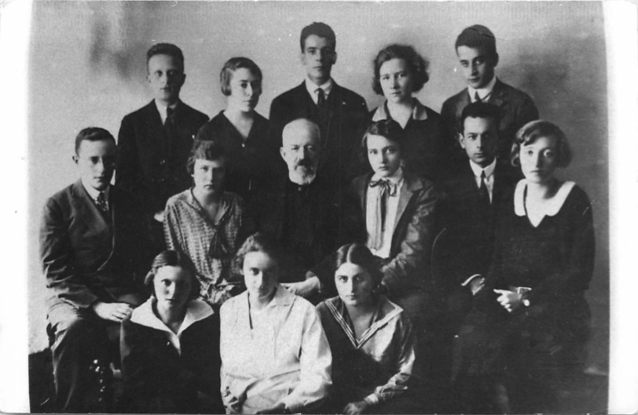

# lvov-warsaw — seminar（supplement）

> （《lvov-warsaw》词条补充材料，源：plato.stanford.edu/entries/lvov-warsaw/seminar.html）

#### Supplement to Lvov-Warsaw School

## Twardowski's Seminar Participants

> 
>
>
> | *Top row from left*: | Henryk Mehlberg, unidentified student, Walter Auerbach, unidentified student, Leopold Blaustein |
> | --- | --- |
> | *Middle row from left*: | unidentified student, Maria Kokoszynska, Twardowski, Izydora Dąmbska, Seweryna Łuszczewska, unidentified student |
> | *Bottom row from left*: | Józefina Mehlberg, Halina Słoniewska, Eugenia Blaustein |

*Photo courtesy of Jan Woleński (a gift from his teacher Izydora Dąmbska) and reproduced with permission.*
