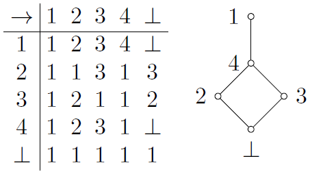
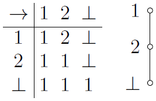

# Mally’s Deontic Logic
**First published Fri Apr 5, 2002; substantive revision Fri Jan 30, 2026**

*Lokhorst, Gert-Jan, Centrone, Stefania, Minari, Pierluigi*

In 1926, Mally presented the first formal system of deontic logic. His system had several consequences which Mally regarded as surprising but defensible. It also had a consequence (“A is obligatory if and only if A is the case”) which Menger (1939) and almost all later deontic logicians have regarded as unacceptable. We will not only describe Mally’s system but also discuss how it may be repaired.

## 1. Introduction

In 1926, the Austrian philosopher Ernst Mally (1879–1944) proposed the first formal system of deontic logic. In the book in which he presented this system, *The Basic Laws of Ought: Elements of the Logic of Willing*, Mally gave the following motivation for his enterprise:

> In 1919, everybody was using the word self-determination. I wanted to obtain a clear understanding of this word. But then, of course, I immediately stumbled on the difficulties and obscurities surrounding the concept of Ought, and the problem changed. The concept of Ought is the basic concept of the whole of ethics. It can only serve as a usable foundation for ethics when it is captured in a system of axioms. In the following I will present such an axiomatic system.[^note-1]

As Mally’s words indicate, he was not primarily interested in deontic logic for its own sake: he mainly wanted to lay the foundation of “an exact system of pure ethics” (*eine exakte reine Ethik*). More than half of his book is devoted to the development of this exact system of ethics. In the following sections, we will concentrate on the formal part of his book, both because it is its “hard core” and because it is the part that has attracted the most interest.

However, before turning to the formal system itself, a few brief preliminary clarifications concerning Mally’s specific terminology (*Wollen*, *Sollen*, *Wünschen*, *Sachverhalt*) and the philosophical background that informs these notions are in order (for a detailed discussion of these aspects, see e.g. Centrone 2013; Morscher 1998)[^centrone-2013][^morscher-1998].

Mally refers to the Logic of Will as “Deontik”—that is, the totality of the laws governing correct willing (*Wollen*). By “Ethics,” he instead means the Logic of Ought, namely the laws governing what ought to be (*Sollen*). The relationship between these two domains can be sketched as follows. Normative propositions are typically taken to concern what one ought to do; according to Mally, however, they specify what one ought to will. Correct willing, in his view, consists precisely in willing what one ought to will. It is likely that Mally inherited aspects of this conception from Bernard Bolzano, who was well known among Brentano’s students and whose writings Mally may have encountered through his teacher Alexius Meinong. According to Bolzano, normative propositions tell us what we ought to do, to will, to choose, and so on (see e.g. Bolzano 1834, I, p. 45)[^bolzano-1834]. Like Bolzano (1834, I, p. 230), Mally maintains that “a will may fail to achieve its goal and yet find and deserve recognition, in that it was a right and proper act of will” (Mally 1926, Introduction, p. 1)[^mally-1926], thus echoing the Latin dictum *ultra posse nemo obligatur* in a sense that departs from its strictly literal meaning, *no one is obligated beyond their ability*.

Following Bolzano and Meinong, Mally also distinguishes between (correct) willing and wishing (*Wünschen*). For propositions concerning willing, the following principle of consequentiality holds: if A ought to be willed and A rationally implies B, then B ought to be willed as well. This is the informal formulation of Basic Law I of Mally’s deontic system (see section 3). By contrast, Mally denies that an analogous form of consequentiality applies to propositions about wishing: “One can very well desire something, insofar as it is agreeable or valuable, but not its unpleasant consequence.”[^note-2] For this reason, Mally claims that a logic of wishing—understood as a system of laws governing correct wishing—is not possible.

A logic of correct willing, however, is possible and stands on the same footing as the logic of correct judging—by which he means more or less what we would today broadly call standard deductive logic. According to Mally, just as a judgment grasps either a *Sein/Nichtsein* or a *Sosein/Nichtsosein*, an act of willing grasps either a *Seinsollen/Nichtseinsollen* or a *Soseinsollen/Nichtsoseinsollen*: the correlates of such acts—“states of affairs” (*Sachverhalte*), in Mally’s terminology—always have, or can be reduced to, a propositional structure. States of affairs are the objects to which propositional mental act-states and linguistic utterances refer, and at the same time the meanings they express, thereby sharing features both with propositions as understood by Frege, Bolzano, and Husserl, and with truth-makers in the strict sense. Mally’s system is thus a logic of normative propositions, not a logic of actions: it concerns *Seinsollen* (what ought to be the case), not *Tunsollen* (what ought to be done). Although the first modern deontic system (Von Wright 1951)[^von-1951] was formulated as a logic of act types, later developments in deontic logic returned to a propositional framework closer to Mally’s—indeed, a shift Von Wright himself eventually adopted in his 1963 and 1968 works.

## 2. Mally’s Formal Language

Mally based his formal system on the classical propositional calculus (**PC**) as formulated in Whitehead’s and Russell’s *Principia Mathematica* (vol. 1, 1910). To this he adds five deontic axioms. Note that no deontic inference rules are added to those of **PC** (*modus ponens* and *substitution*).

The non-deontic part of Mally’s system had the following vocabulary: the sentential letters A, B, C, P and Q (these symbols refer to states of affairs), the sentential variables M and N, the sentential constants V (the *Verum*, Truth) and Λ (the *Falsum*, Falsity)[^note-3], the propositional quantifiers ∃ and ∀, and the connectives ¬, &, ∨, → and ↔. Λ is defined by Λ = ¬V.

The deontic part of Mally’s vocabulary consisted of the unary connective !, the binary connectives f and ∞, and the sentential constants U and ∩.

- Mally read !A as “A ought to be the case” (*A soll sein*) or as “let A be the case” (*es sei A*).
- He read A f B as “A requires B” (*A fordert B*).
- He read A ∞ B as “A and B require each other.”
- He read U as “the unconditionally obligatory” (*das unbedingt Geforderte*).
- He read ∩ as “the unconditionally forbidden” (*das unbedingt Verbotene*).

Actually, not all these symbols are taken by Mally as primitive. In particular f, ∞ and ∩ are defined by:

| Def. f . | A f B = A → !B (Mally 1926, p. 12)[^mally-1926] |
| --- | --- |
| Def. ∞ . | A ∞ B = (A f B) & (B f A) (Mally 1926, p. 22)[^mally-1926] |
| Def. ∩. | ∩ = ¬U (Mally 1926, pp. 18–19)[^mally-1926] |

As we explained in the Introduction, Mally did not only read !A as “it ought to be the case that A.” Because a person’s willing that a given state of affairs A be the case is often expressed by sentences of the form “A ought to be the case”, he also read !A as “I want it to be the case that A.” As a result, his formal system was as much a theory about correct *Wollen* (willing) as a theory about *Sollen* (ought to be the case). In modern deontic logic, the basic deontic connective O is seldom read in this way.

Another conspicuous difference is that in modern deontic logic, the notions of prohibition F, permission P and waiver W are usually defined in terms of obligation O: FA = O¬A, PA = ¬FA, WA = ¬OA. Such definitions are not to be found in Mally’s book.

## 3. Mally’s Axioms

Mally adopted five informal deontic principles – or, in his own words, “Basic Laws of Ought” (*Grundgesetze des Sollens*):

| (i) | If A requires B and if B (materially) implies C, then A requires C |
| --- | --- |
| (ii) | If A requires B and if A requires C, then A requires B and C |
| (iii) | A requires B if and only if it is obligatory that if A then B |
| (iv) | The unconditionally obligatory is obligatory |
| (v) | The unconditionally obligatory does not require its own negation |

and formalised them as follows (Mally 1926, pp. 15–19)[^mally-1926]:

|   | **Deontic axioms / Basic Laws** | (written in terms of the primitive operators) |
| --- | --- | --- |
| I. | ((A f B) & (B → C)) → (A f C) | ((A → !B) & (B → C)) → (A → !C) |
| II. | ((A f B) & (A f C)) → (A f (B & C)) | ((A → !B) & (A → !C)) → (A → !(B & C)) |
| III. | (A f B) ↔ !(A → B) | (A → !B) ↔ !(A → B) |
| IV. | ∃U !U | !U (see comments below) |
| V. | ¬(U f ∩) | ¬(U → !¬U) |

Before considering the system as a whole and its theorems, it is worth reviewing — and commenting on — the intuitive support that Mally offers for each Law in turn.

**3.1.** Basic Law 1 is called by Mally “Principle of Closure under Implication” (*Grundsatz des Mitforderns*) or “Principle of Consequentiality” (*Grundsatz der Folgerichtigkeit*). He justifies it as follows:

> When, under the assumption of a state of affairs A, a state of affairs B ought to be—that is, as we agreed to say, when A requires B—and B implies a state of affairs C, then it also holds that under the assumption A, C ought to be—that is, that A requires C (Mally 1926. p. 15)[^mally-1926].

In other words, if something ought to be the case under a certain condition *A*, then all consequences of it ought to be the case, under the same condition (Mally 1926, p. 15)[^mally-1926].

*Prima facie*, this principle may seem natural, given Mally’s informal justification quoted above. A brief reflection, however, shows that under Mally’s formalization (in particular, the use of material implication) it admits intuitive counterexamples. For instance, suppose (i) we accept “If John has stolen, then he ought to be put in jail” (A →! B), but (ii) we reject “If John has stolen, then he ought to die” (A →! C). If John is ill and de facto, due to his condition, (iii) it is true that if he is jailed, he will die (B → C), then by Basic Law I it follows from (i) and (iii) that “If Jules has stolen, then he ought to die”, contrary to (ii). Actually, Basic Law I is far from harmless: many of the problems in Mally’s system arise from this axiom.

**3.2.** Basic Law II is called by Mally “Principle of Composition (*Grundsatz der Zusammensetzung oder der* *Vereinigung*)”:

> When, under the assumption of a state of affairs M, a state of affairs A ought to be and, under the same assumption, a state of affairs B ought to be, then it also holds that under the assumption M, the state of affairs AB ought to be (Mally 1926, p. 16)[^mally-1926].

It is quite natural to accept Basic Law II (at least for conflict-disallowing conceptions of “ought”, which is surely what Mally had in mind). Interestingly, Mally emphasizes that, trivial as this Law may seem, it nevertheless expresses a distinctive property of willing, one that sets it apart from other kinds of relations to states of affairs (Mally 1926, pp. 16–17)[^mally-1926].

Indeed, while having a counterpart for assertoric judgements – the boolean tautology ((A → B) & ( A → C)) → ( A → B & C) –, so Mally, it does *not* hold in particular for *wishing*-judgements:

> One may wish an A in the case M and then again a B in the same case M, without there lying in the sense of his desires that he wishes A and B together in the case M. A may be desirable in itself and, in the same circumstance, also B may be desirable in itself, but A and B maybe not. This will have the consequence, in the transition from wishing to willing, that one of the wishes …has to be sacrificed to the other, if one wants to wish rationally (Mally 1926, pp. 16–17)[^mally-1926].

**3.3.** Basic Law III, which Mally calls the “Principle of Selection (*Grundsatz der Aussonderung*),” states that any conditional requirement “A requires B” is equivalent to the unconditional statement “it ought to be the case that A implies B” (Mally 1926, p. 17)[^mally-1926]. Mally does not seem to recognize that there is something problematic about this Basic Law. He simply notes that its significance is mainly formal:

>
> For the purpose of the derivation of certain propositions it is formally important to allow substitution of the conditional requirement with the equivalent unconditional requirement. (Mally 1926, p. 248)[^mally-1926]

It is worth noting that this issue goes far beyond mere formal convenience. The problem of correctly formalizing the notion of commitment would become a central topic among the “official” deontic logicians from the early 1960s onward, and each of the two most plausible candidates for such a formalization — !(A → B) and A →!B, whose equivalence is straightforwardly asserted by Basic Law III — would face serious paradoxes.[^note-4]

In any case, regardless of which of the two formalizations one might prefer (if any), it is easy to see that the equivalence (A →!B) ↔ !(A → B) is, at least under a material reading of the conditional, intuitively untenable. For the factual falsity of A automatically makes A →!B true, whereas the truth value of !(A → B) should not reasonably be determined by the factual truth value of A — and so !(A → B) may well be false even when A is *de facto* false.

**3.4.** Basic Law IV, “*there is a state of affairs U satisfying*: ‘*U ought to be the case*!’”, which Mally calls the “Principle of the unconditioned obligation (*Grundsatz der unbedingten Forderung*)” (Mally 1926, p. 18)[^mally-1926], is strange.

First of all, it is the only axiom or theorem mentioned by Mally in which U occurs as a bound variable: in the Basic Law V and in theorems (15)–(17), (20)–(21), (23), (23′) and (27)–(35) (to be displayed below), U is a propositional constant. One should treat it in the same way in the formalization of this Basic Law and, for these reasons, we replaced its original formalization ∃U !U by !U[^note-5]. Indeed, propositional quantifiers can be dropped from the syntax of Mally’s system without limitations. Moreover, Basic Law IV seems redundant: !A → !A is a tautology, so we have !(!A → A) by Axiom III´(→), whence ∃M !M by existential generalization. Axiom IV seems to add nothing to this.

Apart from these minor details, Mally’s intention behind Basic Law IV is sufficiently clear:

> “What these Laws [Basic Laws I, II, and III] claim has the form: if this ought to be the case, then that too ought to be the case; yet none of these Laws asserts that something *de facto* ought to be the case” (Mally 1926, p. 18)[^mally-1926].

In other words, he understood this Law as a guarantee that the system of norms is non-empty — that there is at least one proposition that is unconditionally obligatory, like U. It also seems reasonable to ascribe to Mally (although he does not say this explicitly) the requirement that U be a non-tautological proposition; otherwise, it is hard to make sense of Mally’s surprise at discovering that V ↔ U is derivable from his axioms (see the next section).

**3.5**. Basic Law V, which Mally calls the “Principle of Non-Contradiction of the Ought-to-Be (*Grundsatz der Widerspruchlosigkeit des tatsächlichen Sollens*)” (Mally 1926, p. 19)[^mally-1926], is informally justified as follows:

> *Just as logic cannot set aside the fact that there are contradictory judgements, in the same way* Deontik *cannot set aside the fact that there are contradictory, hence irrational, norms* […]. *But the theory must assess that no actual state of affairs can correspond to a contradictory judgement, and that no rational ought-to-be can correspond to a contradictory norm. This is accomplished by means of a principle requiring that what ought to be unconditionally—our U—does not require its own negation* (Mally 1926, pp. 18–19)[^mally-1926].

This sounds intuitively correct, yet Mally’s formalization of the principle is somewhat odd, given that from ¬(U →!¬U) one immediately derives, by **PC**, that **U** is a theorem, and hence also **V ↔ U is a theorem**, contrary to the intended non-tautological status of **U**. At first sight, the simpler and weaker axiom **¬!¬U** might seem to capture Mally’s intuition just as well (see Morscher 1998, pp. 104–105)[^morscher-1998], while at the same time avoiding this drawback. Unfortunately, one can show that, given Basic Laws I and III (or I and IV), the weaker **¬!¬U** actually implies the stronger **¬(U →!¬U)** (see Centrone 2013, p. 4113 ff.)[^centrone-2013].

In any case, note that if we read “!” as “O” (obligation) and “U” as “V” (or T, *verum*), then — given the rest of the system — Basic Law V is equivalent to PV (PV: it is permitted that V), that is an alternative formulation of the charcteristic Deontic Schema OA **→** PA of the “standard” deontic modal system **KD**.

## 4. Mally’s Theorems

Mally derived the following theorems from his axioms (Mally 1926, pp. 20–34)[^mally-1926].[^note-6]

| (1) | (A f B) → (A f V) |
| --- | --- |
| (2) | (A f Λ) ↔ ∀M (A f M) |
| (3) | ((M f A) ∨ (M f B)) → (M f (A ∨ B)) |
| (4) | ((M f A) & (N f B)) → ((M & N) f (A & B)) |
| (5) | !P ↔ ∀M (M f P) |
| (6) | (!P & (P → Q)) → !Q |
| (7) | !P → !V |
| (8) | ((A f B) & (B f C)) → (A f C) |
| (9) | (!P & (P f Q)) → !Q |
| (10) | (!A & !B) ↔ !(A & B) |
| (11) | (A ∞ B) ↔ !(A ↔ B) |
| (12) | (A f B) ↔ (A → !B) ↔ !(A → B) ↔ !¬(A & ¬B) ↔ !(¬A ∨ B) |
| (13) | (A → !B) ↔ ¬(A & ¬!B) ↔ (¬A ∨ !B) |
| (14) | (A f B) ↔ (¬B f ¬A) |
| (15) | ∀M (M f U) |
| (16) | (U → A) → !A |
| (17) | (U f A) → !A |
| (18) | !!A → !A |
| (19) | !!A ↔ !A |
| (20) | (U f A) ↔ (A ∞ U) |
| (21) | !A ↔ (A ∞ U) |
| (22) | !V |
| (23) | V ∞ U |
| (23′) | V f U |
| (24) | A f A |
| (25) | (A → B) → (A f B) |
| (26) | (A ↔ B) → (A ∞ B) |
| (27) | ∀M (∩ f ¬M) |
| (28) | ∩ f ∩ |
| (29) | ∩ f U |
| (30) | ∩ f Λ |
| (31) | ∩ ∞ Λ |
| (32) | ¬(U f Λ) |
| (33) | ¬(U → Λ) |
| (34) | U ↔ V |
| (35) | ∩ ↔ Λ |

## 5. Surprising Consequences

Mally called theorems (1), (2), (7), (22) and (27)–(35) “surprising” (*befremdlich*) or even “paradoxical” (*paradox*). He viewed (34) and (35) as the most surprising of his surprising theorems. But Mally’s reasons for calling these theorems surprising are puzzling if not confused.

Consider, for example, theorem (1). Mally interpreted this theorem as follows: “if A requires B, then A requires everything that is the case” (Mally 1926, p. 20)[^mally-1926]. He regarded this as a surprising claim, and we agree. However, Mally’s interpretation of (1) is not warranted. (1) only says that if A requires B, then A requires the *Verum*. The expression “if A requires B, then A requires everything that is the case” is to be formalized as

| (1′) | (A f B) → (C → (A f C)) |
| --- | --- |

This formula is an immediate consequence of (1) in virtue of Axiom I. In other words, Mally should have reasoned as follows: (1′) is surprising; but (1′) is an immediate consequence of (1) in virtue of Axiom I; Axiom 1 is uncontroversial; so (1) is to be regarded as surprising.

A similar pattern is to be seen in many of Mally’s other remarks about theorems which surprised him. He generally read too much into them and confused them with some of the consequences they had in his system:

- Mally was surprised by (2) because he thought that it says that if A requires B and B is not the case, then A requires every state of affairs whatsoever (Mally 1926, p. 21)[^mally-1926]. But (2) says no such thing. Mally’s paraphrase is a paraphrase of (A f B) → (¬B → (A f C)) (a consequence of (2) in virtue of Axiom I) rather than (2).
- Mally paraphrased (7) as “if anything is required, then everything that is the case is required” (Mally 1926, p. 28)[^mally-1926], which is indeed surprising. However, Mally’s paraphrase corresponds with !A → (B → !B) (a consequence of (7) in virtue of Axiom I) rather than (7).
- Mally paraphrased (22) as “the facts ought to be the case” (Mally 1926, p. 24)[^mally-1926]. We grant that this is a surprising claim. But the corresponding formula in Mally’s language is A → !A (a consequence of (22) in virtue of Axiom I), not (22).
- Mally read (27) as “if something which ought not to be the case is the case, then anything whatsoever ought to be the case” (Mally 1926, pp. 24, 33)[^mally-1926], but this is a paraphrase of !¬A → (A → !B) (a theorem of Mally’s system) rather than (27).
- Mally paraphrased (33) as “what is not the case is not obligatory” (Mally 1926, p. 25)[^mally-1926] and as “everything that is obligatory is the case” (Mally 1926, p. 34)[^mally-1926]. These assertions are indeed surprising, but Mally’s readings of (33) are not warranted. They are paraphrases of !A → A rather than (33).
- Mally made the following remark about (34) and (35): The latter sentences, which seem to identify being obligatory with being the case, are surely the most surprising of our “surprising consequences.”[^note-7] However, (34) and (35) do not assert that being obligatory is equivalent with being the case, for the latter statement should be formalized as A ↔ !A. The latter formula is a theorem of Mally’s system, as will be shown in a moment, but it is not to be found in Mally’s book.

Mally regarded theorems (28)–(32) as surprising because of their relationships with certain other surprising theorems:

- (28)–(30) are instantiations of (27). But this is not sufficient to call these theorems surprising. Mally actually viewed (28) as less surprising than (27): one might use it to justify retaliation and revenge (Mally 1926, p. 24)[^mally-1926].
- (31) implies (28)–(30) and is therefore at least as surprising as those theorems.
- Mally viewed (32) as surprising because the surprising theorem (33) is an immediate consequence of (32) and the apparently non-surprising theorem (25).

Mally’s list of surprising theorems seems too short: for example, (24) is equivalent with A → !A in virtue of Def. f. But A → !A may be paraphrased as “the facts ought to be the case,” an assertion which Mally regarded as surprising (Mally 1926, p. 24)[^mally-1926]. So then why didn’t he call (24) surprising? Did it not surprise him after (22)?

Even though Mally regarded many of his theorems as surprising, he thought that he had discovered an interesting concept of “correct willing” (*richtiges Wollen*) or “willing in accordance with the facts” which should not be confused with the notions of obligation and willing used in ordinary discourse. Mally’s “exact system of pure ethics” was mainly concerned with this concept, but as we said in the Introduction we will not describe this system because it belongs to the field of ethics rather than deontic logic.

## 6. Menger’s Criticism and the Deontic Collapse

Mally’s enterprise was received with little enthusiasm. As early as 1926, it was noted that “Mr. Mally’s deductions are frequently so amazingly obtuse and irrelevant that (despite his elaborate symbolic apparatus) it is only necessary to state one or two of them to show how far his discussion has strayed from its self-appointed task” (Laird 1926, p. 395)[^laird-1926].

In 1939, Karl Menger published a devastating attack on Mally’s system. He was the first to point out that A ↔ !A, the “deontic collapse” (henceforth DC), is a theorem of this system. In other words, if A is the case, then A is obligatory, and if A ought to be the case then A is indeed the case. As we have already noted in connection with theorems (34) and (35), Mally made the same claim in informal terms, but the formula A ↔ !A does not occur in his book.

Menger gave the following comment:

> This result seems to me to be detrimental for Mally’s theory, however. It indicates that the introduction of the sign ! is superfluous in the sense that it may be cancelled or inserted in any formula at any place we please. But this result (in spite of Mally’s philosophical justification) clearly contradicts not only our use of the word “ought” but also some of Mally’s own correct remarks about this concept, e.g. the one at the beginning of his development to the effect that p → (!q or !r) and p → !(q or r) are not equivalent. Mally is quite right that these two propositions are not equivalent according to the ordinary use of the word “ought.” But they are equivalent according to his theory by virtue of the equivalence of p and !p (Menger 1939, p. 58)[^menger-1939].

Almost all deontic logicians have accepted Menger’s verdict. After 1939, Mally’s deontic system has seldom been taken seriously.

Menger’s theorem A ↔ !A may be proven as follows (Menger’s proof was different; **PC** denotes the classical propositional calculus).

First, the left-to-right direction A → !A (DCₗᵣ) of DC is a theorem:

| 1. | A → ((!B → !B) & (B → A)) | [ **PC** ][^note-8] |
| --- | --- | --- |
| 2. | ((!B → !B) & (B → A)) → (!B → !A) | [ I ] |
| 3. | A → (!B → !A) | [ 1, 2, **PC** ] |
| 4. | !B → (A → !A) | [ 3, **PC** ] |
| 5a. | !U | [ IV ] |
| 5b. | !(!A → A) | [ III(→), **PC** ] |
| 6. | A → !A | [ 4, either 5a or 5b, **PC** ] |
|   |   |   |

Second, the right-to-left direction !A → A (DCᵣₗ) is a theorem:

| 1. | ((U → !A) & (A → ∩)) → (U → !∩) | [ I ] |
| --- | --- | --- |
| 2. | ¬((U → !A) & (A → ∩)) | [ 1, V, **PC** ] |
| 3. | ¬((U → !A) & (A → ∩)) → (!A → A) | [ **PC** ][^note-9] |
| 4. | !A → A | [ 2, 3, **PC** ] |

Because A → !A and !A → A are theorems, A ↔ !A is a theorem as well.

**Observe that a close inspection of the proof of the DC theorem** A ↔!A **given above shows the following:**

- **the DCₗᵣ implication** A →! A is derivable — indeed, even on the basis of *intuitionistic* propositional calculus (**IPC**) — using only axioms **I + IV**, or alternatively **I + III**;
- **the DCᵣₗ implication**!A →, in turn, is derivable using only axioms **I + V** — but *not* on the basis of **IPC** in this case (this is proved in Centrone 2013, p. 4111)[^centrone-2013].

**Hence the infamous deontic collapse DC is already derivable in the two subsystems of Mally’s system determined by the three axioms I, IV, V, and I, III, V, respectively. Since axioms IV and V, taken in isolation, are (at least formally) sound, this seems to place the blame, in particular, on axioms I and III.**

Finally, since **axioms I and IV** suffice to derive **DCₗᵣ**, one might wonder whether they also suffice to derive the opposite half, **DCᵣₗ**. And since **axioms I and V** suffice to derive **DCᵣₗ**, one might wonder whether they also suffice to derive the remaining half, **DCₗᵣ**. **The answer is negative in both cases:** even working with classical logic (see Centrone 2013, pp. 4107–4109)[^centrone-2013]:

- !A → A (DCᵣₗ) is *not* derivable from the set {I, II, III, IV} of axioms, and
- A →!A (DCₗᵣ) is *not* derivable from the set {I, II, V} of axioms.

## 7. Where Did Mally Go Wrong?

Where did Mally go wrong? How could one construct a system of deontic logic which does more justice to the notion of obligation used in ordinary discourse? Three kinds of answers are possible:

1. Mally should not have added his deontic axioms to classical propositional logic;
2. Some of his deontic principles should be modified;
3. Both of the above.

Menger advocated the first view: “One of the reasons for the failure of Mally’s interesting attempt is that it was founded on the 2-valued calculus of propositions” (Menger 1939, p. 59)[^menger-1939].

The first two suggestions turn out to be sufficient, so the third proposal is overkill.

In the following we will point out three facts:

First, if Mally’s deontic principles are added to a system in which the so-called paradoxes of material and strict implication are avoided, many of the “surprising” theorems (such as (34) and (35)) are no longer derivable and A ↔ !A is no longer derivable either (section 8).

Second, if Mally’s deontic principles are added to a system in which the so-called law of the excluded middle is avoided, the unacceptable consequence A ↔ !A is no longer derivable, but almost all theorems that Mally derived himself are still derivable (section 9).

Third, if Mally’s deontic principles, e.g., Def. f , Axiom I, Axiom III, are slightly modified, the resulting system is almost identical with the system nowadays known as standard deontic logic (section 10).

## 8. Alternative Non-Deontic Bases 1: Relevance Logic

Mally’s informal postulates (i)–(iii) and (v) are conditionals or negations of conditionals, i.e., of the form “if … then —” or “not: if … then —.” Føllesdal and Hilpinen (1981, pp. 5–6) have suggested that such conditionals should not be formalized in terms of material implication and that some sort of strict implication would be more appropriate. But this suggestion is not altogether satisfactory, for both A →ₛ !A and !A →ₛ A are derivable in the very weak system **S0.9⁰** plus I and III, where →ₛ is the symbol of strict implication.[^note-10]

In systems of strict implication the so-called paradoxes of material implication (such as A → (B → A)) are avoided, but the so-called paradoxes of strict implication (such as (A & ¬A) →ₛ B) remain. What would happen to Mally’s system if *both* kinds of paradoxes were avoided? This question can be answered by adding Mally’s axioms to a system in which none of the so-called “fallacies of relevance” can be derived (see the entry on relevance logic).

In the following, we will add Mally’s axioms to the prominent relevance logic **R**. The result is better than in the case of strict implication: most of the theorems which Mally regarded as surprising are no longer derivable, and Menger’s theorem A ↔ !A is not derivable either. But many “plausible” theorems can still be derived.

Relevant system **R** with the propositional constant t (“the conjunction of all truths”) has the following axioms and rules (Anderson & Belnap 1975, ch. V; ↔ is defined by A ↔ B = (A → B) & (B → A)):

| Self-implication. | A → A |
| --- | --- |
| Prefixing. | (A → B) → ((C → A) → (C → B)) |
| Contraction. | (A → (A → B)) → (A → B) |
| Permutation. | (A → (B → C)) → (B → (A → C)) |
| & Elimination. | (A & B) → A, (A & B) → B |
| & Introduction. | ((A → B) & (A → C)) → (A → (B & C)) |
| ∨ Introduction. | A → (A ∨ B), B → (A ∨ B) |
| ∨ Elimination. | ((A → C) & (B → C)) → ((A ∨ B) → C) |
| Distribution. | (A & (B ∨ C)) → ((A & B) ∨ C) |
| Double Negation. | ¬¬A → A |
| Contraposition. | (A → ¬B) → (B → ¬A) |
| Ax. t. | A ↔ (t → A) |
| Modus Ponens. | A, A → B / B |
| Adjunction. | A, B / A & B |

A relevant version **RD** of Mally’s deontic system may be defined as follows:

- The language is the same as the language of **R**, except that we write V instead of t, add the propositional constant U and the unary connective !, and define Λ, ∩, f and ∞ as in Mally’s system.
- Axiomatization: add Mally’s Axioms I-V to the axioms and rules of **R**.

**RD** has the following properties.

- Axioms I, II and III may be replaced by the following three simpler axioms:[^note-11]

  | I*. | (A → B) → (!A → !B) |
  | --- | --- |
  | II*. | (!A & !B) → !(A & B) |
  | III*. | !(!A → A) |
- Formulas I–V, (3), (4), (6), (8)–(11), (14), (16)–(18), (23′) and (30) are theorems of **RD**.[^note-12]
- Formulas (1), (2), (5), (7), (12), (13), (15), (19)–(23), (24)–(29), (31)–(35), A → !A and !A → A are not derivable.[^note-13]
- There are 12 mismatches between **RD** and Mally’s expectations: (5), (12)–(13), (15), (19)–(21), (23) and (24)–(26) are not derivable even though Mally did not regard these formulas as surprising, and (30) is a theorem even though Mally viewed it as surprising.
- Formulas (34) and (35) (the formulas which Mally viewed as the most surprising theorems of his system) are in a sense stranger than Menger’s theorem A ↔ !A because the latter theorem is derivable in **RD** supplemented with (34) or (35) while neither (34) nor (35) is derivable in **RD** supplemented with A ↔ !A.[^note-14]

Although most of Mally’s surprising theorems are not derivable in **RD**, this has nothing to do with Mally’s own reasons for regarding these theorems as surprising. They are not derivable in **RD** because they depend on fallacies of relevance. Mally never referred to such fallacies to explain his surprise. His considerations were quite different, as we have already described.

**RD** is closely related to Anderson’s relevant deontic logic **ARD**, which is defined as **R** supplemented with the following two axioms (Anderson 1967, 1968, McArthur 1981; Anderson used the unary connective O instead of !)[^anderson-1967][^anderson-1968][^mcarthur-1981]:

| ARD1. | !A ↔ (¬A → ∩) |
| --- | --- |
| ARD2. | !A → ¬!¬A |

- All theorems of **RD** are theorems of **ARD**.[^note-15]
- ARD1( → ) is not a theorem of **RD**+ARD2.[^note-16] This formula does not occur in Mally’s book. According to Anderson, Bohnert (1945) was the first one to propose it.[^note-17]
- ARD2 is not a theorem of **RD**+ARD1.[^note-18] This formula does not occur in Mally’s book, but Mally endorsed the corresponding informal principle: “a person who wills correctly does not will (not even implicitly) the negation of what he wills; correct willing is free of contradictions.”[^note-19]
- **RD** supplemented with ARD1( → ) and ARD2 has the same theorems as **ARD**.[^note-20]

Anderson’s system has several problematical features (McArthur 1981, Goble 1999, 2001)[^goble-1999][^goble-2001][^mcarthur-1981] and **RD** shares most of these features. But we will not go into this issue here. It is at any rate clear that **RD** is better than Mally’s original system.

## 9. Alternative Non-Deontic Bases 2: Intuitionistic Logic

It was recently pointed out that it is also possible to base Mally’s deontic logic on intuitionistic propositional logic **IPC** rather than classical propositional logic (Lokhorst 2013 & 2015; see also Centrone 2013)[^centrone-2013][^lokhorst-2013][^lokhorst-2015].

Heyting’s intuitionistic propositional calculus **IPC** has the following axioms and rules (see Van Dalen 2002 and the entry on intuitionistic logic)[^van-2002]:

| A → (B → A) |
| --- |
| (A → (B → C)) → ((A → B) → (A → C)) |
| (A & B) → A |
| (A & B) → B |
| A → (B → (A & B)) |
| A → (A ∨ B) |
| B → (A ∨ B) |
| (A → C) → ((B → C) → ((A ∨ B) → C)) |
| ⊥ → A |
| *modus ponens* |
| *substitution* |
|   |

If we add to these axioms and rules the following:

Abbreviations: ¬ A = A → ⊥, A ↔ B = (A → B) & (B → A), T = A → A,

then we can formulate **ID** (an intuitionistic reformulation of Mally’s deontic logic) as **IPC** plus Mally’s axioms I – V and

| (34) | U ↔ T |
| --- | --- |
| VI | !(A ∨ ¬ A) |
|   |   |

Axiom VI follows from Mally’s theorem (12d) (see Mally 1926, ch. 2, sec. 5, p. 29 and Morscher 1998, p. 122)[^mally-1926][^morscher-1998].[^note-21]

FACT 1. **ID** can alternatively be axiomatized as **IPC** plus axioms !A ↔ ¬ ¬ A and (34).[^note-22]

Classical propositional logic, **CPC**, is **IPC** plus A ∨ ¬ A. **MD** (“Mally’s *Deontik*”) is **ID** plus **CPC**.

FACT 2. A ↔ !A is a theorem of **MD**.[^note-23]

In modern deontic logic, P A (“it is permitted that A”) is defined as P A = ¬ !¬ A. If we adopt this definition, **ID** provides !A ↔ P A (because **IPC** provides ¬ ¬ A ↔ ¬ ¬ ¬ ¬ A). Mally did not discuss permission. His approval of !A → ¬ !¬ A (which is usually regarded as characteristic for deontic logic) is clear from Mally 1926, ch. 4, sec. 10, p. 49, *ad* (V).

Mally objected to !(A ∨ B) → (!A ∨ !B) and Menger objected to A ↔ !A (see Mally 1926, ch. 2, sec. 4, p. 27, *ad* (II) and the quote in Section 6 above). **ID** avoids these objections:

FACT 3. Neither !(A ∨ B) → (!A ∨ !B) nor !A → A is a theorem of **ID**.[^note-24]

Only one of the theorems presented by Mally is *not* derivable in **ID**, namely (13b): ¬ (A & ¬ !B) ↔ (¬ A ∨ !B).[^note-25]

FACT 4. For any extension X of **ID** (in the language of **ID**): X provides (13b) if and only if X provides !(A ∨ B) → (!A ∨ !B).[^note-26]

**ID** plus (13b) does not provide !A → A.[^note-27]

The intuitionistic reformulation of Mally’s deontic logic that we have proposed is successful in so far as it avoids both Menger’s and Mally’s own objections while preserving almost all the theorems that Mally noticed himself. However, it is unacceptable as a system of deontic logic in its own right. We mention only two reasons:

1. Theorem A → !A is intuitively invalid. No deontic system, except Mally’s, has this theorem.

2. It is unclear how permission is to be represented. If we use the standard definition (P A = ¬ !¬ A), then P A ↔ !A is a theorem, but P A and !A are not equivalent according to the ordinary use of the words “permitted” and “obligatory.”

The relevantist reformulation of Mally’s system that was discussed above does not have these defects.

Although **ID** is unacceptable as a system of deontic logic, it does make sense as a system of *lax logic*, as we will now show. Lax logic is used in the areas of hardware verification in digital circuits and access control in secure systems, where ! expresses a notion of correctness up to constraints. The term “lax” was chosen “to indicate the looseness associated with the notion of correctness up to constraints” (Fairtlough and Mendler 1997, p. 3)[^fairtlough-1997]. There is a considerable literature on lax logic (see a.o. Goldblatt 2011, Iemhoff 2024)[^goldblatt-2011][^iemhoff-2024].

Propositional lax logic **PLL** is defined as **IPC** plus (A → !B) ↔ (!A → !B) (Fairtlough and Mendler 1997, p. 4, Lemma 2.1)[^fairtlough-1997]. Lax logic PLL* is **PLL** plus !A ↔ ¬ ¬ A (Fairtlough and Mendler 1997, p. 23)[^fairtlough-1997].

FACT 5. **ID** is an alternative axiomatization of lax logic PLL* plus (34).[^note-28]

Mally’s deontic logic and lax logic arose from quite different considerations. It is therefore remarkable that the intuitionistic reformulation of Mally’s logic that we have discussed is identical with lax logic PLL* plus (34).

## 10. Alternative Deontic Principles

Instead of changing the non-deontic propositional basis of Mally’s system, one might instead modify the specifically deontic axioms. This might of course be done in various ways; here we consider two approaches that work well without straying too far from Mally’s original assumptions.

Preliminarily, we recall that the so-called standard system of deontic logic **KD** – where !, V and Λ are usually written as O, ⊤ and ⊥ (see the entry on deontic logic), but we keep Mally’s symbols for ease of comparison – is the normal modal system that can be defined as **PC** supplemented in one of the two following ways:

| **KD – version 1** | **KD – version 2** |
| --- | --- |
| *Inference rule:* | *Inference rule:* |
| Rd: B → C / !B → !C | RN: A / !A |
| *Axioms:* | *Axioms:* |
| i: (!A & !B) → !(A & B) | K: !(A → B) → (!A → !B) |
| ii: !V | D ¬!Λ (or: !A → ¬!¬A) |
| iii: ¬!Λ |   |

The standard system of deontic logic has several problematical features. The fact that each provable statement is obligatory is often regarded as counterintuitive, and there are many other well-known “paradoxes.” The revised versions of Mally’s system we are going to consider share these problematical features. But we will not discuss these issues here. The standard system is at any rate better than Mally’s original proposal.

**10.1.** In the first approach[^note-29], to begin with, the operator f is regarded as primitive and Mally’s definition of f in terms of → and ! (Def. f, the very first specifically deontic postulate in Mally’s book) is replaced by the following definition of ! in terms of V and f :

| Def. !. | !A = V f A |
| --- | --- |

Second, Axiom I, which may also be written as (B → C) → ((A f B) → (A f C)), is replaced with the following *rule of inference*:

| Rule f. | B → C / (A f B) → (A f C) |
| --- | --- |

All the remaining axioms are stated in their original form.

In the resulting system **MD** one may then derive:

| 1. | B → C / !B → !C | [ Def. !, Rule f ] |
| --- | --- | --- |
| 2. | (!A & !B) → !(A & B) | [ Def. !, Ax. II ] |
| 3. | !V | [ 1, Ax. IV, **PC** ] |
| 4. | ¬!Λ | [ 1, Ax. III(←), Ax. V, **PC** (ex falso) ] |

So the new system **MD** is at least as strong as **KD (**see the above table, version 1**).** It is not difficult to see that it is in fact identical with **KD** supplemented with OU (Mally’s Axiom IV) and the following definition of f :

| (Transl_{f}) | A f B = O(A → B) (in modern deontic logic, the notion of *commitment* is sometimes defined in this way) |
| --- | --- |

In this new system, Mally’s theorems have the following status (caution: here I′, II′, III′, IV′, and V′ are Mally’s axioms written in terms of the primitive operators; see the right column of the table in section 3):

- II′, IV′, (1)–(5), (7)–(11), (13)–(15), (17), (20)–(24) and (27)–(32) are derivable.
- I′, III′, V′, (6), (12), (16), (18)–(19), (25)–(26), (33)–(35), A → !A and !A → A are not derivable.
- There are 20 mismatches with Mally’s deontic expectations: 10 “plausible” formulas are no longer derivable, namely I′, III′, V′, (6), (12), (16), (18)–(19) and (25)–(26), and 10 “surprising” theorems are still derivable, namely (1), (2), (7), (22) and (27)–(32).
- Although (34) and (35) are not derivable, adding them would by no means lead to the theoremhood of A ↔ !A.

There were only 12 mismatches in the case of **RD**, so **MD** does less justice to Mally’s deontic expectations than **RD** did. But it agrees better with his general outlook because it is still based on classical propositional logic, a system to which Mally did not object (not that he had much choice in the 1920s).

Many of Mally’s surprising theorems are derivable in **KD**, but they have, as it were, lost their sting: those theorems lead to surprising consequences when combined with Mally’s Axiom I and his definition of f , but they are completely harmless without these postulates.

**10.2.** A different way of amending Mally’s system by modifying the axioms is introduced and examined in Centrone 2013, pp. 4110 ff. The proposed amended system, called **Mm**, has the same language as Mally’s original system **M** and is obtained from the latter as follows, *without changing Mally’s definition of* f:

- Axiom I is replaced with one (at choice) of its associated inference rules:

| Rule RI | A → !B / (B → C) → (A → !C) |
| --- | --- |

| Rule RI´ | (B → C) / (A → !B) → (A → !C) |
| --- | --- |

- Axiom III is dropped.

The language of **Mm** is properly included in that of **KD** (which does not have the sentential constant U) – therefore every **Mm**-formula is a **KD**-formula, but not vice versa. To make the two systems comparable, each **Mm**-formula A is associated with the **KD**-formula A* obtained from A by replacing U everywhere with ⊤. It can then be proved that **Mm** and **KD** are equivalent modulo the translation *. More precisely, the following holds:

• For every **KD**-formula A, if A is a theorem of **KD**, then A is a theorem of **Mm**; • for every **Mm**-formula A, if A is a theorem of **Mm**, then A* is a theorem of **KD**; • moreover, for every **Mm**-formula A, A ↔ A* is a theorem of **Mm**.

The system **MD** considered in 10.1 seems, at least *prima facie*, closer to Mally’s original system than the system **Mm**, insofar as it retains all of Mally’s axioms except Axiom I, which, as in **Mm**, is turned into an inference rule (but in **MD** the rule is formulated using the operator f, which is taken as primitive).

In particular, **MD** includes Mally’s controversial Axiom III, (A f B) ↔ !(A → B), which is instead dropped in **Mm**. This, however, is possible only at the cost of rejecting another of Mally’s commitments, namely his definition of A f B (in terms of !) as A → !B. Indeed, once translated into **KD** + OU according to the definition (Transl_{f}), Axiom III loses its problematic character and becomes the harmless (A → B) ↔ !(⊤ → (A → B)).

## 11. Conclusion

Mally’s deontic logic is unacceptable for the reasons stated by Menger (1939). But it is not as bad as it may seem at first sight. Only relatively minor modifications are needed to turn it into a more acceptable system. One may either change the non-deontic basis to get either a system that is similar to Anderson’s system or a system that is identical with intuitionistic or constructive propositional logic with double negation as an obligation-like operator, or apply two patches to the deontic postulates to obtain a system similar to standard deontic logic.

Some authors have refused to view Mally’s deontic logic as a “real” deontic system and say that they “mention it only by way of curiosity” (Meyer and Wieringa 1993, p. 4)[^meyer-1993]. The above shows that this judgment is too harsh. It is only a small step, not a giant leap, from Mally’s system to modern systems of deontic logic, so Mally’s pioneering effort deserves rehabilitation rather than contempt.

## References（引用注释）

> 原文参考文献已转为脚注引用：文内“作者-年份”引用组后附 [^key] 标记，完整条目见本文末脚注定义。

## Academic Tools

> |   | [How to cite this entry](https://plato.stanford.edu/cgi-bin/encyclopedia/archinfo.cgi?entry=mally-deontic). |
> | --- | --- |
> |   | [Preview the PDF version of this entry](https://leibniz.stanford.edu/friends/preview/mally-deontic/) at the [Friends of the SEP Society](https://leibniz.stanford.edu/friends/). |
> |   | [Look up topics and thinkers related to this entry](https://www.inphoproject.org/entity?sep=mally-deontic&redirect=True) at the Internet Philosophy Ontology Project (InPhO). |
> |   | [Enhanced bibliography for this entry](https://philpapers.org/sep/mally-deontic/) at [PhilPapers](https://philpapers.org/), with links to its database. |

## Other Internet Resources

- Basic information page on [Ernst Mally](https://mally.stanford.edu/mally.html), by Edward Zalta, Stanford University.
- [MaGIC 2.2](https://users.cecs.anu.edu.au/~jks/magic.html). MaGIC (Matrix Generator for Implication Connectives) is a program which finds matrices for implication connectives for a wide range of propositional logics. MaGIC was written by John Slaney of the Automated Reasoning Group, The Research School of Information Sciences and Engineering, The Australian National University. MaGIC was written for Unix and can easily be compiled under Linux, FreeBSD, Mac OS X and similar operating systems. There is also a [version for Windows (Cygwin)](http://gjclokhorst.nl/magic.html).

## Related Entries

logic: deontic | logic: intuitionistic | logic: relevance

### Acknowledgments

The author is very grateful to Lou Goble, whose extensive comments on two earlier drafts led to many substantial improvements. The author would also like to thank Lou Goble and Edgar Morscher for making their papers on Anderson’s and Mally’s deontic logic available to him, Robert K. Meyer for helping him find the matrices used in note 10, and John Slaney for providing him with the proof of II* mentioned in note 8.

## Notes（原文脚注）

[^note-1]: *Im Jahre 1919 wurde mir das Wort Selbstbestimmung, das in aller Leute Munde war, Anlaß eines Versuches, mir einen klaren Begriff zu dem Wort zu bilden. Natürlich stieß ich dabei alsbald auf die Schwierigkeiten und Dunkelheiten des Sollensbegriffes: das Problem wandelte sich. Grundbegriff aller Ethik, kann der Begriff des Sollens ein brauchbares Fundament ihres Aufbaus nur geben, wenn er in einem System von Axiomen festgelegt ist. Ein solches Axiomensystem führe ich hier vor* (Mally 1926, Preface, p. I)[^mally-1926].

[^note-2]: *Man kann sehr wohl etwas wünschen, sofern esuns angenehm oder sonst wertvoll ist, aber die unangenehme Kehrseite des Tatbestandes gar nicht wünschen*. (Mally 1926, p. 15)[^mally-1926].

[^note-3]: [F]or every **M** *— that is, for any state of affairs* *M* — “*M* *implies* *V*”, and, respectively, “*Λ implies* *M**”, does hold* (Mally 1926, 9)[^mally-1926]. Using terminology that Mally himself does not employ, but based on what he writes, we may identify *V* and Λ, currently denoted by **⊤** and **⊥**, with an arbitrarily fixed tautology and an arbitrarily fixed contradiction, respectively.

[^note-4]: See e.g. Føllesdal and Hilpinen 1981 and McNamara 2006 for a survey.

[^note-5]: Menger (1939, p. 57) and Føllesdal and Hilpinen (1981, pp. 2-3) made the same decision.

[^note-6]: Menger (1939, p. 58) said that Mally derived “fifty” theorems, while Føllesdal and Hilpinen (1981, p. 3) said that Mally derived “about fifty” theorems. They probably included some of Mally’s unnumbered theorems, which Mally mentioned only in passing. Our list consists of Mally’s thirty-six explicitly numbered theorems.

[^note-7]: *Diese letzten Sätze, die Seinsollen und Tatsächlichsein zu identifizieren scheinen, sind unter unseren “befremdlichen Folgerungen” wohl die befremdlichsten* (Mally 1926, p. 25)[^mally-1926].

[^note-8]: The formula on this line is a theorem of the classical propositional calculus because A → (B → B) and A → (B → A) are theorems of this calculus.

[^note-9]: The formula on this line is a theorem of the classical propositional calculus because

| ¬((U → !A) & (A → ∩)) | ↔ | ¬((U → !A) & (U → ¬A)) |
| --- | --- | --- |
|   | ↔ | ¬(U → (!A & ¬A)) |
|   | ↔ | U & ¬(!A & ¬A) |
|   | → | !A → A |

[^note-10]: The proofs that A → !A and A ↔ !A are theorems of **S0.9⁰** enriched with ! and supplemented with I and III are to be found in Lokhorst 2010.

[^note-11]: We only prove that I* is a theorem of **RD**. The other five cases (II* and III* are theorems of **RD** and I–III follow from I*–III*) are left to the reader.

| 1. | (!A → !A) & (A → ((A → B) → B)) | [ **R** ] |
| --- | --- | --- |
| 2. | !A → !((A → B) → B) | [ 1, Ax. I, Def. f ] |
| 3. | !A → ((A → B) → !B) | [ 2, Ax. III(←), Def. f ] |
| 4. | (A → B) → (!A → !B) | [ 3, Permutation ] |

Axiom II* is actually redundant. The following formulas are theorems:

| (a) | (A → B) → ( ¬!¬ A → ¬!¬ B ) | [ I* ] |
| --- | --- | --- |
| (b) | ¬!¬ ! A → A | [ I*, III* ] |
| (c) | A → ! ¬!¬ A | [ I*, III* ] |

We therefore have:

| 1. | ¬!¬ ( ! A & ! B) → ¬!¬ ! A | [ &Elimination, (a) ] |
| --- | --- | --- |
| 2. | ¬!¬ ( ! A & ! B) → A | [ 1, (b) ] |
| 3. | ¬!¬ ( ! A & ! B) → B | [ similar to proof of 2 ] |
| 4. | ¬!¬ ( ! A & ! B) → (A & B) | [ 2, 3, &Introduction ] |
| 5. | ! ¬!¬ ( ! A & ! B) → ! (A & B) | [ 4, I* ] |
| 6. | ( ! A & ! B) → ! (A & B) | [ 5, (c) ] |

We owe this proof to John Slaney.

[^note-12]: Most cases are obvious but some hints for (16)–(18) and (30) may be helpful. (16) is a consequence of I* and IV. (17) follows from (16) and (18). (18) may be proven as follows:

| 1. | !(!A → A) & !(!!A → !A) | [ III* (twice), Adjunction ] |
| --- | --- | --- |
| 2. | !((!A → A) & (!!A → !A)) | [ 1, II* ] |
| 3. | ((!A → A) & (!!A → !A)) → (!!A → A) | [ **R** ] |
| 4. | !((!A → A) & (!!A → !A)) → !(!!A → A) | [ 3, I* ] |
| 5. | !(!!A → A) | [ 2, 4 ] |
| 6. | !!A → !A | [ 5, Ax. III(←), Def. f ] |

(30) is proven as follows: we have ∩ → (V → ∩) by Ax. t, whence ∩ → (U → Λ) by Contraposition and Double Negation, whence ∩ → !Λ by (16).

[^note-13]: In order to prove this claim, we first have to remove an obstacle: (2), (5), (15) and (27) do not belong to the language of **RD** because they contain propositional quantifiers. If such quantifiers were added in the usual way (Anderson, Belnap & Dunn 1992, sec. 32)[^anderson-1992], then we could easily prove that (2), (5), (15) and (27) are deductively equivalent with (2′), (5′), (15′) and (27′), respectively:

| (2′) | (A f Λ) → (A f B) |
| --- | --- |
| (5′) | (!A → (B f A)) & ((V f A) → !A) |
| (15′) | A f U |
| (27′) | ∩ f A |

To avoid needless complications, we will not equip **RD** with quantifiers, but confine our attention to the unquantified versions of (2), (5), (15) and (27). We may now proceed with the actual proof. We use the following matrices:

| <table class="cellpad-small frame vert-top"> <tbody> <tr> <td>&rarr; </td> <td>0</td> <td>1</td> <td>2</td> <td>3</td> <td>4</td> <td>5</td> <td>&not;</td> </tr> <tr> <td>0</td> <td>5</td> <td>5</td> <td>5</td> <td>5</td> <td>5</td> <td>5</td> <td>5</td> </tr> <tr> <td>1</td> <td>0</td> <td>1</td> <td>2</td> <td>3</td> <td>4</td> <td>5</td> <td>4</td> </tr> <tr> <td>2</td> <td>0</td> <td>0</td> <td>1</td> <td>1</td> <td>3</td> <td>5</td> <td>3</td> </tr> <tr> <td>3</td> <td>0</td> <td>0</td> <td>0</td> <td>1</td> <td>2</td> <td>5</td> <td>2</td> </tr> <tr> <td>4</td> <td>0</td> <td>0</td> <td>0</td> <td>0</td> <td>1</td> <td>5</td> <td>1</td> </tr> <tr> <td>5</td> <td>0</td> <td>0</td> <td>0</td> <td>0</td> <td>0</td> <td>5</td> <td>0</td> </tr> </tbody> </table> |   | <table class="cellpad-small frame vert-top"> <tbody> <tr> <td>&amp; </td> <td>0</td> <td>1</td> <td>2</td> <td>3</td> <td>4</td> <td>5</td> </tr> <tr> <td>0</td> <td>0</td> <td>0</td> <td>0</td> <td>0</td> <td>0</td> <td>0</td> </tr> <tr> <td>1</td> <td>0</td> <td>1</td> <td>0</td> <td>1</td> <td>0</td> <td>1</td> </tr> <tr> <td>2</td> <td>0</td> <td>0</td> <td>2</td> <td>2</td> <td>2</td> <td>2</td> </tr> <tr> <td>3</td> <td>0</td> <td>1</td> <td>2</td> <td>3</td> <td>2</td> <td>3</td> </tr> <tr> <td>4</td> <td>0</td> <td>0</td> <td>2</td> <td>2</td> <td>4</td> <td>4</td> </tr> <tr> <td>5</td> <td>0</td> <td>1</td> <td>2</td> <td>3</td> <td>4</td> <td>5</td> </tr> </tbody> </table> |
| --- | --- | --- |

Each theorem M of **RD** has the following property: v(M)∈{1, 3, 5} for every assignment v of values to the variables in M such that

- v(A) ∈ {0, 1, 2, 3, 4, 5},
- v(V) = 1,
- v(U) = 2,
- v(¬A), v(A → B) and v(A & B) are as indicated in the tables,
- v(A ∨ B) = v(¬(¬A & ¬B)), and
- v(!A) = v(U → A).

(1), (2), (5), (7), (12), (13), (15), (19)–(23), (24)–(29), (31)–(35), A → !A and !A → A (unquantified versions) lack this property, so these formulas are not theorems of **RD**. (These matrices were discovered by the computer program MaGIC. See the section *Other Internet Resources* for information on this program.)

[^note-14]: Menger’s theorem A ↔ !A is a theorem of both **RD**+(34) and **RD**+(35):

| 1. | A ↔ (V → A) | [ Ax. t ] |
| --- | --- | --- |
| 2. | A ↔ (U → A) | [ 1, either (34) or (35) ] |
| 3. | A → !A | [ 2, (16) ] |
| 4. | (A → ∩) → ((U → !A) → (U → !∩)) | [ I*, Prefixing ] |
| 5. | (A → ∩) → (¬(U → !∩) → ¬(U → !A)) | [ 4, Contraposition ] |
| 6. | ¬(U → !∩) → ((A → ∩) → ¬(U → !A)) | [ 5, Permutation ] |
| 7. | (A → ∩) → ¬(U → !A) | [ 6, Ax. V, Def. f ] |
| 8. | !A → A | [ 2, 7, **R** ] |
| 9. | A ↔ !A | [ 3, 8, Adjunction ] |

However, neither (34) nor (35) is derivable in **RD** supplemented with A ↔ !A. To prove this, we use the following table from Anderson and Belnap 1975, p. 148:

| → | 0 1 2 | ¬ |
| --- | --- | --- |
| 0 | 2 2 2 | 2 |
| 1 | 0 1 2 | 1 |
| 2 | 0 0 2 | 0 |

Each theorem M of **RD**+{A ↔ !A} has the following property: v(M) ∈ {1, 2} for every assignment v of values to the variables in M such that

- v(A) ∈ {0, 1, 2},
- v(V) = 1,
- v(U) = 2,
- v(¬A) and v(A → B) are as indicated in the table,
- v(A & B) = min{v(A), v(B)},
- v(A ∨ B) = max{v(A), v(B)}, and
- v(!A) = v(A).

But v((34)) = v(U → V) = 0 and v((35)) = v(Λ → ∩) = 0, so (34) and (35) are not theorems of **RD**+{A ↔ !A}.

[^note-15]: See Lokhorst 1999, pp. 277-278.

[^note-16]: One may use the three-valued matrices of note 11 to prove this.

[^note-17]: Anderson 1967, p. 348. However, Menger (1939, p. 59) had already defined “I command p” as “unless p, something unpleasant will happen,” or in symbols: Cp ↔ (¬p → A), where Cp stands for “I command p” and A denotes the statement that the unpleasant thing will happen.

[^note-18]: One may use the six-valued matrices of note 10 to prove this.

[^note-19]: *Wer richtig will, will nicht (auch nicht impliziterweise) das Negat des Gewollten; richtiges Wollen ist widerspruchsfrei* (Mally 1926, p. 49)[^mally-1926]. Mally regarded this as a paraphrase of Axiom V, but this is not entirely correct. Morscher (1998, p. 106) has suggested that ARD2 expresses Mally’s intentions more adequately than Axiom V does.

[^note-20]: ARD1 is a theorem of **RD**+ARD1( → ) by virtue of theorem (16), i.e., ARD1( ← ). This completes the proof. Notice that Axiom V is redundant because we have !U by Ax. IV, whence ¬!∩ by ARD2, whence ¬(U → ∩) by ARD1, whence ¬(U → (U → ∩)) by **R**, whence ¬(U → !∩) by ARD1, whence Axiom V by Def. f.

[^note-21]: Proof:

| 1 | !¬ (A & ¬ B) ↔ !(¬ A ∨ B) | [ (12d) ] |
| --- | --- | --- |
| 2 | ((!A → !A) & (A → B)) → (!A → !B) | [ Ax. I ] |
| 3 | (A → B) → (!A → !B) | [ 2 ] |
| 4 | A → ((!A → A) → A) | [ **IPC** ] |
| 5 | A → (!(!A → A) → !A) | [ 3, 4 ] |
| 6 | !(!A → A) | [ Ax. III ] |
| 7 | A → !A | [ 5, 6 ] |
| 8 | ¬ (A & ¬ A) | [ **IPC** ] |
| 9 | !¬ (A & ¬ A) | [ 7, 8 ] |
| 10 | !(A ∨ ¬ A) | [ 1, 9 ] |

[^note-22]: Proof. First, !A ↔ ¬ ¬ A is a theorem of **ID**:

| 1 | ((!A → !A) & (A → B)) → (!A → !B) | [ Ax. I ] |
| --- | --- | --- |
| 2 | (A → B) → (!A → !B) | [ 1 ] |
| 3 | A → (¬ A → ⊥ ) | [ **IPC** ] |
| 4 | !A → !(¬ A → ⊥ ) | [ 2, 3 ] |
| 5 | !A → (¬ A → !⊥ ) | [ 4, Ax. III ] |
| 6 | ⊥ → (U → ¬ U ) | [ **IPC** ] |
| 7 | !⊥ → !(U → ¬ U ) | [ 2, 6 ] |
| 8 | !(U → ¬ U ) → (U → !¬ U ) | [ Ax. III ] |
| 9 | (U → !¬ U ) → ⊥ | [ A5 ] |
| 10 | !⊥ → ⊥ | [ 7, 8, 9 ] |
| 11 | !A → ¬ ¬ A | [ 5, 10 ] |
| 12 | (A ∨ ¬ A) → (¬ ¬ A → A) | [ **IPC** ] |
| 13 | !(¬ ¬ A → A) | [ 2, 12, Ax. VI ] |
| 14 | ¬ ¬ A → !A | [ 13, Ax. III ] |
| 15 | !A ↔ ¬ ¬ A | [ 11, 14 ] |

Second, the axioms of **ID** can be derived from the following theorems of **IPC** plus !A ↔ ¬ ¬ A and (34):

| 1 | ((A → ¬ ¬ B) & (B → C)) → (A → ¬ ¬ C) |
| --- | --- |
| 2 | ((A → ¬ ¬ B) & (A → ¬ ¬ C)) → (A → ¬ ¬ (B & C)) |
| 3 | (A → ¬ ¬ B) ↔ ¬ ¬ (A → B) |
| 4 | ¬ ¬ T |
| 5 | ¬ (T → ¬ ¬ ¬ T) |

[^note-23]: Proof.

| 1 | !A ↔ ¬ ¬ A | [ Fact 1 ] |
| --- | --- | --- |
| 2 | A ↔ ¬ ¬ A | [ **CPC** ] |
| 3 | A ↔ !A | [ 1, 2 ] |

[^note-24]: Proof: see Figure 1: ¬ ¬ (2 ∨ 3) → (¬ ¬ 2 ∨ ¬ ¬ 3) = ¬ ¬ 4 → 4 = 1 → 4 = 4.

*Figure 1.* ∧ and ∨ are interpreted as lattice meet and join, respectively. The designated value is 1. Matrix from McKinsey 1939, p. 157.

[^note-25]: Proof: see Figure 1: ¬ (2 & ¬ ¬ ¬ 2) ↔ (¬ 2 ∨ ¬ ¬ 2) = 1 ↔ 4 = 4.

[^note-26]: Proof. First, if (13b) is a theorem, then !(A ∨ B) → (!A ∨ !B) is also a theorem:

| 1 | (A ∨ B) → ¬ (¬ A & ¬ B) | [ **IPC** ] |
| --- | --- | --- |
| 2 | ¬ ¬ (A ∨ B) → ¬ (¬ A & ¬ B) | [ 1 ] |
| 3 | ¬ (¬ A & ¬ B) → (¬ ¬ A ∨ ¬ ¬ B) | [ (13b), Fact 1 ] |
| 4 | !(A ∨ B) → (!A ∨ !B) | [ 2, 3, Fact 1 ] |

Second, if !(A ∨ B) → (!A ∨ !B) is a theorem, then (13b) is also a theorem:

| 1 | !(A ∨ B) → (!A ∨ !B) | [ Assumption ] |
| --- | --- | --- |
| 2 | !(A ∨ B) ↔ (!A ∨ !B) | [ 1, Ax. I ] |
| 3 | ¬ (A & ¬ B) ↔ ¬ ¬ (¬ A ∨ ¬ ¬ B) | [ **IPC** ] |
| 4 | ¬ ¬ (¬ A ∨ ¬ ¬ B) ↔ (¬ A ∨ ¬ ¬ B) | [ 2, Fact 1 ] |
| 5 | ¬ (A & ¬ B) ↔ (¬ A ∨ ¬ ¬ B) | [ 3, 4 ] |
| 6 | ¬ (A & ¬ !B) ↔ (¬ A ∨ !B) | [ 5, Fact 1 ] |

[^note-27]: Proof: see Figure 2: ¬ ¬ 2 → 2 = 1 → 2 = 2.

*Figure 2.* ∧ and ∨ are interpreted as lattice meet and join, respectively. The designated value is 1. Matrix from McKinsey 1939, p. 157.

[^note-28]: Proof. **IPC** provides (A → ¬ ¬ B) ↔ (¬ ¬ A → ¬ ¬ B), so **ID** provides (A → !B) ↔ (!A → !B) by Fact 1. **ID** provides !A ↔ ¬ ¬ A by Fact 1.

[^note-29]: Morscher (1998) has made a somewhat similar proposal, but the details are different. The present approach was inspired by a number of suggestions made by Lou Goble.

[^anderson-1967]: Anderson, Alan Ross, 1967, “Some nasty problems in the formal logic of ethics,” *Noûs*, 1: 345–360.

[^anderson-1968]: –––, 1968, “A new square of opposition: Eubouliatic logic,” in *Akten des XIV. Internationalen Kongresses für Philosophie* (Volume 2), Vienna: Herder, pp. 271–284.

[^anderson-1975]: Anderson, Alan Ross, and Nuel D. Belnap, Jr., 1975, *Entailment: The Logic of Relevance and Necessity* (Volume 1), Princeton, NJ: Princeton University Press.

[^anderson-1992]: Anderson, Alan Ross, Nuel D. Belnap, Jr., and J. Michael Dunn, 1992, *Entailment: The Logic of Relevance and Necessity* (Volume 2), Princeton, NJ: Princeton University Press.

[^bentham-1782]: Bentham, Jeremy, 1782 [1945], *The Limits of Jurisprudence Defined*, New York: Columbia University Press.

[^bohnert-1945]: Bohnert, Herbert G., 1945, “The semiotic status of commands,” *Philosophy of Science*, 12: 302–315.

[^bolzano-1834]: Bolzano, Bernard, 1834 [1994–2006], *Lehrbuch der Religionswissenschaft, ein Abdruck der Vorlesungshefte eines ehemaligen* *Religionslehrers an einer katholischen Universität, von einigen seiner Schüler gesammelt und heraus-gegeben*, in J. Luzil (ed.), *Bernard Bolzano Gesamtausgabe* (Volumes I, 6–I.8), Stuttgart-Bad Cannstadt: Frommann-Holzboog.

[^centrone-2013]: Centrone, Stefania, 2013, “Notes on Mally’s deontic logic and the collapse of *Seinsollen* and *Sein*,” *Synthese*, 190: 4095–4116.

[^fairtlough-1997]: Fairtlough, Matt, and Michael Mendler, 1997, “Propositional lax logic,” *Information and Computation*, 137: 1–33.

[^føllesdal-1981]: Føllesdal, Dagfinn, and Risto Hilpinen, 1981, “Deontic logic: An introduction,” in Risto Hilpinen (ed.), *Deontic Logic: Introductory and Systematic Readings*, second edition, Dordrecht: D. Reidel, pp. 1–35.

[^gabbay-1981]: Gabbay, Dov M., 1981, *Semantical Investigations in Heyting’s Intuitionistic Logic*, Dordrecht: D.Reidel.

[^goble-1999]: Goble, Lou, 1999, “Deontic logic with relevance,” in Paul McNamara and Henry Prakken (eds.), *Norms, Logics and Information Systems: New Studies on Deontic Logic and Computer Science*, Amsterdam: IOS Press, pp. 331–345,

[^goble-2001]: –––, 2001, “The Andersonian reduction and relevant deontic logic,” in Brown Byson and John Woods (eds.), *New Studies in Exact Philosophy: Logic, Mathematics and Science — Proceedings of the 1999 Conference of the Society of Exact Philosophy*, Paris: Hermes Science Publications, pp. 213–246.

[^goldblatt-2011]: Goldblatt, Robert, 2011, “Cover semantics for quantified lax logic,” *Journal of Logic and Computation*, 21: 1035–1063.

[^hacking-1963]: Hacking, Ian, 1963, “What is strict implication?,” *Journal of Symbolic Logic*, 28: 51–71.

[^höfler-1917]: Höfler, Alois, 1917, “Abhängigkeitsbeziehungen zwischen Abhängigkeitsbeziehungen,” *Sitzungsberichte der kaiserlichen Akademie der Wissenschaften in Wien, Philosophisch-historische Klasse*, 181(4): 1–56.

[^höfler-1922]: –––, 1922, *Logik*, 2nd expanded edn, with contributions by Ernst Mally, Vienna: Hölder-Pichler-Tempsky; Vienna and Leipzig: Freytag.

[^iemhoff-2024]: Iemhoff, Rosalie, 2024, “Proof Theory for Lax Logic”, in N. Bezhanishvili, R. Iemhoff, and F. Yang (eds.), *Dick de Jongh on Intuitionistic and Provability Logics*, Cham: Springer, doi:10.1007/978-3-031-47921-2_8

[^laird-1926]: Laird, John, 1926, Review of Mally’s *Grundgesetze des Sollens*, *Mind* (New Series), 35(139): 394–395.

[^leibniz-1678]: Leibniz, Gottfried W., 1678–81 [1999], Modalia et elementa juris naturalis. In: Leibniz: *Sämtliche Schriften und Briefe* (Series 6, Volume 4), Berlin: Akademie Verlag, pp. 2758–2766.

[^lepage-2016]: Lepage, François, 2016, “A square of oppositions in intuitionistic logic with strong negation,”, *Logica Universalis*, 10: 327–338.

[^lokhorst-1999]: Lokhorst, Gert-Jan C., 1999, “Ernst Mally’s *Deontik* (1926),” *Notre Dame Journal of Formal Logic*, 40: 273–282.

[^lokhorst-2006]: –––, 2006, “Andersonian deontic logic, propositional quantification, and Mally,” *Notre Dame Journal of Formal Logic*, 47: 385–395.

[^lokhorst-2010]: –––, 2010, “Where did Mally go wrong?,” in G. Governatori & G. Sartor, eds., *DEON 2010* (Lecture Notes in Artificial Intelligence (LNAI): Volume 6181), Berlin and Heidelberg: Springer-Verlag, pp. 247–258.

[^lokhorst-2013]: –––, 2013, “An intuitionistic reformulation of Mally’s deontic logic,” *Journal of Philosophical Logic*, 42: 635–641.

[^lokhorst-2015]: –––, 2015, “Mally’s deontic logic: reducibility and semantics”, *Journal of Philosophical Logic*, 44: 309–319.

[^lokhorst-2004]: Lokhorst, Gert-Jan C., and Lou Goble, 2004, “Mally’s deontic logic”, *Grazer philosophische Studien*, 67: 37–57.

[^mally-1926]: Mally, Ernst, 1926, *Grundgesetze des Sollens: Elemente der Logik des Willens*, Graz: Leuschner und Lubensky, Universitäts-Buchhandlung; reprinted in Ernst Mally, *Logische Schriften: Großes Logikfragment, Grundgesetze des Sollens*, Karl Wolf and Paul Weingartner (eds.), Dordrecht: D. Reidel, 1971, pp. 227–324.

[^mcarthur-1981]: McArthur, Robert P., 1981, “Anderson’s deontic logic and relevant implication,” *Notre Dame Journal of Formal Logic*, 22: 145–154.

[^mccune-2005]: McCune, William, 2005–2010, *Prover9* and *Mace4*, version 2009–11a, [available online](https://www.cs.unm.edu/~mccune/mace4/).

[^mckinsey-1939]: McKinsey, John C. C:, 1939, “Proof of the independence of the primitive symbols of Heyting’s calculus of propositions,” *Journal of Symbolic Logic*, 4: 155–158.

[^mcnamara-2006]: McNamara, Paul, 2006, “Deontic logic”, in D. M. Gabbay and J. Woods (eds.), *Handbook of the History of Logic* (Volume 7), Amsterdam: Elsevier, pp. 188–288.

[^menger-1939]: Menger, Karl, 1939, “A logic of the doubtful: On optative and imperative logic,” in *Reports of a Mathematical Colloquium* (2nd series, 2nd issue), Notre Dame, Indiana: Indiana University Press, pp. 53–64.

[^meyer-1993]: Meyer, John-Jules Ch., and Wieringa, Roel J., 1993, “Deontic logic: A concise overview,” in John-Jules Ch. Meyer and Roel J. Wieringa (eds.), *Deontic Logic in Computer Science*, Chichester: John Wiley and Sons, pp. 3–16.

[^moore-1903]: Moore, George E., 1903, *Principia Ethica*, Cambridge: Cambridge University Press.

[^morscher-1998]: Morscher, Edgar, 1998, “Mallys Axiomsystem für die deontische Logik: Rekonstruktion und kritische Würdigung,” *Ernst Mally: Versuch einer Neubewertung* (*ProPhil—Projekte zur Philosophie*, Volume 2), Alexander Hieke (ed.), Sankt Augustin: Academia Verlag, pp. 81–165.

[^nelson-1949]: Nelson, David, 1949, “Constructible falsity,” *The Journal of Symbolic Logic*, 14: 16–26.

[^ray-1926]: Ray, Jean, 1926, *Essai sur la structure logique du code civil français*, Paris: Presses Universitaires de France.

[^van-2002]: Van Dalen, Dirk, 2002, “Intuitionistic logic,” in D. Gabbay and F. Günthner, eds., *Handbook of Philosophical Logic* (Volume 5), 2nd edition, Dordrecht: Kluwer, pp. 1–114.

[^von-1951]: Von Wright, Georg H., 1951, “Deontic logic,” *Mind*, 60: 1–15.

[^von-1963]: –––, 1963, “A note on deontic logic and derived obligation,” *Mind*, 65: 507–509.

[^von-1968]: –––, 1968, *Norm and Action*, New York: Humanities Press.

[^weinberger-2001]: Weinberger, Ota, 2001, “Ernst Mallys Deontik: Ein kritischer Rückblick und ein konstruktiver Ausblick nach einem dreiviertel Jahrhundert,” in Thomas Binder, Reinhard Fabian, Ulf Höfer and Jutta Valent (eds.), *Bausteine zu einer Geschichte der Philosophie an der Universität Graz*, Amsterdam/Atlanta: Rodopi, pp. 289–303.

[^whitehead-1910]: Whitehead, Alfred North, and Bertrand Russell, 1910, *Principia Mathematica* (Volume 1), Cambridge: Cambridge University Press.

[^woleński-1998]: Woleński, Jan, 1998, “Remarks on Mally’s Deontik,” *Ernst Mally: Versuch einer Neubewertung* (*ProPhil–Projekte zur Philosophie*, Volume 2), A. Hieke (ed.), Sankt Augustin: Academia Verlag, pp. 73–80.
