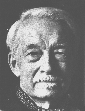

# Jacques Maritain

*Sweet, William*

**First published Fri Dec 5, 1997; substantive revision Wed May 1, 2019**

Jacques Maritain (1882–1973), French philosopher and political thinker, was one of the principal exponents of Thomism in the twentieth century and an influential interpreter of the thought of St Thomas Aquinas.

## 1. Life

Jacques Maritain was born on November 18, 1882 in Paris. The son of Paul Maritain, a prominent lawyer, and Geneviève Favre, daughter of the French statesman, Jules Favre, Jacques Maritain studied at the Lycée Henri IV (1898–99) and at the Sorbonne, where he prepared a *licence* in philosophy (1900–01) and in the natural sciences (1901–02). He was initially attracted to the philosophy of Spinoza.

In 1901, Maritain met Raïssa Oumansoff, a fellow student at the Sorbonne and the daughter of Russian Jewish immigrants. Both were struck by the spiritual aridity of French intellectual life and made a vow to commit suicide within a year should they not find some answer to the apparent meaninglessness of life. Largely at the suggestion of his friend, the poet and religious thinker Charles Péguy, Maritain attended lectures by Henri Bergson at the Collège de France (1903–04). Bergson’s challenges to the then-dominant positivism sufficed to lead Jacques and Raïssa to give up their thoughts of suicide, and they married in 1904. Soon thereafter, through the influence of the writer Léon Bloy, both Maritains, as well as Raïssa’s sister, Vera, sought baptism in the Roman Catholic Church (1906). (Vera would live with Jacques and Raïssa for the rest of her life.)

Maritain received his *agrégation* in philosophy in 1905 and, late in 1906, Jacques and Raïssa left for Heidelberg, where Jacques continued his studies in the natural sciences. They returned to France in the summer of 1908, and it was at this time that the Maritains explicitly abandoned *bergsonisme* and Jacques began an intensive study of the writings of Thomas Aquinas. Recent studies have argued that the influence of Bergson can nevertheless be found throughout Maritain’s writings (Nelson 2007; Gwozdz 2010)[^gwozdz-2010][^nelson-2007]

In 1912, Maritain became professor of philosophy at the Lycée Stanislaus, though he also gave courses at the Institut Catholique de Paris. He was named Assistant Professor at the Institut Catholique (attached to the Chair of the History of Modern Philosophy) in 1914. He became full Professor in 1921 and, in 1928, was appointed to the Chair of Logic and Cosmology, which he held until 1939.

In his early philosophical work (e.g., “La science moderne et la raison”, 1910, and *La philosophie bergsonienne*, 1914), Maritain sought to defend Thomistic philosophy from its Bergsonian and secular opponents. Following brief service in the first world war, Maritain returned to teaching and research. The focus of his philosophical work continued to be the defense of Thomist and, more generally, Catholic thought (e.g., *Antimoderne* [1922], *Trois réformateurs: Luther, Descartes, Rousseau* [1925], and *Clairvoyance de Rome par les auteurs du ‘Pourquoi Rome a parlé’ (J. Maritain et D. Lallement)* [1929]), but Maritain also authored some introductory philosophical texts (e.g., *Éléments de philosophie* [2 volumes, 1920–23]) and his interests expanded to include aesthetics (e.g., *Art et scholastique*, 1920; 2ⁿᵈ ed. 1927).

By the late 1920s, Maritain’s attention began to turn to social issues. Although he had some contact with the Catholic social action movement, *Action Française*, he abandoned it in 1926 when it was condemned by Pope Pius XI for its nationalistic and anti-democratic tendencies. Nevertheless, encouraged through his friendships with the Russian philosopher Nicholas Berdiaev (beginning in 1924) and Emmanuel Mounier (from 1928), Maritain began to develop the principles of a liberal Christian humanism and defense of natural rights.

Maritain’s philosophical work came to be more eclectic, with the publication of books on Thomas Aquinas (1930), on religion and culture (1930), on Christian philosophy (1933), on Descartes (1932), on the philosophy of science and epistemology (*Distinguer pour unir; ou, les degrés du savoir*, 1932) and, perhaps most importantly, on political philosophy. Beginning in 1936, he produced a number of texts, including *Humanisme intégral* (1936), *De la justice politique* (1940), *Les droits de l’homme et la loi naturelle* (1942), *Christianisme et démocratie* (1943), *Principes d’une politique humaniste* (1944), *La personne et le bien commun* (1947), *Man and the State* (written in 1949, but published in 1951), and the posthumously published *La loi naturelle ou loi non-écrite* (based on lectures delivered in August 1950).

Maritain’s ideas were especially influential in Latin America and, largely as a result of the ‘liberal’ character of his political philosophy, he increasingly came under attack from both the left and the right, in France and abroad. Lectures in Latin America in 1936 led to him being named as a corresponding member of the Brazilian Academy of Letters, but also to being the object of a campaign of vilification in Chile as “a man of the left” (Compagnon 2003: 167)[^compagnon-2003].

From the early 1930s Maritain was an established figure in Catholic thought. He visited North and South America and, beginning in January 1933, came periodically to the Institute of Mediaeval Studies and to St Michael’s College in Toronto (Canada) to give courses of lectures. Following his lectures in Toronto at the beginning of 1940, he moved to New York. With the occupation of France by the German military in June 1940, the Maritains decided not to return to France; Jacques taught at Columbia University (1941–44) as well as at Princeton (1941–42).

While in the United States during the war, Maritain was active in the war effort, recording broadcasts destined for occupied France and contributing to the Voice of America. He continued to lecture and publish on a wide range of subjects—not only in political philosophy, but in aesthetics (e.g., *Art and Poetry*, 1943 [French original 1935]), philosophy of education, and metaphysics (*De Bergson à St Thomas d’Aquin*, 1944). Following the liberation of France in the summer of 1944, he was named French ambassador to the Holy See, serving until 1948, but was also a member of (and, for a time, Head) of the French delegation to UNESCO, and was importantly involved in the promotion and, indirectly, in the drafting of the United Nations Universal Declaration of Human Rights (1948).

In the spring of 1948, Maritain returned to Princeton as Professor of Philosophy; he also lectured at a number of American universities (particularly at the University of Notre Dame and the University of Chicago), but frequently returned to France to give short courses in philosophy—notably at ‘L’Eau vive’, in the town of Soisy, near Paris. During this time, in addition to his work in political philosophy (cf. above, as well as *Le philosophe dans la cité*, 1960), Maritain published on aesthetics (*Creative Intuition in Art and Poetry*, 1953), religion (*Approches de Dieu*, 1953), moral philosophy (*Neuf leçons sur les notions premières de la philosophie morale,* 1951; *La philosophie morale*, 1960), and the philosophy of history (*On the Philosophy of History*, 1957).

In 1952, at the age of seventy, Maritain retired from Princeton, but continued living and periodically lecturing there as Professor Emeritus. After the death of Raïssa’s sister Vera in Princeton in December, 1959, the Maritains returned to France. Following Raïssa’s death in November 1960, Jacques moved to Toulouse, where he decided to live with a religious order, the Little Brothers of Jesus. During this time he wrote a number of books, the best-known of which was *Le paysan de la Garonne* (a work sharply critical of post-Vatican Council reforms), published in late 1966. In 1970, he petitioned to join the order, and died in Toulouse on April 28, 1973. He is buried alongside Raïssa in Kolbsheim (Alsace) France.

## 2. General Background

Maritain saw himself as working in continuity with the thought of Thomas Aquinas, and his writings frequently contain quotations from and references to Aquinas’ texts. While his turn to Catholicism was largely due to personal reasons and to the influence of friends, his intellectual itinerary and his defense of Catholic thought and Thomistic philosophy were undoubtedly determined by events affecting his adopted church.

One such series of events was the attack on (principally Catholic) religious organisations by secular and humanist forces within the French state in the early twentieth century, culminating in a number of laws affecting the taxation and ownership of church property and the place of religion in public affairs. Another, at about the same time, were those reflecting the tensions within Catholicism—particularly in France—in reaction to theological modernism. The writings of George Tyrell in England and Ernest Renan and Alfred Loisy in France were condemned for such ‘errors’ as claiming that conscience is the primary source of religious truth and that all knowledge—including dogma—has a historical and contingent character, and so challenging the authoritative character of magisterial pronouncements. Further, the major philosophical traditions in France were seen as incompatible with Catholic theology. The dominant schools were the spiritualism or intuitionism of Bergson (which held that the emphasis in metaphysics on ‘being’ should be replaced by one on *durée* or pure change), the idealism of Léon Brunschvicg, the spiritualism of André Lalande, and the materialism of Edmond Goblot; each challenged claims that were seen as essential to Catholicism. Given this turmoil, there was a call for a defence of the philosophies and the theological teachings of the Catholic Church.

Maritain’s early writings, then, sought to address some of the concerns arising out of these events. Having been attracted initially to Spinoza’s idealism and, later, to Bergson’s vitalist intuitionism, he was able to come to the defense of Catholic thought with a knowledge of its critics that surpassed many of his contemporaries. Maritain rejected ‘modernity’—Cartesian and post-Cartesian thought—for what he saw as its emphasis on epistemology over metaphysics, and found an alternative in the ‘pre-modern’ views of Aquinas. Nevertheless, he saw that philosophy had to do more than merely repeat Thomas’ views, and he took it upon himself to develop some aspects of Thomistic philosophy to address the problems of the contemporary world. Thus, though the most profound inspiration for many of Maritain’s ideas was the work of Thomas Aquinas, his epistemology and aesthetics show also the influence of Christian mysticism, particularly that of St John of the Cross, and his social and political philosophy clearly reflects many of the ideals of European liberalism.

## 3. Principal Contributions

### 3.1 Metaphysics

Although Maritain did not produce a text that provided a comprehensive statement of his metaphysics, his major contributions to the area are found in *Sept leçons sur l’être et les premiers principes de la raison spéculative* (1934, *A Preface to Metaphysics: Seven Lectures on Being*), the *Court traité de l’existence et de l’existant* (1947, *Existence and the Existent*) , and *De Bergson à Thomas d’Aquin, essais de métaphysique et de morale* (1944). Discussion of his metaphysics are also found in other works, such as *Distinguer pour unir; ou, les degrés du savoir* (1932, *The Degrees of Knowledge*), *Science et sagesse* (1935, *Science and Wisdom*), *Ransoming the Time* (1941), and *Raison et raisons* (1948, *The Range of Reason*).

As one might expect, Maritain’s metaphysics follows in the tradition of Aquinas, but it is far from a restatement of Aquinas’s views. For Maritain, metaphysics in general is always in need of renewal and defense (see Dewan 2009)[^dewan-2009], and Maritain saw his task—and the task of Thomism in general—as being “to renovate” Aquinas’s thought, “a task whose novelty may well be greater than [Thomists] themselves realise” (*Preface to Metaphysics*, 1934 [1939: 12–13]).

Following Aquinas, Maritain holds that metaphysics deals with being as being (*ens inquantum ens*), i.e., it “investigates the first principles of things and their highest causes” (*Preface to Metaphysics*, 1934 [1939: 27]). And Maritain also holds that there are certain fundamental metaphysical questions to which Aquinas’s responses are largely correct, though they may not be complete as they stand. Maritain adopts, against John Duns Scotus, Aquinas’s general position on analogy, being, and on the need for analogical terms and concepts. Again, in answer to the problem of unity and plurality—e.g., how can a thing be individual and distinct and yet a member of a class of things of the same kind?—Maritain follows Aquinas: that we have to distinguish *what* a thing is (its nature or essence, which it shares with things of the same kind) from the fact *that* it is (i.e., that it has its own ‘act of existing’). When it comes to the analysis of the nature and the unity of sensible beings, including human beings, Maritain employs Aquinas’s distinction between the form and the matter of a thing; nature or essence reflects the form, whereas the individuality is determined by the matter.

Maritain’s distinctive contribution is not, however, to the details of Thomistic metaphysics, but to bringing it into relation with modern science and philosophy, and to explaining its foundations.

For Maritain, all human enquiry has ‘being’ as its object; being, in other words, is the formal object of the intellect (*Preface to Metaphysics*, 1934 [1939: 25]). But ‘being’ can be grasped in different ways, and Maritain distinguishes, for example, between sensible being (“the object first attained by the human intellect”) and being as being (which is the object of metaphysics). The way in which he does so distinguishes him from several of the other leading twentieth-century Thomists, such as Gilson and Fabro (Contat 2008)[^contat-2008]. It is because of this difference in object that Maritain distinguishes (as he notes in his epistemology and his philosophy of nature, discussed below) among the activities of the empirical scientist, the mathematician, the philosopher, the theologian, and the mystic.

Metaphysical enquiry—the enquiry into being as being—is, Maritain says, a mystery; being is, for example, something that is “pregnant with intelligibility” and too “pure for our intellect” (*Preface to Metaphysics*, 1934 [1939: 4]). Nevertheless, the mystery of being is an “intelligible mystery” (1934 [1939: 83]), and Maritain holds that, unless one does metaphysics, one cannot be a philosopher; “a philosopher is not a philosopher unless he is a metaphysician” (*Existence and the Existent*, 1947 [1948: 29]).

Philosophical reflection on being begins with the intuition of being, and Maritain insists that one needs this “eidetic” intuition for any genuine metaphysical knowledge to be possible. The intuition of being that lies at the root of metaphysical enquiry is not that of “the vague being of common sense” (see *Preface to Metaphysics*, 1934 [1939: 78]), but an “intellectual intuition” (*Existence and the Existent*, 1947 [1948: 28]) or grasp of “the act of existing”. (This emphasis by Maritain on the intuition of being goes beyond what we find in Aquinas—some have argued that it is altogether foreign to him [Wippel 2014, Knasas 1992][^knasas-1992][^wippel-2014]—and arguably reflects Bergson’s account of the intuition of duration. As noted earlier, some have argued that Maritain’s debt to Bergson overall is much greater than he himself held [Gwozdz 2010][^gwozdz-2010].)

This intuition of being

> is a perception direct and immediate …. It is a very simple sight, superior to any discursive reasoning or demonstration [… of] a reality which it touches and which takes hold of it; (*Preface to Metaphysics*, 1934 [1939: 50–51])

it is, Maritain says, an awareness of the reality of one’s being—one which is decisive and has a dominant character. This view of intuition is not, then, that of a hunch or quick insight; neither is it (Maritain continues) the same as Bergson’s. It has an intellectual character, is a grasp of something that is intelligible, and requires “a certain level of intellectual spirituality” (1934 [1939: 49]). Maritain claims that this intuition of being is something which escaped Kant (1934 [1939: 48]) and many subsequent philosophers until, perhaps, the arrival of the existentialists.

There are approaches that one may adopt in order to acquire this grasp or intuition, but there is no method that one may follow that definitely produces it. This grasp may, for example, be acquired by focusing on something real and then reflecting on what lies behind it. Thus, this “eidetic intuition” or “ideating visualisation” is one where we “look … reality … in the face”, in which “reality [is] stripped of its real existence outside the mind” and discloses “the conditions of … an existence of intelligibility in act” (*Preface to Metaphysics*, 1934 [1939: 58]). This metaphysical intuition is, then, an “ideating intuition” of things in the perspective of their “intelligible values”, rather than in terms of the actual conditions of their “contingence and singularity” (*Science and Wisdom*, 1935 [1940: 108]).

Also distinctive in Maritain’s account of metaphysics is the emphasis on “the act of existing”. It is because of this that Maritain has been called an ‘existentialist’; indeed, his *Existence and the Existent*, is subtitled “an essay on Christian existentialism”, and he describes his view as an “existential intellectualism” (*Existence and the Existent*, 1947 [1948: 70]). Maritain believes that such an emphasis is characteristic of any consistent Thomism;

> What distinguishes authentic Thomism … is precisely the primacy which [it] accords to existence and the intuition of existential being. (1947 [1948: 12])

This ‘existentialism’, however, is quite distinct from the existentialisms of Kierkegaard, Gabriel Marcel, or Jean-Paul Sartre. An “authentic existentialism”, Maritain writes,

> affirm[s] the primacy of existence, but as implying and preserving essences or natures, and as manifesting the supreme victory of the intellect and intelligibility. (1947 [1948: 13])

It stands against the position of his contemporaries who abandoned talk of natures or essences or of their intelligibility, but also against those who imagine that essences were created and then came to exist. (For Maritain, essences do not preexist existence; essences might be better seen as “capacities to exist” [1947 [1948: 34]].)

As one has the intuition of being and pursues this investigation into being, one is led into the traditional questions of metaphysics and natural theology. There are, Maritain holds, four basic principles of metaphysics: the principles of identity, of sufficient reason, of efficient causality, and of finality (i.e., every agent acts for an end). Though the truth or the applicability of these principles does not admit of direct proof, they are consistently confirmed by experience and, Maritain holds, cannot be denied without contradiction (*Preface to Metaphysics*, 1934 [1939: 90]).

Metaphysics, then, properly includes an investigation into the *cause* of being—i.e., God, in whom the act of existing is subsistent. Some sympathetic scholars (e.g., Yves Floucat) have nevertheless questioned whether Maritain ultimately had a consistent, Thomistic view of what was the core of metaphysics (Floucat 1996)[^floucat-1996]. In any case, since Maritain holds that being is something that is grasped through intuition, one is not surprised to see that he will argue that one can attain knowledge of the existence of God not only through the Thomistic five ways, but also through intuition. (This is discussed in section 3.4, ‘Natural Theology and Philosophy of Religion’, below.)

### 3.2 Epistemology

Maritain’s primary work in epistemology is *Distinguer pour unir; ou, les degrés du savoir* (1932, *Distinguish to Unite: or, The Degrees of Knowledge*), though some see Maritain’s 1936 essay, “Science et philosophie” (in *Quatre essais sur l’esprit*, 1939), in which Maritain addresses arguments of the Vienna Circle, as completing his account of knowledge (Malquori 2009)[^malquori-2009]. One also finds a number of important essays on the topic in *Raison et raisons, essais détachés* (1948, *The Range of Reason*). Maritain, again, largely follows the realist view of Thomas Aquinas—though he was significantly influenced by John of St Thomas (John Poinsot), St John of the Cross, and St Augustine, and the structure of *Les degrés du savoir* is similar to the procedure traced in the *Itinerarium mentis in Deum* [*Journey of the Soul into God*, 1259 [1938, 2002] of St Bonaventure.

Against ‘modern philosophy’, Maritain insisted on the priority of metaphysics over epistemology—in fact, he held that “the critique of knowledge is part of metaphysics” (*The Range of Reason*, 1948 [1952: 25])—and also maintained that the structure and method of the various sciences were determined by the nature of the object to be known.

Maritain called his view “critical realism”, and argued particularly against the then-dominant rationalist and empiricist accounts of knowledge. He maintained that, despite the differences among them, Kantianism, idealism, pragmatism, and positivism all reflected the influence of nominalism—that universal notions are creations of the human mind and have no foundation in reality. Maritain’s critical realism holds that what the mind knows is identical with what exists. To know a thing is for its ‘essence’ to exist immaterially in the mind. This is not to say that the mind mirrors or copies that which it knows, but that, in virtue of the properties apprehended, it ‘becomes’ the things it knows. Maritain held that our knowledge of reality was through the ‘concept’—the *esse intentionale*—which was immaterial and universal, though the concept itself was something known only by reflection. Thus, when it comes to knowledge of sensible objects, for example, the mind has both a passive role (receiving sense impressions) and an active one (constructing knowledge from these impressions) (see Deely 1997, Munoz 2012)[^deely-1997].

Maritain’s epistemology sought to explain the nature of knowledge found not just in science and philosophy, but in religious faith and mysticism, and one of his aims was to show the different ‘kinds’ of knowledge and their relations to one another. He argued that there were different ‘orders’ of knowledge and, within them, different ‘degrees’ determined by the nature of the object to be known and the ‘degree of abstraction’ involved.

First, in the order of rational knowledge, one can speak of the knowledge of sensible nature (i.e., of the objects of experimental science), which is different from the knowledge of mathematics or of ‘physico-mathematical’ objects (which is limited because its objects do not have a direct relation to the actual), which is, in turn, distinct from the knowledge of trans-sensible or metaphysical nature.

These ‘degrees of knowledge’ are not, however, independent of one another, and they have in common the requirement that to know something is to know *why* it is

> the mind is not satisfied when it merely attains a thing […], but only when it grasps that upon which that datum is founded in being and intelligibility. (*Degrees of Knowledge*, 1932 [1959: 23])

For example, natural science, which is based on sense perception, aims at formulating laws which reflect certain features of the objects perceived. The scientist, then, is primarily concerned with looking for regularities in nature, employing what Maritain calls an “empiriological” approach (see *Degrees of Knowledge*, 1932 [1959: 178–180]; *Philosophy of Nature*, 1935 [1951: 49]). (An empiriological analysis is a non-philosophical and, specifically, non-ontological approach to understanding natural beings that does not seek to know them “in terms of their type of being or reality”, but only “in terms of their empirical manifestations” (Carlson 2012: 37)[^carlson-2012]. Such an analysis does not provide knowledge of the essence of natural beings. Maritain offers mathematical physics as an illustration of this approach.) The product of this method is what Maritain calls “perinoetical” knowledge.

But for natural science to achieve the status of a science, it presupposes the capacity of human beings to know things apart from their particular individuating characteristics (though not apart from the existence of matter), i.e., natural philosophy. Natural philosophy ‘gets behind’ phenomena in order to discover essential connections and causes. Thus, from that which is presented in sense perception, the mind constructs an object (the essence) which is universal. (This is possible because, Maritain maintains, there are essences or natures of things.) This process of ‘thinking through’ to the nature of the thing is called by Maritain *dianoetical* knowledge. So, while natural science and natural philosophy both focus on the physical, the natural philosopher—unlike the scientist—is concerned with the essence of the object and its definition (or, at the very least, an account of its various properties). This is knowledge at the level of the first ‘degree of abstraction’.

Physico-mathematical objects (e.g., quantity, number, and extension) stand at a second ‘degree’ of abstraction. While they cannot exist without the existence of material things, once known, they can be conceived of without any reference to such objects. Finally, metaphysical or speculative knowledge deals with objects existing at a third degree of abstraction (i.e., independently of matter), such as substance, quality, goodness, and the divine. Because of the nature of the objects of metaphysics, this latter kind of knowledge does not involve logical inference as much as reasoning by analogy or what Maritain calls *ananoetic* knowledge. Such knowledge (e.g., of the divine) is not through any direct apprehension, but indirectly, through creatures.

There is a hierarchy among these ‘degrees of knowledge’. Those objects which are highest in intelligibility, immateriality, and potential to be known are the objects of the highest degree of knowledge. Maritain writes,

> [t]he metaphysician considers an object of knowing of a specifically higher nature and intelligibility, and from it he acquires a proper knowledge, a scientific knowledge, by means that absolutely transcend those of the physicist or the mathematician. (*Degrees of Knowledge*, 1932 [1959: 37])

Nevertheless, while there are different ‘orders’ and ‘degrees’ of knowledge, one should not conclude that there are different ‘knowledges’.

Maritain points out that philosophical demonstration is different from natural scientific or mathematical demonstrations:

> philosophy is concerned with an objectively distinct field of knowledge and constitutes a really autonomous discipline, possessing its own adequate means of explaining this field of knowledge. (*Range of Reason*, 1948 [1952: 5])

Thus, Maritain writes, natural philosophy penetrates to the nature of its object. Metaphysics—which is also a kind of philosophic knowing—is concerned with purely intelligible being. Science, however, is at best ‘empiriological’—it does not lead us to being itself, but only to the observable and measurable. Consequently, to employ a method of scientific demonstration to establish or to criticize claims about the object of metaphysical knowledge is, to use Ryle’s classic term, a category mistake. It is precisely because he holds that empiricist and rationalist epistemologies do this, that Maritain takes issue with them.

Just as there is an order of rational knowledge with its ‘degrees’, there is another order and degrees of suprarational knowledge—of a higher wisdom—that is beyond ‘natural knowledge’. These are, on the one hand, ‘the science of revealed mysteries’ or ‘theological wisdom’ and, on the other, ‘mystical theology’. Here, Maritain’s debt to Augustine and John of the Cross is particularly evident (see Barreiro 2008). According to Maritain, in theological wisdom, the divine is known by drawing not just on reason but on faith. (This is distinct from metaphysical knowledge which, so to speak, approaches the divine from the ‘outside’.) Mystical knowledge stands one level higher still—where there is no mediation by concepts—and “consists in knowing […] Deity as such—*according to a mode that is suprahuman and supernatural*” (*The Degrees of Knowledge*, 1932 [1959: 253]). This is a knowledge by connaturality, but also a knowledge that can be pursued through the practical discipline of ‘mystical contemplation’. In this way, human beings acquire a kind of knowledge that makes them more loving and more spiritual. (It is worth noting that, for Maritain, this mysticism extended beyond the Christian tradition. Not only did he refer to the example of Ramanuja, but he encouraged the future Indologist Olivier Lacombe to direct his “philosophical work towards the study of Indian mysticism” [Lardinois 2017: 314].)[^lardinois-2017]

The development of the notion of ‘knowledge by connaturality’ (or ‘connatural knowledge’ or ‘knowledge by inclination’), latent in Aquinas (*Summa theologiae*, II-II, q. 45, a 2), is one of Maritain’s major contributions to epistemology. Maritain places this knowledge at the level of the preconscious intellect. It is “non-conceptual and non-rational”, (*Natural Law*, 2001: 18); he describes it as

> obscure, unsystematic, vital knowledge, by means of instinct or sympathy, and in which the intellect, in order to make its judgments, consults the inner leanings of the subject. (*Man and the State*, 1951: 91)

Nor is it, as much knowledge is, a knowledge of essences. Nevertheless, it is still connected to “intellectual act” and is a genuine knowledge of reality. This kind of knowledge lies at the basis, not only of mystical experience, but of artistic activity and morality; it provides a knowledge of God, of the first principles of morality, and a knowledge of one’s own subjectivity.

A number of questions have been raised concerning Maritain’s epistemology, particularly concerning his characterization of philosophical knowledge. Moreover, while Maritain claims that there is a difference in method between the sciences and philosophy, some have argued that it is not clear what exactly that difference is (Vitoria 2011)[^vitoria-2011]. For example, Maritain would follow Aquinas in holding that metaphysics uses *demonstratio quia*—demonstration from effects. But it would seem that science also sometimes uses such a method of demonstration. Thus, it is not clear what it is in the *method* (as distinct from the content of the premises) that differentiates a metaphysical proof (e.g., of God’s existence) from a scientific argument establishing the existence of a cause of a natural object.

Second, Maritain holds that scientific knowledge is distinguished from philosophical knowledge in terms of their different methods and different objects. But if scientific knowledge and philosophical knowledge are, as it were, incommensurable, it is not clear how philosophy can judge, or be corrective of, the sciences.

Some Thomist scholars have been reluctant to adopt Maritain’s development of Aquinas’ notion of ‘knowledge by connaturality’, preferring instead to speak of “knowledge relative to inclination” (Dewan 2010)[^dewan-2010]. Yet others have argued that this development is of far-reaching significance, as Maritain’s notion of the intuition of being led him, in the years following the publication of *The Degrees of Knowledge*, to recognise a greater role to be played by “the unconscious and preconscious life of the mind” (*The Range of Reason*, 1948 [1952: 80]; Arraj 2006)[^arraj-2006].

Finally, it would seem that the model of demonstration that Maritain employs is foundationalist and, thus, has to answer to those criticisms that modern anti-foundationalism draws attention to—e.g., that a foundationalist theory sets a standard for knowledge that is not only without justification, but is a standard that it cannot itself satisfy. Some defences of Thomistic epistemology (e.g., Veatch 1990)[^veatch-1990], however, suggest ways in which such a concern might be addressed.

### 3.3 Philosophy of Nature

Maritain’s work in the philosophy of nature appears throughout his work—in his *Éléments de philosophie* (Vol. 1, 1920, *Introduction to Philosophy*) and in an essay in *Science et sagesse* (1935, *Science and Wisdom*), but particularly in *Les degrés du savoir* (1932, *The Degrees of Knowledge*) and *La philosophie de la nature* (1935, *The Philosophy of Nature*). Again, Maritain’s account is based on Aristotle, Aquinas, and John Poinsot, though he clearly extends his predecessors’ views.

As noted earlier, Maritain’s early education and university studies were in the natural sciences. His disillusionment with the positivistic approach to the sciences taken by his teachers in Paris, and his interest (following his conversion) in bringing Thomistic philosophy to bear on the contemporary world led him to review the relation between philosophy and the sciences and, particularly, to develop a philosophy of nature.

For Maritain, the philosophy of nature is a branch of speculative philosophy. It seeks to provide an ontological analysis of corporeal, sensible ‘moving being’ (*ens mobile*); specifically, it involves a search for the first principles of physical things—i.e., principles that transcend sense. It is concerned with, then,

> a knowledge whose object, present in all things of corporeal nature, is mobile being as such and the ontological principles which account for its mutability. (*Degrees of Knowledge*, 1932 [1959: 197])

Among the—and at the summit of—natural objects is humanity, and thus psychology is the highest category of the philosophy of nature.

The philosophy of nature lies, therefore, between the sciences and metaphysics; it is to be distinguished from metaphysics, which deals with all being qua being, but also from the (empiriological) sciences, which deal with sensible being qua observable or measurable. Because it seeks principles that underlie all physical objects, it follows from reflections on and goes beyond science; because it still refers to such objects and acknowledges that its conclusions need to be consistent with verification by the senses, however, it is not metaphysics.

According to Maritain, the investigations of natural science fall short of a philosophy of nature because the objective of a philosophy of nature is not merely to reflect on the methods and conclusions of the physical sciences, but to provide the underlying principles. Moreover, the philosophy of nature understands that reality is not reducible to the physical (physical reality). It focuses on the essences of things and the (natural) classes to which those things belong.

Maritain’s account supposes that there is a metaphysical and epistemological hierarchy: of sensible, observable things as known through the senses, to “the intelligible necessities immersed in the reality of this world of existence” which are known through the intellect disengaged from the senses (*Degrees of Knowledge*, 1932 [1959: 145]), to the “universe of quantity as such” (mathematics), to metaphysics and, ultimately, to mystical experience (see 1932 [1959: 145–6]). The levels in this hierarchy are determined, then, by how and the extent to which what is known is abstracted from matter. The philosophy of nature, then, is a deductive science that lies at the first level of abstraction. It is close to metaphysics in that it addresses general issues concerning the universe, such as its relation to principles of necessity and contingency, and to a first cause. But it also needs to be completed by a knowledge of the natural sciences, and so is at the same level of abstraction.

What are the principles that such an approach seeks? The philosophy of nature is specifically concerned with the nature of movement, of corporeal substance (i.e., matter and form), of life, and of the constitutive principles of organisms. Maritain writes,

> it belongs to the philosophy of nature to instruct us about the nature of the continuum and of number, of quantity, of space, of motion, of time, of corporeal substance, of transitive action, of vegetative and sensitive life, of the soul and its operative powers, etc. (1932 [1959: 186])

and so is at the same level of abstraction as the natural sciences.

Maritain’s position here contrasts sharply with that of his colleague, Etienne Gilson, who was more favourable to Bergson and who wrote little on the philosophy of nature throughout his life, arguably because he believed that the underlying Aristotelianism of the Thomistic position had been rendered irrelevant by modern science (Nelson 2007)[^nelson-2007]. Even sympathetic critics, such as Gerald McCool, argue that Maritain’s account of the three different degrees of abstraction that underlie this view is a distortion of Aquinas’s own view (McCool 1989: 254)[^mccool-1989]. More ardent critics have objected to Maritain’s account of what he calls ‘positivism’, and some, such as George Boas, argued at the time that Maritain depends on a theory of the existence of natural classes that have essences—a philosophical theory which may not, in fact, be presupposed by most scientists (Boas 1952)[^boas-1952]. (Maritain, of course, would reply that this is precisely his point; such essences are not the object of empiriological sciences.)

### 3.4 Natural Theology and Philosophy of Religion

Like Aquinas, Maritain held that there was no conflict between true faith and true reason, that religious belief was open to rational discussion, and that the existence of God and certain fundamental religious beliefs could be philosophically demonstrated. (Maritain held, however, that ‘Russellian mathematical logic’ was “inferior to traditional Aristotelian logic”, and that any demonstration of religious belief needed to follow Aristotelian syllogistic; *Introduction to Logic*, 1923 [1937a: 222–232]; Kraal 2013: 357.)[^kraal-2013] Religious belief, then, was not an attitude or a matter of private opinion—an option that could be embraced or not according to one’s private preferences; it was a matter of ‘truth’. For Maritain, one must choose between “the true God or radical irrationality” (*Introduction to Philosophy*, 1920 [1944: 259]).

Maritain held that philosophy was an *ancilla theologiae* (“handmaid of theology”), and that philosophy, under the rubric of metaphysical knowledge, allows for the demonstration of a number of basic religious beliefs. Like Aquinas, Maritain accepted the classical foundationalist position that these beliefs could be established by rational deduction from self-evident principles and constituted genuine knowledge. Specifically, he held that, by the use of natural reason, one can come to know certain truths about God, and that the ‘five ways’ of Thomas Aquinas provided sure knowledge of God’s existence. But Maritain also argued that there could be other ‘proofs’ of the existence of the divine and, in *Approches de Dieu* (1953), he developed what he called a “sixth way”.

There is, Maritain writes, an intuition that is awakened in persons when they are engaged in thought—that is, that it seems impossible that they, as thinking beings, should at some time have not been. As a thinking being, one seems to be free from the vicissitudes of time and space; there is no coming to be or ceasing to be—I cannot think what it is not to be. Nevertheless, we all know very well that we were born—we came into existence. We are confronted, then, with a contradiction—not a logical contradiction, but a lived contradiction. The only solution to this is that one has always existed, but not through oneself, but within “a Being of transcendent personality” and from whom “the self which is thinking now proceeded into temporal existence” (*Approches de Dieu*, in *Oeuvres complètes*, Vol. X, p. 64 [Engl. tr., pp. 71–72]). This being

> must contain all things in itself in an eminent mode and be itself—in an absolutely transcendent way—being, thought and personality. This implies that the first existence is the infinite plenitude of being, separate by essence from all diversity of existents. (*ibid.*, p. 66 [Engl. tr., p. 74])

Maritain also acknowledges the possibility of a natural, pre-philosophical, but still rational knowledge of God (see *Approches de Dieu*, pp. 13–22). This is, Maritain claims, a ‘knowledge’ that is necessary to—and, in fact leads to—a philosophical demonstration of God’s existence. (In this way, then, one can know that some religious beliefs are true, even without being able to demonstrate them.) Maritain’s argument, which resembles the Thomistic argument from contingent being, is that, in one’s intuition of being, one is aware, first, of a reality separate from oneself; second, of oneself as finite and limited; and, third, of the necessity that there is something “completely free from nothingness and death” (*ibid.*, p. 15 [Engl. tr., p. 19]). This is concurrent with a “spontaneous reasoning” that follows the same course to the conclusion that there is

> another Whole […] another Being, transcendent and self-sufficient and unknown in itself and activating all beings […] that is, self-subsisting Being, Being existing through itself. (*ibid.*, p. 16 [Engl. tr., p. 20])

This knowledge of God, Maritain admits, is not demonstrative but is, nevertheless, “rich in certitude” (*ibid.*, p. 19 [Engl. tr., p. 23]) and is both presupposed by, and is the underlying force for, philosophical demonstrations of God’s existence.

The difference between the pre-philosophical and the philosophical knowledge of God is that the latter is one which is based on a “scientific demonstration” (*Approches de Dieu*, p. 19 [Engl. tr., p. 23])—on empirical facts—and involving analogy, from which we have terms that can be properly predicated of the divine. On the other hand, pre-philosophical knowledge is “intuition”—an *approach* to knowledge, though not a “way”, (*ibid.*, p. 20 [Engl. tr., p. 24]) a proof, or a demonstration. This knowledge is based on a natural reasoning which cannot be expressed in words. Yet, it is important also to realize that while Maritain allows that certain truths “are grasped by the common sense before being the object of philosophical concern” (*ibid.*, p. 24 [Engl. tr., p. 30]), philosophical proofs of the existence of God are not only “established and justified philosophically” at the level of philosophy itself, but are already “valid and efficacious” at the level of this “incohative and spontaneous” philosophy. (*ibid.*, p. 24 [Engl. tr., p. 30]), and that what one arrives at by means of such an approach is (as it is in philosophical demonstrations) knowledge of the truth of a proposition.

It has been argued, however, that there are some difficulties with Maritain’s position here. For example, even if it is true that people may ‘naturally’ affirm the proposition that there is a God, it is not obvious how they can claim that they *know* it. In other words, even if the proposition is true, it is not clear how we can say that we know or believe it to be true. What Maritain seems to give us here is an explanation of how one arrives at a certain proposition and of one’s certainty, but nothing more. But, since the state of certainty of an individual is not the same as the assertion that that person knows something to be true, it is not clear that the pre-philosophical approach provides one with an adequate basis to say that a religious belief is true, only that one is convinced of it. And, one might argue, parallel conclusions can be drawn if one examines the other ways that Maritain suggests will lead to a putative knowledge of God.

(Interestingly, Maritain was a critic of a number of arguments proposed in defence of religious belief. He argued that such defenses fail because they do not recognise that there are different types of knowledge, that these different types are hierarchically arranged, and that the methods they employ are, by definition, unsuited to demonstrate certain things. Thus, Maritain holds that while ‘reason’, as “intelligence moving in a progressive way towards its term, the real”, can attain knowledge of God by means of demonstration, if we take ‘reason’ to be a purely discursive method—one which Maritain identifies with the “physical-mathematical sciences” and which he also calls “the ‘reason’ of rationalism” (*Antimoderne*, 1922: 64, my translation)—it can know or say nothing at all about God. Because reason must be ordered to its object, reason (in this second sense) can neither demonstrate nor even encounter revealed truths.)

In addition to the possibility of the demonstration of the existence of God and of the coherence of the divine attributes, Maritain allows that there are a number of other ways in which one might come to know religious beliefs to be true. Besides knowing God ‘naturally’, there is a “non-conscious knowledge of God” in the first act of human freedom (see *Range of Reason*, 1948 [1952: 69–71]), “connatural knowledge”, “abstract intuition” (by which one knows “primary principles” such as the laws of identity and of non-contradiction and the principle of causality), the “ways of the practical intellect” (i.e., through moral or aesthetic experience—though these do not provide a strict demonstration; see *Approches de Dieu*, ch. IV) and, of course, divine revelation.

For Maritain, to say that one can attain, by reason, some knowledge of God is not to say that everyone can do this. Moreover, Maritain also held that it can be reasonable to believe, even in the absence of such arguments or evidence, though what one believes must not contradict the results of ‘true reason’. For example, Maritain argues that, even if one holds that a belief is capable of a rational demonstration, it does not follow that one must be able to provide it; thus, one’s knowledge of ‘revealed truths’ is reasonable, though Maritain (like Aquinas) would never claim that one must be able to produce a philosophical demonstration of them. Further, Maritain allows that theology can “reject as false any philosophic affirmation which contradicts a theological truth” (*Introduction to Philosophy*, 1920 [1944: 126]).

Maritain writes that there can be knowledge of the divine attributes. As with all natural knowledge of the divine, this knowledge is basically analogical, and it is often the result of a *via negativa*. Thus, he insists that we know some things about God. We can know that God is (*quia est*), though not what God is in himself (*quid est*) (*Degrees of Knowledge*, Appendix III, 1932 [1959: 423]). Moreover, against A.G. Sertillanges and Etienne Gilson, Maritain maintains that we can have affirmative knowledge about God—i.e., know in a more or less imperfect but, nevertheless, true way what God is. Besides, Maritain holds, knowledge through negation presupposes positive knowledge. (Mary Daly notes, however, that Maritain is not clear about the extent to which our affirmative knowledge of God is arrived at by means of philosophical argument [Daly 1966: 53.].)[^daly-1966] Nevertheless, Maritain acknowledges that the knowledge of God that philosophy provides is incomplete and imperfect; the *analogical* knowledge that we have of God falls short of a complete description of what God is.

It is not clear that Maritain avoids many of the concerns expressed by critics of ‘analogical knowledge’. For example, if the term ‘cause’ is used analogously when applied to God, then when one utters the proposition ‘God is the cause of the universe’ after examining Aquinas’s ‘second way’, it would seem that one has to be using this term in exactly the same sense as it has been used throughout the preceding argument. If it is not being used in exactly the same sense, then how can one claim that Aquinas has *demonstrated* this conclusion? The problem is not whether analogical predication is possible but, first, whether one can understand the analogical predicate and, second, whether one can employ such a predicate in a demonstration without committing the fallacy of equivocation.

Given Maritain’s account of faith and of suprarational knowledge, it would seem that he would see religious beliefs as ‘trusts’ and, hence, as having more than a purely cognitive character. He would, no doubt, follow Aquinas who spoke of faith as a ‘disposition’ or virtue (*habitus*). A *habitus* is, of course, not merely the product of action, but itself is ordered to action. Thus, to say that religious beliefs are propositional in form is not to say that their function is only descriptive. Nevertheless, Maritain’s account of religious belief and its relation to argument and proof is not complete. Moreover, given that Maritain does employ ‘foundationalism’ as a standard of sufficient evidence for claiming that some propositions expressing religious belief are true, as noted above, there is some debate whether he can directly address the challenges of ‘postmodern’ critics of foundationalist epistemology.

### 3.5 Moral and Political Philosophy and Philosophy of Law

Maritain’s moral and political philosophy lies within what may be called the Aristotelian-Thomistic natural law tradition. Maritain held, however, that Aristotelian ethics, by itself, was inadequate because it lacked knowledge of humanity’s ultimate end. The Thomistic view—that there is a law in human nature that is derivative of (though knowable separately from) a divine or eternal law, and that humanity’s ‘end’ goes beyond anything attainable in this life—was, Maritain thought, a significant advance on what Aristotle had provided.

Following Aquinas, Maritain maintained that there is a natural law that is “unwritten” but immanent in nature. Specifically, given that nature has a teleological character, one can know what a thing should do or how it should be used by examining its “end” and the “normality of its functioning”. Maritain therefore defines ‘natural law’ as

> an order or a disposition that the human reason may discover and according to which the human will must act to accord itself with the necessary ends of the human being. (*La loi naturelle*, 1986: 21, my translation; see *Man and the State*, 1951: 86)

This law “prescribes our most fundamental duties” (*Man and the State*, 1951: 95) and is coextensive with morality.

There is, Maritain holds, a single natural law governing all beings with a human nature. The first principles of this law are known *connaturally*, not rationally or through concepts, by an activity that Maritain, following Aquinas, called *synderesis*. Thus, natural law is ‘natural’ because it not only reflects human nature, but is known naturally. Maritain acknowledges, however, that knowledge of the natural law varies throughout humanity and according to individuals’ capacities and abilities, and he speaks of growth in an individual’s or a collectivity’s moral awareness. This allows him to reply to the challenge that there cannot be a universal, natural law because no such law is known or respected universally. Again, though this law is progressively known, it is never known completely, and so the natural law is never exhausted in any particular articulation of it (*La loi naturelle*, see Sweet 1998)[^sweet-1998]. This recognition of the historical element in human consciousness did not, however, prevent Maritain from holding that this law is objective and binding. (Critics have argued, however, that to speak of ‘connatural knowledge’ is obscure; it is quite unlike what we ordinarily call ‘knowledge’ and is, therefore, inadequate as a basis for knowledge of law. [see, for example, Nielsen 1959 [1991].)[^nielsen-1959]

A key notion in Maritain’s moral philosophy is that of human freedom. He says that the ‘end’ of humanity is to be free but, by ‘freedom’, he does not mean license or pure rational autonomy, but the realisation of the human person in accord with his or her nature—specifically, the achievement of moral and spiritual perfection. Maritain’s moral philosophy, then, cannot be considered independently of his analysis of human nature. Maritain distinguishes between the human being as an individual and as a person. Human beings are ‘individuals’ who are related to a common, social order of which they are parts. But they are also persons. The person is a ‘whole’, is an object of dignity, “must be treated as an end” (*Les droits de l’homme*, 1942 [1943: 84]), and has a transcendent destiny. In both the material and the spiritual order, however, human beings participate in a common good (see D’Souza 2011)[^d’souza-2011]. One is an individual in virtue of being a material being; one is a person so far as one is capable of intellectual activity and freedom. Still, while distinct, both elements are equally necessary to being a human being. It is in virtue of their individuality that human beings have obligations to the social order, but it is in virtue of their personality that they cannot be subordinated to that order. Moreover, it is through free choice and action that a person defines himself (see Toromczak 2008). Maritain’s emphasis on the value of the human person has been described as a form of *personalism*, which he saw as a *via media* between individualism and socialism.

Though some critics have challenged Maritain’s distinction between the person and the individual as, for example, lacking metaphysical rigour (Floucat 1996)[^floucat-1996], many Maritain scholars regard it as a useful way of founding a liberal, but non-individualist political philosophy (D’Souza 2008)[^d’souza-2008] or grounding an applied ethics (Acevedo 2012)[^acevedo-2012].

Maritain’s moral philosophy is clearly related to his political philosophy and his philosophy of law. The personalist position that he defended had antecedents in the nineteenth century, but it was perhaps the first to be part of an account of a new model of civilization (De Tavernier 2009). In one of his earliest political works, Maritain described his view as “integral Christian Humanism”—‘integral’, because it considers the human being, an entity that has both material and spiritual dimensions, as a unified whole and because it sees human beings in society as participants in a common good. The object of Maritain’s political philosophy was to outline the conditions necessary to making the individual fully human. His integral humanism, then, seeks to bring the different dimensions of the human person together, without ignoring or diminishing the value of either, and it has been regarded by some as superior to Charles Taylor’s “exclusive humanism” (Klassen 2011)[^klassen-2011] or, at least, as a completion of it (Doyle 2009)[^doyle-2009]. While one’s private good as an individual is subordinate to the (temporal) common good of the community, as a person with a supernatural end, one’s ‘spiritual good’ is superior to society—and this is something that Maritain believed all political communities should recognize.

For Maritain, the best political order is one which recognizes the sovereignty of God. He rejects, therefore, not only fascism and communism, but all secular humanisms. Maritain objects that such views—particularly fascism and communism—are not only secular religions, but dehumanizing (Kinsella 2012)[^kinsella-2012] and, while he was a defender of American-style democracy, he is clearly not interested in combining his attachment to Christianity with capitalism. A theocentric humanism, Maritain would argue, has its philosophical foundation in the recognition of the nature of the human person as a spiritual and material being—a being that has a relation to God—and social and political institutions must therefore reflect this.

Maritain envisages a political society under the rule of law—and he distinguishes four types of law: the eternal, the natural, the ‘common law of civilisation’ (*droit des gens* or *jus gentium*), and the positive (*droit positif*).

The natural law is “universal and invariable” and deals with “the rights and duties which follow [necessarily] from the first principle” (see *La loi naturelle*; *Man and the State*, 1951: 97–98) or precept of law—that good is to be done and evil avoided. Nevertheless, while the natural law is “self-evident” (see *Man and the State*, 1951: 90) and consistent with and confirmed by experience—something which many critics have challenged—Maritain holds that it is not founded on human nature. It is rooted in divine reason and in a transcendent order (i.e., in the eternal law), and is ‘written into’ human nature by God. At times, Maritain appears to hold that natural law acquires its obligatory character only because of its relation to the eternal law; he writes that “natural law is law only because it is participation in Eternal Law” (see *Man and the State*, 1951: 96). (Some have concluded—perhaps too hastily—that a theory that refers to an Eternal Law must be ultimately theological and cannot be purely philosophical.)

The *droit des gens* or ‘common law of civilisation’ is an extension of the natural law to the circumstances of life in society, and thus it is concerned with human beings as social beings (e.g., as citizens or as members of families). The ‘positive law’ is the system of rules and regulations involved in assuring general order within a particular society. It varies according to the stage of social or economic development within that community and according to the specific activities of individuals within it. Neither the positive law nor the *droit des gens* is, however, deducible from the natural law alone. Neither is known connaturally and, therefore, is not part of the natural law. Nevertheless, it is in virtue of their relation to natural law that they “have the force of law and impose themselves on conscience” (*Les droits de l’homme*, 1942 [1943: 90–1]). When a positive law acts against the natural law, it is, strictly speaking, not a law. Thus, Maritain clearly rejects legal positivism.

The term ‘natural law’ and its relations both to ‘eternal law’ and to positive law have, however, been the focus of much controversy. Maritain’s account of natural law both presupposes a metaphysical view of the nature of human beings and a realistic epistemology, and critics have argued that there are a number of tensions or inconsistencies internal to it. Some of the principal criticisms of this account are i) that it is inconsistent because it sets forth a naturalistic theory of what is good and bad and yet claims that only a supernatural sanction will serve to explain moral obligation, ii) that connatural knowledge is not only inadequate for what we normally count as knowledge, but it is, in fact, also incapable of establishing that something is a natural moral law, iii) that the first principle of moral law is vacuous, and iv) that Maritain glosses over the fact/value distinction.

Maritain held that natural law theory entailed an account of human rights. Since the natural end of each person is to achieve moral and spiritual perfection, it is necessary to have the means to do so, i.e., to have rights which, since they serve to realise his or her nature, are called ‘natural’. This respects the Aristotelian-Thomistic principle of justice, that we should distribute to each ‘what is truly his or hers’. Maritain replies to the criticism that there are no such rights, since they are not universally recognised, by reminding his readers that, just as the natural law comes to be recognised gradually and over time, so also is there a gradual recognition of rights. Indeed, Maritain held that certain basic natural rights can be recognised by all, without there having to be agreement on their foundation and, as an illustration of this, he pointed to the general agreement on those rights found in the 1948 United Nations Universal Declaration of Human Rights. Nevertheless, he did insist that an adequate account of human rights required a foundation in natural law (see *Man and the State*, 1951: Ch. IV)—a position rejected by many authors in the Anglo-American tradition, such as Rawls (Clark 2012)[^clark-2012].

Maritain held that natural rights are fundamental and inalienable, and antecedent in nature, and superior, to society. Still, they should not be understood as ‘antecedent’ in a temporal sense and do not form the basis of the state or of the civil law. Rights are grounded in the natural law, and specifically in relation to the common good. It is this good, and not individual rights, that is the basis of the state, and it is because of this that Maritain held that there can be a hierarchical ordering of these rights (*Man and the State*, 1951: 106–7).

One consequence of his natural law and natural rights theory is that Maritain favoured a democratic and liberal view of the state, and argued for a political society that is both personalist, pluralist, and Christianly-inspired. He held that the authority to rule derives from the people—for people have a natural right to govern themselves. Still, this is consistent with a commitment to Christianity, Maritain thought, because the ideals of democracy are themselves inspired by a belief in God’s rule, and that the primary source of all authority is God (*Man and the State*, 1951: 127).

Maritain also favoured a number of liberal ideals, and the list of rights that he recognises extends significantly beyond that found in many liberal theories, and includes the rights of workers as well as those of the human and the civic person. He was, in particular, a defender of freedom of conscience—and not simply freedom of religion or freedom of worship—which he saw as fundamental to the full development of human personality and to the common good of society (Sweet 2006, Coulter 2012)[^coulter-2012][^sweet-2006].

Furthermore, the ideal of freedom or liberty to be found in the state is close to that which is now generally called positive freedom—i.e., one that reflects a view of the person as sharing in a common good. As a polity that attempts to provide the conditions for the realisation of the human person as an individual who is, thereby, a member of a temporal community, it recognises that the use of goods by individuals must serve the good of all (*Integral Humanism*, 1936 [1968: 184]), and that individuals can be required to serve the community. Moreover, in such a state, political leaders would be more than just spokespersons for the people (*Man and the State*, 1951: 140), and Maritain recognises that they can represent the ‘hidden will’ of the people. Their aim—and the aim of the state as a whole—is, however, always the common good. Since minorities may themselves reflect this ‘hidden will’, Maritain also recognised the important role to be played by dissenting minorities.

(Maritain does not discuss in any detail how his model ‘Christian’ polity might be realised, but suggests that it is the only one that takes account of each person’s spiritual worth and that recognises the importance of providing the means to foster one’s growth as a person. It recognises differences of religious conscience and is, in this way, fundamentally pluralistic. Such a polity, Maritain believed, would exhibit not just tolerance, but friendship and fellowship [see D’Souza 2011, Zunic 2005][^d’souza-2011][^zunic-2005], and would thereby have social cohesion. Whether it would indeed be able to accommodate plurality while remaining a unified community has, however, been a subject of some debate [Armour 2005][^armour-2005].)

In such an ideal polity, Maritain imagines that a leadership role would be played by a multiplicity of ‘civic fraternities’, founded on freedom, inspired by the virtues of Christianity, reflecting a moral and spiritual discipline, and which are fundamentally democratic. While such groups would not necessarily exercise political power, the society as a whole would reflect Christian values—not just because these values are part of a privileged religion or faith (a matter that Maritain would be wary of), but because these are necessary to the temporal community. In such a polity one would, of course, find a church and a state, though Maritain would see them as cooperative entities, with the state occupying itself with those matters that, while focusing on temporal concerns, addressed the needs of the whole of the human person, and with the church focussing on spiritual matters.

It is, perhaps, evident that such a polity could not survive within a single nation state that existed among a plurality of states with different ideals, and so Maritain supported the ideal of a world federation of political societies (see Goedert 2010)[^goedert-2010]. While the realisation of such an ideal was something that lay in a distant future, Maritain nevertheless thought that such a federation was possible, providing that the individual states retained a fair degree of autonomy and that persons could be found from each state who would voluntarily distance themselves from the particular interests of their home country.

Maritain had a significant influence in the development of and advocacy for the Universal Declaration of Human Rights, and his political philosophy had a substantial impact on ‘Christian Democratic’ parties in Western Europe, Chile, and Argentina (Saranyana, 1999–2002: 205)[^saranyana-1999], as well as on constitutional thinking in Latin America and, later, in Canada. His defence of natural rights, developed beginning in the late 1930s and provided in detail in *Les droits de l’homme et la loi naturelle* (1942), was arguably present in the articulation of the American Declaration of the Rights and Duties of Man (adopted by the Ninth International Conference of American States, in Bogotá, Colombia, in 1948) that, in turn, influenced several of the members of the Drafting Committee of the UN Commission on Human Rights. Moreover, not only were some of Maritain’s key writings read in advance by the Drafting Committee, but one of its key members, Charles Malik, followed Maritain’s political thought closely in several respects. It is not surprising, then, that the Declaration has close parallels with the rights enumerated earlier in the *Les droits de l’homme et la loi naturelle*, and Maritain was a major advocate for such a text within UNESCO, in 1947–48, before its adoption by the UN General Assembly, and also in its later advancement.

### 3.6 Aesthetics and Philosophy of Art

Maritain had a long-standing interest in art and the arts. From one of his earliest books, *Art et scolastique* (1920, *Art and Scholasticism*), through work addressing the painter Georges Rouault and the author, Jean Cocteau (e.g., *Art and Faith: Letters Between Jacques Maritain and Jean Cocteau*, 1926 [1948])[^maritain-1926][^maritain-1926-2][^maritain-1926-3], to *Frontières de la poésie* (1935, *Art and Poetry*), *Situation de la poésie* (1938, *The Situation of Poetry*), *Creative Intuition in Art and Poetry* (1953) and *The Responsibility of the Artist* (1960), one finds sustained attention given to the topic, and references to art appear throughout his work, particularly in his epistemology. This should be no surprise. Maritain’s wife, Raïssa, was a poet, and Maritain counted among his friends and acquaintances the artists, Marc Chagall and Georges Rouault, the authors Georges Bernanos, Jean Cocteau, and Julien Green, and the composer Arthur Lourié.

The focus of Maritain’s writing is not aesthetic theory or even aesthetic experience, but art and the nature of beauty. Maritain sought to engage the world of the contemporary arts, but he was also critical of much of the aesthetics that was implied by it; he proposed to uncover principles of art at a time at which talk of such principles had already become somewhat suspect. His familiarity with the arts made his work relevant and accessible to those who engaged in them, and although his early work drew from his knowledge of western art, in his later work he also wrote about that found in Asian and Indian cultures.

Of the arts, poetry is often singled out in Maritain’s discussions of beauty and contemplation. Yet Maritain’s definition of ‘poetry’ is unique; it is, he writes, “that intercommunication between the inner being things of and the inner being of the human self which is a kind of divination” (*Creative Intuition*, 1953: 3)—though some critics remain uncertain of what Maritain means by this. Through poetry, then, Maritain held that there can be a contemplation of “the inner being of things” and, thereby, of beauty (Trapani 2011: 163)[^trapani-2011]. Thus, there is a close relation between the understanding of being in philosophy, and poetry (see Chenet 2012)[^chenet-2012].

A distinctive feature of Maritain’s discussion of art is his account of what art is. For Maritain, art is “a virtue of the practical intellect that aims at making” (*Art and Scholasticism*, 1920 [1962: 13]; *Creative Intuition*, 1953: 49); it is, then, a virtue that is found in artisans and artists alike (see Storck 2010)[^storck-2010]. The virtue or *habitus* of art, Maritain writes, is not simply an “interior growth of spontaneous life”, but has an intellectual character and involves cultivation and practice. As a characteristic of the practical intellect, art is not a speculative or a theoretical activity; it aims not just at knowing, but at doing. Moreover, it can be taught (Trutty-Coohill 2008)[^trutty-coohill-2008]. Finally, Maritain writes that the ‘making’ at which art aims is something that is demanded by the end of the activity itself, not the particular interest of the artist.

On Maritain’s view, what distinguishes the fine arts from the work of artisans is that the fine arts are primarily concerned with beauty—i.e., “that which upon being seen pleases” (*Art and Scholasticism*, 1920 [1962: 23]; *Creative Intuition*, 1953: 160); this classical view, again adapted from Aquinas, runs counter to some of the principal trends in aesthetics and art since the eighteenth century. Maritain insisted, however, that his view of the place of beauty in art was more consistent with the practice of artistic activity. For example, even though a work of art is an end in itself, the general end of art is beauty. Thus, since art is a virtue that aims at making, to be an artist requires aiming at making beautiful things (*Art and Scholasticism*, 1920 [1962: 33]).

Beauty can be found in nature as well as in art. While beauty affects human beings through the senses, and while the awareness of beauty does not involve abstraction (as does knowledge in the sciences), nevertheless, beauty is an object of the intellect. Maritain, following Aquinas, says that beauty “delights the understanding”; the appreciation of art, on the part of the spectator, then, involves awakening the intelligence.

Art has both subjective and objective dimensions. The activity of artistic creation is clearly something that is carried out by a subject. Moreover, Maritain acknowledges that beauty is analogical—just as ‘good’ is; just as each thing is good in its own way, so each thing is beautiful in its own way. Still, beauty is not something purely subjective or relative. Beauty—and, by extension, art—is something that involves integrity, proportion, and splendour or clarity, which are objective qualities. More broadly, art has a relation to the world; it can be a response to the world, but its expression is also determined by the world and by the work itself. (This also serves to put the ambitions and pretensions of the artist into perspective.) Finally, beauty and art have a connection to the spiritual and spiritual experience (*Creative Intuition*, 1953: 178). As a creative activity, art is ultimately dependent upon (and Maritain says that it is “ordained to”) the creator and, therefore, its end, beauty, has a relation to the divine and to the transcendentals of goodness, truth, and unity.

A second key feature of Maritain’s views on art is that art is related to freedom; his views here not only reflect his metaphysics, but bear on his political philosophy. Artistic activity is, for Maritain, part of the basic drive in humans to create and make. This requires freedom—and, thus, the artist must be free. Indeed, for Maritain, freedom is a fundamental characteristic of the human person. But this freedom is not absolute. Maritain reminds his readers that freedom is not license to do whatever one chooses. Freedom in all its forms is ultimately subject to truth and, for the artist, it is also subject to “the spiritual conditions of honest work” (*Art and Scholasticism*, 1920 [1962: 4]). Maritain would say that artistic activity is analogous to divine free creative activity (see his letters to Cocteau); it is “the highest natural resemblance to God’s activity” (*Art and Faith*, 1926 [1948: 89]).

While Maritain rejects the subordination of the artist to politics and to religious authority, he also denies that artists are answerable only to themselves. The creative self, he writes, “dies to itself in order to live in [its] work” (*Creative Intuition*, 1953: 144). Moreover, Maritain writes that art ‘perfects’ the artist; that by engaging in this activity there is “a perfecting of the spirit” (*Art and Scholasticism*, 1920 [1962: 62]). The freedom that Maritain ascribes to artists, then, is not a lawless freedom.

A third distinctive feature of Maritain’s philosophy of art is his account of artistic (or what he sometimes calls ‘poetic’) knowledge. Maritain notes the focus on the awareness of the self as a characteristic of art from the time of the German romantics, and he recognises its value so far as it challenges the emphasis by some artists of the 17th century on reason and mechanical technique—perhaps having in mind figures such as Paul Freart de Chantelou. Artistic knowledge is an instance of what Maritain calls, in general, knowledge though connaturality; it is a kind of ‘creative intuition’ that arises out of “the free creativity of the spirit” (*Creative Intuition*, 1953: 112; *Natural Law*, 2001: 18; see Bellusci 2013, Klein 2010)[^bellusci-2013][^klein-2010]. Maritain also describes artistic activity as a “grasping, by the poet, of his own subjectivity in order to create” (*Creative Intuition*, 1953: 113). As noted earlier, in the discussion of Maritain’s epistemology, this knowledge through connaturality is found at the level of the preconscious intellect. While it is non-conceptual and “obscure” (*Creative Intuition*, 1953: 18; see *Natural Law*, 2001: 18), it is, nevertheless, a knowledge of a “concrete reality”—albeit one that “tends and extends to the infinite” (*Creative Intuition*, 1953: 126).

Maritain’s views on art had a significant influence on a number of artists, writers, and composers of his time, not only on his interlocutors. The American writer, Flannery O’Connor; regarded *Art and Scholasticism* as the book that she “cut [her] aesthetic teeth on” (O’Connor 1979: 216)[^o’connor-1979], and the Canadian writer Morley Callaghan commented that, in the early part of the twentieth century, “Christian artists were finding new dignity and spiritual adventure” in Maritain’s work (Callaghan 1963 [2006: 76])[^callaghan-1963]. While no longer central in contemporary debate in aesthetics, Maritain’s views continue to have a broad audience.

## 4. General Assessment

At the time of his death, Maritain was arguably the best known Catholic philosopher in the world. The breadth of his philosophical work, his influence in the social philosophy of the Catholic Church, and his ardent defenses of human rights made him one of the central figures of his times. His writings influenced a range of figures, from Thomas Merton, Yves Simon, and Gabriel Marcel (with whom, however, he was later estranged), to Saul Alinksy, Martin Luther King, Paul Martin, and Eduardo Frei in politics, to artists such as Bernanos, Julien Green, and Lourié, and to Popes John XXIII and Paul VI (the latter having translated two of Maritain’s books into Italian, and who honored Maritain by presenting the “Message to Men of Thought and Science” to him at the close of the Second Vatican Council, in 1965).

Maritain’s philosophical work has been translated into some twenty languages. As is evident from the preceding remarks, it covers a wide range of areas—though much of it was written for a general, rather than a professional academic, audience. Still, some of Maritain’s writings are polemical and, because much of his concern (especially in the history of philosophy) was to address very specific philosophical and theological issues of his time, these texts may have a rather dated character.

Maritain’s most enduring legacy is undoubtedly his moral and political philosophy, and the influence of his work on human rights can be seen, not only in the United Nations Declaration of 1948 but, it has been claimed, in a number of national declarations, such as the Canadian Charter of Rights and Freedoms and the preamble to the Constitution of the Fourth French Republic (1946)—this last was likely a reflection of Maritain’s lengthy correspondence with the French war hero and, later, President, General Charles DeGaulle. Maritain’s Christian humanism and personalism have also had a significant influence in the social encyclicals of Pope Paul VI and in the thought of Pope John Paul II. Interestingly, since the end of the Cold War, there has been a revival of Maritain’s political ideas in Central and Eastern Europe.

Two other areas in which Maritain’s thought has been influential are his aesthetics and his philosophy of education. Although no longer as strong as they once were, they were particularly significant in Latin America and French-speaking Africa from the 1930s until recent years. Maritain’s work in epistemology, though clearly essential to his political and religious thought and to his aesthetics, has not, however, had the reception Maritain would have held it deserved.

It is not easy to place Maritain’s work within the history of philosophy in the twentieth century. Clearly, his influence was strongest in those countries where Thomistic philosophy had pride of place. While his political philosophy led him, at least in his time, to be considered a liberal and even a social democrat, he eschewed socialism and, in *Le paysan de la Garonne*, was an early critic of many of the religious reforms that followed the Second Vatican Council. One can say, then, that he would be considered by present-day liberals as too conservative, and by many conservatives as too liberal. Again, though generally considered to be a Thomist, the extent to which he was is a matter of some debate. Indeed, according to Etienne Gilson, Maritain’s ‘Thomism’ was really an epistemology and, hence, not a real Thomism at all. There is, not surprisingly, no generally shared view of the precise character of Maritain’s philosophy.

Maritain’s work nevertheless remains influential. Since 1958 there has been a Jacques Maritain Center at the University of Notre Dame in the United States, there are journals devoted to his work, such as *Études maritainiennes / Maritain Studies*, *Notes et documents*, and the *Cahiers Jacques et Raïssa Maritain*, and there are currently some twenty national associations which meet regularly, in addition to the *Institut International Jacques Maritain*. The continuity of interest in his thought in the English-speaking world led, in the mid 1990s, the University of Notre Dame Press to undertake the publication of a *Collected Works* of the English-language editions of Maritain’s writings.

## References（引用注释）

> 原文参考文献已转为脚注引用：文内“作者-年份”引用组后附 [^key] 标记，完整条目见本文末脚注定义。

### Primary Literature: Maritain’s Principal Works

Maritain’s principal works are listed below in chronological order: (Except where indicated otherwise, place of publication is Paris. English-language editions are noted as well.)

### Secondary Literature

### Collections

Additional studies of Maritain’s work are available in such journals as [*Études Maritainiennes—Maritain Studies*](http://people.stfx.ca/wsweet/etudes.html), *Cahiers Jacques et Raïssa Maritain*, and *Notes et documents: pour une recherche personnaliste*.

## Academic Tools

> |   | [How to cite this entry](https://plato.stanford.edu/cgi-bin/encyclopedia/archinfo.cgi?entry=maritain). |
> | --- | --- |
> |   | [Preview the PDF version of this entry](https://leibniz.stanford.edu/friends/preview/maritain/) at the [Friends of the SEP Society](https://leibniz.stanford.edu/friends/). |
> |   | [Look up topics and thinkers related to this entry](https://www.inphoproject.org/entity?sep=maritain&redirect=True) at the Internet Philosophy Ontology Project (InPhO). |
> |   | [Enhanced bibliography for this entry](http://philpapers.org/sep/maritain/) at [PhilPapers](http://philpapers.org/), with links to its database. |

## Other Internet Resources

- [The Jacques Maritain Center, University of Notre Dame](https://maritain.nd.edu/) [includes electronic texts of a number of Maritain’s major texts, as well as transcriptions of manuscripts]
- [The Canadian Jacques Maritain Association](https://sites.google.com/site/cjma4acjm/home)
- [Cercle d’études Jacques et Raïssa Maritain](https://www.facebook.com/Cercle-d'Etudes-Jacques-et-Raissa-Maritain-997298293699773/)

## Related Entries

Aquinas, Thomas | God: and other ultimates | liberalism | religion: philosophy of

[^french-language-1986]: A French-language edition of the works of Maritain is available under the title *Oeuvres complètes de Jacques et Raïssa Maritain*, 16 vols., Fribourg (Switzerland): Éditions universitaires, 1986–2000. Volumes 14 and 15 contain the writings of Raïssa Maritain, and Volume 16 includes previously unpublished work. The publication of a 20 volume set, in English, of *The Collected Works of Jacques Maritain* (under the general editorship of Ralph McInerny) is currently underway under auspices of the University of Notre Dame Press. Summaries (in Italian) of Maritain’s major books are found in *Jacques Maritain: Dizionario delle Opere*, by Piero Viotto, Rome: Città Nuova, 2003.

[^maritain-1910]: 1910, “La science moderne et la raison”, *Revue de Philosophie*, XVI/6 (1910), pp. 575–603. Reprinted in *Antimoderne*, Éditions de la Revue des Jeunes, 1922.

[^maritain-1914]: 1914, *La Philosophie bergsonienne: études critiques*, Marcel Rivière et Cie. [*Bergsonian Philosophy and Thomism*, New York: Philosophical Library, 1955.]

[^maritain-1920]: 1920, *Art et scolastique*, Librairie de l’Art Catholique. (The 1927 edition contains “Frontières de la poésie” and important notes.) [*Art and Scholasticism and The Frontiers of Poetry*, Joseph W. Evans (trans.), New York: Charles Scribner’s Sons, 1962.]

[^maritain-1920-2]: 1920, *Éléments de Philosophie I: Introduction générale à la philosophie*, Téqui. [*An Introduction to Philosophy*, E. I. Watkin (trans.), London: Sheed and Ward, 1944.]

[^maritain-1921]: 1921, *Théonas ou les entretiens d’un sage et deux philosophes sur diverses matières inégalement actuelles*, First publication in the *Revue Universelle*, April 1920 to April 1921, 1st edition, Nouvelle Librairie Nationale, 1921; 2ⁿᵈ edition, corrected, 1925. [*Theonas: Conversations of a Sage*, F.J. Sheed (trans.), London: Sheed and Ward, 1933.]

[^maritain-1922]: 1922, *Antimoderne*, Éditions de la Revue des Jeunes.

[^maritain-1922-2]: 1922, *De la vie d’oraison*, 1st edition privately printed, Saint-Maurice d’Augaune; 2ⁿᵈ edition revised, l’Art Catholique, 1925. [with Raïssa Maritain] [*Prayer and intelligence*, New York: P. J. Kennedy, 1928.]

[^maritain-1923]: 1923, *Éléments de philosophie II: L’ordre des concepts, I — Petite logique (Logique formelle)*. Téqui. [*An Introduction to Logic*, New York: Sheed and Ward, 1937a; *Formal Logic*, Imelda Choquette (trans.), New York: Sheed and Ward, 1937b.]

[^maritain-1924]: 1924, *Réflexions sur l’intelligence et sur sa vie propre*, Bibliothèque français de philosophie, Nouvelle Librairie Nationale; Desclée, 1938.

[^maritain-1925]: 1925, *Trois Réformateurs: Luther, Descartes, Rousseau*, Librairie Plon. [*Three Reformers: Luther, Descartes, Rousseau*, New York: Charles Scribner’s Sons, 1929.]

[^maritain-1926]: 1926, *Georges Rouault, peintre et lithographe*, Éditions Polyglotte, Frapier. [*Georges Rouault*, New York: Harry N. Abrams, Inc., in association with Pocket Books, Inc., 1954.]

[^maritain-1926-2]: 1926, *Reponse à Jean Cocteau*, Librairie Stock. [*Art and Faith: Letters between Jacques Maritain and Jean Cocteau*, New York: Philosophical Library, 1948.]

[^maritain-1926-3]: 1926, *Une opinion sur Charles Maurras et le devoir des catholiques*, Plon.

[^maritain-1927]: 1927, *Primauté du spirituel*, Plon. [*The Things That Are Not Caesar’s*, J.F. Scanlan (trans.), New York: Charles Scribner’s Sons, 1930.]

[^maritain-1927-2]: 1927, *Quelques pages sur Léon Bloy. Cahiers de la Quinzaine*, 10e de la 18 serie, á l’Action du Livre.

[^maritain-1929]: 1929, *Clairvoyance de Rome par les auteurs du ‘Pourquoi Rome a parlé’. (J. Maritain et D. Lallement)*, Éditions Spes.

[^maritain-1930]: 1930, *Le Docteur angélique*, Desclée de Brouwer. [*St. Thomas Aquinas: Angels of the Schools*, J.F. Scanlan (trans.), London: Sheed and Ward, 1931; Translation revised by Peter O’ Reilly and Joseph W. Evans, New York: Meridian Books, 1958.]

[^maritain-1930-2]: 1930, *Religion et culture. dition originale: premier numéro de la collection des questions disputées*, Desclée de Brouwer. 2ⁿᵈ edition, with a preface, 1946. [*Religion and Culture*, London: Sheed and Ward, 1931.]

[^maritain-1932]: 1932, *Distinguer pour unir; ou, les degrés du savoir*, Desclée de Brouwer. Eighth edition, 1963. [*Distinguish to Unite: or, The Degrees of Knowledge*, Translated under the supervision of G.B. Phelan. New York: Charles Scribner’s Sons, 1959.]

[^maritain-1932-2]: 1932, *Le songe de Descartes*, Correa. [*The Dream of Descartes*, Mabelle L. Andison (trans.), New York: Philosophical Library, 1944.]

[^maritain-1933]: 1933, *Du regime temporel et de la liberté*, Desclée de Brouwer. [*Freedom in the modern world*, Richard O’Sullivan (trans.), London: Sheed & Ward, 1935.]

[^maritain-1933-2]: 1933, *De la philosophie chrétienne*, [“Questions disputées”, Vol. IX], Desclée de Brouwer. [*An Essay on Christian Philosophy*, Edward H. Flannery (trans.), New York, Philosophical Library, 1955.]

[^maritain-1934]: 1934, *Sept leçons sur l’être et les premiers principes de la raison spéculative*, Téqui. [*A Preface to Metaphysics: Seven Lectures on Being*, New York and London: Sheed and Ward, 1939.]

[^maritain-1935]: 1935, *Frontières de la poésie*, Louis Rouart et fils. [*Art and Poetry*, E. de P. Matthews (trans.), New York: Philosophical Library, 1943.]

[^maritain-1935-2]: 1935, *Science et sagesse, suivi d’éclaircissements sur ses frontières et son objet*, “Cours et documents de Philosophie”, Téqui. [*Science and Wisdom*, New York: Charles Scribner’s Sons, 1940.]

[^maritain-1935-3]: 1935, *Lettre sur l’indépendance*, Desclée de Brouwer.

[^maritain-1935-4]: 1935, *La philosophie de la nature, essai critique sur ses frontières et son objet*, Téqui. [*Philosophy of Nature*, Imelda C. Byrne (trans.), New York: Philosophical Library, 1951]

[^maritain-1936]: 1936, *Humanisme intégral: problemes temporels et spirituals d’une nouvelle chrétienté*, Fernand Aubier. Two translations: *True humanism*, M.R. Adamson (trans.), London: Bles, 1938; *Integral Humanism: Temporal and Spiritual Problems of a New Christendom*, Joseph W. Evans (trans.), New York: Charles Scribner’s Sons, 1968.]

[^maritain-1938]: 1938, *Situation de la poésie*, Desclée de Brouwer. [with Raïssa Maritain] [*The Situation of Poetry*, Marshall Suther (trans.), New York: Philosophical Library, 1955.]

[^maritain-1938-2]: 1938, *Les Juifs parmi les nations*, Éditions du Cerf. [*A Christian Look at the Jewish Question*, New York: Longmans, Green, 1939.]

[^maritain-1938-3]: 1938, *Questions de conscience*, [“Questions disputées”, Vol. XXI] 2nd edition. Desclée de Brouwer.

[^maritain-1939]: 1939, *Quatre essais sur l’esprit dans sa condition charnelle*, Bibliothèque français de philosophie, Desclée de Brouwer. Nouvelle Édition revue, Alsatia, 1956.

[^maritain-1939-2]: 1939, *Antisemitism*, London, G. Bles.

[^maritain-1940]: 1940, *De la justice politique, notes sur la presente guerre*, Collection “Presences”, Plon.

[^maritain-1940-2]: 1940, *Scholasticism and Politics*, New York: The Macmillan Company. [with Mortimer Jerome Adler]

[^maritain-1941]: 1941, *A travers le désastre*, New York: Éditions de la Maison française. [*France, My Country, Through the Disaster*, New York: Longmans, Green, 1941.]

[^maritain-1941-2]: 1941, *La pensée de Saint Paul, textes choisis et présentés*, New York: Éditions de la Maison française. [*The Living Thoughts of Saint Paul*, Harry Lorin Binsse (trans.), New York: Longmans, Green, 1941.]

[^maritain-1941-3]: 1941, *Ransoming the Time*, New York: Charles Scribner’s Sons, Harry Lorin Binsse (trans.) [A translation of essays written in French, but not collected in a single volume.]

[^maritain-1941-4]: 1941, *Confession de foi*, New York: Éditions de la Maison française. [French translation of an essay published in *I Believe*, Clifton Fadiman (ed.), London: Allen and Unwin, 1940.]

[^maritain-1941-5]: 1941, *Le Crépuscule de la civilisation*, Montréal: Éditions de l’Arbre. [*The Twilight of Civilization*, London: Sheed and Ward, 1946.]

[^maritain-1941-6]: 1941, “The immortality of man”, *The Review of Politics*, 3(4): 411. Reprinted in *Man’s destiny in eternity*, Boston: Beacon Press, chapter 2, 1949. doi:10.1017/S0034670500002023

[^maritain-1942]: 1942, *Les droits de l’homme et la loi naturelle*, New York: Éditions de la Maison française. [*The Rights of Man and Natural Law*, Doris C. Anson (trans.), New York: Charles Scribner’s Sons, 1943.]

[^maritain-1942-2]: 1942, *Saint Thomas and the problem of evil*, Mrs. Gordon Andison [Mabelle L. Andison] (trans.), Milwaukee: Marquette University Press.

[^maritain-1943]: 1943, *Christianisme et Démocratie*, New York: Éditions de la Maison française. [*Christianity and Democracy*, . Doris C. Anson (trans.), New York: Charles Scribner’s Sons, 1944.]

[^maritain-1943-2]: 1943, *Sort de l’homme*, Neuchâtel: Éditions de La Baconnière.

[^maritain-1943-3]: 1943, *Education at the Crossroads*, New Haven: Yale University Press. [*L’éducation à la croisée des chemins*, Egloff, 1947; republished, with additional material, as *Pour une philosophie de l’education*, Arthème Fayard, 1959. Nouvelle édition, 1969.]

[^maritain-1944]: 1944, *Principes d’une politique humaniste*, New York: Éditions de la maison française.

[^maritain-1944-2]: 1944, *De Bergson à Thomas d’Aquin, essais de métaphysique et de morale*, New York: Éditions de la Maison française. Hartmann, 1947.

[^maritain-1945]: 1945, *A travers la victoire*, Hartmann.

[^maritain-1945-2]: 1945, *Messages 1941–1944*, New York: Éditions de la Maison française; Hartmann.

[^maritain-1945-3]: 1945, *Pour la justice*, New York: Éditions de la Maison française.

[^maritain-1947]: 1947, *Court traité de l’existence et de l’existant*, Hartmann. [*Existence and the Existent*, Lewis Galantière and Gerald B. Phelan (trans.), New York: Pantheon Books, 1948.]

[^maritain-1947-2]: 1947, *La personne et le bien commun*, Desclée de Brouwer. [*The Person and the Common Good*, John J. Fitzgerald (trans.), New York: Charles Scribner’s Sons, 1947.]

[^maritain-1948]: 1948, *Art and faith*, New York, Philosophical Library. [see *Réponse a Jean Cocteau*, 1933.]

[^maritain-1948-2]: 1948, *Raison et raisons, essais détachés*, Egloff. [*The Range of Reason*, New York: Charles Scribner’s Sons, 1952.]

[^maritain-1949]: 1949, *La signification de l’athéisme contemporain*, Collection “Courier de Iles”, Desclée de Brouwer.

[^maritain-1949-2]: 1949, *Etienne Gilson, philosophe de la chrétienté*, Cerf.

[^maritain-1951]: 1951, *Man and the State*, Chicago: University of Chicago Press. [*L’Homme et L’État*, Translated into French by Robert and France Duval, Presses Universitaires de France, 1953.]

[^maritain-1951-2]: 1951, *Lettres inédites sur l’inquiétude moderne*, Éditions universelles. [with René Schwob]

[^maritain-1951-3]: 1951, *Neuf leçons sur les notions premières de la philosophie morale*, “Cours et documents de philosophie”, Téqui. [*An Introduction to Basic Problems of Moral Philosophy*, Albany, N.Y.: Magi Books, 1990.]

[^maritain-1953]: 1953, *Approches de Dieu*, Collection “Sagesse et cultures”, Alsatia; in *Oeuvres complètes de Jacques et Raïssa Maritain*, Vol. X, Fribourg: Editions Universitaires; Paris: Editions Saint-Paul, 1985); [*Approaches to God*, Peter O’Reilly (trans.), New York: Harper and Brothers, 1954.]

[^maritain-1953-2]: 1953, *Creative Intuition in Art and Poetry*, New York: Pantheon Books. [*L’Intuition créatrice dans l’art et dans la poésie*, Desclée de Brouwer, 1966.]

[^maritain-1957]: 1957, *On the Philosophy of History*, New York: Charles Scribner’s Sons. [*Pour une philosophie de l’histoire*, Mgr Charles Journet (trans.), Éditions du Seuil, 1959.]

[^maritain-1958]: 1958, *Reflections on America*, New York: Charles Scribner’s Sons. [*Réflexions sur l’Amérique*, Fayard, 1959.]

[^maritain-1959]: 1959, *Pour une philosophie de l’éducation*, Fayard.

[^maritain-1960]: 1960, *Liturgy and contemplation*, London: G. Chapman. [with Raïssa Maritain]

[^maritain-1960-2]: 1960, *The Responsibility of the Artist*, New York: Charles Scribner’s Sons. [*La responsabilité de l’artiste*, Georges and Christianne Brazzola (trans.), Fayard, 1961.]

[^maritain-1960-3]: 1960, *Le philosophe dans la cité*, Alsatia.

[^maritain-1960-4]: 1960, *La philosophie morale. I. Examen historique et critique des grands systemes*, Gallimard, Bibliothèque de Idées. [*Moral Philosophy*, Joseph W. Evans (ed.), London: G. Bles, 1964.]

[^maritain-1961]: 1961, *On the use of philosophy; three essays*, Princeton, N.J.: Princeton University Press.

[^maritain-1963]: 1963, *Dieu et la permission du mal*, Desclée de Brouwer. [*God and the Permission of Evil*, Milwaukee: The Bruce Publishing Co., 1966.]

[^maritain-1965]: 1965, *Carnet de notes*, Desclée de Brouwer. [*Notebooks*, Joseph W. Evans (trans.), Albany: Magi Books/ Notre Dame, IN: University of Notre Dame Press, 1984.]

[^maritain-1965-2]: 1965, *Le mystère d’Israël et autres essais*, Desclée de Brouwer.

[^maritain-1967]: 1967, *The Education of Man*, Donald and Idella Gallagher (eds), New York: Doubleday and Co.

[^maritain-1967-2]: 1967, *Le paysan de la Garonne: Une vieux laïc s’interroge à propos du temps présent*, Desclée de Brouwer. [*The Peasant of the Garonne: An Old Layman Questions Himself about the Present Time*, Micheal Cuddihy and Elizabeth Hughes (trans.), New York: Holt, Rinehart, and Winston, 1968.]

[^maritain-1967-3]: 1967, *De la grâce et de l’humanité de Jésus*, Bruges: Desclée de Brouwer. [*On the Grace and Humanity of Jesus*, Joseph W. Evans (trans.), New York: Herder and Herder, 1969.]

[^maritain-1970]: 1970, *De l’église du Christ, la personne de l’Église et son personnel*, Desclée de Brouwer. [*On the Church of Christ: The Person of the Church and Her Personnel*, Joseph W. Evans (trans.), Notre Dame, IN: University of Notre Dame Press, 1973.]

[^maritain-1973]: 1973, *Approches sans entraves*, Librairie Arthème Fayard.

[^maritain-1973-2]: 1973, *Jacques Maritain, Emmanuel Mounier (1929–1939): [Correspondance]*, Desclée de Brouwer.

[^maritain-1979]: 1979, *Une grande amitié: correspondance, 1926–1972 / Julien Green et Jacques Maritain*, Présentée et annotée par Jean-Pierre Piriou. Précédée de *Jacques Maritain vivant* de Julien Green. Plon. [*The story of two souls: the correspondence of Jacques Maritain and Julien Green*, Henry Bars and Eric Jourdan (eds), translated with an introduction and revised notes by Bernard Doering, New York: Fordham University Press, 1988.]

[^maritain-1986]: 1986, *La loi naturelle ou loi non écrite: texte inédit, établi par Georges Brazzola*, Fribourg, Suisse: Éditions universitaires. [*Lectures on Natural Law*, William Sweet (trans.), in *The Collected Works of Jacques Maritain*, vol. 6, Notre Dame, IN: University of Notre Dame Press, (forthcoming).]

[^maritain-1992]: 1992, *Exiles and fugitives: the letters of Jacques and Raïssa Maritain, Allen Tate, and Caroline Gordon*, John M. Dunaway (ed.), Baton Rouge: Louisiana State University Press.

[^maritain-1993]: 1993, *L’Europe et l’idée fédérale:* textes publiés par le Cercle d’études Jacques et Raïssa Maritain. Mame.

[^maritain-2001]: 2001, *Natural Law: reflections on theory and practice* (edited with Introductions and notes, by William Sweet), South Bend, IN: St Augustine’s Press [distributed by University of Chicago Press]; Second printing, corrected, 2003.

[^though-1994]: Though now dated, the most comprehensive list of studies of Maritain’s work is found in Jean-Louis Allard and Pierre Germain, *Répertoire bibliographique sur la vie et l’oeuvre de Jacques et Raïssa Maritain*, Ottawa, 1994, 232 p.

[^acevedo-2012]: Acevedo, Alma, 2012, “Personalist Business Ethics and Humanistic Management: Insights from Jacques Maritain”, *Journal of Business Ethics*, 105(2): 197–219. doi:10.1007/s10551-011-0959-x

[^allard-1978]: Allard, Jean-Louis, 1978, *L’éducation à la liberté ou la philosophie de l’éducation de Jacques Maritain*, Ottawa: Éditions de l’Université d’Ottawa.

[^allard-1982]: –––, 1982, *Education for Freedom: The Philosophy of Education of Jacques Maritain*, Notre Dame, IN: University of Notre Dame Press.

[^allard-1985]: –––, 1985, *Jacques Maritain, Philosophe dans la cité/ A Philosopher in the World*, Ottawa: University of Ottawa Press.

[^american-1981]: American Maritain Association, 1981, *Selected Papers from the Conference-Seminar on Jacques Maritain’s The Degrees of Knowledge*, St. Louis, MO: American Maritain Association.

[^armour-2005]: Armour, Leslie, 2005, “Escaping Determinate Being: The Political Metaphysics of Jacques Maritain and Charles de Koninck”, *Études Maritainiennes—Maritain Studies*, 21: 61–96.

[^arraj-2006]: Arraj, James, 2006, “Maritain’s Lost Sequel to *The Degrees of Knowledge* and the Future of Thomism”, *Gregorianum*, 87(3): 544–556.

[^barré-1996]: Barré, Jean-Luc, 1996 [2005], *Jacques et Raïssa Maritain, les Mendiants du Ciel*, Paris: Stock. English translation: *Jacques & Raïssa Maritain: Beggars for Heaven*, Bernard E. Doering (trans.), Notre Dame: University of Notre Dame Press, 2005.

[^barreira-2008]: Barreira, Marcelo Martins, 2008, “A função do Entendimento e da Vontade na Contemplação Mística: Sobre o paralelismo entre João da Cruz e Tomás de Aquino”, *Revista Portuguesa de Filosofia*, 64(1): 545–557.

[^bars-1959]: Bars, Henry, 1959, *Maritain en notre temps*, Paris: Bernard Grasset.

[^bellusci-2013]: Bellusci, David, 2013, “Jacques Maritain and Poetic Intuition”, *Maritain Studies / Etudes maritainiennes*, 29: 40–52.

[^boas-1952]: Boas, George, 1952, “Review of *The Philosophy of Nature*”, *The Journal of Philosophy*, 49(7): 247–252. doi:10.2307/2021495

[^bonaventure-1938]: Bonaventure of Bagnoregio, St., 1259 [1938, 2002], *Itinerarium Mentis in Deum* [*Tria opuscula Seraphici Doctoris S. Bonaventurae. Breviloquium, Itinerarium mentis in Deum, et De reductione artium ad theologiam*, The Fathers of the Collegii S. Bonaventura (eds.), Florence: Quaracchi, 1938; *Journey of the Soul into God*, Zachary Hayes, OFM, and Philotheus Boehner, OFM (trans.), St. Bonaventure, NY, Franciscan Institute Publications, 2002.

[^caldera-1980]: Caldera, Rafael-Tomás, 1980, *Le jugement par inclination chez Saint Thomas d’Aquin*, Paris: Vrin.

[^callaghan-1963]: Callaghan, Morley, 1963, *That Summer in Paris; Memories of Tangled Friendships with Hemingway, Fitzgerald, and Some Others*, New York,: Coward-McCann. Toronto: Exile Editions, 2006.

[^campana-2002]: Campana, Gilberto, 2002, “Un testo di Maritain su Spinoza”, *Aquinas*, 45(1): 105–133.

[^carlson-2012]: Carlson, John W., 2012, *Understanding Our Being*, Washington: Catholic University of America Press.

[^chenaux-1999]: Chenaux, Philippe, 1999, *Entre Maurras et Maritain, Une génération intellectuelle catholique (1920–1930)*, Paris: Cerf.

[^chenet-2012]: Chenet, François, 2012, “Métaphysique et poésie: une admirable *concordia discors*?”, *Revue Philosophique de la France et de l’Etranger*, 202(1): 15–28.

[^clark-2012]: Clark, Meghan J., 2012, “Reasoned Agreement versus Practical Reasonableness: Grounding Human Rights in Maritain and Rawls”, *Heythrop Journal*, 53(4): 637–648. doi:10.1111/j.1468-2265.2009.00557.x

[^contat-2008]: Contat, Alain, 2008, “Le figure della differenza ontologica nel tomismo del Novecento (seconda parte)”, *Alpha Omega: Rivista di Filosofia e Teologia dell’Ateneo Pontificio Regina Apostolorum* , 11(2): 213–250.

[^compagnon-2003]: Compagnon, Olivier, 2003, *Jacques Maritain et l’Amérique du Sud. Le modèle malgré lui*, Villeneuve d’Ascq: Presses universitaires du Septentrion.

[^coulter-2012]: Coulter, Gregory J., 2012, “Maritain on tolerance and religion”, *Science et esprit*, 64(2): 217–227.

[^croteau-1950]: Croteau, Jacques, 1950, *Les fondements thomistes du personnalisme de Maritain*, Ottawa: Éditions de l’Université d’Ottawa.

[^d’souza-2000]: D’Souza, Mario, 2000, “Intellectual Unity, Intellectual Virtues, and Intellectual Culture”, *Études Maritainiennes—Maritain Studies*, 16: 59–70.

[^d’souza-2008]: –––, 2008, “The Person, Natural Law, and the Good of Pluralist Societies: Some Thoughts from Maritain’s Political Philosophy”, *Maritain Studies / Etudes maritainiennes*, 24: 3–18.

[^d’souza-2011]: –––, 2011, “Being, Becoming, and the Philosophical Transformation of the Self”, *Philosophy, Culture, and Traditions*, 7: 51–61.

[^daly-1966]: Daly, Mary F., 1966, *Natural Knowledge of God in the Philosophy of Jacques Maritain*, Rome: Officium Libri Catholici-Catholic Book Agency.

[^daujat-1978]: Daujat, Jean, 1978, *Maritain: Un maître pour notre temps*, Paris: Téqui.

[^de-2009]: De Tavernier, Johan, 2009, “The Historical Roots of Personalism: From Renouvier’s Le Personnalisme, Mounier’s Manifeste au service du personnalisme and Maritain’s Humanisme intégral to Janssens’ Personne et Société”, *Ethical Perspectives: Journal of the European Ethics Network*, 16(3): 361–392.

[^deely-1997]: Deely, John, 1997, “Quid Sit Postmodernismus?”,, in *Postmodernism and Christian Philosophy*, Roman T. Ciapalo (ed.), Washington, DC: Catholic University of America Press/American Maritain Association, pp. 68–96.

[^delfino-2002]: Delfino, Robert A., 2002, “Mystical Theology in Aquinas and Maritain” in Ollivant 2002: 253–268. [[Delfino 2002 available online (pdf)](https://www.academia.edu/105146191/Mystical_Theology_in_Aquinas_and_Maritain)]

[^dennehy-2003]: Dennehy, Raymond 2003, “Maritain’s Reply to Gilson’s Rejection of Critical Realism”, in *A Thomistic Tapestry: Essays in Memory of Etienne Gilson*, Peter A. Redpath (ed.), New York: Rodopi, pp. 57–80.

[^dewan-2009]: Dewan, Lawrence, 2009, “St. Thomas and the Perennial Need for Renewal in Metaphysics”, *Science et esprit*, 61(1): 5–17.

[^dewan-2010]: –––, 2010, “The Foundations of Human Rights”, *Science et esprit*, 62(2–3): 227–236.

[^dijoseph-1996]: DiJoseph, John, 1996, *Jacques Maritain and the Moral Foundation of Democracy*, Lanham, MD: Rowman & Littlefield.

[^doering-1983]: Doering, Bernard, 1983, *Jacques Maritain and the French Catholic Intellectuals*, Notre Dame, IN: University of Notre Dame Press.

[^doering-1994]: ––– (ed.), 1994, *The Philosopher and the Provocateur: The Correspondence of Jacques Maritain and Saul Alinsky*, Notre Dame, IN: University of Notre Dame Press.

[^dougherty-2003]: Dougherty, Jude P., 2003, *Jacques Maritain: An Intellectual Profile*, Washington DC, Catholic University of America Press.

[^doyle-2009]: Doyle, Dominic, 2009, “Retrieving the Hope of Christian Humanism: A Thomistic Reflection on Charles Taylor and Nicholas Boyle”, *Gregorianum*, 90(4): 699–722.

[^dunaway-1978]: Dunaway, John M., 1978, *Jacques Maritain*, Boston: Twayne Publishers.

[^eco-1961]: Eco, Umberto, 1961, *Storiografia Medievale ed Estetica Teorica Appunti Metodologici su Jacques Maritain*, Turin: Edizioni di “Filosofia”.

[^evans-1963]: Evans, Joseph W. (ed.), 1963, *Jacques Maritain: The Man and His Achievement*, New York: Sheed and Ward.

[^evans-1973]: –––, 1973, “Jacques Maritain (1882–1973): A Biographical Memoir”, *Proceedings of the National Academy of Education*, 5: 92–127.

[^fallon-2002]: Fallon, Robert, 2002, “Composing Subjectivity: Maritain’s Poetic Knowledge in Stravinsky and Messiaen”, in Ollivant 2002: 284–302. [[Fallon 2002 available online (pdf)](https://www.academia.edu/16053743/Composing_Subjectivity_Maritains_Poetic_Knowledge_in_Stravinsky_and_Messiaen)]

[^fecher-1953]: Fecher, Charles A., 1953, *The Philosophy of Jacques Maritain*, Westminster, MD: Newman Press.

[^fitzgerald-2000]: FitzGerald, Desmond J. “Maritain and Gilson on Painting”, in *Beauty, Art, and the Polis*, Alice Ramos (ed.), Washington, DC: Catholic University of America Press, 2000, pp. 190–199.

[^floucat-1983]: Floucat, Yves, 1983, *Pour une philosophie chrétienne: éléments d’un débat fondamental*, Paris: Téqui.

[^floucat-1996]: –––, 1996, *Jacques Maritain ou la fidélité à l’éternel*, Paris: FAC Editions.

[^fornasier-2010]: Fornasier, Roberto, 2010, *Jacques Maritain ambasciatore. La Francia, la Santa Sede e i problemi del dopoguerra*, Roma: Edizioni Studium.

[^gallagher-1962]: Gallagher, Donald and Idella Gallager, 1962, *The Achievement of Jacques and Raissa Maritain: A Bibliography*, New York: Doubleday and Co..

[^goedert-2010]: Goedert, Georges, 2010, “Die Idee einer politischen Welteinheit: ein philosophisches Projekt von Jacques Maritain”, *Perspektiven der Philosophie, Neues Jahrbuch*, 36: 277–304.

[^gwozdz-2010]: Gwozdz, Thomas L., 2010, “Young and Restless: Jacques Maritain and Henri Bergson”, *American Catholic Philosophical Quarterly*, 84(3): 549–564. doi:10.5840/acpq201084336

[^hubert-1991]: Hubert, Bernard and Yves Floucat (eds), 1991, *Jacques Maritain et ses contemporains*, Paris: Desclée.

[^hudson-1987]: Hudson, Deal W. and Matthew J. Mancini (eds), 1987, *Understanding Maritain: Philosopher and Friend*, Macon, GA: Mercer University Press.

[^institut-1984]: Institut International Jacques Maritain, 1984, *Droits des peuples, Droits de l’homme*, Paris: Éditions du Centurion.

[^jimenez-1948]: Jimenez Berguecio, Julio, S.J., 1948, *La ortodoxia de Jacques Maritain, ante un ataque recente*, Talca, Chile: Libreria Cervantes.

[^jung-1960]: Jung, Hwa Yol, 1960, *The Foundation of Jacques Maritain’s Political Philosophy*, Gainesville, FL: University of Florida Press.

[^killoran-2000]: Killoran, John, 2000, “Approaches to Wisdom: Newman and Maritain on the University”, *Études Maritainiennes—Maritain Studies*, 16: 131–144

[^kinsella-2012]: Kinsella, Noel A., 2012, “Le service public dans ses pas: Considérations philosophiques sur la foi et le service public”, *Science et esprit*, 64(2): 143–156.

[^klassen-2011]: Klassen, David J., 2011, “Integral Humanism or Exclusive Humanism? Reconsidering Maritain’s Political Philosophy”, *Philosophy, Culture, and Traditions*, 7: 87–101.

[^klein-2010]: Klein, Terrance W., 2010, “The Art of Knowing”, *Heythrop Journal*, 51(1): 60–72. doi:10.1111/j.1468-2265.2009.00535.x

[^knasas-1988]: Knasas, John F.X. (ed.), 1988, *Jacques Maritain: The Man and his Metaphysics*, (*Maritain Studies / Études maritainiennes*, 4), Mishawaka, IN: American Maritain Association.

[^knasas-1992]: –––, 1992, “Gilson vs. Maritain: The Start of Thomistic Metaphysics”, *The Future of Thomism*, Deal Hudson and Dennis Moran (eds.), Mishawaka, IN: American Maritain Association/Notre Dame, IN: University of Notre Dame Press.

[^kraal-2013]: Kraal, Anders, 2013, “The Emergence of Logical Formalization in the Philosophy of Religion: Genesis, Crisis, and Rehabilitation”, *History and Philosophy of Logic*, 34(4): 351–366. doi:10.1080/01445340.2013.808805

[^lardinois-2017]: Lardinois, Roland, 2017, *Scholars and Prophets: Sociology of India from France in the 19th-20th Centuries*, London: Routledge.

[^malquori-2009]: Malquori, Diego, 2009, “Science et philosophie: Sobre la concepció epistemològica de Jacques Maritain”, *Comprendre: Revista Catalana de Filosofia*, 11(1): 31–45. [[Malquori 2009 available online](http://www.raco.cat/index.php/Comprendre/article/view/140841)]

[^mathias-2001]: Mathias, R., 2001, “Exploring the New Classicism: Reflections on Stravinsky and Maritain c. 1920–1940”, *Études Maritainiennes—Maritain Studies*, 17 (2001): 79–86.

[^mccool-1989]: McCool, Gerald A., 1989, *Nineteenth-century Scholasticism: The Search for a Unitary Method*, New York: Fordham University Press.

[^mcinerny-1988]: McInerny, Ralph, 1988, *Art and Prudence: Studies in the Thought of Jacques Maritain*, Notre Dame, IN: University of Notre Dame Press.

[^mcinerny-2003]: –––, 2003, *The Very Rich Hours of Jacques Maritain*, Notre Dame, IN: University of Notre Dame Press.

[^michener-1955]: Michener, Norah Willis, 1955, *Maritain on the Nature of Man in a Christian Democracy*, Hull (Canada): Éditions “L’Eclair”.

[^minkiel-1981]: Minkiel, Stephen J., C.M. (ed.), 1981, *Jacques Maritain: The Man for Our Times*, Erie, PA: Gannon University Press.

[^muñoz-2012]: Muñoz, Ceferino P.D., 2012, “En torno a dos lecturas posibles sobre el conocimiento de las esencias en Tomas de Aquino”, *Topicos: Revista de Filosofia (Mexico)*, 43: 123–151.

[^nelson-2007]: Nelson, Ralph C., 2007, *Two Masters, Two Perspectives: Maritain and Gilson on the Philosophy of Nature*, Washington DC: Catholic University of America Press.

[^nielsen-1959]: Nielsen, Kai, 1959 [1991], “An Examination of the Thomistic Theory of Natural [Moral] Law”, *Natural Law Forum*, paper 39, 4: 44–71; reprinted in his *God and the Grounding of Morality*, Ottawa, ON: University of Ottawa Press, 1991, ch. 3, pp. 41–68. [[Nielsen 1959 available online](https://scholarship.law.nd.edu/nd_naturallaw_forum/39/)]

[^nottingham-1968]: Nottingham, William J., 1968, *Christian Faith and Secular Action: An Introduction to the Life and Thought of Jacques Maritain*, St. Louis, MO: The Bethany Press.

[^o’connor-1979]: O’Connor, Flannery, 1979, *The Habit of Being: Letters*, New York: Farrar, Straus, and Giroux.

[^ollivant-2002]: Ollivant, Douglas A. (ed.), 2002, *Jacques Maritain and the Many Ways of Knowing*, Washington DC: Catholic University of America Press.

[^papini-1978]: Papini, Roberto (ed.), 1978, *Jacques Maritain e la Società Contemporanea*, Milan: Massimo.

[^papini-1981]: ––– (ed.), 1981, *L’Apporto del Personalismo alla Costruzione dell’ Europa*, Milan: Massimo.

[^possenti-1978]: Possenti, Vittorio (ed.), 1978, *Maritain e Marx*, Milan: Massimo.

[^possenti-1983]: ––– (ed.), 1983, *Jacques Maritain: Oggi*, Milan: Vita e Pensiero.

[^possenti-1985]: –––, 1985, “Philosophie du droit et loi naturelle selon Jacques Maritain”, in *Jacques Maritain: philosophe dans la cité / a philosopher in the world*, Jean-Louis Allard (ed.), Ottawa: University of Ottawa Press, pp. 313–326.

[^possenti-2000]: Possenti Ghiglia, Nora, 2000 [2006], *I tre Maritain. La presenza di Vera nel mondo di Jacques e Raïssa*, Milano: Àncora. French translation: *Les trois Maritain: La présence de Véra dans le monde de Jacques et Raïssa*, René Mougel and Dominique Mougel (trans.), Parole et Silence, 2006.

[^prouvost-1991a]: Prouvost, Géry, 1991a, *Catholicité de l’intelligence métaphysique: La philosophie dans la foi selon Jacques Maritain*, Paris: Pierre Téqui.

[^prouvost-1991b]: –––, 1991b, *Étienne Gilson-Jacques Maritain: Correspondance 1923–1971*, Paris: Librairie Philosophique J. Vrin.

[^ramsey-1962]: Ramsey, Paul, 1962, *Nine Modern Moralists*, Englewood Cliffs, NJ: Prentice-Hall.

[^redpath-1990]: Redpath, Peter A. (ed.), 1990, *From Twilight to Dawn: The Cultural Vision of Jacques Maritain*, Mishawaka, IN: American Maritain Association.

[^saranyana-1999]: Saranyana, Josep-Ignaci, et al., 1999–2002, *Teología en América Latina*, Madrid: Iberoamericana.

[^schmitz-2000]: Schmitz, Kenneth L., 2000, “Jacques Maritain and Karol Wojtyla: Approaches to Modernity”, in *The Bases of Ethics*, William Sweet (ed.), Milwaukee, WI: Marquette University Press.

[^schultz-2001]: Schultz, Walter James, 2001, “The Eclipse of the Person in Postmodern Iconography”, *Études Maritainiennes—Maritain Studies*, 17: 87–102.

[^schultz-2005]: –––, 2005, “Freedom for Friendship: Maritain’s Christian Personalist Perspective on Global Democracy and the New World Order”, *Études Maritainiennes—Maritain Studies*, 21: 3–31.

[^storck-2010]: Storck, Michael, 2010, “The Meaning of the Word Art: A Neothomistic Investigation”, *Proceedings of the American Catholic Philosophical Association*, 84: 263–273. doi:10.5840/acpaproc20108421

[^sweet-1998]: Sweet, William, 1998, “Persons, Precepts, and Maritain’s Account of the Universality of Natural Law”, *Études Maritainiennes—Maritain Studies*, 14: 141–165.

[^sweet-2006]: –––, 2006, “Jacques Maritain and Freedom of Conscience”, *Journal of Dharma*, 31(1): 29–43.

[^thomas-2006]: Thomas Aquinas, St., 1265–74 [2006], *Summa Theologiae* [*Summary of Theology*], Thomas Gilby O.P., et. alii (eds.), Cambridge: Cambridge University Press.

[^torre-1990]: Torre, Michael D. (ed.), 1990, *Freedom in the Modern World: Jacques Maritain, Yves R. Simon, Mortimer J. Adler*, Mishawaka, IN: American Maritain Association.

[^torończak-2008]: Torończak, Edward, 2008, “Filozoficzno: Pedagogiczne implikacje wyboru podstawowego czlowieka” (in Polish), *Studia Philosophiae Christianae*, 44(1): 176–191.

[^trapani-2011]: Trapani Jr, John G., 2011, *Poetry, Beauty, and Contemplation: The Complete Aesthetics of Jacques Maritain*, Washington, DC: Catholic University of America Press.

[^trutty-coohill-2008]: Trutty-Coohill, Patricia, 2008, “Can Art Be Taught?”, in *Education in Human Creative Existential Planning*, (Analecta Husserliana, 95), Anna-Teresa Tymieniecka (ed.), pp. 123–134. doi:10.1007/978-1-4020-6302-2_11

[^veatch-1990]: Veatch, Henry B., 1990, “Preliminary Statement of Apology, Analysis, and Critique”, Leonard A. Kennedy (ed.), *Thomistic Papers IV*, Houston: Center for Thomistic Studies, 1990, pp. 5–63.

[^vitoria-2011]: Vitoria, María Angeles, 2011, “La relación entre filosofía y ciencias en Jacques Maritain: Implicaciones del quehacer científico”, *Topicos: Revista de Filosofia (Mexico)*, 40: 171–193. doi:10.21555/top.v40i1.90

[^wippel-2014]: Wippel, John F., 2014, “Maritain and Aquinas on Our Discovery of Being”, *Studia Gilsoniana: A Journal of Classical Philosophy*, 3: 415–443. [[Wippel 2014 available online](http://cejsh.icm.edu.pl/cejsh/element/bwmeta1.element.desklight-07ffc534-af58-42da-b84c-0fc1db6cd182)]

[^zunic-2005]: Zunic, Nikolaj, 2005, “Maritain on Human Fellowship and the Evil of Genocide”, *Études Maritainiennes—Maritain Studies*, 21: 97–121.

[^maritain-1948-3]: 1948, *Jacques Maritain: Son oeuvre philosophique*, Paris: Bibliothèque de la Revue Thomiste.

[^maritain-1982]: 1982, *Maritain Centenary*, special issue of *The Review of Politics*, 44(4).

[^maritain-1943-4]: 1943, Issue dedicated to Jacques Maritain of *The Thomist*, volume 5, New York: Sheed and Ward.
