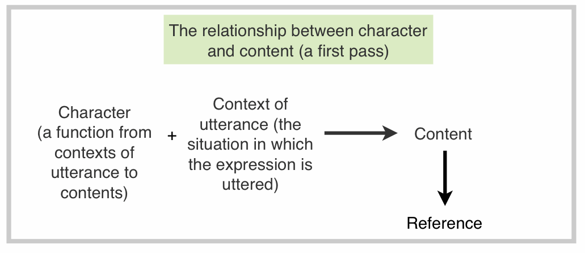
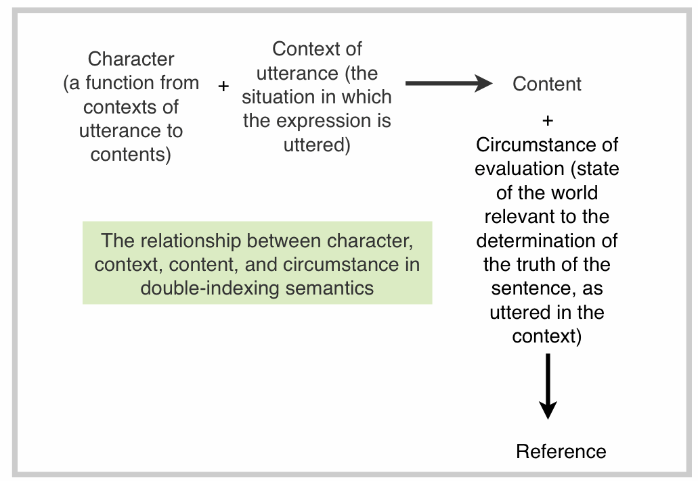
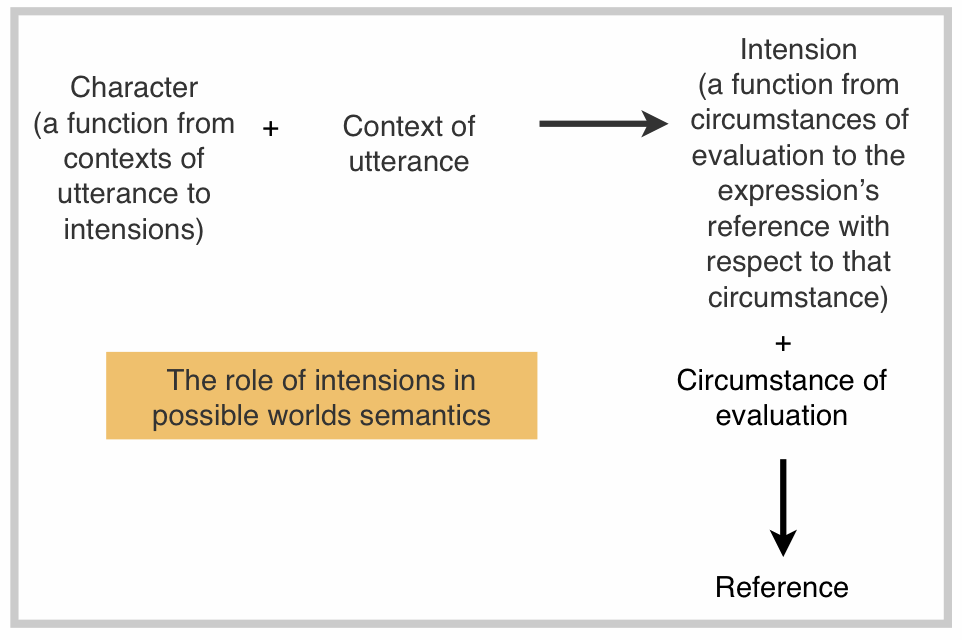
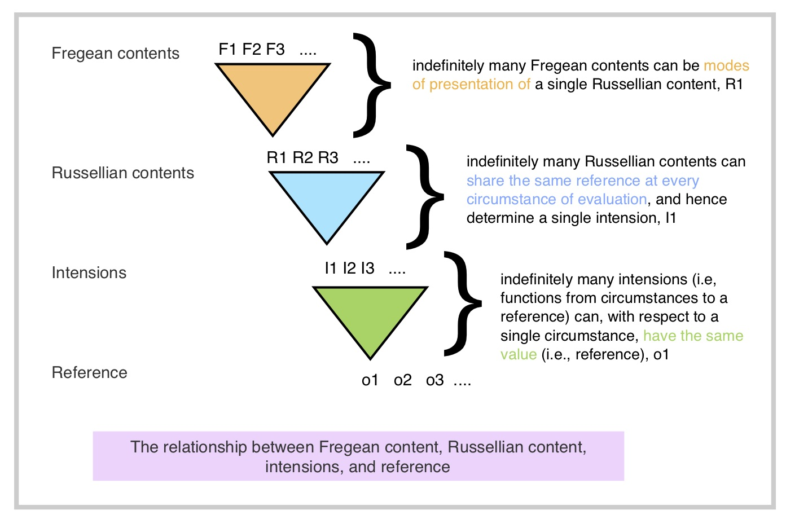

# Theories of Meaning
**First published Tue Jan 26, 2010; substantive revision Wed Jul 31, 2024**

*Speaks, Jeff*

The term “theory of meaning” has figured, in one way or another, in a great number of philosophical disputes over the last century. Unfortunately, this term has also been used to mean a great number of different things. In this entry, the focus is on two sorts of “theory of meaning”. The first sort of theory—a semantic theory—is a theory which assigns semantic contents to expressions of a language. The second sort of theory—a metasemantic theory—is a theory which states the facts in virtue of which expressions have the semantic contents that they have. Following a brief introduction, these two kinds of theory are discussed in turn.

## 1. Two Kinds of Theory of Meaning

In “General Semantics”, David Lewis wrote

> I distinguish two topics: first, the description of possible languages or grammars as abstract semantic systems whereby symbols are associated with aspects of the world; and, second, the description of the psychological and sociological facts whereby a particular one of these abstract semantic systems is the one used by a person or population. Only confusion comes of mixing these two topics. (Lewis 1970: 19)[^lewis-1970]

Lewis was right. Even if philosophers have not consistently kept these two questions separate, there clearly is a distinction between the questions “What is the meaning of this or that symbol (for a particular person or group)?” and “In virtue of what facts about that person or group does the symbol have that meaning?”

Corresponding to these two questions are two different sorts of theory of meaning. One sort of theory of meaning—a *semantic theory*—is a specification of the meanings of the words and sentences of some symbol system. Semantic theories thus answer the question, “What is the meaning of this or that expression?” A distinct sort of theory—a *metasemantic theory*—tries to explain what about some person or group gives the symbols of their language the meanings that they have. (Metasemantic theories are also sometimes called “foundational theories of meaning” or a “metaphysics of meaning.”) To be sure, the shape of a correct semantic theory places constraints on the correct metasemantics, and vice versa; but that does not change the fact that semantic theories and metasemantic theories are simply different sorts of theories, designed to answer different questions.

To see the distinction between semantic theories and metasemantic theories, it may help to consider an analogous one. Imagine a social anthropologist interested in table manners sent out to observe a distant community. One task the anthropologist clearly might undertake is to simply describe the table manners of that community—to describe the different categories into which members of the community place actions at the table, and to say which sorts of actions fall into which categories. This would be analogous to the task of the philosopher of language interested in semantics; their job is say what different sorts of meanings expressions of a given language have, and which expressions have which meanings.

But our anthropologist might also become interested in the nature of manners; they might wonder how, in general, one set of rules of table manners comes to be the system of etiquette governing a particular group. Since presumably the fact that a group obeys one system of etiquette rather than another is traceable to something about that group, the anthropologist might put his new question by asking,

> In virtue of what facts about a person or group does that person or group come to be governed by a particular system of etiquette, rather than another?

Our anthropologist would then have embarked upon the analogue of the construction of a metasemantic theory: they would then be interested, not in which etiquette-related properties particular action types have in a certain group, but rather the question of how action-types can, in any group, come to acquire properties of this sort.[^note-1] Our anthropologist might well be interested in both sorts of questions about table manners; but they are, pretty clearly, different questions. Just so, semantic theories and metasemantic theories are, pretty clearly, different sorts of theories.

The term “theory of meaning” has, in the recent history of philosophy, been used to stand for both semantic theories and metasemantic theories. As this has obvious potential to mislead, in what follows I’ll stick instead to the more specific “semantic theory” and “metasemantic theory”.[^note-2]

This entry focuses on the meanings of expressions of natural languages. But the expressions of natural languages are not the only things to which meanings are attributed. Philosophers often also talk about the meaning, or content, of mental representations. We also talk about the meanings of pictures, maps, and other non-linguistic representations. In either domain, we could make a distinction parallel to our distinction between semantic and metasemantic theories. While there are interesting connections between theories of meaning in our senses and these topics, for reasons of space these topics are not addressed in what follows. For discussions of these topics, see the entries on mental representation and depiction.

There is one other use of “theory of meaning” worth mentioning, which is perhaps most often used in connection with verificationism. The verificationist theory of meaning is the theory that a sentence is meaningful if and only if it is (in a sense to be specified by the theory) verifiable as true or false on the basis of experience. This does not answer the questions to which either semantic or metasemantic theories are addressed; it neither tells us what the meanings of sentences are nor tells us the facts in virtue of which they have those meanings. Instead, it is what we might call a “theory of meaningfulness”; it gives the conditions under which a sentence is meaningful. If the verificationist theory, or some other such theory of meaningfulness, were true, this would provide a constraint which the correct semantic and metasemantic theories would have to meet. I set theories of meaningfulness aside in what follows. For more on the history of verificationism, see the entry on logical empiricism.

This entry covers a lot of ground, and is quite long. However, many parts can be read independently of each other. A reader interested just in getting a sense of how one standard approach to natural language semantics works can read only §2.1. Readers interested in getting a brief introduction to one or another of the alternatives to this standard approach to semantics can read the corresponding subsections of §2.2 on their own. Likewise, the introductions of general issues in semantics in §2.3 – context-sensitivity, relativism, and theories of propositions – can all be read on their own. And the discussions of various approaches to metasemantics in §3 can all be read independently of each other and independently of the discussion of semantics in §2.

## 2. Semantic Theories

The purpose of this section is to lay out the main approaches to constructing a semantic theory for natural languages. These theories agree that there is some way of assigning meanings to the parts of sentences from which the meanings of sentences can be derived; they disagree on what this assignment looks like. But before we get into the disagreements: why think that there is any true theory of this sort to be discovered?

The standard answer to this question focuses on a fact about our understanding of language, and goes back at least to Frege:

> the possibility of our understanding sentences which we have never heard before rests evidently on this, that we can construct the sense of a sentence out of parts that correspond to words. (Frege [1914/1980]: 79)

We are all able to understand sentences which we have never encountered before. How do we manage to do this? A natural answer is that we are able to do this because we understand the meanings of the words out of which these new sentences are formed, and understand the way in which those words are combined in the new sentences. But then it seems that there must be some way of deriving the meanings of sentences from the meanings of the words of which they are composed plus the facts about the ways in which those words are combined. But this way of deriving the meanings of sentences is just what a semantic theory aims to provide; so there must be some true semantic theory to be found. A semantic theory which respects the principle that the meanings of sentences are derived from the meanings of words plus the way in which those words are combined is called a ‘compositional’ semantic theory. For discussion of different versions of this principle and arguments for and against the existence of a true compositional semantic theory, see the entry on compositionality.

No two languages have the same semantics; no two languages are comprised of just the same words, with just the same meanings. Given this, it may seem hard to see how we can say anything about semantic theories in general, as opposed to the semantics of this or that language. While it is of course correct that the semantics for English is one thing and the semantics for French something else, most assume that the various natural languages should all have semantic theories of (in a sense to be explained) the same form. The aim of what follows will, accordingly, be to introduce the reader to the main approaches to natural language semantics—the main views about the right form for a semantics for a natural language to take—rather than to provide a detailed examination of the various views about the semantics of some particular expression. (For an overview, see the entry on word meaning. For discussion of issues involving particular expression types, see the entries on names, quantifiers and quantification, descriptions, propositional attitude reports, and natural kinds.)

Before a semantic theorist sets off to explain the meanings of the expressions of some language, she needs a clear idea of what she is supposed to explain the meaning *of*. This might not seem to present much of a problem; aren’t the bearers of meaning just the sentences of the relevant language, and their parts? This is correct as far as it goes. But the task of explaining what the semantically significant parts of a sentence are, and how those parts combine to form the sentence, is as complex as semantics itself, and has important consequences for semantic theory. Indeed, most disputes about the right semantic treatment of some class of expressions are intertwined with questions about the syntax of sentences in which those expressions figure. Discussion of theories of this sort, which attempt to explain the syntax, or logical form, of natural language sentences, is well beyond the scope of this entry. As a result, figures like Richard Montague, whose work on syntax and its connection to semantics has been central to the development of semantic theory, are passed over in what follows. (Montague’s essays are collected in Montague 1974.)[^montague-1974] For an introduction to the connections between syntax and semantics, see Heim & Kratzer (1998); for an overview of the relations between philosophy of language and several branches of linguistics, see Moss (2012).

There are a wide variety of approaches to natural language semantics. My strategy in what follows will be to begin by explaining one prominent family of approaches to semantics which developed over the course of the twentieth century and is still prominently represented in contemporary work in semantics, both in linguistics and in philosophy. For lack of a better term, I’ll call these types of semantic theories *classical semantic theories*. (As in discussions of classical logic, the appellation “classical” is not meant to suggest that theories to which this label is applied are to be preferred over others.) Classical semantic theories agree that sentences are (typically) true or false, and that whether they are true or false depends on what information they encode or express. This “information” is often called “the proposition expressed by the sentence”. The job of a semantic theory, according to the classical theorist, is at least in large part to explain how the meanings of the parts of the sentence, along with the context in which the sentence is used, combine to determine which proposition the sentence expresses in that context (and hence also the truth conditions of the sentence, as used in that context).

Classical semantic theories are discussed in §2.1. In §§2.1.1–4 the theoretical framework common to classical semantic theories is explained; in §§2.1.5–7 the differences between three main versions of classical semantic theories are explained. In §2.2 there is a discussion of the alternatives to classical semantic theories. In §2.3 a few general concluding questions are discussed; these are questions semantic theorists face which are largely, though not completely, orthogonal to one’s view about the form which a semantic theory ought to take.

### 2.1 Classical Semantic Theories

The easiest way to understand the various sorts of classical semantic theories is by beginning with another sort of theory: a theory of reference.

#### 2.1.1 The theory of reference

A theory of reference is a theory which pairs expressions with the contribution those expressions make to the determination of the truth-values of sentences in which they occur. (Though later we will see that this view of the reference of an expression must be restricted in certain ways.)

This construal of the theory of reference is traceable to Gottlob Frege’s attempt to formulate a logic sufficient for the formalization of mathematical inferences (see especially Frege 1879 and 1892a.)[^frege-1879][^frege-1892a] The construction of a theory of reference of this kind is best illustrated by beginning with the example of proper names. Consider the following sentences:

**(1)**

Barack Obama was the 44th president of the United States.

**(2)**

John McCain was the 44th president of the United States.

(1) is true, and (2) is false. Obviously, this difference in truth-value is traceable to some difference between the expressions “Barack Obama” and “John McCain”. What about these expressions explains the difference in truth-value between these sentences? It is very plausible that it is the fact that “Barack Obama” stands for the man who was in fact the 44th president of the United States, whereas “John McCain” stands for a man who was not. This suggests that the reference of a proper name—its contribution to the determination of truth conditions of sentences in which it occurs—is the object for which that name stands. (While this is plausible, it is not uncontroversial that the purpose of a name is to refer to an individual; see Fara (2015) and Jeshion (2015) for arguments on opposite sides of this issue.)

Given this starting point, it is a short step to some conclusions about the reference of other sorts of expressions. Consider the following pair of sentences:

**(3)**

Barack Obama is a Democrat.

**(4)**

Barack Obama is a Republican.

Again, the first of these is true, whereas the second is false. We already know that the reference of “Barack Obama” is the man for which the name stands; so, given that reference is power to affect truth-value, we know that the reference of verb phrases like “is a Democrat” and “is a Republican” must be something which combines with an object to yield a truth-value. Accordingly, it is natural to think of the reference of verb phrases of this sort as functions from objects to truth-values. The reference of “is a Democrat” is that function which returns the truth-value “true” when given as input an object which is a member of the Democratic party (and the truth-value “false” otherwise), whereas the reference of “is a Republican” is a function which returns the truth-value “true” when given as input an object which is a member of the Republican party (and the truth-value “false” otherwise). This is what explains the fact that (3) is true and (4) false: Obama is a member of the Democratic party, and is not a member of the Republican party.

Matters get more complicated, and more controversial, as we extend this sort of theory of reference to cover more and more of the types of expressions we find in natural languages like English. (For an introduction, see Heim and Kratzer (1998) or Chierchia & McConnell-Ginet (1990).) But the above is enough to give a rough idea of how one might proceed. Consider, for example, adverbs. These seem to combine with verb phrases to form new verb phrases. If so, the reference of an adverb must be something which combines with the reference of a verb phrase to yield the reference of a verb phrase – so, a function from functions from objects to truth-values to functions from objects to truth-values. Or consider a sentence connective like ‘and.’ This seems to combine with a pair of sentences to form a sentence. If so, the reference of a sentence connective must be something which combines with the references of a pair of sentences to a truth-value – so, a function from a pair of truth-values to a truth-value.

#### 2.1.2 Theories of reference vs. semantic theories

So let’s suppose that we have a theory of reference for a language, in the above sense. Would we then have a satisfactory semantic theory for the language?

Some plausible arguments indicate that we would not. To adopt an example from Quine (1970 [1986], pp. 8–9), let’s assume that the set of animals with hearts (which Quine, for convenience, calls “cordates” – not to be confused with “chordates”) is the same as the set of animals with kidneys (which Quine calls “renates”). Now, consider the pair of sentences:

**(5)**

All cordates are cordates.

**(6)**

All cordates are renates.

Given our assumption, both sentences are true. Moreover, from the point of view of the theory of reference, (5) and (6) are just the same: they differ only in the substitution of “renates” for “cordates”, and these expressions have the same reference (because they stand for the same function from objects to truth-values).

All the same, there is clearly an intuitive difference in meaning between (5) and (6); the sentences seem, in some sense, to say different things. The first seems to express the trivial, boring thought that every creature with a heart is a creature with a heart, whereas the second expresses the non-trivial, potentially informative claim that every creature with a heart also has a kidney. This suggests that there is an important difference between (5) and (6) which our theory of reference fails to capture.

Examples of the same sort can be generated using pairs of expressions of other types which share a reference, but intuitively differ in meaning; for example, “Clark Kent” and “Superman”, or (an example famously discussed by Frege (1892a [1960])), “the Morning Star” and “the Evening Star”.

This might seem a rather weak argument for the incompleteness of the theory of reference, resting as it does on intuitions about the relative informativeness of sentences like (5) and (6). But this argument can be strengthened by embedding sentences like (5) and (6) in more complex sentences, as follows:

**(7)**

John believes that all cordates are cordates.

**(8)**

John believes that all cordates are renates.

(7) and (8) differ only with respect to the underlined expressions and, as we noted above, these expressions have the same reference. Despite this, it seems clear that (7) and (8) could differ in truth-value: someone could know that all cordates have a heart without having any opinion on the question of whether all cordates have a kidney. But that means that the references of expressions don’t even do the job for which they were introduced: they don’t explain the contribution that expressions make to the determination of the truth-value of all sentences in which they occur. (One might still think that the reference of an expression explains its contribution to the determination of the truth-value of a suitably delimited class of simple sentences in which the expression occurs.) If we are to be able to explain, in terms of the properties of the expressions that make them up, how (7) and (8) can differ in truth-value, then expressions must have some other sort of value, some sort of meaning, which goes beyond reference.

(7) and (8) are called *belief ascriptions*, because they ascribe a belief to a subject. Belief ascriptions are one sort of *propositional attitude ascription*—other types include ascriptions of knowledge, desire, or judgment. As will become clear in what follows, propositional attitude ascriptions have been very important in recent debates in semantics. One of the reasons why they have been important is exemplified by (7) and (8). Because these sentences can differ in truth-value despite the fact that they differ only with respect to the underlined words, and these words both share a reference and occupy the same place in the structure of the two sentences, we say that (7) and (8) contain a *non-extensional context*: roughly, a “location” in the sentence which is such that substitution of terms which share a reference in that location can change truth-value. (They’re called “non-extensional contexts” because “extension” is another term for “reference”.)[^note-3]

We can give a similar argument for the incompleteness of the theory of reference based on the substitution of whole sentences. A theory of reference assigns to subsentential expressions values which explain their contribution to the truth-values of sentences; but to those sentences, it only assigns “true” or “false”. But consider a pair of sentences like

**(9)**

Mary believes that Barack Obama was the president of the United States.

**(10)**

Mary believes that John Key was the prime minister of New Zealand.

Because both of the underlined sentences are true, (9) and (10) are a pair of sentences which differ only with respect to substitution of expressions (namely, the underlined sentences) with the same reference. Nonetheless, (9) and (10) could plainly differ in truth-value.

This seems to show that a semantic theory should assign some value to sentences other than a truth-value. Another route to this conclusion is the apparent truth of claims of the following sort:

- There are three things that John believes about Indiana, and they are all false.
- There are many necessary truths which are not *a priori*, and my favorite sentence expresses one of them.
- To get an A you must believe everything I say.

Sentences like these suggest that there are things which are the objects of mental states like belief, the bearers of truth and falsity as well as modal properties like necessity and possibility and epistemic properties like a prioricity and posterioricity, and the things expressed by sentences. What are these things? The theory of reference provides no answer.

These entities are often called *propositions*. Friends of propositions aim both to provide a theory of these entities, and, in so doing, also to solve the two problems for the theory of reference discussed above: (i) the lack of an explanation for the fact that (5) is trivial while (6) is not, and (ii) the fact (exemplified by (7)/(8) and (9)/(10)) that sentences which differ only in the substitution of expressions with the same reference can differ in truth-value.

A theory of propositions thus does not abandon the theory of reference, as sketched above, but simply says that there is more to a semantic theory than the theory of reference. Subsentential expressions have, in addition to a reference, a *content*. The contents of sentences—what sentences express—are propositions.

#### 2.1.3 The relationship between content and reference

What is the relationship between content and reference? Let’s examine this question in connection with sentences; here it amounts to the question of the relationship between the proposition a sentence expresses and the sentence’s truth-value. One point brought out by the example of (9) and (10) is that two sentences can express different propositions while having the same truth-value. After all, the beliefs ascribed to Mary by these sentences are different; so if propositions are the objects of belief, the propositions corresponding to the underlined sentences must be different. Nonetheless, both sentences are true.

Is the reverse possible? Can two sentences express the same proposition, but differ in truth-value? It seems not, as can be illustrated again by the role of propositions as the objects of belief. Suppose that you and I believe the exact same thing—both of us believe the world to be just the same way. Can my belief be true, and yours false? Intuitively, it seems not; it seems incoherent to say that we both believe the world to be the same way, but that I get things right and you get them wrong. (Though see the discussion of relativism in §2.3.2 below for a dissenting view.) So it seems that if two sentences express the same proposition, they must have the same truth value.

In general, then, it seems plausible that two sentences with the same content—i.e., which express the same proposition—must always have the same reference, though two expressions with the same reference can differ in content. This is the view stated by the Fregean slogan that sense determines reference (“sense” being the conventional translation of Frege’s *Sinn*, which was his word for what we are calling “content”).

If this holds for sentences, does it also hold for subsentential expressions? It seems that it must. Suppose for reductio that two subsentential expressions, *e* and *e**, have the same content but differ in reference. It seems plausible that two sentences which differ only by the substitution of expressions with the same content must have the same content.[^note-4] But if this is true, then sentences which differ only in the substitution of *e* and *e** would have the same content. But such a pair of sentences could differ in truth-value, since, for any pair of expressions which differ in reference, there is some pair of sentences which differ only by the substitution of those expressions and differ in truth-value. So if there could be a pair of expressions like *e* and *e**, which differ in their reference but not in their content, there could be a pair of sentences which have the same content—which express the same proposition—but differ in truth-value. But this is what we argued above to be impossible; hence there could be no pair of expressions like *e* and *e**, and content must determine reference for subsentential expressions as well as sentences.

This result—that content determines reference—explains one thing we should, plausibly, want a semantic theory to do: it should assign to each expression some value—a content—which determines a reference for that expression.

#### 2.1.4 Character and content, context and circumstance

However, there is an obvious problem with the idea that we can assign a content, in this sense, to all of the expressions of a language like English: many expressions, like “I” or “here”, have a different reference when uttered by different speakers in different situations. So we plainly cannot assign to “I” a single content which determines a reference for the expression, since the expression has a different reference in different situations. These “situations” are typically called *contexts of utterance*, or just *contexts*, and expressions whose reference depends on the context are called indexicals (see entry) or *context-dependent expressions*.

The existence of such expressions shows that a semantic theory must do more than simply assign contents to every expression of the language. Expressions like “I” must also be associated with rules which determine the content of the expression, given a context of utterance. These rules, which are (or determine) functions from contexts to contents, are called *characters*. (The terminology here, as well as the view of the relationship between context, content, and reference, is due to Kaplan 1989a.)[^kaplan-1989a] So the character of “I” must be some function from contexts to contents which, in a context in which I am the speaker, delivers a content which determines me as reference; in a context in which Barack Obama is the speaker, delivers a content which determines Barack Obama as reference; and so on. (See figure 1.)

*Figure 1.*

Figure 1. [An extended description of figure 1 is in the supplement.]

Here we face another potentially misleading ambiguity in “meaning”. What is the real *meaning* of an expression—its character, or its content (in the relevant context)? The best answer here is a pluralist one. Expressions have characters which, given a context, determine a content. We can talk about either character or content, and both are important. The important thing is to be clear on the distinction, and to see the reasons for thinking that expressions have both a character and (relative to a context) a content.

How many indexical expressions are there? There are some obvious candidates—“I”, “here”, “now”, a few others—but beyond the obvious candidates, it is very much a matter of dispute; for discussion, see §2.3.1 below.

One foundational challenge for theorizing about context-sensitive expressions is to explain what the character of these expressions is. In the case of ‘I,’ ‘here,’ and ‘now,’ this seems relatively straightforward; these expressions seem (respectively) to pick out the speaker, time, and place of the context of utterance. But matters get much more difficult once we look beyond this basic set.

Consider for example demonstrative expressions, like ‘this,’ ‘that,’ or ‘that book.’ What determines the reference of these expressions in a context of utterance?

A natural first thought is that, since these expressions are often accompanied by pointing gestures, the reference of uses of these expressions are fixed by these gestures. But this seems insufficiently general, since many uses of these expressions are not accompanied by gestures; and even if this were not true, it is hard to see how a gesture alone could determine a referent. When one points to one thing, one always also points to many (the person, the person’s shirt, the second button on the person’s shirt ...).

A natural second thought is to appeal to the intentions of the speaker. Given that speakers typically have intentions in uttering expressions, intention-based theory also promises to have a generality that the gesture-based theory does not. But complications quickly arise. Marga Reimer (1991, p. 90) gives this example:

> Suppose, for instance, that I suddenly realize that I have left my keys on the desk my (shared) office. I return to my office, where I find the desk occupied by my officemate. I then spot my keys, sitting there on the desk, alongside my officemate’s keys. I then make a grab for my keys, saying just as I mistakenly grab my officemate’s keys, ‘These are mine’.

Here the speaker intends to refer to her keys, but these are not the value of her use of the demonstrative ‘these.’

One response to this kind of case is to develop a more sophisticated intention-based treatment of context sensitive expressions; for a prominent example of this approach, see King (2014b). A different approach appeals, not to the intentions of language users, but to facts about what is salient to the conversational participants. For a theory of this kind, see Mount (2008). A third approach appeals to a richer understanding of the context of utterance. On this view, discourse conventions determine coherence relations between parts of the discourse which play a key role in fixing the values of context-sensitive expressions. This view is laid out and defended in Stojnić (2021).

There is a line of thought that might at first suggest that every expression is an indexical. Consider an expression which does not seem to be context-sensitive, like “the winner of the 2020 United States presidential election”. This does not seem to be context-sensitive, because it seems to refer to the same individual—Joe Biden—whether uttered by me, you, or some other English speaker. But now consider a sentence like

**(11)**

If Donald Trump had won a few more states, Trump would have been the winner of the 2020 United States presidential election.

This sentence is true. But for it to be true, “the winner of the 2020 United States presidential election” would have to, in (11), refer to Donald Trump. But then it seems like this expression must be an indexical—its reference must depend on the context of utterance. In (11), the thought goes, the phrase “If Donald Trump had won a few more states” shifts the context: in (11), “the winner of the 2020 United States presidential election” refers to the individual that it would have referred to if uttered in a situation in which Donald Trump had won a few more states.

However, this can’t be quite right, as is shown by examples like this one:

**(12)**

If my parents had never met, I would not exist.

Let’s suppose that this sentence, as uttered by me, is true. Then, if what we said about (11) was right, it seems that “I” must, in, (12), refer to whoever it would refer to if it were uttered in a situation in which my parents never met. So the one thing we know is that (assuming that (12) is true), it does not refer to me—after all, I would not have been around to utter anything. But, plainly, the “I” in (12) *does* refer to me when this sentence is uttered by me—after all, it is a claim about me. What’s going on here?

What examples like (12) are often taken to show is that the reference of an expression must be relativized, not just to a context of utterance, but also to a *circumstance of evaluation*—at a first pass, the possible state of the world relevant to the determination of the truth or falsity of the sentence. In the case of many simple sentences, context and circumstance coincide; details aside, they both just are the state of the world at the time of the utterance, with a designated speaker and place. But sentences like (12) show that they can come apart. Phrases like “If my parents had never met” shift the circumstance of evaluation—they change the state of the world relevant to the evaluation of the truth or falsity of the sentence—but don’t change the context of utterance. That’s why when I utter (12), “I” refers to me—despite the fact that I would not have existed to utter it in if my parents had never met.

*Figure 2.*

Figure 2. [An extended description of figure 2 is in the supplement.]

The kind of theory which results is sometimes called a *double-indexing semantics*—the two indices being contexts of utterance and circumstances of evaluation. (See figure 2.)

The classic explanation of a double-indexing semantics is Kaplan (1989a); another important early discussion is Kamp (1971). For a different interpretation of the framework, see David Lewis (1980). For a classic discussion of some of the philosophical issues raised by indexicals, see Perry (1979).

Double-indexing explains how we can regard the reference of “the winner of the 2020 United States presidential election” in (11) to be Donald Trump, without taking “the winner of the 2020 United States presidential election” to be an indexical like “I”. On this view, “the winner of the 2020 United States presidential election” does not vary in content depending on the context of utterance; rather, the content of this phrase is such that it determines a different reference with respect to different circumstances of evaluation. In particular, it has Joe Bidens as its reference with respect to the present state of the actual world, and has Donald Trump as its reference with respect to the state of the world decribed in (11). Because “the winner of the 2020 United States presidential election” refers to different things with respect to different circumstances, it is not a rigid designator (see entry)—these being expressions which (relative to a context of utterance) refer to the same object with respect to every circumstance of evaluation at which that object exists, and never refer to anything else with respect to another circumstance of evaluation. (The term “rigid designator” is due to Kripke [1972].) For a discussion of different views about the nature of circumstances of evaluation and their motivations, see §2.3.2 below.

#### 2.1.5 Possible worlds semantics

So we know that expressions are associated with characters, which are functions from contexts to contents; and we know that contents are things which, for each circumstance of evaluation, determine a reference. We can now raise a central question of (classical) semantic theories: what sorts of things are contents? The foregoing suggests a pleasingly minimalist answer to this question: perhaps, since contents are things which together with circumstances of evaluation determine a reference, contents just *are* functions from circumstances of evaluation to a reference.

This view sounds abstract but is, in a way, quite intuitive. The idea is that the content of an expression is not what the expression stands for in the relevant circumstance, but rather a rule which tells you what the expression would stand for if the world were a certain way. So, on this view, the content of an expression like “the tallest man in the world” is not simply the man who happens to be tallest, but rather a function from ways the world might be to men—namely, that function which, for any way the world might be, returns as a referent the tallest man in that world (if there is one, and nothing otherwise). This fits nicely with the intuitive idea that to understand such an expression one needn’t know what the expression actually refers to—after all, one can understand “the tallest man” without knowing who the tallest man is—but must know how to tell what the expression would refer to, given certain information about the world (namely, the heights of all the men in it).

These functions, or rules, are called (following Carnap (1947)) *intensions*. Possible worlds semantics is the view that contents are intensions (and hence that characters are functions from contexts to intensions, i.e. functions from contexts to functions from circumstances of evaluation to a reference). (See figure 3.)

*Figure 3.*

Figure 3. [An extended description of figure 3 is in the supplement.]

The intension of a sentence—i.e., the proposition that sentence expresses, on the present view—will then be a function from worlds to truth-values. In particular, it will be that function which returns the truth-value true for every world with respect to which that sentence is true, and false otherwise. The intension of a simple predicate like “is red” will be a function from worlds to the function from objects to truth-values which, for each world, returns the truth-value true if the thing in question is red, and returns the truth-value false otherwise. In effect, possible worlds semantics takes the meanings of expressions to be functions from worlds to the values which would be assigned by a theory of reference to those expressions at the relevant world: in that sense, intensions are a kind of “extra layer” on top of the theory of reference. A classic discussion of the application of the framework of possible world semantics to natural language is Lewis (1970); see also von Fintel & Heim (2020 [Other Internet Resources]).

This extra layer promises to solve the problem posed by non-extensional contexts, as illustrated by the example of “cordate” and “renate” in (7) and (8). Our worry was that, since these expressions have the same reference, if meaning just is reference, then it seems that any pair of sentences which differ only in the substitution of these expressions must have the same truth-value. But (7) and (8) are such a pair of sentences, and needn’t have the same truth-value. The proponent of possible worlds semantics solves this problem by identifying the meaning of these expressions with their intension rather than their reference, and by pointing out that “cordate” and “renate”, while they share a reference, seem to have different intensions. After all, even if in our world every creature with a heart is a creature with a kidney (and vice versa), it seems that the world could have been such that some creatures had a heart but not a kidney. Since with respect to that circumstance of evaluation the terms will differ in reference, their intensions—which are just functions from circumstances of evaluations to referents—must also differ. Hence possible worlds semantics leaves room for (7) and (8) to differ in truth value, as they manifestly can.

The central problem facing possible worlds semantics, however, concerns sentences of the same form as (7) and (8): sentences which ascribe propositional attitudes, like beliefs, to subjects. To see this problem, we can begin by asking: according to possible worlds semantics, what does it take for a pair of sentences to have the same content (i.e., express the same proposition)? Since contents are intensions, and intensions are functions from circumstances of evaluation to referents, it seems that two sentences have the same content, according to possible worlds semantics, if they have the same truth-value with respect to every circumstance of evaluation. In other words, two sentences express the same proposition if and only if it is impossible for them to differ in truth-value.

The problem is that there are sentences which have the same truth-value in every circumstance of evaluation, but seem to differ in meaning. Consider, for example

**(13)**

$2+2=4$.

**(14)**

There are infinitely many prime numbers.

A standard view is that truths of mathematics like (13) and (14) are necessary truths. If that is correct, then (13) and (14) have the same intension and, according to possible worlds semantics, must have the same content.

But this is highly counterintuitive. (13) and (14) certainly seem to say different things. The problem (just as with (5) and (6)) can be sharpened by embedding these sentences in propositional attitude ascriptions:

**(15)**

John believes that 2 + 2 = 4.

**(16)**

John believes that there are infinitely many prime numbers.

As we have just seen, the proponent of possible worlds semantics must take the underlined sentences, (13) and (14), to have the same content; hence, it seems, the proponent of possible worlds semantics must take (15) and (16) to be a pair of sentences which differ only in the substitution of expressions with the same content. But then it seems that the proponent of possible worlds semantics must take this pair of sentences to express the same proposition, and have the same truth-value; but (15) and (16) (like (7) and (8)) seem to differ in truth-value, and hence seem not to express the same proposition. For an influential extension of this argument, see Soames (1988).

For attempts to reply to the argument from within the framework of possible worlds semantics, see among other places Stalnaker (1984) and Yalcin (2018); for discussion of a related approach to semantics which aims to avoid these problems, see situations in natural language semantics (see entry). Another option is to invoke impossible as well as possible worlds; one might then treat propositions as sets of worlds, which may or may not be possible. If there is an impossible world in which there are only finitely many primes but in which 2+2=4, that would promise to give us the resources to distinguish between the set of worlds in which (13) is true and the set of worlds in which (14) is true, and hence to explain the difference in truth-value between (15) and (16). For an overview of issues involving impossible worlds, see Nolan (2013); for an application of the framework of impossible worlds to solve issues in the theory of content, see Berto & Jago (2019).

#### 2.1.6 Russellian semantics

Suppose that we want an approach to semantics which makes room for sentences like (13) and (14), and hence also (15) and (16), to express different propositions. That requires a view of meaning which makes room for the possibility that a pair of sentences can be true in just the same circumstances but nonetheless have genuinely different contents.

A natural thought is that (13) and (14) have different contents because they are about different things; for example, (14) makes a general claim about the set of prime numbers whereas (13) is about the relationship between the numbers 2 and 4. One might want our semantic theory to be sensitive to such differences: to count two sentences as expressing different propositions if they are have different subject matters, in this sense. One way to secure this result is to think of the contents of subsentential expressions as components of the proposition expressed by the sentence as a whole. Differences in the contents of subsentential expressions would then be sufficient for differences in the content of the sentence as a whole; so, for example, since (14) but not (13) contains an expression which refers to prime numbers, these sentences will express different propositions.

Proponents of this sort of view think of propositions as *structured*: as having constituents which include the meanings of the expressions which make up the sentence expressing the relevant proposition. (See, for more discussion, the entry on structured propositions.) One important question for views of this sort is: what does it mean for an abstract object, like a proposition, to be structured, and have constituents? But this question would take us too far afield into metaphysics (see §2.3.3 below for a brief discussion). The fundamental *semantic* question for proponents of this sort of structured proposition view is: what sorts of things are the constituents of propositions?

The answer to this question given by a proponent of *Russellian semantics* is: objects, properties, relations, and functions. (The view is called “Russellianism” because of its resemblance to the view of content defended in Chapter IV of Russell 1903.)[^russell-1903] So described, Russellianism is a general view about what sorts of things the constituents of propositions are, and does not carry a commitment to any views about the contents of particular types of expressions. However, most Russellians also endorse a particular view about the contents of proper names which is known as *Millianism*: the view that the meaning of a simple proper name is the object (if any) for which it stands.

Russellianism has much to be said for it. It not only solves the problems with possible worlds semantics discussed above, but fits well with the intuitive idea that the function of names is to single out objects, and the function of predicates is to predicate properties of those objects.

However, Millian-Russellian semantic theories also face some problems. One important problem for Russellian conceptions of propositions is a paradox which is sometimes called “Russell’s paradox of propositions” and sometimes called the “Russell-Myhill paradox.” It was first laid out in an appendix of Russell (1903), and can be laid out informally as follows.

Because Russellians individuate propositions by what objects, properties, and relations they are about, it seems plausible that the Russellian should think that for any distinct objects *a* and *b*, the proposition that *a* is *F* is distinct from the proposition that *b* is *F*. Now consider those propositions which say of some set of propositions that every member of that set is true; call these “set-describing propositions.” Given the above assumptions, there will be, for every set-describing proposition, exactly one set that it describes. Among the set-describing propositions, there will be some which are members of the set they describe, and some which are not. Let *w* be the set of all set-describing propositions which are not members of the set they describe. Now let *p* be the proposition that every member of *w* is true.

Is *p* an element of *w*? Suppose first that it is. Then *p* is a set-describing proposition which is an element of the set that it describes; so it is not an element of *w*. But that contradicts our supposition. So suppose that it is not. Then *p* is a set-describing proposition which is not an element of the set that it describes; so it is an element of *w*. But that again contradicts our supposition. So, whichever way we go, we get a contradiction.

This paradox targets, not Russellianism directly, but the Russellian’s assumptions about how fine-grained propositions are. Arguably, then, it is also a problem for views (like the view discussed in the next section) which make propositions more fine-grained than the Russellian does. For a more rigorous discussion and defense of the view that this paradox is a serious problem for Russellian (and other structured) views, see Uzquiano (2015). For an attempt to respond to the paradox within a Russellian framework, see Kment (2022). For a general discussion of the morals of the paradox, see Dorr & Hawthorne (2021).[^note-5]

This is a broadly metaphysical problem for fine-grained views of propositions. Millian-Russellian semantics also faces more specifically semantic objections, of which two are especially important.

The first of these problems involves the existence of *empty names*: names which have no referent. It is a commonplace that there are such names; an example is “Vulcan”, the name introduced for the planet between Mercury and the sun which was causing perturbations in the orbit of Mercury. Because the Millian-Russellian says that the content of a name is its referent, the Millian-Russellian seems forced into saying that empty names lack a content. But this is surprising; it seems that we can use empty names in sentences to express propositions and form beliefs about the world. The Millian-Russellian owes some explanation of how this is possible, if such names genuinely lack a content. For a discussion of this problem from a Millian point of view, see Braun (1993).

Perhaps the most important problem facing Millian-Russellian views, though, is Frege’s puzzle. Consider the sentences

**(17)**

Clark Kent is Clark Kent.

**(18)**

Clark Kent is Superman.

According to the Millian-Russellian, (17) and (18) differ only in the substitution of expressions with have the same content: after all, “Clark Kent” and “Superman” are proper names which refer to the same object, and the Millian-Russellian holds that the content of a proper name is the object to which that name refers. But this is a surprising result. These sentences seem to differ in meaning, because (17) seems to express a trivial, obvious claim, whereas (18) seems to express a non-trivial, potentially informative claim.

This sort of objection to Millian-Russellian views can (as above) be strengthened by embedding the intuitively different sentences in propositional attitude ascriptions, as follows:

**(19)**

Lois believes that Clark Kent is Clark Kent.

**(20)**

Lois believes that Clark Kent is Superman.

The problem posed by (19) and (20) for Russellian semantics is analogous to the problem posed by (15) and (16) for possible worlds semantics. Here, as there, we have a pair of belief ascriptions which seem as though they could differ in truth-value despite the fact that these sentences differ only with respect to expressions counted as synonymous by the relevant semantic theory.

Russellians have offered a variety of responses to Frege’s puzzle. Many Russellians think that our intuition that sentences like (19) and (20) can differ in truth-value is based on a mistake. This mistake might be explained at least partly in terms of a confusion between the proposition semantically expressed by a sentence in a context and the propositions speakers would typically use that sentence to pragmatically convey (Salmón 1986; Soames 2002)[^salmón-1986][^soames-2002], or in terms of the fact that a single proposition may be believed under several “propositional guises” (again, see Salmón 1986)[^salmón-1986], or in terms of a failure to integrate pieces of information stored using distinct mental representations (Braun & Saul 2002)[^braun-2002].[^note-6] Alternatively, a Russellian might try to make room for (19) and (20) to genuinely differ in truth-value by giving up the idea that sentences which differ only in the substitution of proper names with the same content must express the same proposition (Taschek 1995, Fine 2007)[^fine-2007][^taschek-1995].

#### 2.1.7 Fregean semantics

However, these are not the only responses to Frege’s puzzle. Just as the Russellian responded to the problem posed by (15) and (16) by holding that two sentences with the same intension can differ in meaning, one might respond to the problem posed by (19) and (20) by holding that two names which refer to the same object can differ in meaning, thus making room for (19) and (20) to differ in truth-value. This is to endorse a Fregean response to Frege’s puzzle, and to abandon the Russellian approach to semantics (or, at least, to abandon Millian-Russellian semantics).

Fregeans, like Russellians, often think of the proposition expressed by a sentence as a structured entity with constituents which are the contents of the expressions making up the sentence. But Fregeans, unlike Russellians, do not think of these propositional constituents as the objects, properties, and relations for which these expressions stand; instead, Fregeans think of the contents as modes of presentation, or ways of thinking about, objects, properties, and relations. The standard term for these modes of presentation is *sense*. (As with “intension”, “sense” is sometimes also used as a synonym for “content”. But, as with “intension”, it avoids confusion to restrict “sense” for “content, as construed by Fregean semantics”. It is then controversial whether there are such things as senses, and whether they are the contents of expressions.) Frege explained his view of senses with an analogy:

> The reference of a proper name is the object itself which we designate by its means; the idea, which we have in that case, is wholly subjective; in between lies the sense, which is indeed no longer subjective like the idea, but is yet not the object itself. The following analogy will perhaps clarify these relationships. Somebody observes the Moon through a telescope. I compare the Moon itself to the reference; it is the object of the observation, mediated by the real image projected by the object glass in the interior of the telescope, and by the retinal image of the observer. The former I compare to the sense, the latter is like the idea or experience. The optical image in the telescope is indeed one-sided and dependent upon the standpoint of observation; but it is still objective, inasmuch as it can be used by several observers. At any rate it could be arranged for several to use it simultaneously. But each one would have his own retinal image. (Frege 1892a [1960])[^frege-1892a]

Senses are then objective, in that more than one person can express thoughts with a given sense. They also correspond many-one to objects. Thus, just as Russellian propositions correspond many-one to intensions, Fregean propositions correspond many-one to Russellian propositions. This is sometimes expressed by the claim that Fregean contents are more *fine-grained* than Russellian contents (or intensions).

Indeed, we can think of our three classical semantic theories, along with the theory of reference, as related by this kind of many-one relation, as illustrated by the chart below:

*Figure 4.*

Figure 4. [An extended description of figure 4 is in the supplement.]

The principal argument for Fregean semantics (which also motivated Frege himself) is the neat solution the view offers to Frege’s puzzle: the view says that, in cases like (19) and (20) in which there seems to be a difference in content, there really is a difference in content: the names share a reference, but differ in their sense, because they differ in their mode of presentation of their shared reference.

A first challenge for Fregeanism is the challenge of giving a non-metaphorical explanation of the nature of sense. This is a problem for the Fregean in a way that it is not for the possible worlds semanticist or the Russellian since the Fregean, unlike these two, introduces a new class of entities to serve as meanings of expressions rather than merely appropriating an already recognized sort of entity—like a function, or an object, property, or relation—to serve this purpose.[^note-7]

A first step toward answering this challenge is provided by a criterion for telling when two expressions differ in meaning, which might be stated as follows. In his 1906 paper, “A Brief Survey of My Logical Doctrines”, Frege seems to endorse the following criterion:

> *Frege’s criterion of difference for senses* Two sentences *S* and *S** differ in sense if and only if some rational agent who understood both could, on reflection, judge that *S* is true without judging that *S** is true.

Consider (17) and (18), which we saw make trouble for Millian-Russellian views of content. Someone could clearly understand both and, on reflection, judge that (17) is true and (18) false. (Lois Lane is such a person.) Frege’s criterion would then imply that the sentences have different senses, which is what we want.[^note-8]

But even if this tells us when names differ in sense, it does not quite tell us what the sense of a name *is*. Here is one initially plausible way of explaining what the sense of a name is. We know that, whatever the content of a name is, it must be something which determines as a reference the object for which the name stands; and we know that, if Fregeanism is true, this must be something other than the object itself. A natural thought, then, is that the content of a name—its sense—is some condition which the referent of the name uniquely satisfies. Coreferential names can differ in sense because there is always more than one condition which a given object uniquely satisfies. (For example, Superman/Clark Kent uniquely satisfies both the condition of being the superhero Lois most admires, and the newspaperman she least admires.) Given this view, it is natural to then hold that names have the same meanings as *definite descriptions*—phrases of the form “the so-and-so”. After all, phrases of this sort seem to be designed to pick out the unique object, if any, which satisfies the condition following the “the”. (For more discussion, see entry on descriptions.) This Fregean view of names is called *Fregean descriptivism*.

However, as Saul Kripke argued in *Naming and Necessity*, Fregean descriptivism faces some serious problems. Here is one of the arguments he gave against the view, which is called the *modal argument*. Consider a name like “Aristotle”, and suppose for purposes of exposition that the sense I associate with that name is the sense of the definite description “the greatest philosopher of antiquity”. Now consider the following pair of sentences:

**(21)**

Necessarily, if Aristotle exists, then Aristotle is Aristotle.

**(22)**

Necessarily, if Aristotle exists, then Aristotle is the greatest philosopher of antiquity.

If Fregean descriptivism is true, and “the greatest philosopher of antiquity” is indeed the description I associate with the name “Aristotle”, then it seems that (21) and (22) must be a pair of sentences which differ only via the substitution of expressions (the underlined ones) with the same content. If this is right, then (21) and (22) must express the same proposition, and have the same truth-value. But this seems to be a mistake; while (21) appears to be true (Aristotle could hardly have failed to be himself), (22) appears to be false (perhaps Aristotle could have been a shoemaker rather than a philosopher; or perhaps if Plato had worked a bit harder, he rather than Aristotle could have been the greatest philosopher of antiquity).

An important precursor to Kripke’s arguments against Fregean descriptivism is Marcus (1961), which argues that names are “tags” for objects rather than abbreviated descriptions. Fregean descriptivists have given various replies to Kripke’s modal and other arguments; see especially Plantinga (1978), Dummett (1981), and Sosa (2001). For rejoinders to these Fregean replies, see Soames (1998, 2002) and Caplan (2005). For a defense of a view of descriptions which promises a reply to the modal argument, see Rothschild (2007). For a discussion of Kripke’s other arguments against Fregean descriptivism, see §2.4 of the entry on [names](https://plato.stanford.edu/entries/names/#MeanNece).

Kripke’s arguments provide a strong reason for Fregeans to deny Fregean descriptivism, and hold instead that the senses of proper names are not the senses of any definite description associated with those names by speakers. The main problem for this sort of *non-descriptive Fregeanism* is to explain what the sense of a name might be such that it can determine the reference of the name, if it is not a condition uniquely satisfied by the reference of the name. Non-descriptive Fregean views were defended in McDowell (1977) and Evans (1981). Perhaps the most influential recent version of the view is a kind of blend of Fregean semantics and possible worlds semantics. This is the epistemic two-dimensionalist approach to semantics which has been developed by David Chalmers. See Chalmers (2004, 2006).

Suppose that the Fregean has provided an account of senses which is suitable to solve Frege’s puzzle. A second argument against Fregean approaches to semantics suggests that any view of meaning which is fine-grained enough to provide a general solution to Frege’s puzzle will be both implausible and will give rise to problems of explaining substitution success.

The argument can be pressed using a kind of example first introduced by Kripke (1979). These are examples of pairs of expressions which seem to be synonymous but, despite this fact, give rise to instances of Frege’s puzzle.

Consider, for example, “catsup” and “ketchup”. (The example is from Salmón 1990.)[^salmón-1990] Now consider Bob, a confused condiment user, who thinks that the tasty red substance standardly labeled “catsup” at his favorite breakfast restaurant is distinct from the tasty red substance standardly labeled “ketchup” served at his favorite lunch restaurant, and consider the following pair of sentences:

**(23)**

Bob believes that catsup is catsup.

**(24)**

Bob believes that catsup is ketchup.

(23) and (24) seem quite a bit like (19) and (20): these each seem to be pairs of sentences which differ in truth-value, despite differing only in the substitution of the underlined expressions. So there is some pressure on the Fregean to explain the apparent difference in truth-value between (23) and (24) in just the way they explain the apparent difference in truth-value between (19) and (20): by positing a difference in meaning between ‘catsup’ and ‘ketchup.’

But this can look implausible; surely if any expressions in English are synonymous, these are. Further, as Kripke (1979) points out, similar problems arise from distinct tokens of a single name. So the Fregean seems forced to say that there are differences in meaning, not just between apparent synonyms like ‘catsup’ and ‘ketchup,’ but also between distinct tokens of one name. There turn out to be many more differences in meaning than one might have thought.

Many Fregeans embrace this very fine-grained view of meanings. However, some object that, while this would provide the resources for a general explanation of substitution failures, it gives rise to difficult problems in explaining substitution success. We often ascribe beliefs and other propositional attitudes to subjects without having any expectation that we think of the objects the attitude is about in the same way. For example, it seems plausible that I can truly say ‘Plato believed that Socrates was wise.’ Of course I have no expectation that the sense I attach to ‘Socrates’ is at all close to the sense Plato attached to any of his devices for referring to Socrates. But that suggests that, if Fregeanism is true, the above ascription attributes a belief to Plato which Plato simply did not have and is therefore false. Most agree that this would be an implausible result. A standard line of response is to say that the truth of an attitude ascription requires, not identity of sense between the that-clause as uttered by the ascriber and the attitude of the subject of the ascription, but just that these two senses stand in some (presumably context-sensitive) relation. See for discussion and defense Chalmers (2011).[^note-9]

### 2.2 Alternatives to Classical Semantic Theories

Classical semantic theories are not the only game in town. This section lays out the basics of five alternatives to classical semantic theorizing.

#### 2.2.1 Davidsonian semantics

One kind of challenge to classical semantics attacks the idea that the job of a semantic theory is to systematically pair expressions with the entities which are their meanings. Wittgenstein was parodying just this idea when he wrote

> You say: the point isn’t the word, but its meaning, and you think of the meaning as a thing of the same kind as the word, though also different from the word. Here the word, there the meaning. The money, and the cow that you can buy with it. (Wittgenstein 1953, §120)[^wittgenstein-1953]

While Wittgenstein himself did not think that systematic theorizing about semantics was possible, this anti-theoretical stance has not been shared by all subsequent philosophers who share his aversion to “meanings as entities”. A case in point is Donald Davidson. Davidson thought that semantic theory should take the form of a theory of truth for the language of the sort which Alfred Tarski showed us how to construct (see Tarski 1944 and the entry on Tarski’s truth definitions)[^tarski-1944].

For our purposes, it will be convenient to think of a Tarskian truth theory as a variant on the sorts of theories of reference introduced in §2.1.1. Recall that theories of reference of this sort specified, for each proper name in the language, the object to which that name refers, and for every simple predicate in the language, the set of things which satisfy that predicate. If we then consider a sentence which combines a proper name with such a predicate, like

> Amelia sings

the theory tells us what it would take for that sentence to be true: it tells us that this sentence is true if and only if the object to which “Amelia” refers is a member of the set of things which satisfy the predicate “sings”—i.e., if and only if Amelia sings. So we can think of a full theory of reference for the language as implying, for each sentence of this sort, a *T-sentence* of the form

> “Amelia sings” is *T* (in the language) if and only if Amelia sings.

Suppose now that we expand our theory of reference so that it implies a T-sentence of this sort for every sentence of the language, rather than just for simple sentences which result from combining a name and a monadic predicate. We would then have a Tarskian truth theory for our language. Tarski’s idea was that such a theory would define a truth predicate (“*T*”) for the language; Davidson, by contrast, thought that we find in Tarskian truth theories “the sophisticated and powerful foundation of a competent theory of meaning” (Davidson 1967)[^davidson-1967].

This claim can seem puzzling: why should a a theory which issues T-sentences, but makes no explicit claims about meaning or content, count as a *semantic* theory? Davidson’s answer was that knowledge of such a theory would be sufficient to understand the language. If Davidson were right about this, then he would have a plausible argument that a semantic theory could take this form. After all, it is plausible that someone who understands a language knows the meanings of the expressions in the language; so, if knowledge of a Tarskian truth theory for the language were sufficient to understand the language, then knowledge of what that theory says would be sufficient to know all the facts about the meanings of expressions in the language, in which case it seems that the theory would state all the facts about the meanings of expressions in the language.

One advantage of this sort of approach to semantics is its parsimony: it makes no use of the intensions, Russellian propositions, or Fregean senses assigned to expressions by the propositional semantic theories discussed above. Of course, as we saw above, these entities were introduced to provide a satisfactory semantic treatment of various sorts of linguistic constructions, and one might well wonder whether it is possible to provide a Tarskian truth theory of the sort sketched above for a natural language without making use of intensions, Russellian propositions, or Fregean senses. The Davidsonian program obviously requires that we be able to do this, but it is still very much a matter of controversy whether a truth theory of this sort can be constructed. Discussion of this point is beyond the scope of this entry; one good way into this debate is through the debate about whether the Davidsonian program can provide an adequate treatment of propositional attitude ascriptions. See the discussion of the paratactic account and interpreted logical forms in the entry on propositional attitude reports. (For Davidson’s initial treatment of attitude ascriptions, see Davidson 1968; for further discussion see, among other places, Burge 1986; Schiffer 1987; Lepore and Loewer 1989; Larson and Ludlow 1993; Soames 2002.)[^burge-1986][^davidson-1968][^larson-1993][^lepore-1989][^schiffer-1987][^soames-2002]

Let’s set this aside, and assume that a Tarskian truth theory of the relevant sort can be constructed, and ask whether, given this supposition, this sort of theory would provide an adequate semantics. There are two fundamental reasons for thinking that it would not, both of which are ultimately due to Foster (1976). Larson and Segal (1995) call these the *extension problem* and the *information problem*.

The extension problem stems from the fact that it is not enough for a semantic theory whose theorems are T-sentences to yield true theorems; the T-sentence

> “Snow is white” is *T* in English iff grass is green.

is true, but tells us hardly anything about the meaning of “Snow is white”. Rather, we want a semantic theory to entail, for each sentence of the object language, exactly one *interpretive* T-sentence: a T-sentence such that the sentence used on its right-hand side gives the meaning of the sentence mentioned on its left-hand side. Our theory must entail *at least one* such T-sentence for each sentence in the object language because the aim is to give the meaning of each sentence in the language; and it must entail *no more than one* because, if the theory had as theorems more than one T-sentence for a single sentence *S* of the object language, an agent who knew all the theorems of the theory would not yet understand *S*, since such an agent would not know which of the T-sentences which mention *S* was interpretive.

The problem is that it seems that any theory which implies at least one T-sentence for every sentence of the language will also imply more than one T-sentence for every sentence in the language. For any sentences *p*, *q*, if the theory entails a T-sentence

> *S* is *T* in *L* iff *p*,

then, since *p* is logically equivalent to $p \amp \nsim(q \amp \nsim q)$, the theory will also entail the T-sentence

> *S* is *T* in *L* iff $p \amp \nsim(q \amp \nsim q)$,

which, if the first is interpretive, won’t be. But then the theory will entail at least one non-interpretive T-sentence, and someone who knows the theory will not know which of the relevant sentences is interpretive and which not; such a person therefore would not understand the language.

The information problem is that, even if our semantic theory entails all and only interpretive T-sentences, it is not the case that knowledge of what is said by these theorems would suffice for understanding the object language. For, it seems, I can know what is said by a series of interpretive T-sentences without knowing that they are interpretive. I may, for example, know what is said by the interpretive T-sentence

> “Londres est jolie” is *T* in French iff London is pretty

but still not know the meaning of the sentence mentioned on the left-hand side of the T-sentence. The truth of what is said by this sentence, after all, is compatible with the sentence used on the right-hand side being materially equivalent to, but different in meaning from, the sentence mentioned on the left. This seems to indicate that knowing what is said by a truth theory of the relevant kind is not, after all, sufficient for understanding a language. (For replies to these criticisms, see Davidson (1976), Larson and Segal (1995) and Kölbel (2001); for criticism of these replies, see Soames (1992) and Ray (2014). For a reply to the latter, see Kirk-Giannini and Lepore (2017).)

#### 2.2.2 Internalist semantics

The Davidsonian, on one reading, diagnoses the mistake of classical semantics in its commitment to a layer of content which goes beyond a theory of reference. A different alternative to classical semantics departs even more radically from that tradition, by denying that mind-world reference relations should play any role in semantic theorizing.

This view is sometimes called “internalist semantics” by contrast with views which locate the semantic properties of expressions in their relation to elements of the external world. This internalist approach to semantics is associated with the work of Noam Chomsky (see especially Chomsky 2000)[^chomsky-2000].

The internalist denies an assumption common to all of the approaches discussed so far: the assumption that in giving the content of an expression, we are primarily specifying something about that expression’s relation to things in the world which that expression might be used to say things about. According to the internalist, expressions as such don’t bear any semantically interesting relations to things in the world; names don’t, for example, *refer* to the objects with which one might take them to be associated; predicates don’t have extensions; sentences don’t have truth conditions. On this sort of view, we can use sentences to say true or false things about the world, and can use names to refer to things; but this is just one thing we can do with names and sentences, and is not a claim about the meanings of those expressions.

So what are meanings, on this view? The most developed answer to this question is given in Pietroski (2018), according to which “meanings are instructions for how to build concepts of a special sort” (2018: 36). By “concepts”, Pietroski means mental representations of a certain kind. So the meaning of an expression is an instruction to form a certain sort of mental representation.

On this kind of view, while concepts may have extensions, expressions of natural languages do not. So this approach rejects not just the details but the foundation of the classical approach to semantics described above.

One way to motivate an approach of this kind focuses on the ubiquity of the phenomenon of polysemy in natural languages. As Pietroski says,

> We can use “line” to speak of Euclidean lines, fishing lines, telephone lines, waiting lines, lines in faces, lines of thought, etc. We can use “door” to access a concept of certain impenetrable objects, or a concept of certain spaces that can be occupied by such objects. (2018: 5)

The defender of the view that expressions have meanings which determine extensions seems forced to say that “line” and “door” are homophonous expressions, like “bank”. But that seems implausible; when one uses the expressions “fishing line” and “line of thought” one seems to be using “line” in recognizably the same sense. (This is a point of contrast with standard examples of homophony, as when one uses “bank” once to refer to a financial institution and then later to refer to the side of a river.) Internalists, by contrast, are not forced into treating these as cases of homophony; they can say that the meaning of “line” is an instruction to fetch one of a family of concepts.

A second style of argument in favor of internalist semantics is based on examples of natural language constructions which seem difficult to handle if the meanings of expressions are contributions to truth conditions. Pietroski (2003) gives the example of ‘have/has wheels.’ A natural thought is that a sentence ‘__ has/have wheels’ is true iff the relevant object (or objects) has (have) at least one wheel. But that predicts, incorrectly, that ‘Bob’s unicycle has wheels’ is true. The only alternative seems to be to treat sentences of this form as true iff the relevant object (or objects) has (have) at least two wheels. But that predicts, incorrectly, that ‘Unicycles have wheels’ is false.

For defenses and developments of internalist approaches to semantics, see McGilvray (1998), Chomsky (2000), and Pietroski (2003, 2005, 2018). For a critical evaluation of the case for internalism, see King (2017).

#### 2.2.3 Inferentialist semantics

Internalist semantics can be understood as denying the classical semantic assumption that a semantic theory should assign truth conditions to sentences. Another alternative to classical semantics does not deny that assumption, but does deny that truth conditions should play the fundamental role in semantics that classical semantics give to them.

This alternative is inferentialist semantics. The difference between classical and inferentialist semantics is nicely put by Robert Brandom:

> The standard way [of classical semantics] is to assume that one has a prior grip on the notion of truth, and use it to explain what good inference consists in. … [I]nferentialist pragmatism reverses this order of explanation … It starts with a practical distinction between good and bad inferences, understood as a distinction between appropriate and inappropriate doings, and goes on to understand talk about truth as talk about what is preserved by the good moves. (Brandom 2000: 12)[^brandom-2000]

The classical semanticist begins with certain language-world representational relations, and uses these to explain the truth conditions of sentences; we can then go on to use these truth conditions to explain the difference between good and bad inferences. The inferentialist, by contrast, begins with the distinction between good and bad inferences, and tries to explain the representational relations which the classical semanticist takes as (comparatively) basic in inferentialist terms. (I say “comparatively basic” because the classical semanticist might go on to provide a reductive explanation of these representational relations, and the inferentialist might go on to provide a reductive explanation of the distinction between good and bad inferences.)

As Brandom also emphasizes, the divergence between the classical and inferentialist approaches to semantics arguably brings with it a divergence on two other fundamental topics.

The first is the relative explanatory priority of the semantic properties of sentences, on the one hand, and subsentential expressions, on the other. It is natural for the classical semanticist to think that the representational relations between subsentential expressions and their semantic contents can be explained independently of the representational properties of sentences (i.e., their truth conditions); the latter can thus be explained in terms of the former. For the inferentialist, on the other hand, the semantic properties of sentences must come first, because inferential relations hold between sentences but not between subsentential expressions. (One cannot, for example, infer one name from another.) So the inferentialist will not explain the semantic properties of, for example, singular terms in terms of representational relations between those singular terms and items in the world; rather, she will explain what is distinctive of singular terms in terms of their role in certain kinds of inferences. (To see how this strategy might work, see Brandom 2000: Ch. 4.)[^brandom-2000]

The second is the relative explanatory priority of the semantic properties of individual sentences, on the one hand, and the semantic relations between sentences on the other. The classical semanticist can, so to speak, explain the meanings of sentences one by one; there is no difficulty in explaining the meaning of a sentence without mentioning other sentences. By contrast, according to the inferentialist,

> if the conceptual content expressed by each sentence or word is understood as essentially consisting in its inferential relations (broadly construed) or articulated by its inferential relations (narrowly construed), then one must grasp many such contents in order to grasp any. (Brandom 2000: 29)[^brandom-2000]

This is sometimes called a “holist” approach to semantics. For discussion of the pros and cons of this kind of view, see the entry on meaning holism.

For book length defenses of inferentialism, see Brandom (1994) and Brandom (2000). Important precursors include Wittgenstein (1953) and Sellars (1968); see also the entries on Ludwig Wittgenstein and Wilfrid Sellars. For a classic objection to inferentialism, see Prior (1960). For a discussion of a prominent approach within the inferentialist tradition, see the entry on proof-theoretic semantics.

#### 2.2.4 Dynamic semantics

In laying out the various versions of classical semantics, we said a lot about sentences. By comparison, we said hardly anything about conversations, or discourses. This is no accident; classical approaches to semantics typically think of properties of conversations or discourses as explicable in terms of explanatorily prior semantic properties of sentences (even if classical semanticists do often take the semantic contents of sentences to be sensitive to features of the discourse in which they occur).

Dynamic semantics is, to a first approximation, an approach to semantics which reverses these explanatory priorities. (The sorts of classical theories sketched above are, by contrast, called “static” semantic theories.) On a dynamic approach, a semantic theory does not aim primarily to deliver a pairing of sentences with propositions which then determine the sentence’s truth conditions. Rather, according to these dynamic approaches to semantics, the semantic values of sentences are rather “context change potentials”—roughly, instructions for updating the context, or discourse.

In a dynamic context, many of the questions posed above about how best to understand the nature of semantic contents show up instead as questions about how best to understand the nature of contexts and context change potentials. It is controversial not just whether a dynamic or static approach to semantics is likely to be more fruitful, but also what exactly the distinction between dynamic and static systems comes to. (For discussion of the latter question, see Rothschild & Yalcin 2016.)[^rothschild-2016]

A number of different linguistic phenomena have been thought to point in the direction of a dynamic approach to semantics. One important example involves unbound anaphora. Consider a discourse which includes in sequence the following sentences:

A man walked in. He sat down.

“He” in the second sentence seems to be anaphoric on “a man” in the first sentence. But on a non-dynamic, or static, approach to semantics, this can look puzzling. “A man” is not a referring expression, so it does not have as its semantic content an individual to which “he” might refer. But “he” does not appear to be bound by “a man.” On a dynamic approach, this commonplace phenomenon might be handled by taking part of the meaning of the first sentence to be the addition of a “discourse referent” to the context, which “he” in the second sentence can then pick up on. Here a discourse referent is something like a placeholder or variable introduced into the conversation; later contributions to the conversation can then predicate further properties of this individual.

The relationship between dynamic semantics and classical semantics is different than the relationship between the latter and the other alternatives to classical semantics that I’ve discussed. The other alternatives to classical semantics reject some core feature of classical semantics—for example, the assignments of entities as meanings, or the idea that meaning centrally involves language-world relations. By contrast, dynamic semantics can be thought of as a kind of extension or generalization of classical semantics, which can employ modified versions of much of the same theoretical machinery.

Foundational works in this tradition include Irene Heim’s file change semantics (1982) and Hans Kamp’s discourse representation theory (see entry). For more details on different versions of this alternative to classical semantics, see the entry on dynamic semantics. For critical discussion of the motivations for dynamic semantics, see Karen Lewis (2014). For discussion of the extent to which dynamic and static approaches are really in competition, see Stojnić (2019).

#### 2.2.5 Expressivist semantics

A final alternative to classical semantics differs from those discussed in the preceding four subsections in two (related) respects.

The first is that, unlike the other non-classical approaches, expressivist semantics was originally not motivated by linguistic considerations. Rather, it was developed in response to specifically metaethical considerations. A number of philosophers held metaethical views which made it hard for them to see how a classical semantic treatment of sentences about ethics could be correct, and so developed expressivism as an alternative treatment of these parts of language.

This leads to a second difference between expressivist and our other four alternatives to classical semantics. The latter are all “global alternatives”, in the sense that they propose non-classical approaches to the semantics of all of a natural language. By contrast, expressivists often agree that classical semantics (or one of the other non-expressivist alternatives to it discussed in §§2.2.1–4) is correct for many parts of language; they just think that special features of some parts of language require expressivist treatment.

One can think of many traditional versions of expressivism, which were motivated by metaethical concerns, as involving two basic ideas. First, we can explain the meaning of a sentence by saying what mental state that sentence expresses. Second, the mental state expressed by a sentence about ethics (or of whatever category of sentence the expressivist treatment is being offered) is different in kind from the mental state expressed by a “factual” sentence.

Two follow up questions suggest themselves. One is about what “expresses” means here; for one answer, see Gibbard (1990). A second is about what the relevant difference in mental states consists in. On many views, the mental states expressed by non-ethical sentences are beliefs, whereas the mental states expressed by ethical sentences are not. Different versions of expressivism propose different candidates for the mental states which are expressed by ethical sentences. Prominent candidates include exclamations (Ayer 1936)[^ayer-1936], commands (Hare 1952)[^hare-1952], and plans (Gibbard 1990, 2003)[^gibbard-1990].

A classic problem for expressivist theories of the kind just sketched comes from interactions between ethical and non-ethical bits of language. This problem has come to be known as the Frege-Geach problem, because a very influential version of the problem was posed by Geach (1960, 1965). (A version of the problem is also independently presented in Searle 1962.)[^searle-1962] In one of its versions, the problem comes in two parts. First, whatever mental state expressivists take ethical sentences to express will typically not be expressed by complex sentences which embed the relevant ethical sentence. So even if

Lying is wrong.

expresses the mental state of planning not to lie, the same sentence when embedded in the conditional

If lying is wrong, then what Jane did was wrong.

does not. After all, one can endorse this conditional without endorsing a plan not to lie. So it seems that the expressivist must say that “lying is wrong” means something different when it occurs alone than it does when it occurs in the antecedent of a conditional. The problem, though, is that if one takes that view it is hard to see how it could follow from the above two sentences, as it surely does, that

What Jane did was wrong.

For a discussion of solutions to this problem, and an influential critique of expressivism, see Schroeder (2008).

Much recent work on expressivism is both less focused on the special case of ethics, and more motivated by purely linguistic considerations, than has often been the case traditionally. Examples include discussions of expressivism about epistemic modality in Yalcin (2007), about knowledge ascriptions in Moss (2013), and about vagueness in MacFarlane (2016).

### 2.3 General Questions Facing Semantic Theories

As mentioned above, the aim of §2 of this entry is to discuss issues about the form which a semantic theory should take which are at a higher level of abstraction than issues about the correct semantic treatment of particular expression-types. But there are some general issues in semantics which, while more general than questions about how, for example, the semantics of adverbs should go, are largely (though not wholly) orthogonal to the question of which of the frameworks for semantic theorizing laid out in §2.1 and §2.2 should be adopted. The present subsection introduces a few of these.

#### 2.3.1 How much context-sensitivity?

§2.1.4 introduced the idea that some expressions might be context-sensitive, or indexical. Within a propositional semantics, we’d say that these expressions have different contents relative to distinct contexts; but the phenomenon of context-sensitivity is one which any semantic theory must recognize. A very general question which is both highly important and orthogonal to the above distinctions between types of semantic theories is: How much context-sensitivity is there in natural languages?

Virtually everyone recognizes a sort of core group of indexicals, including “I”, “here”, and “now”. Most also think of demonstratives, like (some uses of) “this” and “that”, as indexicals. But whether and how this list should be extended is a matter of controversy. Some popular candidates for inclusion are:

- devices of quantification
- gradable adjectives
- alethic modals, including counterfactual conditionals
- “knows” and epistemic modals
- propositional attitude ascriptions
- “good” and other moral terms

Many philosophers and linguists think that one or more of these categories of expressions are indexicals. Indeed, some think that virtually every natural language expression is context-sensitive.

Questions about context-sensitivity are important, not just for semantics, but for many areas of philosophy. And that is because some of the terms thought to be context-sensitive are terms which play a central role in describing the subject matter of other areas of philosophy.

Perhaps the most prominent example here is the role that the view that “knows” is an indexical has played in recent epistemology. This view is often called “contextualism about knowledge”; and in general, the view that some term *F* is an indexical is often called “contextualism about *F*”. Contextualism about knowledge is of interest in part because it promises to provide a kind of middle ground between two opposing epistemological positions: the skeptical view that we know hardly anything about our surroundings, and the dogmatist view that we can know that we are not in various Cartesian skeptical scenarios. (So, for example, the dogmatist holds that I can know that I am not a brain in a vat which is, for whatever reason, being made to have the series of experiences subjectively indistinguishable from the experiences I actually have.) Both of these positions can seem unappealing—skepticism because it does seem that I can occasionally know, e.g., that I am sitting down, and dogmatism because it’s hard to see how I can rule out the possibility that I am in a skeptical scenario subjectively indistinguishable from my actual situation.

But the disjunction of these positions can seem, not just unappealing, but inevitable; for the proposition that I am sitting entails that I am not a brain in a vat, and it’s hard to see—presuming that I know that this entailment holds—how I could know the former without thereby being in a position to know the latter. The contextualist about “knows” aims to provide the answer: the extension of “knows” depends on features of the context of utterance. Perhaps—to take one among many possible contextualist views—a pair of a subject and a proposition *p* will be in the extension of “knows” relative to a context only if that subject is able to rule out every possibility which is both (i) inconsistent with *p* and (ii) salient in *C*. The idea is that “I know that I am sitting down” can be true in a normal setting, simply because the possibility that I am a brain in a vat is not normally salient; but typically “I know that I am not a brain in a vat” will be false, since discussion of skeptical scenarios makes them salient, and (if the skeptical scenario is well-designed) I will lack the evidence needed to rule them out. See for discussion, among many other places, the entry on epistemic contextualism, Cohen (1986), DeRose (1992), and David Lewis (1996).

Having introduced one important contextualist thesis, let’s return to the general question which faces the semantic theorist, which is: How do we tell when an expression is context-sensitive? Contextualism about knowledge, it would seem, can hardly get off the ground unless “knows” really is a context-sensitive expression. “I” and “here” wear their context-sensitivity on their sleeves; but “knows” does not. What sort of argument would suffice to show that an expression is an indexical?

Philosophers and linguists disagree about the right answers to this question. The difficulty of coming up with a suitable diagnostic is illustrated by considering one intuitively plausible test, defended in Chapter 7 of Cappelen & Lepore (2005). This test says that an expression is an indexical iff it characteristically blocks disquotational reports of what a speaker said in cases in which the original speech and the disquotational report are uttered in contexts which differ with respect to the relevant contextual parameter. (Or, more cautiously, that this test provides evidence that a given expression is, or is not, context-sensitive.)

This test clearly counts obvious indexicals as such. Consider “I”. Suppose that Mary utters

I am hungry.

One sort of disquotational report of Mary’s speech would use the very sentence Mary uttered in the complement of a “says” ascription. So suppose that Sam attempts such a disquotational report of what Mary said, and utters

Mary said that I am hungry.

The report is obviously false; Mary said that Mary is hungry, not that Sam is. The falsity of Sam’s report suggests that “I am hungry” has a different content out of Mary’s mouth than out of Sam’s; and this, in turn, suggests that “I” has a different content when uttered by Mary than when uttered by Sam. Hence, it suggests that “I” is an indexical.

It isn’t just that this test gives the right result in many cases; it’s also that the test fits nicely with the plausible view that an utterance of a sentence of the form “*A* said that *S*” in a context *C* is true iff the content of *S* in *C* is the same as the content of what the referent of “*A*” said (on the relevant occasion).

The interesting uses of this test are not uses which show that “I” is an indexical; we already knew that. The interesting use of this test, as Cappelen and Lepore argue, is to show that many of the expressions which have been taken to be indexicals—like the ones on the list given above—are *not* context-sensitive. For we can apparently employ disquotational reports of the relevant sort to report utterances using quantifiers, gradable adjectives, modals, “knows”, etc. This test thus apparently shows that no expressions beyond the obvious ones—“I”, “here”, “now”, etc.—are genuinely context-sensitive.

But, as Hawthorne (2006) argues, naive applications of this test seem to lead to unacceptable results. Terms for relative directions, like “left”, seem to be almost as obviously context-sensitive as “I”; the direction picked out by simple uses of “left” depends on the orientation of the speaker of the context. But we can typically use “left” in disquotational “says” reports of the relevant sort. Suppose, for example, that Mary says

> The coffee machine is to the left.

Sam can later truly report Mary’s speech by saying

> Mary said that the coffee machine was to the left.

despite the fact that Sam’s orientation in the context of the ascription differs from Mary’s orientation in the context of the reported utterance. Hence our test seems to lead to the absurd result that “left” is not context-sensitive.

One interpretation of this puzzling fact is that our test using disquotational “says” ascriptions is a bit harder to apply than one might have thought. For, to apply it, one needs to be sure that the context of the ascription really does differ from the context of the original utterance *in the value of the relevant contextual parameter*. And in the case of disquotational reports using “left”, one might think that examples like the above show that the relevant contextual parameter is sometimes not the orientation of the speaker, but rather the orientation of the subject of the ascription at the time of the relevant utterance.

This is but one criterion for context-sensitivity. But discussion of this criterion brings out the fact that the reliability of an application of a test for context-sensitivity will in general not be independent of the space of views one might take about the contextual parameters to which a given expression is sensitive. For a discussion of ways in which we might revise tests for context-sensitivity using disquotational reports which are sensitive to the above data, see Cappelen & Hawthorne (2009). For a critical survey of other proposed tests for context-sensitivity, see Cappelen & Lepore (2005: Part I).

This is just an introduction to one central issue concerning the relationship between context and semantic content. A sampling of other influential works on this topic includes Sperber and Wilson (1995), Carston (2002), Recanati (2004, 2010), Bezuidenhout (2002), and the essays in Stanley (2007).

#### 2.3.2 How many indices?

§2.1.5 introduced the idea of an expression determining a reference, relative to a context, with respect to a particular circumstance of evaluation. But that discussion left the notion of a circumstance of evaluation rather underspecified. One might want to know more about what, exactly, these circumstances of evaluation involve—and hence about what sorts of things the reference of an expression can (once we’ve fixed a context) vary with respect to.

One way to focus this question is to stay at the level of sentences, and imagine that we have fixed on a sentence *S*, with a certain character, and context *C*. If sentences express propositions relative to contexts, then *S* will express some proposition *P* relative to *C*. If the determination of reference in general depends not just on character and context, but also on circumstance, then we know that *P* might have different truth-values relative to different circumstances of evaluation. Our question is: exactly what must we specify in order to determine *P*’s truth-value?

Let’s say that an *index* is the sort of thing which, for some proposition *P*, we must at least sometimes specify in order to determine P’s truth-value. Given this usage, we can think of circumstances of evaluation—the things which play the theoretical role outlined in §2.1.5—as made up of indices.

The most uncontroversial candidate for an index is a world, because most advocates of a propositional semantics think that propositions can have different truth-values with respect to different possible worlds. The main question is whether circumstances of evaluation need contain any indices other than a possible world.

The most popular candidate for a second index is a time. The view that propositions can have different truth-values with respect to different times—and hence that we need a time index—is often called “temporalism”. The negation of temporalism is eternalism.

The motivations for temporalism are both metaphysical and semantic. On the metaphysical side, A-theorists about time (see the entry on time) think that corresponding to predicates like “is a child” are A-series properties which a thing can have at one time, and lack at another time. (Hence, on this view, the property corresponding to “is a child” is not a property like *being a child in 2014*, since that is a property which a thing has permanently if at all, and hence is a B-series rather than A-series property.) But then it looks like the proposition expressed by “Violet is a child”—which predicates this A-series property of Violet—should have different truth-values with respect to different times. And this is enough to motivate the view that we should have an index for a time.

On the semantic side, as Kaplan (1989a) notes, friends of the idea that tenses are best modeled as operators have good reason to include a time index in circumstances of evaluation. After all, operators operate on contents, so if there are temporal operators, they will only be able to affect truth-values if those contents can have different truth-values with respect to different times.

A central challenge for the view that propositions can change truth-value over time is whether the proponent of this view can make sense of retention of propositional attitudes over time. For suppose that I believe in 2014 that Violet is a child. Intuitively, I might hold fixed all of my beliefs about Violet for the next 40 years, without its being true, in 2054, that I have the obviously false belief that Violet is still a child. But the temporalist, who thinks of the proposition that Violet is a child as something which incorporates no reference to a time and changes truth-value over time, seems stuck with this result. Problems of this sort for temporalism are developed in Richard (1981); for a response see Sullivan (2014).

Motivations for eternalism are also both metaphysical and semantic. Those attracted to B-theories of time will take propositions to have their truth-values eternally, which makes inclusion of a time index superfluous. And those who think that tenses are best modeled in terms of quantification over times rather than using tense operators will, similarly, see no use for a time index. For a defense of the quantificational over the operator analysis of tense, see King (2003).

There are also views according to which the truth-value of propositions can vary over indices other than world and time. These are sometimes called *relativist* views. According to one relativist semantic theory, our indices should include not just a world and (perhaps) a time, but also a *context of assessment*. Just as propositions can have different truth values with respect to different worlds, so, on this view, they can vary in their truth depending upon features of the conversational setting in which they are considered.

The motivations for this sort of view can be illustrated by a type of example whose importance is emphasized in Egan et al. (2005). Suppose that, at the beginning of a murder investigation inquiry, I say

> The murderer might have been on campus at midnight.

It looks like the proposition expressed by this sentence will be true, roughly, if we don’t know anything which rules out the murderer having been on campus at midnight. But now suppose that more information comes in, some of which rules out the murderer having been on campus at midnight. At this point, it seems, I could truly say

> What I said was false—the murderer couldn’t have been on campus at midnight.

But this is puzzling. It is not puzzling that the sentence “The murderer might have been on campus at midnight” could be true when uttered in the first context but false when uttered in the second context; that fact could be accommodated by any number of contextualist treatments of epistemic modals, which would dissolve the puzzle by saying that the sentence expresses different propositions relative to the two contexts. The puzzle is that the truth of the second sentence seems to imply that the proposition expressed by the first—which we agreed was true relative to that context—is false relative to the second context. Here we don’t have (or don’t just have) sentences varying in truth-value depending on context; we seem to have propositions varying in truth-value depending on context. The relativist about epistemic modals takes appearance here to be reality, and holds that, in addition to worlds (and maybe times), propositions can sometimes differ in their truth-value relative to contexts of assessment (roughly, the context in which the proposition is being considered). (Note that it is not essential to the case that the two contexts of assessment are at different times; much the same intuitions can be generated by considering cases of “eavesdropping”, in which one party overhears the utterance of some other group which lacks some of its evidence.)

Relativist treatments of various expressions have also been motivated by certain apparent facts about disagreement. Lasersohn (2005) considers the example of predicates of personal taste. He points out that we’re often inclined to think that, if our tastes differ sufficiently, my utterance of “That soup is tasty” can be true even while your utterance of “That soup is not tasty” is also true. As above, this fact by itself is not especially surprising, and might seem to cry out for a contextualist treatment of “tasty”. But the puzzling thing is that, despite the fact that we think that each of us are uttering sentences which express true propositions, we seem to be disagreeing with each other. (You might say, after overhearing me, “*No*, that soup is not tasty”.)

The contrast here with indexicals is apparently quite sharp. If I say “I’m hungry”, and you’re not hungry, you’d never reply to my utterance by saying “No, I’m not hungry”—precisely because it’s obvious that we would not be disagreeing. So again we have a puzzle: a puzzle about how each of our “soup” sentences could express true propositions, despite those propositions contradicting each other. Relativism suggests an answer: these propositions are only true or false relative to individuals. The one I express is true relative to me, and its negation is true relative to you; they’re contradictory in the sense that it is impossible for both to be true relative to the same individual (at the same time).

It is controversial whether any of these relativist arguments are convincing. For more discussion, see the discussion of “new relativism” in the entry on relativism. For an explication of relativism and its application to various kinds of discourse, see MacFarlane (2014). For an extended critique of relativism, see Cappelen & Hawthorne (2009).

#### 2.3.3 What are propositions?

Classical approaches to semantics supply propositions as the contents of sentences relative to contexts. But it is notable that of the three families of classical views canvassed above, only one—possible worlds semantics—actually tells us what propositions are. (Even in that case, of course, one might ask what possible worlds are, and hence what propositions are sets *of*. See the entry on possible worlds.) Russellian and Fregean views, as laid out above, make claims about what sorts of things are the constituents of propositions—but don’t tell us what the structured propositions so constituted are.

There are really two questions here. One is the question: what does it mean to say that *x* is a constituent of a proposition? The language of constituency suggests parthood; but there’s some reason to think that *x*’s being a constituent of a proposition isn’t a matter of *x*’s being a part of that proposition. This is perhaps clearest on a Russellian view, according to which ordinary physical objects can be constituents of propositions. The problem is that a thing can be a constituent of a proposition without every part of that thing being a constituent of that proposition; a proposition with me as a constituent, it seems, need not also have every single molecule that now composes me as a constituent. But that fact is inconsistent with the idea that constituency is parthood and the plausible assumption that parthood is transitive. For discussion of this and other problems, see Gilmore (2014), Keller (2013), and Merricks (2015).

Hence the proponent of structured propositions owes some account of what “structure” and “constituent” talk amounts to in this domain. And it seems unattractive to take these notions as primitive, since it would then be very unclear what explanatory value the claim that propositions are structured could have.

The second, in some ways more fundamental, question, is: What sort of thing are propositions? To what metaphysical category do they belong? The simplest and most straightforward answer to this question is: “They belong to the *sui generis* category of propositions”. On this view, the category of propositions is a primitive category in our ontology. This view is defended by Plantinga (1974), Merricks (2015), and Keller (2022). Proponents of this view typically deny that propositions have constituents; but one can still raise the question of how fine-grained propositions are. So, while the primitivist will not go in for the “structure” talk employed by many Fregeans and Russellians, there could be versions of primitivism which endorse Frege’s criterion of difference for sense, or versions which accept individuation conditions for propositions more like those accepted by the Russellian.

But many philosophers have sought to give different answers to the question of what propositions are, by trying to explain how propositions could be members of some other ontological category in which we have independent reason to believe.

According to one view, propositions are a kind of fact. This view was, on some interpretations, advocated by Russell (1903) and Wittgenstein (1922). A more recent defender of this view is Jeffrey King. On his version of the view, propositions (at least the propositions expressed by sentences) are meta-linguistic facts about sentences. At a first pass, and ignoring some important subtleties, the proposition expressed by the sentence “Amelia talks” will be the fact that there is some language *L*, some expression *x*, some expression *y*, and some syntactic relation *R* such that *R*(*x*,*y*), *x* has Amelia as its semantic value, *y* has the property of talking as its semantic value, and *R* encodes ascription. See for development and defense of this view King (2007, 2014a).

According to a second sort of view, propositions are kind of property. Versions of this view vary both according to which properties they take propositions to be, and what they take propositions to be properties of. This view is associated with David Lewis (1979) and Chisholm (1981), who took the objects of propositional attitudes to be properties which the bearer of the attitude ascribes to him- or herself. Other versions of the view are defended by van Inwagen (2004) and Gilmore (2022), who take propositions to be 0-place relations, and Richard (2013) and Speaks (2014), who take propositions to be monadic properties of certain sorts.

According to a third sort of view, propositions are entities which are, or owe their existence to, the mental acts of subjects. While their views differ in many ways, both Hanks (2007, 2011) and Soames (2010, 2014) think of propositions as acts of predication. In the simplest case—a monadic predication—the proposition will be the act of predicating a property of an object.

A fourth and quite different approach to thinking about propositions can be found in recent work in ‘higher-order metaphysics.’ Very roughly, proponents of higher-order metaphysics hold that there are irreducibly distinct metaphysical types which correspond to linguistic types. So, for example, the type of thing which corresponds to a singular term – an object – is distinct from the type of thing which corresponds to a predicate or sentence. In this context, it is natural to think of propositions as the type corresponding to sentences. From this perspective, all of the approaches just sketched – which identify propositions with sets, cognitive acts, facts, etc. – make a fundamental mistake. They all identify propositions with objects – things that can be picked out by singular terms – whereas propositions are of a different metaphysical type entirely. Arguably, a version of this view can be found in Frege (1892b [1951]); for a recent defense, see Jones (2019). For a sympathetic but critical discussion of the approach, see Lederman (2024).

There are other views as well. For any overview of theories of propositions, see the essays collected in Tillman & Murray (2022).

## 3. Metasemantic theories

We now turn to our second sort of “theory of meaning”: metasemantic theories, which are attempts to specify the facts in virtue of which expressions of natural languages come to have the semantic properties that they have.

The use of ‘metasemantics’ in this context is traceable to David Kaplan:

> The fact that a word or phrase *has* a certain meaning clearly belongs to semantics. On the other hand, a claim about the basis for ascribing a certain meaning to a word or phrase does not belong to semantics. “Ohsnay” means snow in Pig‐Latin. That’s a semantic fact about Pig‐Latin. The reason why “ohsnay” means snow is not a semantic fact; it is some kind of historical or sociological fact about Pig‐Latin. ... perhaps, because it is a fact about semantics, [it should be categorized] as part of the Metasemantics of Pig‐Latin (or perhaps, for those who prefer working from below to working from above, as part of the Foundations of semantics of Pig‐Latin). (Kaplan (1989b), 573–4)

The question which metasemantic theories try to answer is a common sort of question in philosophy. In the philosophy of action (see entry) we ask what the facts are in virtue of which a given piece of behavior is an intentional action; in questions about personal identity (see entry) we ask what the facts are in virtue of which *x* and *y* are the same person; in ethics we ask what the facts are in virtue of which a given action is morally right or wrong. In metasemantics we ask a parallel question about meaning.

It is worth flagging the fact that in the contemporary literature, ‘metasemantics’ is used in two different, if related, ways. The distinction can be illustrated by thinking about a simple context-sensitive expression, like ‘that.’ This expression has different contents in different contexts of use. Competent speakers are able to figure out what content it has in different contexts of use; so, plausibly, our linguistic competence includes implicit grasp of some rule which, for arbitrary contexts of use, determines a content for ‘that.’ This rule would seem to be what (in section 2.1.4) we called a ‘character’: a function from contexts to contents. Sometimes the task of explicating this function is called giving a ‘metasemantics for demonstratives.’ We can also ask this question about non-context-sensitive expressions; but the metasemantics, in this sense, of such expressions is easy and boring. After all, the characters of these expressions are just constant functions.

But we can ask another question about ‘that,’ which remains even if we have in hand a satisfactory explication of the character of the expression. We can ask what facts about language users explain the fact that ‘that’ is an expression with that character. After all, presumably it could have been a context-sensitive expression with a different character; for that matter, it could have been a name or sentence connective; or it could have lacked any meaning at all. When we ask this sort of metasemantic question about ‘that,’ we are, as Kaplan says, looking for the historical or sociological (or psychological) facts which explain the fact that ‘that’ has the semantic properties that it has. Notice that when we ask this sort of metasemantic question about non-context-sensitive expressions, the answer is not easy or boring; it is (as we will see) very unobvious what explains a name or predicate having the content that it has.

The two uses of ‘metasemantics’ are related: both are attempts to explain the facts in virtue of which expressions have in certain contexts of use the contents that they have. But they provide different parts of that explanation. For that reason, they are (arguably) subject to different constraints. As already mentioned, it is plausible that speakers have must have some sort of implicit grasp of the character of context-sensitive expressions (and so of their metasemantics in the first sense). By contrast there is no more reason to think that ordinary speakers must have an implicit grasp of the metasemantics of expressions in the second sense than there is to think that ordinary speakers have an implicit grasp of the answers to other questions in metaphysics.

This section focuses on the main approaches to metasemantics in the second sense. (For a brief survey of different approaches to metasemantics in the first sense, see section §2.1.4; see also the entry on indexicals.)

Even if the kind of question metasemantic theories are trying to answer is common in philosophy, it is not obvious what the constraints are on answers to these sorts of questions, or when we should expect questions of this sort to have interesting answers. Accordingly, one sort of approach to metasemantics is simply to deny that there is any true informative account of the nature of meaning. One might be quite willing to endorse one of the semantic theories outlined above while also holding that facts about the meanings of expressions are primitive, in the sense that there is no systematic story to be told about the facts in virtue of which expressions have the meanings that they have. (See, for example, Johnston 1988.)[^johnston-1988]

There is another reason why one might be pessimistic about the current prospects of metasemantics. While plainly distinct from semantics, the attempt to provide a metasemantic theory is clearly in one sense answerable to semantic theorizing, since without a clear view of the facts about the semantic contents of expressions we won’t have a clear view of the facts for which we are trying to provide an explanation. One might, then, be skeptical about the prospects of metasemantics not because of a general primitivist view of semantic facts, but just because one holds that natural language semantics is not yet advanced enough for us to have a clear grip on the semantic facts which metasemantic theories aim to analyze. (See for discussion Yalcin (2014).)

Many philosophers have, however, attempted to construct metasemantic theories. Most of these philosophers have been working within a classical, or at least broadly truth-conditional, approach to semantics. So most of these philosophers have taken their aims to include an explanation of the facts in virtue of which sentences in contexts have the truth conditions that they do.

The purpose of this section is to lay out the main approaches to constructing a theory of this kind. But it is worth flagging the fact that the task of metasemantics may look quite different if one is not working with this conception of what the semantic facts are. Suppose, for example, that one adopts the internalist idea that the meanings of linguistic expressions are instructions for building or accessing certain mental representations. It is not implausible to think that this might considerably simplify the task of metasemantic theorizing; perhaps the metasemantic story could be as simple as an inventory of the relevant language user’s dispositions to access certain representations when encountering the target linguistic expression.

The most popular approaches to metasemantics explain the semantic properties of linguistic expressions at least partly in terms of facts about mental representation. Some hold that expressions simply inherit their meanings from the contents of mental states to which they stand in some suitable relation (to be specified by the theory). Others do not hold this sort of inheritance view, but still give the intentions or other mental states of language users a role to play in metasemantics. We might call metasemantic theories which make use of facts about the contents of mental states of language users “mentalist” approaches to metasemantics.

For philosophers who are interested in explaining content, or representation, in non-representational terms, mentalist theories can only be a first step in the task of giving an ultimate explanation of the foundations of linguistic representation. The second, and more fundamental explanation would then come at the level of a theory of mental content. (For an overview of theories of this sort, see entry on mental representation.) Indeed, the popularity of mentalist theories of linguistic meaning, along with the conviction that content should be explicable in non-representational terms, is an important reason why so much attention has been focused on theories of mental representation over the last few decades.

### 3.1 Meaning, belief, and convention

Perhaps the most popular approach to metasemantics builds on the groundbreaking work of David Lewis (1975). According to this view, there are in language communities regularities connecting utterances of sentences with beliefs of language users. When these regularities are conventions, they ground the meanings of the relevant sentences in the contents of the beliefs to which those sentences are connected.

In Lewis’ version of the theory, the key regularities are regularities of truthfulness and trust. The regularity of truthfulness connects a sentence *S* with the belief *p* just in case members of the community will not utter *S* unless they believe *p*. The regularity of trust connects *S* with the belief *p* just in case members of the community will come to believe *p* when they hear another member of the community utter *S*.

Roughly, a regularity is a matter of convention when the regularity obtains because there is something akin to an agreement among a group of people to keep the regularity in place. So, applied to our present example, the idea would be (again roughly) that for a sentence *S* to express a proposition *p* in some group is for there to be something like an agreement in that group to maintain some sort of regularity between utterances of *S* and agents’ believing *p*. There are different ways to make this rough idea precise (see the entry on convention). According to one important kind of view, a sentence *S* expresses the proposition *p* if and only if the following three conditions are satisfied: (1) speakers typically utter *S* only if they believe *p* and typically come to believe *p* upon hearing *S*, (2) members of the community believe that (1) is true, and (3) the fact that members of the community believe that (1) is true, and believe that other members of the community believe that (1) is true, gives them a good reason to go on acting so as to make (1) true. (This a simplified version of the theory defended in David Lewis 1975.)[^lewis-1975]

This brief sketch leaves many important questions unanswered. How does the theory handle the fact that speakers are not always truthful, and hearers not always trusting? How can the theory handle sentences which are never uttered? How can the theory handle indexical sentences, which express different propositions in different contexts of use? Williams (2021, Part II) gives the fullest development of this Lewisian approach to metasemantics. For critical discussion of this sort of analysis of meaning, see Burge 1975, Hawthorne 1990, Laurence 1996, Schiffer 2006.

One important criticism of Lewis’ approach is that it overestimates the degree to which language is a tool for cooperative information exchange as opposed to other social ends, which may or may not be cooperative. For a criticism of Lewis’ theory along these lines, and a development of an alternative convention-based metasemantics that gives information exchange a less privileged role, see Keiser (2022).

### 3.2 The Gricean program

Paul Grice developed an analysis of meaning which can be thought of as the conjunction of two claims: (1) facts about what expressions mean are to be explained, or analyzed, in terms of facts about what speakers mean by utterances of them, and (2) facts about what speakers mean by their utterances can be explained in terms of their intentions. These two theses comprise the “Gricean program” for reducing meaning to the contents of the intentions of speakers.

To understand Grice’s view of meaning, it is important first to be clear on the distinction between the meaning, or content, of *linguistic expressions*—which is what semantic theories like those discussed in §2 aim to describe—and what *speakers* mean by utterances employing those expressions. This distinction can be illustrated by example. (See entry on pragmatics for more discussion.) Suppose that in response to a question about the weather in the city where I live, I say “Well, South Bend is not exactly Hawaii”. The meaning of this sentence is fairly clear: it expresses the (true) proposition that South Bend, Indiana is not identical to Hawaii. But what *I* mean by uttering this sentence is something more than this triviality: I mean by the utterance that the weather in South Bend is not nearly as good as that in Hawaii. And this example utterance is in an important respect very typical: usually the propositions which speakers mean to convey by their utterances include propositions other than the one expressed by the sentence used in the context. When we ask “What did you mean by that?” we are usually not asking for the meaning of the sentence uttered.

The idea behind stage (1) of Grice’s theory of meaning is that of these two phenomena, speaker-meaning is the more fundamental: sentences and other expressions mean what they do because of what speakers mean by their utterances of those sentences. (For more details about how Grice thought that sentence-meaning could be explained in terms of speaker-meaning, see the discussion of resultant procedures in the entry on Paul Grice.) One powerful way to substantiate the claim that speaker-meaning is explanatorily prior to expression-meaning would be to show that facts about speaker-meaning may be given an analysis which makes no use of facts about what expressions mean; and this is just what stage (2) of Grice’s analysis, to which we now turn, aims to provide.

Grice thought that speaker-meaning could be analyzed in terms of the communicative intentions of speakers—in particular, their intentions to cause beliefs in their audience.

The simplest version of this idea would hold that meaning *p* by an utterance is just a matter of intending that one’s audience come to believe *p*. But this can’t be quite right. Suppose I turn to you and say, “You’re standing on my foot”. I intend that you hear the words I am saying; so I intend that you believe that I have said, “You’re standing on my foot”. But I do not mean by my utterance that I have said, “You’re standing on my foot”. That *is* my utterance—what I mean by it is the proposition that you are standing on my foot, or that you should get off of my foot. I do not mean by my utterance that I am uttering a certain sentence.

This sort of example indicates that speaker meaning can’t just be a matter of intending to cause a certain belief—it must be intending to cause a certain belief in a certain way. But what, in addition to intending to cause the belief, is required for meaning that *p*? Grice’s idea was that one must not only intend to cause the audience to form a belief, but also intend that they do so on the basis of their recognition of the speaker’s intention. This condition is not met in the above example: I don’t expect you to believe that I have uttered a certain sentence on the basis of your recognition of my intention that you do so; after all, you’d believe this whether or not I wanted you to. This is all to the good.

This Gricean analysis of speaker-meaning can be formulated as follows (Grice 1957 and 1969)[^grice-1957][^grice-1969]:

**[G]**

*a* means *p* by uttering *x* iff *a* intends in uttering *x* that 1. his audience come to believe *p*,

**2.**

his audience recognize this intention, and

**3.**

(1) occur on the basis of (2).

However, even if [G] can be given a fairly plausible motivation, and fits many cases rather well, it is also open to some convincing counterexamples. Three such types of cases are: (i) cases in which the speaker means *p* by an utterance despite knowing that the audience already believes *p*, as in cases of reminding or confession; (ii) cases in which a speaker means *p* by an utterance, such as the conclusion of an argument, which the speaker intends an audience to believe on the basis of evidence rather than recognition of speaker intention; and (iii) cases in which there is no intended audience at all, as in uses of language in thought. These cases call into question whether there is any connection between speaker-meaning and intended effects stable enough to ground an analysis of the sort that Grice envisaged; it is controversial whether an explanation of speaker meaning descended from [G] can succeed.

For developments of the Gricean program, see—in addition to the classic essays in Grice (1989)—Schiffer (1972), Neale (1992), and Davis (2002). For an extended criticism, see Schiffer (1987). A different use of intentions in metasemantics uses the resources of game theory; see for an example Parikh (2010).

### 3.3 Mental representation-based theories

The two sorts of mentalist theories sketched above both try to explain meaning in terms of the relationship between linguistic expressions and propositional attitudes of users of the relevant language. But this is not the only sort of theory available to a theorist who wants to explain meaning as inheritance of contents from mental representations. A common view in the philosophy of mind and cognitive science is that the propositional attitudes of subjects are underwritten by an internal language of thought, comprised of mental representations. (See entry on the computational theory of mind.) One might try to explain linguistic meaning directly in terms of the contents of mental representations, perhaps by thinking of language processing as pairing linguistic expressions with mental representations; one could then think of the meaning of the relevant expression for that individual as being inherited from the content of the mental representation with which it is paired.

While this view has, historically, not enjoyed as much attention as the mentalist theories discussed in the preceding two subsections, it is a natural view for anyone who endorses the widely held thesis that semantic competence is to be explained by some sort of internal representation of the semantic facts. If we need to posit such internal representations anyway, it is natural to think that the meaning of an expression for an individual can be explained in terms of that individual’s representation of its meaning. For discussion of this sort of theory, see Laurence (1996).

### 3.4 Causal origin

In *Naming and Necessity*, Kripke suggested that the reference of a name could be explained in terms of the history of use of that name, rather than by descriptions associated with that name by its users. In the standard case, Kripke thought, the right explanation of the reference of a name could be divided into an explanation of the name’s *introduction* as name for this or that—an event of “baptism”—and its successful *transmission* from one speaker to another.

One approach to the theory of meaning is to extend Kripke’s remarks in two ways: first, by suggesting that they might serve as an account of meaning, as well as reference;[^note-10] and second, by extending them to parts of speech other than names. (See, for discussion, Devitt 1981.)[^devitt-1981] In this way, we might aim to explain the meanings of expressions in terms of their causal origin.

While causal theories don’t take expressions to simply inherit their contents from mental states, it is plausible that they should still give mental states an important role to play in explaining meaning. For example, it is plausible that introducing a term involves *intending* that it stand for some object or property, and that transmission of a term from one speaker to another involves the latter *intending* to use it in the same way as the former.

There are two standard problems for causal theories of this sort (whether they are elaborated in a mentalist or a non-mentalist way). The first is the problem of extending the theory from the case of names to other sorts of vocabulary for which the theory seems less natural. Examples which have seemed to many to be problematic are empty names and non-referring theoretical terms, logical vocabulary, and predicates which, because their content does not seem closely related to the properties represented in perceptual experience, are not intuitively linked to any initial act of “baptism”. The second problem, which is sometimes called the “*qua* problem”, is the problem of explaining which of the many causes of a term’s introduction should determine its content. Suppose that the term “water” was introduced in the presence of a body of H₂O. What made it a term for this substance, rather than for liquid in general, or colorless liquid, or colorless liquid in the region of the term’s introduction? The proponent of a causal theory owes some answer to this question; see for discussion Devitt and Sterelny (1987).

For a classic discussion of the prospects of causal theories, see Evans (1973). For a more recent theory which makes causal origin part but not all of the story, see Dickie (2015).

### 3.5 Truth-maximization and the principle of charity

Causal theories aim to explain meaning in terms of the relations between expressions and the objects and properties they represent. A very different sort of metasemantics which maintains this emphasis on the relations between expressions and the world gives a central role to a *principle of charity* which holds that (modulo some qualifications) the right assignment of meanings to the expression of a subject’s language is that assignment of meanings which maximizes the truth of the subject’s utterances.

An influential proponent of this sort of view was Donald Davidson, who stated the motivation for the view as follows:

> A central source of trouble is the way beliefs and meanings conspire to account for utterances. A speaker who holds a sentence to be true on an occasion does so in part because of what he means, or would mean, by an utterance of that sentence, and in part because of what he believes. If all we have to go on is the fact of honest utterance, we cannot infer the belief without knowing the meaning, and have no chance of inferring the meaning without the belief. (Davidson 1974a: 314; see also Davidson 1973)[^davidson-1973][^davidson-1974a]

Davidson’s idea was that attempts to state the facts in virtue of which expressions have a certain meaning for a subject face a kind of dilemma: if we had an independent account of what it is for an agent to have a belief with a certain content, we could ascend from there to an account of what it is for a sentence to have a meaning; if we had an independent account of what it is for a sentence to have a meaning, we could ascend from there to an account of what it is for an agent to have a belief with a certain content; but in fact neither sort of independent account is available, because many assignments of beliefs and meanings are consistent with the subject’s linguistic behavior. Davidson’s solution to this dilemma is that we must define belief and meaning together, in terms of an independent third fact: the fact that the beliefs of an agent, and the meanings of her words, are whatever they must be in order to maximize the truth of her beliefs and utterances.

On its face, this sort of metasemantic theory would seem to provide a more complete account of the representational facts than the other approaches we have discussed. It promises to give an account together of meaning and belief, rather than taking the latter for granted in explaining the former.

By tying meaning and belief to truth, this sort of metasemantic theory implies that it is impossible for anyone who speaks a meaningful language to be radically mistaken about the nature of the world; and this implies that certain levels of radical disagreement between a pair of speakers or communities will also be impossible (since the beliefs of each community must be, by and large, true). This is a consequence of the view which Davidson embraced (see Davidson 1974b)[^davidson-1974b]; but one might also reasonably think that radical disagreement, as well as radical error, are possible, and hence that any theory, like Davidson’s, which implies that they are impossible must be mistaken.

A different sort of worry about a theory of this sort is that the requirement that we maximize the truth of the utterances of subjects hardly seems sufficient to determine the meanings of the expressions of their language. It seems plausible, offhand, that there will be many different interpretations of a subject’s language which will be tied on the measure of truth-maximization; one way to see the force of this sort of worry is to recall the point, familiar from our discussion of possible worlds semantics in §2.1.5 above, that a pair of sentences can be true in exactly the same circumstances and yet differ in meaning. One worry is thus that a theory of Davidson’s sort will entail an implausible indeterminacy of meaning. For Davidson’s fullest attempt to answer this sort of worry, see Chapter 3 of Davidson (2005).

### 3.6 Reference magnetism

A different sort of theory emerges from a further objection to the sort of theory discussed in the previous section. This objection is based on Hilary Putnam’s (1980, 1981) model-theoretic argument. This argument aimed to show that there are very many different assignments of reference to subsentential expressions of our language which make all of our utterances true. (For details on how the argument works, see the entry on Skolem’s paradox, especially §3.4.) Putnam’s argument therefore leaves us with a choice between two options: either we must accept that there are no facts of the matter about what any of our expressions refer to, or we must deny that reference assignments are determined solely by a principle of truth-maximization.

Most philosophers take the second option. Doing so, however, doesn’t mean that something like the principle of charity can’t still be part of our metasemantics.

David Lewis (1983, 1984) gave a version of this kind of response, which he credits to Merrill (1980), and which has since been quite influential. His idea was that the assignment of contents to expressions of our language is fixed, not just by the constraint that the right interpretation will maximize the truth of our utterances, but by picking the interpretation which does best at jointly satisfying the constraints of truth-maximization and the constraint that the referents of our terms should, as much as possible, be “the ones that respect the objective joints in nature” (1984: 227).

Such entities are often said to be more “eligible” to be the referents of expressions than others. An approach to the foundations of meaning based on the twin principles of charity + eligibility has some claim to being the most widely held view today. See Sider (2011) for an influential extension of the Lewisian strategy.

Lewis’ solution to Putnam’s problem comes with a non-trivial metaphysical price tag: recognition of an objective graded distinction between more and less natural properties. Some have found the price too much to pay, and have sought other approaches to metasemantics. But even if we recognize in our metaphysics a distinction between properties which are “joint-carving” and those which are not, we might still doubt whether this distinction can remedy the sorts of indeterminacy problems which plague metasemantic theories which are based solely on the principle of charity. For doubts along these lines, see Hawthorne (2007).

### 3.7 Rules of use

A last way to develop a non-mentalist foundational theory of meaning focuses less on relations between subsentential expressions or sentences and bits of non-linguistic reality and more on the rules which govern our use of language. This view is often associated with the work of the later Wittgenstein and his philosophical descendants. (See especially Wittgenstein 1953.)[^wittgenstein-1953]

One question facing theories of this sort is whether the rules are thought of as normative or as descriptive. According to the first view, the relevant rules are facts about how we ought to use certain expressions. According to the second, they are facts about how we do in fact use those expressions. Brandom (1994) develops a use theory of the first sort; Horwich (1998, 2005) develops a use theory of the second sort.

On Brandom’s view, a sentence’s meaning is due to the conditions, in a given society, under which it is correct or appropriate to perform various speech acts involving the sentence. To develop a theory of this sort, one must do two things. First, one must show how the meanings of expressions can be explained in terms of these normative statuses. Second, one must explain how these normative statuses come to be. For discussion of the role (or lack thereof) of normativity in a foundational theory of meaning, see Hattiangadi (2007), Gluer and Wilkforss (2009), and the entry on meaning normativity.

On Horwich’s view, our acceptance of sentences is governed by certain laws, and, in the case of non-ambiguous expressions, there is a single “acceptance regularity” which explains all of our uses of the expression. This is a descriptive fact about our use language. The meanings of expressions are determined by the acceptance regularity which governs their use.

A second question facing theories of this sort is whether the relevant rules are thought of as governing an individual’s use of language or as governing the use of a linguistic community. Horwich opts for the individualistic version, whereas Brandom goes for the community-first version. But this choice point is orthogonal to the first; one could also go for a descriptive community-first theory or a normative individualistic one.

It is open to proponents of any of these theories to say that different sorts of rules are operative for different types of linguistic expressions. Horwich opts for a view of this kind. The type of acceptance regularity which is relevant will vary depending on the sort of expression whose meaning is being explained. For example, our use of a perceptual term like “red” might be best explained by the following acceptance regularity:

> The disposition to accept “that is red” in response to the sort of visual experience normally provoked by a red surface.

On the other hand, in the case of a logical term like “and”, the acceptance regularity will involve dispositions to accept inferences involving pairs of sentences rather than dispositions to respond to particular sorts of experiences:

> The disposition to accept the two-way argument schema “_p_, _q_ // _p_ and _q_”.

It is plausible that the flexibility of this sort of “rules of use” approach is one of its strengths.

One might also adopt a theory which combines a use theory with aspects of a mentalist theory. For example, Pautz (2021) proposes a theory which explains linguistic meaning in terms of facts about perceptual representation along with facts about use.

## References（引用注释）

> 原文参考文献已转为脚注引用：文内“作者-年份”引用组后附 [^key] 标记，完整条目见本文末脚注定义。

## Academic Tools

> |   | [How to cite this entry](https://plato.stanford.edu/cgi-bin/encyclopedia/archinfo.cgi?entry=meaning). |
> | --- | --- |
> |   | [Preview the PDF version of this entry](https://leibniz.stanford.edu/friends/preview/meaning/) at the [Friends of the SEP Society](https://leibniz.stanford.edu/friends/). |
> |   | [Look up topics and thinkers related to this entry](https://www.inphoproject.org/entity?sep=meaning&redirect=True) at the Internet Philosophy Ontology Project (InPhO). |
> |   | [Enhanced bibliography for this entry](https://philpapers.org/sep/meaning/) at [PhilPapers](https://philpapers.org/), with links to its database. |

## Other Internet Resources

- von Fintel, Kai and Irene Heim, 2020, [*Intensional semantics*](https://github.com/fintelkai/fintel-heim-intensional-notes/releases/download/v2020/fintel-heim-2020-intensional.pdf), Spring 2020 version, online manuscript.
- [philpapers: Philosophy of Language](http://philpapers.org/browse/philosophy-of-language)
- [The semantics archive](http://semanticsarchive.net/)

## Related Entries

action | compositionality | conditionals | contextualism, epistemic | convention | descriptions | discourse representation theory | Frege, Gottlob | Grice, Paul | indexicals | meaning: normativity of | meaning: of words | meaning holism | mental representation | mind: computational theory of | names | natural kinds | paradox: Skolem’s | personal identity | possible worlds | pragmatics | propositional attitude reports | propositions: singular | propositions: structured | quantifiers and quantification | relativism | rigid designators | Sellars, Wilfrid | semantics: dynamic | semantics: proof-theoretic | semantics: two-dimensional | situations: in natural language semantics | Tarski, Alfred: truth definitions | tense and aspect | time | Wittgenstein, Ludwig

## Notes（原文脚注）

## Notes to Theories of Meaning

[^note-1]: For an illuminating discussion of the analogies between semantic rules and systems of etiquette, see McKeown-Green 2002.

[^note-2]: Before turning to discussion of these two sorts of theories, it is worth noting that one prominent tradition in the philosophy of language denies that there are facts about the meanings of linguistic expressions. (See, for example, Quine 1960 and Kripke 1982; for critical discussion, see Soames 1997.)[^kripke-1982][^quine-1960][^soames-1997][^soames-1997-2] If this sort of skepticism about meaning is correct, then there is neither a true semantic theory nor a true metasemantic theory to be found, since the relevant sort of facts simply are not around to be described or analyzed. Discussion of these skeptical arguments is beyond the scope of this entry, so in what follows I’ll simply assume that skepticism about meaning is false.

[^note-3]: These contexts are also sometimes called ‘intensional contexts.’ But this phrase is, somewhat confusingly, used in two different ways. The first is just as a synonym for ‘non-extensional context,’ i.e. a context in which substitution of expressions with the same reference/extension can change the truth-value of the sentence. The second is as a name for a context in which substitution of expressions with the same *intension* – that is, the same function from indices to extensions – *cannot* change the truth-value of the sentence. These are then contrasted with ‘hyperintensional contexts,’ which are contexts in which substitution of expressions with the same intension can change the truth-value of the relevant sentence. Hyperintensional contexts would be intensional in the first sense of the term but not the second. Because of these complications it is arguably best to stick with ‘non-extensional.’

[^note-4]: While plausible, this principle is not uncontroversial; see entry on compositionality

[^note-5]: Other broadly metaphysical objections to Russellianism target the assumption that some propositions have individuals among their constituents. Problems result if we assume that propositions cannot exist without their constituents existing. Consider the proposition that possibly Socrates does not exist. This seems to be true. But then it seems that there must be some possible world in which the proposition that Socrates does not exist is true. But if that proposition is true, it must exist; and if the proposition exists, then its constituents, including Socrates, must exist. But then, contra our assumption, the proposition that Socratres does not exist can’t be true after all. For discussion, see the entry on singular propositions.

[^note-6]: According to the first sort of Russellian, we can’t adequately decide disputes about the semantics of names without also investigating the relationship between semantics and pragmatics; one of the important trends in recent semantics has been an increasing attempt to explain linguistic phenomena with an eye on both possible semantic and pragmatic explanations.

[^note-7]: This is not to say that there is not controversy over the existence of these sorts of entities; there is. (See for discussion nominalism in metaphysics.) The point is just that many believe in the existence of entities of these kinds for reasons unconnected to the philosophy of language; these entities were not introduced to play the role of the contents of expressions.

[^note-8]: One worry about this formulation concerns the apparent existence of pairs of sentences, like “If Obama exists, then Obama=Obama” and “If McCain exists, McCain=McCain” which are such that any rational person who understands both will take both to be true. These sentences seem intuitively to differ in content—but this is ruled out by the criterion above. One idea for getting around this problem would be to state our criterion of difference for senses of expressions in terms of differences which result from substituting one expression for another:

> Two expressions *e* and *e** differ in sense if and only if there are a pair of sentences, *S* and *S** which (i) differ only in the substitution of *e* for *e** and (ii) are such that some rational agent who understood both could, on reflection, judge that *S* is true without judging that *S** is true.

This version of the criterion has Frege’s formulation as a special case, since sentences are, of course, expressions; and it solves the problem with obvious truths, since it seems that substitution of sentences of this sort can change the truth value of a propositional attitude ascription. Furthermore, the criterion delivers the wanted result that coreferential names like “Superman” and “Clark Kent” differ in sense, since a rational, reflective agent like Lois Lane could think that (17) is true while withholding assent from (18). For more discussion of Frege’s criterion of difference for senses, see Schellenberg (2012).

[^note-9]: A third traditional problem for Fregeanism asks whether the Fregean can give an adequate treatment of indexical expressions. A classic argument that the Fregean cannot is given in Perry (1977); for a Fregean reply, see Evans (1981).

[^note-10]: This is most natural for views, like Millian-Russellian views, which make meaning closely related to the entity in the world for which the word stands.

[^ayer-1936]: Ayer, Alfred Jules, 1936, *Language, Truth, and Logic*, London: Victor Gollancz.

[^beaney-1997]: Beaney, Michael (ed.), 1997, *The Frege Reader*, Oxford: Basil Blackwell.

[^berto-2019]: Berto, Francesco & Jago, Mark, 2019, *Impossible Worlds*, Oxford: Oxford University Press.

[^bezuidenhout-2002]: Bezuidenhout, Anne, 2002, Truth-Conditional Pragmatics, *Philosophical Perspectives*, 16: 105–134.

[^brandom-1994]: Brandom, Robert B., 1994, *Making It Explicit: Reasoning, Representing, and Discursive Commitment*, Cambridge, MA: Harvard University Press.

[^brandom-2000]: –––, 2000, *Articulating Reasons: An Introduction to Inferentialism*, Cambridge, MA: Harvard University Press.

[^braun-1993]: Braun, David, 1993, “Empty Names”, *Noûs*, 27(4): 449–469. doi:10.2307/2215787

[^braun-2002]: Braun, David and Jennifer Saul, 2002, “Simple Sentences, Substitutions, and Mistaken Evaluations”, *Philosophical Studies*, 111(1): 1–41. doi:10.1023/A:1021287328280

[^burge-1975]: Burge, Tyler, 1975, “On Knowledge and Convention”, *The Philosophical Review*, 84(2): 249–255. doi:10.2307/2183970

[^burge-1986]: –––, 1986, “On Davidson’s ‘Saying That’”, in *Truth and Interpretation: Perspectives on the Philosophy of Donald Davidson*, Ernest Lepore (ed.), Oxford: Blackwell Publishing, 190–210.

[^burgess-2014]: Burgess, Alexis and Brett Sherman (eds.), 2014, *Metasemantics: New Essays on the Foundations of Meaning*, Oxford: Oxford University Press. doi:10.1093/acprof:oso/9780199669592.001.0001

[^caplan-2005]: Caplan, Ben, 2005, “Against Widescopism”, *Philosophical Studies*, 125(2): 167–190. doi:10.1007/s11098-004-7814-1

[^cappelen-2009]: Cappelen, Herman and John Hawthorne, 2009, *Relativism and Monadic Truth*, Oxford: Oxford University Press. doi:10.1093/acprof:oso/9780199560554.001.0001

[^cappelen-2005]: Cappelen, Herman and Ernie Lepore, 2005, *Insensitive Semantics: A Defense of Semantic Minimalism and Speech Act Pluralism*, Malden, MA: Blackwell Publishing. doi:10.1002/9780470755792

[^carnap-1947]: Carnap, Rudolf, 1947, *Meaning and Necessity: A Study in Semantics and Modal Logic*, Chicago: University of Chicago Press.

[^carston-2002]: Carston, Robyn, 2002, *Thoughts and Utterances: The Pragmatics of Explicit Communication*, Malden, MA: Blackwell Publishing. doi:10.1002/9780470754603

[^chalmers-2004]: Chalmers, David J., 2004, “Epistemic Two-Dimensional Semantics”, *Philosophical Studies*, 118(1/2): 153–226. doi:10.1023/B:PHIL.0000019546.17135.e0

[^chalmers-2006]: –––, 2006, “The Foundations of Two-Dimensional Semantics”, in *Two-Dimensional Semantics*, Manuel Garcia-Carpintero and Josep Macià (eds.), Oxford: Clarendon Press, 55–140.

[^chalmers-2011]: –––, 2011, “Propositions and Attitude Ascriptions: A Fregean Account”, *Noûs*, 45(4): 595–639. doi:10.1111/j.1468-0068.2010.00788.x

[^chierchia-2000]: Chierchia, Gennaro & McConnell-Ginet, Sally, 2000, *Meaning and Grammar: An Introduction to Semantics*, Cambridge, Mass: MIT Press.

[^chisholm-1981]: Chisholm, Roderick M., 1981, *The First Person: An Essay on Reference and Intentionality*, Minneapolis, MN: University of Minnesota Press.

[^chomsky-2000]: Chomsky, Noam, 2000, *New Horizons in the Study of Language and Mind*, Cambridge: Cambridge University Press. doi:10.1017/CBO9780511811937

[^cohen-1986]: Cohen, Stewart, 1986, “Knowledge and Context”, *The Journal of Philosophy*, 83(10): 574–583. doi:10.2307/2026434

[^davidson-1967]: Davidson, Donald, 1967, “Truth and Meaning”, *Synthese*, 17(1): 304–323; reprinted in Davidson 1984: 17–36. doi:10.1007/BF00485035

[^davidson-1968]: –––, 1968, “On Saying That”, *Synthese*, 19(1–2): 130–146. doi:10.1007/BF00568054

[^davidson-1973]: –––, 1973, “Radical Interpretation”, *Dialectica*, 27(3–4): 313–328. doi:10.1111/j.1746-8361.1973.tb00623.x

[^davidson-1974a]: –––, 1974a, “Belief and the Basis of Meaning”, *Synthese*, 27(3–4): 309–323. doi:10.1007/BF00484597

[^davidson-1974b]: –––, 1974b, “On the Very Idea of a Conceptual Scheme”, *Proceedings and Addresses of the American Philosophical Association*, 47: 5–20; reprinted in Davidson 1984: 183–198. doi:10.2307/3129898

[^davidson-1976]: –––, 1976, “Reply to Foster”, in Evans and McDowell (eds.) 1976: 33–41.

[^davidson-1984]: –––, 1984, *Inquiries into Truth and Interpretation*, Oxford: Oxford University Press.

[^davidson-2005]: –––, 2005, *Truth and Predication*, Cambridge, MA: Harvard University Press.

[^davis-2002]: Davis, Wayne A., 2002, *Meaning, Expression and Thought*, Cambridge: Cambridge University Press. doi:10.1017/CBO9780511498763

[^derose-1992]: DeRose, Keith, 1992, “Contextualism and Knowledge Attributions”, *Philosophy and Phenomenological Research*, 52(4): 913–929. doi:10.2307/2107917

[^devitt-1981]: Devitt, Michael, 1981, *Designation*, New York: Columbia University Press. [[Devitt 1981 available online](https://devitt.commons.gc.cuny.edu/files/2012/11/designation.pdf)]

[^devitt-1987]: Devitt, Michael and Kim Sterelny, 1987, *Language and Reality: An Introduction to the Philosophy of Language*, Cambridge, MA: MIT Press.

[^dickie-2015]: Dickie, Imogen, 2015, *Fixing Reference*, Oxford: Oxford University Press. doi:10.1093/acprof:oso/9780198755616.001.0001

[^dorr-2021]: Dorr, Cian, Hawthorne, John & Yli-Vakkuri, Juhani, 2021, *The Bounds of Possibility: Puzzles of Modal Variation*, Oxford: Oxford University Press.

[^dummett-1981]: Dummett, Michael A.E., 1981, *The Interpretation of Frege’s Philosophy*, Cambridge, MA: Harvard University Press.

[^egan-2005]: Egan, Andy, John Hawthorne, and Brian Weatherson, 2005, “Epistemic Modals in Context”, in Preyer and Peter 2005: 131–170.

[^egan-2011]: Egan, Andy and Brian Weatherson (eds.), 2011, *Epistemic Modality*, Oxford: Oxford University Press. doi:10.1093/acprof:oso/9780199591596.001.0001

[^evans-1973]: Evans, Gareth, 1973, “The Causal Theory of Names”, *Proceedings of the Aristotelian Society* (Supplement), 47 (1): 187–208.

[^evans-1981]: –––, 1981, “Understanding Demonstratives”, in *Meaning and Understanding*, Herman Parret and Jacques Bouveresse (eds.), New York: Walter de Gruyter, 280–304; reprinted in his 1996 *Collected Papers*, Oxford: Clarendon Press, 291–304.

[^evans-1976]: Evans, Gareth and John McDowell (eds.), 1976, *Truth and Meaning: Essays in Semantics*, Oxford: Clarendon Press.

[^fine-2007]: Fine, Kit, 2007, *Semantic Relationism*, New York: Blackwell Publishing.

[^foster-1976]: Foster, J.A., 1976, “Meaning and Truth Theory”, in Evans and McDowell (eds.) 1976: 1–32.

[^frege-1879]: Frege, Gottlob, 1879 [1997], *Begriffsschrift*, Halle: Louis Nebert; translated and reprinted in Beaney 1997: 47–79.

[^frege-1892a]: –––, 1892a [1960], “Über Sinn und Bedeutung” (On Sense and Reference), *Zeitschrift für Philosophie und philosophische Kritik*, 100: 25–50. Translated and reprinted in *Translations from the Philosophical Writings of Gottlob Frege*, Peter Geach and Max Black (eds.), Oxford: Basil Blackwell, 1960, 56–78.

[^frege-1892b]: –––, 1892b [1951], “On Concept and Object”, *Mind*, 60(238): 168–180.

[^frege-1906]: –––, 1906 [1997], “Kurze Übersicht meiner logischen Lehren?”, unpublished. Translated as “A Brief Survey of My Logical Doctrines”, in Beaney 1997: 299–300.

[^frege-1914]: –––, 1914 [1979], “Logic in Mathematics” (“Logik in der Mathematik”), in his *Posthumous Writings*s, Hermes, et al. (eds.), Chicago: Chicago University Press, pp. 201–50.

[^geach-1960]: Geach, P. T., 1960, “Ascriptivism”, *The Philosophical Review*, 69(2): 221–225. doi:10.2307/2183506

[^geach-1965]: –––, 1965, “Assertion”, *The Philosophical Review*, 74(4): 449–465. doi:10.2307/2183123

[^gibbard-1990]: Gibbard, Allan, 1990, *Wise Choices, Apt Feelings: A Theory of Normative Judgment*, Cambridge, MA: Harvard University Press.

[^gibbard-2003]: –––, 2003, *Thinking How to Live*, Cambridge, MA: Harvard University Press.

[^gilmore-2014]: Gilmore, Cody, 2014, “Parts of Propositions”, in *Mereology and Location*, Shieva Kleinschmidt (ed.), Oxford: Oxford University Press, 156–208. doi:10.1093/acprof:oso/9780199593828.003.0009

[^gilmore-2022]: –––, 2022, “Why 0-adic Relations Have Truth Conditions”, in Tillman & Murray (2022).

[^gluer-2009]: Gluer, Kathrin and Åsa Wikforss, 2009, “Against Content Normativity”, *Mind*, 118(469): 31–70. doi:10.1093/mind/fzn154

[^graff-2015]: Graff Fara, Delia, 2015, “Names Are Predicates”, *Philosophical Review*, 124(1): 59–117. doi:10.1215/00318108-2812660

[^grice-1957]: Grice, H. P., 1957, “Meaning”, *The Philosophical Review*, 66(3): 377–388; reprinted in Grice 1989: 213–223. doi:10.2307/2182440

[^grice-1969]: –––, 1969, “Utterer’s Meaning and Intention”, *The Philosophical Review*, 78(2): 147–177; reprinted in Grice 1989: 86–116. doi:10.2307/2184179

[^grice-1989]: –––, 1989, *Studies in the Way of Words*, Cambridge, MA: Harvard University Press.

[^hanks-2007]: Hanks, Peter W., 2007, “The Content–Force Distinction”, *Philosophical Studies*, 134(2): 141–164. doi:10.1007/s11098-007-9080-5

[^hanks-2011]: –––, 2011, “Structured Propositions as Types”, *Mind*, 120(477): 11–52. doi:10.1093/mind/fzr011

[^hare-1952]: Hare, R. M., 1952, *The Language of Morals*, Oxford: Oxford University Press. doi:10.1093/0198810776.001.0001

[^hattiangadi-2007]: Hattiangadi, Anandi, 2007, *Oughts and Thoughts: Scepticism and the Normativity of Meaning*, Oxford: Oxford University Press. doi:10.1093/acprof:oso/9780199219025.001.0001

[^hawthorne-2007]: Hawthorne, John, 2007, “Craziness and Metasemantics”, *Philosophical Review*, 116(3): 427–440. doi:10.1215/00318108-2007-004

[^hawthorne-2006]: –––, 2006, “Testing for Context-Dependence”, *Philosophy and Phenomenological Research*, 73(2): 443–450. doi:10.1111/j.1933-1592.2006.tb00627.x

[^hawthorne-1990]: –––, 1990, “A Note on ‘Languages and Language’”, *Australasian Journal of Philosophy*, 68(1): 116–118. doi:10.1080/00048409012340233

[^heim-1982]: Heim, Irene, 1982, *The Semantics of Definite and Indefinite Noun Phrases*, Ph.D. thesis, Department of Linguistics, University of Massachusetts at Amherst

[^heim-1998]: Heim, Irene and Angelika Kratzer, 1998, *Semantics in Generative Grammar*, (Blackwell Textbooks in Linguistics 13), Malden, MA: Blackwell.

[^horwich-1998]: Horwich, Paul, 1998, *Meaning*, Oxford: Oxford University Press. doi:10.1093/019823824X.001.0001

[^horwich-2005]: –––, 2005, *Reflections on Meaning*, Oxford: Clarendon Press. doi:10.1093/019925124X.001.0001

[^jeshion-2015]: Jeshion, Robin, 2015, “Referentialism and Predicativism About Proper Names”, *Erkenntnis*, 80(S2): 363–404. doi:10.1007/s10670-014-9700-3

[^johnston-1988]: Johnston, Mark, 1988, “The End of the Theory of Meaning”, *Mind & Language*, 3(1): 28–42. doi:10.1111/j.1468-0017.1988.tb00131.x

[^jones-2019]: Jones, Nicholas K., 2019, “Propositions and Cognitive Relations”, *Proceedings of the Aristotelian Society*, 119(2): 157–178.

[^kamp-1971]: Kamp, Hans, 1971, “Formal Properties of ‘Now’”, *Theoria*, 37(3): 227–273. doi:10.1111/j.1755-2567.1971.tb00071.x

[^kamp-1981]: –––, 1981, “A Theory of Truth and Semantic Representation”, in *Formal Methods in the Study of Language*, Jeroen A. G. Groenendijk, Theo M. V. Janssen, and M. B. J. Stokhof (eds.), Amsterdam: Mathematisch Centrum; reprinted in in *Formal Semantics: The Essential Readings*, Paul Portner and Barbara H. Partee (eds.), Oxford: Blackwell Publishers, 189–222. doi:10.1002/9780470758335.ch8

[^kaplan-1989a]: Kaplan, David, 1989a, “Demonstratives”, in *Themes from Kaplan*, Joseph Almog, John Perry, and Howard Wettstein (eds.), New York: Oxford University Press, 481–563.

[^kaplan-1989b]: –––, 1989b, “Afterthoughts”, in J. Almog, J. Perry & H. Wettstein (eds.), *Themes From Kaplan*, Oxford: Oxford University Press, pp. 565–614.

[^keiser-2022]: Keiser, Jessica, 2022, *Non-Ideal Foundations of Language*. New York, NY: Routledge.

[^keller-2013]: Keller, Lorraine, 2013, “The Metaphysics of Propositional Constituency”, *Canadian Journal of Philosophy*, 43(5–6): 655–678. doi:10.1080/00455091.2013.870735

[^keller-2022]: –––, 2022, “Propositions Without Parts”, in Chris Tillman & Adam Murray (eds.), *The Routledge Handbook of Propositions*, London: Routledge.

[^king-2003]: King, Jeffrey C., 2003, “Tense, Modality, and Semantic Values”, *Philosophical Perspectives*, 17(1): 195–246. doi:10.1111/j.1520-8583.2003.00009.x

[^king-2007]: –––, 2007, *The Nature and Structure of Content*, Oxford: Oxford University Press.

[^king-2014a]: –––, 2014a, “Naturalized Propositions”, in King, Soames, and Speaks (eds.) 2014: 47–70.

[^king-2014b]: –––, 2014b, “The Metasemantics of Contextual Sensitivity”, in Brett Sherman & Alexis Burgess (eds.), *Metasemantics: New Essays on the Foundations of Meaning*, Oxford: Oxford University Press, pp. 97–118.

[^king-2017]: –––, 2017, “W(h)ither Semantics!(?)”, *Noûs*, 52(4): 772–795.

[^king-2014]: King, Jeffrey C., Scott Soames, and Jeff Speaks (eds.), 2014, *New Thinking about Propositions*, Oxford: Oxford University Press. doi:10.1093/acprof:oso/9780199693764.001.0001

[^kirk-giannini-2017]: Kirk-Giannini, Cameron Domenico and Ernie Lepore, 2017, “De Ray: On the Boundaries of the Davidsonian Semantic Programme”, *Mind*, 126(503): 697–714. doi:10.1093/mind/fzv186

[^kment-2022]: Kment, Boris, 2022, “Russell–Myhill and Grounding”, *Analysis*, 82(1): 49–60.

[^kolbel-2001]: Kolbel, Max, 2001, “Two Dogmas of Davidsonian Semantics”, *The Journal of Philosophy*, 98(12): 613–635. doi:10.2307/3649462

[^kripke-1972]: Kripke, Saul A., 1972, *Naming and Necessity*, Cambridge, MA: Harvard University Press.

[^kripke-1979]: –––, 1979, “A Puzzle about Belief”, in *Meaning and Use*, Avishai Margalit (ed.), (Synthese Language Library 3), Dordrecht: Springer Netherlands, 239–283. doi:10.1007/978-1-4020-4104-4_20

[^kripke-1982]: –––, 1982, *Wittgenstein on Rules and Private Language: An Elementary Exposition*, Cambridge, MA: Harvard University Press.

[^larson-1993]: Larson, Richard K. and Peter Ludlow, 1993, “Interpreted Logical Forms”, *Synthese*, 95(3): 305–355. doi:10.1007/BF01063877

[^larson-1995]: Larson, Richard K and Gabriel Segal, 1995, *Knowledge of Meaning: An Introduction to Semantic Theory*, Cambridge, MA: MIT Press.

[^lasersohn-2005]: Lasersohn, Peter, 2005, “Context Dependence, Disagreement, and Predicates of Personal Taste*”, *Linguistics and Philosophy*, 28(6): 643–686. doi:10.1007/s10988-005-0596-x

[^laurence-1996]: Laurence, Stephen, 1996, “A Chomskian Alternative to Convention-Based Semantics”, *Mind*, 105(418): 269–301. doi:10.1093/mind/105.418.269

[^lederman-2024]: Lederman, Harvey, 2024, “Higher-order Metaphysics and Propositional Attitudes”, in Peter Fritz & Nicholas K. Jones (eds.), *Higher-Order Metaphysics*, Oxford: Oxford University Press.

[^lepore-2007]: Lepore, Ernest and Kirk Ludwig, 2007, *Donald Davidson’s Truth-Theoretic Semantics*, Oxford: Oxford University Press. doi:10.1093/acprof:oso/9780199290932.001.0001

[^lepore-1989]: Lepore, Ernest and Barry Loewer, 1989, “You Can Say *That* Again”, *Midwest Studies in Philosophy*, 14: 338–356. doi:10.1111/j.1475-4975.1989.tb00196.x

[^lewis-1970]: Lewis, David, 1970, “General Semantics”, *Synthese*, 22(1–2): 18–67. doi:10.1007/BF00413598

[^lewis-1975]: –––, 1975, “Languages and Language”, in *Language, Mind, and Knowledge*, Keith Gunderson (ed.), Minneapolis: University of Minnesota Press.

[^lewis-1979]: –––, 1979, “Attitudes *De Dicto* and *De Se*”, *The Philosophical Review*, 88(4): 513–543. doi:10.2307/2184843

[^lewis-1980]: –––, 1980, “Index, Context, and Content”, in *Philosophy and Grammar*, Stig Kanger and Sven Ōhman (eds.) (Synthese Library 143), Dordrecht: Springer Netherlands, 79–100. doi:10.1007/978-94-009-9012-8_6

[^lewis-1983]: –––, 1983, “New Work for a Theory of Universals”, *Australasian Journal of Philosophy*, 61(4): 343–377. doi:10.1080/00048408312341131

[^lewis-1984]: –––, 1984, “Putnam’s Paradox”, *Australasian Journal of Philosophy*, 62(3): 221–236. doi:10.1080/00048408412340013

[^lewis-1996]: –––, 1996, “Elusive Knowledge”, *Australasian Journal of Philosophy*, 74(4): 549–567. doi:10.1080/00048409612347521

[^lewis-2014]: Lewis, Karen S., 2014, “Do We Need Dynamic Semantics?”, in Burgess and Sherman 2014: 231–258. doi:10.1093/acprof:oso/9780199669592.003.0010

[^macfarlane-2014]: MacFarlane, John, 2014, *Assessment Sensitivity: Relative Truth and Its Applications*, Oxford: Oxford University Press. doi:10.1093/acprof:oso/9780199682751.001.0001

[^macfarlane-2016]: MacFarlane, John, 2016, “I – Vagueness as Indecision”, *Aristotelian Society Supplementary Volume*, 90(1): 255–283. doi:10.1093/arisup/akw013

[^marcus-1961]: Marcus, Ruth Barcan, 1961, “Modalities and Intensional Languages”, *Synthese*, 13(4): 303–322. doi:10.1007/BF00486629

[^mcdowell-1977]: McDowell, John, 1977, “On the Sense and Reference of a Proper Name”, *Mind*, 86(342): 159–185. doi:10.1093/mind/LXXXVI.342.159

[^mcgilvray-1998]: McGilvray, James, 1998, “Meanings Are Syntactically Individuated and Found in the Head”, *Mind & Language*, 13(2): 225–280. doi:10.1111/1468-0017.00076

[^mcglone-2012]: McGlone, Michael, 2012, “Propositional Structure and Truth Conditions”, *Philosophical Studies*, 157(2): 211–225. doi:10.1007/s11098-010-9633-x

[^mckeown-green-2002]: McKeown-Green, Arthur Jonathan, 2002, *The Primacy of Public Language*, PhD Dissertation, Princeton University.

[^merricks-2015]: Merricks, Trenton, 2015, *Propositions*, Oxford: Oxford University Press. doi:10.1093/acprof:oso/9780198732563.001.0001

[^merrill-1980]: Merrill, G. H., 1980, “The Model-Theoretic Argument against Realism”, *Philosophy of Science*, 47(1): 69–81. doi:10.1086/288910

[^moltmann-2013]: Moltmann, Friederike, 2013, “Propositions, Attitudinal Objects, and the Distinction between Actions and Products”, *Canadian Journal of Philosophy*, 43(5–6): 679–701. doi:10.1080/00455091.2014.892770

[^montague-1974]: Montague, Richard, 1974, *Formal Philosophy: The Selected Papers of Richard Montague*, R. Thomason (ed.), New Haven, CT: Yale University Press.

[^moss-2012]: Moss, Sarah, 2012, “The Role of Linguistics in the Philosophy of Language”, in *Routledge Companion to the Philosophy of Language*, Delia Graff Fara and Gillian Russell (eds.), Routledge.

[^moss-2013]: –––, 2013, “Epistemology Formalized”, *Philosophical Review*, 122(1): 1–43. doi:10.1215/00318108-1728705

[^mount-2008]: Mount, Allyson, 2008, “Intentions, Gestures, and Salience in Ordinary and Deferred Demonstrative Reference”, *Mind and Language*, 23(2): 145–164.

[^neale-1992]: Neale, Stephen, 1992, “Paul Grice and the Philosophy of Language”, *Linguistics and Philosophy*, 15(5): 509–559. doi:10.1007/BF00630629

[^nolan-2013]: Nolan, Daniel P., 2013, “Impossible Worlds”, *Philosophy Compass*, 8(4): 360–372. doi:10.1111/phc3.12027

[^parikh-2010]: Parikh, Prashant (2010). *Language and Equilibrium*. MIT Press.

[^pautz-2021]: Pautz, A., 2021, “Consciousness Meets Lewisian Interpretation Theory”, in Uriah Kriegel (ed.), *Oxford Studies in Philosophy of Mind*, Vol. 1, New York: Oxford University Press, pp. 263–314.

[^perry-1977]: Perry, John, 1977, “Frege on Demonstratives”, *The Philosophical Review*, 86(4): 474–497. doi:10.2307/2184564

[^perry-1979]: –––, 1979, “The Problem of the Essential Indexical”, *Noûs*, 13(1): 3–21. doi:10.2307/2214792

[^pietroski-2003]: Pietroski, Paul M., 2003, “The Character of Natural Language Semantics”, in *Epistemology of Language*, Alex Barber (ed.), Oxford: Oxford University Press, 217–256.

[^pietroski-2005]: –––, 2005, “Meaning Before Truth”, in Preyer and Peter 2005: 255–302.

[^pietroski-2018]: –––, 2018, *Conjoining Meanings: Semantics Without Truth Values*, Oxford: Oxford University Press. doi:10.1093/oso/9780198812722.001.0001

[^plantinga-1974]: Plantinga, Alvin, 1974, *The Nature of Necessity*, Clarendon Press.

[^plantinga-1978]: –––, 1978, “The Boethian Compromise”, *American Philosophical Quarterly*, 15(2): 129–138.

[^preyer-2005]: Preyer, Gerhard and Georg Peter (eds.), 2005, *Contextualism in Philosophy: Knowledge, Meaning, and Truth*, Oxford: Clarendon Press.

[^prior-1960]: Prior, A. N., 1960, “The Runabout Inference-Ticket”, *Analysis*, 21(2): 38–39. doi:10.1093/analys/21.2.38

[^putnam-1980]: Putnam, Hilary, 1980, “Models and Reality”, *Journal of Symbolic Logic*, 45(3): 464–482. doi:10.2307/2273415

[^putnam-1981]: –––, 1981, *Reason, Truth and History*, Cambridge: Cambridge University Press. doi:10.1017/CBO9780511625398

[^quine-1960]: Quine, W.V.O., 1960, *Word and Object*, Cambridge, MA: MIT Press.

[^quine-1970]: –––, 1970 [1986], *Philosophy of Logic*, New Jersey: Prentice Hall; second edition, 1986. (Page reference is to the second edition.)

[^ray-2014]: Ray, Greg, 2014, “Meaning and Truth”, *Mind*, 123(489): 79–100. doi:10.1093/mind/fzu026

[^recanati-2004]: Recanati, François, 2004, *Literal Meaning*, Cambridge: Cambridge University Press. doi:10.1017/CBO9780511615382

[^recanati-2010]: –––, 2010, *Truth-Conditional Pragmatics*, Oxford: Oxford University Press. doi:10.1093/acprof:oso/9780199226993.001.0001

[^reimer-1991]: Reimer, Marga, 1991, “Demonstratives, Demonstrations, and Demonstrata”, *Philosophical Studies*, 63(2): 187–202.

[^richard-1981]: Richard, Mark, 1981, “Temporalism and Eternalism”, *Philosophical Studies*, 39(1): 1–13. doi:10.1007/BF00354808

[^richard-2013]: –––, 2013, “What Are Propositions?”, *Canadian Journal of Philosophy*, 43(5–6): 702–719. doi:10.1080/00455091.2013.870738

[^rosen-1997]: Rosen, Gideon, 1997, “Who Makes the Rules Around Here?”, *Philosophy and Phenomenological Research*, 57(1): 163–171. doi:10.2307/2953786

[^rothschild-2007]: Rothschild, Daniel, 2007, “Presuppositions and Scope”:,*Journal of Philosophy*, 104(2): 71–106. doi:10.5840/jphil2007104233

[^rothschild-2016]: Rothschild, Daniel and Seth Yalcin, 2016, “Three Notions of Dynamicness in Language”, *Linguistics and Philosophy*, 39(4): 333–355. doi:10.1007/s10988-016-9188-1

[^russell-1903]: Russell, Bertrand, 1903, *The Principles of Mathematics*, Cambridge: Cambridge University Press.

[^salmón-1986]: Salmón, Nathan U., 1986, *Frege’s Puzzle*, Atascadero, CA: Ridgeview Publishing Company.

[^salmón-1990]: –––, 1990, “A Millian Heir Rejects the Wages of *Sinn*”, in *Propositional Attitudes: The Role of Content in Logic, Language, and Mind*, C. Anthony Anderson and Joseph Owens (eds.), (CSLI Lecture Notes 20), Stanford, CA: CSLI Publications.

[^searle-1962]: Searle, John R., 1962, “Meaning and Speech Acts”, *The Philosophical Review*, 71(4): 423–432. doi:10.2307/2183455

[^schellenberg-2012]: Schellenberg, Susanna, 2012, “Sameness of Fregean Sense”, *Synthese*, 189(1): 163–175.

[^schiffer-1972]: Schiffer, Stephen, 1972, *Meaning*, Oxford: Oxford University Press.

[^schiffer-1987]: –––, 1987, *Remnants of Meaning*, Cambridge, MA: MIT Press.

[^schiffer-2000]: –––, 2000, “Review: Horwich on Meaning”, *Philosophical Quarterly*, 50(201): 527–536.

[^schiffer-2006]: –––, 2006, “Two Perspectives on Knowledge of Language”, *Philosophical Issues*, 16: 275–287. doi:10.1111/j.1533-6077.2006.00114.x

[^schroeder-2008]: Schroeder, Mark, 2008, *Being For: Evaluating the Semantic Program of Expressivism*, Oxford: Oxford University Press. doi:10.1093/acprof:oso/9780199534654.001.0001

[^sellars-1968]: Sellars, Wilfrid, 1968, *Science and Metaphysics: Variations on Kantian Themes*, New York: Humanities Press.

[^sider-2011]: Sider, Theodore, 2011, *Writing the Book of the World*, Oxford: Oxford University Press. doi:10.1093/acprof:oso/9780199697908.001.0001

[^soames-1988]: Soames, Scott, 1988, “Direct Reference, Propositional Attitudes, and Semantic Content”, in *Propositions and Attitudes*, Nathan Salmón and Scott Soames (eds.), Oxford: Oxford University Press, 197–239.

[^soames-1992]: –––, 1992, “Truth, Meaning, and Understanding”, *Philosophical Studies*, 65(1–2): 17–35. doi:10.1007/BF00571314

[^soames-1997]: –––, 1997, “Skepticism about Meaning: Indeterminacy, Normativity, and the Rule-Following Paradox”, *Canadian Journal of Philosophy*, 27 Supplementary Volume 23: 211–249. doi:10.1080/00455091.1997.10715967

[^soames-1997-2]: –––, 1997, “Skepticism About Meaning: Indeterminacy, Normativity, and the Rule-following Paradox”, *Canadian Journal of Philosophy* (Supplementary Volume), 23: 211–249.

[^soames-1998]: –––, 1998, “The Modal Argument: Wide Scope and Rigidified Descriptions”, *Noûs*, 32(1): 1–22. doi:10.1111/0029-4624.00084

[^soames-2002]: –––, 2002, *Beyond Rigidity: The Unfinished Semantic Agenda of Naming and Necessity*, Oxford: Oxford University Press. doi:10.1093/0195145283.001.0001

[^soames-2010]: –––, 2010, *Philosophy of Language*, Princeton, NJ: Princeton University Press.

[^soames-2014]: –––, 2014. “Cognitive Propositions”, in King, Soames, and Speaks 2014: 91–125.

[^sosa-2001]: Sosa, David, 2001, “Rigidity in the Scope of Russell’s Theory”, *Noûs*, 35(1): 1–38. doi:10.1111/0029-4624.00286

[^speaks-2014]: Speaks, Jeff, 2014, “Propositions Are Properties of Everything or Nothing”, in King, Soames, and Speaks 2014: 71–90.

[^sperber-1995]: Sperber, D. & Wilson, D., 1995, *Relevance*, Blackwell.

[^stalnaker-1984]: Stalnaker, Robert C., 1984, *Inquiry*, Cambridge, MA: MIT Press.

[^stanley-2007]: Stanley, Jason, 2007, *Language in Context: Selected Essays*, Oxford: Clarendon Press.

[^stich-1994]: Stich, Stephen P. and Ted A. Warfield (eds.), 1994, *Mental Representation: A Reader*, Cambridge, MA: Blackwell.

[^stojnić-2019]: Stojnić, Una, 2019, “Content in a Dynamic Context”, *Noûs*, 53(2): 394–432. doi:10.1111/nous.12220

[^stojnić-2021]: –––, 2021, *Context and Coherence: The Logic and Grammar of Prominence*, Oxford: Oxford University Press.

[^sullivan-2014]: Sullivan, Meghan, 2014, “Change We Can Believe In (and Assert): Change We Can Believe In (and Assert)”, *Noûs*, 48(3): 474–495. doi:10.1111/j.1468-0068.2012.00874.x

[^tarski-1944]: Tarski, Alfred, 1944, “The Semantic Conception of Truth: And the Foundations of Semantics”, *Philosophy and Phenomenological Research*, 4(3): 341–376. doi:10.2307/2102968

[^taschek-1995]: Taschek, William W., 1995, “Belief, Substitution, and Logical Structure”, *Noûs*, 29(1): 71–95. doi:10.2307/2215727

[^tillman-2022]: Tillman, Chris & Murray, Adam (eds.) (2022). *The Routledge Handbook of Propositions*. Routledge.

[^uzquiano-2015]: Uzquiano, Gabriel, 2015, “A Neglected Resolution of Russell’s Paradox of Propositions”, *Review of Symbolic Logic*, 8(2): 328–344.

[^inwagen-2004]: van Inwagen, Peter, 2004, “A Theory of Properties”, in *Oxford Studies in Metaphysics*, volume 1, Dean W Zimmerman (ed.), Oxford: Clarendon Press, 107–138.

[^weatherson-2011]: Weatherson, Brian and Andy Egan, 2011, “Introduction: Epistemic Modals and Epistemic Modality”, in Egan and Weatherson 2011: 1–18. doi:10.1093/acprof:oso/9780199591596.003.0001

[^wilson-2012]: Wilson, Deirdre and Dan Sperber, 2012, *Meaning and Relevance*, Cambridge: Cambridge University Press. doi:10.1017/CBO9781139028370

[^wittgenstein-1922]: Wittgenstein, Ludwig, 1922, *Tractatus Logico-Philosophicus*, C. K. Ogden (trans.), London: Routledge & Kegan Paul; originally published as “Logisch-Philosophische Abhandlung”, in *Annalen der Naturphilosophische*, XIV (3/4), 1921.

[^wittgenstein-1953]: –––, 1953, *Philosophical Investigations*, G.E.M. Anscombe (trans.), New York: MacMillan.

[^yalcin-2007]: Yalcin, Seth, 2007, “Epistemic Modals”, *Mind*, 116(464): 983–1026. doi:10.1093/mind/fzm983

[^yalcin-2014]: –––, 2014, “Semantics and Metasemantics in the Context of Generative Grammar”, in Burgess and Sherman 2014: 17–54. doi:10.1093/acprof:oso/9780199669592.003.0002

[^yalcin-2018]: –––, 2018, “Belief as Question-Sensitive”, *Philosophy and Phenomenological Research*, 97(1): 23–47. doi:10.1111/phpr.12330
