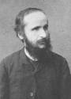
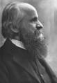
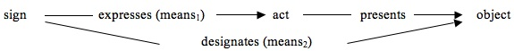

# Alexius Meinong

*Marek, Johann*

   
# Alexius Meinong
**First published Mon Dec 8, 2008; substantive revision Tue Dec 26, 2023**

Alexius Meinong Ritter von Handschuchsheim (b. 1853, d. 1920) was an Austrian philosopher and psychologist who worked at the University of Graz from 1882 until his death. He initiated experimental psychology in Austria-Hungary by founding the first psychological laboratory there in 1894. However, he became primarily renowned for the so called *theory of objects* ([*Gegenstandstheorie*], 1904), a kind of *a priori* ontological account that introduces and considers systematically not only existent but also non-existent objects. His approach is not only shaped by Franz Brentano’s descriptive psychology, a form of phenomenological philosophy, and its connected notion of intentionality (directedness of mind), but also by the British empiricists. Continuing and modifying Brentano’s philosophical teachings, Meinong provided important original contributions to quite a few philosophical disciplines, most notably to ontology and metaphysics, value theory, epistemology, philosophical psychology, and philosophy of language.

In this vein, for example, he tried to lay new foundations for the theory of value by going back to value-feelings (emotions) as its psychological basis. But although Meinong had constantly recognized the fundamental role of psychology in philosophy, he became more and more an opponent of psychologism. His switch to an objectivistic account of a theory of value (1912) and his distinction between the “psychological” (mental) content and the object of a mental act, introduced in 1899, became hallmarks of his anti-psychologism.

Meinong found a sympathetic reader in Bertrand Russell. However, Russell later rejected both Meinong’s object theory, with its conception of non-being, and his philosophical psychology, which conceives consciousness as a relation to objects via mental contents. Russell’s criticism was mainly responsible for Meinong’s international recognition. On the one hand, Russell made Meinong notorious. On the other hand, the controversy with Russell also became an incentive for the development of Meinongian versions of logic and semantics as a serious alternative to classical logic and semantics (especially neo-Meinongianism, a modern version of Meinongianism).

## 1. Life and Work

### 1.1 Chronology

| (1853) | Born July 17 in Lemberg, former capital of the Austrian crown land Galicia (before and after the Habsburg period Lwów, Poland; today Lviv, Ukraine). Youngest of the six children of Anton Meinong von Handschuchsheim (1799–1870), and Wilhelmine, née Sófalví (1817–1909). |
| --- | --- |
| (1862) | Meinong comes to Vienna; first as a private student, then as a public student for his high school education at the Academic Gymnasium in Vienna (1868–1870). |
| (1874) | Meinong receives D.Phil. in History as major and German Philology as minor at the University of Vienna. His doctoral dissertation is on the history of Arnold of Brescia [*Zur Geschichte Arnold’s von Brescia*]. Franz Brentano is one of Meinong’s examiners in his philosophical doctoral examination (“Philosophicum”). |
| (1875) | Meinong attends philosophical courses held by Brentano for four semesters; before this, for two semesters, he also attended courses on economics held by Carl Menger. |
| (1878) | Meinong earns a Habilitation in Philosophy at the University of Vienna with the thesis, supervised by F. Brentano, *Hume-Studien I. Zur Geschichte und Kritik des modernen Nominalismus*, and becomes *Privatdozent* there. |
| (1882) | Meinong becomes a *Professor Extraordinarius* at the University of Graz. |
| (1889) | Meinong is appointed *Professor Ordinarius* at the University of Graz; stays in this position until his death. Marriage to Doris Buchholz (1865–1940). |
| (1892) | Son Ernst born November 15 (deceased 1940). |
| (1894) | Meinong founds Austria’s first psychological laboratory. |
| (1897) | Meinong establishes the Philosophical Seminar at the University of Graz. |
| (1898) | Meinong gets an offer from the University of Kiel, but he rejects it and remains in Graz. |
| (1904) | Meinong edits *Untersuchungen zur Gegenstandstheorie und Psychologie*, a composite publication of the so-called Graz School of experimental psychology (Gestalt psychology) and theory of objects. |
| (1906) | Meinong becomes a Corresponding Member of the Austrian Academy of Science. |
| (1914) | Meinong rejects the offer to become a professor at the University of Vienna. Elected as a Real Member of the Austrian Academy of Science. |
| (1916) | Appointment as *Hofrat* [Councilor]. |
| (1920) | Meinong dies November 27 in Graz. |
| (1933) | John Niemeyer Findlay receives his D.Phil. at the University of Graz with his book *Meinong’s Theory of Objects* as a doctoral dissertation — supervisor and first examiner: Ernst Mally, a former disciple of Meinong and Meinong’s successor in Graz. |
| (1968–1978) | Publication of the Complete Edition of Meinong’s works in seven volumes and one supplement. |

### 1.2 Meinong’s Life and Work

Meinong’s father was an Austrian Major General whose ancestors came from southwestern Germany (Handschuchsheim, near Heidelberg). Meinong repeatedly stressed that he was German, and he also joined political organizations of German nationalists. On the other hand, he was a loyal Austrian and emphasized his distance from extreme, Pan-Germanist groups like those that had taken up the ideas of Georg von Schönerer.

Meinong showed a strong inclination to music, practically as well as theoretically. He performed chamber music in a proficient way (the piano and especially the violin), was an amateur composer (mainly of *Lieder*) and took an interest in theoretical questions concerning music (for example, he was engaged in discussions with Guido Adler, Christian von Ehrenfels, Stephan Witasek, and Joseph Marx, and he wrote reviews of Carl Stumpf’s *Tonpsychologie*, Vol. I and II).

Meinong suffered from an inherited semi-blindness, a handicap that he always tried to conceal, but which was already a hindrance in his early years and deteriorated to almost complete blindness in the course of his life. Eventually, he needed people like his wife to read to him. So it was rather difficult for him to become acquainted with the literature of his time. In spite of such unfavorable circumstances and although Meinong rather shunned social, political and cultural exposure (including the giving of public lectures and participation in conferences), he was still able to exert considerable influence on the academic community of his time. Meinong’s great achievements were due in part to his ambition and perseverance, combined with diligence and a disciplined way of working. To a considerable extent Meinong’s accomplishments were facilitated by a well-organized family life for which his wife Doris bears much of the responsibility and credit. Meinong is a paradigmatic example of a bourgeois academic scholar — of an “Ordinarius” — around the turn of the century.

Life-time friendships begun in Meinong’s Viennese academic period included those with the musicologist Guido Adler and the philosophers (also his pupils) Christian von Ehrenfels, Alois Höfler, and Anton von Oelzelt-Newin. During the time of his professorship in Graz he also became the teacher of, among others, Eduard Martinak, Stephan Witasek, Anton Faist, Rudolf Ameseder, Vittorio Benussi, Ernst Mally, Joseph Marx, Franz Weber, Ferdinand Weinhandl, and Fritz Heider.

Although Meinong was a Roman Catholic, his early work already showed a critical and distanced attitude towards the Catholic Church. Like Arnold of Brescia, Meinong advocated the separation of religious and secular affairs as well as the idea of the political equality of all denominations. Furthermore, Meinong criticized the religious education in Austria’s “Mittelschulen” [*high schools*] as inadequate, since he considered it to be a restriction on freedom of opinion. Meinong suggested that historians (and not priests) should instead teach the history of the development of religions and the various ways of satisfying religious needs.

His early essays, the “Hume Studies”, I (1877) and II (1882) — his only investigations with an explicit historical orientation — are, as the subtitles foreshadow, nonetheless critical and systematic treatises. Written under the influence of his Viennese mentor Franz Brentano, they show Meinong’s tendency towards British Empiricism (rather than Kantianism and German Idealism) and became relevant in the development of his object theory.

Meinong’s first book *On Philosophical Science and its Propaedeutics* (1885) plays a pivotal role for the understanding of Meinong’s research as well as his teaching activities. Originally, this book was written with the intention to criticize instructions issued by the Ministry of Culture and Instruction to cut down the hours of high school teaching in Philosophical Propaedeutics [*philosophisch-propädeutischer Unterricht*], i.e., psychology, logic and philosophy. But the book can also be read as a programmatic essay on Meinong’s own views on philosophy and psychology. He makes it clear that philosophy can be done in a scientific rather than in a speculative manner, and he considers psychology as a fundamental subdiscipline of philosophy. Teaching psychology and philosophy cannot consist in the attempt to present finished results or accepted theories; it has to be done by performing experiments and engaging in discussion, respectively. Uncertainty in the domain of knowledge is not to be considered as an obstacle, but rather as a didactically fertile challenge and an opportunity for making progress. Because of this practically-oriented view of philosophy and science, Meinong proposed the establishment of both a Psychological Laboratory and a Philosophical Seminar as university institutions in Graz. As an academic philosopher he made it his duty to find extra time to discuss philosophical matters with his students, friends, and colleagues.

In his *Psychological-Ethical Investigations in* *Value Theory* (1894), Meinong discussed the subjectivist economic value theories of the Austrian economists Carl Menger and Friedrich von Wieser. He took over, in principle, their subjectivist approach, but he criticized and modified their theory of marginal utility in certain ways. On the one hand, he extended it to values in general, over and above mere economic values, on the other hand, he applied it to other axiological domains, especially to ethics. He also developed in detail his idea that ethics was entirely determined by the *value–disvalue* [*Wert–Unwert*] distinction. Beginning with his paper from 1912 “Für die Psychologie ...” and then with *On Emotional Presentation* (1917) and other later works on value theory (1921; 1923), Meinong took an objectivist point of view and combined the psychological analysis of values with his theory of objects. Values and norms (“oughts”, [*Sollen*]) are to be seen as special kinds of objects, and there are not only personal values but also impersonal ones.

Meinong’s psychological works are more concerned with the methodology of psychology and with what Brentano called “descriptive psychology” — a kind of classification or taking of an inventory of the mental furniture — than with “genetic psychology”, i.e., the experiment-based, causal theory of mental (and physiological) occurrences (cf. Antonelli 2018: 3–100)[^antonelli-2018]. Stimulated by Twardowski (1894) but also in critical distance to this treatise, Meinong combined descriptive-psychological matters with epistemological and ontological themes in his essay “On Objects of Higher Order and Their Relationship to Internal Perception” (1899).

Meinong’s mature epistemological views, which are both anti-skeptical and fallibilistic, are to be found in his 1906, 1910, and 1915. He propagated a theory of evidence as the basis of justification partly similar to Brentano’s (as far as the “direct–indirect” and “*a priori*–*a posteriori*” distinctions are concerned), partly in sharp contrast to it, because already in 1886 Meinong added the “evidence for presumption” [*Vermutungsevidenz*] to the “evidence for certainty”, something of which Brentano strongly disapproved.

In his later works (1902; 1904b; 1906; 1907; 1910; 1915; 1917; 1918) the various aforementioned philosophical disciplines are intertwined, only the emphasis of the subject matters differs. Although the topics of the monographs seem to be narrowly demarcated (*On Assumptions* (1902, 1910); *On Possibility and Probability* (1915); *On Emotional Presentation* (1917)), Meinong deals with a broad range of subjects so that one can make out the development of a complete system of philosophy. A work of a more general character is “The Theory of Objects” (1904b), a kind of manifesto, which was continued by the apologetic and also programmatic book *On the Place of the Theory of Objects in the System of Sciences* (1907).

In 1918, Meinong published his last major work — an attempt at proving the law of universal causation, i.e. the principle that assures the unexceptional causal determination of all occurrences (states, events). He provides two arguments in favor of this principle. First, he argues, following Hobbes and Brentano, that uncaused events turn out to be infinitely improbable. Second, Meinong uses an *a priori* proof of his own which claims that exceptionless determinacy is necessary as no occurrence can be without a state of affairs that Meinong calls its “implicans” (1918: 45–66; cf. Hartmann 1920)[^hartmann-1920]. Meinong not only supports determinism, he also defends compatibilism because determinism, and not indeterminism, allows us to ascribe responsibility (for being guilty, or meritorious etc.) to persons (1894, §68; 1918: 92: “Freedom is not indeterminacy, and determinacy is not compulsion or coercion”).

Near the end of his life he wrote the short and yet comprehensive intellectual autobiography “A. Meinong” (1921a). Further biographical information is provided in Dölling 1999, the first biographical monograph on Meinong, and in Dölling 2001, Eder 1995, Kindinger 1965, Lindenfeld 1980 (Chapt. III), Raspa 2016.

## 2. Meinong on Philosophy

Meinong was neither a speculative philosopher nor a so-called philosophical system thinker. Nevertheless he gradually developed a philosophical system which included the main disciplines and had his theory of objects at its center. Meinong’s terminology constantly increased, and the number of his ideas and alleged objects grew steadily — although with significant revisions of some of his older views.

Meinong’s metaphilosophical reflections do not yield something like a definition of what philosophy is, and in his autobiography he concedes that he has not yet found a conceptually exact formula for it. Philosophy is supposed to be not a single sharply delineated science but an assemblage of sciences which are held together by the fact that they have to do with mental phenomena (1921a: 101; 1885: 5). There are no specifically philosophical objects, but everything that can be experienced “may be handled philosophically if treated from the point of view of its relation to the human thinking subject” (Hicks 1922: 5)[^hicks-1922]. Because of this, psychology becomes a fundamental discipline of this philosophical congeries. Another even more basic philosophical discipline is the theory of objects as it is the most general, comprehensive and fundamental science. According to Meinong, its range is wider than metaphysics because metaphysics deals only with existing things, i.e. with the entirety of the real. As metaphysics is determined by “the prejudice in favor of the actual”, it can only be seen as a universal science *a posteriori*. However, the theory of objects goes beyond that. It is an *a priori* science as it has to do with whatever can be known *a priori* about objects. It deals essentially with objects as such, or in Meinongian words, it “has to do with the given taken in its entirety” (1904b, §§2, 11).

Meinong saw himself neither in the camp of the empiricists nor in the camp of the rationalists; instead he claimed to be an empirical although not a psychologistic thinker (1907, §§25–6). Although Meinong’s theory of objects is an *a priori* science, its method can be characterized as a *philosophy from below*, a working method that follows the precepts of a kind of bottom-up thinking. There is an important analogy between the empirical (*a posteriori*) sciences and the theory of objects as a paradigmatic *a priori* science: both start from given data. In the case of the empirical sciences these data are experiences, while the data of the theory of objects usually are things that are not existent but only subsistent [*bestehend*] or even merely outside of being [*außerseiend*] (1917, §11: 103 [*92*]; 1921a, Sect. 2.F: 130). This “empirical manner of investigating” was appreciated by Russell (1904: 205), for instance. Moreover, our general as well as our particular knowledge of language facts is able to supply us with additional data as basis of further theorizing. Meinong (1904b, §10: 33 [*103*]) thus says “that the general theory of objects has to learn from grammar just as the specialized theory of objects can and must learn from mathematics” (cf. also 1904b: 15 [*88*]; 1907: 109). He also told his students that it is best to begin one’s investigations with linguistic data (Nachlass, Karton IV/b), and — because of this — that the answer to the question what the common man thinks of this or that situation or of this or that word is an indispensable presupposition of all other inquiry (Nachlass, Karton XI/e; cf. Manotta 2005: 65–68)[^manotta-2005].

Meinong considers ethics, aesthetics and logic to be the primary disciplines of practical philosophy. It is worth noting that he contrasts his customary use of “logic” as a practical discipline, which was adopted from Brentano and is comparable to *Port-Royal Logic* [*La Logique ou l’art de penser* (*Logic, or the Art of Thinking*)], with Kant’s and, especially, Husserl’s conception of a “formal” or “pure” logic and also with symbolic logic, “Logistik”, and algebra of logic, which all can be seen as parts of his theory of objects. He puts the distinction between theoretical and practical disciplines primarily down to the difference between theoretical and practical interests and not to the difference between the subject matters of the sciences. In contrast to the disciplines of theoretical philosophy — metaphysics, object theory, and theory of knowledge, for example —, which are determined by cognitive aims, the practical disciplines set themselves practical goals. They can be seen as something like applied sciences or branches of engineering [*Kunstlehren*], quite comparable to architecture, and nautical or military sciences. (1885: 96–98; 1904b, §§7–8; 1907, §20: 114–30; 1921a: 103, 130.)

## 3. Some Epistemology Matters

Epistemology has a double fact as its object: the known fact and the fact of knowing. Knowing is judging an objective (state of affairs, see below 4.3.1) with entitlement [*Berechtigung*] – both external and internal (1915, Chapt. IV). The external entitlement is provided by the truth or truth-conduciveness of the judged objective, the internal by evidence [*Evidenz*]. Evidence is not just a subjective feeling of conviction; it is an objective feature of the mental act component of judging (with or without certainty) and not of its mental content component. (For the difference between the act and content components of an experience see 4.1 below and the supplement on [Presentation of Objects via Psychological Content](meinong.supplement.md).) Following Brentano, Meinong stands up for a concept of evidence as a basis for the theory of knowledge. Meinong, for instance, accepts Brentano’s views on evidence as they pertain to the “direct–indirect” and “*a priori*–*a posteriori*” distinctions. On the one hand, direct evidence may be given as a borderline case in inner perception, in which case it is evidence *a posteriori* (1906, §§9–13: 47–68; §26: 111: “The evidence of inner perception, like that of memory, is mere conjectural evidence that only reaches the limit of certainty at the present limit.” [“*Die Evidenz der inneren Wahrnehmung ist, gleich der des Gedächtnisses, bloße Vermutungsevidenz, die nur an der Gegenwärtigkeitsgrenze die Gewißheitsgrenze erreicht*.”]). On the other hand, it may be given as knowledge of axiomatic truths, which is evidence *a priori* (1906, §1; 1915, §55).

Like Brentano, Meinong also thinks that perceiving and remembering are always cases of judging and not just representing (1915: 606–7, 613) and that a judgement is indirectly evident if it is concluded from directly evident judgements. On the other hand, Meinong deviates in certain respects from Brentano’s theory of evidence. Already in 1886, Meinong adds “evidence for presumption” [*Vermutungsevidenz*] to “evidence for certainty”. He realizes that we trust in memory, outer perception, and induction not “blindly and thoughtlessly” or by chance, although our trust in these abilities does not derive from anything else. It has an internal justification, which is directly given and neither derived from the a posteriori evidence of inner perception nor from the a priori evidence of axioms. In delivering a kind of inference to the best explanation, Meinong concludes that this confidence can be counted as a further source of knowledge. It manifests itself as direct evidence, but evidence for something that may be erroneous, not certain, and he therefore calls it “direct conjectural evidence” ([*unmittelbare* *Vermutungsevidenz*], 1886: 30–34). Brentano, who only accepted “evidence for certainty”, strongly disapproved of Meinong’s conception. He considered Meinong’s introduction of a new special mode of cognition to be a cutting rather than an unravelling of the Gordian knot (Kindinger 1965, 22–3)[^kindinger-1965]. – Actually this disagreement was the beginning of the estrangement between them.

As Meinong takes objectives as ideal objects, he gives up Brentano’s definition of truth by means of evidence. Brentano rejects the correspondence theory of truth, on the grounds that (among other things) he does not see anything in reality that would correspond to true negative judgements such as “there are no unicorns” and defines truth of judgements by their evidence (Brentano 1930: 139 [*82*])[^brentano-1930]; see entries on *Brentano* and *Brentano’s Theory of Judgement*). Meinong adopts a kind of identity theory of truth, which can be seen as a borderline case of a correspondence theory (Meinong 1915, §7; 1910, §13; see below 5.6). According to Meinong, the true negative judgement “there are no unicorns” has a subsistent objective as its corresponding object (the fact of the non-being of unicorns). If the objective in question does not subsist (has non-being) the judgement is false. However, though Meinong does not use the notion of evidence for a definition of truth, he holds it still relevant for a truth criterion because truth is a “proprium” of evidence (1915: 463), and evidence for certainty (and for presumption, respectively) makes truth (and probability, respectively) accessible to us. (A classical criticism of Meinong’s theory of evidence is Nelson 1908: 479–485.)[^nelson-1908]

Meinong’s epistemology turned out to be relevant to analytic theory of knowledge. Some of Chisholm’s (1966: 38–55) rules of evidence, for example, are a kind of application of Meinong’s conception of direct evidence for conjecture. Further, Meinong’s treatment of epistemic concepts like *truth* or *entitlement* as value concepts anticipates the epistemic normativity of some internalist positions. It is also worth mentioning, that Meinong (1915, §54) linked the “principle of the self-validity of all knowing” [*Prinzip der Selbstgültigkeit alles Erkennens*], a kind of prima facie justification principle, with the fallibilistic methodological-epistemological “principle of the critical openness of all knowing” [*Prinzip der kritischen Unabgeschlossenheit alles Erkennens*], which says that critical examination is always possible, since there is always an unverified judgement left at the end of a justification process.

In his *Erfahrungsgrundlagen* (1906) Meinong shows that a perception taken only from a causal point of view cannot explain, for example, why a perception picks out the distant object and not something between the perceived object and the observer. In investigating important features of perception, Meinong (1906, §22) introduces the concept of a perceptive forum [*Wahrnehmungsforum*]. The perceptive forums include the internal and external moments that affect the content of a perception. As such the sensing organs, the determinations of the perceived object and other media come into consideration. The forums are transparent in the sense that you cannot tell from the perceptive act which forums are involved. When you see, for example, a piece of chalk, by means of your spectacles, you see the chalk but you do not notice your eyes and your spectacles. But it is possible that the role of such media can be reconstructed by using causal approaches. Fritz Heider already discussed some of this accounts in his dissertation thesis *Zur Subjektivitaet der Sinnesqualitaeten* [*On the subjectivity of sense qualities*] (1920), and later, in his paper “Ding und Medium” [“Thing and Medium”] (1926/27), he took over Meinong’s conception that media are so to say glass – glass can mediate the seen of objects, but glass can also be seen as an object. From this point of view he elaborated fundamental features of media. Through its interesting, detailed descriptions this study together with later papers became a forerunner of some modern theories of media and communication (see, for example, Luhmann 1995; Krämer 2008)[^krämer-2008][^luhmann-1995].

## 4. Mind and Object

### 4.1 Psychological Content *versus* Logical Content

In his treatise “On Objects of Higher Order and Their Relationship to Internal Perception” (1899) Meinong explicitly introduces the distinction between the *psychological* (mental) *content* [*psychologischer Inhalt*] and the *object of a representation* [*Gegenstand einer Vorstellung*] — a fundamentally important distinction to him that he keeps on refining and extending (subsequently applying it to *all* kinds of mental acts).

Meinong’s view on non-existent and impossible objects was sharpened by Twardowski 1894. Twardowski’s work can be seen as the occasion for Meinong to begin thinking more deeply about the content/object distinction, and indeed Meinong took over some of Twardowski’s arguments. However, Meinong never thought that Twardowski’s distinction and conception of the content of a representation could be understood as a precise conceptual clarification that should be adopted unquestioningly. Meinong stated that there was a great deal of interesting niand useful information in Twardowski’s 1894 study, but he said this with respect to “the whole difficult and important problem of objects” and not exactly in relation to the difference between content and object (1899, §2: 185 [*141*]). Meinong, for example, accepts Twardowski’s critical attitude to the view that there are objectless, empty representations, a thesis Bolzano put forward “with special emphasis” (see the entry on Bernard Bolzano, Section 3.5). After 1894, Meinong took psychological contents as something purely mental and concrete. Such contents are therefore always something real. Twardowski, however, says that the content is a mental picture, but he also identifies the mental content with the meaning of a name and with Bolzano’s objective representation (idea), i.e., the representation (idea) in itself, or as such, [*Vorstellung an sich*]. For that reason Twardowski (1894: 31 [*29*]) takes the content — in contrast to the (real) act — as something that “always lacks reality”. Meinong, however, became more and more aware of the purely mental nature of the psychological content. He realized that the psychological content was not something abstract or conceptual in the sense of something intensional, that it was not some sort of meaning at all.

According to Meinong, all experiences [*Erlebnisse*], even the most elementary ones, are complex mental phenomena, because they contain at least three constituents: (1) the act, (2) the (psychological) content, and (3) the object of the experience. The first two components are intrinsically mental and, therefore, must exist if the experience exists, whereas the third one need not exist, and it is usually extrinsic to the mental. If somebody entertains a strong hope for universal peace, for instance, then (1) the act of hope (and not of hate) exists, (2) the corresponding psychological content exists, but (3) no universal peace may occur (there is only the non-existent object *the universal peace*). Meinong believes that experiences can have different objects [*Gegenstände*] for two reasons: (i) Different kinds of acts correspond to different kinds of objects (for example, “objecta” correspond to representations, and “objectives” to thoughts; see below 4.3.1). (ii) But inside an act, so to speak, any variation on the side of the objects is correlated with a variation of some mental component which is the psychological content of the experience. (See the supplement on [Presentation of Objects via Psychological Content](meinong.supplement.md).)

What is often called “content”, especially “conceptual content”, is not a Meinongian psychological content. Meinong distinguishes between psychological and logical (= conceptual) content in his later work, but he stresses the point that so-called “logical content” is “not [psychological] content but object or, more exactly, it is the proximate object” a psychological content is related to (1915: 163n). The psychological content of a presentation is not something abstract or intensional, whereas the conceptual content is identified with the auxiliary object, which is an incomplete object and which seems in a way akin to a universal (1915, §23: 163, §28: 206, unpublished appendix in Meinong 1968–78, Vol. VI: 739–40; 1978: 368, 400; see also Section 6 below). However, the connection to meaning, reference, and so-called “logical content” is guaranteed by Meinong’s ideal relation of adequateness between the psychological content to its corresponding object, expounded in the supplement below. Perhaps this is one reason why quite a number of Meinong’s interpreters seem to bring Meinong’s psychological content too close to the sphere of intensions. Nevertheless, Meinong thinks that the introduced distinction between the psychological content and its corresponding proximate object, which is the logical content, allows him to avoid psychologism. See the supplement:

> [Presentation of Objects via Psychological Content](meinong.supplement.md)

### 4.2 Mind as Object — Self-Presentation in Contrast to Other-Presentation

Meinong’s so-called *self-presentation* [*Selbstpräsentation*] usually counts as a mark of consciousness, of the manifest mental. Experiences, i.e., conscious mental occurrences, are able to present themselves to a self. This kind of self-presentation is not yet presentation of the self or the ego, which was not an issue for Meinong. It should also be set apart from self-evidence in the sense of infallibility, and from inner perception, self-observation, and higher-order thinking. The whole manifest mental life is self-presenting, that is, all the experiences of a subject are self-presenting to the experiencing subject. If you are happy that it is raining**,** you can grasp your happiness in inner perception**,** but not by means of a separate mental content. That your mental experiences present themselves to you means you refer to your instantaneous experiences without the intermediary of a further representation of them. You are able to reflect upon your momentary anger or upon your feeling of shame, for instance, without needing a kind of mental symbol of your anger or your feeling of shame.

Usually, the objects of experiences are not constituted by their experiences: they are something mind independent and not immanent to consciousness. What is immanent to the mind (consciousness) are the experiences themselves. When you have a representation of red, for example, you are conscious of the object *red*. In such a representation of *red*, the red-content serves as a kind of sign of something, i.e., *red*, and is itself a mental piece of the whole representation. In order to present the red-content as object of an inner reflective experience, you do not need a further, separate representation with an additional mental content to which the red-content corresponds as object. The red-content has the capacity to present itself to your mind. In general, the reference to one’s own experiences does not require the intervention of an additional content. Meinong thinks that *all* inner experiences and *all* parts of them are able to be apprehended through self-presentation. Meinong (1910, §20: 138 [*103*], §43: 264 [*190–1*]; 1915, §33; 1917, §1) calls it the *self*-presentation of inner experiences in opposition to the *other*-presentation [*Fremdpräsentation*], where the content functions as sign for something else. Since experiences do not need to be brought within the range of apprehension by presentations (and contents) of their own, Meinong calls the self-presenting parts of an experience (act component and content component) and the whole self-presenting experience *quasi-contents*. The quasi-content coincides with the object that is to be apprehended or intended. When you desire something, for example, it may also happen that you judge about your desire. The whole desire, then, presents itself to your judgement without any supplementary interfering content. It plays the role of a content, so to speak — hence the name “quasi-content.”

Meinong (1906, §§11 and 13; 1910, §43) thinks that attention allows us to do two different things with one and the same experience and content respectively: (1) If we direct our attention to our inner experience, for instance, to the red content of a representation of red, this very content serves for the inner perception of itself — the red-content becomes an intended object and serves for the apprehension (perception) of itself. He also says that in this case the content becomes *turned inwards* (*introversion*, [*Einwärtswendung*]). (2) If the content contributes to a perception or a thought of something red, the content concerns something external to the mind — it serves for the apprehension of the coordinated outer objects and can therefore be called *turned outwards* (*extraversion*, [*Auswärtswendung*]).

Meinong would not accept the following highly controversial thesis of consciousness:

**(C)**

Consciousness is necessarily such that if a subject *s* has a conscious property *P*, *s* is also conscious of its* having the property *P*.

This is a thesis of self-consciousness in a twofold manner: First, *s* is conscious of itself in a direct (de se) manner — therefore, the third person pronoun is used with a Castañeda asterisk as a sign of a “quasi-indicator”, i.e., an emphatic reflexive expressing the reference of the subject to itself qua itself (cf. the entry on indexicals, Section 5). Secondly, *s* is conscious of the conscious state it is in. Brentano accepted (C), with some provisos in order to avoid an infinite regress. Brentano thinks that conscious states (mental acts) are necessarily such that if a subject *s* is in a conscious state, *s* is also conscious of its* being in this state. This self-consciousness is to be interpreted as inner perception, but *not as a separate higher-order perception*: Each mental act is primarily directed to an object (my hearing a sound has the sound as its primary object), and it is *incidentally* directed towards itself (my hearing a sound has itself as secondary object). (See Brentano 1874, 2. Buch, 2. Kap., §§8–9; Brentano 1982: 22–5)[^brentano-1874][^brentano-1982].

Meinong would instead state:

**(C1)**

Being *F* is a self-presenting property for a subject *s* =_{*df*} Being *F* is necessarily such that, if *s* is *F*, and if *s* thinks about its* being *F*, then *s* does not need any particular, separate presentation of its* being *F*.

**(C2)**

Being *F* is self-presented to a subject *s* =_{*df*} (1) Being *F* is a self-presenting property for a subject *s*, (2) *s* is *F*, and (3) *s* thinks about its* being *F*.

**(C3)**

Conscious properties are necessarily self-presenting properties, and self-presenting properties are necessarily conscious properties.

**(C4)**

The evidence one gets by self-presentation is (1) direct, (2) certain (in the borderline case of immediate presence), and (3) *a posteriori*.

Consciousness does not automatically include some kind of self-reflection. An experience’s being conscious does not consist in the subject’s having a higher-order thought; that is, consciousness *only allows* self-reflection by self-presentation in the sense of (C2), but does not already involve any higher-order thoughts or inner perception in a Brentanoan sense. Meinong’s use of “self-presentation” seems to have two readings: (1) as an *ability-based term*, when you say that the self-presentation of an experience consists in its *ability* to be apprehended directly, that is, without any supplementary psychological content; (2) as a *nondispositional term* that expresses a *manifest* self-presentation in the sense that the experience is actually self-presented. (C3) expresses the thesis that being a self-presenting state is a mark of consciousness: The whole of a person’s manifest mental life is self-presenting (understood as “selfpresent*able*”, as an ability-based term); that is, all experiences of a subject are in this sense self-presenting to the experiencing subject. (Cf. Marek 2003; 2012.)[^marek-2003]

### 4.3 The Manifoldness of Mind

Although Meinong is concerned with the subject matter Brentano called *intentional inexistence* of an object, he avoids using this term or something like *intentionality*. Meinong is not completely sure whether “being directed to something, to an object” is common to all experiences. But Meinong stresses the point that experiences like representations, judgements, feelings and desires are usually directed to an object (1904b, §1; 1899, §2: 185 [*141*]), and he interprets the intentionality of such mental occurrences in a relational rather than in an adverbial manner (“I am sensing (something) red” instead of “I am sensing redly”). Agreeing with Twardowski, Meinong stresses the point that among the objects that are presented to the subject, some may not exist and some may not even be possible, for example the round square or the state of affairs (“objective”) that a biangle exists.

Meinong’s philosophical psychology is influenced by Brentano’s descriptive psychology, but Meinong modified it in several ways. There are at least four main modifications involving Brentano’s view of mental phenomena, especially Brentano’s tripartite classification of such phenomena into representations, judgements, and phenomena of love and hate (or emotions [*Gemütsbewegungen*]): (1) Meinong’s first deviation consists in dividing up the class of emotions into the classes of *feelings* [*Gefühle*] and of *desires* [*Begehrungen*]. (2) His second modification consists in introducing the differentiation between *serious* [*ernstartige*] and *fantasy* [*phantasieartige*] experiences (the latter include what he called “assumptions”). (3) He distinguishes between the *act*, the *(psychological) content*, and the *object* of a mental phenomenon (see above 4.1). (4) He gives up Brentano’s thesis that we can be intentionally directed to one and the same object in different ways, i.e., by different kinds of mental acts, and he argues in favor of proper, nonreal (ideal) objects corresponding to judging, feeling, and desiring. (For further investigations regarding the affinities and divergences between both philosophers, see Rollinger 2005 and Marek 2017.)[^marek-2017][^rollinger-2005]

#### 4.3.1 Mental Elementary Experiences and Their Objects

As Meinong supposes that the different kinds of acts are coordinated with the different kinds of presented objects [*präsentierte Gegenstände*], his classification of mental elementary experiences [*psychische Elementarerlebnisse*] allows a *categorization of all objects from an intentionalistic point of view*:

| Experience [*Erlebnis*] |   |   |   |
| --- | --- | --- | --- |
| intellectual | emotional |   |   |
| Representation [*Vorstellung*] serious or fantasy | Thought [*Gedanke*] serious (= judgement [*Urteil*]) or fantasy (= assumption [*Annahme*]) | Feeling [*Gefühl*] serious or fantasy | Desire [*Begehren*] serious or fantasy |
| object of representation [*Vorstellungsgegenstand*]: objectum [*Objekt*] | object of thought [*Denkgegenstand*]: objective [*Objektiv*] | object of feeling [*Fühlgegenstand*]: dignitative [*Dignitativ*] | object of desire [*Begehrungsgegenstand*]: desiderative [*Desiderativ*] |
| *Red* | *Red is a color* | *The attractiveness of red* | *The fruit should be red* |

A representation does not occur in isolation — it always comes to mind in the context of a further, more complex mental act that includes this very representation as a psychological presupposition, i.e., representations are always embedded in propositional attitudes. We do not just present the object *red*, we judge, for example, that something is red, or that *red* is something (1910, §§38, 45; 1915, §33; 1917, §§1, 8). On the other hand, no mental act can take place without the occurrence of a representation, and hence the objects of a mental act always include an objectum; no objective, for instance, can subsist without an objectum (even though the objectum in question may be a beingless object) (1910, §20: 135 [*101*]). The judgement that red is a color presupposes the representations of red and of color, for example. The common linguistic expressions of represented objecta are nouns or adjectives. Objecta can be continuants but also occurrents, and they can be either real or ideal.[^note-1] Objectives are always ideal, they are something like states of affairs or propositions and can be expressed (1) by an independent sentence like “Red is a color” if they are judged or assumed, and (2) by a “that”-clause (“that red is a color”) or a nominal phrase (“the colorfulness of red”) if they are judged about (1910, §10). That which is judged [*geurteilt*] is always an objective whereas that which is judged about [*beurteilt*] is often an objectum but can be an objective, a dignitative, and a desiderative as well. There is no objective which is an objectum, although objectives may be the subject matter of further objectives as, for example, in “Meinong believed that the round square is round”. Following his pupil Rudolf Ameseder (1904: 54–5), Meinong stresses the point that objectives can be characterized as those objects that not only can *have* being but can also *be* being, whereas objecta can have being but can never be being. This dictum is based on the linguistic fact that the “that”-clauses “that (object) *o* is” and “that (object) *o* is *F*”, respectively, can frequently be replaced by the nominal (gerund) phrases “the being of *o*” and “the being *F* of *o*”, respectively (1910, §11: 61–2 [*50–1*]; 1915, §5: 27; Morscher & Simons 2001: 443–4)[^morscher-2001].

Meinong was not completely sure whether his classification of mental acts and its corresponding categorization of objects (taken intentionalistically) were complete (1917, §11). A candidate for another category would be questions. Are questions reducible to something like a specific desire to know something, as Meinong thought (1910, §18), or are they ultimately irreducible? And do they have specific objects of their own, which could be coined “quaesitives” or “rogatives” (cf. Kreibig 1914)[^kreibig-1914]? One might think that another candidate would be drawing conclusions, because it is controversial whether inferences can be understood simply as complex judgements. Meinong did not consider this possibility; he just reduced inferences to particular (specially “motivated”) judgements about assumptions or about judgements (1910, §§27–32).

#### 4.3.2 Fantasy Experiences and Serious Experiences

The distinction between fantasy (imaginary) experiences and serious experiences concerns the act component. This distinction is a generalization of Meinong’s division of thoughts into assumption and judgements, which he introduces in *On Assumptions* (1902). Meinong, considering assumptions as a subclass of thoughts, places them “between representations and judgements”, as they are, like judgements, affirmative or negative; and like representations, without belief (1910; §§1, 59). Judgements are directed to objectives *and* involve conviction, whereas assumptions do not involve conviction — they merely involve entertaining the objectives they are directed at (1910: 376 [*268*]). Meinong realized that such an entertaining of objectives without conviction plays a central role in our intellectual and emotional lives. Asking questions, denying, reasoning, desiring, playing games, performing or producing artistic works would not be possible without assuming. In judging that *A or B*, for example, one does not judge *A* and *B*, respectively — one only assumes them. Fantasy and serious cases can also be found in the other kinds of experiences. As an illustration, if a representation of red has a perceptual look because a red-quale is involved, it is of a serious character, and if the red-representation is merely reproductive, that is, a recollective or imaginative one, it is a fantasy experience and so only of an imaginary character. Meinong’s application of the fantasy/serious distinction to *all* kinds of mental acts (including the affective and conative dimension) may seem schematic and controversial, but also leads to remarkable insights into phenomena like art and into understanding the role of emotions in writing and reading fiction, as empathic experiences and reception of art provide us with paradigmatic cases of fantasy representations, fantasy thoughts, and — especially — fantasy feelings. These are neither merely representations of emotions nor serious emotions but something intermediate between representations and serious emotions. In general, fantasy experiences are not imagined experiences as they are not merely representations of experiences. Adopting Mally’s distinction between fantasy judgement and pure assumption [*Unterscheidung von Phantasieurteil und reiner Annahme*] (1912: 61–2, fn.) Meinong later even distinguishes between (1) *serious-like* and (2) *shadowy* fantasy experiences [*ernstartige* versus *schattenhafte Phantasieerlebnisse*]. A fantasy experience (e.g., an assumption) can be understood either (1) as a pretense of experiencing seriously (e.g., of making a judgement) or (2) as a mere entertaining of the object (e.g., an objective without a pretense of judging) (1917, §6: 47–53 [*42–47*]). Introducing the concept of shadowy fantasy experiences (or pure assumption, respectively) allows some forms of fantasy to be understood without resort to a pretense theory.

Assumptions do not imply conviction. Hence, no assumption can exhibit any evidential advantage over another assumption or can be challenged on evidential grounds. From the standpoint of an evidential requirement, one cannot believe everything, but one can assume everything, that is, one can assume any objective and one can represent any objectum. Meinong calls this insight the *principle of unrestricted freedom of assumption* [*Prinzip der* *unbeschränkten Annahmefreiheit*] (1910, §60) and contrasts it with the principle of relatively constrained assumptions, which postulates a quite unmistakable logical constraint when one regards one or more assumptions as already given and then logically relates further assumptions to them: “It is true that assumptions are without exception free, absolutely regarded; but for all that, they can be constrained relatively.” (1910, §60: 346 [*246–7*]) Over the years, Meinong maintained that there were limitations of his principle of unrestricted freedom of assumption. He speaks of such a limitation explicitly in connection with the modal moment (1915, §37: 282; see below 5.4.3), and his discussion whether some defective objects fail outside-being and were therefore no loyal objects can be interpreted as limiting this freedom principle. (Cf. 1917, §2; 1978: 377–8; see below 5.3.1.)

#### 4.3.3 Production of Representations

Assembling objects to a more complex object is an important activity of the mind, but it does not form a separate species of elementary experiences beyond the four aforementioned types of mental acts. According to Meinong (1902, §2; 1910, §2) two or more representations of objecta can be used to produce a new representation of a complex objectum. The objects of the more simple representations can be seen as the foundation of the complex object, which is always an object of higher order, a *superius*, because it is founded by the founding objects (*inferiora*). (See below Section 5.5.) The diversity of red and green has *red* and *green*, the checkered pattern has squares of different colors, and a red square has *red* and *square* as its inferiora. In order to get a representation of objects of higher order, of a Gestalt, a melody, for example, you have to have representations of the more elementary objects on which you build the complex representation. This operation of the mind is called “production of representations” [“*Vorstellungsproduktion*”] because the mind is able to produce complex representations and not already their corresponding complex objects. This conception became an important and fruitful, although controversial, notion in Gestalt psychology, as Meinong still acknowledges the primacy of the elementary representations. The underlying elements of objects of higher order, for example, are not to be seen as “only abstractly distinguishable parts” which was assumed by the Berlin Gestalt school. (Cf. Smith 1994, Chapt. 8: 272.)[^smith-1994]

## 5. Object Theory — Ontology beyond Being and Non-Being

### 5.1 The Principle of Independence and the Principle of Indifference

Whatever can be experienced in some way, i.e., be the target of a mental act, Meinong calls an object [*Gegenstand* or *Objekt*]. The term “object” is a “relation term” in the sense that “you shall not speak of an object without considering a mental activity” (1888–1903: 47). Meinong does not see an ontological but only a conceptual dependence expressed by the term “object”, and he does not determine an object intentionally as something that is grasped but only as something that *can* be grasped by mental acts (it *can* be represented, judged etc.). He is neither a constructivist nor a subjective idealist as he admits that the mental acts are not already to be thought of as something that create objects. He (1904b, §4; 1921a: 110) also acknowledges the following connection between “(every) thing” and “object”: Everything is an object, but everything is logically prior to its apprehending and pre-given [*vorgegeben*] to the mind. Referring to Meinong’s theory of knowledge lectures in the winter term 1903/4, Ernst Mally (1904, Chapt. I, §3, 126), even states “Everything that is something is called an object” [*“Alles, was etwas ist, heißt ein Gegenstand”*]).

Not only existing things but also all kinds of non-beings (nonentities, Routley 1980: 7)[^routley-1980] find their place in Meinong’s all-embracing theory of objects — among them even impossible objects, like the round square, as well as paradoxical, “defective” objects, like some forms of *the liar* or special cases of purely self-referential thinking (*the thought about itself*, for example).[^note-2] Similar to Twardowski (see above 4.1), Meinong maintains that talking about non-beings is not just speaking of nothing, i.e. there can be no objectless representations and thoughts. He clears up the apparently paradoxical sentence “There are objects of which it is true that there are no such objects” (1904b, §3) by introducing two meanings of “there are”: first as *outside-being* (pre-giveness), second as *being*, and he tries to give a rational account of the paradoxical sentence by referring to two closely related principles: (1) the “principle of the independence of so-being from being” [*“Prinzip der Unabhängigkeit des Soseins vom Sein”*], and (2) the “principle of the indifference of the pure object to being” (“principle of the outside-being of the pure object” [*“Satz vom Außersein des reinen Gegenstandes”*]) (1904b, §3–4).

Ad 1: The *independence principle*, first formulated by Ernst Mally in the year 1903 and a little later in his 1904 (Chapt. I, §3), states that “the so-being of an object is not affected by its non-being” (Meinong 1904b: 8 [*82*]), that is to say, an object’s having properties is independent of whether it has being or not. Meinong’s comments on this principle show that it combines several claims; in particular, (i) the *characterization principle*, which postulates that any object has those properties that it is characterized as having (e.g., “The *AB* is *A* and *B*, respectively”), and (ii) the *denial of the ontological assumption*, which denies that there are no true propositions about what does not have being (cf. Routley 1980)[^routley-1980].

Ad 2: The *indifference principle* says: “The object is by nature indifferent to being, although in any case one of the object’s two objectives of being, its being or its non-being, subsists” (1904b: 13 [*86*]). This formulation is supposed to be less misleading than the claim that “the pure object stands ‘beyond being and non-being’ ” [“*der reine Gegenstand stehe* ‘*jenseits von Sein und Nichtsein*’”]. The latter catchphrase means that neither being nor non-being belongs to the make-up of an object’s nature (its so-being [*Sosein*]), but it should not be taken to mean that an object is beyond being and non-being in the sense that it neither has being nor does not have being — the second clause of the indifference principle makes this clear. Although the non-being of an object may be guaranteed by the object’s nature — as in the case of the round square, for example —, the non-being does not belong to its nature. In other words: Being (or non-being) is not part of an object’s nature, but nevertheless “the law of excluded middle lays it down that every object necessarily stands in a fact of being or in a fact of non-being” (Findlay 1963: 49). It is worth noticing that there are two interpretations of negation (narrower, internal, predicate, or ontological negation *versus* wider, external, sentence, logical negation), and accordingly there are two versions of the law of excluded middle. Meinong seems to accept the law of excluded middle only with respect to sentence negation.

### 5.2 Incomplete Objects

#### 5.2.1 Incomplete Objects and Their Logic

In his 1915, §25, Meinong introduces in more detail the notion of *incompletely determined objects*, i.e., objects that are undetermined with respect to at least one property. Pure things like the triangle as such are incomplete objects. The triangle as such has three angles (a *constitutive* property), it has three sides (a *consecutive* property, one that is somehow included in the object’s constitutive properties), but it is neither scalene nor non-scalene, neither green nor non-green etc. In such cases denying that *a* is *F* does not imply affirming that *a* is not *F*, because the denial that *a* is *F* may also be correct when *a* is not determined with respect to *F*. Incomplete objects infringe the law of excluded middle (and impossible objects infringe the law of noncontradiction) with respect to internal negation only (predicate negation: “~”) and not with respect to external negation (sentence negation: “¬”). Meinong would have acknowledged the validity of

> Law of Noncontradiction: ∀*F*∀*x*¬(*Fx* ∧ ¬*Fx*)

and

> Law of Excluded Middle: ∀*F*∀*x*(*Fx* ∨ ¬*Fx*)

but he would also have admitted the theses:

> ∃*F*∃*x*[*Fx* ∧ (~*F*)*x*]
> ∃*F*∃*x* ¬[*Fx* ∨ (~*F*)*x*]

More recent philosophical work shows that characterizing determinations can be constructed which go against any classical logical law. The object *the square such that it is not the case that it is square* is characterized as being square and also being such that it is not the case that it is square. These two determinations, however, lead to a contradiction involving external negation. (See Routley 1980; Simons 1992: 185; Thrush 2001b.)[^routley-1980][^simons-1992][^thrush-2001b]

#### 5.2.2 Indeterminacy with Respect to Being

With respect to being, Meinong states that all complete objects have either being or non-being, and all incomplete objects lack being. Meinong’s indifference principle accommodates the law of excluded middle in the external but not in the internal version. From the fact that incomplete objects do not have being, it does not follow that they have non-being as well. Some of them, for example, incomplete objects that are also contradictorily determined, have non-being; others, like the triangle as such, are not determined with respect to being at all.

Using “*B*!” as an abbreviation for Meinong’s “has being”, this can be summed up as follows:

- If object *x* is determined with respect to being [*seinsbestimmt*] then ¬(*B*!*x*) → (~*B*!)*x*.
- If *x* is not determined with respect to being then ¬[¬(*B*!*x*) → (~*B*!)*x*].
- “¬(*B*!*x*)” either implies “(~*B*!)*x*” or “*x* is not determined with respect to being”.

This indeterminacy with respect to being [*Seinsunbestimmtheit*] must not be mixed up with the indifference to being (or outside-being [*Außersein*]), because every object has outside-being whereas only some of them — the square (as such), for example — are not determined with respect to being (1915, §25).

#### 5.2.3 Incomplete Objects as the Territory “Where Possibility Is at Home”

Incomplete objects play an important role in Meinong’s late philosophy, for instance as “auxiliary objects” to indicate the (usually complete) target objects of our intending (see below Section 6), and as the basis of ascribing possibility and degrees of possibility to objectives. Some objectives are factual, some nonfactual [*untatsächlich*], and some are neither (i.e. “subfactual” [*untertatsächlich*]). The subfactual objectives, which concern incomplete objects, constitute the proper territory “where possibility is at home” (1915, §24: 167). Incomplete objects that are not determined with respect to being serve as the foundation of possibility insofar as neither the factuality nor the nonfactuality of their being and their so-being (except their constitutive properties) is specified. For instance, the objective expressed by the sentence “The [incomplete] object *the (fair) die* will show a three with the next throw” has neither factuality nor nonfactuality, but it is subfactual to the degree of 1/6. The borderline cases are degree 1 (factuality) and degree 0 (nonfactuality). Meinong states that incomplete objects can somehow be embedded or involved in complete objects, not like a part in a whole, but rather in the sense that for certain incomplete objects there are (more) complete ones which have at least all the determinations that the incomplete objects in question have. Such an incomplete object, the die, for instance, can be said to be *implected* [*implektiert*] in a (more) complete object: this white ivory die, for instance (1915, §29; see also Section 6 below). One may apply the possibility ascription of incomplete objects to the corresponding complete objects in an indirect way. If the throw of a concrete die actually shows a three, the objective “This die shows a three” is factual (degree of possibility = 1) and we cannot say that it really has the possibility degree of 1/6. This degree of possibility can be attributed to this throw in a derivative way only; its possibility is 1/6 in so far as the throw is treated merely as a throw of a fair die.

### 5.3 A Meinongian Table of Categories

#### 5.3.1 Outside-Being as a Borderline-Case of a Mode of Being

Meinong repeatedly ponders the question of whether outside-being is a further mode of being or just a lack of being (1904b, §4; 1910, §12; 1917, §2; 1978: 153–4, 261, 358–9, 377). He finally interprets outside-being as a borderline case of a kind of being (1910: 80 [*62*]). Every object is prior to its apprehension, i.e., objects are pre-given [*vorgegeben*] to the mind, and this pre-givenness is due do the (ontological) status of outside-being. According to Meinong’s distinction between judgements that state that something is so and so [*Soseinsurteile*] and judgements about the mode of being of an object [*Seinsurteile*], the most general determination of so-being is *being an object*, and the most general determination of being is *outside-being*. The concept of an object cannot be defined in terms of a qualified genus and differentia. It does not have a negative counterpart, and correlatively outside-being does not seem to have a negation either (1921a, Section 2 B: 102–7).

But this claim is challenged in lecture notes from 1917/18 (1978: 377–8), where Meinong discusses cases of negative outside-being, for example so-called *defective* objects — objects that involve paradoxes like the liar or the apprehension of inapprehensible objects. (See also 1917, §2: 22–4 [*20–1*]) where he states that there is a typical case of something that lacks outside-being, namely a round square concretely presented.) In lecture notes from 1910 (1978: 227), Meinong also mentions absurdities, examples of nonsense [*Unsinn*], and tries to contrast them with cases of a kind of inconsistency [*Widersinn*] like the round square. Meinong tentatively defines such an inconsistency as something that involves incompatible determinations [*Unverträgliches*] but is still understandable, whereas nonsense would be something that cannot be understood at all. “A blot of ink fiddled down on a piano”, “green virtue”, and “an automobile paved with therefore” seem to be examples of incomprehensible nonsense. In the end, however, Meinong gives up the attempt to distinguish nonsense from mere inconsistency. Meinong’s point, rather, is that although the first two examples mix determinations of different groups, his theory of objects can describe them as based on incompatibility, and it gives an account of this kind of incompatibility, whereas the last example has only linguistic but no object theoretical relevance (cf. also 1978: 385–6).

#### 5.3.2 Meinong’s Non-Intentionalistic Table of Categories

If one puts the paradoxical and nonsensical cases aside, Meinong’s table of categories according to the modes of being looks as follows:

| I. Objects (Everything is an object, and every object has outside-being [*Außersein*]) |   |   |   |   |   |
| --- | --- | --- | --- | --- | --- |
| I.A. Objects that have being | I.B. Objects that do not have being |   |   |   |   |
| I.A.1. Real objects (which exist as well as subsist) | I.A.2. Ideal objects (which only subsist) | I.B.1. Objects that have non-being | I.B.2. Objects that are not determined with respect to being |   |   |
| ↓ | ↓ | I.B.1.a. Noncontradictory Objects | I.B.1.b. Contradictory Objects | ↓ |   |
| Complete objects | Complete objects | Complete objects | Incomplete objects; non-being is “explicitly presupposed” ([*ausdrücklich vorgegeben*], 1915: 740) | Complete or incomplete objects | Incomplete objects; not contradictorily determined and their non-being is not “explicitly presupposed” |
| Examples: Doughnuts (like the one on the table in front of me), tables, stars, etc.; occurrences such as my judging or desiring now | Examples: The objective (state of affairs) of my doughnut being on the table; the state of affairs of my doughnut not being in the fridge; the number of doughnuts in front of me | Examples: The doughnut on the table but which is made of chocolate instead of vanilla; the state of affairs of my doughnut being in the fridge; the Platonistic idea of “doughnuthood” (if Platonism fails) | Examples: The mountain made of doughnuts; the golden mountain; the perpetual motion machine | Examples: The ring-shaped doughnut without a hole; the round square; the set of all sets; the greatest prime number; the doughnut on the table but with some property in *addition* to its complete set of properties | Examples: The doughnut as such; the “auxiliary” object: my doughnut (see Sections 5.4.3 and 6 below); the object whose only property is being blue; The Triangle |

Being has two modes, to wit *existence*, which is linked with time, and mere *subsistence*, which is timeless (1910: 64 [*52*]). Nevertheless Meinong states that existence implies subsistence, and non-subsistence implies non-existence (1896: 250; 1910: 74 [*58*]; 1915, §11: 63). All objects that subsist (and *a fortiori* all objects that exist) are completely determined, but not all complete objects exist or have being (1915, §§25–7: 169–202).

The ideal–real distinction is to be explained by the terms “existence”, “subsistence”, and “mere subsistence”. In 1978, (252–3, 366–7), Meinong calls those objects *real* (1) which exist (= “externally real” [*äußerlich real*]), my chair or my desiring, for example, or (2) which could exist by their nature (= internal reality [*innere Realität*], *ibid*.) as, for example, my golden chair. Physical and psychological things as well are real. If an object that subsists also exists, it is a *real* object, but if an object that subsists cannot exist (i.e., can merely subsist), it is an ideal object. Hence, ideal objects can never correctly be said to exist. There are also ideal objects that do not subsist, for example the being of a biangle or the non-identity between the morning star and the evening star. Absences, limits, the number (of some existent or non-existent) chairs, similarities, and objectives are further examples of ideal objects (1899, §6; 1910, §12).

### 5.4 Beingless Objects — Russell versus Meinong

#### 5.4.1 Russell’s Criticism

Russell (especially 1905a; see also 1905b and 1907) chiefly objects to Meinong’s theory as inconsistent because of the following: Objection (1): Some propositions about impossible objects (e.g., “The round square is round and not round”) are contradictory. Objection (2): Although it is a fact that the *existent* present King of France or, respectively, the *existent* round square does not exist, one also has to conclude (using the characterization principle; see Section 5.1 above) that he/it does exist. Russell thinks he can provide a radical cure for Meinong’s inconsistencies by applying his theory of descriptions, which treats definite (and indefinite) descriptions as incomplete symbols that are to be eliminated in favor of existential quantification and predicates. According to Russell, the problems involved stem from the mistaken view that the grammatical form of language always shows its logical form, and that if an expression means something, there must always be some thing that it means. But while denoting phrases such as “The *so-and-so*” look like referring expressions they are, in fact, nothing of the sort. It is because Meinong wrongly assumes that such expressions are referring expressions whose meaning is what they refer to that his theory is apt to infringe logical laws.

#### 5.4.2 Meinong’s Answers

Meinong answered objection (1) by denying that beingless objects must obey the law of noncontradiction — only actual and possible objects do (1907, §3: 16). On the contrary, thinking about impossibilia makes the suspension of the law of noncontradiction indispensable. Meinong’s later appeal to the above-mentioned distinction between negation in a wider and narrower sense (5.2.1) shows that he meant only the law of noncontradiction in its traditional, ontological and not in its logical, propositional form. According to Meinong’s characterization principle, the round square is both round and non-round, but it is not the case that (i) the round square is round and (ii) the round square is not round (i.e., it is not the case that the round square is round). The triangle is neither green nor non-green, but nevertheless it is either the case that the triangle is green or it is not the case that it is green. In such cases, Meinong does not accept that the predicate negation “*A* is non-*B*” is equivalent to the sentence-negation “Not (*A* is *B*)”. The equivalence of both kinds of negation “(~*F*)*x* ↔ ¬(*Fx*)” does not hold for impossibilia and incomplete objects but only for actual and possible objects where “possible” seems to be taken in a strong sense that relates possibility with completeness: “Only complete objects are possible” Meinong says in a lecture note dating from 1910 (1978: 228). (To see that there is still a problem left, see 5.2.1 above; cf. also Swanson 2011 which criticizes Meinong’s distinction between narrow and wide negation and argues that Russell’s account is to be preferred to a (Neo-)Meinongian view.)

Meinong’s reply to objection (2) consists in stressing the distinction between “being existing” [*Existierend-Sein*] as a determination of so-being and “existence” (“to exist” [*Existieren*]) as a determination of being. Meinong’s distinction between judgements of so-being and judgements of being, combined with the indifference principle that being does not belong to the object’s nature (so-being), reminds one of Kant’s dictum that being is not a real predicate. Meinong did not accept the ontological argument either, and argued that “being existing” is a determination of so-being and can in a certain sense be properly accepted even of the object “existing golden mountain,” and, say, even of the object “existing round square,” whereas “existence”, which is a determination of being, will no more belong to the one than it does to the other (1907, §3; 1910, §20: 141 [*105*]). In other words, according to the characterization principle both the existing round square and the existing golden mountain (Russell 1907 uses “existent”)[^russell-1907] are existing (existent), but nevertheless they do not exist. Russell (1907, 439) could not see any difference between “being existent” and “to exist” and had “no more to say on this head.” With that, the published debate on nonentities came to an end.

#### 5.4.3 The Nuclear/Extra-nuclear Distinction and the Modal Moment

That there is indeed a difference between “being existing (existent)” and “to exist” can also be made clear by a distinction Meinong took over from Mally, the distinction between two kinds of properties (determinations), *nuclear* versus *extra-nuclear* properties [*konstitutorische* versus *außerkonstitutorische Bestimmungen*] (1915, §25). The nuclear properties of an object are the properties characterizing the nature of a presented object — what we might call its “ordinary” (constitutive and consecutive) properties —, and the extra-nuclear properties of an object are those properties that are neither a constitutive nor a consecutive part of its nature. Some of the extra-nuclear properties may supervene on the nature of the object, some may not. According to the characterization principle, the round square, for instance, is round and a square, i.e., it is determined by the nuclear properties being round and being a square. *Being thought of by someone*, on the other hand, can be seen as an extra-nuclear property of the round square which does not supervene on it. Nevertheless, the round square has as its supervening extra-nuclear determinations such properties as *being determined by the (nuclear) property round*, *being determined by two (nuclear) properties*, *being undetermined by the property red*, *being incomplete*, *being contradictorily determined*, and *having non-being*. Similarly, the object *a red* (*thing*) [*ein Rotes*] is just red, has only *red* as its nuclear determination, and can, therefore, be called a “simple object”, with simplicity being one of its supervening extra-nuclear determinations (another is being-incomplete).

If an extra-nuclear property like simplicity were treated as a further “ordinary”, characterizing property, one would be caught up in a contradiction: As the object *a red thing* is a simple object, it has two properties, redness and simplicity, and is, therefore, not simple but complex. The introduction of the nuclear/extra-nuclear distinction allows us to avoid this contradiction. Without it Meinong would also have had problems holding the principle that every particular triangle has *all* the properties that belong to the (incomplete) object *the triangle in abstracto* (*the triangle as such*). Particular triangles are triangles, have three sides etc., and they are complete, but according to the mentioned principle, they would also be incomplete.

Furthermore, Meinong states that one can treat [*behandeln*] such determinations like *complete* in two ways: as an extra-nuclear determination but also as a nuclear one. If one considers an object through its three nuclear determinations *complete*, *brown*, and *quadrangle* one has not yet decided the question whether one intends the object to have the extra-nuclear determination of completeness. But one can do this simply by attributing the extra-nuclear version of the determination *complete*. Meinong just trusts in the ability of the extra-nuclear function of the determination *complete* to ensure that one intends a complete object, and he only wonders about the reason that makes a determination nuclear or extra-nuclear (1915, §26: 189–90). Our mental powers are limited as our human mind cannot take in the infinity of the determinations of complete objects. Despite this limitation we can think and speak about the world and hit [*treffen*] an existing and, therefore, complete object because we consider an object that is incomplete to be complete in its extra-nuclear version. The object hit by the incomplete object that is present to the mind (and functions as an “auxiliary object”) is called the “target object” (more about this in 6 below). Nevertheless, our thinking of things in the world with the aid of auxiliary objects and the extra-nuclear determinations may fail. If you think “the golden mountain” in this way there is no corresponding target object that exists; there is only the incomplete object that does not exist (cf. 1915: 740). It is worth noting that you can also hit incomplete objects by this method. You succeed in hitting the incomplete object *the triangle as such* when you simply think the object *the triangle* with the extra-nuclear determination of incompleteness (1915, §26: 191–2).

Meinong *does not explicitly* apply the nuclear/extra-nuclear distinction to the being existent/to exist case. This is done in some logical reconstructions of Meinong’s object theory which favor a dual property approach (for example, Parsons 1980; Routley 1980; Jacquette 1996; see below 5.4.4 and the entry on nonexistent objects)[^jacquette-1996][^parsons-1980][^routley-1980].

In order to explain his view, Meinong resorts to the notions of the *modal moment* and *watered-down factuality* [*depotenzierte Tatsächlichkeit*] (1915, §§37–38). Objectives can be *assumed* to be subsistent (factual), although, actually, they do not subsist (are nonfactual). For instance, we can imagine that it is a fact that squares are round. This assumption has as its object *the fact that squares are round*; nevertheless this assumption is directed to a non-subsistent (nonfactual) objective. On the one hand (according to the characterization principle), the objective *the fact that squares are round* is a fact; on the other hand (as the objective in question cannot subsist), it is not a fact. Meinong explains away the discrepancy with the introduction of two readings of “fact”. The second reading, as Findlay (1963: 103–4) puts it, concerns factuality in a “full-strength” sense, whereas the first reading is about factuality in a “watered-down” sense. The watered-down version fails a feature that the full-strength version has: Meinong calls it “the modal moment”. In pure, counterfactual imagination we can *correctly* assume the watered-down version of factuality but we cannot correctly assume the full-strength version of it — there seems to be a lack of freedom of assumption, Meinong thinks (1915, §37: 282).

Meinong thinks that one cannot unrestrictedly apply analytic sentences to the sphere of being. Analytically true sentences like “A (The) *BA* is *B*” do not imply the full factuality of the being of the objects involved. The factuality of the being of a *B*, the being of an *A*, and the being of a *BA*, respectively, is “watered down” in such a sentence — it lacks the modal moment. According to this view, “The sun is the sun” or “The eclipsed sun is eclipsed” has more than one reading. On the interpretation of these sentences as purely analytic, no claim as to the existence of the sun or an eclipsed object is made. However, if an existential claim is implied, the sentences could be false; they are not purely analytic anymore. The terms “the sun” and “the eclipsed sun” may express the pure objects (without any existential commitment), or they may express the actual (eclipsed) sun that exists. But this existence claim is an extra claim and cannot be gained through an analytic formula.

Because of this, only “The existent *B* is existent”, where no existential claim is made, can be analytic. In thinking “The existent *B* is existent”, one can apprehend the existence of *B*, but one cannot grasp the genuine factuality of *B*’s existence. In order to do so, one would also have to encounter the factually existing object and thereby *learn* this fact of being (= the objective of being with the modal moment). One may even assert “The *B* which exists exists”, but if this sentence is to be understood as analytic, it can only be interpreted as a variant of “The existent *B* is existent”. In short, it is in no way within one’s mental power to determine objectively which objectives have the modal moment. The principle of unrestricted freedom of assumption thus finds a limit with respect to the modal moment. Concerning the sentence “The existent round square exists”, Meinong thinks that it is either analytically true (and no existential claim is made) or it is the expression of an evidentially false judgement because there exists no round square. It follows that for Meinong it is not possible to apply the characterization principle to cases where the existence of the objects is presupposed to be a fact (cf. Jorgensen 2002b)[^jorgensen-2002b].

#### 5.4.4 Meinong’s Impact on Modern Logic and Semantics

Meinong’s conception of beingless objects has proved to have useful applications in intentional contexts where simple applications of Russell’s theory of descriptions do not work. Consider the following:

> Meinong believed that the round square is round.

This is true, but Russell’s theory of definite descriptions implies that it is false. Depending on whether the scope of the description is wide or narrow, this sentence permits two possible analyses:

> There exists exactly one round square, and Meinong believed that it is round.
>
> Meinong believed that there exists exactly one round square, and that it is round.

The first analysis is false, because no round square exists. The second is false, because Meinong did not believe in the existence of the round square (Routley 1980: 118–9; Simons 1992: 184–5; Priest 2005: 109–10; cf. Castañeda 1974: 6–10)[^castañeda-1974][^priest-2005][^routley-1980][^simons-1992].

It is controversial whether Russell’s interpretation was naïve or whether there was indeed a naïve Meinong whom Russell rightly criticized. In fact, many modern logico-semantical “re-constructions” and philosophical interpretations show a Meinongian object theory that is not naïve but tenable and fruitful. Russell’s claim that Meinong’s theory is internally inconsistent can be refuted. There are at least three main accounts that overcome the naïvety (cf. the entries on nonexistent objects, Sections 4 & 5, and on existence, section 2): (1) The first consists in the elaboration of Mally’s nuclear/extra-nuclear distinction, which Meinong adopted. Routley and (in particular) Parsons (in addition to authors like Jacquette) are in accord with this dual-property approach. (2) Another strategy is the dual-copula approach which has its origin in Mally’s distinction between an object’s being determined [*determiniert sein*] by a property and an object’s satisfying [*erfüllen*] a property (Mally 1912; see entry on Ernst Mally)[^mally-1912]. On this approach, Mally’s distinction is interpreted as a distinction between two modes of predication of properties, namely, in Zalta’s terms, between “encoding” and “exemplifying” a property. Sympathetic to the dual-copula approach are, for instance, Castañeda, Rapaport, Zalta, Pasniczek, and Reicher. (3) Adopting a paraconsistent logic, that is, a logic in which inconsistencies do not imply everything, is a further attempt to confine the infringement of fundamental logical principles (Routley, Priest). One version of such an approach is Berto and Priest’s *Modal Meinongianism*, so-named because “characterization is understood with reference to worlds other than the actual”, including impossible worlds (Berto & Priest 2014: 184)[^berto-2014].

### 5.5 Objects of Higher Order

Some objects are, in a way, founded on other objects. A founding object is an *inferius*, as it is in some way inferior and also prior to the founded object, that is, an inferius is of lower order with respect to its superior object. Such a *superius* is, therefore, coined *an object of higher order* (1899, §§2–7). Objects of higher order presuppose founding objects; you can also say that the superius supervenes on its inferiora. In the case of four nuts that form a plane square one can state “There are four nuts on the floor”, but one can also state that there is a square of nuts over there, i.e., the nuts form a square. The nuts are the founding objects, the inferiora, and the founded higher object (the superius) is the square of nuts (1910, §§4, 6). Another example is given by the combination of the following tokens “**:–)**” or by a circle with three points and a round line — they make a face picture, a smiley. Meinong is a kind of ontological atomist as he thinks that there are objects of lowest order — objects which cannot be objects of higher order. These genuinely simple objects are called *infima* (1921a, Sect. 2B: 105). Although objects of higher order are based on infima they are not reducible to them; properties of superiora supervene on properties of their inferiora. Infima can be presented only by the mental act of an elementary representation, while objects of higher order can be presented by representations (gained by the production of representation; see above 4.3.3) and by other mental acts as well. In Meinong’s later work, objects of higher order are complexes (comprising mere collections as a borderline case), relations, and the aforementioned objects of mental acts, namely objectives, dignitatives and desideratives (1917, §11). Every object of higher order includes its constituents and a relation which combines them in a specific way. Not all objects of higher order have mereological parts. The objective “The round square does not exist” has being (subsists), although its constituent “the round square” is a beingless object. According to Meinong’s examples of existing things, real objects of higher order may also exist (an experience or a house, for example), but the number of stones and the (dis-)similarities between the stones of an existing house do not exist; they only subsist and are of ideal character (1899, §6; 1978: 252).

Meinong’s conception of objects of higher order was strongly influenced by Christian von Ehrenfels’ Gestalt theory (Ehrenfels 1890)[^ehrenfels-1890]. Despite some differences, there are significant similarities between Meinong’s objects of higher order and Ehrenfels’ Gestalt qualities (1891; 1899; cf. Smith 1994, Chapt. 8)[^smith-1994].

### 5.6 Facts and Truths

Objectives, the objects of thinking, are ideal, not real objects. They may have being or not, but they cannot exist at all. Like all other (possible) ideal objects, they can merely subsist. Concrete occurrences, however, can exist. They are therefore real and must be distinguished from the objectives, which are ideal. An objective which subsists can be called factual — it is a fact [*Tatsache*]. Nonfactual objectives (nonfacts, [*Untatsachen*]) do not subsist and are thus objects beyond being. “True” in its subjective sense is a relative predicate as it can be attributed only to subsistent objectives in so far as they are apprehended by thoughts (judgements or assumptions). In an analogous way one can also attribute truth to thoughts in so far as they present subsistent objectives (facts). “Truth” in its objective sense, however, simply means a subsistent objective, a fact. Hence Meinong’s truth theory is a borderline case of a correspondence theory; it is an identity theory of truth (1915, §7; 1910, §13). The relation of possibility to probability corresponds to the relation of factuality to truth. Possibility is objective and absolute, whereas probability is in a way subjective and relative. What is nowadays called “objective probability”, Meinong calls “possibility” (“degrees of possibility”).

## 6. Expressing Mind and Intending Objects — Meinong’s Theory of Meaning

Meinong did not develop a comprehensive philosophy of language; his remarks on language are rather fragmentary and embedded as digressions in his object-theoretical works. In 1910, §4: 28 [*27*], he summarizes his views this way: “a word means something so far as it expresses a presenting experience, and the object thereby presented is the meaning [*Bedeutung*].” This statement can be generalized to all linguistic items: If someone judges “The golden mountain does not exist” she expresses a judgement and its presupposed representations, and she means the objective that the golden mountain does not exist, and all the other presupposed objecta such as something golden and a mountain.

In the above quotation “means” and “meaning” have two uses: (1) Meaning as a relation between signs and experiences (acts), i.e., the relation of expressing experiences by means of signs; and (2) meaning as a relation between signs and the objects that are presented by the expressed experiences (more exactly: by the corresponding psychological contents), that is, the relation of expressing the objects of experiences. Referring to Martinak 1901, Meinong states that signs are objects which let someone know the existence of (usually other) objects. *A* is a sign for someone if it constitutes the epistemic ground to an epistemic consequent *B*: If you can infer the presence of *B* from the presence of *A*, then *A* is a sign of *B* for you, and the being of *B* is the meaning of the sign *A*. Sign and meaning in this sense cover a broad range of cases, including natural, “real” signs like dark clouds for thunderstorm or tears for sorrow, and artificial, “final” signs as, for example, (groups of) words express mental acts. An experience (like happiness, sorrow, conviction) can be expressed by an object (a smiling face, tears, and a group of words respectively). This object (more exactly: the fact that there is such an object) lets you know the expressed act (experience, mental phenomenon) and, therefore, functions as a sign which has the act behind it as its meaning₁. If *A* is the sign that has the experience *B* as its meaning₁, and if the object *C* is presented by the expressed experience *B*, then the sign *A* is connected not only with *B* but, in a new way, also with *C*, which is the meaning₂. The utterance “It is raining in Graz” means₁ a judgement, and it means₂ the object of the judgement, i.e., the objective that it is raining in Graz. In other words, you can say the utterance expresses the judgement in one way, and it expresses the object presented by the judgement in another way. Meinong observes that the meaning of a word is usually an actual meaning for someone, but he also mentions in contrast to such a speaker’s meaning the potential, linguistic meaning of a word.

Meinong’s account from 1910 is represented in the schematic diagram below (cf. Simons 1992, 163)[^simons-1992]:

> 

When someone utters in a sentence “something that is black” and “something that is light”, respectively, two different sorts of things can be meant by those expressions: (1) the meant object is *closed* to further possible determination; (2) the meant object is *open* to further possible determination. If “something that is black” is used in the open way, we think of the object as something that can have other properties besides blackness; it may be identical with the object that is meant by “something that is light”. If we use the expressions “something that is black” and “something that is light” in the closed way, the objects meant by these expressions are necessarily distinct. In general, we speak about real, existent things, which as completely determined objects have infinitely many determinations. As our mind can only grasp a finite number of aspects, we usually intend the objects as open (1910, §45). Nevertheless a question remains: That an object appears closed or open to us, is due to our intending (meaning). But what makes an open attitude open?

Later, in 1915, Meinong points out that we can use incomplete objects (see above 5.2, and 5.4.3), like *a square brown thing*, as a kind of “auxiliary object” [*Hilfsgegenstand*] to intend (mean) more completely determined objects, like *a square brown thing in the dining room*, or even complete ones as the “target objects” [*Zielgegenstände*] of our intending. In order to apprehend a target object, the auxiliary object has to have an “implexive being” [*implexives Sein*] in the target object, that is, it has to be in a way involved — Meinong says “implected” — in the more complete object. An incomplete object *A* is *implected* in a more complete object *T* if and only if *T* has all the determinations *A* has (cf. 1915, §§27, 29; Section 5.2.3 above). In order to aim *at a complete object*, it is essential “to include the moment of completeness explicitly in the intending. If I want to intend something wholly determined by the thought ‘a square brown thing’, without necessarily knowing the determinations which distinguish it from something else, I need only think of ‘a determinate square brown thing’” (1915, §26: 189). Meinong points out that the determinacy or completeness he hints at cannot be simply seen as a nuclear property — it has to be of an extra-nuclear character. (See Section 5.4.3 above.)

As auxiliary objects are incomplete and as they can be implected in complete target objects, they bear a remarkable resemblance to things of abstract nature like universals, concepts or types. Indeed, in the appendix to his 1915 (p. 739–40) Meinong himself interprets such incomplete objects as platonic universals without being (see also 1978: 368; Section 4.1 above), and he also states there: “what words mean [*bedeuten*] is the auxiliary object, and what they designate [*nennen*] is the target object” (1915: 741). This sounds like Frege’s sense/reference distinction: The incomplete, auxiliary objects’ role is akin to the role of Frege’s sense, which functions as the mode of presentation and the determinant of its referent. Meinong’s view of incomplete objects as auxiliary objects has also a close affinity with the denoting concepts view of Russell (1903).

## 7. Values and Emotions

### 7.1 Meinong’s Initial Theory — Value Subjectivism

Meinong’s early theory of value is influenced by Carl Menger’s subjectivist interpretation of value in economics as something that is not inherent in the goods but determined by people’s subjective valuation. According to Menger (1871, Chapt. 3, §1), values are not independent real things which exist outside the consciousness of men; value is rather the importance [*Bedeutung*] that people attribute to something to the extent that it satisfies their needs. Meinong criticises and modifies, generalizes and extends that view. He is not only concerned with economic value but with value in general, and he tries to apply general value theory to other fields than economics, for instance to ethics and aesthetics. Already in his early courses on practical philosophy, Meinong bases ethics mainly on general value theory and value theory on psychology.

Meinong’s early theory of value (1894; 1895) can be dubbed a *subjectivist theory* insofar as Meinong holds the thesis that value experiencies are explanatorily prior to values, that is, things have values because of our value attitudes [*Werthaltungen*], and not that we would value things because they have a value *per se*. A value attitude is a value-feeling [*Wertgefühl*], for instance, the feeling that rescuing this person from a tricky situation is good or meritorious. Value attitudes themselves are neither judgements about one’s value-feelings nor judgements about the values of objects. A value-feeling is an emotional response to believed states of affairs and presupposes, therefore, judgements and representations (ideas) of the intended objects as so-called “psychological presuppositions” (1894, §11). The objects of emotions are set up before the mind by those judgements and ideas. Genuine value errors (i.e., false emotional responses to presented objects) are not possible. Errors can only occur in those judgements that are psychological presuppositions of value attitudes (that the person is in a perilous situation if she is not, for instance) and in misjudgements about one’s own (manifest and latent) value attitudes (1894: 77–81; 1895).

Meinong (1894; 1895) thinks that there are no absolute, impersonal values, and thus values cannot be defined without the concept of a subject being able to have value-feelings. Values can be seen as a *special relation between the object* that has value *and the subject* for whom the object has value (1894: 71–2). Although Meinong considers himself to be a value subjectivist at this stage, he already includes some kind of *non-subjective*, namely intersubjective and dispositional, conditions in the definition of values. Values are conceptually determined by value-feelings, but a value cannot simply be characterized as an assemblage of value-feelings. A value judgement [*Werturteil*], that is, judging that something has value or disvalue, goes far beyond the actual value feeling, and therefore the decision about its truth value is primarily a matter for cognition and not for emotion (1895, §4). The verbal expression of a value judgement is neither the verbal expression of one’s actual value feeling nor the verbal judgement about one’s actual appreciation or aversion. It expresses the judgement that the thing in question has the ability to invoke appreciation or aversion by an adequately oriented subject with a normal disposition under appropriate circumstances (1894: 25; 1895: 328).

Values are always personal or interpersonal values, that is, values for an individual or a collective of individuals, respectively. In discussing moral values, Meinong attaches them not to an individual subject as such but to a collective subject, to the “surrounding totality” [*umgebende Gesamtheit*] to which the individuals in question belong — in the end up to the totality of mankind — (1894: 168ff, 205, 216–7), or, in a more personified form to the *representative of social interests* (1894: 187). The constitutive nature of values (and value-feelings, respectively) itself is indefinable or unanalyzable insofar as it cannot be derived from concepts like utility, happiness, pleasantness, biological needs or cost (1894, §§2–4; 1923, I, §§2–5). The value properties of an object are not its intrinsic, fundamental properties like common physical or psychological properties, they are higher order properties and external to the object, something dependent upon the underlying properties of the object *and* the subject.

Meinong, being an ethical relativist and cognitivist, emphasizes that the presence of moral values is an empirical fact (1894: 170), and ethics, like value theory in general, is an *empirical science* (1894: 225). Against the reproach for having fallen victim to a kind of naturalistic fallacy, Meinong could reply, first, the he does not confuse the intellectual, cognitive side with the emotional one, and second, that some facts are constituted by the intentional (emotional and intellectual) attitudes of an individual or the members of a community and, because of that, acquire a valuative character and a normative strength.

Meinong bases values on feelings and not on desires, and he critically contrasted his kind of emotivism to Ehrenfels’ voluntarism, a more conative, desire-based theory of values. For Meinong, things have value because we value things, and we desire things because they have value for us. (1894: 15, 25; 1895: 341, where he comes closer to Ehrenfels. Cf. Fabian & Simons 1986: 57–75; Schuhmann 2001, Reicher 2009.)[^fabian-1986][^reicher-2009][^schuhmann-2001][^simons-1986]

### 7.2 Meinong’s Later Theory — Value Objectivism

Later on, Meinong (1912; 1917; 1923) became a value objectivist, and value theory was taken up into his theory of objects together with his epistemology and philosophical psychology. He does not consider value experiences as constitutive of values anymore. Value experiences make values only accessible to the subject. They have a presenting function of their own (“emotional presentation”) and are a means of apprehending values analogous to sensations in perception. Moreover, a value experience or value attitude has to be distinguished from the corresponding value judgement. Despite the subjectivity of sensible qualities, one does not want to talk about a personal color or a personal hardness, Meinong says. In a similar vein, it is not the case that each value has to be a personal value just because it comes to us only through the mediation of value experiences (1923, Chapt. IV, §7: 152). Perception includes perceptual judgements on the basis of sensations, i.e., perceptive representations [*Wahrnehmungsvorstellungen*]. The value judgement completes the valuation as the perceptual judgement completes the perception: (1) just as one is permitted to derive the existence of colored things from color sensations, so one is justified in deriving the realization of value properties from value experiences; (2) just as sensations can be illusory and even hallucinatory, so emotions may be unwarranted; the judgement that an object has value may be false, hence, genuine value errors (and not only errors concerning the presupposed cognitive judgements) are possible. Because emotions are more susceptible to a subjective bias, they are not as reliable a source of knowledge as sensations are (1912: 13). Meinong is no longer either a value subjectivist or a relativist. He became a realist concerning objective values as he believes that value experiences are able to present not only subjective, personal values but also objective, absolute, impersonal values: “An object has value in this [new] sense not just because a subject is interested in it, but only insofar it merits this interest.” (1912, Sect. IV: 12)

Yet, Meinong does not give up the assumption of personal values. A personal value of an object is the emotional significance [*emotionale Bedeutung*] that a subject is disposed to assign to that object (1923, Chapt. IV, §6: 144–5, §7: 162), or, in other words, it is the aptitude of the object to arouse a certain value experience in the subject (1917, §13: 151 [*132*], 156 [*136*]). Impersonal values, by contrast, are not based on value attitudes; they are independent from them, but we can give them a subjective characterization (not a definition). As an object in its most general sense is describable, although not definable, as something that is able to become an object of experience, values can also be described (but not defined) by their dispositional property of being able to become objects of value experiences. However, value experiences are not only a means of recognizing a dispositional value property; they are also a means of recognizing the actual value property, that is the underlying foundation or basis of the disposition. In accordance with Meinong’s theory of dispositional properties (1919), a disposition has an actual quality as its foundation. The actual feature that is the foundation of the disposition to generate value experiences in the subject is determined purely objectively, i.e., without any reference to subjects. According to Meinong, there are objective values, interpreted (1) as dispositions to produce value experiences, and (2) as the foundations of this disposition (1923, Chapt. IV, §7: 151).

The genuine objects of emotions are called “dignitatives”; examples are the good and the beautiful. Ought [*Sollen*] and expediency [*Zweckmäßigkeit*] are the paradigms of the so-called desideratives, the genuine objects of desires (1917, §11). Like objectives, the genuine objects of thinking, both dignitatives and desideratives can subsist or not,[^note-3] and they are ideal objects and cannot be reduced to something mental or physical. As value properties are not reducible to natural properties, they are in some way unanalyzable. Goodness, for example cannot be defined in terms of pleasure, and moral value judgements are not to be reduced to psychological or sociological reports on moral behavior. Furthermore, dignitatives and desideratives have a complex nature because the presuppose certain things and states of affairs. A person has an aesthetic emotion, for example, when a building is presented to her as beautiful. The presented beauty (of the building) is the genuine, proper object [*Eigengegenstand*] — the dignitative — of the aesthetic emotion, while the building itself is the presupposed, appropriated [*angeeignete Gegenstand*] of the emotion in question. Dignitatives and desideratives then are objects of higher order (1917: 107–8 [*95–6*]) — they are *superiora* (see above 5.5; against the view that ought is an object of higher order, see Weber 2004: 31–3)[^weber-2004]. Just as one can see four nuts as a square of nuts, or a circle with two dots and an arc as a smiling face, so a donation to a charitable fund can be seen (grasped) as a morally good deed. Grasping value properties can be interpreted as a certain kind of grasping of a Gestalt, as Ehrenfels and other Gestalt theorists might have said. There are, we might say, good-Gestalten (the Gestalt of the moral good, the aesthetic good, and so on). The main difference between this sort of “value perception” and sensory perception is that, instead of (or in addition to) sense impressions, emotional impressions are involved. Meinong thinks that “the indefinability of impersonal values is not to be put on a par with the one of color or sound, but rather with the one of melody or form [*Gestalt*]” (1923, Chapt. IV, §7: 161).

Meinong calls the dignitatives and the desideratives that are of impersonal nature “dignities” and “desiderata”, respectively (1917, §15). Axiological (and deontological) knowledge is possible since feelings (and desires) that present factual dignities (and desiderata) can be justified. A feeling can be described as justified if the corresponding judgement attributing the dignity to the presupposed object is justified (1917, §12). Meinong sees here a kinship to Brentano’s “love with the character of rightness” or “correct love” (Brentano 1889, §27)[^brentano-1889], which can be understood as “evidence-analogue” to the evidence of judgements, but Meinong emphasizes that only the evidence of judgements itself makes such a justification possible and “an evidence-analogue for feelings and desires is therefore not required” (1917: 131 [*115*]). As values have to be taken as ideal things that cannot exist but only subsist, Meinong thinks that axiological (and, similarly, deontological) knowledge is *a priori* (1917, §12). He is convinced that “there are laws for so to speak correct desires as there are laws for the correct deriving of conclusions” (1917: 128). Already in 1912 Meinong admits self-critically that his naturalistic, “exclusively psychological” account of value has been shown to rest on an inadmissible, faulty psychologism (see also 1917: 168 [*146*]).

## References（引用注释）

> 原文参考文献已转为脚注引用：文内“作者-年份”引用组后附 [^key] 标记，完整条目见本文末脚注定义。

### Primary Sources: Selected Works by Meinong

| 1877 | “Hume-Studien I. Zur Geschichte und Kritik des modernen Nominalismus” [“*Hume Studies I. On the History and Criticism of Modern Nominalism*”] in *Sitzungsberichte der philosophisch-historischen Klasse der Kaiserlichen Akademie der Wissenschaften in Wien*, Band [*Vol.*] 87, Wien, 185–260. Separate Edition: Wien: Karl Gerold’s Sohn, 1877, 78 pp; reprinted in Meinong 1968–78, Vol. I: 1–76. Transl. in Barber 1966: 98–193. |
| --- | --- |
| 1882 | “Hume-Studien II. Zur Relationstheorie” [“*Hume Studies II. The Theory of Relations*”] in *Sitzungsberichte der philosophisch-historischen Klasse der Kaiserlichen Akademie der Wissenschaften in Wien*, Band [*Vol.*] 101, Wien, 573–752. Separate Edition: Wien: Carl Gerold’s Sohn, 1882, 182 pp; reprinted in Meinong 1968–78, Vol. II: 1–183. Partly transl. in Barber 1966: 194–232. |
| 1885 | *Über philosophische Wissenschaft und ihre Propädeutik* [*On Philosophical Science and its Propaedeutics*], Wien: Alfred Hölder; reprinted in Meinong 1968–78, Vol. V: 1–196. |
| 1886 | “Zur erkenntnistheoretischen Würdigung des Gedächtnisses”, *Vierteljahrsschrift für wissenschaftliche Philosophie,* 10: 7–33 [[Meinong 1886 available online](https://gallica.bnf.fr/ark:/12148/bpt6k94137d)]; reprinted in Meinong 1968–78, Vol. II: 185–213. Engl. trans. by L. L. McAlister & M. Schättle, “Toward an Epistemological Assessment of Memory”, in R. M. Chisholm & R. J. Swartz, Empirical Knowledge, Englewood Cliffs, N. J.: Prentice-Hall, 1973, 253–70. |
| 1888–1903 | “Sach-Index zur Logik und Erkenntnistheorie” [*Subject index to logic and epistemology*]. Ms in Meinong-Nachlass, Karton No. X/a–b. Printed in Meinong 1978: 25–128. |
| 1890 | Collaboration on Höfler 1890 [[Meinong 1890 available online](https://archive.org/details/logikuntermitwi00meingoog)]. |
| 1891 | “Zur Psychologie der Komplexionen und Relationen” [“*On the Psychology of Complexions and Relations*”], *Zeitschrift für Psychologie und Physiologie der Sinnesorgane,* II: 245–65; reprinted in Meinong 1968–78, Vol. I: 279–303. |
| 1894 | *Psychologisch-ethische Untersuchungen zur Werth-Theorie* [*Psychological-Ethical Investigations in Value Theory*], Graz: Leuschner & Lubensky [[Meinong 1894 available online](https://gallica.bnf.fr/ark:/12148/bpt6k943389?rk=21459;2)]; reprinted in Meinong 1968–78, Vol. III: 1–244. |
| 1895 | “Über Werthaltung und Wert” [“*On Valuative Attitude and Value*”], *Archiv für systematische Philosophie*, 1: 327–346 [[Meinong 1895 available online](http://www.digizeitschriften.de/download/PPN827940653_0001/PPN827940653_0001___LOG_0038.pdf)], reprinted in Meinong 1968–78, Vol. III: 245–266. |
| 1896 | “Über die Bedeutung des Weber’schen Gesetzes. Beiträge zur Psychologie des Vergleichens und Messens”, *Zeitschrift für Psychologie und Physiologie der Sinnesorgane*, XI: 81–133, 230–285, 353–404. Separate edition, Hamburg and Leipzig: L. Voss, 1896; reprinted in Meinong 1968–78, Vol. II: 215–376. Reviewed by Russell 1899. |
| 1899 | “Über Gegenstände höherer Ordnung und deren Verhältnis zur inneren Wahrnehmung”, *Zeitschrift für Psychologie und Physiologie der Sinnesorgane,* XXI: 182–272; reprinted in Meinong 1968–78, Vol. II: 377–480. Transl. as “On Objects of Higher Order and Their Relationship to Internal Perception” by Schubert Kalsi 1978: 137–208. |
| 1902 | *Ueber Annahmen*, Leipzig: J. A. Barth. Erg.-Bd. [*Suppl. Vol.*] II of *Zeitschrift für Psychologie und Physiologie der Sinnesorgane*. Parts reprinted in Meinong 1968–78, Vol. IV: 385–489. See also Meinong 1910. |
| 1904a | (ed.), *Untersuchungen zur Gegenstandstheorie und Psychologie* [*Investigations in Theory of Objects and Psychology*], Leipzig: J. A. Barth. This composite publication of the Graz School of object theory and experimental psychology [*Grazer Schule der Gegenstandstheorie und Experimentalpsychologie*] contains Meinong’s programmatic article 1904b and ten philosophical and psychological contributions of his pupils; reviewed by Russell (1905b). |
| 1904b | “Über Gegenstandstheorie”, in Meinong 1904a: 1–51; reprinted in Meinong 1968–78, Vol. II: 481–535, and in Meinong 1988. Transl. as “The Theory of Objects” in R. M. Chisholm (ed.), *Realism and the Background of Phenomenology*, Glencoe, IL: Free Press, 1960; reprint: Atascadero, CA: Ridgeview, 1981, 76–117. |
| 1906 | *Über die Erfahrungsgrundlagen unseres Wissens* [*On the Experiential Foundations of Our Knowledge*], in *Abhandlungen zur Didaktik und Philosophie der Naturwissenschaften*, Band [*Vol.*] I, Heft [*Issue*] 6, Berlin: J. Springer; reprinted in Meinong 1968–78, Vol. V: 367–481. Epistemological treatise on empirical knowledge — on internal and external perception in contrast to *a priori* knowledge. Reviewed by Russell 1906. |
| 1907 | *Über die Stellung der Gegenstandstheorie im System der Wissenschaften* [*On the Place of the Theory of Objects in the System of Sciences*], Leipzig: R. Voigtländer; reprinted in Meinong 1968–78, Vol. V: (197)–(365). Meinong’s defense of his new theory, reviewed by Russell 1907. |
| 1910 | *Über Annahmen*, 2nd ed., Leipzig: J. A. Barth. 2nd, revised ed. of Meinong 1902; reprinted in Meinong 1968–78, Vol. IV: XV–XXV and 1–384. Transl. with an introduction by James Heanue as *On Assumptions*, Berkeley, Los Angeles, London: University of California Press, 1983. Reviewed by Broad 1913. |
| 1912 | “Für die Psychologie und gegen den Psychologismus in der allgemeinen Werttheorie” [“*For Psychology and Against Psychologism in General Value Theory*”], *Logos. Internationale Zeitschrift für Philosophie der Kultur*, 3: 1–14 [[Meinong 1912 available online](http://www.digizeitschriften.de/dms/resolveppn/?PID=PPN51032052X_1912_0003%7Clog6)]; reprinted in Meinong 1968–78, Vol. III: 267–282. |
| 1913 | *A. Meinong’s Gesammelte Abhandlungen*, II. Band: *Abhandlungen zur Erkenntnistheorie und Gegenstandstheorie*, hrsg. und mit Zusätzen versehen von seinen Schülern [*A. Meinongs Collected Articles*, Vol. II: *Articles on Theory of Knowledge and Object Theory*, ed. and with commentary by his students], Leipzig: Barth; reprinted as Meinong 1968–78, Vol. II. |
| 1914 | *A. Meinong’s Gesammelte Abhandlungen*, I. Band: *Abhandlungen zur Psychologie*, hrsg. und mit Zusätzen versehen von seinen Schülern [*A. Meinongs Collected Articles*, Vol. I: *Articles on Psychology*, ed. and with commentary by his students], Leipzig: Barth; reprinted as Meinong 1968–78, Vol. I. |
| 1915 | *Über Möglichkeit und Wahrscheinlichkeit. Beiträge zur Gegenstandstheorie und Erkenntnistheorie* [*On Possibility and Probability. Contributions to Object Theory and Epistemology*], Leipzig: J. A. Barth, I–XVI, 1–760; reprinted with an unpublished appendix in Meinong 1968–78, Vol. VI: XXII + 860 pp. [new appendix: 729–776]. |
| 1917 | *Über emotionale Präsentation*, in *Sitzungsberichte der Kaiserlichen Akademie der Wissenschaften in Wien. Philosophisch-historische Klasse*, Band [*Vol.*] 183, Abhandlung [*Article*] 2, Wien. Separate Edition: Wien: A. Hölder, 1917, 183 pp; reprinted in Meinong 1968–78, Vol. III: 283–467. Transl. with an introduction by M.-L. Schubert Kalsi as *On Emotional Presentation*, Evanston: Northwestern University Press, 1972. |
| 1918 | *Zum Erweise des allgemeinen Kausalgesetzes* [*In Proof of the General Law of Causality*], in *Sitzungsberichte der Kaiserlichen Akademie der Wissenschaften in Wien. Philosophisch-historische Klasse*, Band [*Vol.*] 189, Abhandlung [*Article*] 4, Wien. Separate Edition: Wien: A. Hölder, 1918, 118 pp; reprinted in Meinong 1968–78, Vol. V: 483–602. |
| 1919 | “Allgemeines zur Lehre von den Dispositionen”, in A. Meinong (ed.), *Beiträge zur Pädagogik und Dispositionstheorie. Eduard Martinak zur Feier seines 60. Geburtstages*, Prag–Wien–Leipzig: A. Haase, 33–55; reprinted in Meinong 1968–78, Vol. VII: 287–310, and in *The Journal for the Philosophy of Language, Mind and the Arts*, 1(1) (2020): 69–94. |
| 1921a | “A. Meinong (Selbstdarstellung)”, in Raymund Schmidt (ed.), *Die deutsche Philosophie der Gegenwart in Selbstdarstellungen*, Vol. I, Leipzig: F. Meiner, 91–150; reprinted in Meinong 1968–78, Vol. VII: (1)–(62), and in Meinong 1988. Meinong’s autobiography (parts of it already written 15 years before when he became Corresponding Member of the Austrian Academy of Science; see Meinong 1921b); some parts transl. by Grossmann 1974: 224–236. |
| 1921b | Autobiographical notes, dated from November 1906, in *Almanach der Akademie der Wissenschaften in Wien*, Jahrgang 71, Wien: A. Hölder, 232–241. These took the place of an obituary. |
| 1921c | “Ethische Bausteine”. Nachgelassenes Fragment, Introduction by Ernst Mally, February 23, 1921. Printed in Meinong 1968–78, Vol. III: 657–724. Transl. as *Elements of Ethics* by M.-L. Schubert Kalsi 1996: 87–170. |
| 1923 | *Zur Grundlegung der allgemeinen Werttheorie. Statt einer zweiten Auflage der* “Psychologisch-ethischen Untersuchungen zur Werttheorie” [*On the Foundation of General Value Theory. Instead of a Second Edition of* “Psychological-Ethical Investigations in Value Theory”], Graz: Leuschner & Lubensky; reprinted in Meinong 1968–78, Vol. III: 469–656. Ed. by Ernst Mally with a short foreword of Meinong’s wife Doris Meinong. Last version of Meinong’s theory of value. |
| 1968–78 | *Alexius Meinong Gesamtausgabe* [*Complete Edition*], ed. by Rudolf Haller, Rudolf Kindinger in collaboration with Roderick M. Chisholm, 7 vols., Graz: Akademische Druck- u. Verlagsanstalt. See also Meinong 1978. |
| 1978 | *Alexius Meinong Ergänzungsband zur Gesamtausgabe. Kolleghefte und Fragmente. Schriften aus dem Nachlaß*, ed. by Reinhard Fabian and Rudolf Haller, Graz: Akademische Druck- u. Verlagsanstalt. Suppl. Vol. of Meinong 1968–78. |
| 1988 | *Über Gegenstandstheorie. Selbstdarstellung*, ed. with an intro by J. M. Werle, reprint of Meinong 1904b and 1921a. |

### Secondary Sources: References and Further Reading

#### Journals

## Academic Tools

> |   | [How to cite this entry](https://plato.stanford.edu/cgi-bin/encyclopedia/archinfo.cgi?entry=meinong). |
> | --- | --- |
> |   | [Preview the PDF version of this entry](https://leibniz.stanford.edu/friends/preview/meinong/) at the [Friends of the SEP Society](https://leibniz.stanford.edu/friends/). |
> |   | [Look up topics and thinkers related to this entry](https://www.inphoproject.org/entity?sep=meinong&redirect=True) at the Internet Philosophy Ontology Project (InPhO). |
> |   | [Enhanced bibliography for this entry](https://philpapers.org/sep/meinong/) at [PhilPapers](https://philpapers.org/), with links to its database. |

## Other Internet Resources

- [Alexius Meinong’s Theory of Objects](http://www.formalontology.it/meinonga.htm), Raul Corazzon: Ontology. A Resource Guide for Philosophers.
- [Plato and Meinong](https://mally.stanford.edu/plato-meinong.html), in E. Zalta, Metaphysics Research Lab web pages.
- [Zeno.org](http://www.zeno.org/nid/20001828363), scan of “Meinong, Alexius von Handschuchsheim”, in Rudolf Eisler, *Philosophen–Lexikon*, Berlin: Mittler, 1912.
- [Meinong](https://austria-forum.org/af/AustriaWiki/Alexius_Meinong), Entry in Austria-Forum.
- [Alexius Meinong: Die Grazer Schule der Gegenstandstheorie & Psychologie](https://unipub.uni-graz.at/download/pdf/2743650.pdf), Exhibition catalogue, Graz 1995.

## Related Entries

Brentano, Franz | Brentano, Franz: theory of judgement | Chisholm, Roderick | consciousness: and intentionality | Ehrenfels, Christian von | existence | facts | fiction: fictional entities | Findlay, J.N. | intentionality | logic: free | Mally, Ernst | Marty, Anton | nonexistent objects | ontological arguments | Platonism: in metaphysics | possible objects | properties | psychologism | reference | Russell, Bertrand | Stumpf, Carl | tropes | truth: correspondence theory of | truth: identity theory of | Twardowski, Kazimierz | value theory

### Acknowledgments

I would like to thank Sarah W. Holtman, Maria E. Reicher and Edward N. Zalta for helpful comments. I have benefitted greatly from Fred Kroon’s critical comments and helpful suggestions for revisions; I am especially grateful to him.

## Notes（原文脚注）

[^note-1]: In Meinong 1910, we find (p. 74 [*58*]): “Over against real objects such as a table and a chair—or for that matter, representing [*Vorstellen*] and desiring [*Begehren*]—stand ideal objects, ones whose being can be none other than subsistence, if they do have any being.”

[^note-2]: The main title of Routley 1980, *Exploring Meinong’s Jungle and Beyond*, is a critical allusion to the following passages from Kneale 1949:

> With the horrors of Meinong’s jungle fresh in our minds, we cannot accept such language until we are convinced that it is harmless. (p. 32)
>
> But after a period of wandering in Meinong’s jungle of subsistence […] philosophers are agreed that propositions cannot be regarded as ultimate entities. (p. 12)

And in the footnote to this last passage, Kneale mentions that “The jungle is described in Meinong’s book *Über Annahmen*”. — There is even a Wikipedia entry on “Meinong’s jungle”.

Gilbert Ryle’s “frank concession” (1972: 7) “that *Gegenstandstheorie* itself is dead, buried and not going to be resurrected” is also widely quoted (and often derided) in the later literature on Meinong (cf. Priest 2005: vi, and Swanson 2011, for instance)[^priest-2005][^swanson-2011].

[^note-3]: Later, 1923 (p. 158), Meinong acknowledges that the German term “*gelten*” which was introduced by Rickert and Windelband can be used for the “subsistence” [*Sein*] of dignitatives.

[^note-4]: The German word “*Vorstellung*” is rendered as “representation”, its corresponding verb “*vorstellen*” as “represent”. Meinong’s use of “*Präsentation*” and “*präsentieren*” is translated as “presentation” and “present”. In English works on Meinong you can find as alternative translations of “*Vorstellung*” the expressions “idea” (sometimes in Findlay and Grossmann, for instance) and “presentation”.

[^throughout-nd]: Throughout this article the consulted translations have been modified when necessary.[^note-4] German terms and page references to English translations are in square brackets and written in italics. Bibliographical references to Meinong’s work usually refer to the pagination of his original editions.

[^alexius-1998]: Alexius Meinong’s Nachlass is at the Universitätsbibliothek Graz — Nachlass Sammlung. Meinong’s personal books and papers were acquired by the Philosophy Department at the University of Ljubljana, Slovenia (see Juvančič-Mehle 1998 below).

[^see-nd]: See also the bibliographical entries in [Electronic Archives](meinong.electronic-archives.md).

[^meinong’s-nd]: A number of Meinong’s original works are available electronically. See the supplementary document: [Electronic Archives](meinong.electronic-archives.md).

[^albertazzi-2001]: Albertazzi, Liliana and Jacquette, Dale and Poli, Roberto, (eds.), 2001. *The School of Alexius Meinong*, Aldershot: Ashgate.

[^albrecht-2007]: Albrecht, Vera, 2007. *Between Being and Not-Being: Non-Existent Objects and the Intermediary in Plato, Frege, and Meinong*, Ph.D. Dissertation, City University of New York.

[^ameseder-1904]: Ameseder, Rudolf, 1904. “Beiträge zur Grundlegung der Gegenstandstheorie”, in Meinong 1904a: 51–120.

[^antonelli-2018]: Antonelli, Mauro, 2018. *Vittorio Benussi in the History of Psychology*, Cham: Springer.

[^barber-1966]: Barber, Kenneth F., 1966. *Meinong’s Hume Studies. Translation and Commentary*, Ann Arbor, Michigan: University Microfilms. (Cf. Meinong 1877 and Meinong 1882.)

[^bergmann-1967]: Bergmann, Gustav, 1967. *Realism. A Critique of Brentano and Meinong*, Madison: University of Wisconsin Press.

[^berto-2013]: Berto, Francesco, 2013. *Existence as a Real Property. The Ontology of Meinongianism* (Synthese Library, Volume 356), Dordrecht: Springer.

[^berto-2014]: Berto, Francesco and Priest, Graham, 2014. “Modal Meinongianism and Characterization. Reply to Kroon”, *Grazer Philosophische Studien*, 90: 183–200.

[^brentano-1874]: Brentano, Franz, 1874. *Psychologie vom empirischen Standpunkte*, Leipzig: Duncker & Humblot [[Brentano 1874 available online](https://archive.org/details/psychologievome02brengoog)]. Translation by A. C. Rancurello, D. B. Terrell, and L. McAlister as *Psychology from an Empirical Standpoint*, London: Routledge, 1973; 2nd edition, introduction by P. Simons, 1995.

[^brentano-1889]: –––, 1889. *Vom Ursprung sittlicher Erkenntnis*, Leipzig: Duncker & Humblot, 1889 [[Brentano 1889 available online](https://archive.org/details/vomursprungsitt00brengoog)]. Third revised edition, by O. Kraus, Leipzig: Meiner, 1934. Translation as *The Origin of the Knowledge of Right and Wrong*; trans. of the first edition by Cecil Hague, Westminster: Archibald Constable & CO, 1902 [[C. Hague translation of Brentano 1889 available online](https://archive.org/details/originknowledge01goog)], and of the third ed. by R. M. Chisholm and E. H. Schneewind, London: Routledge & Kegan Paul, 1969.

[^brentano-1930]: –––, 1930. *Wahrheit und Evidenz*, ed. by O. Kraus, Leipzig: Meiner. Translation ed. by R.M. Chisholm as *The True and the Evident*, London: Routledge & Kegan Paul, 1966.

[^brentano-1982]: –––, 1982. *Deskriptive Psychologie*, R. Chisholm & W. Baumgartner (eds.), Hamburg: Meiner. Trans. by B. Müller as *Descriptive Psychology*, London: Routledge, 1995.

[^broad-1913]: Broad, C. D., 1913. “*Über Annahmen*. Von A. Meinong. Zweite umgearbeitete Auflage”, *Mind* (n.s.), 22: 90–102. Critical Notice of Meinong 1910. [[Scan of Broad 1913 original available online](http://www.hist-analytic.com/BroadMeinong.pdf)], [[Searchable transcription of Broad 1913 in HTML available online](http://www.ditext.com/broad/meinong.html)].

[^cappio-1981]: Cappio, James J., 1981. *Meinong and Reference*, Ph.D. Dissertation, Princeton University.

[^castañeda-1974]: Castañeda, Hector-Neri, 1974. “Thinking and the Structure of the World”, *Philosophia*, 4: 3–40.

[^castañeda-1985]: –––, 1985–86. “Objects, Existence, and Reference. A Prolegomenon to Guise Theory”, in Haller 1985–86: 3–59.

[^chisholm-1967]: Chisholm, Roderick M., 1967. “Meinong, Alexius (1853–1920)”, in D. M. Borchert (ed.), *Encyclopedia of Philosophy*, 2nd ed., Vol. 6, Detroit: Macmillan, 2006, 114–19 (1st ed. 1967, ed. by P. Edwards).

[^chisholm-1982]: –––, 1982. *Brentano and Meinong Studies*, Amsterdam: Rodopi.

[^chrudzimski-2007]: Chrudzimski, Arkadiusz, 2007. *Gegenstandstheorie und Theorie der Intentionalität bei Alexius Meinong*, Dordrecht: Springer.

[^dölling-1999]: Dölling, Evelyn, 1999.*“Wahrheit suchen und Wahrheit bekennen.” Alexius Meinong: Skizze seines Lebens*, Amsterdam: Rodopi.

[^dölling-2001]: –––, 2001. “Alexius Meinong’s Life and Work”, in Albertazzi, Jacquette, & Poli 2001: 49–76.

[^dyche-1976]: Dyche, Richard E., 1976. *Meinong’s Theory of Objects: A Reinterpretation and Defense*, Ph.D. Dissertation, New Brunswick, Rutgers University.

[^eaton-1930]: Eaton, Howard O., 1930. *The Austrian Philosophy of Values*, Norman: University of Oklahoma Press.

[^eder-1995]: Eder, Gabriele Johanna, 1995. *Alexius Meinong und Guido Adler. Eine Freundschaft in Briefen*, Amsterdam: Rodopi.

[^ehrenfels-1890]: Ehrenfels, Christian von, 1890. “Über ‘Gestaltqualitäten’”, *Vierteljahrsschrift für wissenschaftliche Philosophie*, 14: 249–92 [[Ehrenfels 1890 available online](https://gallica.bnf.fr/ark:/12148/bpt6k94141n/f254.image)]. English translation “On ‘Gestalt Qualities’”, in B. Smith (ed.), *Foundations of Gestalt Theory* [[Translation of Ehrenfels 1890 available online](http://ontology.buffalo.edu/smith/book/FoGT/Contents.htm)], München and Wien: Philosophia, 1988, 82–117.

[^eliot-1964]: Eliot, T. S., 1964, 1916. *Knowledge and Experience in the Philosophy of F. H. Bradley*, London: Faber and Faber, 1964, reprint of *Experience and the Objects of Knowledge in the Philosophy of F. H. Bradley*, Ph.D. Dissertation, Cambridge, MA: Harvard University, 1916, and two papers in *The Monist*, 26 (1916).

[^fabian-1986]: Fabian, Reinhard and Simons, Peter, 1986. “The Second Austrian School of Value Theory”, in W. Grassl and B. Smith (eds.), *Austrian Economics. Historical and Philosophical Background*, London and Sydney: Croom Helm, 1986, 37–101.

[^findlay-1933]: Findlay, John N., 1933, 1963. *Meinong’s Theory of Objects*, London: Oxford University Press, 1933. 2nd, enlarged ed. *Meinong’s Theory of Objects and Values*, Oxford: Clarendon Press, 1963. (Enlarged by a new Preface, two chapters on Meinong’s theory of value and emotional presentations, and a concluding “Appraisal of Meinong”; reprinted with an introduction “Findlay and Meinong” by Dale Jacquette, Aldershot, Hampshire: Gregg Revivals, 1995.)

[^fischer-1895]: Fischer, Auguste, 1895. “Alexius Meinong †”, *Archiv für die gesamte Psychologie*, 41: 382–89.

[^gomperz-1895]: Gomperz, Heinrich, 1895. “Meinong A., Psychologisch-ethische Untersuchungen zur Werttheorie”, *Zeitschrift für die österreichischen Gymnasien*, 46: 534–545 [[Gomperz 1895 available online](https://archive.org/details/bub_gb_LfcaAAAAYAAJ)].

[^griffin-1985]: Griffin, Nicholas, 1985–86. “Russell’s Critique of Meinong’s Theory of Objects”, in Haller 1985–86: 375–401.

[^griffin-2009]: Griffin, Nicholas and Jacquette, Dale, (eds.), 2009. *Russell vs. Meinong. The Legacy of “On Denoting”*, London: Routledge.

[^grossmann-1974]: Grossmann, Reinhardt, 1974. *Meinong*, London: Routledge & Kegan Paul.

[^haller-1972]: Haller, Rudolf, (ed.), 1972. *Jenseits von Sein und Nichtsein. Beiträge zur Meinong-Forschung*, Graz: Akademische Druck- u. Verlagsanstalt.

[^haller-1973]: –––, 1973, “Über Meinong”, *Revue Internationale de Philosophie*, 27 (2/3): 148–160.

[^haller-1985]: –––, (ed.), 1985–86. *Non-Existence and Predication* (*Grazer Philosophische Studien*: Volume 25/26), Amsterdam: Rodopi.

[^haller-1995]: –––, (ed.), 1995. *Meinong and the Theory of Objects* (*Grazer Philosophische Studien*: Vol. 50), Amsterdam: Rodopi.

[^hartmann-1920]: Hartmann, Nicolai, 1920. “Die Frage der Beweisbarkeit des Kausalgesetzes”, *Kantstudien*, 24: 261–90.

[^heider-1920]: Heider, Fritz, 1920. *Zur Subjektivität der Sinnesqualitäten* [*On the subjectivity of sense qualities*], unpublished doctoral dissertation: University of Graz, Austria [[Heider 1920 available online](https://unipub.uni-graz.at/obvugrdiss/content/titleinfo/5788806)].

[^heider-1926]: –––, 1926/7. “Ding und Medium”, *Symposion*, I (2): 109–157; reprint edited by Dirk Baeker, Berlin: Kulturverlag Kadmos, 2005. English translation “Thing and medium”, in F. Heider, *On perception, event-structure and psychological environment. Selected papers*, *Psychological Issues*, 1 (3) (1959), pp. 1–123: 1–34 [[Heider 1926/7 available online](https://archive.org/details/psychologicalissues)]. Unfortunately, in the English translation “Thing and Medium” the original section dealing with Meinong’s question has been omitted. Meinong is mentioned only in the third paper “The Function of Economical Description in Perception” on p. 53.

[^hicks-1922]: Hicks, George Dawes, 1922. “The Philosophical Researches of Meinong (I.)”, *Mind* (n.s.), 31: 1–30.

[^höflechner-1981]: Höflechner, Walter and Kernbauer, Alois, (eds.), 1981. “Guido Adler an Alexius Meinong. Briefe 1877–1920”, in W. Höflechner (ed.), *Beiträge und Materialien zur Geschichte der Wissenschaften in Österreich* (*Publikationen aus dem Archiv der Universität Graz*: Volume 11), Graz: Akademische Druck- u. Verlagsanstalt, 413–78 [[Guido Adler an Alexius Meinong. Briefe 1877–1920 available online](https://austria-forum.org/web-books/klassischephilo11de1981kfu/000429)].

[^höfler-1890]: Höfler, Alois, (unter Mitwirkung von [*in collaboration with*] Alexius Meinong), 1890. *Philosophische Propädeutik.*, *I. Theil: Logik*, Wien: F. Tempsky [[Höfler 1890 available online](https://archive.org/details/logikuntermitwi00meingoog)].

[^jacquette-1996]: Jacquette, Dale, 1996. *Meinongian Logic. The Semantics of Existence and Nonexistence*, Berlin: Walter de Gruyter.

[^jacquette-2015]: –––, 2015. *Alexius Meinong, The Shepherd of Non-Being* (Synthese Library, Volume 360), Cham: Springer.

[^james-1890]: James, William, 1890. *The Principles of Psychology*, 2 vols., New York: Henry Holt.

[^jorgensen-2002a]: Jorgensen, Andrew Kenneth, 2002a. *Meinong’s theory of non-existent objects*, Ph.D. Dissertation, Philadelphia, PA: Temple University.

[^jorgensen-2002b]: –––, 2002b. “Meinong’s Much Maligned Modal Moment”, *Grazer Philosophische Studien*, 64: 95–118.

[^juvančič-mehle-1998]: Juvančič-Mehle, Ana, 1998. *Meinongova knjižnica v Ljubljani. Die Meinong-Bibliothek in Ljubljana*, Ljubljana: Zanastveni inštitut Filozofske fakultete, (Razprave Filozofske fakultete).

[^kerler-1910]: Kerler, Dietrich Heinrich, 1910. *Ueber Annahmen. Eine Streitschrift gegen A. v. Meinongs gleichnamiger Arbeit nebst Beiträgen zur Bedeutungslehre und Gegenstandstheorie*, Ulm: published by the author.

[^kerler-1911]: –––, 1911. “Meinong, A. v., *Über Annahmen*,” 2. Aufl., *Vierteljahrsschrift für wissenschaftliche Philosophie*, 35: 121–28 [[Kerler 1911 available online](https://gallica.bnf.fr/ark:/12148/bpt6k94162m/f129.image)].

[^kindinger-1965]: Kindinger, Rudolf, (ed.), 1965. *Philosophenbriefe. Aus der wissenschaftlichen Korrespondenz von Alexius Meinong*, Graz: Akademische Druck- u. Verlagsanstalt.

[^kneale-1949]: Kneale, William, 1949. *Probability and Induction*, Oxford: Clarendon Press. 2nd, corrected impression 1952.

[^krämer-2008]: Krämer, Sybille, 2008. *Medium, Bote, Übertragung. Kleine Metaphysik der Medialität*, Frankfurt am Main: Suhrkamp 2008. English translation *Medium, Messenger, Transmission. An Approach to Media Philosophy*, Amsterdam: Amsterdam University Press 2015 [[Krämer 2008 available online](https://library.oapen.org/handle/20.500.12657/31440)].

[^kreibig-1914]: Kreibig, Josef Klemens, 1914. “Beiträge zur Psychologie und Logik der Frage”, *Archiv für die gesamte Psychologie*, 33: 152–212.

[^lambert-1983]: Lambert, Karel 1983. *Meinong and the Principle of Independence*, Cambridge: Cambridge University Press.

[^landini-1986]: Landini, Gregory, 1986. *Meinong Reconstructed versus Early Russell Reconstructed: A Study in the Formal Ontology of Fiction*, Ph.D. Dissertation, Bloomington: Indiana University.

[^landini-1990]: –––, 1990. “How to Russell Another Meinongian: A Russellian Theory of Fictional Objects Versus Zalta’s Abstract Objects”, *Grazer Philosophische Studien*, 37: 93–122.

[^lindenfeld-1980]: Lindenfeld, David F., 1980. *The Transformation of Positivism. Alexius Meinong and European Thought*, *1880–1920*, Berkeley: University of California Press.

[^lück-1990]: Lück, Helmut E., 1990. “Ein Briefwechsel zwischen William Stern und Alexius Meinong”, *Psychologie und Geschichte*, 1(4): 38–54 [[Lück 1990 available online](http://journals.zpid.de/index.php/PuG/article/view/58)].

[^luhmann-1995]: Luhmann, Niklas, 1995. *Die Kunst der Gesellschaft*, Frankfurt am Main: Suhrkamp; English translation, *Art as a Social System*, by Eva M. Knodt, Stanford: Stanford University Press 2000.

[^mackenzie-1895]: Mackenzie, [John Stuart], 1895. “Notes on the Theory of Values”, *Mind* (n.s.), 4: 425–449.

[^mally-1904]: Mally, Ernst, 1904. “Untersuchungen zur Gegenstandstheorie des Messens”, in Meinong 1904a: 121–262.

[^mally-1912]: –––, 1912. *Gegenstandstheoretische Grundlagen der Logik und Logistik* (Ergänzungsheft zu [*supplement to*] *Zeitschrift für Philosophie und philosophische Kritik*: Volume 148), Leipzig: Johann Ambrosius Barth.

[^mally-1935]: –––, 1935. “Alexius Meinong”, *Neue österreichische Biographie* (Band 8), Wien, Zürich, Leipzig: Amalthea, 90–100.

[^mally-1971]: –––, 1971. *Logische Schriften. Großes Logikfragment – Grundgesetze des Sollens*, ed. by K. Wolf and P. Weingartner, Dordrecht: D. Reidel.

[^manotta-2005]: Manotta, Marina, 2005. “Sprache, Wahrheit und Rechtfertigung. Alexius Meinongs frühe Schaffensperioden zur Erkenntnislehre”, *Meinong Studies*, 1: 63–93.

[^marek-2001]: Marek, Johann Christian, 2001. “Meinong on Psychological Content”, in Albertazzi, Jacquette & Poli 2001: 261–86.

[^marek-2003]: –––, 2003. “On Self-Presentation”, in C. Kanzian, J. Quitterer, E. Runggaldier (eds.), *Persons. An Interdisciplinary Approach. Proceedings of the 25th International Wittgenstein Symposium*, Wien: öbv & hpt, 163–73.

[^marek-2009]: –––, 2009. “Psychological Content and Indeterminacy with Respect to Being: Two Notes on the Russell-Meinong Debate”, in Griffin & Jacquette 2009: 144–68.

[^marek-2012]: –––, 2012. “Exemplarization and self-presentation: Lehrer and Meinong on consciousness”, *Philosophical Studies*, 161: 119–29

[^marek-2017]: –––, 2017. “Meinong and Brentano”, in U. Kriegel (ed.), *Franz Brentano and the Brentano School*, New York and London, 272–282.

[^marek-2021]: –––, 2021. “Brentano und Meinong. Versuch einer dokumentarischen Gegenüberstellung”, in M. Antonelli and T. Binder (eds.), *The Philosophy of Brentano* (Studien zur österreichischen Philosophie: Volume 49), Leiden and Boston: Brill Rodopi, 263–298.

[^marti-huang-1984]: Marti-Huang, Duen Jau, 1984. *Die Gegenstandstheorie von Alexius Meinong als Ansatz zu einer ontologisch neutralen Logik*, Bern: Haupt.

[^martinak-1901]: Martinak, Eduard, 1901. *Psychologische Untersuchungen zur Bedeutungslehre*, Leipzig: J. A. Barth [[Martinak 1901 available online](https://dn790007.ca.archive.org/0/items/psychologischeu01martgoog/psychologischeu01martgoog.pdf)].

[^marty-1906]: Marty, A., 1906. “Über Annahmen. (Ein kritischer Beitrag zur Psychologie, namentlich der deskriptiven.)”, *Zeitschrift für Psychologie und Physiologie der Sinnesorgane*, 40: 1–54. [[Marty 1906 available online](http://echo.mpiwg-berlin.mpg.de/MPIWG:GMH860VF)]

[^meinong-gedenkschrift-1952]: *Meinong-Gedenkschrift*, Graz: “Styria” Steirische Verlagsanstalt, 1952.

[^menger-1871]: Menger, Carl, 1871. *Grundsätze der Volkswirthschaftslehre*, Wien: Wilhelm Braumüller [[Menger 1871 available online](https://mises.org/sites/default/files/Collected%20Works%20of%20Carl%20Menger%20(in%20German)%20Volume%20I_5.pdf)]. English translation, *Principles of Economics*, by James Dingwall and Bert Hoselitz, Glencoe: Free Press, 1950; reprinted, Auburn, AL: Ludwig von Mises Institute, 2007. [[Dingwall and Hoselitz translation available online](https://cdn.mises.org/Principles%20of%20Economics_5.pdf)].

[^moore-1909]: Moore, G. E., 1909/10. “The Subject-Matter of Psychology”, *Proceedings of the Aristotelian Society*, 10: 36–62.

[^moore-1910]: –––, 1910. “[Critical Notice of August Messer’s] *Empfindung und Denken* (1908)”, *Mind* (n.s.), 19: 395–409.

[^morscher-2001]: Morscher, Edgar and Simons, Peter, 2001. “Meinong’s Theory of Meaning”, in Albertazzi, Jacquette & Poli 2001: 427–55.

[^nelson-1908]: Nelson, Leonard, 1908. *Über das sogenannte Erkenntnisproblem* (*Abhandlungen der Fries’schen Schule*, II, Heft 4), Göttingen: Vandenhoeck & Ruprecht, 413–839. [[Nelson 1908 available online](https://archive.org/details/uberdassogenann00nelsgoog)]

[^nelson-2016]: Nelson, Michael, 2016. “Existence”, *The Stanford Encyclopedia of Philosophy* (Winter 2016 Edition), Edward N. Zalta (ed.), URL = <[https://plato.stanford.edu/archives/win2016/entries/existence/](https://plato.stanford.edu/archives/win2016/entries/existence/)>.

[^parsons-1980]: Parsons, Terence, 1980. *Nonexistent Objects*, New Haven: Yale University Press.

[^paśniczek-1992]: Paśniczek, Jacek, (ed.), 1992. *Theories of Objects: Meinong and Twardowski* (*Realizm Racjonalność Relatywizm*: Volume 30), Lublin: Wydawnictwo Uniwersytetu Marii Curie-Skłodowskiej.

[^paśniczek-1998]: –––, 1998. *The Logic of Intentional Objects. A Meinongian Version of Classical Logic*, Dordrecht: Kluwer.

[^perszyk-1993]: Perszyk, Kenneth J., 1993. *Nonexistent Objects: Meinong and Contemporary Philosophy*, Dordrecht: Kluwer.

[^priest-2005]: Priest, Graham, 2005. *Towards Non-Being. The Logic and Metaphysics of Intentionality*, Oxford: Clarendon. 2nd ed. 2016.

[^rapaport-1978]: Rapaport, William J., 1978. “Meinongian Theories and a Russellian Paradox”, *Noûs*, 12: 153–80.

[^rapaport-1985]: –––, 1985–86. “Non-Existent Objects and Epistemological Ontology”, in Haller 1985–86: 61–95.

[^rapaport-1991]: –––, 1991. “Meinong Alexius I: Meinongian Semantics”, in H. Burkhardt and B. Smith, *Handbook of Ontology*, Vol. 2, München: Philosophia, 516–19.

[^raspa-2016]: Raspa, Venanzio, (ed. with an introduction), 2016. *Alexius Meinong – Kazimierz Twardowski. Der Briefwechsel* (*Meinong Studies*: Volume 7) [[Raspa (ed.) 2016 available online](https://www.degruyter.com/view/product/468222?format=EPUB)].

[^reicher-2005]: Reicher, Maria, 2005. “Russell, Meinong, and the Problem of Existent Nonexistents”, in B. Linsky and G. Imaguire (eds.), *On Denoting 1905–2005*, München: Philosophia, 167–93.

[^reicher-2009]: –––, 2009. “Value Facts and Value Experiences in Early Phenomenology”, in B. Centi and W. Huemer (eds.), *Values and Ontology*, Frankfurt/Main: Ontos, 105–35.

[^reicher-2016]: –––, 2016. “Nonexistent Objects”, *The Stanford Encyclopedia of Philosophy* (Winter 2016 Edition), Edward N. Zalta (ed.), URL = <[https://plato.stanford.edu/archives/win2016/entries/nonexistent-objects/](https://plato.stanford.edu/archives/win2016/entries/nonexistent-objects/)>.

[^rollinger-1993]: Rollinger, Robin D., 1993. *Meinong and Husserl on Abstraction and Universals. From* Hume Studies I *to* Logical Investigations II, Amsterdam: Rodopi.

[^rollinger-2005]: –––, 2005. “Meinong and Brentano”, *Meinong Studies*, 1: 159–97.

[^rollinger-2008]: –––, 2008. *Austrian Phenomenology. Brentano, Husserl, Meinong, and Others on Mind and Object*, Frankfurt: Ontos.

[^routley-1980]: Routley, Richard [= Richard Sylvan], 1980. *Exploring Meinong’s Jungle and Beyond. An Investigation of Noneism and the Theory of Items*, Canberra: Research School of Social Sciences, Australian National University. New edition in 4 volumes, each with supplementary essays: M. Eckert (ed.), *Exploring Meinong’s Jungle and Beyond* [*The Sylvan Jungle* (Volume 1), 2018 = Synthese Library (Volume 394)]; D. Hyde (ed.), *Noneist Explorations I* [*The Sylvan Jungle* (Volume 2), 2019, corrected 2023 = Synthese Library (Volume 415)]; D. Hyde, (ed.), *Noneist Explorations II* [*The Sylvan Jungle* (Volume 3), 2020, corrected 2023 = Synthese Library (Volume 432)]; Zach Weber (ed.), *Ultralogic as Universal?* (*The Sylvan Jungle* (Volume 4), 2019 = Synthese Library (Volume 396)], Cham: Springer.

[^russell-1899]: Russell, Bertrand, 1899. “*Ueber die Bedeutung des Weberschen Gesetzes. Beiträge zur Psychologie des Vergleichens und Messens.* Von A. Meinong”, *Mind* (n.s.), 8: 251–56. (Critical Notice of Meinong 1896.)

[^russell-1903]: –––, 1903. *The Principles of Mathematics*, Cambridge: At the University Press; reprint with an introduction by John G. Slater, London: Routledge, 1992.

[^russell-1904]: –––, 1904. “Meinong’s Theory of Complexes and Assumptions” (Review of Meinong 1899 and 1902), *Mind* (n.s.), 13: 204–19; 336–54; 509–24; reprinted in Russell 1973: 21–76.

[^russell-1905a]: –––, 1905a. “On Denoting”, *Mind* (n.s.), 14: 479–93; reprinted in Russell 1973: 103–19.

[^russell-1905b]: –––, 1905b. “*Untersuchungen zur Gegenstandstheorie und Psychologie*, herausgegeben von A. Meinong”, *Mind* (n.s.), 14: 530–38. (Critical Notice of Meinong 1904a; reprinted in Russell 1973: 77–88.)

[^russell-1906]: –––, 1906. “*Ueber die Erfahrungsgrundlagen unseres Wissens*, by Dr. A. Meinong”, *Mind* (n.s.), 15: 412–15. (Critical Notice of Meinong 1906.)

[^russell-1907]: –––, 1907. “*Über die Stellung der Gegenstandstheorie im System der Wissenschaften*. Von A. Meinong” (Critical Notice of Meinong 1907), *Mind* (n.s.), 16: 436–39; reprinted in Russell 1973: 89–93.

[^russell-1913]: –––, 1913. *Theory of Knowledge. The 1913 Manuscript* (*The Collected Papers of Bertrand Russell*: Volume 7), edited by Elizabeth Ramsden Eames in collaboration with Kenneth Blackwell, London and Boston: George Allen & Unwin.

[^russell-1914]: –––, 1914. “On the Nature of Acquaintance. [Part] III. Analysis of Experience”, *The Monist*, 24: 435–53; reprinted as Part I, Chap. III of Russell 1913.

[^russell-1973]: –––, 1973. *Essays in Analysis*, ed. by Douglas Lackey, London: George Allen and Unwin.

[^ryle-1972]: Ryle, Gilbert, 1972. “Intentionality-Theory and the Nature of Thinking”, in Haller 1972: 7–14; reprinted in *Revue Internationale de Philosophie*, 27 (1973): 255–65.

[^salice-2009]: Salice, Alessandro, 2009. *Urteile und Sachverhalte: Ein Vergleich zwischen Alexius Meinong und Adolf Reinach*, München: Philosophia.

[^schubert-1978]: Schubert Kalsi, Marie-Luise, 1978. *Alexius Meinong on Objects of Higher Order and Husserl’s Phenomenology*, The Hague: Martinus Nijhoff.

[^schubert-1987]: –––, 1987. *Meinong’s Theory of Knowledge*, Dordrecht: Martinus Nijhoff.

[^schubert-1996]: –––, 1996. *Alexius Meinong’s Elements of Ethics* (with Translation of the Fragment “Ethische Bausteine”), Dordrecht/Boston/London: Kluwer.

[^schuhmann-2001]: Schuhmann, Karl, 2001. “Value Theory in Ehrenfels and Meinong”, in Albertazzi, Jacquette & Poli 2001: 541–70.

[^sainsbury-2010]: Sainsbury, R. M. 2010. *Fiction and Fictionalism*, London and New York: Routledge

[^sierszulska-2005]: Sierszulska, Anna, 2005. *Meinong on Meaning and Truth*, Frankfurt: Ontos.

[^simons-1986]: Simons, Peter, 1986. “Alexius Meinong: Gegenstände, die es nicht gibt”, in J. Speck (ed.), *Grundprobleme der großen Philosophen. Philosophie der Neuzeit* IV, Göttingen: Vandenhoeck & Ruprecht, 91–127.

[^simons-1992]: –––, 1992. “On What There Isn’t: the Meinong Russell Dispute”, in P. Simons, *Philosophy and Logic in Central Europe from Bolzano to Tarski. Selected Essays*, Dordrecht: Kluwer, 159–91.

[^simons-1995]: –––, 1995. “Meinong’s Theory of Sense and Reference”, in Haller 1995: 171–86.

[^simons-1998]: –––, 1998. “Meinong”, in E. Craig (ed.), *Routledge Encyclopedia of Philosophy* (Volume 6), London: Routledge, 282–86.

[^smith-1994]: Smith, Barry, 1994. *Austrian Philosophy. The Legacy of Franz Brentano*, Chicago: Open Court [[Smith 1994 available online](http://ontology.buffalo.edu/smith/book/austrian_philosophy/)].

[^smith-1985]: Smith, Janet Farrell, 1985. “The Russell-Meinong Debate”, *Philosophy and Phenomenological Research*, 45: 305–50.

[^smith-2005]: –––, 2005. “Russell’s ‘On Denoting’, the Laws of Logic, and the Refutation of Meinong”, in B. Linsky and G. Imaguire (eds.), *On Denoting 1905–2005*, München: Philosophia, 137–66.

[^stock-1990]: Stock, Mechthild and Stock, Wolfgang G., 1990. *Psychologie und Philosophie der Grazer Schule. Eine Dokumentation und Wirkungsgeschichte*, 2 vols., Amsterdam: Rodopi.

[^swanson-2011]: Swanson, Carolyn, 2011. *Reburial of Nonexistents. Reconsidering the Meinong-Russell Debate*, Amsterdam and New York: Rodopi.

[^thrush-2001a]: Thrush, Michael, 2001a. *The problem of non-being*, Ph.D. Dissertation, University of Notre Dame, 2001.

[^thrush-2001b]: –––, 2001b. “Do Meinong’s Impossible Objects Entail Contradictions?”, *Grazer Philosophische Studien,* 62: 157–73.

[^twardowski-1894]: Twardowski, Kasimir [*Kazimierz*], 1894. *Zur Lehre vom Inhalt und Gegenstand der Vorstellungen. Eine psychologische Untersuchung*, Wien: Hölder; reprinted with an introduction by Rudolf Haller, München and Wien: Philosophia, 1982; also reprinted in A. Brożek, J. Jadacki, F. Stadler (eds.), *Kasimir Twardowski. Gesammelte deutsche Werke*, Cham: Springer, 2016: 39–122; translated with an introduction by Reinhardt Grossmann, *On the Content and Object of Presentations. A Psychological Investigation*, The Hague: Martinus Nijhoff, 1977.

[^urban-1906]: Urban, Wilbur M., 1906. “*Review of Untersuchungen zur Gegenstandstheorie und Psychologie* […] herausgegeben von A. Meinong”, *The Philosophical Review*, 15(1): 65–75.

[^weber-2004]: Weber Franz, 2004. *Die Natur des Sollens* […], Graz: Artikel-VII Kulturverein für Steiermark. (Printed version of Weber’s dissertation written in 1916.)

[^weinberger-1976]: Weinberger, Christiane, 1976. *Zur Logik der Annahmen*, Wien: VWGÖ.

[^wittgenstein-1980]: Wittgenstein, Ludwig, 1980. *Remarks on the Philosophy of Psychology*, Volume 2, Oxford: Blackwell.

[^zalta-1983]: Zalta, Edward N., 1983. *Abstract Objects: An Introduction to Axiomatic Metaphysics*, Dordrecht: D. Reidel [[Zalta 1983 available online](https://mally.stanford.edu/abstract-objects.pdf)].

[^zalta-1988]: –––, 1988. *Intensional Logic and the Metaphysics of Intentionality*, Cambridge, MA: MIT Press.

[^axiomathes-1996]: *Axiomathes*, 7 (1996): 3–286. *The Philosophy of Alexius Meinong*, ed. by Liliana Albertazzi. Contains articles of: L. Albertazzi, D. Jacquette, F. Modenato, W. G. Stock, K. Schuhmann, R. D. Rollinger, S. Cattaruzza, N. Stucchi, R. Poli, M. Potrc and M. Vospernik, B. Smith, W. Baumgartner and W. Zelaniec, J. J. Jadacki, U. Zeglen, and J. Paśniczek.

[^grazer-1995]: *Grazer Philosophische Studien*, 50 (1995): *Meinong and the Theory of Objects*, ed. with an introduction by Rudolf Haller.

[^meinong-2005]: *Meinong Studies – Meinong Studien*, 2005*ff*, Vol. 1*ff*. Yearly periodical. The Studies contain the following special volumes:

[^vol-2006]: Vol. 2 (2006) ed. by Venanzio Raspa: *Meinongian Issues in Contemporary Italian Philosophy*;

[^vol-2010]: Vol. 4 (2010) ed. by Venanzio Raspa: *The Aesthetics of the Graz School*;

[^vol-2014]: Vol. 5 (2014) ed. by Mauro Antonelli and Marian David: *Logical, Ontological, and Historical Contributions on the Philosophy of Alexius Meinong*;

[^vol-2016]: Vol. 6 (2016) ed. by Mauro Antonelli and Marian David: *Existence, Fiction, Assumption*;

[^vol-2016-2]: Vol. 7 (2016) ed. with an introduction by Venanzio Raspa: *Alexius Meinong – Kazimierz Twardowski. Der Briefwechsel* [[Available online](https://www.degruyter.com/view/product/468222?format=EPUB)];

[^vol-2017]: Vol. 8 (2017) ed. by Ulf Höfer and Jutta Valent: *Christian von Ehrenfels: Philosophie – Gestalttheorie – Kunst*.

[^revue-1973]: *Revue Internationale de Philosophie*, 27 (1973): 148–287. Contains contributions of R. Haller, J. N. Findlay, E. Morscher, R. M. Chisholm, R. Routley and V. Routley, G. Ryle, and F. Jacques.
