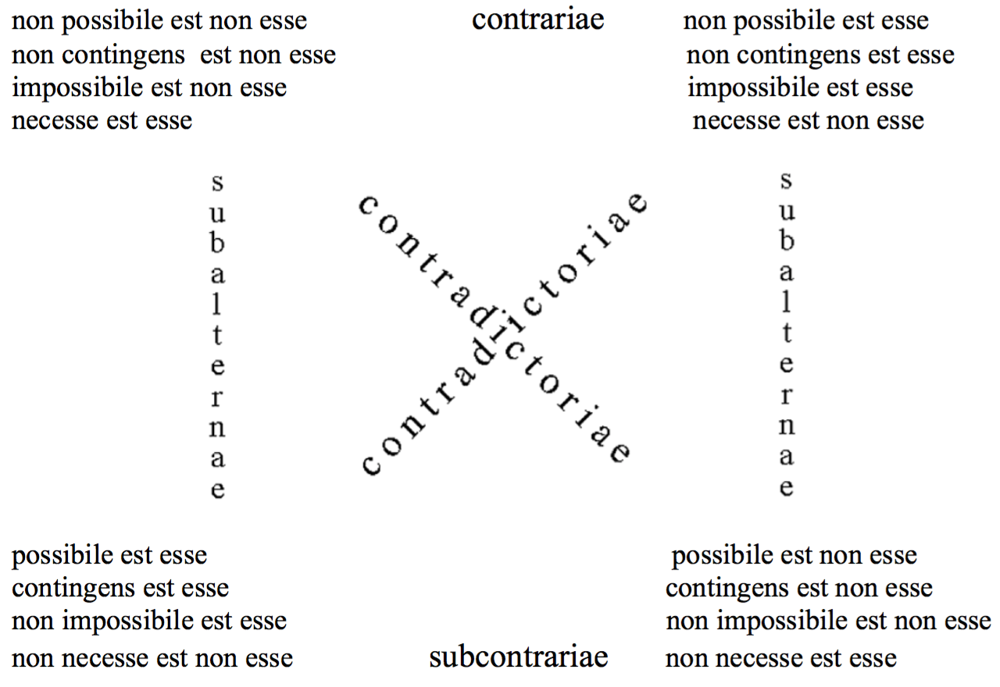

# Medieval Theories of Modality
**First published Wed Jun 30, 1999; substantive revision Thu Apr 15, 2021**

*Knuuttila, Simo*

There are four historical modal paradigms in ancient philosophy: the frequency interpretation of modality, the model of possibility as a potency, the model of antecedent necessities and possibilities with respect to a certain moment of time (diachronic modalities), and the model of possibility as non-contradictoriness. None of these habits of thought, which were well known in early medieval times through the works of Boethius, was based on the idea of modality as involving reference to simultaneous alternatives. This new paradigm was introduced into Western thought in early twelfth-century discussions influenced by Augustine’s theological conception of God as acting by choice between alternative histories.

While the new idea of associating modal terms with simultaneous alternatives was used also in thirteenth-century theology, it was not often discussed in philosophical contexts at that time. The increasing acceptance of Aristotle’s philosophy gave support to traditional modal paradigms, as is seen in Robert Kilwardby’s influential commentary on Aristotle’s *Prior Analytics*, in which modal syllogistic is treated as an essentialist theory of the structures of being. There were analogous discussions of philosophical and theological modalities in Arabic philosophy. Arabic modal theories influenced Latin discussions mainly through the translations of Averroes’s works.

John Duns Scotus developed the model of modality as alternativeness into a detailed theory. A logical possibility is something to which to be is not repugnant, though it may not be compossible with other possibilities. Scotus’s modal semantics influenced early fourteenth-century philosophy and theology in many ways. Thirteenth-century essentialist assumptions were dropped from modal syllogistic, the Aristotelian version of which was regarded as a fragmentary theory without a sufficient explication of the various fine structures of modal propositions. While the Aristotelian frequency interpretation of modality was not found relevant in late medieval logic, it continued to play a role in natural philosophy.

## 1. Aspects of Ancient Modal Paradigms

In speaking about the general features of the universe, ancient philosophers were inclined to think that all generic possibilities will be actualized, a habit of thinking called the principle of plenitude by Arthur O. Lovejoy (1936). Correspondingly, it was natural for them to think that the invariant structures of reality are necessary. This line of thought is found, e.g., in Plato’s doctrine of the ideas which are exhaustively imitated in the world by the Demiurge, in Aristotle’s theory of the priority of actuality over potentiality, in the Stoic doctrine of the rational world-order and the eternal cosmic cycles, as well as in Plotinus’s metaphysics of emanation (Knuuttila 1993)[^knuuttila-1993].

In these approaches to the constituents of the universe, modal notions could be understood in accordance with the so-called ‘statistical’ or ‘temporal frequency’ model of modality where the meaning of modal terms is spelled out extensionally as follows: what is necessary is always actual, what is impossible is never actual and what is possible is at least sometimes actual. The term ‘statistical interpretation of modality’ was introduced into the modern discussion by Oscar Becker (1952), and it has been applied since in descriptions of certain ways of thinking in the history of philosophy as well, particularly by Jaakko Hintikka (1973).

Even though Aristotle did not define modal terms with the help of extensional notions, examples of this way of thinking can be found in his discussion of eternal beings, the natures of things, the types of events, and generic statements about such things. (See, for example, *Metaphysics*. IX.10.) Modal terms refer to the one and only world of ours and classify the types of things and events on the basis of their actuality. This paradigm suggests that actualization is the general criterion of the genuineness of possibilities, but the deterministic implications of this view compelled Aristotle to seek ways of speaking about unrealized singular possibilities. Diodorus Chronus (fl. 300 BCE) was a determinist who found no problem in this way of thinking. Some commentators have argued that Aristotle’s views showing similarities to the statistical model are based on special metaphysical and ontological doctrines and not on his understanding of modal terms themselves. However, it is not clear that Aristotle had any such distinction in mind. (For different interpretations and evaluations of the role of this model in Aristotle, see Hintikka 1973, Sorabji 1980, Seel 1982, Waterlow 1982a, van Rijen 1989, Gaskin 1995.)[^gaskin-1995][^hintikka-1973][^seel-1982][^sorabji-1980][^rijen-1989][^waterlow-1982a] In *Posterior Analytics* I.6, Aristotle states that certain predicates may belong to their subjects at all times without belonging to them necessarily. Some ancient commentators took this to mean that Aristotle operated with a distinction between strong essential *per se* necessities and weak accidental necessities in the sense of non-essential invariances, such as inseparable accidents (see also Porphyry, *Isagoge* 3.5–6), and that this distinction played an important role in his modal syllogistic. See the commentaries on the *Prior Analytics* by Alexander of Aphrodisias (36.25–32; 201.21–24) and Philoponus (43.8–18; 126.7–29); Flannery 1995, 62–65, 99–106. This was also the view of Averroes and some Latin authors in the Middle Ages. (See below, section 3.)

Another Aristotelian modal paradigm was that of possibility as a potency. In *Met*. V.12 and IX.1 potency is said to be the principle of motion or change either as the activator or as the receptor of a relevant influence. (For agent and patient in Aristotle’s natural philosophy in general, see Waterlow 1982b.)[^waterlow-1982b] The types of potency-based possibilities belonging to a species are recognized as possibilities because of their actualization — no natural potency type remains eternally frustrated. Aristotle says that when the agent and the patient come together and there is no hindrance, the one must act and the other must be acted on (*Met*. IX.5).

In *De Caelo* I.12 Aristotle supposes, *per impossibile*, that a thing has contrary potencies, one of which is always actualized. He argues that the alleged eternally unactualized potencies are not potencies at all because they cannot be assumed to be realized at any time without contradiction. Aristotle applies here the model of possibility as non-contradictoriness which is defined in *Prior Analytics* I.13 as follows: when a possibility is assumed to be realized, it results in nothing impossible. In speaking about the assumed non-contradictory actualization of a possibility, Aristotle thinks that it is realized in real history. Aristotle uses in *De Caelo* I.12 and in some other places (for example, *Met* IX.4, *An. pr.* I.15) a *reductio* argument which consists of assuming the denial of what is to be proved and showing that this leads to a contradiction. The argument has created much controversy about how possibilities are supposed to obtain. See Judson 1983; Rini 2011, 135–156; Rosen and Malink 2012; Smith 2016.)

Aristotle refers to potencies in criticizing some of his contemporaries who claimed that only that which takes place is possible (*Met*. IX.3). The model of possibility as potency *prima facie* allowed him to speak about all kinds of unrealized singular possibilities by referring to passive or active potencies, but taken separately they represent partial possibilities which do not guarantee that their actualization can take place. More is required for a real singular possibility, but when the further requirements are added, such as a contact between the active and passive factor and the absence of an external hindrance, the potency model suggests that the potency can really be actualized only when it is actualized (*Met*. IX.5, *Phys*. VIII.1). It is possible that this led Aristotle to define motion (*kinêsis*) as the actuality of the potentiality (of the end) *qua* potentiality (*Phys*. III.1), but this did not explain the possibility of beginning (Hintikka et al. 1977)[^hintikka-1977].

In discussing future contingent statements in In Chapter 9 of *De interpretatione*, Aristotle says that what is, necessarily is when it is, but he then qualifies this necessity of the present with the remark that it does not follow that what is actual is necessary without qualification. If he meant that the temporal necessity of a present event does not imply that such an event necessarily takes place in circumstances of that type, this is an unsatisfactory ‘statistical’ attempt to avoid the problem that changeability as a criterion of contingency makes all temporally definite singular events necessary (Hintikka 1973)[^hintikka-1973]. Another interpretation is that Aristotle wanted to show that the necessity of an event at a certain time does not imply that it would have been antecedently necessary. Aristotle discusses such singular diachronic modalities in some places (*Met*. VI.3; *EN* III.5, 1114a17–21; *De int*. 19a13–17) in which he seems to assume that the conditions which at *t*_{1} are necessary for *p* to obtain at a later time *t*_{2} are not necessarily sufficient for this, although they might be sufficient for the possibility (at *t*_{1}) that *p* obtains at *t*_{2}. Aristotle did not elaborate these ideas, which might have been his most promising attempt to formulate a theory of unrealized singular possibilities (for example *De int.* 19a12–14. The importance of this model is particularly stressed in Waterlow 1982a; see also von Wright 1984; Weidemann 1986; Gaskin 1995.

Aristotle’s conceptual difficulties can be seen from his various attempts to characterize the possibilities based on dispositional properties such as heatable, separable, or countable. Analogous discussions were not unusual in later ancient philosophy. In Philo’s definition of possibility (ca. 300 BCE), the existence of a passive potency was regarded as a sufficient ground for speaking about a singular possibility. The Stoics revised this definition by adding the condition of the absence of external hindrance, thinking that otherwise the alleged possibility could not be realized. According to the deterministic world view of the Stoics, fate as a kind of active potency necessitates everything, but they did not accept the Master Argument of Diodorus Cronus for determinism, which was meant to show that there cannot be possibilities which will not be realized. The number of passive potencies with respect to a definite future instant of time is greater than what will be realized. As long as these possibilities are not prevented from being realized by being unactualized, they in some sense represent open possibilities. Alexander of Aphrodisias was influenced by the Stoic ideas of diachronic modalities, but he thought that it was misleading to speak about unrealized diachronic possibilities if everything is determined. He argued for what he took to be Aristotle’s view, namely that there are undetermined prospective alternatives which remain open options until the moment of time to which they refer. (See Sharples 1983; Bobzien 1993, 1998; Hankinson 1998.)[^bobzien-1993][^bobzien-1998][^sharples-1983] Neither Aristotle nor later ancient thinkers had any considered conception of simultaneous alternatives. They thought that what is, necessarily is when it is, and that the alternative possibilities disappear when the future is fixed. Alexander’s Peripatetic theory of alternative prospective possibilities could be characterized as the model of diachronic modalities without simultaneous alternatives: there are transient singular alternative possibilities, but those which will not be realized vanish instead of remaining unrealized.

Aristotle often made use of indirect arguments from false or impossible positions by adding hypotheses which he himself labeled as impossible. In order to defend Aristotle’s procedure against ancient critics, Alexander of Aphrodisias characterized these hypotheses as impossibilities that were not nonsensical. (For this controversy, see Kukkonen 2002.)[^kukkonen-2002] Some late ancient authors were interested in impossible hypotheses as tools for conceptual analysis. In the arguments which were called Eudemian procedures something impossible was assumed in order to see what followed. The impossibilities discussed in this way by Philoponus and Boethius show similarities with Porphyry’s characterization of inseparable accidents as something which cannot occur separately but can be separated in thought. These hypotheses were not regarded as formulations of possibilities in the sense of what could be actual; they were counterpossible and not merely counterfactual (Martin 1999)[^martin-1999].

There are several recent works on Aristotle’s modal syllogistics, but no generally accepted historical reconstruction which would make it a coherent theory. It was apparently based on various assumptions which were not fully compatible (Hintikka 1973; Smith 1989; Striker 2009)[^hintikka-1973][^smith-1989][^striker-2009]. Some commentators have been interested in finding coherent layers of the theory by explicating them in terms of Aristotle’s other views (van Rijen 1989; Patterson 1995)[^patterson-1995][^rijen-1989]. There are also several formal reconstructions such as Rini 2011 (modern predicate logic), Ebert and Nortmann 2007 (possible worlds semantics), and various set-theoretical approaches discussed in Johnson 2004 and Malink 2006, 2013 (mereological semantics).

## 2. Early Medieval Developments

Early medieval thinkers were well acquainted with ancient modal conceptions through Boethius’s works. One of the Aristotelian modal paradigms occurring in Boethius is that of possibility as potency (*potestas*, *potentia*). According to Boethius, when the term ‘possibility’ (*possibilitas*) is used in the sense of ‘potency’, it refers to real powers or tendencies, the ends of which are either actual or non-actual at the moment of utterance. Some potencies are never unrealized. They are said to be necessarily actual. When potencies are not actualized, their ends are said to exist potentially (*In Periherm*. II, 453–455). Necessarily actual potencies leave no room for the potencies of their contraries, for they would remain unrealized forever and the constitution of nature does not include elements which would be in vain (*In Periherm*. II, 236). The potencies of non-necessary features of being do not exclude contrary potencies. They are not always and universally actualized, but as potency-types even these potencies are taken to satisfy the actualization criterion of genuineness (*In Periherm*. I, 120–121; II, 237).

Boethius’s view that the types of potencies and potency based possibilities are sometimes actualized is in agreement with the Aristotelian frequency interpretation of modality. This is another Boethian conception of necessity and possibility. He thought that modal notions can be regarded as tools for expressing temporal or generic frequencies. According to the temporal version, what always is, is by necessity, and what never is, is impossible. Possibility is interpreted as expressing what is at least sometimes actual. Correspondingly, a generic property of a species is possible only if it is exemplified at least in one member of that species (*In Periherm*. I, 120–121, 200–201; II, 237).

Like Aristotle, Boethius often treated statement-making utterances as temporally indeterminate sentences. The same sentence can be uttered at different times, and many of these temporally indeterminate sentences may sometimes be true and sometimes false, depending on the circumstances at the moment of utterance. If the state of affairs the actuality of which makes the sentence true is omnitemporally actual, the sentence is true whenever it is uttered. In this case, it is necessarily true. If the state of affairs associated with an assertoric sentence is always non-actual, the sentence is always false and therefore impossible. A sentence is possible only if what is asserted is not always non-actual (I, 124–125). Quasi-statistical ideas are also employed in Ammonius’s Greek commentary on Aristotle’s *De interpretatione* which shares some sources with Boethius’s work (88.12–28) and in Alexander of Aphrodisias’s commentary on Aristotle’s modal syllogistic. (See Mueller 1999, 23–31.)[^mueller-1999]

In dealing with Chapter 9 of Aristotle’s *De interpretatione*, Boethius argues (II, 241) that because

**(1)**

M(*p*_{*t*} & ¬ *p*_{*t*})

**(1′)**

It is possible that *p* obtains at *t* and not-*p* obtains at *t*

is not acceptable, one should also deny

**(2)**

*p*_{*t*} & M_{*t*} ¬*p*_{*t*}

**(2′)**

*p* obtains at *t* and it is possible at *t* that not-*p* obtains at *t*.

The denial of (2) is equivalent to

**(3)**

*p*_{*t*} →  L_{*t*} *p*_{*t*}

**(3′)**

If *p* obtains at *t* then it is necessary at *t* that *p* obtains at *t*.

(2) was generally denied in ancient philosophy and its denial was taken as an axiom by Boethius as well. Correspondingly, (3) shows how the necessity of the present was understood in ancient thought. Boethius thought that the temporal necessity of *p* can be qualified by shifting attention from temporally definite cases or statements to their temporally indeterminate counterparts (I, 121–122; II, 242–243; cf. Ammonius 153.24–26). This was one of Boethius’s interpretations of the Aristotelian distinction between necessity now and necessity without qualification. But he also made use of the diachronic model according to which the necessity of *p* at *t* does not imply that, before *t*, it was necessary that *p* obtains at *t*.

Boethius developed the diachronic ideas as part of his criticism of Stoic determinism. If it is not true that everything is causally necessitated, there must be genuine alternatives in the course of events. Free choice was the source of contingency in which Boethius was mainly interested, but he thought in addition that according to the Peripatetic doctrine there is a real factor of indeterminacy in the causal nexus of nature. When Boethius refers to chance, free choice, and possibility in this context, his examples include temporalized modal notions which refer to diachronic prospective possibilities at a given moment of time. A temporally determinate prospective possibility may not be realized at the time to which it refers, in which case it ceases to be a possibility. Boethius did not develop the idea of simultaneous alternatives which would remain intact even when diachronic possibilities had vanished, insisting that only what is actual at a certain time is at that time possible at that time (cf. (3) above). But he also thought that there are objective singular contingencies, so that the result of some prospective possibilities is indefinite and uncertain ‘not only to us who are ignorant, but to nature’ (*In Periherm*. I, 106, 120; II, 190–192, 197–198, 203, 207). (For Boethius’s modal conceptions, see Kretzmann 1985; Knuuttila 1993, 45–62.)[^knuuttila-1993][^kretzmann-1985]

As for the discussion of future contingent statements in *De interpretatione* 9, Boethius’s view shows similarities to that of Ammonius, both authors apparently having known some similar Greek discussions. (Ammonius’s Greek commentary on *De interpretatione* is translated by D. Blank and Boethius’s two Latin commentaries by N. Kretzmann in the same volume, with essays by R. Sorabji, N. Kretzmann and M. Mignucci, in 1998.)[^kretzmann-1998][^mignucci-1998] According to the majority interpretation, Ammonius and Boethius ascribe to Aristotle the view that the predictions of future contingent events and their denials differ from other contradictory pairs of propositions because truth and falsity are not definitely distributed between them. The propositions are consequently neither true nor false, but their disjunctions are necessary. This was characterized as broad bivalence by Kretzmann 1987, 1998. (See also Frede 1985; Craig 1988; Gaskin 1995.)[^craig-1988][^gaskin-1995] Another interpretation holds that future contingents are not definitely true or false in Boethius’s view because their truth-makers are not yet determined, but are true or false in an indeterminate way. No qualification of the principle of bivalence is involved (Mignucci 1989, 1998; for a related interpretation of Ammonius, see Seel 2000.)[^mignucci-1989][^mignucci-1998] While most medieval thinkers regarded the latter view as true in theology, many of them thought that Aristotle’s opinion was similar to the Boethian broad bivalence. Peter Abelard and John Buridan were among those who read Aristotle as holding that future contingent propositions are true or false. Peter Auriol argued that these propositions lack a truth-value; even God is aware of the future in a way which does not imply bivalence. This was an exceptional view. (See Normore 1982, 1993; Lewis 1987; Schabel 2000; Knuuttila 2010.)[^knuuttila-2010][^lewis-1987][^normore-1982][^normore-1993][^schabel-2000] Boethius, Aquinas, and many others thought that God can know future contingents only because the flux of time is present to divine eternity. Some late medieval thinkers, for example John Duns Scotus and William of Ockham, found the idea of atemporal presence of history to God problematic and tried to find other models for foreknowledge. These discussions led to the so-called middle knowledge theory of the counterfactuals of freedom (Craig 1988; Freddoso 1988; Dekker 2000)[^craig-1988][^dekker-2000][^freddoso-1988].

From the point of view of the history of modal thought, interesting things took place in theology in the eleventh and twelfth centuries. Augustine had already criticized the application of the frequency model of possibility to divine power; for him, God has freely chosen the actual world and its providential plan from alternatives which he could have realized but did not will to do (*potuit sed noluit*). This way of thinking differs from ancient philosophical modal paradigms because the metaphysical basis is now the eternal domain of simultaneous alternatives instead of the idea of one necessary world order. In Augustine, God’s eternal ideas of finite beings represent the possibilities of how the highest being can be imitated, the possibilities thus having an ontological foundation in God’s essence. This was the dominating conception of theological modal metaphysics until Duns Scotus departed from it. (See Knuuttila 2014, 86–89). The discrepancy between the Catholic doctrine of God’s freedom and power and the philosophical modal conceptions was brought into the scope of discussion in the eleventh century. Peter Damian argued for the sovereignty of divine omnipotence in a way that is sometimes mistakenly taken to include the power to change the past (Holopainen 1996)[^holopainen-1996]. Anselm of Canterbury tried to develop a general modal semantics based on the notions of power and potentiality, with various conceptual distinctions (Knuuttila 2004)[^knuuttila-2004]. Modal questions in philosophy and theology were developed in a more sophisticated way in twelfth-century considerations of God’s power and providence and historical contingencies with the idea of simultaneous alternatives. The idea of divine choice between alternatives was absent in Avicenna and Averroes, but it was defended by al-Ghazali, who criticized Avicenna’s necessitarian metaphysics. (See Kukkonen 2000; for metaphysical necessitarianism in Arabic philosophy, see Belo 2007; De Haan 2020.)[^belo-2007][^de-2020][^kukkonen-2000]

Even though Abelard (1079–1142) sometimes made use of the Boethian modal concepts (as Anselm also did), he was interested in the philosophical significance of the idea of modality as alternativeness. Assuming that what is actual is temporally necessary at a certain point of time as no longer avoidable, he adds that unrealized counterfactual alternatives are possible at the same time in the sense that they could have happened at that time. There are also merely imaginable alternatives, such as Socrates’s being a bishop, which never had a real basis in things. (See Martin 2001, 2003; Marenbon 2007, 156–158, is sceptical about this interpretation; see also Binini 2019.)[^binini-2019][^marenbon-2007][^martin-2001][^martin-2003] Gilbert of Poitiers (d. 1154) stressed the idea that natural regularities which are called natural necessities are not absolute, since they are freely chosen by God and can be overridden by divine power. This basically Augustinian conception was a widespread theological view in the twelfth century. In explaining Plato’s ‘Platonitas’ Gilbert innovatively argues that this includes all that Plato was, is and will be as well as what he could be but never is (*The Commentaries on Boethius* 144.77–78, 274.75–76; Knuuttila 1993, 75–82)[^knuuttila-1993].

An interesting early thirteenth-century philosophical analysis of Augustinian modalities was put forward by Robert Grosseteste (d. 1253; Lewis 1996)[^lewis-1996]. Grosseteste taught that while things are primarily called necessary or possible ‘from eternity and without beginning’ with respect to God’s eternal knowledge, there are necessities and impossibilities with a beginning in God’s providence which are eternal contingencies in the sense that God could have chosen their opposites (*De libero arbitrio* 168.26–170.33, 178.24–29). One of the theses of twelfth-century authors, later called *nominales*, was that ‘What is once true is always true’. It was argued that while tensed statements about temporally definite singular events have a changing truth-value, the corresponding non-tensed propositions are unchangingly true or false, without being necessarily true or false for this reason (Nuchelmans 1973, 177–189; Iwakuma and Ebbesen 1992)[^iwakuma-1992][^nuchelmans-1973]. This was in agreement with Abelard’s view that future contingent propositions are true or false. The actuality of a contingent state of affairs at a specified future time does not exclude the non-temporalized possibility of simultaneous alternatives, nor does the truth of a proposition about this state of affairs make it necessary (Abelard, *Glossae super Peri hermeneias* IX, 520–577; see also Peter of Poitiers (d. 1205), *Sententiae* I.7.133–43, I.12.164–223, I.14, 328–353).

## 3. Modalities in Thirteenth-Century Logical Treatises

Modifying Boethius’s systematization of Aristotle’s remarks in *De interpretatione* 12 and 13, twelfth- and thirteenth-century logicians often presented the equipollences between modal terms and opposed relations between modal propositions with the help of the following diagram:

*Figure 1.*

Figure 1.

The square could be taken to refer to modals *de dicto* or singular modals *de re* (see below.) Abelard tried to define the opposed relations between quantified *de re* modals as well, mistakenly thinking that these were the same as those between singular modal propositions (*Glossae super Perihermeneias* XII, 468–471, 530–544). This question was not much discussed before its satisfactory solution in fourteenth-century modal semantics. (See Hughes 1989 and his description of Buridan’s octagon of modal opposites and equipollences.)[^hughes-1989] While *possibile* and *contingens* are treated as synonyms in the figure, it became more usual to associate the former with one-sided possibility (not impossible) and the latter with two-sided possibility (neither necessary nor impossible).

The anonymous *Dialectica Monacensis* (ca. 1200) is one of the numerous works representing the new terminist approach to logic and can be used as an example of how modalities were treated in it. (A collection of late twelfth- and early thirteenth-century logical texts is edited in de Rijk 1962–67.) In discussing the quantity (universal, particular, singular) and quality (affirmative, negative) of the modals, the author states that modal terms may be adverbial or nominal. The modal adverb qualifies the copula, and the structure of the sentence can be described as follows:

**(4)**

quantity/subject/modalized copula/predicate (for example: Some A’s are necessarily B)

In this form, the negation can be located in different places, either

**(5)**

quantity/subject/copula modalized by a negated mode/predicate (for example: Some A’s are-not-necessarily B)

or

**(6)**

quantity/subject/modalized negative copula/predicate (for example: Some A’s are-necessarily-not B)

The modal sentences with nominal modes can be read in two ways. One can apply an adverbial type of reading to them, which is said to be how Aristotle treats modal sentences in the *Prior Analytics*. The quality and quantity of such a *de re* modal sentence is determined by the corresponding non-modal sentence. In a *de dicto* modal sentence that which is asserted in a non-modal sentence is considered as the subject about which the mode is predicated. When modal sentences are understood in this way, they are always singular, their form being:

**(7)**

subject/copula/mode (for example: That some A’s are B is necessary.)

This reading is said to be the one which Aristotle presented in *De interpretatione* (De Rijk 1967, II-2, 479.35–480.26). The idea of the systematic distinction between the readings *de dicto* (*in sensu composito*) and *de re* (*in sensu diviso*) of modally qualified statements was employed in Abelard’s investigations of modal statements (*Glossae super Perihermeneias* XII, 3–106; *Dialectica* 191.1–210.19). Independently of Abelard, the distinction was often used, as in the *Dialectica Monacensis*, in discussions of the composition-division ambiguity of sentences. (See also Maierù 1972, ch. 5; Jacobi 1980, ch. 4.)[^jacobi-1980][^maierù-1972]

Following Boethius, many authors referred to a modal distinction based on a triple matter of assertoric sentences, namely natural, contingent, or remote. In a sentence of natural matter, the predicate belongs essentially to the subject or is its proprium, in contingent matter, the predicate may belong or not belong to the subject, and in remote matter, the predicate cannot belong to the subject. See, for example, Peter of Spain, *Tractatus*, p. 7; *Dialectica Monacensis* 472.9–473.22. According to Garland the Computist (11th century), the opposite universal sentences of contingent matter are both false and the opposite particular sentences are both true (*Dialectica*, 54.21–30; 82.25–30). The same division of the sentences of contingent matter based on the frequency interpretation of contingency is found in Aquinas (*In Periherm*. I.13, 168). See also Boethius, *In Periherm.* II, 177.18–178.8; 303.15–306.13; 325.8–15. Another often discussed theme was the distinction between modalities *per se* and *per accidens*, which was based on the idea that the modal status of a temporally indefinite sentence may be changeable or not; for example, ‘You have not been in Paris’ may begin to be impossible, whereas ‘You either have or have not been in Paris’ may not. (See, for example, William of Sherwood, *Introduction to Logic*, 41). Another distinction between sentences necessary *per se* and *per accidens* was based on Aristotle’s theory of *per se* predication in *Posterior Analytics* I.4. A sentence was said to be accidentally necessary when it was unchangeably true but, as distinct from *per se* predications, there was no necessary conceptual connection between subject and predicate. This became an important part of thirteenth-century interpretations of Aristotle’s modal syllogistics. (See, for example, Robert Kilwardby’s *Notule libri Priorum* 8.133–142; 40.162–174.)

One example of the prevalence of the traditional use of modal notions can be found in the early medieval *de dicto/de re* analysis of examples such as ‘A standing man can sit’. It was commonly stated that the composite (*de dicto*) sense is ‘It is possible that a man sits and stands at the same time’ and that on this reading the sentence is false. The divided (*de re*) sense is ‘A man who is now standing can sit’ and on this reading the sentence is true. Many authors formulated the divided possibility as follows: ‘A standing man can sit at another time’. It was assumed that a possibility refers to an actualization in the one and only world history and that it cannot refer to the present moment because of the necessity of the present understood in the Aristotelian sense formulated in (2) and (3) above. When authors referred to another time, they thought that the possibility will be realized at that time or that the divided possibility refers to the future even though it may remain unrealized. Those who made use of the (at that time modern) idea of simultaneous alternatives took the composite reading to refer to one and the same state of affairs and the divided reading to simultaneous alternative states of affairs. This analysis was also applied to the question of whether God’s knowledge of things makes them necessary (Knuuttila 1993, 118–121)[^knuuttila-1993].

A great deal of Abelard’s logical works consisted of discussions of topics, consequences and conditionals. Like Boethius, Abelard thought that true conditionals express necessary connections between the antecedents and the consequents. He argued that inseparability and entailment between the truth of the antecendent and consequent are required for the truth of a conditional. Some twelfth-century masters regarded the principle that the antecedent is not true without the consequent as a sufficient condition for the truth of a conditional and accepted the so-called paradoxes of implication. The question of the nature of conditionals and consequences remained a popular theme in medieval logic (Martin 1987, 2012)[^martin-1987][^martin-2012].

The principles of propositional modal logic, found in *Prior Analytics* I.15, were generally expressed as follows: if the antecedent of a valid consequence is possible/necessary, the consequent is possible/necessary (Abelard, *Dialectica* 202.6–8). However, the main interest was in modal syllogistic and modal predicate logic. Avicenna (d. 1037) wrote a brief Arabic summary of Aristotle’s modal syllogistic, but his own theory was different, being based on the assumptions that the subject terms and the predicate terms of assertoric and modal propositions stand for all possible applications and the truth-conditions of assertoric propositions and corresponding possibility propositions are the same. It follows, for example, that syllogisms with assertoric premises coincide with uniform possibility syllogisms (Street 2002, 2005; Lagerlund 2009)[^lagerlund-2009][^street-2002][^street-2005]. Avicenna was particularly interested in relative necessities and distinguished between various types of conditional necessities in terms of temporal determinations. Later Arabic works on modal theories were much influenced by Avicenna. (See Strobino and Thom 2016.)[^strobino-2016] While Averroes’s commentaries on the *Prior Analytics* followed the main lines of Aristotle’s text, his separate treatise on modality involved new systematic ideas, mainly the theory of accidental and *per se* necessary terms and the interpretation of syllogistic necessity premises as *per se* necessary predications with *per se* necessary terms. Both ideas were inspired by Aristotle’s remarks in the *Posterior Analytics* I.4. Since Averroes took modal premises to be of the divided type, assertoric premises in Aristotelian mixed necessity-assertoric syllogisms must have a predicate term which is necessary. The same applies to the subject term of the first premise in mixed assertoric-necessity syllogisms (*Quaesita octo in librum Priorum Analyticorum*, IV.3, 84, in *Aristotelis Opera cum Averrois Commentariis* I.2b; see also Thom 2003, 81–85)[^thom-2003]. This is a speculative explanation of Aristotle’s asymmetric treatment of mixed necessity-assertoric syllogisms and mixed assertoric-necessity syllogisms. Gersonides later tried to develop further Averroes’s remarks; see Manekin 1992. Analogous essentialist ideas were developed in thirteenth-century Latin discussions.

The first Latin commentary on the *Prior Analytics* is an anonymous late twelfth-century treatise (‘Anonymus Aurelianensis III’) which involves detailed discussions of modal conversion and modal syllogisms as well as many problems dealt with in ancient commentaries. (See Ebbesen 2008; an edition by Thomsen Thörnqvist in 2015.)[^ebbesen-2008]. *Dialectica Monacensis* involves a brief summary of Aristotle’s modal syllogistic the elements of which were discussed in logic courses in Paris in the first part of the thirteenth century. Robert Kilwardby’s commentary *Notule libri Priorum* (c. 1240) became an authoritative work from which the discussions of modal syllogisms in the commentaries of Albert the Great (ca. 1250) and many others were largely derived. Abelard, who did not deal with Aristotle’s modal syllogistic, said that the modals in mixed syllogisms with both modal and assertoric premises should be understood in a way which he elsewhere characterizes as *de re* interpretation (*Glossae super Perihermeneias* XII, 189–203). This reading of modal premises was often assumed, although it was seldom discussed as such. A central problem of Aristotle’s theory is that the structure of the premises is not analyzed. Even if it is natural to think that the presupposition of the mixed moods is a *de re* reading of modally qualified premises, this creates difficulties when applied to the conversion rules, most of which are unproblematic only if understood as rules for modals *de dicto*. (According to Aristotle, necessity premises are converted in the same way as assertoric premises: ‘Every/some A is B’ implies ‘Some B is A’ and ‘No A is B’ implies ‘No B is A’. Affirmative contingency premises are converted to corresponding negative contingency premises and both these by the conversion of terms to particular contingency propositions; *Prior Analytics* I.3, 13.)

While many historians think that Aristotle’s modal syllogistic included incompatible elements, this was not the view of mid-thirteenth century logicians. Many of them discussed the same alleged counter-examples to the universal convertibility of necessary propositions, such as

**(8)**

Everything healthy (or awake) is necessarily an animal.

Robert Kilwardby’s explanation is based on the view that convertible necessity premises are necessity propositions *per se* and not *per accidens*, like (8), which are not convertible. (See *Notule libri Priorum* 8.133–146.) In affirmative necessity propositions *per se*, the subject is *per se* connected to the predicate. In negative necessity propositions *per se*, the subject is *per se* incompatible with the predicate. The terms in *per se* inherences or incompatibilities are essential and necessarily stand for the things they signify. The historical background of Kilwardby’s interpretation is not clear; it does show similarities to Averroes’s discussion mentioned above, but there was no historical link. (See Lagerlund 2000, 25–42; Thom 2007, 19–28.)[^lagerlund-2000][^thom-2007]

As for the conversion of contingency propositions (neither necessary nor impossible), Kilwardby notes that while the converted propositions of indefinite (*utrumlibet*) contingency are of the same type of contingency, the conversion of natural contingency propositions (true about most cases) results in contingency propositions when contingency means possibility proper (not impossible). There were extensive discussions of the kinds of contingency based on various philosophical ideas in Kilwardby, Albert the Great and their contemporaries (Knuuttila 2008, 540–541)[^knuuttila-2008].

Kilwardby follows Aristotle’s remark that ‘A contingently belongs to B’ may mean either ‘A contingently belongs to that to which B belongs’ or ‘A contingently belongs to that to which B contingently belongs’, *Notule libri Priorum* 18.682–697. Kilwardby argues that the subject terms in contingency syllogisms are read in the second way and ampliated, if syllogistic relations do not demand restrictions. In explaining the difference in this respect between necessity propositions and contingency propositions, he states that since the terms in *per se* necessity propositions are essential, ‘Every A is necessarily B’ and ‘Whatever is necessarily A is necessarily B’ behave in the same way in logic. Contingency propositions which are ampliated do not mean the same as those which are not ampliated (*Notule libri Priorum* 18.187–207; 18.653–672). For the conversion of both types of contingency propositions and the role of the distinction between essential and accidental terms in defining the truth conditions of contingency propositions, see Thom 2019, 139–149. In the conversion of *de re* readings of unampliated contingency propositions, the possibility changes into actuality, which is in agreement with the frequency interpretation of modality.

According to Kilwardby, the modal character of the predication in the conclusion of the perfect first figure syllogism follows from the first premise, which involves the whole syllogism in accordance with the *dici de omni et nullo* (Lagerlund 2000, 41–42)[^lagerlund-2000]. The premises and the conclusion in uniform necessity syllogisms are necessary *per se*. In mixed first-figure syllogisms with a major necessity premise and a minor asertoric premise, the non-modalized premise should be *simpliciter* assertoric, i.e., a necessarily true *per se* predication. Similarly, in mixed first-figure syllogisms with contingent major and assertoric minor premises, the assertoric premise must be *simpliciter* assertoric, but this time the criteria are that the predicate belongs to the subject *per se*, invariably or by natural contingency (*Notule libri Priorum* 15.255–301; 20.706–736).

Kilwardby explains that in first-figure mixed necessity-assertoric syllogisms the necessity premise appropriates to itself a minor which is necessary *per se*; no such appropriation occurs in first-figure mixed assertoric-necessity syllogisms. There are similar appropriation rules for some mixed second-figure and third-figure moods with assertoric and necessity premises and for various mixed contingency moods pertaining to the kind of appropriated contingency premises or assertoric premises (Thom 2007, chs. 5–6)[^thom-2007].

Kilwardby and his followers regarded Aristotle’s modal syllogistic as the correct theory of modalities, the explication of which demanded various metaphysical considerations. As exemplified by the appropriation rules, they assumed that propositions of the same form had different interpretations, depending on how they were related to other propositions in a syllogism. From the logical point of view, these rules have an *ad hoc* character. (For some comparisons between contemporary philosophical modal logic and thirteenth-century views, see also Uckelman 2009.)[^uckelman-2009]

Thirteenth-century Aristotelian authors generally assumed that modalities had a metaphysical foundation in the hierarchical order of the nature of things that determined their occurrences in the temporal order accountable by frequential modalities. This was the background of the popular Averroist classification of necessary and contingent causes in natural philosophy (Knuuttila 1993, 129–137)[^knuuttila-1993]. Following a twelfth-century distinction, theologians divided between God’s absolute power limited by contradiction and God’s ordained power as the first principle of the existing order (Moonan 1994; Gelber 2004, 309–349)[^gelber-2004][^moonan-1994].

After Kilwardby and Albert the Great, who retailed him, several thirteenth-century authors wrote treatises on the *Prior Analytics*. Ebbesen (2010) lists seven literal and six question commentaries from the 1270s through the 1290s. One of these has been recently edited, namely the question commentary of Radulphus Brito (2017). On the basis of the lists of the contents of the question commentaries included in Ebbesen 2010, one can characterize this as a Kilwardbian tradition. While Richard Campsall’s early fourteenth-century *Questions on Aristotle’s Prior Analytics* was influenced by this literature, it also involved some new modal ideas. Campsall thinks that one should discuss *de dicto* and *de re* modalities separately. In considering the syllogistic logic of *de re* possibility statements with terms standing for actual things, he says that an affirmative *de re* possibility statement as of now implies the corresponding assertoric statement (5.40) and a negative assertoric statement as of now implies the corresponding *de re* necessity statement (5.50). It follows that what is possible now is actualized and things cannot be otherwise because all true present tense negative statements are necessarily true. This is Campsall’s version of the traditional doctrine of the necessity of the present. But if the denial of a present affirmative statement is necessary, how can the statement itself be non-necessary? Campsall defines a *de re* contingency statement as a conjunction of an affirmative and corresponding negative possibility proper statement (7.34–36). Perhaps he thought that this is applicable to present tense statements with actual terms and imply the idea of simultaneous alternatives, as suggested by Lagerlund 2000, 87–90. But Campsall also equates *de re* necessity with respect to actual things to unchanging predication and contingency to changing predication. Actual things may be contingent in the sense that they will be changed in the future (12.31). For Campshall’s confusing formulations, see also Knuuttila 2018.

## 4. Fourteenth-Century Discussions

John Duns Scotus’s theory of simultaneous alternatives was an exposition of the intensional theory of modality, some elements of which were put forward in the twelfth century. In criticizing Henry of Ghent’s theory of theological modalities, Scotus sketched a model of ‘divine psychology’ in which certain relations between theological, metaphysical, and modal theoretical notions are defined. Scotus deviated from the metaphysical tradition in which possibilities were founded in divine being. According to him, when God as an omniscient being knows all possibilities, he does not know them by turning first to his essence. Possibilities can be known in themselves (*Ord*. I.35, 32). In fact they would be what they are even if there were no God. Scotus states that if it is assumed that, *per impossibile*, neither God nor the world exists and the proposition ‘The world is possible’ then existed, this proposition would be true. The actual world is possible as it is, and this possibility and the possibilities of unrealized things are primary metaphysical facts which are not dependent on anything else (*Ord*. I.7.1, 27; *Lect*. I.7, 32, I.39.1–5, 49). The commentators are divided on whether Scotus speaks here about possibilities as such (Knuuttila 1996)[^knuuttila-1996] or about the independence of formal possibilities, but not of concrete possibilities, which are dependent on God (Normore 2003; Hoffmann 2009)[^hoffmann-2009][^normore-2003].

Scotus calls the propositional elements of the modal domain ‘logical possibilities’. These express things and states of affairs to which it is not repugnant to be. Possibilities as such have no kind of existence of their own nor are they causally sufficient for the existence of anything, but they form the precondition for everything that is or can be. God’s omniscience involves an actually infinite number of intelligibles (*De primo principio* IV.9, 68–69); as an object of divine knowledge, they receive an intelligible or objective being. As an object of divine omnipotence, they receive an intentional possible being. Some of these are included in God’s providential plan of creation and will receive an actual being. The description of how things could be at a certain moment consists of compossible possibilities. Though possibilities necessarily are what they are, the actualization of non-necessary possibilities is contingent. Since all finite things are contingently actual, their alternatives are possible with respect to the same time, though these are not compossible with what is actual. Impossibilities are incompossibilities between possibilities (*Ord*. I.35, 32, 49–51, I.38, 10, I.43, 14; *Lect*. I.39.1–5, 62–65).

In criticizing extensional modal theories, Scotus redefined a contingent event as follows: ‘I do not call something contingent because it is not always or necessarily the case, but because its opposite could be actual at the very moment when it occurs’ (*Ord*. I.2.1.1–2, 86). This is a denial of the traditional thesis of the necessity of the present and the temporal frequency characterization of contingency. In Scotus’s modal semantics, the meaning of the notion of contingency is spelt out by considering simultaneous alternatives. What is actual is contingently so if, instead of being actual, it could be not actual. This conception of simultaneous contingent alternatives is part of an argument that the first cause does not act necessarily. According to Scotus, the eternal creative act of divine will is free only if it could be other than it is in a real sense (*Lect*. I.39.1–5, 58). For Scotus’s modal theory, see also Honnefelder 1990; Vos et al. 1994; King 2001; Hoffmann 2002; the thesis of Scotus’s innovativeness is criticized in Pasnau 2020.

Scotus’s approach to modalities brought new themes into philosophical discussion. One of these was the idea of possibility as a non-existent precondition of all being and thinking. Some of his followers and critics argued that if there were no God, there would not be any kind of modality (see Hoffmann 2002, Coombs 2004; for Bradwardine’s criticism, see Frost 2014)[^frost-2014][^hoffmann-2002]. Scotus’s views were known in the seventeenth century through the works of Suárez and some Scotist authors (Honnefelder 1990)[^honnefelder-1990]. In his discussion of eternal truths, Descartes criticized the classical view of the ontological foundation of modality as well as the Scotist theory of modality and conceivability. (There are different interpretations of Descartes’s view of the foundations of modality and how it is related to late medieval discussions; see Alanen 1990; Normore 1991, 2006.)[^alanen-1990][^normore-1991][^normore-2006]

Another influential idea was the distinction between logical and natural necessities and possibilities. In Scotus’s theory, logically necessary attributes and relations are attached to things in all those sets of compossibilities in which they occur. Against this background one could ask which of the natural invariances treated as necessities in earlier natural philosophy were necessary in this strong sense of necessity, and which of them were merely empirical generalizations without being logically necessary. (For a discussion of logical and natural necessities in the fourteenth century, see Knuuttila 1993, 155–160, 2001a.)[^knuuttila-1993][^knuuttila-2001a] Buridan distinguished between logical and natural necessities in his classification of four grades of necessity (*Dialectica* 8.6.3). He used a non-extensional metaphysical notion of possibility *sencundum imaginationen* in his questions on Aristotle’s *Physics* (Sylla 2001), but a frequency interpretation in his questions on Aristotle’s *On generation and corruption* I.4 (57). This was the main modal conception in the Averroist Aristotle commentaries by John of Jandun (see, for example, his questions on *Metaphysics*, IX.5 114va-b; questions on *On the Heavens* I.34, 21vb) and remained a popular option until the Renaissance times (Knebel 2003)[^knebel-2003].

One important branch of medieval logic developed in treatises called *De obligationibus* dealt, roughly speaking, with how an increasing set of true and false propositions might remain coherent in a disputation. According to thirteenth-century rules, a false present tense statement could be accepted as a starting point only if it was taken to refer to a moment of time different from the actual one. Scotus deleted this rule, based on the Aristotelian axiom of the necessity of the present, and later theories accepted the Scotist revision. In this new form, obligations logic could be regarded as a theory of how to analyze possible states of affairs and their mutual relationships. These discussions influenced the philosophical theory of counterfactual conditionals (Yrjönsuuri 1994, 2001; Gelber 2004; Dutilh Novaes 2007)[^dutilh-2007][^gelber-2004][^yrjönsuuri-1994][^yrjönsuuri-2001].

In dealing with counterfactual hypotheses of indirect proofs mentioned above, Averroes and Thomas Aquinas made use of the idea of abstract possibilities which did not imply the idea of alternative domains. The possibilities of a thing can be dealt with at various levels which correspond to Porphyrian predicables. Something which is possible for a thing as a member of a genus can be impossible for it as a member of a species. The same holds of it as a member of a species and an individuated thing. Thus humans can fly because there are other animals which can fly. These abstract possibilities are impossible in the sense that they cannot be actualized. Buridan heavily criticized this approach from the point of view of his modal theory. He argued that if a counterfactual state of affairs is possible, it can be coherently imagined as actual. If something cannot be treated in this way, calling it possible is based on conceptual confusion. (See Knuuttila and Kukkonen 2011.)[^knuuttila-2011] While Scotus, Buridan and many others understood the basic level of possibility in terms of semantic consistency, Ockham wanted to preserve the link to the notion of power in his modal considerations, thinking that necessity is actuality plus immutability, the past and the present are necessary, and Scotus was wrong in assuming that things could be different from how they are at the very moment of their actuality (Normore 2016)[^normore-2016].

Influenced by the new ideas about logical modality, William of Ockham (*Summa logicae*), John Buridan (*Tractatus de consequentiis*, *Summulae de Dialectica*) and some other fourteenth-century authors could formulate the principles of modal logic much more completely and satisfactorily than did their predecessors. Questions of modal logic were discussed separately with respect to modal propositions *de dicto* and *de re*; modal propositions *de re* were further divided into two groups depending on whether the subject terms refer to actual or possible beings. It was thought that logicians should also analyze the relationships between these readings and, furthermore, the consequences having various types of modal sentences as their parts. Ockham, Buridan and their followers largely dropped thirteenth-century essentialist assumptions from modal syllogistic. They regarded the Aristotelian version as a fragmentary theory in which the distinctions between different types of fine structures were not explicated and, consequently, did not try to reconstruct Aristotle’s modal syllogistic as a consistent whole by one unifying analysis of modal propositions; they believed, like some modern commentators, that such reconstruction was not possible. (For fourteenth-century modal logic, see King 1985; Lagerlund 2000; Thom 2003; Knuuttila 2008, 551–567; Read 2021.)[^king-1985][^knuuttila-2008][^lagerlund-2000][^read-2021][^thom-2003]

According to Hughes (1989), one could supply a Kripke-style possible worlds semantics to Buridan’s modal system. This is done in Johnston 2015. In discussing the conception of simultaneous alternativeness in fourteenth-century logic, many historians have used the terminology of possible worlds semantics without the metaphysical and formal details of the modern theory (Yrjönsuuri 1994, 167–174; Dutilh Novaes 2007, 90–91; Read 2021. Ockham and Buridan state that the truth of ‘A white thing can be black’ demands the truth of ‘This can be black’ and that ‘This can be black’ and ‘‘This is black’ is possible’ mean the same. Compound (*de dicto*) and divided (*de re*) readings do not differ at this level, but are separated in dealing with universal and particular propositions. While Ockham did not discuss unrestricted divided necessity propositions, Buridan took the subject terms of all quantified divided modal propositions as standing for possible beings if they are not restricted. The truth of these propositions demands the truth of all or some relevant singular propositions of the type just mentioned; the demonstrative pronoun is then taken to refer to the possible beings even though they may not exist. Buridan could have said that the possible truth of ‘This is X’ means that it is true in a possible state of affairs in which the possible being referred to by ‘this’ occurs and that the necessary truth of ‘This is X’ means that it is true in all possible states of affairs in which the possible being referred to by ‘this’ occurs (Hughes 1989)[^hughes-1989]. For Buridan’s modal logic, see also Read’s introduction to *Treatise on Consequences* (2015); Johnston 2021.

The new modal logic was among the most remarkable achievements of medieval logic. Buridan’s modal logic was dominant in late medieval times, being more systematic than that of Ockham because of its symmetric treatment of possibility and necessity. It was embraced by Marsilius of Inghen, Albert of Saxony, Jodocus Trutfetter and others (Lagerlund 2000, 184–227; for the later influence of medieval modal theories, see also Coombs 2003; Knebel 2003; Roncaglia 1996, 2003; Schmutz 2006)[^coombs-2003][^knebel-2003][^lagerlund-2000][^roncaglia-1996][^roncaglia-2003][^schmutz-2006]. The rise of the new modal logic was accompanied by elaborated theories of epistemic logic (Boh 1993)[^boh-1993] and deontic logic (Knuuttila and Hallamaa 1995)[^knuuttila-1995].

## References（引用注释）

> 原文参考文献已转为脚注引用：文内“作者-年份”引用组后附 [^key] 标记，完整条目见本文末脚注定义。

### Primary sources

### Secondary sources

## Academic Tools

> |   | [How to cite this entry](https://plato.stanford.edu/cgi-bin/encyclopedia/archinfo.cgi?entry=modality-medieval). |
> | --- | --- |
> |   | [Preview the PDF version of this entry](https://leibniz.stanford.edu/friends/preview/modality-medieval/) at the [Friends of the SEP Society](https://leibniz.stanford.edu/friends/). |
> |   | [Look up topics and thinkers related to this entry](https://www.inphoproject.org/entity?sep=modality-medieval&redirect=True) at the Internet Philosophy Ontology Project (InPhO). |
> |   | [Enhanced bibliography for this entry](http://philpapers.org/sep/modality-medieval/) at [PhilPapers](http://philpapers.org/), with links to its database. |

## Other Internet Resources

[Please contact the author with suggestions.]

## Related Entries

Aquinas, Thomas | Aristotle | Boethius, Anicius Manlius Severinus | Buridan, John [Jean] | Duns Scotus, John | Ibn Sina [Avicenna] | Kilwardby, Robert | Latin Averroism | logic: modal | medieval philosophy | Ockham [Occam], William | possible worlds | Stoicism | terms, properties of: medieval theories of

[^albert-1890]: Albert the Great, *Commentarium in Librum I Priorum Analyticorum*, in *Opera omnia*, ed. A. Borgnet, vol. I, Paris: Vivès, 1890.

[^alexander-1883]: Alexander of Aphrodisias, *In Aristotelis Analyticorum priorum librum I commentarium*, ed. M. Wallies, Commentaria in Aristotelem Graeca 2.1, Berlin, 1883.

[^alexander-1983]: –––, *On Fate*, text, translation and commentary by R. W. Sharples, London: Duckworth, 1983.

[^ammonius-1897]: Ammonius, *In Aristotelis De interpretatione commentarius*, ed. A. Busse, Commentaria in Aristotelem Graeca 4.5, Berlin, 1897.

[^ammonius-1998]: –––, *On Aristotle: On Interpretation 9*, trans. D. Blank, with Boethius, *On Aristotle: On Interpretation 9*, first and second Commentaries, trans. N. Kretzmann, with Essays by R. Sorabji, N. Kretzmann and M. Mignucci, London: Duckworth, 1998.

[^anonymus-2015]: Anonymus Aurelianensis III, *In Aristotelis* Analytica priora. Critical edition, Introduction, Notes, and Indices by C. Thomsen Thörnqvist, Studien und Texte zur Geistesgeschiche des Mittelalters 115, Leiden: Brill 2015.

[^anselm-1946]: Anselm of Canterbury, *Opera omnia*, 6 vols., ed. F. S. Schmitt, Edinburgh: Nelson, 1946–1961.

[^averroes-1962]: Averroes, *Aristotelis Opera cum Averrois commentariis*, vol. I.2b, Venice 1562, reprinted, Frankfurt am Main: Minerva, 1962.

[^boethius-1877]: Boethius, *Commentarii in librum Aristotelis* Perihermeneias *I-II*, ed. C. Meiser, Leipzig: Teubner, 1877–80.

[^de-1962]: De Rijk, L. M. (1962–67), *Logica Modernorum. A Contribution to the History of Early Terminist Logic I: On Twelfth Century Theories of Fallacy, II.1–2: The Origin and Early Development of the Theory of Supposition*, Wijsgerige teksten en studies 6, 16, Assen: van Gorcum, 1962, 1967.

[^garland-1959]: Garland the Computist, *Dialectica*, ed. L.M. de Rijk, Assen: van Gorcum, 1959.

[^gersonides-1992]: Gersonides, *The Book of Correct Syllogism* in *The Logic of Gersonides. A Translation of* Sefer ha-Heqqesh ha-Yashar, with an introduction, commentary, and analytical glossary by C. H. Manekin, The New Synthese Historical Library 40, Dordrecht: Kluwer, 1992.

[^gilbert-1966]: Gilbert of Poitiers, *The Commentaries on Boethius*, ed. N. M. Häring, Toronto: Pontifical Institute of Mediaeval Studies, 1966.

[^john-2010]: John Buridan, *Quaestiones super libros* De generatione et corruptione *Aristotelis*. A critical edition with an introduction by M. Sreijger, P. Bakker and J. Thijssen. History of Science and Medicine Library 17, Leiden: Brill. 2010.

[^john-2001]: –––, *Summulae de Dialectica*, an annotated translation with a philosophical introduction by G. Klima, New Haven: Yale University Press, 2001.

[^john-1976]: –––, *Tractatus de consequentiis*, ed. H. Hubien, Louvain: Publications Universitaires, 1976, translated with an introduction by S. Read in John Buridan, *Treatise on Consequences*, New York: Fordham University Press, 2015.

[^john-1950]: John Duns Scotus, *Opera omnia*, studio et cura Commissionis Scotisticae, Vatican City: Vatican Press, 1950–.

[^john-1974]: –––, *Abhandlung über das erste Prinzip*, edited and translated by W. Kluxen, Darmstadt: Wissenschaftliche Buchgesellschaft, 1974; English translation by A.B. Wolter in John Duns Scotus, *A Treatise on God as First Principle*, Chicago: Franciscan Herald Press, 1966.

[^john-nd]: John of Jandun, *Quaestiones in duodecim libros Metaphysicae*, Venice, 1554.

[^john-nd-2]: –––, *In libros Aristotelis De caelo et mundo quae extant quaestiones*, Venice, 1552.

[^peter-1956]: Peter Abelard, *Dialectica*, ed. L. M. de Rijk, Wijsgerige teksten en studies 1, Assen: van Gorcum, 1956.

[^peter-2010]: –––, *Glossae super Perihermeneias*, ed. K. Jacobi and C. Strub, Corpus Christianorum Continuatio Mediaevalis 206, Turnhout: Brebols, 2010.

[^peter-1972]: Peter Damian, *De divina omnipotentia*, Sources chrétiennes 191, ed. A. Cantin, Paris: Cerf, 1972.

[^peter-1961]: Peter of Poitiers, *Sententiae I*, ed. P. S. Moore and M. Dulong, Publications in Medieval Studies 7, Notre Dame: The University of Notre Dame Press, 1961.

[^peter-1972-2]: Peter of Spain, *Tractatus*, ed. L.M. de Rijk, Assen: van Gorcum, 1972.

[^philoponus-1905]: Philoponus, *In Aristotelis Analytica priora commentaria*, ed. M. Wallies, Commentaria in Aristotelem Graeca 13.2, Berlin, 1905.

[^radulphus-2016]: Radulphus Brito, *Quaestiones super Priora analytica Aristotelis*, ed. G.A. Wilson, Leuven: Leuven University Press, 2016.

[^richard-1968]: Richard of Campsall, *Quaestiones super librum Priorum Analyticorum* in *The Works of Richard Campsall*, vol. I, ed. E. A. Synan, Toronto: Pontifical Institute of Medieval Studies, 1968.

[^robert-1912]: Robert Grosseteste, *De libero arbitrio* in *Die philosophischen Werke des Robert Grosseteste*, ed. L. Baur, Beiträge zur Geschichte der Philosophie des Mittelalters 9, Münster: Aschendorff, 1912; N. Lewis, ‘The First Recension of Robert Grosseteste’s *De libero arbitrio*, *Mediaeval Studies* 53 (1991), 1–88.

[^robert-1968]: Robert Kilwardby, *In libros Priorum Analyticorum expositio*, Venice 1516 (under the name Aegidius Romanus), reprint Frankfurt am Main: Minerva, 1968; modern edition by P. Thom and J. Scott, *Notule libri Priorum*, two volumes, Auctores Britannici Medii Aevi 23, Oxford: Oxford University Press for the British Academy, 2015.

[^thomas-1964]: Thomas Aquinas, *In Aristotelis Peri hermeneias expositio*, ed. R.M. Spiazzi, Turin: Marietti, 1964; trans. by J. T. Oesterle, Milwaukee: Marquette University Press, 1962.

[^william-1974]: William of Ockham, *Summa logicae*, ed. Ph. Boehner, G. Gál, S. Brown, Guillelmi de Ockham Opera philosophica I, St. Bonaventure: Franciscan Institute of St. Bonaventure University, 1974.

[^william-1966]: William of Sherwood, *Introduction to Logic*, trans. with an introduction and notes by N. Kretzmann, Minneapolis: University of Minnesota Press, 1966.

[^alanen-1990]: Alanen, L., 1990, ‘Descartes, Conceivability and Logical Modality’ in T. Horowitz and G. J. Massey (eds.), *Thought Experiments in Science and Philosophy*, Savage: Rowman & Littlefield, 65–84.

[^bäck-2001]: Bäck, A., 2001, ‘Avicenna and Averroes: Modality and Theology’ in Buchheim et al. (eds.), 125–145.

[^becker-1952]: Becker, O., 1952, *Untersuchungen über den Modalkalkül*, Meisenheim am Glan: Anton Hain.

[^belo-2007]: Belo, C., 2007, *Chance and Determinism in Avicenna and Averroes*, Leiden: Brill.

[^binini-2019]: Binini, I., 2019, ‘Abelard’s Treatment of Logical Determinism in Its Twelfth-Century Context’, *Vivarium*, 58: 1–28.

[^bobzien-1993]: Bobzien, S., 1993, ‘Chrysippus’s Modal Logic and Its Relation to Philo and Diodorus’ in K. Döring and T. Ebert (eds.), *Dialektiker und Stoiker*, Stuttgart: Franz Steiner, 63–84.

[^bobzien-1998]: –––, 1998, *Determinism and Freedom in Stoic Philosophy*, Oxford: Clarendon Press.

[^boh-1993]: Boh, I., 1993, *Epistemic Logic in the Later Middle Ages*, London: Routledge.

[^buchheim-2001]: Buchheim, T., C. H. Kneepkens and K. Lorenz (eds.), 2001, *Potentialität und Possibilität. Modalaussagen in der Geschichte der Metaphysik*, Stuttgart-Bad Canstatt: Frommann-Holzboog.

[^coombs-2003]: Coombs, J. C., 2003, ‘The Ontological Source of Logical Possibility in Catholic Second Scholasticism’ in R. L. Friedman and L. O. Nielsen (eds.), 191–229.

[^craig-1988]: Craig, W. L., 1988, *The Problem of Divine Foreknowledge and Future Contingents from Aristotle to Suárez*, Leiden: Brill.

[^de-2020]: De Haan, D., 2020, *Necessary Existence and the Doctrine of Being in Avicenna’s* Metaphysics of the Healing, Leiden: Brill.

[^de-1962-2]: De Rijk, L. M., 1962–67, see Primary sources.

[^dekker-2000]: Dekker, E., 2000, *Middle Knowledge*, Studies in Philosophical Theology 20, Leuven: Peeters.

[^dutilh-2007]: Dutilh Novaes, C., 2007, *Formalizing Medieval Logical Theories: Suppositio, Consequentiae and Obligationes*, Dordrecht: Springer.

[^ebbesen-2008]: Ebbesen, S., 2008, *Greek-Latin Philosophical Interaction: Collected Essays of Sten Ebbesen 1–2*, Aldershot: Ashgate.

[^ebbesen-2010]: –––, 2010, ‘The *Prior Analytics* in the Latin West: 12th–13th Centuries’, *Vivarium*, 48: 96–133.

[^ebert-2007]: Ebert, T. and U. Norrmann, 2007, *Aristoteles*, Analytica Priora, *Buch I*, Berlin: Akademie Verlag.

[^flannery-1995]: Flannery, K. L., 1995, *Ways into the Logic of Alexander of Aphrodisias*, Leiden: Brill.

[^freddoso-1988]: Freddoso, A. J., 1988, *Louis de Molina: On Divine Foreknowledge, Part IV of the Concordia*, translation with introduction and texts, Ithaca: Cornell University Press.

[^friedman-2003]: Friedman, R. L. and L. O. Nielsen (eds.), 2003, *The Medieval Heritage in Early Modern Metaphysics and Modal Theory*, The New Synthese Historical Library 53, Dordrecht: Kluwer.

[^frost-2014]: Frost, G., 2014, ‘Thomas Bradwardine on God and the Foundations of Modality’, *British Journal for the History of Philosophy*, 22: 655–679.

[^gaskin-1995]: Gaskin, R., 1995, *The Sea Battle and the Master Argument*, Berlin: de Gruyter.

[^gelber-2004]: Gelber, H., 2004, *It Could Have Been Otherwise: Contingency and Necessity in Dominican Theology at Oxford 1300–1350*, Studien und Texte zur Geistesgeschichte des Mittelalters 81, Leiden: Brill.

[^hankinson-1999]: Hankinson, R. J., 1999, ‘Determinism and Indeterminism’ in K. Algra et al. (eds.) *The Cambridge History of Hellenistic Philosophy*, Cambridge, Cambridge University Press.

[^hintikka-1973]: Hintikka, J., 1973, *Time and Necessity: Studies in Aristotle’s Theory of Modality*, Oxford: Oxford University Press.

[^hintikka-1977]: Hintikka, J., with U. Remes and S. Knuuttila, 1977, *Aristotle on Modality and Determinism*, Acta Philosophica Fennica 29, 1, Amsterdam: North-Holland.

[^hoffmann-2002]: Hoffmann, T., 2002, *Creatura intellecta. Die Ideen und Possibilien bei Duns Scotus mit Ausblick auf Franz von Mayronis, Poncius und Mastrius*, Beiträge zur Geschichte der Philosophie und Theologie des Mittelalters, NF 60, Münster: Aschendorff.

[^hoffmann-2009]: –––, 2009, ‘Duns Scotus on the Origin of the Possibles in the Divine Intellect’, in S. F. Brown, T. Dewender, and T. Kobusch (eds.), *Philosophical Debates at Paris in the Early Fourteenth Century*, Leiden: Brill, 359–379.

[^holopainen-1996]: Holopainen, T., 1996, *Dialectic and Theology in the Eleventh Century*, Studien und Texte zur Geistesgeschichte des Mittelalters 54, Leiden: Brill.

[^honnefelder-1990]: Honnefelder, L., 1990, *Scientia transcendens. Die formale Bestimmung der Seiendheit und Realität in der Metaphysik des Mittelalters und der Neuzeit*, Hamburg: Felix Meiner.

[^honnefelder-1996]: Honnefelder, L., R. Wood, and M. Dreyer (eds.), 1996, *John Duns Scotus: Metaphysics and Ethics*, Studien und Texte zur Geistesgeschichte des Mittelalters 53, Leiden: Brill.

[^hughes-1989]: Hughes, G. E., 1989, ‘The Modal Logic of John Buridan’, in G. Corsi, C. Mangione and M. Mugnai (eds.), *Atti del Convegno internazionale di storia della logica: le teorie delle modalità*, Bologna: CLUEB, 93–111.

[^iwakuma-1992]: Iwakuma, Y. and S. Ebbesen, 1992, ‘Logico-Theological Schools from the Second Half of the 12th Century: A List of Sources’, *Vivarium*, 30: 173–215.

[^jacobi-1980]: Jacobi, K., 1980, *Die Modalbegriffe in den logischen Schriften des Wilhelm von Shyreswood und in anderen Kompendien des 12. und 13. Jahrhunderts: Funktionsbestimmung und Gebrauch in der logischen Analyse*, Leiden-Cologne: Brill.

[^johnson-2004]: Johnson, F., 2004, ‘Aristotle’s Modal Syllogisms’, in D. M. Gabbay and J. Woods (eds.), *Handbook of the History of Logic* (Volume I), Amsterdam: Elsevier, 247–307.

[^johnston-2015]: Johnston, S.C., 2015, ‘A Formal Reconstruction of Buridan’s Modal Syllogism’, *History and Philosophy of Logic*, 36: 2–17.

[^johnston-2021]: –––, 2021, ‘Modal Logic’ in R. Cross and J.T. Paatsch (eds.), *The Routledge Companion to Medieval Philosopy*, New York: Routledge, 43–56.

[^judson-1983]: Judson, L., 1983, ‘Eternity and Necessity in *De caelo* I.12’, *Oxford Studies in Ancient Philosophy*, 1: 217–255.

[^king-1985]: King, P., 1985, *Jean Buridan’s Logic. The Treatise on Supposition. The Treatise on Consequences* (translation with introduction and commentary), Synthese Historical Library 27, Dordrecht: Reidel.

[^king-2001]: –––, 2001, ‘Duns Scotus on Possibilities, Powers and the Possible’ in Buchheim et al. (eds.), 175–199.

[^knebel-2003]: Knebel, S., 2003, ‘The Renaissance of Statistical Modalities in Early Modern Scholasticism’ in R. L. Friedman and L. O. Nielsen (eds.), 231–251.

[^knuuttila-1993]: Knuuttila, S., 1993, *Modalities in Medieval Philosophy*, London, New York: Routledge; second edition, 2020.

[^knuuttila-1996]: –––, 1996, ‘Duns Scotus and the Foundations of Logical Modalities’ in L. Honnefelder, R. Wood, M. Dreyer (eds.), 127–143.

[^knuuttila-2001]: –––, 2001, ‘Time and Creation in Augustine’ in N. Kretzmann and E. Stump (eds.), *The Cambridge Companion to Augustine*, Cambridge: Cambridge University Press, 103–115; second edition, ed. D.V. Meconi and E. Stump, 2014, 81–97.

[^knuuttila-2001a]: –––, 2001a, ‘Necessities in Buridan’s Natural Philosophy’ in H. Thijssen and J. Zupko (eds.), *The Metaphysics and Natural Philosophy of John Buridan*, Leiden: Brill, 65–76.

[^knuuttila-2004]: –––, 2004, ‘Anselm on Modality’ in B. Davies and B. Leftow (eds.), *The Cambridge Companion to Anselm*, Cambridge: Cambridge University Press, 111–131.

[^knuuttila-2008]: –––, 2008, ‘Medieval Modal Theories and Modal Logic’ in D. M. Gabbay and J. Woods (eds.), *Handbook of the History of Logic 2: Mediaeval and Renaissance Logic*, Amsterdam: Elsevier, 505–578

[^knuuttila-2010]: –––, 2010,‘Medieval Commentators on Future Contingents in *De interpretatione* 9’, *Vivarium*, 58: 75–95.

[^knuuttila-2012]: –––, 2012, ‘Modality’, in J. Marenbon (ed.), *The Oxford Handbook of Medieval Philosophy*, New York: Oxford University Press, 312–341.

[^knuuttila-2018]: –––, 2018, ‘Three Medieval Theories of Modal Syllogistics’, in C.Kann *et al.* (eds.), *Modern Views of Mediaeval logic*, Recherches de théologie et philophie mediévales Bibliotheca, Leuven: Peeters 2018.

[^knuuttila-1995]: Knuuttila, S. and O. Hallamaa, 1995, ‘Roseth and Medieval Deontic Logic’, *Logique & Analyse*, 149: 75–87.

[^knuuttila-2011]: Knuuttila, S. and T. Kukkonen, 2011, ‘Thought Experiment and Indirect Proof in Averroes, Aquinas, and Buridan’, in K. Ierodiakonou and S. Roux (eds.), *Thought Experiments: Methodological and Historical Perspectives*, Leiden: Brill, 83–99.

[^kretzmann-1985]: Kretzmann, N., 1985, ‘Nos ipsi principia sumus: Boethius and the Basis of Contingency’ in T. Rudavsky (ed.), *Divine Omniscience and Omnipotency in Medieval Philosophy*, Synthese Historical Library 25, Dordrecht: Reidel, 23–50.

[^kretzmann-1998]: –––, 1998, ‘Boethius and the Truth about Tomorrow’s Sea Battle’ in Ammonius, *On Aristotle: On Interpretation 9*, 24–52.

[^kukkonen-2000]: Kukkonen, T., 2000, ‘Possible Worlds in the *Tahâfut al-falâsifa*. Al-Gazâli on Creation and Contingency’, *Journal of the History of Philosophy*, 38: 479–502.

[^kukkonen-2002]: –––, 2002, ‘Alternatives to Alternativers: Approaches to Aristotle’s *per impossibile* Arguments’, *Vivarium*, 40: 137–173.

[^kukkonen-2005]: –––, 2005, ‘‘The Impossible insofar as it is Possible’: Ibn Rushd and Jean Buridan on Logic and Natural Theology’, in D. Perler and U. Rudolph (eds.), *Logik und Theologie: Das Organon im arabischen und lateinischen Mittelalter*, Studien und Texte zur Geistesgeschichte des Mittelalters 84, Leiden: Brill, 447–467.

[^lagerlund-2000]: Lagerlund, H., 2000, *Modal Syllogistics in the Middle Ages*, Leiden: Brill.

[^lagerlund-2009]: –––, 2009, ‘Avicenna and al-Tûsî on Modal Logic’, *History and Philosophy of Logic*, 30: 227–239.

[^lewis-1987]: Lewis, N. T., 1987, ‘Determinate Truth in Abelard’, *Vivarium*, 25: 81–109.

[^lewis-1996]: –––, 1996, ‘Power and Contingency in Robert Grosseteste and Duns Scotus’ in L. Honnefelder, R. Wood, M. Dreyer (eds.), 205–225.

[^lovejoy-1936]: Lovejoy, A., 1936, *The Great Chain of Being: A Study of the History of an Idea*, Cambridge, Mass.: Harvard University Press.

[^maierù-1972]: Maierù, A., 1972, *Terminologia logica della tarda scolastica*, Rome: Edizioni dell’ Ateneo.

[^malink-2006]: Malink, M., 2006, ‘A Reconstruction of Aristotle’s Modal Syllogistic’, *History and Philosophy of Logic*, 27: 95–141.

[^malink-2013]: Malink, M., 2013, *Aristotle’s Modal Syllogistic*, Cambridge, MA: Harvard University Press, 2013.

[^manekin-nd]: Manekin, C.H., see Primary sources, Gersonides.

[^marenbon-2007]: Marenbon, J., 2007, *Medieval Philosophy: An Historical and Philosophical Introduction*, London: Routledge.

[^martin-1987]: Martin, C. J., 1987, ‘Embarrassing Arguments and Surprising Conclusions in the Development of Theories of the Conditional in the Twelfth Century’ in J. Jolivet and A. de Libera (eds.), *Gilbert de Poitiers et ses contemporains: aux origines de la* Logica Modernorum, Naples: Bibliopolis, 377–400.

[^martin-1999]: –––, 1999, ‘Thinking the Impossible: Non-reductive Arguments from Impossible Hypotheses in Boethius and Philoponus’, *Oxford Studies in Ancient Philosophy*, 17: 279–302.

[^martin-2001]: –––, 2001, ‘Abaelard on Modality. Some Possibilities and Some Puzzles’in T. Buchheim et al. (eds.), 97–122.

[^martin-2003]: –––, 2003, ‘An Amputee is Biped. The Role of the Categories in the Development of Abaelard’s Theory of Possibility’ in J. Biard and I. Catach-Rosier (eds.), *La Tradition médiévale des Catégories (XIIe-XV siècles)*, Philosophes médiévaux 45, Louvain-la-Neúve: Éditions de l’Institut Supérieur de Philosophie; Louvain-Paris: Peeters, 225–242.

[^martin-2012]: –––, 2012, ‘Logical consequence’, in J. Marenbon (ed.), *The Oxford Handbook of Medieval Philosophy*, New York: Oxford University Press, 289–311.

[^mignucci-1989]: Mignucci, M., 1989, ‘Truth and Modality in Late Antiquity: Boethius on Future Contingent Propositions’, G. Corsi, C. Mangione and M. Mugnai (eds.), in *Atti del Convegno internazionale di storia della logica: le teorie delle modalità* , Bologna: CLUEB, 47–78.

[^mignucci-1998]: –––, 1998, ‘Ammonius’ Sea Battle’ in Ammonius, *On Aristotle: On Interpretation 9*, 53–86.

[^moonan-1994]: Moonan. L., 1994, *Divine Power: The Medieval Power Distinction up to Its Adoption by Albert, Bonaventure, and Aquinas*, Oxford: Clarendon Press.

[^mueller-1999]: Mueller, I., 1999, ‘Introduction’ in Alexander of Aphrodisias, *On Aristotle’s* Prior Analytics I.8–13, translated by I. Mueller and J. Gould, Ithaca: Cornell University Press, 1–38.

[^normore-1982]: Normore, C., 1982, ‘Future Contingents’ in N. Kretzmann, A. Kenny, J. Pinborg (eds.), *The Cambridge History of Later Medieval Philosophy*, Cambridge: Cambridge University Press, 358–381.

[^normore-1991]: –––, 1991, ‘Descartes’s Possibilities’ in G. J. D. Moyal (ed.), *René Descartes: Critical Assessments* (Volume III), London, Routledge, 68–83.

[^normore-1993]: –––, 1993, ‘Petrus Aureoli and His Contemporaries on Future Contingents and Excluded Middle’, *Synthese*, 96: 83–92.

[^normore-2003]: –––, 2003, ‘Duns Scotus’s Modal Theory’ in T. Williams (ed.), *The Cambridge Companion to Duns Scotus*, Cambridge: Cambridge University Press, 129–160.

[^normore-2006]: –––, 2006, ‘Necessity, Immutability, and Descartes’ in V. Hirvonen et al. (eds.), *Mind and Modality*, Brill’s Studies in Intellectual History 141, Leiden: Brill, 257–283.

[^normore-2016]: –––, 2016, ‘Ockham and the Foundations of Modality in the Fourteenth Century’ in M. Cresswell, E. Mares and A. Rini (eds.), *Logical Modalities from Aristotle to Carnap: The Story of Necessity*, Cambridge: Cambridge University Press, 133–153.

[^nuchelmans-1973]: Nuchelmans, G., 1973, *Theories of the Proposition: Ancient and Medieval Conceptions of the Bearers of Truth and Falsity*, Amsterdam: North-Holland.

[^pasnau-2020]: Pasnau, R., 2020, ‘Medieval Modal Spaces’, *Proceedings of the Aristotelian Society* (Supplementary Volume), 94: 225–254.

[^patterson-1995]: Patterson, R., 1995, *Aristotle’s Modal Logic: Essence and Entailment in the Organon*, Cambridge: Cambridge University Press.

[^read-2021]: Read, S., 2021, ‘Modality in Medieval Philosophy’, in O. Bueno and S. Shalkowski (eds.), *The Routledge Handbook of Modality*, New York and London, Routledge, 344–354.

[^rini-2011]: Rini, A., 2011, *Aristotle’s Modal Proofs: Prior analytics A 8–22 in Predicate Logic*, The New Synthese Historical Library 68, Dordrecht: Springer.

[^roncaglia-1996]: Roncaglia, G., 1996, *Palestra rationis. Discussioni su natura della copula e modalità nella filosofia ‘scolastica’ tedesca del XVII secolo*, Florence: Leo S. Olschki.

[^roncaglia-2003]: –––, 2003, ‘Modal Logic in Germany at the Beginning of the Seventeenth Century: Christoph Scheibler’s *Opus Logicum*’ in R. L. Friedman and L. O. Nielsen (eds.), 191–229.

[^rosen-2012]: Rosen, J. and Malink, M., 2012, ‘A Method of Modal Proof in Aristotle’, *Oxford Studies in Ancient Philosophy*, 42: 179–261.

[^schabel-2000]: Schabel, C., 2000, *Theology in Paris 1316–1345. Peter Auriol and the Problem of Divine Foreknowledge and Future Contingents*, Aldershot: Ashgate.

[^schmutz-2006]: Schmutz, J., 2006,‘Qui a inventé les mondes possibles’ in J. C. Bardout and V. Jullien (eds.) *Les Mondes possibles*, Cahiers de philosophie de l’Universite de Caen, Caen: Presses universitaires de Caen, 9–45.

[^seel-1982]: Seel, G., 1982, *Die Aristotelische Modaltheorie*, Berlin: Walter de Gruyter.

[^seel-2001]: –––, 2001, ‘‘In a Definite Way True’: Truth-Values and their Modalization in Ammonius’ in G. Seel (ed.), *Ammonius and the Seabattle; Text, Commentary and Essays*, Berlin and New York: de Gruyter, 234–246.

[^sharples-1983]: Sharples, R. W., 1983, see Primary sources, Alexander of Aphrodisias.

[^smith-1989]: Smith, R. A., 1989, *Aristotle: Prior Analytics*, Indianapolis and Cambridge: Hackett.

[^smith-2016]: –––, 2016, ‘‘Why Does Aristotle Need a *Modal* Syllogistic?’ in M. Cresswell, E. Mares and A. Rini (eds.), *Logical Modalities from Aristotle to Carnap: The Story of Necessity*, Cambridge: Cambridge University Press, 50–69.

[^sorabji-1980]: Sorabji, R., 1980, *Necessity, Cause, and Blame: Perspectives on Aristotle’s Theory*, Ithaca, NY: Cornell University Press.

[^street-2002]: Street, T., 2002, ‘An Outline of Avicenna’s Syllogistic’, *Archiv für Geschichte der Philosophie*, 84: 129–160.

[^street-2005]: –––, 2005, ‘Fahraddîn Ar-Râzî’s Critique of Avicennan Logic’ in D. Perler and U. Rudolph (eds.) *Logik und Theologie: Das Organon im arabischen und lateinischen Mittelalter*, Studien und Texte zur Geistesgeschichte des Mittelalters 84, Leiden: Brill, 99–116.

[^striker-2009]: Striker, G., 2009, *Aristotle*, Prior Analytics, *Book I*, Oxford: Clarendon Press.

[^strobino-2016]: Strobino, R. and P. Thom, 2016, ‘The Logic of Modality ’ in C. Dutilh Novaes and S. Read (eds.),*The Cambridge Companion to Medieval Logic*, Cambridge: Cambridge University Press, 342–369.

[^sylla-1981]: Sylla, E.D., 1981, ‘*Ideo quasi mendicare oportet intellectum humanum*: The Role of Theology in John Buridan’s Natural Philosophy’ in J. Thijssen and J. Zupko (eds.) *The Metaphysics and Natural Philosophy of John Buridan*, Medieval and Early Modern Science 2, Leiden: Brill.

[^thom-2003]: Thom, P., 2003, *Medieval Modal Systems: Problems and Concepts*, Ashgate Studies in Medieval Philosophy, Aldershot: Ashgate, 2003.

[^thom-2007]: –––, 2007, *Logic and Ontology in the Syllogistic of Robert Kilwardby*, Studien und Texte zur Geistesgeschichte des Mittelalters 92, Leiden: Brill.

[^thom-2019]: –––, 2019, *Robert Kilwardby’s Science of Logic*, Investigating Medieval Philosophy 11, Leiden: Brill 2019.

[^uckelman-2009]: Uckelman, S., 2009, *Modalities in Medieval Logic*, Ph.D. Dissertation, University of Amsterdam.

[^rijen-1989]: van Rijen, J., 1989, *Aspects of Aristotle’s Logic of Modalities*, Synthese Historical Library 35, Dordrecht: Kluwer.

[^wright-1984]: von Wright, G. H., 1984, *Truth, Knowledge, and Modality*, Oxford: Blackwell.

[^vos-1994]: Vos, A., H. Veldhuis, A. H. Looman-Graaskamp, E. Dekker, N. W. den Bok, 1994, *John Duns Scotus: Contingency and Freedom. Lectura I 39* (introduction, translation and commentary), The New Synthese Historical Library 42, Dordrecht: Kluwer.

[^waterlow-1982a]: Waterlow, S., 1982a, *Passage and Possibility: A Study of Aristotle’s Modal Concepts*, Oxford: Clarendon Press.

[^waterlow-1982b]: –––, 1982b, *Nature, Change, and Agency in Aristotle’s* Physics, Oxford: Clarendon Press.

[^weidemann-1986]: Weidemann, H., 1986, ‘Aristoteles und das Problem des kausalen Determinismus (*Met*. E 3)’, *Phronesis* 31, 27–50.

[^yrjönsuuri-1994]: Yrjönsuuri, M., 1994, *Obligationes: Fourteenth Century Logic of Disputational Duties*, Acta Philosophica Fennica 55, Helsinki: The Philosophical Society of Finland.

[^yrjönsuuri-2001]: –––, 2001, ‘Duties, Rules and Interpretations in Obligational Disputations’, in M. Yrjönsuuri (ed.), *Medieval Formal Logic: Obligations, Insolubles and Consequences*, The New Synthese Historical Library 49, Dordrecht: Kluwer, 3–34.
