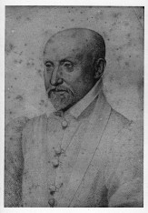

# Michel de Montaigne

*Foglia, Marc, Ferrari, Emiliano*

François Quesnel, “Montaigne”, c. 1590, drawing reprinted with permission from the Montaigne Studies website
# Michel de Montaigne
**First published Wed Aug 18, 2004; substantive revision Sat Aug 8, 2026**

> *The question is not who will hit the ring, but who will make the best runs at it.*

Given the huge breadth of his readings, Montaigne could have been ranked among the most erudite humanists of the 16ᵗʰ century. But in the *Essays*, his aim is above all to exercise his own judgment properly. Readers who might want to convict him of ignorance would find nothing to hold against him, he said, for he was exerting his natural capacities, not borrowed ones. He thought that too much knowledge could prove a burden, preferring to exert his “natural judgment” to displaying his erudition.

## 1. Life

Montaigne (1533–1592) came from a rich bourgeois family that acquired nobility after his father fought in Italy in the army of King Francis I of France; he came back with the firm intention of bringing refined Italian culture to France. He decorated his Périgord castle in the style of an ancient Roman villa. He also decided that his son would not learn Latin in school. He arranged instead for a German preceptor and the household to speak to him exclusively in Latin at home. So the young Montaigne grew up speaking Latin and reading Vergil, Ovid, and Horace on his own. At the age of six, he was sent to board at the Collège de Guyenne in Bordeaux, which he later praised as the best humanist college in France, though he found fault with humanist colleges in general. Where Montaigne later studied law, or, indeed, whether he ever studied law at all is not clear. The only thing we know with certainty is that his father bought him an office in the Court of Périgueux. He then met Etienne de La Boëtie with whom he formed an intimate friendship and whose death some years later, in 1563, left him deeply distraught. Tired of active life, he retired at the age of only 37 to his father’s castle. In the same year, 1571, he was nominated Gentleman of King Charles IX’s Ordinary Chamber, and soon thereafter, also of Henri de Navarre’s Chamber. He received the decoration of the Order of Saint-Michel, a distinction all the more exceptional as Montaigne’s lineage was from recent nobility. On the title page of the first edition (1580) of the *Essays*, we read: “Essais de Messire Michel Seigneur de Montaigne, Chevalier de l’ordre du Roy, & Gentilhomme ordinaire de sa chambre.” Initially keen to show off his titles and, thus, his social standing, Montaigne had the honorifics removed in the second edition (1582).

Replicating Petrarca’s choice in *De vita solitaria*, Montaigne chose to dedicate himself to the Muses. In his library, which was quite large for the period, he had wisdom formulas carved on the wooden beams. They were drawn from, amongst others, *Ecclesiastes*, Sextus Empiricus, Lucretius, and other classical authors, whom he read intensively. To escape fits of melancholy, he began to commit his thoughts to paper. In 1580, he undertook a journey to Italy, whose main goal was to cure the pain of his kidney stones at thermal resorts. The journey is related in part by a secretary, in part by Montaigne himself, in a manuscript that was only discovered during the 18ᵗʰ century, given the title *The Journal of the Journey to Italy*, and forgotten soon after. While Montaigne was taking the baths near Pisa, he learnt of his election as Mayor of Bordeaux. He was first tempted to refuse out of modesty, but eventually accepted (he even received a letter from the King urging him to take the post) and was later re-elected. In his second term he came under criticism for having abandoned the town during the great plague in an attempt to protect himself and his family. His time in office was dimmed by the wars of religion between Catholics and Protestants. Several members of his family converted to Protestantism, but Montaigne himself remained a Catholic.

## 2. Work

Montaigne wrote three books of *Essays*. (“Essay” was an original name for this kind of work; it became an appreciated genre soon after.) Three main editions are recognized: 1580 (at this stage, only the first two books were written), 1588, and 1595. The last edition, which could not be supervised by Montaigne himself, was edited from the manuscript by his adoptive daughter Marie de Gournay. Till the end of the 19ᵗʰ century, the copy text for all new editions was that of 1595; Fortunat Strowski and shortly after him Pierre Villey dismissed it in favor of the “Bordeaux copy”, a text of the 1588 edition supplemented by manuscript additions.[^note-1] Montaigne enriched his text continuously; he preferred to add for the sake of diversity, rather than to correct.[^note-2] The unity of the work and the order of every single chapter remain problematic. We are unable to detect obvious links from one chapter to the next: in the first book, Montaigne jumps from “Idleness” (I,8) to “Liars” (I,9), then from “Prompt or slow speech” (I,10) to “Prognostications” (I,11). The random aspect of the work, acknowledged by the author himself, has been a challenge for commentators ever since. Part of the brilliance of the *Essays* lies in this very ability to elicit various forms of explanatory coherence whilst at the same time defying them. The work is so rich and flexible that it accommodates virtually any academic trend. Yet, it is also so resistant to interpretation that it reveals the limits of each interpretation.

Critical studies of the *Essays* have, until recently, been mainly of a literary nature. However, to consider Montaigne as a writer rather than as a philosopher can be a way of ignoring a disturbing thinker. Indeed, he shook some fundamental aspects of Western thought, such as the superiority we assign to man over animals,[^note-3] to European civilization over “Barbarians”,[^note-4] or to reason as an alleged universal standard. A tradition rooted in the 19th century tends to relegate his work to the status of literary impressionism or to the expression of a frivolous subjectivity. To do him justice, one needs to bear in mind the inseparable unity of thought and style in his work. Montaigne’s repeated revisions of his text, as modern editions show with the three letters A, B, C, standing for the three main editions, mirror the relationship between the activity of his thought and the *Essays* as a work in progress. The *Essays* display both the laboriousness and the delight of thinking.

In Montaigne we have a writer whose work is deeply infused by philosophical thought. One verse out of sixteen in Lucretius’ *De natura rerum* is quoted in the *Essays*.[^note-5] If it is true, as Edmund Husserl said, that philosophy is a shared endeavor, Montaigne is perhaps the most exemplary of philosophers since his work extensively borrows and quotes from others. Montaigne managed to internalize a huge breadth of reading, so that his erudition does not appear as such. He created a most singular work, yet one that remains deeply rooted in the community of poets, historians, and philosophers. His decision to use only his own judgment in dealing with all sorts of matters, his resolutely distant attitude towards memory and knowledge, his warning that we should not mix God or transcendent principles with the human world, are some of the key elements that characterize Montaigne’s position. As a humanist, he considered that one has to assimilate the classics, but above all to display virtue, “according to the opinion of Plato, who says that steadfastness, faith, and sincerity are real philosophy, and the other sciences which aim at other things are only powder and rouge.”[^note-6]

## 3. A Philosophy of Free Judgment

Montaigne rejects the theoretical or speculative way of philosophizing that prevailed under the Scholastics ever since the Middle Ages. According to him, science does not exist, but only a general belief in science. Petrarch had already criticized the Scholastics for worshiping Aristotle as their God. Siding with the humanists, Montaigne develops a sharp criticism of science “à la mode des Geométriens”,[^note-7] the *mos geometricus* deemed to be the most rigorous. It is merely “a practice and business of science”,[^note-8] he says, which is restricted to the University and essentially carried out between masters and their disciples. The main problem of this kind of science is that it makes us spend our time justifying as rational the beliefs we inherit, instead of calling into question their foundations; it makes us label fashionable opinions as truth, instead of gauging their strength. Whereas science should be a free inquiry, it consists only in gibberish discussions on how we should read Aristotle or Galen.[^note-9] Critical judgment is systematically silenced. Montaigne demands a thought process that would not be tied down by any doctrinaire principle, a thought process that would lead to free enquiry.

If we trace back the birth of modern science, we find that Montaigne as a philosopher was ahead of his time. In 1543, Copernicus put the earth in motion, depriving man of his cosmological centrality. Yet he nevertheless changed little in the medieval conception of the world as a sphere. The Copernican world became an “open” world only with Thomas Digges (1576) although his sky was still situated in space, inhabited by gods and angels.[^note-10] One has to wait for Giordano Bruno to find the first representative of the modern conception of an infinite universe (1584). But whether Bruno is a modern mind remains controversial (the planets are still animals, etc). Montaigne, on the contrary, is entirely free from the medieval conception of the spheres. He owes his cosmological freedom to his deep interest in ancient philosophers, to Lucretius in particular. In the longest chapter of the *Essays*, the “Apologie de Raymond Sebond”, Montaigne conjures up many opinions, regarding the nature of the cosmos, or the nature of the soul. He weighs the Epicureans’ opinion that several worlds exist, against that of the unicity of the world put forth by both Aristotle and Aquinas. He comes out in favor of the former, without ranking his own evaluation as a truth.

As a humanist, Montaigne conceived of philosophy as morals. In the chapter “On the education of children”,[^note-11] education is identified with philosophy, this being understood as the formation of judgment and manners in everyday life: “for philosophy, which, as the molder of judgment and conduct, will be his principal lesson, has the privilege of being everywhere at home”.[^note-12] Philosophy, which consists essentially in the use of judgment, is significant to the very ordinary, varied and “undulating”[^note-13] process of life. In fact, under the guise of innocuous anecdotes, Montaigne achieved the humanist revolution in philosophy. He moved from a conception of philosophy conceived of as theoretical science, to a philosophy conceived of as the practice of free judgment. Lamenting that “philosophy, even with people of understanding, should be an empty and fantastic name, a thing of no use and no value”,[^note-14] he asserted that philosophy should be the most cheerful activity. He practised philosophy by setting his judgment to trial, in order to become aware of its weaknesses, but also to get to know its strength. “Every movement reveals us”,[^note-15] but our judgments do so the best. At the beginning of the past century, one of Montaigne’s greatest commentators, Pierre Villey, developed the idea that Montaigne truly became himself through writing. This idea remains more or less true, in spite of its obvious link with late romanticist psychology. The *Essays* remain an exceptional historical testimony of the progress of privacy and individualism, a blossoming of subjectivity, an attainment of personal maturity that will be copied, but maybe never matched since. It seems that Montaigne, who dedicated himself to freedom of the mind and peacefulness of the soul, did not have any other aim through writing than cultivating and educating himself. Since philosophy had failed to determine a secure path towards happiness, he committed each individual to do so in his own way.[^note-16]

Montaigne wants to escape the stifling of thought by knowledge, a wide-spread phenomenon which he called “pedantism”,[^note-17] an idea that he may have gleaned from the tarnishing of professors by the *Commedia dell’arte*. He praises one of the most famous professors of the day, Adrianus Turnebus, for having combined robust judgment with massive erudition. We have to moderate our thirst for knowledge, just as we do our appetite for pleasure. Siding here with Callicles against Plato, Montaigne asserts that a gentleman should not dedicate himself entirely to philosophy.[^note-18] Practised with restraint, it proves useful, whereas in excess it leads to eccentricity and insociability.[^note-19] Reflecting on the education of the children of the aristocracy (chapter I, 26, is dedicated to the countess Diane de Foix, who was then pregnant), Montaigne departs significantly from a traditional humanist education, the very one he himself received. Instead of focusing on the ways and means of making the teaching of Latin more effective, as pedagogues in the wake of Erasmus usually did, Montaigne stresses the need for action and playful activities. The child will conform early to social and political customs, but without servility. The use of judgment in every circumstance, as a warrant for practical intelligence and personal freedom, has to remain at the core of education. He transfers the major responsibility of education from the school to everyday life: “Wonderful brilliance may be gained for human judgment by getting to know men”.[^note-20] The priority given to the formation of judgment and character strongly opposes the craving for a powerful memory during his time. He reserves for himself the freedom to pick up bits of knowledge here and there, displaying the “nonchalance” or unconcern intellectually, much in the same way that Castiglione’s courtier would use *sprezzatura* in social relationships. Although Montaigne presents this nonchalance as essential to his nature, his position is not innocent: it allows him to take on the voice now of a Stoic, and then of a Sceptic, now of an Epicurean and then of a Christian. Although his views are never fully original, they always bear his unmistakable mark. Montaigne’s thought, which is often rated as modern in so many aspects, remains deeply rooted in the classical tradition. Montaigne navigates easily through heaps of classical knowledge, proposing remarkable literary and philosophical innovations along the way.

Montaigne begins his project to know man by noticing that the same human behavior can have opposite effects, or that even opposite conducts can have the same effects: “by diverse means we arrive at the same end”.[^note-21] Human life cannot be turned into an object of rational theory. Human conduct does not obey universal rules, but a great diversity of rules, among which the most accurate still fall short of the intended mark. “Human reason is a tincture infused in about equal strength in all our opinions and ways, whatever their form: infinite in substance, infinite in diversity”[^note-22] says the chapter on custom. By focusing on anecdotal experience, Montaigne comes thus to write “the masterpiece of modern moral science”, according to the great commentator Hugo Friedrich. He gives up the moral ambition of telling how men should live, in order to arrive at a non-prejudiced mind for knowing man as he is. “Others form man, I tell of him”.[^note-23] Man is ever since “without a definition”, as philosopher Marcel Conche commented.[^note-24] In the chapter “Apologie de Raimond Sebond”, Montaigne draws from classical and Renaissance knowledge in order to remind us that, in some parts of the world, we find men that bear little resemblance to us. Our experience of man and things should not be perceived as limited by our present standards of judgment. It is a sort of madness when we settle limits for the possible and the impossible.[^note-25]

Philosophy has failed to secure man a determined idea of his place in the world, or of his nature. Metaphysical or psychological opinions, indeed far too numerous, come as a burden more than as a help. Montaigne pursues his quest for knowledge through experience; the meaning of concepts is not set down by means of a definition, it is related to common language or to historical examples. One of the essential elements of experience is the ability to reflect on one’s actions and thoughts. Montaigne is engaging in a case-by-case *gnôti seauton*, “know thyself”: although truth in general is not truly an appropriate object for human faculties, we can reflect on our experience. What counts is not the fact that we eventually know the truth or not, but rather the way in which we seek it. “The question is not who will hit the ring, but who will make the best runs at it.”[^note-26] The aim is to properly exercise our judgment.

Montaigne’s thinking baffles our most common categories. The vision of an ever-changing world that he developed threatens the being of all things. “We have no communication with being”.[^note-27] We wrongly take that which appears for that which is, and we indulge in a dogmatic, deceptive language that is cut off from an ever-changing reality. We ought to be more careful with our use of language. Montaigne would prefer that children be taught other ways of speaking, more appropriate to the nature of human inquiry, such as “What does that mean ?”, “I do not understand it”, “This might be”, “Is it true?”[^note-28] Montaigne himself is fond of “these formulas that soften the boldness of our propositions”: “perhaps”, “to some extent”, “they say”, “I think”,[^note-29] and the like. Criticism of theory and dogmatism permeates for example his reflexion on politics. Because social order is too complicated to be mastered by individual reason, he deems conservatism as the wisest stance.[^note-30] This policy is grounded on the general evaluation that change is usually more damaging than the conservation of social institutions. Nevertheless, there may be certain circumstances that advocate change as a better solution, as history sometimes showed. Reason being then unable to decide *a priori*, judgment must come into play and alternate its views to find the best option.

## 4. Montaigne’s Scepticism

With Cornelius Agrippa, Henri Estienne or Francisco Sanchez, among others, Montaigne has largely contributed to the rebirth of scepticism during the 16ᵗʰ century. His literary encounter with Sextus produced a decisive shock: around 1576, when Montaigne had his own personal medal coined, he had it engraved with his age, with “*Epecho*” , “I abstain” in Greek, and another Sceptic motto in French: “*Que sais-je*?”: what do I know ? At this period in his life, Montaigne is thought to have undergone a “sceptical crisis”, as Pierre Villey famously commented. In fact, this interpretation dates back to Pascal, for whom scepticism could only be a sort of momentary frenzy.[^note-31] The “Apologie de Raimond Sebond”, the longest chapter of the *Essays*, bears the sign of intellectual despair that Montaigne manages to shake off elsewhere. But another interpretation of scepticism formulates it as a strategy used to confront “fideism”, as stressed by Richard Popkin in *History of Scepticism,* even as Montaigne himself does not use the word[^note-32]: because reason is unable to demonstrate religious dogmas, we must rely on spiritual revelation and faith. Montaigne appears here as a founding father of the Counter Reformation, being the leader of the “Nouveaux Pyrrhoniens”, for whom scepticism is used as a means to an end, that is, to neutralize the grip that philosophy once had on religion.

Commentators now agree upon the fact that Montaigne largely transformed the type of scepticism he borrowed from Sextus. The two sides of the scale are never perfectly balanced, since reason always tips the scale in favor of the present at hand. This imbalance undermines the key mechanism of *isosthenia*, the equality of strength of two opposing arguments. Since the suspension of judgment cannot occur “casually”, as Sextus Empiricus would like it to, judgment must abstain from giving its assent. In fact, the sources of Montaigne’s scepticism are much wider: his childhood readings of Ovid’s *Metamorphosis*, which gave him a deep awareness of change, the *in utramque partem* academic debate which he practised at the Collège de Guyenne (a *pro* and *contra* discussion inherited from Aristotle and Cicero), and the humanist philosophy of action, dealing with the uncertainty of human affairs, shaped his mind early on. Through them, he learned repeatedly that rational appearances are deceptive. In most of the chapters of the *Essays*, Montaigne now and then reverses his judgment: these sudden shifts of perspective are designed to escape adherence, and to tackle the matter from another point of view.[^note-33] The *Essays* mirror a discreet conduct of judgment, in keeping with the formula *iudicio alternante*, which we still find engraved today on the beams of the Périgord castle’s library. The aim is not to ruin arguments by opposing them, as it is the case in the Pyrrhonian “antilogy”, but rather to counterbalance a single opinion by taking into account other opinions. In order to work, each scale of judgment has to be laden. If we take morals, for example, Montaigne refers to varied moral authorities, one of them being custom and the other reason. Against every form of dogmatism, Montaigne returns moral life to its original diversity and inherent uneasiness. Through philosophy, he seeks full accordance with the diversity of life: “As for me, I love life and cultivate it as God has been pleased to grant it to us”.[^note-34]

We find two readings of Montaigne as a Sceptic. The first one concentrates on the polemical, negative arguments drawn from Sextus Empiricus, at the end of the “Apology”. This hard-line scepticism draws the picture of man as “humiliated”.[^note-35] Its aim is essentially to fight the pretensions of reason and to annihilate human knowledge. “Truth”, “being” and “justice” are equally dismissed as unattainable. Doubt foreshadows here Descartes’ *Meditations*, on the problem of the reality of the outside world. Dismissing the objective value of one’s representations, Montaigne would have created the long-lasting problem of “solipsism”. We notice, nevertheless, that he does not question the reality of things — except occasionally at the very end of the “Apology” — but the value of opinions and men. The second reading of his scepticism puts forth that Cicero’s probabilism is of far greater significance in shaping the sceptical content of the *Essays*. After the 1570s, Montaigne no longer read Sextus; additions show, however, that he took up a more and more extensive reading of Cicero’s philosophical writings. We assume that, in his early search for polemical arguments against rationalism during the 1570s, Montaigne borrowed much from Sextus, but as he got tired of the sceptical machinery, and understood scepticism rather as an ethics of judgment, he went back to Cicero.[^note-36] The paramount importance of the *Academica* for 16ᵗʰ century thought has been underlined by Charles B. Schmitt.[^note-37] In the free enquiry, which Cicero engaged throughout the varied doctrines, the humanists found an ideal mirror of their own relationship with the Classics. “The Academy, of which I am a follower, gives me the opportunity to hold an opinion as if it were ours, as soon as it shows itself to be highly probable”[^note-38], wrote Cicero in the *De Officiis*. Reading Seneca, Montaigne will think as if he were a member of the Stoa; then changing for Lucretius, he will think as if he had become an Epicurean, and so on. Doctrines or opinions, beside historical stuff and personal experiences, make up the nourishment of judgment. Montaigne assimilates opinions, according to what appears to him as true, without taking it to be absolutely true. He insists on the dialogical nature of thought, referring to Socrates’ way of keeping the discussion going: “The leader of Plato’s dialogues, Socrates, is always asking questions and stirring up discussion, never concluding, never satisfying (…).”[^note-39] Judgment has to determine the most convincing position, or at least to determine the strengths and weaknesses of each position. The simple dismissal of truth would be too dogmatic a position; but if absolute truth is lacking, we still have the possibility to balance opinions. We have resources enough, to evaluate the various authorities that we have to deal with in ordinary life.

The original failure of commentators was perhaps in labelling Montaigne’s thought as “sceptic” without reflecting on the proper meaning of the essay. Montaigne’s exercise of judgment is an exercise of “natural judgment”, which means that judgment does not need any principle or any rule as a presupposition. In this way, many aspects of Montaigne’s thinking can be considered as sceptical, although they were not used for the sake of scepticism. For example, when Montaigne sets down the exercise of doubt as a good start in education, he understands doubt as part of the process of the formation of judgment. This process should lead to wisdom, characterized as “always joyful”.[^note-40] Montaigne’s scepticism is not a desperate one. On the contrary, it offers the reader a sort of jubilation which relies on the modest but effective pleasure in dismissing knowledge, thus making room for the exercise of one’s natural faculties.

## 5. Montaigne and Relativism

Renaissance thinkers felt strongly compelled to address the nature of humanity as such. But no one accentuated this necessity more than Montaigne: what he was looking for, when reading historians or travellers such as Lopez de Gomara’s *History of Indies*, was the utmost variety of beliefs and customs that would enrich his image of man. Neither the Hellenistic Sage, nor the Christian Saint, nor the Renaissance Scholar, are unquestioned models in the *Essays*. Instead, Montaigne is considering real men, who are the product of customs. “Here they live on human flesh; there it is an act of piety to kill one’s father at a certain age (…).”[^note-41] The importance of custom plays a polemical part: alongside with scepticism, the strength of imagination (chapter I,21) or Fortune (chapters I,1, I,24, etc.), it contributes to the devaluation of reason and will. It is bound to destroy our spontaneous confidence that we do know the truth, and that we live according to justice. During the 16ᵗʰ century, the jurists of the “French school of law” showed that the law is tied up with historical determinations.[^note-42] In chapter I,23, “On custom”, Montaigne seems to extrapolate on this idea : our opinions and conducts being everywhere the product of custom, references to universal “reason”, “truth”, or “justice” are to be dismissed as illusions. Pierre Villey was the first to use the terms “relativity” and “relativism”, which proved to be useful tools when commenting on the fact that Montaigne acknowledges that no universal reason presides over the birth of our beliefs.[^note-43] The notion of absolute truth, applied to human matters, vitiates the understanding and wreaks havoc in society. Upon further reflexion, contingent customs impact everything: “in short, to my way of thinking, there is nothing that custom will not or cannot do”.[^note-44] Montaigne calls it “Circe’s drink”.[^note-45] Custom is a sort of witch, whose spell, among other effects, casts moral illusion. “The laws of conscience, which we say are born from nature, are born of custom. Each man, holding in inward veneration the opinions and the behavior approved and accepted around him, cannot break loose from them without remorse, or apply himself to them without self-satisfaction.”[^note-46] The power of custom, indeed, not only guides man in his behavior, but also persuades him of its legitimacy. What is crime for one person will appear normal to another. In the 17ᵗʰ century, Blaise Pascal will use this argument when challenging the pretension of philosophers of knowing truth. One century later, David Hume will lay stress on the fact that the power of custom is all the stronger, specifically because we are not aware of it. What are we supposed to do, then, if our reason is so flexible that it “changes with two degrees of elevation towards the pole”, as Pascal puts it?[^note-47] For the Jansenist thinker, only one alternative exists, faith in Jesus Christ. However, it is more complicated in the case of Montaigne. Getting to know all sorts of customs, through his readings or travels, he makes an exemplary effort to open his mind. “We are all huddled and concentrated in ourselves, and our vision is reduced to the length of our nose.”[^note-48] Custom’s grip is so strong that it is dubious as to whether we are in a position to become aware of it and shake off its power.

Montaigne was hailed by Claude Lévi-Strauss as the progenitor of the human sciences, and the pioneer of cultural relativism.[^note-49] However, Montaigne has not been willing to indulge entirely in relativism. Judgment is at first sight unable to stop the relativistic discourse, but it is not left without remedy when facing the power of custom. Exercise of thought is the first counterweight we can make use of, for example when criticizing an existing law. Customs are not almighty, since their authority can be reflected upon, evaluated or challenged by individual judgment. The comparative method can also be applied to the freeing of judgment: although lacking a universal standard, we can nevertheless stand back from particular customs, by the mere fact of comparing them. Montaigne thus compares heating or circulating means between people. In a more tragic way, he denounces the fanaticism and the cruelty displayed by Christians against one another, during the civil wars in France, through a comparison with cannibalism: “I think there is more barbarity in eating a man alive than in eating him dead, and in tearing by tortures and the rack a body still full of feeling (…).”[^note-50] The meaning of the word “barbarity” is not merely relative to a culture or a point of view, since *there are* degrees of barbarity. Passing judgment on cannibals, Montaigne also says: “So we may well call these people barbarians, in respect to the rules of reason, but not in respect to ourselves, who surpass them in every kind of barbarity (…).”[^note-51] Judgment is still endowed with the possibility of postulating universal standards, such as “reason” or “nature”, which help when evaluating actions and behaviors. Although Montaigne maintains in the “Apologie” that true reason and true justice are only known by God, he asserts in other chapters that these standards are somehow accessible to man, since they allow judgment to consider customs as particular and contingent rules.[^note-52] In order to criticize the changeable and the relative, we must suppose that our judgment is still able to “bring things back to truth and reason”.[^note-53] Man is everywhere enslaved by custom, but this does not mean that we should accept the numbing of our mind. Montaigne elaborates a pedagogy, which rests on the practice of judgment itself. The task of the pupil is not to repeat what the master said, but, on a given subject or problem, to confront his judgment with that of the master. Moreover, relativistic readings of the *Essays* are forced to ignore certain passages that carry a more rationalistic tone. “The violent detriment inflicted by custom” (I,23) is certainly not a praise of custom, but an invitation to escape it. In the same way that Circe’s potion has changed men into pigs, custom turns their intelligence into stupidity. In the toughest cases, Montaigne’s critical use of judgment aims at giving “a good whiplash to the ordinary stupidity of judgment.”[^note-54] In many other places, Montaigne boasts of himself being able to resist vulgar opinion. Independence of thinking, alongside with clear-mindedness and good faith, are the first virtues a young gentleman should acquire.

## 6. From Sceptical Doubt to Critical Theory

The *Essays* offer a pioneering analysis of modern European civilization. Montaigne demonstrates a sharp awareness of the cultural and social patterns that inform human judgments, beliefs, and behaviors. His scepticism challenges dogmatic claims to absolute truth and norms. It paves the way for a critical examination of ideological certainties, issues that resonate deeply with some of the fundamental problems of our time. In this sense, Montaigne can be considered a precursor of social and critical theories, as he shows how we are shaped by societal norms and values. This attitude is not merely theoretical: the primary aim of the essay as a literary genre is to transform the reader’s idea of self and thereby guide their ethical action in the world. The highest goal of education is the building of moral character, a purpose that humanist pedantry seems to have lost sight of. “Its [education’s] goal has been to make us not good and wise, but learned (…). It has not taught us to follow and embrace virtue and wisdom, but has imprinted in us their derivation and etymology”.[^note-55] The first feature of Montaigne’s critical attitude is the genealogical examination of beliefs and values that reveals their contingent origins. He shows how social norms are rooted in habits, thereby deconstructing the illusion of naturalness. The dogmas of Western civilization, which reinforce its structures of domination over nature and over people, are thus destabilized by sceptical scrutiny. Why accuse animals of being unable to speak? “This defect that hinders communication between them and us, why is it not just as much ours as theirs?”[^note-56] An egalitarian view of all living beings is opened by this position, based on the rejection of essential hierarchies, blurring the line between the natural and the monstrous, the normal and the pathological. There are no “miracles” or “monsters”, except in our ignorance of nature.[^note-57] Regarding the so-called “Cannibals”, Montaigne shows how cultural and scientific discourses of his time categorize forms of inequality and alleged superiority, that can be used to legitimate mercenary interests. In the chapter “Of Coaches”, he provides one of the earliest critiques of European colonization and its massacres.[^note-58]

Consistent with these critiques, the *Essays* see the emergence of a philosophy of tolerance and pluralism that embraces the recognition of otherness and diversity in the world. The uniqueness of beings and things continally unsettles our tendency to formulate general rules. “The inference that we try to draw from the resemblance of events is uncertain, because they are always dissimilar: there is no quality so universal in this aspect of things as diversity and variety.”[^note-59] Montaigne refused to join the ranks of those who claimed that witchcraft was a demonic possession, such as the eminent lawyer Jean Bodin, who justified interrogations, torture and death penalty. Having visited alleged witches in prison, he concluded that he “would have prescribed them rather hellebore than hemlock”,[^note-60] hellebore being one of the remedies supposed to cure insanity. The *Essays* are framed here as a tool for reshaping the cognitive and moral environment of the reader, promoting paths of autonomy and emancipation for men and women. The alleged intellectual inferiority of women is not a fact of nature but a product of education and culture. When he criticizes women’s desire to access the same education as men by learning logic or rhetoric, it is mainly because he rejects the alleged superiority of this abstract curriculum over more practical ones and sees it as a new way for men to subjugate women.[^note-61] “I say that males and females are cast in the same mould; except for education and custom, the difference is not great”.[^note-62] In ths insight, we can already discern the roots of the feminist philosophy that Marie de Gournay (1565–1645), the “daugther-in-law“ (*fille d’alliance*) of Montaigne in his later years, would articulate in the seventeenth century. This perspective ultimately allows Montaigne’s critical thought to be seen as a foundation for modern approaches to the study of the self, analogous to the ones to be later developed by thinkers who examine the processes through which individuals come to define and construct their identities in relation to applicable norms. “Meditation is a powerful and full study for anyone who knows how to examine and exercise himself vigorously: I would rather fashion my mind than furnish it.”[^note-63]

## 7. Montaigne’s Legacy from Charron to Hobbes

Pierre Charron was Montaigne’s friend and official heir. In *De la sagesse* (1601 and 1604), he re-organized many of his master’s ideas, setting aside the most disturbing ones. His work is now usually dismissed as a dogmatic misrepresentation of Montaigne’s thought. Nevertheless, his book was given priority over the *Essays* themselves during the whole 17ᵗʰ century, especially after Malebranche’s critics conspired to have the *Essays* included in the Roman Index of 1677. Montaigne’s historical influence must be reckoned through the lens of this mediation. Moreover, Charron’s reading is not simply faulty. According to him, wisdom relies on the readiness of judgment to revise itself towards a more favorable outcome:[^note-64] this idea is one of the most remarkable readings of the *Essays* in the early history of their reception.

The critical conception of the essay was taken up by the English scientist and philosopher Francis Bacon, who considered his own Essays as “fragments of [his] conceits” and “dispersed meditations”, aiming to stimulate the reader’s appetite for thinking and knowledge rather than satisfying it with expositions of dogmas and methods.[^note-65] Even in his more scientific works, such as *The Advancement of Learning*, Bacon’s writing was inconclusive. He posited that this open and fragmentary style was the best way to inspire further thought and examination: “Aphorisms, representing a knowledge broken, do invite men to inquire further”.[^note-66] Bacon’s reflections allow us to appreciate the scientific value of Montaigne’s Essays, insofar as they are incomplete works, always calling for subsequent reflections by the author and the reader, thus inspiring and promoting the development of ideas and the advancement of research.

The influence Montaigne had on Descartes has been commented upon by many critics, at least from the 19ᵗʰ century on, within the context of the birth of modern science. As a sceptic, calling into question the natural link between mind and things, Montaigne would have won his position in the modern philosophical landscape. The scepticism in the “Apologie” is, no doubt, a main source of “solipsism”, but Descartes cannot be called a disciple of Montaigne in the sense that he would have inherited a doctrine. Above all, he owes the Périgourdin gentleman a way of educating himself. Far from substituting Montaigne for his Jesuit schoolteachers, Descartes decided to teach himself from scratch, following the path indicated by Montaigne to achieve independence and firmness of judgment. The mindset that Descartes inherited from the *Essays* appears as something particularly obvious, in the two first parts of the *Discours de la méthode*. As the young Descartes left the Collège de La Flèche, he decided to travel, and to test his own value in action. “I employed the rest of my youth to travel, to see courts and armies, to meet people of varied humors and conditions, to collect varied experiences, to try myself in the meetings that fortune was offering me (…).”[^note-67] Education, taken out of a school context, is presented as an essay of the self through experience. The world, as pedagogue, has been substituted for books and teachers. This new education allows Descartes to get rid of the prejudice of overrating his own customs, a widespread phenomenon that we now call ethnocentrism. Montaigne’s legacy becomes particularly conspicuous when Descartes draws the lesson from his travels, “having acknowledged that those who have very contrary feelings to ours are not barbarians or savages, but that many of them make use of reason as much or more so than we do”. And also : “It is good to know something of different people, in order to judge our own with more sanity, and not to think that everything that is against our customs and habits is ridiculous and against reason, as usually do those who have never seen anything.”[^note-68] Like Montaigne, Descartes begins by philosophizing on life with no other device than the a discipline of judgment: “I was learning not to believe anything too firmly, of which I had been persuaded through example and custom.”[^note-69] He departs nevertheless from Montaigne when he will equate with error opinions that are grounded on custom.[^note-70] The latter would not have dared to speak of error: varied opinions, having more or less authority, are to be weighed upon the scale of judgment. It is thus not correct to interpret Montaigne’s philosophy as a “criticism of prejudice” from a Cartesian stance.

In recent years, critics have stressed the importance of the connection between Montaigne and Hobbes for the development of a modern vision of politics, rooted in a criticism of traditional doctrines of man and society. At the time when Shakespeare was writing his plays, the first English translation of Montaigne’s *Essays* by John Florio (1603) became a widely-read classic in England. As a former student of Magdalen Hall (Oxford) and Saint John’s College (Cambridge), and as a young tutor and secretary to aristocratic and wealthy families, Thomas Hobbes had many opportunities to read Montaigne in the libraries he frequented. In his capacity as tutor, he traveled widely in Europe and spent several sojourns in France, before the English Civil War forced him into exile in Paris (1641–1651). During this period, Hobbes moved in skeptical and libertine circles and met scholars such as Sorbière, Gassendi, and La Mothe Le Vayer, all influenced by a shared reference to Montaigne’s skepticism. Historical documents and comparative research confirm the relevance of Montaigne’s influence on Hobbes’s work, from *Elements of Law* to *Leviathan*.[^note-71] The two authors share a philosophical conception of man as driven by desire and imagination, and relentlessly striving for self-conservation and power. Montaigne identified human life with movement and instability, and pointed to the power that our passions have to push us toward imaginary future accomplishments (honor, glory, science, reason, and so on).[^note-72] In *Leviathan*, Hobbes builds on this position to assert, as a general inclination of all mankind, “a perpetual and restless desire of power after power, that ceases only in death”.[^note-73] This shared anthropology shows the extent to which Montaigne and Hobbes refute the Scholastic and Renaissance anthropocentric idea of man as a rational being at the summit of creation. On the contrary, they underline his instinctive and passionate nature, which eventually leads to violence and conflict wherever the political community collapses. This negative anthropology is to be understood in the light of the historical experience of the civil wars upsetting both their countries.[^note-74] The threat of political turmoil imbued both Montaigne and Hobbes’ lives. Whereas Hobbes quoted the ancient saying *homo homini lupus*, and described the human condition outside the civil state as a war “where every man is enemy to every man”,[^note-75] Montaigne seemed to go further, “having learned by experience, from the cruelty of some Christians, that there is no beast in the world to be feared by man as man”.[^note-76] In order to avoid the outburst of violence, they both recognize the necessity of laws and obedience, a necessity that does not rely on any ontological or moral foundation. The normative force of law results from its practical necessity, as it is the rational condition of life in society.[^note-77] As Montaigne wrote: “Now laws remain in credit not because they are just, but because they are laws”.[^note-78] Questioning the Aristotelian vision of politics as a natural goal for humanity, Montaigne and Hobbes pointed out the man-made nature of civil authority, as founded in the need to preserve life and peace, avoiding violence and war.

## 8. Conclusion

Montaigne cultivates his liberty by not adhering exclusively to any one idea, while at the same time exploring them all. In exercising his judgment on various topics, he trains himself to go off on fresh tracks, starting from something he read or experienced. For Montaigne this also means calling into question the convictions of his time, reflecting upon his beliefs and education, and cultivating his own personal thoughts. His language can be said to obey only one rule, that is, to be “an effect of judgment and sincerity,”[^note-79] which is the very one that he demands from the pupil. His language bears an unmistakable tone but contradicts itself sometimes from one place to another, perhaps for the very reason that it follows so closely the movements of thought.

If being a philosopher means being insensitive to human frailties and to the evils or to the pleasures which befall us, then Montaigne is not a philosopher. If it means using a “jargon”, and being able to enter the world of scholars, then Montaigne is not one either. Yet, if being a philosopher is being able to judge properly in any circumstances of life, then the Essays are the exemplary testimony of an author who wanted to be a philosopher for good. Montaigne is putting his judgment to trial on whatever subject, in order not only to get to know its value, but also to form and strengthen it.

He manages thus to offer us a philosophy in accordance with life. As Nietzsche puts it, “that such a man has written, joy on earth has truly increased…If my task were to make this earth a home, I would attach myself to him.” Or, as Stefan Zweig said, in a context which was closer to the historical reality experienced by Montaigne himself : “Montaigne helps us answer this one question: ‘How to stay free? How to preserve our inborn clear-mindedness in front of all the threats and dangers of fanaticism, how to preserve the humanity of our hearts among the upsurge of bestiality?’”

## References（引用注释）

> 原文参考文献已转为脚注引用：文内“作者-年份”引用组后附 [^key] 标记，完整条目见本文末脚注定义。

### Editions

### Translations in English

### Secondary Sources

## Academic Tools

> |   | [How to cite this entry](https://plato.stanford.edu/cgi-bin/encyclopedia/archinfo.cgi?entry=montaigne). |
> | --- | --- |
> |   | [Preview the PDF version of this entry](https://leibniz.stanford.edu/friends/preview/montaigne/) at the [Friends of the SEP Society](https://leibniz.stanford.edu/friends/). |
> |   | [Look up topics and thinkers related to this entry](https://www.inphoproject.org/entity?sep=montaigne&redirect=True) at the Internet Philosophy Ontology Project (InPhO). |
> |   | [Enhanced bibliography for this entry](https://philpapers.org/sep/montaigne/) at [PhilPapers](https://philpapers.org/), with links to its database. |

## Other Internet Resources

### Texts

- The complete, searchable [text of the Villey-Saulnier edition](http://www.lib.uchicago.edu/efts/ARTFL/projects/montaigne/), from the ARFTL project at the University of Chicago (French)
- [Montaigne Studies: An Interdisciplinary Forum](http://humanities.uchicago.edu/orgs/montaigne/), Philippe Desan, ed., (University of Chicago).
- [Portrait Gallery](http://humanities.uchicago.edu/orgs/montaigne/h/gallery/), in Montaigne Studies: An Interdisciplinary Forum

### Translations

- [Montaigne’s Essays](https://scholarsbank.uoregon.edu/xmlui/bitstream/handle/1794/766/montaigne.pdf?sequence=1) John Florio’s translation (first published 1603, Ben R. Schneider (ed.), Lawrence University, Wisconsin, from The World’s Classics, 1904, 1910, 1924), published at Renascence Editions, U. Oregon
- [Essays of Michel De Montaigne](https://archive.org/details/essaysofmontaign00mont/page/n7), translated (1685–1686) by Charles Cotton, edited by William Carew Hazlitt, London: Reeves anbd Turner.

## Related Entries

civic humanism | Descartes, René | humanism: in the Renaissance | liberty: positive and negative | relativism | Sextus Empiricus | skepticism | Stoicism

## Notes（原文脚注）

## Notes to Michel de Montaigne

[^note-1]: Michel de Montaigne, *Les Essais*, published according to the “Exemplaire de Bordeaux” by Fortunat Strowski, Bordeaux 1906 and 1909; Georg Olms, Hildesheim/ New York, 1981.

[^note-2]: II 37 F 696 “but only to vary, not to delete”; VS 758c “pour diversifier, non pour ôter”. The first reference, to the English text, is taken from Michel de Montaigne, *The Complete Works. Essays, Travel Journal, Letters*, translated by Donald M. Frame (noted F in the entry) Leland Stanford Junior University, 1948, renewed 1971 & 1976, Stanford University. The second reference, in French, is the edition by Pierre Villey, 1924, reedited by Victor-Louis Saulnier, Paris, Presses Universitaires de France, 1965 (noted VS in the entry).

[^note-3]: Chapter II 12: “Apologie de Raymond Sebond”.

[^note-4]: Chapter I 31: “Des Cannibales”

[^note-5]: See Screech 1998.

[^note-6]: I 26, F 136; VS 152a: “suivant l’advis de Platon, qui dict la fermeté, la foy, la sincerité estre la vraye philosophie, les autres sciences et qui visent ailleurs, n’estre que fard.”

[^note-7]: II 12 VS 540a ; F 489

[^note-8]: II 12 VS 539a ; F 488

[^note-9]: F 489: “We do not ask wether Galen said anything worth saying, but whether he said thus or otherwise”; VS II 12 540a: “On ne demande pas si Galen a rien dit qui vaille, mais s’il a dit ainsi ou autrement.”

[^note-10]: See Alexandre Koyré, *Du monde clos à l’univers infini*, Paris, Gallimard, 1962.

[^note-11]: I 26: “De l’institution des enfants”; “Of the Institution of Children”.

[^note-12]: I,26 F 148; VS 164a.

[^note-13]: I 1, F 5: “Truly man is a marvelously vain, diverse, and undulating object”; VS 9a. See also II 10 VS 413a.

[^note-14]: I 26 F 143; VS 160a: “(…) que la philosophie, ce soit, jusques aux gens d’entendement, un nom vain et fantastique, qui se treuve de nul usage et de nul pris.”

[^note-15]: I 50, F 266; VS 302c: “Tout mouvement nous découvre”.

[^note-16]: II 16 VS 522c

[^note-17]: I 25 “Du pedantisme”; “Of pedantry”.

[^note-18]: I 30, VS 198c: “Calliclez, en Platon, dict l’extremité de la philosophie estre dommageable, et conseille de ne s’y enfoncer outre les bornes du profit ; que, prinse avec moderation, elle est plaisante et commode, mais qu’en fin elle rend un homme sauvage et vicieux, desdaigneux des religions et loix communes…”.

[^note-19]: I 23 F 100 ; VS 115

[^note-20]: I 26 F 140; VS 157a: “Il se tire une merveilleuse clarté, pour le jugement humain, de la fréquentation du monde”.

[^note-21]: I 1 “Par divers moyens on arrive à pareille fin”.

[^note-22]: I 23 F 96.

[^note-23]: III 2, F 740; VS 804b: “Les autres forment l’homme, je le recite (…)”.

[^note-24]: See M. Conche, 1996, chap. 1.

[^note-25]: I 27, F 160: “It is folly to measure the true and false by our own capacity”.

[^note-26]: III 8, F 860; VS 928b. “Ce n’est pas à qui mettra dedans, mais à qui fera les plus belles courses”.

[^note-27]: II 12 F 553 ; VS 601a: “Et nous, et nostre jugement, et toutes choses mortelles, vont coulant et roulant sans cesse. … Nous n’avons aucune communication à l’estre….”

[^note-28]: III 11, F 959; VS 1031; see also II,12, F 477: “I can see why the Pyrrhonian philosophers cannot express their general conception in any manner of speaking ; for they would need a new language. Ours is wholly formed of affirmative propositions….”

[^note-29]: III 11, *ibid*.

[^note-30]: See I 23, “Of custom, and not easily changing accepted law”, F 93–108.

[^note-31]: See *Entretien avec Mr de Sacy*: the attribution of the text to Pascal is controversial. The relation of the text to Montaigne is commented by André Tournon, in *La Glose et l’essai*, 2001, p. 258.

[^note-32]: See for ex. II 12 F 517: “Many times (as I sometimes do deliberately), having undertaken as exercise and sport to maintain an opinion contrary to my own, my mind, applying itself and turning in that direction, attaches me to it so firmly that I can no longer find the reason for my former opinion, and I abandon it.”

[^note-33]: Popkin 1960, 1979, and 2003.

[^note-34]: III 13 F 1041; VS 1113b: “Pour moy donc, j’ayme la vie et la cultive telle qu’il a pleu à Dieu nous l’octroier.”

[^note-35]: Hugo Friedrich, *Montaigne*, Bern, Francke, 1947.

[^note-36]: Montaigne had previously and rather conventionally blamed Cicero for vanity. See I,40, “Considerations on Cicero”. These attacks have been a commonplace since the quarrel of “ciceronianism”, which Erasmus had revived at the begining of the century.

[^note-37]: Schmitt 1972.

[^note-38]: Cicero, *De Officiis*, III, 4, 20

[^note-39]: II 12, F 458; VS 509c: “toujours demandant en esmouvant la dispute, jamais l’arrestant, jamais satisfaisant”

[^note-40]: I 26 F 144: “The surest sign of wisdom is constant cheerfulness”; VS 161c: “La plus expresse marque de la sagesse, c’est une esjouissance constante”.

[^note-41]: I 23 F 99 ; VS 114a.

[^note-42]: See Alciat, Cujas, Hotman, Pasquier, etc. See Franklin, Julian H., *Jean Bodin and the Sixteenth-Century Revolution in the Methodology of Law and History*, New York/London: Columbia Unviersity Press, 1963; A. Tournon, 1983; Z.S. Schiffman, *On the Trehshold of Modernity: Relativism in the French Renaissance*, Baltimore: John Hopkins U. Press, 1991.

[^note-43]: P. Villey, 1933, p.326.

[^note-44]: I 23, F 100; VS 115a: “Et somme, à ma fantaisie, il n’est rien qu’elle ne fasse, ou qu’elle ne puisse…”

[^note-45]: III 13 F 1008: “It is for habit to give form to our life, just as it pleases; it is all-powerful in that; it is Circe’s drink, which varies our nature as it sees fit.” VS 1080a: “C’est à la coutume de donner forme à notre vie, telle qu’il lui plaît; elle peut tout en cela: c’est le breuvage de Circé, qui diversifie notre nature comme bon lui semble.”

[^note-46]: I 23 F 100 ; VS 115c: “Les lois de la conscience, que nous disons naître de nature, naissent de la coutume: chacun ayant en vénération interne les opinions et mœurs approuvées et reçues autour de lui.” See also I,31, F 185: “I think there is nothing barbarous and savage in that nation, from what I have been told, except that each man calls barbarism whatever is not his own practice”; VS 205a.

[^note-47]: Pascal: “Trois degrés d’élévation du pôle renversent toute la jurisprudence; un méridien décide de la vérité…. Vérité au deçà des Pyrénées, erreur au delà” (éd. Brunschvicg 294; éd. Lafuma 60); Montaigne, VS 579a.

[^note-48]: I 26, F 140; VS 157a: “Nous sommes tous contraints et amoncellez en nous, et avons la veuë racourcie à la longueur de nostre nez.”

[^note-49]: C. Lévi-Strauss, *Histoire de lynx*, chap. 18, “en relisant Montaigne”.

[^note-50]: I 31, F 189; VS 209a: “Je pense qu’il y a plus de barbarie à manger un homme vivant qu’à le manger mort, à deschirer, par tourmens et par geénes, un corps encore plein de sentiment…”

[^note-51]: I 31, F 189; VS 210a.

[^note-52]: I 23, F 100: “Whence it comes to pass that what is off the hinges of custom, people believe to be off the hinges of reason: God knows how unreasonnably, most of the time”; VS 116c: “Par où il advient que ce qui est hors des gonds de coutume, on le croit hors des gonds de raison: Dieu sait combien déraisonnablement, le plus souvent.” I,23 F 100: “it is his soul that a wise man should withdraw from the crowd, maintaining its power and freedom freely to make judgements, whilst externally accepting all received forms and fashions”; VS 118a.

[^note-53]: I 23, F 102: “Whoever wants to get rid of this violent prejudice of custom (…) when he refers things to truth and reason, he will fell his judgment as it were all upset, and nevertheless restored to a much surer status.” VS 117a: “Qui voudra se défaire de ce violent préjudice de la coutume (…) rapportant les choses à la vérité et à la raison, il sentira son jugement comme tout bouleversé, et remis pourtant en un bien plus sûr état.”

[^note-54]: I 23, F 101; VS 116c: “donner un bon coup de fouet à la bêtise ordinaire de notre jugement”

[^note-55]: II, 17, F 608 ; VS 660 : “(…) elle a eu pour sa fin de nous faire non bons et sages, mais sçavans (…). Elle ne nous a pas apris de suyvre et embrasser la vertu et la prudence, mais elle nous en a imprimé la derivation et l’etymologie.”

[^note-56]: II, 12, F 402 ; VS 453 “Ce defaut qui empesche la communication d’entre elles et nous, pourquoy n’est il aussi bien à nous qu’à elles?”

[^note-57]: See e.g. I, 23, VS 112 ; II, 30, “Of a monstrous child”, F. 654 : “What we call monsters are not so to God (…).”

[^note-58]: III, 6, VS 910 ; F 844 : “So many cities razed, so many nations exterminated, so many millions of people put to the sword, and the richest and most beautiful part of the world turned upside down, for the traffic in pearls and pepper!”

[^note-59]: Montaigne, III, VS 1065 : “La consequence que nous voulons tirer de la ressemblance des evenemens est mal seure, d’autant qu’ils sont tousjours dissemblables : il n’est aucune qualité si universelle en cette image des choses que la diversité et variété”.

[^note-60]: III, 11, F 961 ; VS 1032 : “En fin et en conscience, je leur eusse plustost ordonné de l’ellebore, que de la cicue”.

[^note-61]: III, 3, VS 822 ; F : “When I see them intent on rhetoric, astrology, logic, and similar drugs, so vain and useless for their needs, I begin to fear that the men who advise them to do this, do so as a means of gaining authority over them under this pretext.”

[^note-62]: III, 5, VS 897 ; F 831.

[^note-63]: III, 3, VS 819 ; F 754 : “Le mediter est un puissant estude et plein, à qui sçait se taster et employer vigoureusement: j’aime mieux forger mon ame que la meubler.”

[^note-64]: See Pierre Charron, *De la sagesse*, book II, chap. 2.

[^note-65]: Francis Bacon, The Major Works, Oxford University Press, 2008, Essays (Dedicatory Epistles to 1597 and 1612 editions), p. 545, 677–678.

[^note-66]: Id., The Advancement of Learning, II, p. 235.

[^note-67]: *Discours de la Méthode*, Gallimard, Pléiade p. 231: “J’employai le reste de ma jeunesse à voyager, à voir des cours et des armées, à fréquenter des gens de diverses humeurs et conditions, à recueillir diverses expériences, à m’éprouver moi-même dans les rencontres que la fortune me proposait, et partout à faire telle réflexion sur les choses qui se présentaient, que j’en pusse tirer quelque profit.”

[^note-68]: *Discours de la Méthode*, p. 129: “Il est bon de savoir quelque chose des divers peuples, afin de juger des nôtres plus sainement, et que nous ne pensions pas que tout ce qui est contre nos modes soit ridicule et contre raison, ainsi qu’ont coutume de faire ceux qui n’ont rien vu (…).”

[^note-69]: “(…) J’apprenais à ne rien croire trop fermement de ce qui ne m’avait été persuadé que par l’exemple et la coutume (…).”

[^note-70]: “(…) et ainsi je me délivrais peu à peu de beaucoup d’erreurs qui peuvent offusquer notre lumière naturelle et nous rendre moins capables d’entendre raison”.

[^note-71]: See Quentin Skinner, Visions of Politics. Volume 3: Hobbes and Civil Science, Cambridge, Cambridge University Press, 2002; Gianni Paganini, Skepsis. Le débat des modernes sur le scepticisme (Montaigne, Le Vayer, Campanella, Hobbes, Descartes, Bayle), Paris, Vrin, 2008; Ferrari, Emiliano, & Gontier, Thierry, L’Axe Montaigne-Hobbes: anthropologie et politique, Paris, Classiques Garnier, 2016.

[^note-72]: “Nous ne sommes jamais chez nous, nous sommes tousjours au delà. La crainte, le desir, l’esperance nous eslancent vers l’advenir” (I, 3, VS 15b); “Nos desirs rajeunissent sans cesse” (II, 28, VS 702a); II, 12, VS 485b.

[^note-73]: Thomas Hobbes, Leviathan, Oxford University Press, 1996, I, 11, p. 66.

[^note-74]: The French civil war between Catholics and Protestants raged over the period from 1562 to 1598 (Edict of Nantes). In England, the struggle between Parliament and King Charles I resulted in a civil war extending from 1641 to 1651.

[^note-75]: Leviathan, XIII, 9. For the Latin saying see De Cive, “Dedicatory Epistle”.

[^note-76]: Montaigne, II, 19, VS 671a: here portraying Emperor Julian, Montaigne drew the same conclusion, having observed Christians’ “cruelty” during the French wars of religion.

[^note-77]: See Montaigne, II, 12, VS 559; Hobbes, Leviathan, “Of Civil laws”, I, XXVI.

[^note-78]: Montaigne, III, 13, VS 1072b : “Or les lois se maintiennent en credit, non par ce qu’elles sont justes, mais par ce qu’elles sont loix (…).”

[^note-79]: I, 26, VS 155: “un effect de jugement et de sincerité”.

[^essais-1912]: *Essais*, F. Strowski (ed.), Paris: Hachette, 1912, Phototypic reproduction of the “Exemplaire de Bordeaux”, showing Montaigne’s handwritten additions of 1588–1592.

[^essais-1922]: *Essais*, Pierre Villey (ed.), 3 volumes, Alcan, 1922–1923, revised by V.-L. Saulnier, 1965. Gives the 3 strata indications, probable dates of composition of the chapters, and many sources.

[^michel-2007]: *Michel de Montaigne. Les Essais*, J. Balsamo, C. Magnien-Simonin & M. Magnien (eds.) (with “Notes de lecture” and “Sentences peintes” edited by Alain Legros), Paris, “Pléiade”, Gallimard, 2007. The Essays are based on the 1595 published version.

[^la-1935]: *La Théologie naturelle de Raymond Sebond*, *traduicte nouvellement en François par Messire Michel, Seigneur de Montaigne, Chevalier de l’ordre du Roy et Gentilhomme ordinaire de sa chambre*. Ed. by Dr Armaingaud, Paris: Conard, 1935.

[^le-1992]: *Le Journal de Voyage en Italie de Michel de Montaigne*. Ed. by François Rigolot, Paris: PUF, 1992.

[^lettres-1939]: *Lettres*. Ed. by Arthur Armaingaud, Paris, Conard, 1939 (vol. XI, in *Œuvres complètes*, pp. 159–266).

[^essayes-1603]: *The Essayes*, tr. by John Florio. London: V. Sims, 1603.

[^essays-1685]: *The Essays*, tr. by Charles Cotton. 3 vol., London: T. Basset, M. Gilliflower and W. Hensman, 1685–1686.

[^essays-1927]: *The Essays*, tr. by E.J. Trechmann. 2 vol., Oxford: Oxford University Press, 1927.

[^michel-1958]: *Michel de Montaigne. The Complete Works. Essays, Travel Journal, Letters, tr. by Donald M. Frame*, Stanford: Stanford University Press, 1958, renewed 1971 & 1976.

[^complete-1993]: *The Complete Essays*, tr. by M.A. Screech, London/New York: Penguin, 1993.

[^journal-1903]: *The Journal of Montaigne’s Travels*, tr. by W.G. Watters, 3 vol., London: John Murray, 1903.

[^diary-1929]: *The Diary of Montaigne’s Journey to Italy in 1580 and 1581*, tr. by E.J. Trechmann. London: Hogarth Press, 1929.

[^auerbach-1946]: Auerbach, Erich, 1946, “l’humaine condition” (on Montaigne) in *Mimesis: The Representation of Reality in Western Literature*, trans. Willard Trask. Princeton: Princeton University Press, 2003 (originally pub. Bern: Francke).

[^burke-1981]: Burke, Peter, 1981, *Montaigne*, Oxford: Oxford University Press.

[^chenoweth-2018]: Chenoweth, Katie, 2018, “Derrida at Montaigne: A Stay of Execution,” in *Deconstructing the Death Penalty: Derrida’s Seminars and the New Abolitionism*, Kelly Oliver and Stephanie Straub (eds.), Fordham University Press: 101–118

[^compayré-1908]: Compayré, Gabriel, 1908, Montaigne and the Education of the Judgment, trans. J. E. Mansion, New York: Burt Franklin, 1971.

[^conche-1996]: Conche, Marcel, 1996, *Montaigne et la philosophie*, Paris: PUF.

[^de-2012]: De Marzio, Darryl M., 2012, “The Pedagogy of Self-Fashioning: A Foucaultian Study of Montaigne’s ‘On Educating Children,’” in *Studies in Philosophy and Education*, 31(4): 387–405

[^desan-2017]: Desan, Philippe, 2017, *Montaigne: A Life*, Princeton: Princeton University Press.

[^desan-2007]: ––– (ed.), 2007, *Dictionnaire de Montaigne*, Paris: Champion.

[^desan-2016]: ––– (ed.), 2016, *The Oxford Handbook of Montaigne*, Oxford: Oxford University Press.

[^ferrari-2016]: Ferrari, Emiliano, & Gontier, Thierry, 2016, *L’Axe Montaigne-Hobbes: anthropologie et politique*, Paris: Classiques Garnier.

[^frame-1984]: Frame, Donald M., 1984, *Montaigne: A Biography*, New York: Harcourt/ London: Hamish Hamilton, 1965/ San Francisco: North Point Press.

[^friedrich-1991]: Friedrich, Hugo, 1991, *Montaigne*, Bern: Francke, 1949; Berkeley: University of California Press.

[^fontana-2008]: Fontana, Biancamaria, 2008, *Montaigne’s Politics: Authority and Governance in the Essays*, Princeton: Princeton University Press.

[^hoffmann-1998]: Hoffmann, Georges, 1998, *Montaigne’s Career*, Oxford: Clarendon Press.

[^horkheimer-1938]: Horkheimer, Max, 1938, *Montaigne und die Funktion der Skepsis*, Frankfurt: Fischer; reprinted 1971.

[^imbach-1983]: Imbach, Ruedi, 1983, “‘Et toutefois nostre outrecuidance veut faire passer la divinité par nostre estamine’, l’essai II,12 et la genèse de la pensée moderne. Construction d’une thèse explicative” in *Paradigmes de théologie philosophique*, O. Höffe et R. Imbach (eds.), Fribourg: Editions Universitaires de Bruxelles.

[^ulrich-2005]: Ulrich Langer, 2005, *The Cambridge Companion to Montaigne*, Cambridge: Cambridge University Press.

[^leake-1981]: Leake, R.E., 1981, *Concordance des Essais de Montaigne*, 2 volumes, Genève: Droz.

[^long-2019]: Long, Kathleen Perry, 2019, “From Monstrosity to Postnormality: Montaigne, Canguilhem, Foucault” in *Monstrosity, Disability, and the Posthuman in the Medieval and Early Modern World*, Godden, K.P. & Mittman, A.S. (eds), London: Palgrave Macmillan: 35–61

[^paganini-2008]: Paganini, Gianni, 2008, *Skepsis. Le débat des modernes sur le scepticisme* (*Montaigne, Le Vayer, Campanella, Hobbes, Descartes, Bayle*), Paris: Vrin.

[^popkin-1960]: Popkin, Richard, 1960, *The History of Scepticism from Erasmus to Descartes*, Assen: Van Gorcum.

[^popkin-1979]: –––, 1979, *The History of Scepticism from Erasmus to Spinoza*, Berkeley: University of California Press.

[^popkin-2003]: –––, 2003, *The History of Scepticism from Savonarola to Bayle*, Oxford: Oxford University Press.

[^schmitt-1972]: Schmitt, Charles B., 1972, *Cicero scepticus*: *A Study of the Influence of the Academica in the Renaissance*, The Hague: Martinus Nijhoff.

[^screech-1983]: Screech, Michael, 1983, *Montaigne & Melancholy — The Wisdom of the Essays*, London: Duckworth.

[^screech-1998]: –––, 1998, *Montaigne’s Annotated Copy of Lucretius, A transcription and study of the manuscript, notes and pen-marks*, Geneva: Droz.

[^skinner-2002]: Skinner, Quentin, 2002, *Visions of Politics* (Volume 3: Hobbes and Civil Science), Cambridge: Cambridge University Press.

[^starobinski-2009]: Starobinski, Jean, 2009, *Montaigne in Motion*, Chicago: University of Chicago Press.

[^supple-1984]: Supple, James, 1984, *Arms versus Letters, The Military and Literary Ideals in the Essays*, Oxford: Clarendon Press.

[^thompson-2018]: Thompson, Douglas, 2018, *Montaigne and the Tolerance of Politics*, Oxford: Oxford University Press.

[^tournon-1983]: Tournon, André, 1983, *La glose et l’essai*, Paris: H. Champion; reprinted 2001.

[^zallouah-2009]: Zallouah Zahi, 2009 (ed.), *Montaigne after Theory, Theory after Montaigne*, Seattle: University of Washington Press

[^zweig-1960]: Zweig, Stefan, 1960, *Montaigne* [written 1935–1941] Frankfurt: Fischer.
