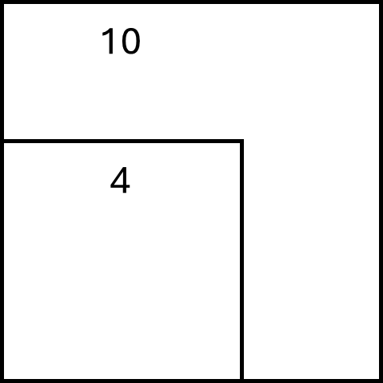
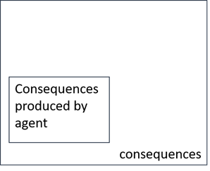

# Moral Learning
**First published Sat Sep 12, 2026**

*Kushnir, Tamar, Nichols, Shaun*

In this piece moral learning is taken to comprise the acquisition of norms and values in the moral domain. The investigation of the acquisition of such norms and values stretches back to antiquity, and it has received focused attention in contemporary moral psychology.

Moral prohibitions are found in virtually every culture (Brown 1991)[^brown-1991]. But there is considerable cultural variability on which groups count morally. The Mbuti think that it is wrong to steal from each other, but acceptable to take from outsiders (Turnbull 1972)[^turnbull-1972]. The morality surrounding incest is also variable across cultures. In some cultures (e.g. parts of Korea), first-cousin marriage is absolutely forbidden; in other cultures (e.g., in Saudi Arabia), it is permitted; in other cultures (e.g., parts of south India), it is wrong to marry one’s *parallel cousin* (i.e., the child of a parent’s same-sex sibling), but not a *cross-cousin* (i.e., the child of a parent’s opposite sex sibling). Both the uniformity and diversity of moral attitudes across cultures entail an important role for moral learning.

In addition, people seem to make critical moral distinctions. There is a difference between representing “this is something people shouldn’t do” and representing “this is something I’m required to stop people from doing”. How are such distinctions acquired? Again, moral learning seems to be required.

In this entry, we start by considering the initial states from which moral learning might begin; this includes both affective and cognitive precursors. We then review another critical element in the repertoire: the capacity for learning from testimony. Following this, we review several of the key aspects of moral cognition the acquisition of which calls out for explanation, including the moral/conventional distinction and moral parochialism. One class of accounts of moral acquisition draws on associative learning, a ubiquitous and powerful form of learning. We review how associative learning might explain aspects of our moral psychology and where it seems to be inadequate to the explanatory task. We then turn to nativist accounts, according to which crucial aspects of our moral cognition cannot be explained without adverting to an innate faculty dedicated to moral acquisition. The following section reviews recent attempts to explain moral cognition by appeal to statistical learning. In the final section, we take up broader issues about when the acquired norms and values should be construed as moral, and how norms and values might come to be moralized.

## 1. Starting States

Learning requires input, but it also requires a psychology – in the learner – that receives input in a way that is useful for learning. Thus, one of the questions we must answer before addressing mechanisms of learning in any domain is what states of reacting, attending, encoding, representing, and knowing exist prior to receiving input. Answering this question is important for understanding the emergence of moral knowledge early in human development. It is also important for understanding changes to and advances in moral knowledge later in life, in as much as prior processing capacities, reactions, and knowledge bias treatment of new information.

When it comes to young moral learners, the theories of moral learning discussed below assume a set of such “starting states”, though they disagree on which ones. Much of the disagreement stems from a connection between modern scientific views on learning and historical debates over innateness of knowledge (see SEP entries “The Historical Controversies Surrounding Innateness” and “Innateness and Contemporary Theories of Cognition”). The current entry does not aim to resolve debates on the innateness (or not) of moral knowledge, nor to resolve controversies about which starting states are innate. Here instead we start by specifying the set of emotional and cognitive capacities present early in life that – whether innate or themselves learned – are together useful, and perhaps necessary, as foundations for moral learning.

### 1.1. Affective precursors

One set of precursors to moral learning is emotional or broadly affective capacities. Among our emotional capacities early in development is sensitivity to behavioral manifestations of suffering in others. In a well-known experiment, Simner exposed newborn infants to recordings of various sounds, including the spontaneous crying of another newborn, the crying of a 5-month-old, a synthetic crying sound created by computer, and white noise of the same loudness (Simner 1971)[^simner-1971]. The study revealed that infants cried notably more when hearing the recording of another newborn crying compared to the other conditions. These results have been replicated by independent groups (Sagi & Hoffman 1976; Martin & Clark 1982)[^martin-1982][^sagi-1976].

Something similar is found in other mammals. For example, rats and monkeys seem to have a natural aversion to distress cues exhibited by members of their own species (Masserman et al. 1964; Greene 1969)[^greene-1969][^masserman-1964]. In one somewhat disturbing study, a monkey was trained to pull a chain to receive food, but the setup was later modified so that pulling the chain would also deliver an electric shock to another monkey in a nearby cage. The shocked monkey would shriek in pain, which the other monkey would quickly associate with his pulling the chain. Several monkeys chose to stop pulling the chain, presumably as a result of the association between pulling the chain and the shrieks of the other monkey. By refraining from pulling the chain, the monkey prevented his conspecific from being shocked, but he also no longer received any food. As the authors put it, “a majority of rhesus monkeys will consistently suffer hunger rather than secure food at the expense of electroshock to a conspecific” (Masserman et al. 1964, 585)[^masserman-1964].

One interpretation of these findings on human infants is that the indicators of suffering trigger self-focused distress on the part of the infant (cf. Batson 1991)[^batson-1991]. In this kind of distress, one might seek comfort for oneself rather than attend to or comfort the injured person. However, even in the first year of life, infants sometimes show other-regarding interests in the presence of distress cues. In an early study by Hay, Nash, and Pederson (1981), researchers observed how 6-month-old infants reacted when another infant spontaneously began crying or fussing. Self-focused distress was uncommon; instead, the babies tended to focus on the distressed peer, often leaning toward them, gesturing, or making physical contact, and showing sober, concerned expressions or vocalizations. Similarly, Roth-Hanania et al. (2011) examined infants’ reactions to an adult (the mother) feigning injury. In two separate episodes, the mother displayed facial and vocal signs of moderate pain for about 60 seconds, while avoiding eye contact with the child. Researchers assessed the infants for visible signs of concern—such as facial expressions, vocal tones, and body gestures. They also rated prosocial actions, such as attempts to comfort (e.g. by patting). Findings showed that by 8 to 10 months, infants already showed facial and vocal expressions associated with other-oriented sympathetic concern. Prosocial behaviors—like helping or consoling—were rare in the first year but became far more frequent during the second year, with strong responses evident by 16 months (see also Roberts and Strayer 1996, 456; Eisenberg et al. 1989, 58; Miller et al. 1996, 213)[^eisenberg-1989][^miller-1996][^roberts-1996].

### 1.2 Cognitive precursors

In addition to the emotional capacities described above, human learners have a set of cognitive capacities which emerge within the first few years of life that are foundational for learning about the complexities of the social world. Several researchers have argued that this is part of a suite of evolved cognitive skills that enable humans to engage in cooperation in social groups (Chudek & Henrich 2011; Tomasello 2018a; Cosmides & Tooby 1992)[^chudek-2011][^cosmides-1992][^tomasello-2018a]. As a leading proponent of the view that morality and cooperation are connected, and tied to uniquely human psychology, Tomasello writes:

> Cooperation and morality both refer to intentional actions in which the agent is not just pursuing its own self-interested motives, but is also concerned with the well-being of others. … to account for cooperation, and so morality, we need a psychology that recognizes individuals’ interdependence with one another that makes it rational for each individual to be concerned that their groupmates survive and thrive, and that those groupmates reciprocate this concern. (2018a, 661–662)

Tomasello’s view (2018a) on moral starting states involves two maturational changes in development that are timed to emerge in sequence (see SEP entry “Collective Intentionality” for more details on the view). The first is the development, at the end of the first year of life (roughly at 9 months of age), of cognitive capacities that allow the infant to cooperate as an individual with other individuals *and* include the ability to engage in joint attention, and to infer others’ intentions and goals (see below). The second is the development, at the beginning of early childhood (roughly age 3), of cognitive capacities that allow the young child to cooperate as a *member of a group* with other group members*.* This includes the abilities to coordinate shared intentions, to take the perspective of others and reason about mental states (see SEP entry “Folk Psychology as a Theory”), and to understand social norms. On Tomasello’s view, these developmental changes parallel two transitions in human evolution: the former includes cognitive characteristics shared with other primates and the latter is unique to our species.

Below we review four cognitive capacities important for moral learning and describe a timeline for their emergence in human development:

1. the capacity to understand that agents act *intentionally* with respect to their *goals*,
2. the capacity to represent *social* or *interpersonal goals* including the goal of helping or harming another agent,
3. the capacity to understand deontic *rules, social conventions, and norms*, and
4. the capacity to view individual agents as members of social *groups* and to make inductive inferences about the properties of those groups, such as typical behaviors and attitudes of group members.

For each subsection, we briefly review what is known about the developmental emergence of these capacities based on existing empirical evidence. Section 1.2.5 briefly addresses how these cognitive capacities manifest in early social behaviors.

*Note on research methods in cognitive development*: Even with little or no verbal ability (prior to the age of 3 years) infants’ developing social cognition can be assessed based on observing behavior in experimentally controlled settings. The predominant empirical paradigms for exploring the social-cognitive capacities of preverbal infants involve using various measures of visual attention to measure stimulus discrimination in visual displays (e.g. preferential looking, looking time, habituation and dishabituation: see e.g. Oakes 2010)[^oakes-2010]. Researchers interpret these patterns of visual attention as signs that infants have *expectations* about what agents will do under the circumstances presented. Critically, however, visual attention can only be reliably used when infants can control their saccades and head movements, around 3 months of age (see Robertson et al. 2001)[^robertson-2001] which makes any claims about capacities prior to this age speculative. As infants begin to achieve motor milestones such as reaching for and manipulating objects, or crawling and walking towards objects or people, experimental paradigms begin to rely less on visual attention and more on overt behaviors and decisions. Importantly, some degree of motor skill is necessary for studying early prosocial or normatively guided behaviors such as helping others or complying with directives or rules (see below for examples).

#### 1.2.1 Intentional agents

The ability to understand intentions is an important prerequisite for intent-based moral judgment. The cognitive capacities that allow us to represent intentions and goals first emerge in infancy. Within the first six months of life infants reliably distinguish agents from inanimate objects based on perceptual cues (Rakison & Poulin-Doubois 2001)[^rakison-2001]. Shortly thereafter, infants make two further distinctions that are relevant for understanding intentional agency: The first is that infants expect the *causes* of animate motion – unlike the motion of inanimate objects – to be internal to an agent (in particular, the motions do not require being initiated from the outside, Premack 1990; Saxe, Tzelnic, & Carey 2007)[^premack-1990][^saxe-2007]. The second is that infants expect the *consequences* of agents’ actions – unlike the consequences of inanimate object motion – to be determined by an agents’ intentions and goals rather than by predictable physical laws such as force and direction (Woodward 1998; Gergely & Csibra 2003)[^gergely-2003][^woodward-1998]. By 9 to 10 months of age, infants interpret agents’ behaviors with respect to goals even when agents fail to achieve those goals, which gives further evidence of a focus on intent rather than outcomes when encoding human actions (Brandone & Wellman 2009)[^brandone-2009].

#### 1.2.2 Social goals

Understanding moral norms involves considering the positive (helpful) and negative (harmful) consequences of actions to others. Our moral judgments, in turn, often depend on evaluations of intentions to harm or help others. A seminal study by Hamlin et al. (2007) showed some capacity to represent social goals in pre-verbal infants 6 to 10 months of age. Hamlin and colleagues habituated infants to two displays – one agent (a circle shape with eyes) “helps” another agent achieve the goal of climbing a hill, and one agent who “hinders” the same agent in achieving the same goal (see also Kuhlmeier et al. 2003; Premack & Premack 1997)[^kuhlmeier-2003][^premack-1997]. Infants’ patterns of dishabituation suggest they encode pro- and anti-social intentions and use them to guide expectations: they expect the climber to approach the helper and avoid the hinderer. Infants’ own behavior (selective reaching to helpful, harmful, or neutral agents) suggests they approach helpers and actively avoid hinderers. Follow-up studies have found expectations about social goals, and resulting preferences for socially helpful over harmful individuals, using a variety of methods and at a range of ages within the first two years of life (for a review see Hamlin 2013)[^hamlin-2013].[^note-1]

Beyond studies of physical harm (and helpfulness), additional work shows that infants have expectations that agents should distribute resources equally (for example, splitting items of food or toys in half as they distribute between two people: see Sommerville 2018)[^sommerville-2018]. By 15 months, infants prefer agents who intend to help but accidentally harm due to holding a false belief over agents who intend to harm but accidentally help (Woo & Spelke 2023)[^woo-2023]. These results suggest that, by the second year of life, infants’ expectations about social goals – similar to expectations about object-directed goals – are tied to intentions of agents regardless of outcomes.

#### 1.2.3 Deontic Rules

By 3 years old, children show a striking facility with picking up deontic rules (see e.g., Cummins 1996; Harris & Núñez 1996)[^cummins-1996][^harris-1996]. In a representative task by Harris and Núñez, children were presented with a rule that was clearly arbitrary: “One day Carol wants to do some painting. Her Mum says if she does some painting she should put her helmet on” (1996, 1581). Children were shown four pictures: two pictures depicted Carol painting, one with and one without a helmet; in the other two pictures, Carol is not painting, but in one of these pictures she has a helmet on. Children were asked, “Show me the picture where Carol is being naughty and not doing what her Mum told her?” Despite the fact that the rule was unfamiliar and arbitrary, 3- and 4-year old children tend to get the right answer. They can also identify the relevant feature; when asked “What is Carol doing in that picture which is naughty?” (1581), children tend to invoke the helmet.

This facility with deontic rules is contrasted with the great difficulty posed by indicative conditionals. Harris & Núñez paired deontic conditional cases like the helmet case with parallel indicative conditional cases. In the indicative case for the helmet scenario, the experimenter says, “One day Carol wants to do some painting. Carol says that if she does some painting she always puts her helmet on” (1996, 1585). Subjects were shown the usual array of pictures and in the indicative case were asked, “Show me the picture where Carol is doing something different and not doing what she said” (1585). Both 3-year-olds and 4-year-olds did much worse with these kinds of questions than with the parallel deontic questions (see also Cummins 1996)[^cummins-1996]. Despite the close similarity between deontic and indicative conditionals, young children were much better at evaluating whether deontic conditionals were met than whether indicative conditionals were true.

Not only do 3-year-olds readily pick up on rules, but they also assume that rules and norms *ought* to be followed. This is seen in the increase around the third birthday in children’s motivation to follow all sorts of arbitrary actions demonstrated by adults, and their assumptions that such actions are social conventions or norms (see section 1.2.5 below). Most convincingly, 3-year-olds will act as norm *enforcers*, and will protest when others violate rules. This phenomenon of normative protest was first demonstrated by Rakoczy et al. (2008). In their study, 2- and 3-year-old children learned how to play a game with a simple rule. Children then saw a puppet state their intentions to play the game, but instead perform an action that violated the game rule. Three-year-olds protested the puppet’s action, often accompanying their protest with deontic language (“it doesn’t go like that”, “that’s not how we do it”). Two-year-olds sometimes protested, but without deontic language.

Three-year-olds’ normative understanding, as measured by protest behaviors, integrates consideration of circumstances in which others might *not* have to follow rules. For example, children do not protest if the agent states that they are choosing to opt out of the game (Racoczy et al. 2008), or if the agent is unable to follow the norm due to a physical constraint (Josephs et al. 2016)[^josephs-2016]. If the agent is a member of a different social group (out-group), children protest the agent’s violations of moral norms (harmful actions) but not conventional norms (game rules) (Schmidt et al. 2011)[^schmidt-2011].

#### 1.2.4 Social Groups

Social groups share systems of norms, practices, beliefs, and attitudes that help regulate cooperation among group members (Chudek & Henrich 2011; Tomasello 2019)[^chudek-2011][^tomasello-2019]. The understanding of social groups, and a sense of one’s own group identity or belonging to a group, have been theorized to serve as a motivation for individuals to conform with social and moral norms (see SEP entry “Social Norms”). As a potential starting state for social group cognition, infants have been shown to demonstrate homophily – a tendency to prefer similar others – based on exposure to and familiarity with facial features or languages (Kelly et al. 2005; Bar Haim et al. 2006; Kinzler et al. 2007)[^kelly-2005][^kinzler-2007]. Infants also have expectations of homophily in other agents: they expect, for example, for agents who are similar to each other to like each other, to share food preferences, and to act in similar ways (Liberman et al. 2021)[^liberman-2021]. Homophily has early implications for social learning. Infants prefer to eat new foods when those foods are eaten by someone who speaks the same language (Shutts et al. 2009)[^shutts-2009]; infants also preferentially imitate members of their social group (Over & Carpenter 2012)[^over-2012].

As further evidence that social group cognitions emerge early, identification with social “ingroups” – and deidentification with social “outgroups” – can be induced in preschool age children using experimental “minimal groups” paradigms in the lab (Dunham et al. 2011)[^dunham-2011]. Moreover, even minimal group affiliations can lead children to view their own group members as having more positive characteristics, as more trustworthy, and as more deserving of fair and moral treatment than outgroups (McAuliffe & Dunham 2016)[^mcauliffe-2016].

Preschoolers show an early tendency to link social group affiliation to normative and moral behavior. Roberts and colleagues (2017) taught preschoolers about two novel social groups (a group of “Hibbles” and a group of “Glerks”) and described the behavior of one of the groups in generic terms (e.g. “Hibbles eat yellow berries”). Children as young as 4 took these descriptions of the behavior as suggestive of prescriptive norms that distinguished the groups from each other and evaluated non-conforming group members negatively (e.g. Hibbles *should* eat yellow berries). Social group information also influences preschoolers’ moral judgments. Rhodes & Chalik (2013) introduced 3- to 9-year-olds to two novel categories (“Flurps” and “Zazzes”). Children as young as 3 years old judged harm to be impermissible independent of any extrinsic rules *only* when the harm was inflicted by one group member on another. The authors suggest “social categories as marking patterns of intrinsic interpersonal obligations” (2013, 1003) that extend beyond conventions and rules.

#### 1.2.5 Early social (moral) behavior

The previous sections review the ways in which infants interpret their social world from the beginning of life, setting the stage for moral learning that is based on observations of others’ behavior. But infants also learn by doing; they act and make decisions. Their decisions can result from observations of others (imitation), can be motivated by their nascent conceptions of what is helpful or fair (prosocial motives), and/or can be motivated by what they think one ought to do (normative motives). Moral agency and moral learning are in a cycle of feedback: young moral learners’ actions and decisions result from their current state of moral knowledge and self-regulatory skill. In turn, their actions are subject to corrective feedback and guidance from their moral teachers (peers, older peers, adults), resulting in further learning.

The earliest prosocial behaviors emerge in concert with emotional and cognitive developments discussed above. Notably, the capacity to understand intentions combines with empathic concern to inform early prosocial behavior, especially helping, comforting, and sharing (Paulus 2014)[^paulus-2014]. For example, toddlers will go out of their way to remove obstacles or obtain out-of-reach objects if such actions help another person accomplish their goals (Dunfield et al. 2011; Warneken & Tomasello 2006; Svetlova et al. 2010)[^dunfield-2011][^svetlova-2010][^warneken-2006]. The understandings of fairness (equitable resource allocation) which emerge in the second year of life correlate with infants’ own sharing behavior: infants who themselves share expect others to share. These and other examples suggest early ties between moral cognition and prosocial action.

Understanding intentional agency also allows for social learning through imitation. Infants in the second year of life are motivated to imitate what they perceive to be the intentions of a demonstrator, rather than an exact copy of their body movements (Melzoff 1995; Carpenter et al. 1998)[^carpenter-1998], and they imitate what they infer to be a demonstrator’s goal even if the attempt is unsuccessful (Melzoff 1995; Gergeley et al. 2002).

Importantly for moral learning, by age 3 children assume that adults have *pedagogical goals* when they act intentionally (Bonawitz et al. 2011)[^bonawitz-2011]. The result is the phenomenon of “overimitation” – or a tendency to imitate arbitrary sequences of actions that have no instrumental value (Lyons et al. 2007)[^lyons-2007]. Studies have shown that by 3 years of age children infer that adults who intentionally perform instrumentally irrelevant actions are in fact intending to teach something socially relevant, and thus children will imitate these actions as a form of norm learning (Kenward et al. 2011)[^kenward-2011].

## 2. Testimonial learning

In addition to the basic emotional and cognitive precursors mentioned above, children have an ability to learn from others via testimony, which might be defined as language-based assertions that listeners treat as reliable sources of evidence in themselves (see SEP entry “Epistemology of Testimony” for details and controversies). This includes spoken and written statements, and statements that result from first-hand experience, second-hand hearsay, relevant expertise, or personal reflection. A large body of work in developmental psychology (e.g. Koenig et al. 2022; Koenig & Harris 2005; Harris 2012; Mills 2013)[^harris-2012][^koenig-2005][^koenig-2022][^mills-2013] shows that testimony is an important mechanism of knowledge acquisition from the time children begin to understand and use language themselves. This body of work shows that children are *selective* in who they trust and in which testimony they consider reliable. Sometimes, children evaluate testimony by checking it against their own prior knowledge (Sobel & Kushnir 2013)[^sobel-2013]. Other times, children trust testimony for interpersonal rather than epistemic reasons – selectively learning from others based on a speaker’s familiarity, cultural similarity, or non-verbal cues such as confidence (Mills 2013)[^mills-2013]. Regardless of reasons to trust, children treat testimony as a fundamental source of knowledge, with its own status rivalling first-hand experience (Harris et al. 2018)[^harris-2018].

How does testimony influence moral learning? Hills (2020) distinguishes between two types of moral testimony. The first is “transmission” of moral assertions that a speaker directs at a listener (e.g. “X is wrong”). The second is what Hills refers to as “propagation” in which a speaker gives reasons or rationales for a listener to consider in coming to their own moral evaluations (e.g. “X can be harmful to others”). According to Hills, transmission is epistemically problematic, even if one happens to be learning from a moral expert, as it can result in second-hand moral *knowledge* but not any deeper form of moral *understanding* or cultivation of moral *virtue*. Propagation is less problematic, at least for mature moral agents who are expected to come to their own conclusions, understandings, and evaluations.

What about young moral learners? Li & Koenig (2023) argue that transmission may be less epistemically problematic for children, and suggest that direct statements are useful for providing a basis of moral principles or norms to consider in the first place. This claim is supported by work showing that children do in fact learn from direct moral statements. For example, Li et al. (2019) showed 3- to 5-year-old children an unspecified action that caused a child to cry. Most children initially judged this action wrong. But then children were provided with testimony from adults that the actions were, in fact “OK”. Many (but not all) children revised their initial belief, and younger children did so more than older children. This suggests that direct statements of wrongness by adults, even when counterintuitive, exert influence on children’s moral judgments, especially when they are young.

Propagation of various sorts – reasons, arguments, discussions – also influences young learners, and, as children get older, appeals to appropriate moral reasons become more effective than direct statements of wrongness (see Tomasello 2018b)[^tomasello-2018b]. For example, Rottman et al. (2017) presented 7-year-old children with a fictional group of “aliens” who engaged in a neutral action with no obvious harmful consequences (e.g. “putting cotton balls in the forest”), and provided testimony with either emotional condemnation (“when they do X it is disgusting”) or harm-based reasons (“when they do X it can be harmful to others”). Both types of testimony, neither of which was a direct statement of wrongness, led 7-year-olds to form moral judgments of the neutral action. Moreover, their judgments were stronger and longer lasting when testimony appealed to harm-based reasons rather than emotions.

Another form of testimonial propagation emerges in peer-to-peer disagreements (Tomasello 2018b)[^tomasello-2018b]. From at least age 5, children actively defend moral points of view in discussions with peers and are more receptive to considering alternative perspectives on complex moral issues; this is more pronounced when engaging in discussions with peers rather than parents or other authority figures (Mammen et al. 2019)[^mammen-2019]. These findings strengthen the idea that moral learning through testimony is selective and dependent on the interpersonal characteristics of the interlocutor – parents are treated as moral “experts”, more so than peers, thus each potentially plays a unique role in moral learning.

## 3. Characteristics of moral cognition

People’s capacities to make moral judgments, draw distinctions, and determine moral boundaries demand explanation. In this section, we will review several features of moral cognition that have been targets of learning theory: the moral/conventional distinction, the focus on action, the scope of moral patiency (e.g. who deserves to receive moral treatment), and the role of universalizing judgments. Importantly, many of these features show up early in development (Levine et al. 2018; Pellizzonni et al. 2010; Powell et al. 2012; Heiphetz and Young 2017; Smetana & Braeges 1990)[^heiphetz-2017][^levine-2018][^powell-2012][^smetana-1990].

### 3.1 The moral/conventional distinction

From a young age, children treat canonical moral violations differently from conventional violations (Turiel 1983)[^turiel-1983]. This has been explored extensively via the “moral/conventional” task (for reviews see Smetana 1993; Tisak 1995; Killen & Smetana 2015)[^killen-2015][^smetana-1993][^tisak-1995]. In this task, preschool-age children are presented with various kinds of violations, some of which are considered moral (e.g., unprovoked hitting), and others conventional (e.g., standing up during nap time). Children, like adults, tend to treat the moral violations differently from the conventional violations on a variety of measures. Moral violations are rated as more serious than the conventional ones. People are also more likely to cite harm when explaining why the moral violations are wrong, as compared to the conventional violations.

On a somewhat more subtle measure, the *authority dependence* task, participants are asked whether the action would be wrong if some relevant authority didn’t have a rule against it. For example, would it be wrong to hit someone in class without provocation if the teacher didn’t have a rule against it? People tend to say that it would still be wrong in such a case but are less likely to say this when asked about a conventional rule, like standing up during nap time.

A further measure explores whether conventional violations are more likely to be treated as *relative* to a group or culture. Children are more likely to judge that moral violations will be wrong in other places and countries, as compared to conventional violations (Smetana 1985)[^smetana-1985]. Relativism is also measured via a *disagreement task*, in which adult participants are presented with an action and told that two people disagree about whether it’s wrong and then asked whether only one of the disputants must be right or whether both of them could be right (Goodwin & Darley 2008)[^goodwin-2008]. Participants are more likely to say that both of the individuals can be right for conventional items, as compared to moral items. That is, moral rules (e.g., it’s wrong to hit) tend to be taken to hold universally while other rules are taken to hold only relative to certain contexts (e.g., it’s wrong to wear jeans at school [for certain schools]) (Wright et al. 2014)[^wright-2014].

There is a great deal of dispute about how exactly to interpret the results on moral/conventional tasks (see, e.g., SEP entry “The Moral/Conventional Distinction”). But the effects themselves have been widely replicated. The moral violations presented to participants in these studies are treated differently on these questions. This differential treatment has been found from preschoolers through adulthood (Huebner et al. 2010)[^huebner-2010]. And this generates a learning-theoretic question: how is this differentiation acquired?

### 3.2 Moral intuitions and action

People show a marked distinction in moral intuitions about scenarios that involve actions as compared to allowings. Young children judge that it’s worse to produce a bad outcome than it is to fail to prevent the same outcome (Powell et al. 2012)[^powell-2012]. More generally, people tend to regard social and moral rules a*s act-based* (keep your promises; don’t litter) rather than *consequence-based* (maximize promise-keeping; minimize litter). This focus on action is revealed in studies on moral dilemmas like trolley cases. In *Footbridge*, one can push a person in front of the speeding trolley to prevent the trolley from killing five innocents; the modal judgment here is that it’s not permissible to push the person. But in this case, while the agent refrains from producing the death of the one person, he is thereby allowing the death of five people. *Allowing* the deaths doesn’t seem to carry the same moral import as producing a death via one’s own action. This pattern of judgment has also been found in young children (Pellizzoni et al. 2010)[^pellizzoni-2010].

### 3.3 Parochialism

It’s a familiar observation from anthropology that in many cultures, moral prohibitions apply to members of the local community but not to outsiders. Just to take one famous example, according to Turnbull (1972), the nomadic Mbuti thought it was wrong to steal from each other, but they thought it was fine to steal from people in villages. Moral rules are thus often *parochial* (e.g., Read 1955, 255; Snare 1980, 364)[^read-1955][^snare-1980].

Homophily (section 1.2.4) is likely an important precursor to various parochial attitudes. Babies prefer others who have the same accent as their mother (see, e.g., Kinzler, Dupoux, & Spelke 2007)[^kinzler-2007]. This affects social choices, e.g. who they would want to be friends with (Kinzler et al. 2009)[^kinzler-2009]. Children are also more generous to ingroup members (Sparks, Schinkel, & Moore 2017)[^sparks-2017], and they provide more positive trait evaluations for ingroup members (Richter, Over, & Dunham 2016)[^richter-2016].

Classic and striking work comes from studies using the “minimal group paradigm” (Tajfel 1970; Diehl 1990; Dunham 2018)[^diehl-1990][^dunham-2018][^tajfel-1970]. In these studies, people display ingroup favoritism even when randomly assigned to previously unfamiliar social groups based on arbitrary cues (e.g., a label, ‘the red group’). Although the classic work on minimal groups was done on adults, the core result is also found in children. For instance, in a minimal group paradigm, children were more willing to trust the testimony of ingroup members even in the absence of any prior knowledge about the group (MacDonald et al. 2013)[^macdonald-2013].

## 4. Associative learning and morality

### 4.1 Classical conditioning and moral judgment

Classical conditioning is a fundamental form of associative learning. Such conditioning depends ultimately on natural links between a stimulus (e.g., meat powder) and a response (e.g., salivation) such that an organism reliably exhibits the response in the presence of the stimulus. The natural responses occur before any learning, and both the stimulus and the response are dubbed “unconditioned”. This relation between the unconditioned stimulus (US) and unconditioned response (UR) forms the basis for learning new associations. When a neutral stimulus, like a bell ringing, occurs shortly before the appearance of the US (meat powder), over time, the neutral stimulus comes to be associated with the unconditioned stimulus and it will, all by itself, generate the familiar response (salivation). When that occurs, the bell, which had been a neutral stimulus, has become a “conditioned stimulus” and the salivation that follows it is a “conditioned response”. (See SEP entry “Associationist Theories of Thought”.)

Classical conditioning is a ubiquitous and powerful form of learning. It’s found across the animal kingdom, from humans to snails (Kemenes & Benjamin 1989). And it’s implicated in a wide range of phenomena, from phobias (e.g., LeDoux 2014)[^ledoux-2014] to drug tolerance (e.g., Siegel et al. 1982).

James Blair has recruited classical conditioning as an important element in the emergence of moral judgment. As we saw in section 1.1, infants are acutely sensitive to the distress of others. This fact is of central importance in Blair’s theory. In Blair’s classic (1995) articulation of the model, humans possess an innate mechanism, the violence inhibition mechanism (VIM). This proposal is derived from the idea that social animals have mechanisms to inhibit intra-species aggression (see, e.g., Lorenz 1966)[^lorenz-1966]. A distress cue (e.g., crying) is an unconditioned stimulus for the activation of VIM, and VIM activation is an unconditioned response to such cues (Blair 1995, 5)[^blair-1995]. The activation of VIM results in a withdrawal response but also generates an aversive experience (1995, 7). It is this aversive experience that is critical to moral judgments on Blair’s view. However, the distress cues that constitute unconditioned stimuli for VIM are a limited class, tied directly to perceptual signs of distress like crying and shrieking. Moral judgments, by contrast, can be made in the absence of any such perceptual cues. This is where the learning story enters for Blair. Blair maintains that classical conditioning will lead to associations between perceptual cues of pain and *thoughts* about harm. In particular, classical conditioning will build an association between perceptual cues of pain and “representations of the victim’s internal state, formed through role taking” (1995, 9). As a result of this association, representations of a victim’s pain will activate VIM even in the absence of any perceptual signs, and this activation will carry an aversive experience. As Blair puts it, “an individual may generate empathic arousal to just the thought of someone’s distress (e.g., "what a poor little boy") without distress cues being actually processed” (1995, 5).

Although Blair’s original VIM-based account is based on ethological work, this is not essential to the learning story. That is, it needn’t be VIM in particular that underlies the aversion to distress cues. What matters is that (1) perceptual signs of pain trigger aversive experiences, (2) conditioning can establish an association between perceptual signs of pain and *thoughts* of acts that cause pain to others, and (3) a consequence of this association is that thoughts of acts that cause pain to others will trigger an aversive experience.

After the foregoing kind of conditioning, an aversive experience will occur whenever the normally developing child thinks about harmful actions. That will confer a special salience to thoughts about harmful actions. Blair summarizes as follows:

> moral socialization occurs through the pairing of the activation of the mechanism by distress cues with representations of the acts which caused the distress cues (moral transgressions—for example, one person hitting another). A process of classical conditioning results in these representations of moral transgressions becoming triggers for the mechanism. (2001, 730)

The result of this process of classical conditioning is that representations of moral transgressions are aversive. This, Blair suggests, is key to the special status of moral violations, as reflected in the moral/conventional task (section 3.1).

Blair draws on his account of aversion to harmful thoughts in order to explain the differences found between moral violations (e.g., unprovoked hitting) and conventional violations (e.g., standing up during nap time). In particular, Blair maintains that the moral items, unlike the conventional ones, will trigger aversive experiences. This is simply because of the conditioned response to thoughts of harmful actions. When we think about Johnny hitting Billy, because of our history of conditioning, we find this thought aversive, whereas when we think about Johnny standing up during nap time, we have no history of conditioning that makes this thought aversive (Blair 1995, 7–8)[^blair-1995]. This felt difference between the moral and conventional cases gives rise to the differences in judgments, according to Blair.

### 4.2 Model-free reinforcement learning and moral judgment

#### 4.2.1 Reinforcement learning and operant conditioning

Classical conditioning leads to associations between stimuli (e.g., a bell and the arrival of meat powder), and such associations can inform behavior like salivating. But classical conditioning does not involve learning from *behavior*. Skinner introduced the notion of *operant* conditioning to capture the evident fact that organisms learn from their behavior. In operant conditioning, the organism learns associations between behaviors and their consequences. A rat might learn that hitting a lever is associated with the appearance of food. This association might then affect future behavior. Because the consequence of the behavior (hitting the lever) is rewarding, the behavior will become more frequent. As a result, this consequence would count as “reinforcement”. But sometimes the result of the behavior will be aversive. For instance, a rat might learn that walking on red squares is associated with electric shock. This association will then make the behavior (walking on red squares) less frequent. The consequence of walking on the red squares would count as “punishment”.

The notion of *operant conditioning* was introduced by Skinner (see, e.g., 1938) and is bound up with his behaviorism. As a result, the theoretical framework of operant conditioning does not include any account of the internal processing involved in generating the behavior. Computational cognitive science examines much of the same phenomena as Skinner, but under the label *reinforcement learning*, which explicitly invokes processing and representations of value. The appeal to value representations can explain a great deal of behavior. Rats push the lever because they place a high value on food and expect that pressing the lever will result in the appearance of food. Monkeys select grapes over cucumbers because they assign a higher value to grapes. Water-deprived rats who are allowed to run a Y-maze will run towards the branch with water (rather than the food branch) because they place a high value on water after being deprived of it. A rat can acquire a positive value representation for pressing a lever (e.g. when it’s followed by food) or a negative vale representation for the action (e.g., when it’s followed by a shock).

In the case of water-deprived rats, the water is represented as higher-value than the food, and hence the rats navigate to the portion of the maze with water. This behavior depends on the rat learning a *model* of the maze that includes the locations of the water and food. This kind of learning is called *model-based reinforcement learning*, since it involves the agent building a model of their situation.

While models can be excellent tools for making decisions, real-world environments are often far more complex than simple experimental setups like Y-mazes. To learn a model of complicated environments is computationally expensive, and animals also rely on a simple associationist learning procedure – habit learning. This is also known as *model-free* reinforcement learning because it doesn’t involve constructing or representing a model. For example, after getting food rewards from pressing a lever, an animal might come to assign a positive value to lever-pressing itself. Such value representations drive habitual behavior, and this behavior can persist even when the original goal of the behavior is undermined.

It can be difficult to determine whether an animal’s lever-pressing is motivated by a goal (get the food) or a mere habit. If the animal presses the lever specifically to obtain food, that’s goal-directed behavior based on understanding the relationship between action and outcome. However, if the animal presses the lever simply because the action itself feels rewarding, that’s habitual behavior. The difference between these two types of behavior is revealed in "devaluation" experiments. In these tests, researchers first teach a rat that lever-pressing produces food. Then, they completely satisfy the rat’s hunger before returning it to the test cage. Sometimes, rats will continue pressing the lever even though they’re no longer interested in eating the food that appears. Similar behavior occurs when hungry rats know that pressing the lever won’t produce any food – they may still press it habitually under certain circumstances. In this case, we might say the rat just likes to press the lever. In real life, model-free reinforcement learning explains why I check my phone for messages even when I just checked a minute ago. In some sense, I just “like” checking my phone without having further thoughts about possible consequences. This behavior is habitual rather than goal-directed.

#### 4.2.2 Moral intuitions and reinforcement learning

Crockett (2013) and Cushman (2013) independently drew on reinforcement learning to explain people’s intuitions about moral dilemmas like the ubiquitous trolley cases (section 3.2). In *Switch*, one can pull a lever to divert a trolley from five innocent individuals towards a side track with only one such individual; people tend to judge it permissible to pull the switch. In *Footbridge*, one can push a person in front of the speeding trolley to prevent it from killing five innocents; the modal judgment here is that it’s not permissible to push the person. Crockett and Cushman suggest that these different kinds of judgments derive from the different kinds of value representations issued by model-based and model-free reinforcement learning. Model-based value representations are focused on consequences, model-free value representations are focused on actions (Crockett 2013, 363; Cushman 2013, 279)[^crockett-2013][^cushman-2013]. Accordingly, model-based value representations are said to facilitate utilitarian verdicts whereas model-free value representations are said to facilitate deontological verdicts like those in *Footbridge* (Crockett 2013, 364; Cushman 2013, 282)[^crockett-2013][^cushman-2013].

Cushman characterizes the distinction between value representations as follows:

> the functional role of value representation in a model-free system is to select actions without any knowledge of their actual consequences, whereas the functional role of value representation in a model-based system is to select actions precisely in virtue of their expected consequences. (2013, 279)

According to Cushman, when presented with *Footbridge*, we rebel against pushing the man because our model-free system has assigned a negative value to the action-type *pushing*. Why do we assign this negative value? At least part of the reason, Cushman suggests, derives from model-free reinforcement learning – pushing is associated with a negative value-representation because pushing typically led to aversive outcomes (e.g., harm to victim) (2013, 282). Again, as with habit learning generally, the verdict is not thought through in terms of consequences but just in terms of the attraction or aversion to the action itself.

Is it true that pushing itself is aversive in a way that goes beyond the foreseen bad consequences? It seems so. In a series of studies, Cushman found that participants showed negative reactions to performing actions typically associated with harm, but in which the harm clearly will not occur (Cushman et al. 2012). For example, participants were asked to use a rock to smash a manifestly fake hand; in a control condition, participants were told to use a rock to crack a nut. Even though participants knew the hand wasn’t real, they showed greater physiological distress response when striking the fake hand compared to the nut. This demonstrates that humans naturally recoil from actions that usually hurt others, even when they know those specific actions won’t cause any real harm (Cushman 2013, 286)[^cushman-2013].

### 4.3 Beyond associationism

Associative learning plausibly does play an important role in moral reactions. Classical conditioning likely makes certain thoughts aversive because of the association with primitive triggers of distress. Thinking of someone pointing a gun at another is distressing, though guns are not unconditioned stimuli for distress. Rather, we have learned to associate guns with harmful actions that naturally trigger our empathic responses. Classical conditioning can explain how thoughts of guns get linked with these natural (unconditioned) responses of distress. Similarly, model-free reinforcement learning likely makes certain actions intrinsically aversive. Hitting a person with a rock causes distressing reactions in the victim. This can lead us to attach negative value representations to the act of hitting itself. Thus, we find it difficult to perform such actions even if we know that the typical bad consequence won’t follow.

Although associative learning plausibly plays a key role in what thoughts and actions we find aversive, it’s less plausible that this suffices to explain moral judgment. One reason is that to judge something to be wrong is not the same as registering that thing as aversive. People who spank their children often find it aversive to do so, without thinking it wrong to do so. And many moral judgments concern the wrongness, not the aversiveness, of an action. In Cushman’s experiments, participants found it aversive to hit the fake hand with the rock, but they probably didn’t regard it as morally wrong. Thus, aversion isn’t sufficient for a wrongness judgment. Neither is an aversive experience necessary for a wrongness judgment. I can judge it to be wrong to cheat on one’s income taxes without working up any substantial distress response.

In order to explain moral judgments, more sophisticated representations seem to be demanded, representations that encode rules (e.g., Mikhail 2011; Nichols 2004 and 2021; Nichols & Mallon 2008)[^mikhail-2011][^nichols-2004][^nichols-2021]. However, once we allow such complex representations, we then face a new kind of question about moral learning – how do we learn complex moral representations? One answer is that a substantial portion of the moral system depends on a special-purpose learning system for morality.

## 5. Nativism and moral learning

### 5.1 The linguistic analogy

It seems that moral judgment involves complex representations that go beyond what can be acquired through associative learning processes. A prevailing systematic account of how we acquire complex moral representations is that of nativist views that are inspired by Chomskyan linguistics. On the Chomskyan view, the acquisition of grammar depends on a domain-specific learning device: a Language Acquisition Device. Similarly, according to the analogy, the acquisition of morality depends on a domain-specific learning device: a Morality Acquisition Device (Dwyer 1999 and 2006; Harman 1999; Levine et al. 2018; Mikhail 2011 and 2022)[^harman-1999][^levine-2018][^mikhail-2011][^mikhail-2022]. According to Chomskyans, the actual grammatical knowledge that a child attains depends on innate domain-specific processes that constrain the kinds of languages that humans can acquire. The point is not simply that the Language Acquisition Device is a distinct mechanism. Rather, the Chomskyan proposal is that different acquisition devices run different programs: the program for learning to perceive faces is supposed to be quite different from the device for acquiring a grammar.

The core argument in favor of an innate language-acquisition device is a Poverty of the Stimulus argument. The argument maintains that the evidence available to the learner is not sufficient for domain-general learning (e.g. associative or statistical learning) to yield the mature state of grammatical knowledge from the starting state. Moral Chomskyans advance a parallel Poverty of the Stimulus argument for moral knowledge.

According to the linguistic analogy, just as the acquisition of complex linguistic structures depends on a domain-specific language-acquisition device, so too the acquisition of the complex moral structures depends on a domain-specific morality-acquisition device. As Dwyer puts the view:

> The child’s mindbrain contains (at some level of abstraction) a *morality acquisition device* (or *moral faculty*) that makes possible the acquisition of all and only humanly possible moralities. The moral faculty is characterized in terms of a set of rules, principles, and constraints (universal moral grammar) that determine what aspects of her environment a child needs to pay attention to, and, together with what she hears and sees around her, determines her mature moral competence, which we can call her I-morality, or moral idiolect. (Dwyer 2006, 242)

Similarly, Mikhail proposes that we possess

> a “Universal Moral Grammar” (UMG) analogous to the linguist’s notion of Universal Grammar (UG), that is, an innate … morality acquisition device that maps the child’s early experience into the system of principles that constitutes the mature state of her moral competence. (Mikhail 2008, 355; 2011, 90)[^mikhail-2008]

The morality-acquisition device is, of course, different from the language-acquisition device, and both are different from any domain-general learning device like associationism (section 4) or statistical inference (see below, section 6).

An innate morality-acquisition device has been posited to explain several aspects of moral cognition (see, e.g., Dwyer et al. 2009; Mikhail 2011; Mahlmann 2023)[^mahlmann-2023][^mikhail-2011]. But perhaps the most detailed accounts have applied to the moral/conventional distinction and the content of moral rules.

Dwyer takes early appreciation of the moral/conventional distinction as a central competence that depends on a learning device specific to morality. She writes:

> [T]he recognition of a distinction between moral and conventional domains, and the belief that moral considerations are imbued with special force and authority appear to be universal features of human life (Song, Smetana, and Kim 1987; Turiel 1983)[^song-1987][^turiel-1983]. (Dwyer 1999, 169–170)

Similarly, in a later treatment of moral nativism, she writes:

> Three- to four-year-olds understand that moral rules differ from conventional rules in terms of two main criteria: the former have force that is independent of any particular authority (e.g., God, parents, social custom) and are closely tied up with considerations of harm and injury (see Nucci 2001; Turiel 1983, 1998)[^nucci-2001][^turiel-1983][^turiel-1998]. (Dwyer 2006, 237)

Thus, Dwyer maintains that a key feature of what is acquired is the recognition that moral rules, unlike conventional rules, are authority-independent.

In keeping with the linguistic analogy, Dwyer uses a Poverty of the Stimulus argument to show that the moral/conventional distinction depends on an innate learning device (Dwyer 1999, 171–177; 2006, 239–242). According to Dwyer, “the fundamental mistake” of domain-general learning theories is “the assumption that all the information the child needs to achieve moral maturity is available in her environment” (172). She continues:

> Absent a detailed account of how children extrapolate distinctly moral rules from the barrage of parental imperatives and evaluations, the appeal to explicit moral instruction will not provide anything like a satisfactory explanation of the emergence of mature moral competence. What we have here is a set of complex, articulated abilities that (i) emerge over time in an environment that is impoverished with respect to the content and scope of their mature manifestations, and (ii) appear to develop naturally across the species. (1999, 173)

According to Dwyer, just as domain-general learning can’t explain the child’s linguistic competence, domain-general learning can’t explain the child’s *moral* competence, as revealed by their grasp of the moral/conventional distinction (see also Dwyer 2006, 239–240). Thus, Dwyer maintains that the child’s moral competence exceeds what a domain-general learning system would be able to achieve given the information available in the environment. She concludes that “we all come into the world equipped with a store of innate moral knowledge which, together with our experience, determines our mature moral competence” (1999, 176–177). In particular, Dwyer speculates that neonates are “in possession of some knowledge that primes them for recognizing two normative social domains” (1999, 177).

While Dwyer focuses on the moral/conventional distinction, other moral Chomskyans have focused on the character of the rules. Harman and Mikhail suggest that the *Principle of Double Effect* is reflected in the pattern of intuitions people have about trolley cases (Harman 1999, 113–14; Mikhail 2011, 360)[^harman-1999][^mikhail-2011]. The Principle of Double Effect holds that it can be permissible to bring about a bad consequence when that consequence is foreseen but not intentional. If people have this principle represented in some way, this would partly explain why they judge it permissible to pull the switch to save five people, knowing that one person on the side track will be killed.

Mikhail maintains that the acquisition of these principles likely depends on the morality-acquisition device (2011). And we find a poverty-of-the-stimulus-style argument from Harman:

> An ordinary person was never taught the principle of Double-Effect…, and it is unclear how such a principle might have been acquired from the examples available to the ordinary person. This suggests that the relevant principle is built into I-morality ahead of time, in which case we should expect it to occur in all I-moralities (or be a default case, or something of the sort). In other words, the principles should be part of universal moral grammar. (Harman 225)

Harman’s point is that given the evidence available to the learner, it’s implausible that the learner could have acquired a principle as complex as the Principle of Double Effect without some innate contribution. And for the Chomskyan, the contribution is characteristically a dedicated acquisition device.

### 5.2 Parochialism and nativism

As we reviewed in section 3.3, infants and young children are highly sensitive to group boundaries, and their affiliations and inferences are influenced by these distinctions. One explanation for parochial moral norms, then, is that it’s the inevitable consequence of innate tribalism. The moral Chomskyans don’t try to explain this via innate learning devices, but other theorists do maintain that parochial norms derive from innate tribal biases.

Clark and colleagues affirm tribal nativism: “tribal bias is a natural and nearly ineradicable feature of human cognition” (Clark, Liu, Winegard, & Ditto 2019, 587)[^clark-2019]. This gets recruited into accounts of moral acquisition by cultural evolutionary, social, and developmental psychologists. For instance, Chalik and Rhodes (2020) propose that children have an *automatic group bias:* “children assume all norms (not just moral norms) are bounded by some type of category… once they learn that something falls under the scope of a norm… they assume there is a boundary on whom it applies” (80). This idea of an automatic group bias is motivated by the idea that there are evolutionary reasons to expect norm acquisition to facilitate within-group coordination (see, e.g., Boyd & Richerson 2009; Rand & Nowak 2013)[^boyd-2009][^rand-2013]. Chudek and Henrich (2011, 219) propose that such pressures resulted in “…a coevolutionary selection for an ‘ethnic psychology’: a tendency for social group members to adopt arbitrary ethnic markers and preferentially interact with and learn from people who share those markers, further reinforcing the degree of and pressure for coordination”. There was, they maintain, evolutionary pressure in favor of having a “skill at recognizing and representing the most common behaviors, beliefs, or strategies in one’s community and for dispositions to adopt them or even internalize them as proximate motivations or heuristics” (Chudek and Henrich 2011, 219–20)[^chudek-2011].

## 6. Statistical learning and norms

As moral nativists like Mikhail have emphasized, moral rules seem to have complexity not explained directly by associative learning or explicit testimony. However, children and adults also learn via rational statistical inference based on available evidence (Kushnir et al. 2010; Xu & Kushnir 2013; Gopnik & Wellman 2012)[^gopnik-2012][^kushnir-2010]. While some statistical inference methods are intricate and specialized, others are straightforward and commonly understood. For example, if you want to estimate the difficulty of a logic exam you’ve administered, you might randomly grade 10 of the exams and use this sample to infer how the rest of the class performed. If 8 out of the 10 graded exams scored 100%, this suggests that the broader group likely did well, indicating that the test wasn’t too challenging. Here, you consider the graded sample as representative of the overall population of exams. Interestingly, even infants can make inferences from samples to populations (Xu & Kushnir 2013), and they demonstrate an early ability to use several statistical inference techniques (Dewar & Xu 2010; Girotto & Gonzalez 2008; Fontanari et al. 2014)[^dewar-2010][^fontanari-2014][^girotto-2008].

Various cognitive phenomena have been identified as relying on statistical inference, including categorization (Smith et al. 2002; Kemp et al. 2007)[^kemp-2007][^smith-2002], word learning (Xu & Tenenbaum 2007), theory of mind (Kushnir et al. 2010)[^kushnir-2010] and parsing (Gibson et al. 2013)[^gibson-2013]. In the case of the moral domain, rational statistical learning might not be able to tell the child what counts as moral (see section 7), but some of the complexity surrounding moral cognition might be explained via statistical learning. In this section, we will review statistical-learning approaches to some of the phenomena reviewed above.

### 6.1 The size principle

One simple principle that has been invoked to capture moral representations is known as the “size principle” (Xu & Tenenbaum 2007). To grasp the principle intuitively, imagine your friend has two dice: a 4-sided and a 10-sided die. He randomly selects one, conceals it from you, and rolls it 10 times. He then reports the results: 3, 2, 2, 3, 1, 1, 1, 4, 3, 2. Which die do you think he rolled? Intuitively it seems like it must be the 4-sided die. While the results are technically compatible with the 10-sided die, it would be a suspicious coincidence that all the rolls happened to be 4 or lower. This reasoning aligns with the size principle, which we can represent using a nested structure to compare different hypotheses (figure 1).

*Figure 1:* The numbers represent the highest denomination of the die; the rectangles represent the relative sizes of the hypotheses

The size principle states that when the evidence is consistent with the “smaller hypothesis” (in this case that is the hypothesis that it’s the 4-sided die), that hypothesis is the one that should be favored.

#### 6.1.1 Moral intuitions and action

As we saw in section 3.2, children tend to interpret moral rules as being focused on specific actions rather than on the broader consequences of those actions. They often understand these rules to mean that individuals should avoid causing certain outcomes rather than striving to reduce or minimize such outcomes. For example, the moral rule about lying is typically understood as "one should not lie" instead of "one should work to minimize instances of lying". Although children seem to register this distinction, they are not explicitly told anything like "it’s wrong to lie, but you’re not obligated to minimize others’ lying". So, how do children acquire moral rules defined over actions rather than consequences? The size principle provides a possible explanation.

As with the hypotheses about the dice, hypotheses about the range of a rule can be organized into a nested structure: the set of consequences actively produced by an agent is a subset of the broader set of consequences either produced or allowed by an agent (see figure 2).

*Figure 2*: The potential scope of rules. A rule confined to the smaller box (e.g., “it is wrong for an agent to make a mess”) is act-based. In contrast, a rule that spans the larger box (e.g., “it is wrong for an agent to make a mess or allow a mess to remain”) is consequence-based.

Children are rarely given explicit instruction about the difference between *doing* and *allowing*, yet they may still infer the distinction from the evidence they encounter. If all of the sample violations they encounter involve an agent intentionally producing an outcome, this pattern can suggest that the operative rule is not meant to forbid merely allowing that outcome to occur. This reasoning follows from the size principle (section 6.1). When none of the observed violations are “allowings” this would be a suspicious coincidence if the rule prohibited allowings. The absence of evidence is itself evidence.

But what kind of evidence does the child actually receive? Nichols and colleagues analyzed a portion of the standard database for child-directed speech (CHILDES) and found that over 99% of observed rule violations involved intentional actions (Nichols et al. 2016)[^nichols-2016]. For most of the rules children encounter, the data show a conspicuous lack of evidence in favor of the hypothesis that the rule applies both to acting and allowing. And this counts as evidence that the rules do not apply to allowings but only to actions.

#### 6.1.2 Parochialism

The size principle can also explain how children might learn parochial rather than inclusive norms. Suppose a learner is trying to determine whether some rule applies to everyone or just to a designated proper subset of the population. For instance, imagine a set of creatures, some of whom are blue and some of whom are yellow. If the child has an opportunity to see several violations, and all of them are restricted to the blue creatures, that would provide evidence that the rule only applies to the blue creatures. That is, if the rule applied to the entire population, it would be a suspicious coincidence that all of the sample violations only applied to the blue creatures. Hence, it would be appropriate to infer that the rule had a parochial scope.

Using a novel rules paradigm, Partington and colleagues (2023) investigated whether adults and children would make these kinds of inferences about social rules. Participants were told about two distinct groups of creatures, Glerks and Hibbles, and given sample violations. For instance, an image showing a Glerk wearing a ribbon is labeled as violating the rule. Based on the sample violations, participants were asked to infer whether the rule applied to just Glerks or to Glerks as well as Hibbles. In keeping with the size principle, participants tended to think that when all of sample violations were with Glerks, they tended to infer that the rule only applied to Glerks. This tendency was stronger when the population of Glerks was small (20%) rather than large (80%). This is in fact the rational inference to draw since if all of the sample violations involved Glerks, then it’s especially likely that the rule only applies to Glerks if the population of Glerks is only 20%. That is, it would be even more of a suspicious coincidence if the rule applied to everyone when all the samples come from a designated small minority.

### 6.2 Trade-off between fit and flexibility

Another statistical principle that has been invoked to explain moral representations involves the trade-off between fit and flexibility. Of course, it’s important for a hypothesis to *fit the data*; but it’s also important to take into account the *flexibility* of the hypothesis, i.e., *its ability to fit data*. An extremely flexible hypothesis can accommodate a very wide range of data and thus risks overfitting. Thus each prediction of a highly flexible hypothesis is less likely than the prediction of a more committal hypothesis.

This applies naturally to evaluating whether a claim is universally or relatively true. Consider a child learning about months and seasons. She thinks that the sentence “July is a summer month” is true, and she’s trying to figure out whether it’s universally true or only relatively true. If she discovers that just over half the world considers July a summer month while the rest do not, it would be reasonable for her to conclude that the sentence “July is a summer month” is only relatively true. The hypothesis that it is a universal truth fits the consensus data too poorly.

Now imagine the child learns that 99% of people around the world think that “Snow melts when it warms” is true. The consensus surrounding this judgment provides reason to think that it is a universal truth about which a small minority is mistaken. A relativist account can, of course, fit the responses – one could say that the judgment is true relative to one group and false relative to another, much smaller group; however, the relativist hypothesis can say this about *any* distribution of responses, and this massive amount of flexibility counts against it. It will often be more plausible to count a small minority as mistaken about a universal truth rather than correct about a relative one.

More generally, if opinion is largely split, then, unless we have prior reason to think it’s a universal domain or the opinion-holders are unreliable on the topic, it is rational to infer relativism as a means of fitting the data. However, if opinion is almost universal then, unless we have prior reason to think it’s a relativist domain or the opinion holders are unreliable on the topic, we should maintain universalism rather than take on a flexible account like relativism.

#### 6.2.1 Universal norms

People tend to think it’s universally true that it’s wrong to steal (e.g., Goodwin & Darley 2008)[^goodwin-2008]. But people think that it’s only relatively true that it’s wrong to wear jeans to school. In other words, whether it’s wrong to wear jeans depends on the context, but it’s wrong to steal across all contexts. How do people come to make these meta-normative judgments? Reasoning from fit and flexibility provides a method. If we discover that almost everyone thinks it’s wrong to steal, then this favors the view that stealing is universally wrong. To invoke relativism would introduce unwarranted flexibility into the model. By contrast, if we discover that there is wide divergence about whether it’s wrong to wear jeans to school, this suggests that the claim about attire must be relativized to context.

Are people actually sensitive to consensus evidence when making judgments about whether a claim is universally or only relatively true? Indeed they are. First, there is a correlation between judgments of universalism and judgments of high consensus. For instance, people tend to think that (1) there is widespread consensus that it’s wrong to rob banks and that (2) robbing a bank is universally wrong; by contrast, people tend to think that (1*) there is no widespread consensus about whether abortion is wrong and that (2*) abortion is not universally wrong (Goodwin & Darley 2008)[^goodwin-2008]. Goodwin & Darley (2012) also manipulated perceived consensus about various issues by informing participants either that there was high or low consensus in the United States about the issue; they found that people gave more universalist responses when they were told that consensus was high and more relativist responses when they were told that consensus was low (see also Ayars & Nichols 2020)[^ayars-2020].

#### 6.2.2 The moral/conventional distinction

As we saw above (section 3.1), children reliably treat moral violations differently from conventional violations. Of particular interest is that children are more likely to regard conventional violations (e.g., standing up during nap time) as authority-dependent than moral violations (e.g., hitting another child). If a teacher says that there is no rule against standing up during nap time, then children are more inclined to say that the action is permissible than if the teacher says there is no rule against hitting another child (Smetana, 1985; Turiel 1983)[^smetana-1985][^turiel-1983].

The account of universalist and relativist judgments offered above naturally extends to explain judgments about authority-independence. Insofar as perceived high consensus generates a universalist judgment – that the action is wrong universally – it follows that the action should also be regarded as wrong independent of authority. In a recent study, consensus information was manipulated directly and the results indicated that when there is high consensus regarding an unspecified normative prohibition, people tend to think that the prohibited action is wrong independent of authority (Ayars & Nichols 2020)[^ayars-2020]. Thus, statistical learning seems to provide an explanation for how people come to make judgments of universalism and relativism as well as authority independence.

## 7. Moralization

Although statistical learning might explain some of the complexity of moral representations, it does so at the expense of capturing anything distinctively moral (see, e.g., Mikhail 2022)[^mikhail-2022]. Thus, even if statistical learning offers a how-possible explanation for the acquisition of rules that are act-based and parochial, as well as how rules might be accorded the status of being authority-independent, it’s not obvious that this is the correct story about the acquisition of *moral* rules and the moral/conventional distinction. In this final section, we consider various ways that distinctively moral representations might be acquired, or not, as the case may be.

### 7.1 Rejecting the distinction

The first, simplest option regarding distinctively moral representations is to deny that there is a true distinction between moral and non-moral representations (e.g., Kelly et al. 2007; Sinnott-Armstrong & Wheatley 2012 and 2014; Sinnott-Armstrong 2016)[^kelly-2007][^sinnott-armstrong-2016][^sinnott-armstrong-2012][^sinnott-armstrong-2014]. The most prominent version of this skeptical position focuses on the moral/conventional literature. According to standard ways of drawing the moral domain, it is essentially tied to harmful actions, such that if an action is registered as harming an individual, it will be regarded as morally wrong. However, some experimental results seem to speak against this simple identification. For instance, Kelly and colleagues found that most participants thought that whipping a sailor who is neglectful of their duties was wrong now, but a majority thought it was okay to whip a derelict sailor 300 years ago (Kelly et al. 2007; see also Quintelier and Fessler 2015)[^kelly-2007][^quintelier-2015]. *Pace* the traditional account of the moral/conventional distinction, these results are supposed to show that actions that constitute harm-based violations for us now still show context-relativity. That would mean that one of the core signatures that is supposed to attend to moral representations is really not dispositive. For responses to this line of critique, see e.g., Sousa et al. 2009; Kumar 2015; Dahl & Waltzer 2020 (supplementary online materials); Margoni & Surian 2021. (See also SEP entry “The Moral/Conventional Distinction”.)

### 7.2 Testimony

Even if skeptics about the moral/conventional distinction are right, there remains a question about the ordinary use of the term “moral”. People do reliably identify certain transgressions as “moral” (see, e.g., Wright et al. 2013 and 2014)[^wright-2013][^wright-2014]. For instance, most people regard the type of issue involved in cheating on a lifeguard exam as “moral”, whereas most people regard the type of issue involved in wearing pajamas to a meeting as “social conventions/norm” (Wright et al. 2013, 4)[^wright-2013]. There is a simple question about how these labels get attached, and skepticism about the moral/conventional distinction doesn’t answer this question. However, one flat-footed possibility is that people simply hear the word “moral” attached to certain kinds of actions, like cheating. This would be a minimal explanation for the emergence of talk of “morality”. One version of this idea would be broadly consistent with the skepticism about the moral/conventional distinction. For it might be that the use of “moral” is relatively undisciplined. Another possibility, though, is that there is some deeper regularity about the way the term “moral” is used, and that this deeper regularity conforms to a great extent to the traditional characterization of morality in terms of harm.

### 7.3 Innate

A much more robust view is that moral representations are distinctive because there is an innate learning device for moral acquisition. This view was discussed in section 5 above. According to this nativist view, even if it’s possible to acquire the act/allow distinction or the moral/conventional distinction from statistical learning, this is not how humans actually acquire such distinctions in the moral domain. Although this is a theoretical possibility, more work would be needed to show that this is a superior explanation to the domain-general explanation offered by statistical learning. That is, it remains to be seen why we should think that the act/allow distinction is learned differently in the moral domain than it is in the, say, conventional domain.

### 7.4 Emotional resonance

Another explanation for distinctiveness of moral representations harks back to findings on emotional sensitivity. Blair’s theory ties moral judgment to the innate sensitivity to distress cues (see section 4.1). His theory has difficulty accommodating the fact that we regard moral violations as wrong, and not merely as bad (see section 4.3). It’s partly because of this failure to register wrongness that many theorists have maintained that rules play an essential role in moral representations that go beyond mere emotional response. However, one might attempt to capture the distinctiveness of moral representations by invoking both rules and emotional responses. It might be that rules that prohibit actions that are independently likely to elicit aversive responses get treated in distinctive ways. And this coupling would plausibly occur for central moral violations like those involving assault (see, e.g., Nichols 2004)[^nichols-2004]

### 7.5 Universalizability

A final possibility for how we might develop distinctively moral representations draws on roughly Kantian ideas about the permissibility of universalizing a particular kind of action. At least in some cases, we feel obligations not because our individual action has direct consequences, and not because it is bound by societal norms or even strong emotions, but rather because we consider a hypothetical: “What if everyone did/didn’t do X?” and the potential harms or benefits that would result. Examples include voting (for potential collective political benefits), recycling and reusing (for potential environmental benefits), and vaccination (for potential public health benefits).

Levine and colleagues (2020) termed this consideration of hypothetical collective actions *universalization*. They found that this tendency to think about the hypothetical actions of collectives of individuals can explain the generation of new moral rules in certain cases. These cases can be predicted through a computational model as a function of the number of people *n* who would hypothetically engage in an action if they felt “at moral liberty to do so” (Levine et al. 2020, 26159)[^levine-2020] and the aggregate utility *U(n)* of that collective action. When the hypothetical number of people exceeds a threshold for harm, *U(n)* decreases and the action is judged to be impermissible.

In a series of experiments, Levine et al. (2020) showed that this model of universalization matches well with people’s evaluations of the permissibility of individual actions. For example, in one vignette, participants read a story about a fictional lakeside town where people could fish without harming the lake. They were then told about a new fishing hook that could be used by three or fewer people without harming the lake but would harm the lake if more than three people used it (the harm was a “total collapse” of the fish population). Participants were asked to evaluate one fisherman’s actions as morally good or bad across two conditions: in the *low-interest* condition they were told that no one else is interested in using the hook, and in the *high-interest* condition they were told that everyone was interested in using the hook. Importantly, participants in both conditions were also told that (1) everyone else had decided not to use the hook, and (2) there were no rules against using the hook. Despite these additional assurances, participants judged the fisherman’s action as less permissible in the *high-interest* than in the *low-interest* condition.

The tendency to universalize drives moralization of otherwise harmless actions even early in development. With child-friendly vignettes, Levine and colleagues (2020) showed that even 4- to 11-year-old children consider the potential threshold of harm when judging whether an action is permissible or impermissible. Finiasz and colleagues (2025) replicated this finding with a new sample of 6- to 10-year-old children, showing that children’s tendency to universalize is influenced not only by hypothetical interest, but by the severity of the potential harmful consequences that result. Together these studies suggest universalization as a mechanism for moralizing actions in the absence of individual direct harms, emotional resonance, or explicit rules.

In this entry, we have reviewed the main threads of work on moral learning in contemporary moral psychology. The result suggests that several different mechanisms are implicated in moral learning, including innate starting states, associative learning, statistical learning, and emotional sensitivity. This just illustrates some of the broad contours of how we acquire morality. There is much left to discover.

## References（引用注释）

> 原文参考文献已转为脚注引用：文内“作者-年份”引用组后附 [^key] 标记，完整条目见本文末脚注定义。

## Academic Tools

> |   | [How to cite this entry](https://plato.stanford.edu/cgi-bin/encyclopedia/archinfo.cgi?entry=moral-learning). |
> | --- | --- |
> |   | [Preview the PDF version of this entry](https://leibniz.stanford.edu/friends/preview/moral-learning/) at the [Friends of the SEP Society](https://leibniz.stanford.edu/friends/). |
> |   | [Look up topics and thinkers related to this entry](https://www.inphoproject.org/entity?sep=moral-learning&redirect=True) at the Internet Philosophy Ontology Project (InPhO). |
> |   | [Enhanced bibliography for this entry](https://philpapers.org/sep/moral-learning/) at [PhilPapers](https://philpapers.org/), with links to its database. |

## Other Internet Resources

[Please contact the authors with suggestions.]

## Related Entries

experimental moral philosophy | moral/conventional distinction | normative cognition, psychology of | social norms

## Notes（原文脚注）

[^note-1]: Large-scale failed replications of the original Hamlin et al. (2007) findings with 6- and 10-month-olds have cast doubt on strong interpretations of innateness and universality (Lucca et al. 2025)[^lucca-2025] but results from older infants are more robust (e.g. Woo et al. 2017)[^woo-2017]. Thus by at least the second year of life if not earlier, moral learning can begin in our earliest observations of interpersonal behavior.

[^ayars-2020]: Ayars A., and S. Nichols, 2020, “Rational Learners and Metaethics: Universalism, Relativism, and Evidence from Consensus”, *Mind Lang*, 35: 67–89. doi:10.1111/mila.12232

[^bar-haim-2006]: Bar-Haim, Y., T. Ziv, D. Lamy, & R. M. Hodes, 2006, “Nature and Nurture in Own-Race Face Processing”, *Psychological Science*, 17(2): 159–163. doi:10.1111/j.1467-9280.2006.01679.x

[^batson-1991]: Batson, C., 1991, *The Altruism Question*, Hillsdale, N.J.: Lawrence Erlbaum.

[^blair-1995]: Blair, R. J. R., 1995, “A Cognitive Developmental Approach to Morality: Investigating the Psychopath”, *Cognition*, 57(1): 1–29. doi:10.1016/0010-0277(95)00676-P

[^blair-2001]: –––, 2001, “Neurocognitive Models of Aggression, the Antisocial Personality Disorders, and Psychopathy”, *Journal of Neurology, Neurosurgery & Psychiatry*, 71(6): 727–731. doi:10.1136/jnnp.71.6.727

[^bonawitz-2011]: Bonawitz, E., P. Shafto, H. Gweon, N. D. Goodman, E. Spelke, & L. Schulz, 2011, “The Double-Edged Sword of Pedagogy: Instruction Limits Spontaneous Exploration and Discovery”, *Cognition*, 120(3): 322–330.

[^boyd-2009]: Boyd R., P. J. Richerson, 2009, “Culture and the Evolution of Human Cooperation”, *Philososphical Transactions of the Royal Society of London B* (*Biological Science*), 364(1533): 3281–3288. doi:10.1098/rstb.2009.0134

[^brandone-2009]: Brandone, A. C., & H. M. Wellman, 2009, “You Can’t Always Get What You Want: Infants Understand Failed Goal-Directed Actions”, *Psychological Science*, 20(1): 85–91. doi:10.1111/j.1467-9280.2008.02246.x

[^brown-1991]: Brown, D., 1991, *Human Universals*, New York: McGraw-Hill.

[^carpenter-1998]: Carpenter, M., N. Akhtar, & M. Tomasello, 1998, “Fourteen- Through 18-Month-Old Infants Differentially Imitate Intentional and Accidental Actions”, *Infant Behavior and Development*, 21(2): 315–330. doi:10.1016/S0163-6383(98)90009-1

[^chalik-2020]: Chalik, L., & M. Rhodes, 2020, “Groups as Moral Boundaries: A Developmental Perspective”, *Advances in Child Development and Behavior*, 58: 63–93. doi:10.1016/bs.acdb.2020.05.002

[^chudek-2011]: Chudek, M., & J. Henrich, 2011, “Culture-Gene Coevolution, Norm-Psychology and the Emergence of Human Prosociality”, *Trends in Cognitive Sciences*, 15(5): 218–226. doi:10.1016/j.tics.2011.03.003

[^clark-2019]: Clark, C. J., B. S. Liu, B. M. Winegard, & P. H. Ditto, 2019, “Tribalism is human nature”, *Current Directions in Psychological Science*, 28(6): 587–592. doi:10.1177/0963721419862289

[^crockett-2013]: Crockett, M. J., 2013, “Models of morality”, *Trends in Cognitive Sciences*, 17(8): 363–366. doi:10.1016/j.tics.2013.06.005

[^cosmides-1992]: Cosmides, L., & J. Tooby, 1992, “Cognitive Adaptations for Social Exchange”, in J. H. Barkow, L. Cosmides, & J. Tooby (eds.), *The Adapted Mind: Evolutionary Psychology and the Generation of Culture*, Oxford: Oxford University Press, pp. 163–228.

[^cummins-1996]: Cummins, D., 1996, “Evidence of Deontic Reasoning in 3- and 4-Year Old Children”, *Memory and Cognition*, 24: 823–29.

[^cushman-2013]: Cushman, F., 2013, “Action, Outcome, and Value: A Dual-System Framework for Morality”, *Personality and Social Psychology Review*, 17(3): 273–292. doi:10.1177/1088868313495594

[^dahl-2020]: Dahl, A., & T. Waltzer, 2020, “Constraints on Conventions: Resolving Two Puzzles of Conventionality”, *Cognition*, 196, Article 104152. doi:10.1016/j.cognition.2019.104152

[^dewar-2010]: Dewar, K. M., & F. Xu, 2010, “Induction, Overhypothesis, and the Origin of Abstract Knowledge: Evidence from 9-month-old Infants”, *Psychological Science*, 21(12): 1871–1877. doi:10.1177/0956797610388810

[^diehl-1990]: Diehl, M., 1990, “The Minimal Group Paradigm: Theoretical Explanations and Empirical Findings”, *European Review of Social Psychology*, 1(1): 263–292.

[^dunfield-2011]: Dunfield, K., V. A. Kuhlmeier, L. O’Connell, & E. Kelley, 2011, “Examining the Diversity of Prosocial Behavior: Helping, Sharing, and Comforting in Infancy”, *Infancy*, 16(3): 227–247. doi:10.1111/j.1532-7078.2010.00041.x

[^dunham-2018]: Dunham, Y., 2018, “Mere Membership”, *Trends in Cognitive Sciences*, 22(9): 780–793.

[^dunham-2011]: Dunham, Y., A. S. Baron, & S. Carey, 2011, “Consequences of ‘Minimal’ Group Affiliations in Children”, *Child Development*, 82(3): 793–811.

[^dwyer-2010]: Dwyer, S., B. Huebner, & M. D. Hauser, 2010, “The Linguistic Analogy: Motivations, Results, and Speculations”, *Topics in Cognitive Science*, 2(3): 486–510.

[^eisenberg-1989]: Eisenberg, N., R. Fabes, P. Miller, J. Fultz, R. Shell, R. Mathy, and R. Reno, 1989, “Relation of Sympathy and Personal Distress to Prosocial Behavior: A Multimethod Study”, *Journal of Personality and Social Psychology*, 57: 55–66.

[^finiasz-2025]: Finiasz, Z., M. Shore, F. Xu, & T. Kushnir, 2025, “Children’s Cost-Benefit Analysis About Agents Who Act for the Greater Good”, *Cognition*, 256: 106051. doi:10.1016/j.cognition.2024.106051

[^fontanari-2014]: Fontanari, L., M. Gonzalez, G. Vallortigara, & V. Girotto, 2014, ““Probabilistic Cognition in Two Indigenous Mayan Groups”, *Proceedings of the National Academy of Sciences*, 111(48): 17075–17080.

[^gergely-2003]: Gergely, G., & G. Csibra, 2003, “Teleological Reasoning in Infancy: The Naı̈ve Theory of Rational Action”, *Trends in Cognitive Sciences*, 7(7): 287–292. doi:10.1016/S1364-6613(03)00128-1

[^gergely-2002]: Gergely, G., H. Bekkering, & I. Király, 2002, “Rational Imitation in Preverbal Infants”, *Nature*, 415(6873): 755.

[^gibson-2013]: Gibson, E., L. Bergen, & S. T. Piantadosi, 2013, “Rational Integration of Noisy Evidence and Prior Semantic Expectations in Sentence Interpretation”, *Proceedings of the National Academy of Sciences*, 110(20): 8051–8056. doi:10.1073/pnas.1216438110

[^girotto-2008]: Girotto, V., & M. Gonzalez, 2008, “Children’s Understanding of Posterior Probability”, *Cognition*, 106(1): 325–344. doi:10.1016/j.cognition.2007.02.005

[^goodwin-2008]: Goodwin, G. P., & J. M. Darley, 2008, “The Psychology of Meta-Ethics: Exploring Objectivism”, *Cognition*, 106(3): 1339–1366.

[^goodwin-2012]: –––, 2012, “Why are Some Moral Beliefs Perceived to be More Objective than Others?” *Journal of Experimental Social Psychology*, 48(1): 250–256. doi:10.1016/j.jesp.2011.08.006

[^gopnik-2012]: Gopnik, A., & H. M. Wellman, 2012, “Reconstructing Constructivism: Causal Models, Bayesian Learning Mechanisms, and the Theory Theory”, *Psychological Bulletin*, 138: 1085–1108. doi:10.1037/a0028044

[^greene-1969]: Greene, J. T., 1969, “Altruistic Behavior in the Albino Rat”, *Psychonomic Science*, 14(1): 47–48.

[^hamlin-2013]: Hamlin, J. K., 2013, “Moral Judgment and Action in Preverbal Infants and Toddlers: Evidence for an Innate Moral Core”, *Current Directions in Psychological Science*, 22(3): 186–193. doi:10.1177/0963721412470687

[^hamlin-2007]: Hamlin, J. K., K. Wynn, & P. Bloom, 2007, “Social Evaluation in Preverbal Infants”, *Nature*, 450(7169): 557–559. doi:10.1038/nature06288

[^harman-1999]: Harman, G., 1999, “Moral Philosophy and Linguistics”, in *The Proceedings of the Twentieth World Congress of Philosophy* (Volume 1), pp. 107–115.

[^harris-2012]: Harris, P. L., 2012, *Trusting What You’re Told: How Children Learn from Others*, Cambridge, MA: Harvard University Press. doi:10.4159/harvard.9780674065192

[^harris-1996]: Harris, P. L., & M. Núñez, 1996, “Understanding of Permission Rules by Preschool Children”, *Child Development*, 67(4): 1572–1591.

[^harris-2018]: Harris, P. L., M. A. Koenig, K. H. Corriveau, & V. K. Jaswal, 2018, “Cognitive Foundations of Learning from Testimony”, *Annual Review of Psychology*, 69: 251–273. doi:10.1146/annurev-psych-122216-011710

[^hay-1981]: Hay, D. F., A. Nash, & J. Pedersen, 1981, “Responses of Six-Month-Olds to the Distress of their Peers”, *Child Development*, 52(3): 1071–1075.

[^heiphetz-2017]: Heiphetz, L., & L. L. Young, 2017, “Can Only One Person Be Right? The Development of Objectivism and Social Preferences Regarding Widely Shared and Controversial Moral Beliefs”, *Cognition*, 167: 78–90.

[^hills-2020]: Hills, A., 2020, “Moral Testimony: Transmission Versus Propagation”, *Philosophy and Phenomenological Research*, 101(2): 399–414. doi:10.1111/phpr.12595

[^huebner-2010]: Huebner, B., J. Lee, & M. Hauser, 2010, “The Moral-Conventional Distinction in Mature Moral Competence”, *Journal of Cognition and Culture*, 10(1–2): 1–26.

[^josephs-2016]: Josephs, M., T. Kushnir, M. Gräfenhain, & H. Rakoczy, 2016, “Children Protest Moral and Conventional Violations More when they Believe Actions are Freely Chosen”, *Journal of Experimental Child Psychology*, 141: 247–255.

[^kelly-2005]: Kelly, D. J., P. C. Quinn, A. M. Slater, K. Lee, A. Gibson, M. Smith, L. Ge, & O. Pascalis, 2005, “Three-Month-Olds, but Not Newborns, Prefer Own-Race Faces”, *Developmental Science*, 8(6): F31–36. doi:10.1111/j.1467-7687.2005.0434a.x

[^kelly-2007]: Kelly, D., S. Stich, K. J. Haley, S. J. Eng, & D. M. Fessler, 2007, “Harm, Affect, and the Moral/Conventional Distinction”, *Mind & Language*, 22(2): 117–131. doi:10.1111/j.1468-0017.2007.00327.x

[^kemp-2007]: Kemp, C., Perfors, A., & Tenenbaum, J. B., 2007, “Learning Overhypotheses with Hierarchical Bayesian Models”, *Developmental science*, 10(3): 307–321.

[^kenward-2011]: Kenward, B., M. Karlsson, & J. Persson, 2011, “Over-Imitation is Better Explained by Norm Learning than by Distorted Causal Learning”, *Proceedings of the Royal Society B: Biological Sciences*, 278(1709): 1239–1246.

[^killen-2015]: Killen, M., & J. G. Smetana, 2015, “Origins and Development of Morality”, in R. Lerner, W. Overton, & P. Molenaar (eds.), *Handbook of Child Psychology and Developmental Science*, Oxford: Wiley, pp. 1–49.

[^kinzler-2007]: Kinzler, K. D., E. Dupoux, & E. S. Spelke, 2007, “The Native Language of Social Cognition”. *Proceedings of the National Academy of Sciences*, 104(30): 12577–12580. doi:10.1073/pnas.0705345104

[^kinzler-2009]: Kinzler, K. D., K. Shutts, J. DeJesus, & E. S. Spelke, 2009, “Accent Trumps Race in Guiding Children’s Social Preferences”, *Social Cognition*, 27(4): 623–634.

[^koenig-2005]: Koenig, M. A., & P. L. Harris, 2005, “Preschoolers Mistrust Ignorant and Inaccurate Speakers”, *Child Development*, 76(6): 1261–1277. doi:10.1111/j.1467-8624.2005.00849.x

[^koenig-2022]: Koenig, M. A., P. H. Li, & B. McMyler, 2022, “Interpersonal Trust in Children’s Testimonial Learning”, *Mind & Language*, 37(5): 955–974. doi:10.1111/mila.12361

[^kuhlmeier-2003]: Kuhlmeier, V., K. Wynn, & P. Bloom, 2003, “Attribution of Dispositional States by 12-Month-Olds”, *Psychological Science*, 14(5): 402–408. doi:10.1111/1467-9280.01454

[^kumar-2015]: Kumar, V., 2015, “Moral Judgment as a Natural Kind”, *Philosophical Studies*, 172(11): 2887–2910. doi:10.1007/s11098-015-0435-3

[^kushnir-2010]: Kushnir, T., F. Xu, & H. M. Wellman, 2010, “Young Children use Statistical Sampling to Infer the Preferences of Other People”, *Psychological Science*, 21(8): 1134–1140.

[^ledoux-2014]: LeDoux, J. E., 2014, “Coming to Terms With Fear”, *Proceedings of the National Academy of Sciences*, 111(8): 2871–2878. doi:10.1073/pnas.1400331111

[^levine-2018]: Levine, S., A. M. Leslie, & J. Mikhail, 2018, “The Mental Representation of Human Action”, *Cognitive Science*, 42(4): 1229–1264.

[^levine-2020]: Levine, S., M. Kleiman-Weiner, L. Schulz, J. Tenenbaum, & F. Cushman, 2020, “The Logic of Universalization Guides Moral Judgment”, *Proceedings of the National Academy of Sciences*, 117(42): 26158–26169. doi:10.1073/pnas.2014505117

[^li-2023]: Li, P. H., & M. A. Koenig, 2023, “Understanding the Role of Testimony in Children’s Moral Development: Theories, Controversies, and Implications”, *Developmental Review*, 67: 101053.

[^li-2019]: Li, P. H., P. L. Harris, & M. A. Koenig, 2019, “The Role of Testimony in Children’s Moral Decision Making: Evidence from China and United States”, *Developmental Psychology*, 55(12): 2603.

[^liberman-2021]: Liberman, Z., K. D. Kinzler, & A. L. Woodward, 2021, “Origins of Homophily: Infants Expect People with Shared Preferences to Affiliate”, *Cognition*, 212: 104695. doi:10.1016/j.cognition.2021.104695

[^lorenz-1966]: Lorenz, K., 1966, *On Aggression*, New York: Harcourt, Brace & World.

[^lucca-2025]: Lucca, K., F. Yuen, Y. Wang, N. Alessandroni, O. Allison, M. Alvarez, E. L. Axelsson, J. Baumer, H. A. Baumgartner, J. Bertels, M. Bhavsar, K. Byers-Heinlein, A. Capelier-Mourguy, H. Chijiiwa, C. S. S. Chin, N. Christner, L. K. Cirelli, J. Corbit, M. M. Daum … J. K. Hamlin, 2025, “Infants’ Social Evaluation of Helpers and Hinderers: A Large-Scale, Multi-Lab, Coordinated Replication Study”, *Developmental Science*, 28(1): e13581. doi:10.1111/desc.13581

[^lyons-2007]: Lyons, D. E., A. G. Young, & F. C. Keil, 2007, “The Hidden Structure of Overimitation”, *Proceedings of the National Academy of Sciences*, 104(50): 19751–19756.

[^macdonald-2013]: MacDonald, K., M. Schug, E. Chase, & H. Barth, 2013, “My People, Right or Wrong? Minimal Group Membership Disrupts Preschoolers’ Selective Trust”, *Cognitive Development*, 28(3): 247–259.

[^mahlmann-2023]: Mahlmann, M., 2023, *Mind and Rights: The History, Ethics, Law and Psychology of Human Rights*, Cambridge: Cambridge University Press.

[^mammen-2019]: Mammen, M., B. Köymen, & M. Tomasello, 2019, “Children’s Reasoning with Peers and Parents about Moral Dilemmas”, *Developmental Psychology*, 55(11): 2324–2335. doi:10.1037/dev0000807

[^margoni-2021]: Margoni, F., & Surian, L., 2021, “Question Framing Effects and the Processing of the Moral–conventional Distinction”, *Philosophical Psychology*, 34(1): 76–101. doi:10.1080/09515089.2020.1845311

[^martin-1982]: Martin, G. B., & R. D. Clark, 1982, “Distress Crying in Neonates: Species and Peer Specificity”, *Developmental Psychology*, 18(1): 3.

[^masserman-1964]: Masserman, J. H., S. Wechkin, & W. Terris, 1964, “‘Altruistic’ Behavior in Rhesus Monkeys”, *The American Journal of Psychiatry*, 121(6): 584–585.

[^mcauliffe-2016]: McAuliffe, K., & Y. Dunham, 2016, “Group Bias in Cooperative Norm Enforcement”, *Philosophical Transactions of the Royal Society B: Biological Sciences*, 371(1686): 20150073.

[^meltzoff-1995]: Meltzoff, A. N., 1995, “Understanding the Intentions of Others: Re-Enactment of Intended Acts by 18-Month-Old Children”, *Developmental Psychology*, 31(5): 838–850. doi:10.1037/0012-1649.31.5.838

[^mikhail-2008]: Mikhail, J., 2008, “The Poverty of the Moral Stimulus”, in W. Sinnott-Armstrong (ed.), *Moral Psychology* (Volume 1): *The Evolution of Morality: Adaptations and Innateness*, Cambridge, MA: MIT Press, pp. 353–360.

[^mikhail-2011]: –––, 2011. *Elements of Moral Cognition: Rawls’ Linguistic Analogy and the Cognitive Science of Moral and Legal Judgment*, Cambridge: Cambridge University Press.

[^mikhail-2022]: –––, 2022. Review of Shaun Nichols, *Rational Rules: Towards a Theory of Moral Learning*, *Philosophical Review*, 131(3): 399–403.

[^miller-1996]: Miller, P., N. Eisenberg, R. Fabes, and R. Shell, 1996, “Relations of Moral Reasoning and Vicarious Emotion to Young Children’s Prosocial Behavior toward Peers and Adults”, *Developmental Psychology*, 32: 210–219.

[^mills-2013]: Mills, C. M., 2013, “Knowing When to Doubt: Developing a Critical Stance when Learning from Others”, *Developmental Psychology*, 49(3): 404–418. doi:10.1037/a0029500

[^nichols-2004]: Nichols, S., 2004. *Sentimental Rules: On the Natural Foundations of Moral Judgment*, Oxford: Oxford University Press.

[^nichols-2021]: Nichols, S., 2021, *Rational Rules: Towards a Theory of Moral Learning*, Oxford: Oxford University Press.

[^nichols-2016]: Nichols, S., S. Kumar, T. Lopez, A. Ayars, and H.-Y. Chan, 2016, “Rational Learners and Moral Rules”, *Mind and Language*, 31: 530–554. doi:10.1111/mila.12119

[^nichols-2006]: Nichols, S., & R. Mallon, 2006. “Moral Dilemmas and Moral Rules”, *Cognition*, 100(3): 530–542. doi:10.1016/j.cognition.2005.07.005

[^nucci-2001]: Nucci, L. P., 2001, *Education in the Moral Domain*, Cambridge: Cambridge University Press. doi:10.1017/CBO9780511605987

[^oakes-2010]: Oakes, L. M., 2010, “Using Habituation of Looking Time to Assess Mental Processes in Infancy”, *Journal of Cognition and Development*, 11(3): 255–268. doi:10.1080/15248371003699977

[^over-2012]: Over, H., & M. Carpenter, 2012, “Putting the Social into Social Learning: Explaining both Selectivity and Fidelity in Children’s Copying Behavior”, *Journal of Comparative Psychology*, 126(2): 182–192. doi:10.1037/a0024555

[^partington-2023]: Partington, S., S. Nichols, & T. Kushnir, 2023, “Rational Learners and Parochial Norms”, *Cognition*, 233: 105366. doi:10.1016/j.cognition.2022.105366

[^paulus-2014]: Paulus, M., 2014, “The Emergence of Prosocial Behavior: Why Do Infants and Toddlers Help, Comfort, and Share?”, *Child Development Perspectives*, 8(2): 77–81. doi:10.1111/cdep.12066

[^pellizzoni-2010]: Pellizzoni, S., M. Siegal, & L. Surian, 2010, “The Contact Principle and Utilitarian Moral Judgments in Young Children”, *Developmental Science*, 13(2): 265–270.

[^powell-2012]: Powell, N. L., S. W. Derbyshire, & R. E. Guttentag, 2012, “Biases in Children’s and Adults’ Moral Judgments”, *Journal of Experimental Child Psychology*, 113(1): 186–193.

[^premack-1990]: Premack, D., 1990, “The Infant’s Theory of Self-Propelled Objects”, *Cognition*, 36(1): 1–16. doi:10.1016/0010-0277(90)90051-K

[^premack-1997]: Premack, D., & A. J. Premack, 1997, “Infants Attribute Value± to the Goal-Directed Actions of Self-Propelled Objects”, *Journal of Cognitive Neuroscience*, 9(6): 848–856. doi:10.1162/jocn.1997.9.6.848

[^quintelier-2015]: Quintelier, K. J. P., & D. M. T. Fessler, 2015, “Confounds in Moral/Conventional Studies”, *Philosophical Explorations*, 18(1): 58–67. doi:10.1080/17404622.2014.986763

[^rakison-2001]: Rakison, D. H., & D. Poulin-Dubois, 2001, “Developmental Origin of the Animate–Inanimate Distinction”, *Psychological Bulletin*, 127(2): 209–228. doi:10.1037/0033-2909.127.2.209

[^rakoczy-2008]: Rakoczy, H., F. Warneken, & M. Tomasello, 2008, “The Sources of Normativity: Young Children’s Awareness of the Normative Structure of Games”, *Developmental Psychology*, 44(3): 875–881. doi:10.1037/0012-1649.44.3.87

[^rand-2013]: Rand, D. G., & Nowak, M. A., 2013, “Human cooperation”, *Trends in Cognitive Sciences*, 17(8): 413–425. doi:10.1016/j.tics.2013.06.003

[^read-1955]: Read, K.E., 1955, “Morality and the Concept of the Person Among the Gahuku-Gama”, *Oceania*, 25: 233–282. doi:10.1002/j.1834-4461.1955.tb00651.x

[^rhodes-2013]: Rhodes, M., & L. Chalik, 2013, “Social Categories as Markers of Intrinsic Interpersonal Obligations”, *Psychological Science*, 24(6): 999–1006. doi:10.1177/0956797612466267

[^richter-2016]: Richter, N., H. Over, & Y. Dunham, 2016, “The Effects of Minimal Group Membership on Young Preschoolers’ Social Preferences, Estimates of Similarity, and Behavioral Attribution”, *Collabra*, 2(1): 8.

[^roberts-2017]: Roberts, S. O., S. A. Gelman, & A. K. Ho, 2017, “So It Is, So It Shall Be: Group Regularities License Children’s Prescriptive Judgments”, *Cognitive Science*, 41(S3): 576–600. doi:10.1111/cogs.12443

[^roberts-1996]: Roberts, W., and J. Strayer, 1996, “Empathy, Emotional Expressiveness, and Prosocial Behavior”, *Child Development*, 67: 449–70.

[^robertson-2001]: Robertson, S. S., L. F. Bacher, & N. L. Huntington, 2001, “The Integration of Body Movement and Attention in Young Infants”, *Psychological Science*, 12(6): 523–526. doi:10.1111/1467-9280.00396

[^roth-hanania-2011]: Roth-Hanania, R., M. Davidov, & C. Zahn-Waxler, 2011, “Empathy Development from 8 to 16 Months: Early Signs of Concern for Others”, *Infant Behavior and Development*, 34(3): 447–458.

[^rottman-2017]: Rottman, J., L. Young, & D. Kelemen, 2017, “The Impact of Testimony on Children’s Moralization of Novel Actions”, *Emotion*, 17(5): 811.

[^sagi-1976]: Sagi, A., & M. L. Hoffman, 1976, “Empathic Distress in the Newborn”, *Developmental Psychology*, 12(2): 175.

[^saxe-2007]: Saxe, R., T. Tzelnic, & S. Carey, 2007, “Knowing Who Dunnit: Infants Identify the Causal Agent in an Unseen Causal Interaction”, *Developmental Psychology*, 43(1): 149–158. doi:10.1037/0012-1649.43.1.149

[^schmidt-2011]: Schmidt, M. F. H., H. Rakoczy, & M. Tomasello, 2011, “Young Children Attribute Normativity to Novel Actions Without Pedagogy or Normative Language”, *Developmental Science*, 14(3): 530–539. doi:10.1111/j.1467-7687.2010.01000.x

[^shutts-2009]: Shutts, K., K. D. Kinzler, C. B. McKee, & E. S. Spelke, 2009, “Social Information Guides Infants’ Selection of Foods”, *Journal of Cognition and Development*, 10(1–2): 1–17. doi:10.1080/15248370902966636

[^simner-1971]: Simner, M. L., 1971, “Newborn’s Response to the Cry of Another Infant”, *Developmental Psychology*, 5(1): 136.

[^sinnott-armstrong-2016]: Sinnott-Armstrong, W., 2016, “The Disunity of Morality”, in S. M. Liao (ed.), *Moral Brains: The Neuroscience of Morality*, Oxford: Oxford University Press, pp. 331–354.

[^sinnott-armstrong-2012]: Sinnott-Armstrong, W., & T. Wheatley, 2012, “The Disunity of Morality and Why it Matters to Philosophy”, *The Monist*, 95(3): 355–377.

[^sinnott-armstrong-2014]: –––, 2014, “Are Moral Judgments Unified?”, *Philosophical Psychology*, 27(4): 451–474.

[^skinner-1938]: Skinner, B. F., 1938, *The Behavior of Organisms: An Experimental Analysis*, New York: Appleton-Century.

[^smetana-1985]: Smetana, J. G., 1985, “Preschool Children’s Conceptions of Transgressions: Effects of Varying Moral and Conventional Domain-Related Attributes”, *Developmental Psychology*, 21(1): 18.

[^smetana-1993]: –––, 1993, “Understanding of Social Rules”, in M. Bennett (ed.), *The Development of Social Cognition: The Child as Psychologist*, New York: Guilford Press, pp. 111–41

[^smetana-1990]: Smetana, J. G., & J. Braeges, 1990, “The Development of Toddlers’ Moral and Conventional Judgements”, *Merrill-Palmer Quarterly*, 36: 329–46.

[^smith-2002]: Smith, L. B., S. S. Jones, B. Landau, L. Gershkoff-Stowe, & L. Samuelson, 2002, “Object Name Learning Provides On-the-Job Training for Attention”, *Psychological Science*, 13(1): 13–19. doi:10.1111/1467-9280.00401

[^snare-1980]: Snare, F. E., 1980, “The Diversity of Morals”, *Mind*, 89(355), 353–369.

[^sobel-2013]: Sobel, D. M., & T. Kushnir, 2013, “Knowledge Matters: How Children Evaluate the Reliability of Testimony as a Process of Rational Inference”, *Psychological Review*, 120(4): 779.

[^sommerville-2018]: Sommerville, J. A., 2018, “Infants’ Understanding of Distributive Fairness as a Test Case for Identifying the Extents and Limits of Infants’ Sociomoral Cognition and Behavior”, *Child Development Perspectives*, 12(3): 141–145. doi:10.1111/cdep.12283

[^song-1987]: Song, M.-j., Smetana, J. G., & Kim, S. Y., 1987, “Korean Children’s Conceptions of Moral and Conventional Transgressions” *Developmental Psychology*, 23(4): 577–582. doi:10.1037/0012-1649.23.4.577

[^sousa-2009]: Sousa, P., C. Holbrook, & J. Piazza, 2009, “The Morality of Harm”, *Cognition*, 113(1): 80–92. doi:10.1016/j.cognition.2009.06.015

[^sparks-2017]: Sparks, E., Schinkel, M. G., & Moore, C., 2017, “Affiliation Affects Generosity in Young Children: The Roles of Minimal Group Membership and Shared Interests”, *Journal of Experimental Child Psychology*, 159: 242–262.

[^svetlova-2010]: Svetlova, M., S. R. Nichols, & C. A. Brownell, 2010, “Toddlers’ Prosocial Behavior: From Instrumental to Empathic to Altruistic Helping”, *Child Development*, 81(6): 1814–1827. doi:10.1111/j.1467-8624.2010.01512.x

[^tajfel-1970]: Tajfel, H., 1970, “Experiments in Intergroup Discrimination”, *Scientific American*, 223(5): 96–103.

[^tisak-1995]: Tisak, M., 1995, “Domains of Social Reasoning and Beyond”, in R. Vasta (ed.), *Annals of Child Development* (Volume 11), London: Jessica Kingsley, pp. 95–130.

[^tomasello-2018a]: Tomasello, M., 2018a, “Precis of a Natural History of Human Morality”, *Philosophical Psychology*, 31(5): 661–668. doi:10.1080/09515089.2018.1486605

[^tomasello-2018b]: –––, 2018b, “The Normative Turn in Early Moral Development”, *Human Development*, 61(4–5): 248–263. doi:10.1159/000492802

[^tomasello-2019]: –––, 2019, *Becoming Human: A Theory of Ontogeny*, Cambridge, MA: Belknap Press.

[^turiel-1983]: Turiel, E., 1983, *The Development of Social Knowledge: Morality and Convention*, Cambridge: Cambridge University Press.

[^turiel-1998]: –––, 1998. “The Development of Morality”, in W. Damon & N. Eisenberg (ed.), *Handbook of Child Psychology: Social, emotional, and personality development*, 5th edition, Oxford: John Wiley & Sons, Inc., pp. 863–932.

[^turnbull-1972]: Turnbull, C., 1972, *The Forest People*, New York: Random House.

[^warneken-2006]: Warneken, F., & M. Tomasello, 2006, “Altruistic Helping in Human Infants and Young Chimpanzees”, *Science*, 311(5765): 1301–1303. doi:10.1126/science.1121448

[^woo-2023]: Woo, B. M., & E. S. Spelke, 2023, “Toddlers’ Social Evaluations of Agents who Act on False Beliefs”, *Developmental Science*, 26(2): e13314. doi:10.1111/desc.13314

[^woo-2017]: Woo, B. M., C. M. Steckler, D. T. Le, & J. K. Hamlin, 2017, “Social Evaluation of Intentional, Truly Accidental, and Negligently Accidental Helpers and Harmers by 10-Month-Old Infants”, *Cognition*, 168: 154–163. doi:10.1016/j.cognition.2017.06.029

[^woodward-1998]: Woodward, A. L., 1998, “Infants Selectively Encode the Goal Object of an Actor’s Reach”, *Cognition*, 69(1): 1–34. doi:10.1016/s0010-0277(98)00058-4

[^wright-2013]: Wright, J. C., P. T. Grandjean, & C. B McWhite, 2013, “The Meta-Ethical Grounding of our Moral Beliefs: Evidence for Meta-Ethical Pluralism”, *Philosophical Psychology*, 26(3): 336–361.

[^wright-2014]: Wright, J. C., C. B. McWhite, and P. T. Grandjean, 2014, “The Cognitive Mechanisms of Intolerance: Do Our Meta-Ethical Commitments Matter?”, in T. Lombrozo, J. Knobe and S. Nichols (eds.), *Oxford Studies in Experimental Philosophy* (Volume 1), Oxford: Oxford University Press, pp. 28–61.

[^xu-2013]: Xu, F., & T. Kushnir, 2013, “Infants are Rational Constructivist Learners”, *Current Directions in Psychological Science*, 22(1): 28–32.

[^xu-2007]: Xu, F., & Tenenbaum, J. B., 2007, “Word Learning as Bayesian Inference”, *Psychological Review*, 114(2), 245–272. doi:10.1037/0033-295X.114.2.245
