# Natural Deduction Systems in Logic
**First published Fri Oct 29, 2021; substantive revision Tue Feb 24, 2026**

*Pelletier, Francis Jeffry, Hazen, Allen*

‘Natural deduction’ designates a type of logical system described initially in Gentzen (1934) and Jaśkowski (1934). It also designates the type of reasoning that these logical systems embody. A fundamental part of natural deduction, and what (according to most writers on the topic) sets it apart from other proof methods, is the notion of a “subproof” — parts of a proof in which the argumentation depends on temporary premises (hypotheses “assumed for the sake of argument”). In the Fitch-Jaśkowski presentation of natural deduction, subproofs are marked off in a way that makes them immediately visible in a written proof; with other presentations it takes a bit more work to pick out the formulas forming a subproof. Although formalisms differ, an underlying idea is that one is able to “make an assumption A and see that it leads to conclusion X”, and then conclude that *if* the A were true, *then* so would X be. (There are also various other types of subproof that we discuss.) Research in this area has concentrated on such topics as (a) Can all natural deduction proofs be put into some “normal form”?, (b) Do different systems of logic require radically different *types* of logical rules?, (c) If different logics require radically different *types* of logical rules, does this show that some logics are “better” than others in some sense?, and (d) Can the features that might make some logics be “better” than others be employed to characterize the meaning of logical terms (and perhaps others) in natural language?

## 1. Introduction

‘Natural deduction’ designates a type of logical system described initially in Gentzen (1934) and Jaśkowski (1934). A fundamental part of natural deduction, and what (according to most writers on the topic) sets it apart from other proof methods, is the notion of a “subproof” — parts of a proof in which the argumentation depends on temporary premises (hypotheses “assumed for the sake of argument”). In the Fitch-Jaśkowski presentation of natural deduction, subproofs are marked off in a way that makes them immediately visible in a written proof; with other presentations it takes a bit more work to pick out the formulas forming a subproof. That is, we are justified in concluding *without any assumption* that “if A then X”, i.e., $(A\rightarrow X)$, because we could create this subproof. This assumption-making can occur also *within* some previously-made assumption, so there needs to be some method that prevents mixing up of embedded conclusions. That example is but one of a number of different types of “subordinate proof” types that can be found in textbooks as well as in research contributions. In the Suppes-Lemmon style of proof — which is often or even usually called a style of natural deduction — the proofs can and probably should instead be seen as operating with sequents, and so (by our stipulative definition) is not really a system of natural deduction, but (i) it resembles other forms of natural deduction (as in Gentzen’s sequent calculi $\mathcal{NJ}$ and $\mathcal{NK}$) by having elimination rules, rather than the rules for the introduction of formulas on the left side of sequence (in this it contrasts with Gentzen’s sequent calculi), and (ii) when one works with it in practice it feels like natural deduction. (We discuss this style in §4.) Various of these different styles will be illustrated in this survey.

‘Natural deduction’ also designates the type of reasoning that these logical systems embody, and it is the intuition of very many writers on the notion of meaning—meaning generally, but including in particular the meaning of the connectives behind active reasoning—that it is defined by the *use* of the expression. And for logical expressions like connectives, a salient aspect of their use is given by the patterns of inference involving them. Much has been written in this area that categorizes some important aspects of formal logic as manifesting this feature also, and in particular that it is most clearly at the fore in natural deduction.

Although the first formal descriptions of natural deduction were in 1934, its acceptance and popularity weren’t manifested until the 1950s and 1960s when a huge number of elementary logic textbooks were published, different ones using variations on the central ideas of the foundational works from 1934.[^note-1] We shall only briefly touch on a few of the ways that the logical systems of these elementary textbooks differ from the original works, but it should be noted that some of these differences are thought (by some scholars) to be so important as to distinguish “true natural deduction” from some other types of formalisms that are sometimes also called natural deduction. (We describe such a system-wide difference in §4.)

And our mention of other types of logical systems brings to the fore the topic of certain other classes of logical formalisms, some of which are already described in the original (Gentzen 1934)[^gentzen-1934], and another in Gentzen (1936). We will use some space discussing various important distinctions among these related theories. Some modern theorists call them all ‘natural deduction’ while others (including one of us) think of them as distinct theories of logic.

Of course, most logicians and logic-oriented philosophers of language are not especially interested in the various formalisms of elementary logic, but rather in some metatheoretic properties that different logics manifest. We consider here a number of places where natural deduction is thought to be superior to (or at least, different from) various other formalisms of the underlying logic. Some of these differences are purely formal in nature (such as Normalization and Harmony) while others concern issues of The One True Logic[^note-2], Inferentialism, and various other philosophical positions. We will also look at extensions of natural deduction beyond intuitionistic and classical logics, such as modal and relevance logics. Some of these features are discussed in the original Gentzen works, but much later research has shed further light on the intricacies involved.

## 2. Natural Deduction Systems

Natural deduction allows especially perspicuous comparison of classical with intuitionistic logic, as formulations of the two logics can be given with only small changes to the set of rules. Gentzen, Jaśkowski, and Fitch all noted this in their early publications.[^note-3]

In this section we briefly describe both the original systems of Gentzen[^note-4] and Jaśkowski as well as a very few of the influential systems that have been introduced in the more recent heyday of elementary logic textbooks.

### 2.1 Gentzen and Jaśkowski

Gentzen’s method for natural deduction—his $\mathcal{N}$ calculi—were given in a tree format with occurrences of formulas appearing as nodes of the tree. The root of the tree is the formula to be proved, and the “suppositions” are at the leaves of the tree. The following is such a proof tree for the theorem

$$(((p\rightarrow q) \land (\neg r\rightarrow \neg q))\rightarrow(p\rightarrow r))$$

in Gentzen’s $\mathcal{N}$ calculus. (As an aid in following this proof, it should be mentioned that Gentzen’s main rule for indirect proofs first generated $\bot$ (“the absurd proposition”) from the two parts of a contradiction, and then generated the negation of the relevant assumption.[^note-5]

*Figure 1:*

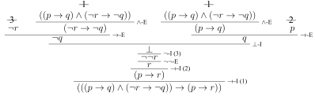

Figure 1: Gentzen style proof. [An extended description of figure 1 is in the supplement.]

The lines indicate a transition from the upper formula(s) to the one just beneath the line, using the rule of inference indicated on the right edge of the line. (We might replace these horizontal lines with vertical or splitting lines to more clearly indicate tree-branches, and label these branches with the rule of inference responsible, and the result would look even more tree-like). Gentzen uses the numerals on the leaves as a way to keep track of subproofs. Here the antecedent of the conditional to be proved is entered (twice, since there are two separate things to do with it) with the numeral ‘1’, the antecedent of the consequent of the main theorem is entered with numeral ‘2’, and the formula $\neg r$ (to be used in the reductio part of the proof) is entered with numeral ‘3’. When the relevant “scope changing” rule is applied (indicated by citing the numeral of that branch as part of the citation of the rule of inference, in parentheses) this numeral gets crossed out, indicating that this subproof is finished.

Completely independent from Gentzen, Jaśkowski (1934) described two methods. Of interest to us in this article is the one found in a lengthy footnote, where he describes a pictorial method that he had announced earlier.[^note-6] The pictorial method involved the drawing of “boxes” around portions of a proof, to indicate that the enclosed formulas are “considered as following only under a supposition”—or as we might say, they are a subproof that follows from an assumed premise.[^note-7]

*Figure 2:*

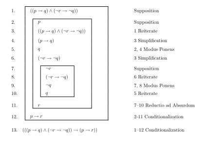

Figure 2: Jaśkowski style proof. [An extended description of figure 2 is in the supplement.]

The fundamental notion of making a supposition (= assumption) and seeing where it leads is indicated in Jaśkowski’s proof by the introduction of a box, the first line of which is the supposition and all the consequences of that assumption are retained inside that box. Moreover, further suppositions can be made *within* the previous box by generating a subordinate box. The fundamental rule of Conditionalization is that a conditional whose antecedent is the supposition and whose consequent is the final line inside the box can be entered as the next line *outside* the box. Once a box has been constructed, no formula within it can be used to justify any line of the proof outside of the box. A similar rule of supposition is the *Reductio*, or Negation Introduction, rule, where two contradictory lines inside the same box can trigger a completion (closing) of the box and the unnegated supposition as the next line outside the box. A theorem of the language is a formula that can be generated by these rules and is *outside of all boxes*. As with the Gentzen proof, we see that Jaśkowski’s use of the rule Reductio ad Absurdum *deletes* a negation sign from the assumption. This is Jaśkowski’s way to move from intuitionistic logic to classical logic. (See [^note-24] for methods of strengthening intuitionistic logic to classical logic.)

### 2.2 Modern Versions of Jaśkowski’s Method

In our future examples of natural deduction we will employ a more modern version of Jaśkowski’s method: that of Fitch (1952). Variants of this method are followed by most modern elementary textbooks, although there is one type of exception that is followed by several authors. We look at this exception shortly, in §4.

Fitch’s method, like Jaśkowski’s, is graphical and involves a method of indicating Jaśkowski’s boxes and suppositions. The rules are of two types: those that refer to previous lines but have the new formula within the same box as the previous lines, and those that allow a box to be ended, with the new formula in the next outer box. But rather than drawing an entire box, the Fitch method uses just the left side of the box, and rather than suppositions being merely the first line of a new box, the Fitch method indicates them by entering them just above a short horizontal line.

*Figure 3:*

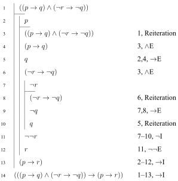

Figure 3: Fitch style proof. [An extended description of figure 3 is in the supplement.]

The rules employed in this proof[^note-8] illustrate an aspect of natural deduction that is thought (by some) to be very important in the metatheory of natural deduction: that each connective of the language should have an introduction rule and an elimination rule—or as this is sometimes put, the entire logic should be organized into pairs of Introduction and Elimination (Int-Elim for short) rules for each logical operator. We discuss this feature in §5 on normalization. We note here that Fitch’s exact formulation does not meet this Int-Elim requirement because it has, in addition to the usual rules, Int-Elim rules for certain *combinations* of connectives, namely the negations of connectives. Thus there are Int-Elim rules for such formula types as $\neg(\phi\land\psi)$, $\neg(\phi\lor\psi)$ and $\neg(\phi\rightarrow\psi)$:

(a)

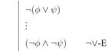

(b)

(c)

Figure 4: Fitch-Style Negative Elim-Rules: Negative-Int rules are the inverses of these. [An extended description of figure 4 is in the supplement.]

This affects arguments about the semantic significance of natural deduction, and slightly complicates some metatheoretic developments, but Fitch’s negative Int-Elim rules are paired in a way that suffices for analogues of many standard results (as we discuss in §5.3). It might be noted that Gentzen’s presentation tends to be preferred by writers on technical proof theory, but Fitch’s presentation by writers of elementary textbooks. People who have learned one presentation of natural deduction often initially find others opaque, but with experience the “translation” becomes routine. The transformation of a proof in one style of natural deduction into one in another is a simple matter of cutting and pasting (or perhaps, since Gentzen’s tree-form presentation often requires multiple copies of some formulas, cutting, photocopying, and pasting). But however natural deduction systems are presented, they have rules of two types. There are *rules of inference*, by which a formula may be inferred from one or more previous formulas. (Some systems also allow “zero-premise” rules, by which formulas of specified kinds can be written anywhere desired: in effect, logical axiom schemes.) Typically the rules of inference include these:

- $\land$-Introduction: a conjunction may be inferred from its two conjuncts.[^note-9]
- $\land$-Elimination: a conjunct may be inferred from a conjunction.[^note-10]
- $\lor$-Introduction: a disjunction may be inferred from either disjunct.[^note-11]
- $\rightarrow$-Elimination: $B$ may be inferred from the two premises $A$ and $(A\rightarrow B)$
- $\neg$-Elimination: an arbitrary formula, $B$, may be inferred from a pair of contradictory premises, $A$ and $\neg A$.[^note-12]

There are also what Jaśkowski calls *rules of supposition*, in which conclusions are inferred, not from earlier formulas, but from the presence of one or more subproofs of a specified kind. Typically (described in Fitch-style terminology) these include:

- $\rightarrow$-Introduction: $(A\rightarrow B)$ may be asserted after a subproof having $A$ as its hypothesis and and $B$ as a line.
- $\lor$-Elimination: an arbitrary formula $C$ may be asserted after three items: a disjunction, $(A\lor B)$, a subproof, having $A$ as its hypothesis, with $C$ as a line, and a subproof, having $B$ as its hypothesis, with $C$ as a line.
- $\neg$-Introduction: a negation, $\neg A$, may be asserted after a subproof, with $A$ as its hypothesis, containing a pair of contradictory formulas, $B$ and $\neg B$, as lines.[^note-13]

Just as, in axiomatic formulations of logic (“Frege systems” or “Hilbert-style” systems), different choices of axioms are possible for a particular logic, different sets of rules can be chosen in formulating a natural deduction system. In particular, one or more rules of supposition can, in the presence of others, be replaced by inference rules. Thus, for example, it is possible to have $\rightarrow$-I[^note-14]as the only rule of supposition, any others being replaced by inference rules having, among their premises, conditionals summarizing the subproofs of the original rules. (Elementary students may find it easier to learn inference rules than to learn suppositional rules, in which case this sort of system may be a rational choice for elementary textbooks.) Alternatively, $\neg$-I may be taken as the only rule of supposition, $\rightarrow$-I being replaced by a rule allowing $(A\rightarrow B)$ to be inferred from $\neg(A\land\neg B)$. Other choices are also possible. D’Agostino, Gabbay, and Modgil (2020) present a very elegant system for Classical propositional logic in which the only rule of supposition is an “excluded middle” rule: a formula may be asserted if it is derived in each of a pair of subproofs, the hypothesis of one being the negation of the hypothesis of the other.

## 3. Natural Deduction and Quantifiers

Rules for the quantifiers are necessarily more complicated, but those standardly used can be seen as natural (although analogical) extensions of the rules for $\land$ and $\lor$.

### 3.1 Quantifier Basics

Thinking of a universal quantification as (sort of) a conjunction with one conjunct for each element in the domain quantified over, we naturally get a rule of

**$\forall$-E:**

an arbitrary instance, $A(t)$, may be inferred from a universal quantification, $\forall x(A(x))$.[^note-15]

The corresponding introduction rule is less obvious: the domain might be infinite, and only finitely many conjuncts can occur in a formal proof! We proceed more circuitously. First, we assume an “alphabet” of special terms (variously called *free variables, parameters, dummy constants*,…). Next, we define a special sort of subproof, the subproof *general with respect to* a particular term from this alphabet: in Fitch’s notation, these subproofs are marked with an occurrence of the relevant term beside the top of its vertical line. These subproofs are subject to a restriction on reiteration: a formula containing a particular one of the special terms cannot be reiterated into a subproof general with respect to that term. Then we may state the rule

**$\forall$-I:**

a universal quantification, $\forall x(A(x))$, may be asserted after a subproof, general with respect to a special term, $a$, having no hypothesis, containing the instance of the quantification for that term, $A(a)$.[^note-16]

The soundness of such a rule is easy to see. The restriction on reiteration into general subproofs means that no special assumptions on the term $a$ can be smuggled into a subproof general with respect to $a$. The subproof, therefore, can be seen as displaying a schema by which (pretending for the moment that every element in the domain has a name[^note-17]) proofs could be constructed of an instance of the quantification for each element.

The standard rules for the existential quantifier are similar analogical extensions of the disjunction rules. The introduction rule is easy:

**$\exists$-I:**

an existential quantification, $\exists x(A(x))$, may be inferred from any of its instances, $A(t)$.

The rule of $\lor$-E allows us to infer a conclusion from a disjunction given subproofs showing how the conclusion can be deduced on the assumption of any of the disjuncts. Using a general subproof, as before, to present a schema for the deduction of the conclusion from an arbitrary “disjunct”, we have

**$\exists$-E:**

a conclusion, $C$, may be asserted after an existential quantification, $\exists x(A(x))$, and a subproof, general with respect to a term, $a$ (where $a$ does not occur in $C$), having the instance $A(a)$ as its hypothesis and containing $C$ as a line.

Again, pretending for the moment that every element of the domain has a name, the soundness of these rules is evident. (An instructive exercise, given the negation rules for classical logic, is to show that the rules for $\exists$ (for $\forall$) are derivable from the rules for $\forall$ (for $\exists$) and the definition of $\exists x(A(x))$ as $\neg\forall x\neg(A(x))$ (the definition of $\forall x(A(x))$ as $\neg\exists x\neg(A(x))$). The restriction that the special term of the subproof not occur in the conclusion of $\exists$-Elimination turns out to correspond exactly to the restriction on reiteration into general subproofs.)

A few remarks about these rules are in order. One is that, since only finitely many terms can occur in the finite section of a proof preceding a given application of a rule, we could require that the special term, $a$, used in an application of $\forall$-I or $\exists$-E should not occur in the hypothesis of any of the subproofs containing the rule application (or in any premise of the whole proof). In the terminology used in discussing Gentzen’s tree-like formulation of natural deduction, $a$ cannot occur in a hypothesis above the rule application unless that hypothesis has already been discharged by some earlier application of a rule of supposition. This would slightly simplify the overall framework by rendering unnecessary the restriction on reiteration into general subproofs. On the other hand, in constructing a very long formalized proof, it is convenient to allow ourselves to re-use special terms. If we did require that *a* not occur in any undischarged earlier hypothesis, we could just say that $\forall x(A(x))$ may be asserted after $A(a)$-- provided that $a$ does not occur in earlier hypotheses that have not been discharged. (Many popular undergraduate textbooks adopt this course.) This would simplify the statement of the rules a bit (though not the process of constructing proofs: checking that $a$ doesn’t occur in “prohibited” hypotheses will be time-consuming in constructing a long proof). But it would obscure the simple relationship between the $\forall$ and $\exists$ rules.

There is another oddity about the $\forall$-I rule. We initially introduced the idea of a subproof as representing suppositional reasoning: a subproof is a deduction from a hypothesis. But in $\forall$-I we use a subproof that doesn’t have a hypothesis! If this seems objectionably odd, we could say that the subproof of an application of $\forall$-I, does have a hypothesis, but an unstated, metalinguistic, one: the supposition is that the (otherwise uninterpreted) term $a$ stands for some element in the domain. This is not as arbitrary as it might seem: if we modify the rules to give universally free logic (see Nolt 2020)[^nolt-2020]—that is, quantificational logic freed from the assumptions made in ordinary first order logic that the domain is non-empty and that all singular terms denote elements of it—this hypothesis comes into the object language and is explicitly stated. Free logic is most easily formulated with an existence predicate, $E!$, and the rule becomes

**Free $\forall$-I:**

a universal quantification, $\forall x(A(x))$, may be asserted after a subproof, general with respect to a special term, $a$, having $E!(a)$ as its hypothesis, containing the instance of the quantification, $A(a)$ as a line.

Existence hypotheses and premises get added to the other quantifier rules: $\forall$-E and $\exists$-I become two-premise rules, with $E!(t)$ as the second premise, and the subproof for $\exists$-E ends up with two hypotheses, $A(a)$ and $E!(a)$. Formulations of many-sorted quantificational logics (Hailperin 1957, 1960 for a classic statement; Freund 2019 for a philosophical application)[^freund-2019][^hailperin-1957] can follow the same pattern, with the extra hypotheses and premises saying that the relevant term or parameter stands for something in the range of a particular sort of variable.

### 3.2 Issues with $\forall$-Generalization and $\exists$-Instantiation

A number of textbooks (Quine 1950b, some editions of Copi 1954, and Kalish & Montague 1964, are perhaps the best known)[^copi-1954][^kalish-1964][^quine-1950b] employ a deviant set of quantifier rules. The simpler rules, $\exists$-I and $\forall$-E, are unchanged, but the two subproof-involving rules we just surveyed are replaced by rules which (following Quine) we will refer to as Existential Instantiation (EI) and Universal Generalization (UG):

**EI:**

from an existential quantification $\exists x(A(x))$, an instance, $A(a)$ may be inferred, where $a$ is a $A$ term from a special “alphabet” of terms. (*Instantial Constant* or *Instantial Term* are often used for this constant instead of *parameter*, etc.)

**UG:**

from an instance $A(a)$, where $a$ is one of the special terms, a universal quantification $\forall x(A(x))$ may be inferred.

Used without restriction, such rules are obviously unsound: they would allow one to reason from the premise $\exists x(A(x))$ to the conclusion $\forall x(A(x))$ in two steps! The rules are therefore hedged with restrictions on the particular instantial terms to be used. For a start, one cannot use the same instantial term in two distinct quantifier instances in the same derivation, but by itself this is not sufficient. Precise formulation of restrictions that will yield a sound and complete system of rules is not trivial: Copi’s textbook (1954) went through several editions with different incorrect systems, and Quine (1950a) changed the wording of the restriction between editions of his textbook (though both versions give correct systems). Several articles were published, both in specialist logic journals and in general philosophical ones, noting errors and offering analyses of the situation.

The ideas behind these rules seem to have no intrinsic connection with natural deduction, because they do not use subproofs (they replace the subproof-involving quantifier rules of more standard systems), and they could be used in conjunction with a purely axiomatic system of propositional logic. Their association with natural deduction is a matter of historical accident: the textbooks introducing them presented systems with other features of natural deduction. Still, they have some practical value, because proofs employing (a correctly restricted version of) them, in the context of a system for classical logic, can be shorter and simpler than the proofs in systems with the standard natural deduction rules. (The classically valid schemes

$$\exists x(\exists yF(y)\rightarrow F(x))$$

and

$$\exists x(F(x)\rightarrow\forall yF(y)),$$

for example, have very short and obvious proofs using $\rightarrow$-I and the variant quantifier rules.) On the other hand, they cannot be used without change in systems for intuitionistic or modal logics, as we explain in §6: the classical schemes mentioned above are not intuitionistically valid, but their simple proofs go through in a system that adds the quantifier rules of Quine’s textbook to a formalization of intuitionistic propositional logic, and natural attempts to use them in formulating systems of quantified modal logic lead to simple derivations of the Barcan principle and its converse. Lack of caution in using these (and related) rules in the context of non-classical logics has led to errors in published philosophical articles.

The difficulty in formulating correct restrictions on these rules is connected to the absence of any obvious semantic interpretation of the instantial terms. Classically, the truth of $\exists xF(x)$ in a model implies that (if every element of the domain has a name) then the quantification has a true instance, but not that we can identify which instance it is. Thus, when the rule of EI is used in a proof in an otherwise interpreted language, the person constructing the proof may not be in a position to define the instantial term: it remains uninterpreted. A moderately complicated model theoretic account has, however, been developed by Fine (1985a,b), which allows proof of the soundness of appropriately restricted EI and UG rules. (Those interested in using these rules for practical purposes in giving short proofs should consult Fine’s work: he gives streamlined statements of the rules and restrictions, and provides a simple algorithm, his *dependency diagrams*, for checking that the instantial terms in a proof comply with the restrictions.) For those familiar with Hilbert’s Epsilon Calculus (see Avigad & Zach 2020)[^avigad-2020], perhaps the easiest way of seeing the soundness of properly restricted EI and UG is to think of the instantial terms as abbreviating $\epsilon$-terms: the terms occurring in a proof that complies with the restrictions can be expanded to appropriate $\epsilon$-terms, whereas such expansion is blocked when the restrictions are violated (see Hazen 1987, for a more detailed account)[^hazen-1987]. Cellucci (1995) gives an interesting discussion on a variety of rules related to EI and UG. Pelletier (1999) recounts the many re-formulations of the UG and EI rules in the early 1950s–1960s.

## 4. Sequent Calculi and Sequent Natural Deduction

Gentzen (1934) presented his natural deduction systems, $\mathcal{NJ}$ and $\mathcal{NK}$, for intuitionistic and classical logic (respectively), but he was not satisfied with $\mathcal{NK}$: he didn’t see how to extend the normalization theorem (discussed below in §5) from $\mathcal{NJ}$ to $\mathcal{NK}$. He therefore introduced another pair of systems, $\mathcal{LJ}$ and $\mathcal{LK}$ ($\mathcal{L}$ for *logistisch*), for the two logics, for which he *was* able to give a uniform proof of a closely related metatheorem. As with his presentation of natural deduction, a proof in one of his $\mathcal{L}$-systems is a tree, but whereas the nodes of the tree in an $\mathcal{N}$-system proof are occupied by single formulas, the nodes in an $\mathcal{L}$-system proof are occupied by *sequents*, where a sequent consists of a pair of (possibly null!) *lists* of formulas, separated by a special symbol, $\vdash$.[^note-18] (As a result, systems similar to Gentzen’s $\mathcal{L}$-systems are usually called *sequent calculi*.) The intuitive meaning of a sequent is that if all the formulas of the list to the left of the $\vdash$ (the *antecedent* formulas) are true, then at least one of the formulas in the right-hand list (the *succedent* formulas) is true, or (to use a word hinting at the relation to natural deduction) the *assumption* that all the antecedent formulas are true justifies the conclusion that at least one of the succedent formulas is true. In line with standard usage of *all* and *at least one of* in modern mathematics, this is interpreted as covering the cases of sequents with null lists: if there are no antecedent formulas in a sequent, it is interpreted as meaning that at least one of the succedent formulas is true, if there are no succedent formulas the sequent is interpreted as meaning that at least one of the antecedent formulas is false, and if both lists are null—so the sequent is just a $\vdash$ standing by itself—it is interpreted as expressing a necessary falsehood.

The initial sequents of an $\mathcal{L}$-proof (the leaves of the tree) are identity sequents of the form $\phi \vdash \phi$ (this corresponds to the way arbitrary assumptions can be used as leaves in $\mathcal{N}$-proofs), and sequents at lower nodes follow by rules of inference from the sequents at the one or two nodes immediately above them. The rules are of two kinds. First, *structural* rules for managing lists: *Interchange* (embodying the idea that the order of the formulas in a list is irrelevant), *Contraction* (allowing the elimination of duplicate copies of a formula from the list), and *Thinning* (in the sense of watering down: extra formulas may be added to a list). Second, *logical* rules associated with the different connectives (and quantifiers): two for each operator[^note-19], dealing with the operator in antecedent formulas and in succedent formulas. The rules for succedent occurrences of the operators are analogous to the Introduction rules of natural deduction: thus, for example, the right-hand rule for $\land$ allows us to infer a sequent

$$\Gamma \vdash \Delta, (\phi\land\psi)$$

from the two sequents

$$\Gamma \vdash \Delta, \phi$$

and

$$\Gamma \vdash \Delta, \psi.$$

Introduction rules in natural deduction add complexity: the conclusions of instances of an introduction rule are formed by adding an operator to earlier formulas. In contrast, elimination rules simplify: the premises of instances of elimination rules are formed by deleting operators to the conclusions (or, in $\lor$-E, to the hypotheses of the subproofs used). The $\mathcal{L}$-systems have no simplifying rules of this kind. Their place is taken by complexifying rules on the left-hand side. Thus, for example, the rule for $\land$ in the antecedent allows a sequent

$$(\phi \land \psi), \Gamma \vdash \Delta$$

to be inferred from either of the sequents

$$\phi, \Gamma \vdash \Delta$$

and

$$\psi, \Gamma \vdash \Delta.$$

The notation of sequents (and, in particular, sequents with only one succedent formula) can, however, be used in a presentation of natural deduction: Gentzen (1936) gives such a system. The notational complications of the different presentations of natural deduction described above—Gentzen’s trees, Jaśkowski’s boxes—are required in order to keep track of just which *assumptions* a given formula of the proof depends on. An alternative, allowing the use of standard Int-Elim rules, would be to replace each formula in a natural deduction proof with a sequent: the replaced formula standing as the sole succedent formula of the sequent, and the assumptions it depends on forming the antecedent. A system of this sort may be called a system of *sequent natural deduction*.

Sequent natural deduction turns out to be very usable in practice. Explicit mention of the structural rules of Interchange and Contraction can be avoided by stipulating that the list of antecedent formulas is simply a representation of a set of formulas. Natural deduction rules with two premises can be formulated to allow merging of antecedents: thus, for example, $\rightarrow$-E should allow the inference of

$$\Gamma, \Delta \vdash \psi$$

from

$$\Gamma \vdash (\phi \rightarrow \psi)$$

and

$$\Delta \vdash \phi.$$

Thinning is still useful to cover proofs in which the hypothesis of a subproof is not used in deriving a later formula, as in the formalization of the inference from $\psi$ to $(\phi \rightarrow \psi)$. Rules of supposition, which discharge assumptions, are formulated as deleting the assumption from the antecedent: thus $\rightarrow$-I allows the inference of

$$\Gamma \vdash (\phi \rightarrow \psi)$$

from

$$\phi, \Gamma \vdash \psi$$

(which, give or take the possibility of additional succedent formulas, is precisely the right-hand $\rightarrow$-I rule in the $\mathcal{L}$-systems).

The main practical problem with using this as a presentation of natural deduction is the tedium of writing and rewriting all the formulas which occur in the antecedents of multiple sequents. It was apparently first noticed in the elementary text, Suppes 1957, that there was an easy way to abbreviate and refer to these formulas:[^note-20] first, by giving each sequent a numeral (if there are currently $n$ sequents in the proof up to this point, then the next sequent will be numbered $n+1$). And secondly by associating a label with that numeral used in a proof. The label for a premise of an argument is the same as its numeral; the label for an assumption (or “supposition”) is also the same as its numeral; and otherwise (when a new sequent is generated by appeal to previous sequents) there are two cases, depending on whether the rule is a “direct” rule or a “supposition-ending” rule. In the former case, as exemplified by $\land$-Introduction and $\rightarrow$-Elimination, the new sequent’s label is the set containing the labels of both formulas that are used in the rule. In the latter case, as exemplified by $\rightarrow$-Introduction, the new labels are the label-set of the numeral of the $\rightarrow$’s consequent minus the label of the $\rightarrow$’s antecedent.[^note-21]

The sequent natural deduction of the earlier argument that we’ve done in the Gentzen tree format, the Jaśkowski-style format, and the Fitch format would become, in the Suppes (1957) notation:[^note-22]

*Figure 5:*

$$\begin{alignat*}{4} \{1\}\hspace{.2cm} &1. \hspace{.2cm}((p\rightarrow q)\land(\neg r\rightarrow\neg q)) &&\text{Assume} \\ \{2\}\hspace{.2cm} &2. \hspace{.2cm}p &&\text{Assume}\\ \{1\}\hspace{.2cm} &3. \hspace{.2cm}(p\rightarrow q) &1,\ & {\land}\text{-Elim}\\ \{1,2\}\hspace{.2cm} &4. \hspace{.2cm}q &2,3,\ & {\rightarrow}\text{-Elim}\\ \{1\}\hspace{.2cm} &5. \hspace{.2cm}(\neg r\rightarrow\neg q) &1,\ & {\land}\text{-Elim}\\ \{6\}\hspace{.2cm} &6. \hspace{.2cm}\neg r & &\text{Assume}\\ \{1,6\}\hspace{.2cm} &7. \hspace{.2cm}\neg q &5,6,\ & {\rightarrow}\text{-Elim} \\ \{1,2,6\}\hspace{.2cm} &8. \hspace{.2cm}(q\land\neg q) &4,7,\ & {\land}\text{-Intro}\\ \{1,2\}\hspace{.2cm} &9. \hspace{.2cm}\neg\neg r & 6,8,\ & {\neg}\text{-Intro} \\ \{1,2\}\hspace{.2cm} &10. \hspace{.2cm}r &\text{9},\ & {\neg\neg}\text{-Elim} \\ \{1\}\hspace{.2cm} &11. \hspace{.2cm}(p\rightarrow r) &2,10,\ & {\rightarrow}\text{-Intro}\\ \emptyset\hspace{.2cm} &12. \hspace{.2cm}(((p\rightarrow q)\land(\neg r\rightarrow\neg q))\rightarrow (p\rightarrow r)) & 1,11,\ & {\rightarrow}\text{-Intro} \end{alignat*}$$

Figure 5: Suppes Proof Example

We’ve called this way of presenting proofs “sequent natural deduction” to honour the way it is developed from sequent calculus. However, many — maybe even all — elementary logic textbooks that use such a system as their object to be taught call it simply “natural deduction”. Of these books, some even take the space (in an authorial introduction, usually) to argue that this is superior to other ways of doing natural deduction, especially from a pedagogical point of view. However, they don’t remark on the relation of this method to that of Gentzen’s single-conclusion sequent calculus.

Another interesting variation uses (essentially) only the right-hand side of (classical) sequents: nodes in the proof tree are occupied by the finite sequences of formulas, which can be thought of, intuitively, as interpreted disjunctively.[^note-23]

## 5. Normalization

The central metatheorem about natural deduction is the *Normalization* theorem, to the effect that proofs in a natural deduction system can be transformed into a “normal form”, informally characterized by Gentzen as “not being roundabout”. This theorem applies to the full systems for first order logic, though in what follows we will, in order to give a “flavour” of the result and the method of proving it, describe only the propositional fragment.

### 5.1 Normalization of Intuitionistic Logic

Gentzen (1934) remarked that the introduction rules were like definitions of the logical operators, and that the elimination rules were consequences of their definitions. Making this remark precise is not easy, but it has an intuitive plausibility. In the paradigmatically simple case of conjunction, the premises needed for an application of $\land$-I are simply the two conjuncts, so the rule can be seen as “defining” a conjunction to be true in the case that both of its conjuncts are. In an application of $\land$-E, the conclusion is one of the conjuncts, and so something that has to be true if the conjunction is, supposing conjunction to be “defined” that way. For other operators it is a bit less straightforward. The required subproof for $\rightarrow$-I is one in which the consequent is derived from the antecedent: thought of as a definition, this says that $A\rightarrow B$ is true just in case $B$ is (somehow) obtainable from $A$. The rule of $\rightarrow$-E can be seen as a kind of consequence: to infer $B$ from the (major) premise $A\rightarrow B$ and the (minor) premise $A$ is to treat $A\rightarrow B$ as licensing one to infer $B$ when $A$ is given. (The special rules needed for Classical logic are harder to fit into this framework, an issue we discuss further, in the context of *harmony*, which we introduce in §7.)

Ignoring, for now, the metaphor of defining a connective (we will come back to it in §7), there is a formal point here. If, in constructing a derivation, one uses an introduction rule to get a formula with a certain main operator, and then applies the corresponding elimination rule with that formula as (major) premise, one has made an avoidable “detour” in the argumentation. It is easy to see in many cases that the detour could have been avoided: to use $\land$-E in this way is just to obtain (a second copy of) a formula that was already there to be used as a premise of the $\land$-I. Similarly, using $\rightarrow$-E after $\rightarrow$-I could be obtained more directly: the minor premise is an occurrence of the same formula as the hypothesis of the $\rightarrow$-I subproof, so simply use the steps of the subproof as lines of the main proof.

Gentzen saw that this could be generalized, at least for the system for intuitionistic logic. Call the “route straightening” modifications to a derivation described in the previous paragraphs (i.e., deleting the “detour” conjunction or conditional and taking a premise of the former introduction rule as the conclusion, or obtaining the conclusion by means of argumentation from the subproof for the introduction rule), and analogous modifications for the other operators, an immediate reduction. Then, roughly, his result (now called the Normalization Theorem) is that any derivation can be transformed by a sequence of immediate reductions into a derivation in normal form, in which no (occurrence of) a formula obtained by one of the introduction rules is used as the major premise of an elimination rule. We give examples of immediate reductions in figure 6. This is rough because of an annoying complication in the cases of the elimination rules ($\lor$-E, $\exists$-E) which involve subproofs.

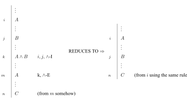

(a)

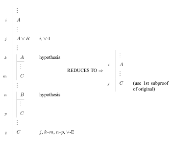

(b)

Figure 6: Examples of Immediate Reductions. [An extended description of figure 6 is in the supplement.]

There are two variant forms of the complication. (1) A formula is obtained by an introduction rule and then reiterated into the subproof, and then used as the major premise of an elimination rule there. The needed immediate reduction for this introduction-elimination detour isn’t possible, because the material (premise, premises, subproof) needed isn’t available in the subproof of the $\lor$-E or $\exists$-E. (Note that this problem can’t arise if we have a Gentzen-style presentation of natural deduction: where a Fitch-style derivation uses reiteration to get a second copy of a formula, the Gentzen-style derivation just repeats the whole argumentation leading to the formula above each of its occurrences.) The fix for this is conceptually simple (though in some cases it can lead to an increase in total derivation size, since it can involve installing multiple copies of many formulas): instead of reiterating the formula into the subproof, reiterate whatever was needed to derive it, derive it by the introduction rule within the subproof, and proceed to the immediate reduction. (2) The conclusion of the $\lor$-E or $\exists$-E inference, which is also the last line of the subproof(s), is obtained by an introduction rule inside the subproof, and is then used as the (major) premise of an elimination rule in the main derivation. Again, an immediate reduction of the detour is not possible, because the conclusion is in the main derivation, but the materials needed for its direct derivation are available only in the subproof(s). It is perhaps a little less obvious that the fix for this works, but it is again conceptually simple: do the second elimination inference inside the subproof(s), so its conclusion is the last line of the subproof(s), and then take its conclusion in place of the original as the conclusion of the main $\lor$-E or $\exists$-E inference. Call modifications of this sort to a derivation “permutative reductions”. Then the less rough statement of Gentzen’s theorem is that any derivation (in the natural deduction system for intuitionistic logic) can be converted, by a sequence of immediate and permutative reductions, into the normal form, in which no occurrence of a formula is both the conclusion of an introduction rule and the major premise of an elimination rule. Derivations in normal form have interesting and useful properties. Perhaps the most noteworthy is the *subformula property*: every formula in a normal derivation is a subformula of (that is, either identical to or a part of) either an undischarged hypothesis or the final conclusion.

*Figure 7:*

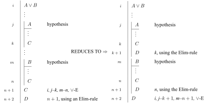

Figure 7: Example of Permutative Reduction. [An extended description of figure 7 is in the supplement.]

As an example of the applications of normalization theorems, the fact that normal derivations have the subformula property has implications for the decision problems. In propositional logic, there are only finitely many subformulas of the (finitely many) initial premises and conclusion, so a normal derivation can contain occurrences only of finitely many formulas. This (with a bit more work) implies that there is a finite upper bound on the size of possible normal derivations of a given conclusion from given premises, so the propositional logic is (in principle!) decidable by an exhaustive search of possible derivations (Gentzen 1934 proves the decidability of Intuitionistic propositional logic in essentially this way, appealing to his *Hauptsatz* for the sequent calculus rather than normalization for natural deduction.)[^gentzen-1934] Turning to first order logic, normal derivations have only a looser subformula property: for every free variable, the instance $F(a)$ substituting that free variable for the quantified variable counts as a subformula of $\forall xF(x)$ and $\exists xF(x)$. First order logic is, of course, undecidable: what this shows is that no upper bound can be computed for the number of distinct instances of a quantification that need to occur in $\forall$-I or $\exists$-E subproofs in the proof of a valid formula of a given length.

### 5.2 Proofs of Normalization

It is clear from Gentzen (1934) that he was aware of the normalization theorem, but he did not publish a proof, or even a precise formulation, of it. The reason would seem to be that he despaired of proving an analogous result for the system of natural deduction for classical logic, and so developed his sequent calculus systems. For these he *was* able to prove a result for both the classical and intuitionistic variants (his *Hauptsatz*) which is analogous to the normalization theorem, and useful for some of the same applications. A proof of the normalization theorem was finally published by Prawitz (1965), but it turns out that Gentzen himself had written out a detailed proof in 1933, which is very similar to that given by Prawitz. Jan von Plato discovered Gentzen’s manuscript and published it (von Plato 2008)[^plato-2008]. (Gentzen’s presentation of the proof is very clear, and evidences a strong visual imagination: it is a pleasure to read.)

### 5.3 A Variant Logic

Before going on to difficult things like classical logic, it may be worth while to give an example of how these ideas can be generalized. In Nelson (1949), David Nelson presented a variant of intuitionistic logic, agreeing with Heyting’s on the positive connectives and quantifiers, but having a different negation operator. (Some subsequent logicians, considering systems with both operators, call Nelson’s negation ‘strong negation’.) It is easy to formulate natural deduction rules for Nelson’s logic if we allow negative introduction and elimination rules in the style of Fitch. Negative negation introduction and elimination allow $\neg\neg A$ to be inferred from $A$ and vice versa. Negative $\rightarrow$ rules allow $\neg(A\rightarrow B)$ to be treated as if it were $(A\land\neg B)$. Negative (conjunction, disjunction, universal quantifier, existential quantifier) rules parallel the usual (disjunction, conjunction, existential quantifier, universal quantifier) rules: for example, $\neg(A\land B)$ can be inferred by $\neg\land$-I from either $\neg A$ or $\neg B$, and a conclusion, $C$, follows from $\neg(A\land B)$ by $\neg\land$-E from three items: $\neg(A\land B)$, a subproof in which $C$ is derived from the hypothesis $\neg A$, and a subproof in which C is derived from the hypothesis $\neg B$. Since the pair of negative Int-Elim rules for any operator are related in a way parallel to the relation between (ordinary) Int-Elim rules for some operator, detours in a formal proof can be reduced in ways analogous to Gentzen’s reductions for standard intuitionistic logic. A normalization theorem can therefore be proven in much the same way as that for the standard logic. A normal derivation won’t have quite the same subformula property as normal derivations in the standard logic (every formula of a normal Nelson derivation will be a *weak subformula*—that is, either a subformula or the negation of a subformula—of the final conclusion or of some premise), but close enough for many technical applications.

### 5.4 Normalization in Classical Logic

Typically, natural deduction systems for classical logic are formulated by adding an extra, classicizing, rule to a natural deduction system for intuitionistic logic: any of a variety of possible rules can be added.[^note-24] The immediate and permutative reductions are possible in derivations in classical natural deduction, but there is another case to consider: a logically complex formula might be concluded by the classicizing rule and then used as the major premise of an elimination rule. This formula might be more complex than the final conclusion or any of the premises of the derivation, in which case its use would intuitively seem just as much a “detour” as those eliminated by the normalization of an intuitionistic derivation. Worse, if we allowed such detours, we would lose the “control” over the complexity of derivations necessary for technical applications of the normalization theorem. So a normal derivation, in natural deduction for classical logic, should be defined as one in which no conclusion of an introduction rule is used as the major premise of an elimination rule (as before) and in which no formula obtained by the classicizing rule is used as the major premise of an elimination rule. Gentzen appears to have thought that no reduction process was possible which would allow arbitrary derivations in the classical system to be transformed into this kind of normal derivation. (It is possible that the particular classicizing rule he envisaged (see [^note-23]) makes this harder than other formulations would.)

Prawitz (1965) proved a normalization theorem for a system of classical natural deduction with a reduced set of logical operators. (The operators, $\lor$ and $\exists$, that he omitted can be defined, in classical logic, in terms of the others, so Prawitz’s result is strong enough for some applications.) Several later writers proved normalization results for classical logic with all the usual operators, but under various restrictions. It thus came as a surprise to the logical community when von Plato and Siders (2012) were able to give a very simple proof of a fully general normalization theorem for a system of classical logic including all the usual operators.

For the normalization result of von Plato and Siders, we will choose, as our classicizing rule, the principle of indirect proof: a formula, $A$, may be asserted after a subproof, with hypothesis $\neg A$, having a pair of contradictory formulas, $B$ and $\neg B$, as items. The possibility of normalization then depends on our being able to modify derivations to eliminate cases where a formula, $C$, is obtained by indirect proof and is then used as the (major) premise of an elimination rule to obtain another formula, $D$: we might call manoeuvres like this in a derivation “classicizing detours”. This is illustrated in figure 8.

*Figure 8:*

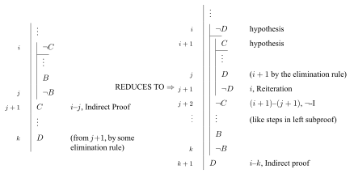

Figure 8: Example of Classical Reduction. [An extended description of figure 8 is in the supplement.]

(Depending on details, further reductions may be needed within the new subproof.) To avoid such detours, we instead use indirect proof to obtain $D$. This fix, a classicizing reduction, is analogous to the permutative reductions discussed above. The new indirect proof subproof will have $\neg D$ as its hypothesis; since $D$ is immediately derivable (by an elimination rule!) from $C$, we can use $\neg$-Int to infer $\neg C$, after which the argumentation of the original subproof will yield a contradiction.

In normalizing an entire derivation, we can start by attacking the most deeply embedded classicizing detours (those in whose (original) indirect proof subproofs no further classicizing detours occur) and working outward. Combining this with applications of the earlier reductions, it is not hard to see that the entire derivation can be converted into one in normal form. Normal derivations in classical logic have only the weak (but still useful!) subformula property mentioned in §5.3 in connection with Nelson’s variant of intuitionistic logic.

Given the simplicity of von Plato and Siders’s technique, it is somewhat surprising that it took so long to discover a method of normalizing natural deduction. Perhaps the barrier was psychological: the intuitively obvious part of the Gentzen/Prawitz normalization of intuitionistic logic is in the immediate reductions, the permutative reductions in contrast being perceived as annoying technical details needed for a few rules. So perhaps logicians didn’t find it natural to use permutative-style reductions more generally. In this connection, it is perhaps significant that von Plato (2001) had worked with systems having what are called *general* elimination rules. Here the other elimination rules are replaced by rules more in the spirit of $\lor$-E: the conclusion, which need not be an immediate subformula of the (major) premise, is derived in a subproof having hypotheses sufficient for obtaining that premise by the corresponding introduction rule, and is taken to be established in the main proof by the existence of the subproof. This was of course not a *logically* necessary prerequisite—normalization holds both for classical natural deduction with general rules and, as we have seen, for a more standard formulation of classical natural deduction—but psychologically it may have made it easy to see how the problem could be solved.

The normalization proofs described, turning on applications of the various reductions in a certain order, are moderately complicated in detail, but conceptually elementary: they (like Gentzen’s 1934 proof of the *Hauptsatz* for sequent calculi)[^gentzen-1934] are finitistic in the sense of the Hilbert program. (The corollaries Gentzen derives from the *Hauptsatz* in the last section of Gentzen (1934), though published after Gödel’s incompleteness theorem, can thus be seen as among the successes of Hilbert’s program.)

The theorems described, depending as they do on the order of application of the reductions, are sometimes called weak normalization theorems. There are also strong normalization theorems, to the effect that any derivation can be converted into one in normal form by application of the reductions in arbitrary order (Prawitz 1971)[^prawitz-1971]. Their proof is necessarily less elementary. The theorems, and the methods used in their proof, are analogous to what is called “normalizability” theorems in the context of the lambda-calculus (detailed discussions can be found in, e.g., Troelstra & Schwichtenberg 1996)[^troelstra-1996]. There are also weaker theorems, called *normal form theorems*, stating that for any derivation there is a derivation in normal form of the same conclusion from the same premises, without saying anything about a procedure for converting a non-normal derivation into a normal one. Such theorems can be proven, e.g., semantically, by proving the completeness of a system restricted to normal derivations.

## 6. Natural Deduction Systems for Modal and other Logics

Natural deduction systems were originally described, by Gentzen and Jaśkowski, for intuitionistic and classical first order logic: the logical framework needed in formalizing intuitionistic and classical mathematical theories. The techniques can be generalized, however, to a broad range of other logics. We will note briefly a few of these extensions.

Historically, the first seem to be systems of natural deduction for *modal logics*. The logical behavior of necessity and possibility operators in familiar modal logics has deep analogies to the logical behavior of universal and existential quantifiers. (This, of course, is what makes the “possible worlds” semantics for modality—on which the necessity of a proposition is construed as its holding in every member of some range of “worlds”, and its possibility as its holding in at least one—so natural.) Introduction and elimination rules for the modal operators, then, can be formulated in ways analogous to those for the quantifiers. The elimination rule for necessity and the introduction rule for possibility (at least for alethic modal logics) are easy: what is necessary is true, and what is true is possible. For Necessity Introduction, we can have the rule that $\square A$ may be asserted after a subproof (of a special kind: in Fitch’s nomenclature, a strict subproof) in which $A$ occurs: there will be some restriction, differing in formulations for different modal logics, on reiteration into these special subproofs. (Intuitively, in terms of the possible worlds semantic interpretation, the idea is that something asserted before the beginning of the subproof can be reiterated into it only if its truth does not depend on any special feature of the actual world.) Possibility Elimination will similarly ape the form of $\exists$-Elim: for at least some range of formulas $B$, $B$ may be inferred from $\diamondsuit A$ in the presence of a strict subproof having $A$ as a hypothesis and containing $B$, with the complication that $B$ must satisfy a condition analogous to the condition permitting formulas to be reiterated into strict subproofs. (For many modal logics, the easiest way of formulating the condition is to make $B$ suitable, as it were, after the fact: if $B$ is of the form $\diamondsuit C$, it may be asserted after $\diamondsuit A$ and a strict subproof with $A$ as hypothesis in which $C$ occurs.) Fitch (1952) defines systems like this for the modal logics S4 and T. (He doesn’t name T in the book, describing the system only as “resembling S$_2$”.) Curry (1950) and, in greater detail, Curry (1963) gives similar rules for S4, formulated in a Gentzen-style rather than Fitch-style presentation of natural deduction. Fitch (1966) gives formulations of a variety of alethic and deontic propositional modal logics; Fitting (1983) is a comprehensive study of a variety of modal natural deduction systems and their metatheoretic properties.

These modal systems are easy to use, and they have been included in some logic textbooks for philosophy undergraduates. They are, however, often less elegant than natural deduction systems for first order logic. The natural deduction rules for classical logic support the interdefinability of the two quantifiers: $\forall xA(x)$ and $\exists xA(x)$ are provably equivalent to $\neg\exists x\neg A(x)$ and $\neg\forall x\neg A(x)$ by use of the quantifier and negation rules; and the rules for either quantifier are derivable, when it is defined in terms of the other, by use of the negation rules and the rules for the other quantifier. For most modal natural deduction systems, the analogous results do not hold, and the equivalences have to be postulated specially. Again, $\exists xA(x)\lor\exists xB(x)$ is derivable from $\exists x(A(x)\lor B(x))$ by use of the rules for the existential quantifier and disjunction, but the restrictions on $\diamondsuit$-E usually block the analogous derivation in modal natural deduction. Normalization theorems are known for some systems of modal natural deduction, but often they are not as strong as the analogous results for first order logic. Sometimes the subformula property of normal derivations requires that the result of prefixing a limited number of modal operators to a formula count as one of its “honorary” subformulas.

Going further afield, very pretty natural deduction systems can be given for at least fragments of systems of relevant logics. Early in the literature on these logics the naturalness of these systems was presented as evidence for the naturalness of the logics (see Anderson 1960; Anderson & Belnap 1962b; with some rearrangement, Anderson & Belnap 1962b, is reprinted in chapter 1 of Anderson & Belnap 1975)[^anderson-1960][^anderson-1962b][^anderson-1975]. The key connectives of relevant logics are implicational: entailment or relevant implication. The natural deduction rules for these connectives are modifications of the standard rules for conditionals: the usual modus ponens for the $\rightarrow$-E rule; and for the $\rightarrow$-I, a variant of the standard rule with a restriction (formulated in Anderson & Belnap 1962b, with the aid of a simple and elegant bit of notation)[^anderson-1962b] ensuring that the hypothesis of the $\rightarrow$-I subproof is actually used in deriving the consequent. The pure implicational systems defined in Anderson and Belnap (1962b) are very elegant, and the conceptual arguments based on them are impressive! Another fragment of the standard relevant logics, having quantifiers and the “Boolean” operators $\neg,\ \land$ and $\lor$, but lacking the characteristic $\rightarrow$ operator, also has a nice natural deduction formulation: the positive and negative rules for $\land$ and $\lor$ mentioned above in §5.3 and the negative negation (i.e., double negation) rules, but omitting §5.3’s negation elimination rule (which is a form of *ex falso quodibet*). (The propositional part of this fragment of relevant logic is discussed in Anderson & Belnap 1962a, which is reproduced in chapter 3 of Anderson & Belnap 1975.)[^anderson-1962a][^anderson-1975] Unfortunately natural deduction systems for full relevant logics, incorporating all the connectives, require rules and restrictions that may strike many as ad hoc.

Similar techniques can be adapted for formulations of other substructural logics in the sense of Restall (2000). Implicational relevant/relevance logics are examples of logics lacking the property of Thinning, at least in intentional structures: that is, lacking the principle that if $\Gamma\vdash B$, then $\Gamma,A\vdash B$, when $\Gamma\vdash B$ is an intentional construction. Non-contractive logics – logics in which the inference from $(A\rightarrow(A\rightarrow B))$ to $(A\rightarrow B)$ is rejected – can be captured by restrictions on the number of times a hypothesis can be used. (Formulations of Contraction-free and Thinning-free logics as sequent calculi analogous to Gentzen’s $\mathcal{LJ}$ and $\mathcal{LK}$

Then there are non-distributive logics, in which the inference from $(A\land(B\lor C))$ to $((A\land B)\lor(A\land C))$ is rejected; such logics have been proposed as quantum logics. A natural deduction system for such a logic (based on the form of sequent natural deduction used in Lemmon (1965), though Fitch-style versions are also possible) is given in the textbook, Gibbins 1987.

## 7. IntElim and some Possible Philosophical Consequences

Certain features of natural deduction have been thought to be of a more general philosophical interest than just to the realm of organizing and displaying derivations of logical systems in an efficient and perspicuous form. Here we discuss two areas where the idea of Introduction and Elimination rules for each connective reverberates into philosophical debate of other topics.

### 7.1 IntElim as the Correct View of Logic

As we mentioned above, Gentzen saw his set of rules as being organized into Introduction rules and Elimination rules. He had also remarked that the Introduction rules were “like” introducing something (namely, a sentence with a given major connective) into a proof and the corresponding Elimination rule was “like” simplifying the complex sentence into (at least one of) its component parts. This is the ideal of an Int-Elim organization of the rules of a logic. To some, this is the ideal of what a logic should be, and gives an important clue, again according to some, as to what is The One True Logic. Gentzen (1934) showed that his formulation of intuitionistic logic had this feature, but apparently thought that the extra rule(s) or axiom(s) required for classical logic did not manifest this property. (Or at least, not straightforwardly.) This has led many philosophers of logic, notably Michael Dummett (1977, 1975 [1978], 1991; and others of his works), to claim that intuitionism is The One True Logic. (See Schroeder-Heister 2018; Steinberger 2011, and the final section of Shapiro & Kouri Kissel 2021, for further remarks on this. See also Read 2006 for a lively defense of the claim.)[^read-2006][^schroeder-heister-2018][^shapiro-2021][^steinberger-2011]

However, the claim of the superiority of Int-Elim rules has seemed to some to be either shaky or perhaps circular. Consider the case of a new binary connective, TONK, proposed in Prior (1960), whose (complete) meaning was to be given by the introduction rule: from $\phi$ infer $(\phi$ TONK $\psi)$, and the elimination rule: from $(\phi$ TONK $\psi)$ infer $\psi$. If logic rules are to be given merely in terms of some Introduction and some Elimination conditions, then TONK has just been given a proper Int-Elim definition. But as Prior notes, logic becomes much more “egalitarian” with this new connective…*too* egalitarian, perhaps!

Prior’s article elicited a large volume of responses, many in the early-mid-1960s in the pages of *Analysis*. Perhaps the best of these is Belnap (1962), which responded by arguing that “meaning-in-a-language” involved more than simply supplying a connective with *some* introduction rule and *some* elimination rule: the proposed connective needed also to be able “fit in” with other aspects of the language. Furthermore, and importantly, the Int-Elim ideal required that the elimination rule was required *only* to “undo” the effect of the introduction rule. But the TONK-E rule obviously did very much more.

According to this view, if the introduction and the elimination rules are to be “reverse images of one another”, so that the elimination rule for connectives were merely “consequences of the definition given for the introduction of the connective”, then the elimination rule for TONK would need to be the following pair of rules, TONK-Elim-Left and TONK-Elim-Right:

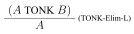

(a)

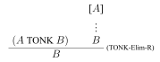

(b)

Figure 9 [An extended description of figure 9 is in the supplement.]

After all, the TONK-E rule is supposed to conclude $B$ from $(A$ TONK $B)$, but given that the TONK-I rule introduced the $(A$ TONK $B)$ formula merely from the previous formula $A$, clearly—if we are to honour the view that the elimination operation only has the effect of “undoing” the introduction rule—we need it to be the case that $A$ already entailed $B$.

It is equally possible to keep the elimination rule as initially stated—from $(A$ TONK $B)$ infer $B$—but to change the introduction rule so as to guarantee that no new information is added by an elimination:[^note-25]

*Figure 10*

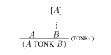

Figure 10 [An extended description of figure 10 is in the supplement.]

The generalization of this feature is now called *Harmony* by most of the concerned theorists (see Read 2004; Steinberger 2011, among many others, for discussion)[^read-2004][^steinberger-2011]. As we have already remarked, many have claimed that this is the “proper” form of rules of logic: it is the key to describing what is “meant” by a logical connective and also what a restriction on The One True Logic is—namely, that all its connectives must exemplify this property. And hence many theorists have claimed that Intuitionistic Logic is The One True Logic. (For examples of forcefully articulated opinions on the matter, see Read 2006, 2008, 2010.)[^read-2006]

A possibly serious challenge to the thought that Harmony is *the* central feature of an adequate logic comes from considerations on identity. The introduction and elimination rules for identity are usually seen as in figure 11.

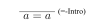

(a)

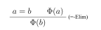

(b)

Figure 11: Traditional IntElim Rules for Identity. [An extended description of figure 11 is in the supplement.]

It is not at all obvious how this $=$-E rule just “reverses the effect” of the $=$-I rule here.

An early proposal to answer this was made in Read (2004), thinking of defining identity by means of indiscernibility: $(\forall F(Fa\leftrightarrow Fb)\leftrightarrow a=b)$. This can be put into the form of an intuitionistic rule-pair, as in figure 12. But of course, for the $=$-I rule to correctly mirror the second-order quantification of the indiscernibility principle, the $F$ needs to be “truly arbitrary” (perhaps: a unary predicate that does not occur in any assumption other than the present one). The $F$ in the $=$-E rule, on the other hand, is any unary predicate of the language. There is a burgeoning literature on this topic, much of it focussing on whether it is legitimate to incorporate features of second-order logic in the ways required.

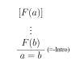

(a)

(b)

Figure 12: Read’s (2004) Indiscernability IntElim Rules for Identity. [An extended description of figure 12 is in the supplement.]

Besides the works cited just above, see also Griffiths 2014; Klev 2019; Kremer 2007; Read 2016.

### 7.2 Logic’s Relations with Language and Metaphysics

The general picture of harmonious Int-Elim rules has not only fuelled a theory of The One True Logic (as in Read 2006)[^read-2006] but also has been the backing for a theory of “semantics” (both of formal logic and also of natural language usage) called Inferentialism. As Read (2010: 558) puts it,

> Traditionally, semantics has been denotational and representational, consisting in a homomorphic valuation from expressions to some range of objects. This approach risks ontological explosion, first in hypostatizing denotations for empty names, predicates, conjunctions, prepositions and so on…, then in seeking values for false propositions in the form of non actual states of affairs. It is also regressive, since a criterion is now needed to determine which non-actual states of affairs are possible, which simply repeats the initial problem. Talk of possible worlds is an attractive metaphor, but does little useful philosophical work and much harm.
>
> Inferentialism, in contrast, is ontologically neutral. Expressions are meaningful if there are rules governing their use, in particular, logical expressions are given meaning by the introduction-rules, specifying the grounds for assertion of propositions containing them, and elimination-rules drawing inferences from those assertions.

The works mentioned above concerned themselves with introducing connectives in logic, as is appropriate for an entry “Natural Deduction in Logic”. But as Read (2010) points out, the general viewpoint is consonant with “use theories of meaning” that have been prominent in philosophy of language.[^note-26] The chain of inference here seems to be (something like):

1. Systems of formal logic are best characterized by their natural deduction formalizations.
2. The best sort of natural deduction formalism is by means of a set of Int-Elim rules, ones that will lead us to normalizability of proofs and will show a harmony in their formalizations.
3. Given the way that such Int-Elim rules operate in formal derivations, they should be organized into harmonious pairs. And it is clear that this specifies the entirety of the meaning of such connectives.
4. Not only is this true of a connective’s meaning within logical systems, but—more widely—it is true of the meanings natural language terms that correspond to such logical operators: their meanings are also entirely given by these Int-Elim rules.
5. Hence, it is therefore plausible to suppose that a feature related to introduction and elimination should be the entire meaning of *any* (and *all*) natural language meaning.

This argument from logic to natural language meaning is reminiscent of slippery slope reasoning: it might be challenged at any of the sliding points. For instance, one might argue that there is no real reason (= no reason other than to try to establish the overall conclusion about natural language meaning) to prefer natural deduction formulations of logic over Frege-Hilbert axiomatic ones. Or one might point to an alleged “vast gulf” between logical systems (and the reasoning employed in them) and natural language (and the variety of uses to which natural language lends itself). Still, the project has seemed not just possible but a straightforwardly correct path to investigate.

Some work in the informal side of this idea is illustrated by Brandom (1994, 2000), under the title ‘Inferentialism’; and on the more formal side by Francez (2015, 2021), under the title ‘Proof-theoretic Semantics’. Arguing both for the formal side and for the informal side of this viewpoint is Dummett (1973, 1977, 1978, 1991), which has been much of the inspiration for the current interest in the notion of harmony of inference rules in logical systems as well as in natural language.

> Dummett (1973: 453): Learning to use a statement of a given form involves learning two things: The conditions under which one is justified in making the statement; and what constitutes acceptance of it, i.e., the consequences of accepting it.
>
> Brandom (2000: 63): What corresponds to an *introduction* rule for a propositional content is the set of *sufficient* conditions for asserting it, and what corresponds to an *elimination* rule is the set of *necessary* consequences of asserting it, that is, what follows from doing so.

Francez (2021: 55–6) puts the aim of Proof-Theoretic Semantics (PTS) like this (italics and bold in the original):

> The PTS programme as a theory of meaning can be described as follows: … Replace the received approach of taking sentential meanings as **truth-conditions** … by taking them as **canonical derivability conditions** … within a “dedicated” meaning-conferring natural-deduction proof-system in which the derivability conditions are formulated. … The proof system should reflect the “use” of the sentences (their inferential roles) …, and should allow recovering pre-theoretic properties of the meanings of sentences, such as *entailment* and *consequence drawing* (inference). … Such a system has two kinds of rules: **Introduction rules** [and] **Elimination rules**.

A feature of (logical) intuitionism is a denial of the law of bivalence, and its characteristic denial of the truth of formulas such as $(p\lor\neg p)$. The intuitionistic interpretation of theoremhood is said to be *provability*, and it may be that neither $p$ nor $\neg p$ is provable, so hence $(p\lor\neg p)$ should not be provable. In Dummett’s version, the provability constraint is replaced by *warranted assertibility*, which in turn is based on having rules for being justified in introducing some piece of language into a conversation and rules that justify the exploitation of the piece (‘exploitation’ being the standard term used in discussing natural language corresponding to the ‘elimination’ used when one exploits a logical operator). A rallying cry of such theorists might be that

> The meaning of any term or phrase or linguistic item whatsoever is given by, and only by, the set of rules for the introduction of such an item into discourses and for exploiting them once they have been introduced.

One can see ties from this rallying cry to other views concerning meaning, such as “Don’t ask for the meaning, ask for the use”, or “The rules of the language game are what determine, and wholly describe, what is the meaning of linguistic items”.

Michael Dummett has turned this discussion of “use” into a metaphysical position. (See especially Dummett 1991; but this builds on Dummett 1977 [e.g., p. 682], and even Dummett 1973 [e.g., p. 377], as well as many of his other works.)[^dummett-1973][^dummett-1977][^dummett-1991] The basic idea seems to be this: intuitionism as applied to logic urges meaning to be given by rules of how to use the connectives. Classical logic, on the other hand, assumes that there is a pre-given notion of reference and designation, employing notions like TRUE and FALSE. It follows, he says, that classical logic is going to be committed to a pernicious form of “meaning holism” that makes language learning impossible. (To some it seems counterintuitive that Dummett should think that classical logic with a meaning-presupposition of reference and denotation is committed to “total meaning holism”, when that is a more usual criticism of meaning-as-use theories. But that is indeed his view, as elaborated in Dummett (1975 [1978]), and elsewhere.) The doctrine that follows from this is called *anti-realism* by Dummett, and entails that there are no “realistic” facts or items that ground the correctness of logical operations. There is only the “learning of how the community *uses* the relevant terms”.

This is Dummett’s argument from the Manifestation Criterion: there must be some way for language learners to become able to use terms of language (in the first instance, learn the terms expressing the logical notions)—there must be some criterion that is manifest in their (language-learning) experience. Dummett claims this is where classical semantic theories fail: there is no way, short of an all-embracing meaning holism for them to do so, since there is no access to an independent semantic realm apart from language itself.

The literature on Dummett’s version of anti-realism is huge. An early and incisive critique Dummett’s (and also of some of his critics’) thoughts on the Manifestation Criterion is by Michael (1999), who argues that classical logic is not actually committed to a total meaning holism, but only to an innocuous “molecular holism of meaning”. Interested readers might consult Khlentzos (2021) for a general discussion of realism and varieties of anti-realism and in particular its §3 for the particular linguistic aspects that are relevant to the current subsection.

## References（引用注释）

> 原文参考文献已转为脚注引用：文内“作者-年份”引用组后附 [^key] 标记，完整条目见本文末脚注定义。

## Academic Tools

> |   | [How to cite this entry](https://plato.stanford.edu/cgi-bin/encyclopedia/archinfo.cgi?entry=natural-deduction). |
> | --- | --- |
> |   | [Preview the PDF version of this entry](https://leibniz.stanford.edu/friends/preview/natural-deduction/) at the [Friends of the SEP Society](https://leibniz.stanford.edu/friends/). |
> |   | [Look up topics and thinkers related to this entry](https://www.inphoproject.org/entity?sep=natural-deduction&redirect=True) at the Internet Philosophy Ontology Project (InPhO). |
> |   | [Enhanced bibliography for this entry](https://philpapers.org/sep/natural-deduction/) at [PhilPapers](https://philpapers.org/), with links to its database. |

## Other Internet Resources

- [“Natural Deduction”](https://iep.utm.edu/nat-ded/), *The Internet Encyclopedia of Philosophy*, entry by Andrzej Indrzejczak
- [“Natural Deduction”](https://en.wikipedia.org/w/index.php?title=Natural_deduction&oldid=1048022977), *Wikipedia* entry as of October 2025
- Roy, Tony, 2006, [“Natural Derivations for Priest, An Introduction to Non-Classical Logic”](https://ojs.victoria.ac.nz/ajl/article/view/1779/1630), *Australasian Journal of Logic* 4:47–192; this article provides Fitch-style natural deduction proof methods for systems of many-valued logic and some relevant logics that are described in Graham Priest’s *An Introduction to Non-Classical Logic* (2001, Cambridge: Cambridge University Press)

## Related Entries

connectives: sentence connectives in formal logic | epsilon calculus | logic: classical | logic: free | logic: intuitionistic | logic: modal | logic: relevance | logic: substructural | proof theory | proof theory: development of

### Acknowledgments

We’d like to thank Chris Menzel for prompting us to make some improvements to the definition of ‘natural deduction’ in the main text (to better accommodate sequent natural deduction) and to the presentations of some of the Fitch-style proofs.

## Notes（原文脚注）

## Notes to Natural Deduction Systems in Logic

[^note-1]: It might be noted, however, that Gödel and Bernays both presented natural deduction systems in lectures, at Notre Dame and Princeton respectively, in the late 1930s. Details are in Došen and Adžić (2018) for Gödel and in von Plato (2008) for Bernays. A detailed historical account of the textbooks can be found in Pelletier (1999).

[^note-2]: This phrase seems to have been used (with the appropriate mock-religious fervor) first by Routley and Meyer (1973: 199):

> None of the model structures that Kripke made, nor that Hintikka made,…were, however, relevant. This caused great sadness in the city of Pittsburgh where dwelt the captains of American Industry. The Logic Industry was there represented by Anderson, Belnap & Sons, discoverers of entailment and scourge of material impliers, strict impliers, and of all that to which their falsehoods and contradictions led. Yea, every year or so Anderson & Belnap turned out a new logic, and they did call it E, or R,…, and they beheld each such logic, and they were called relevant. …Word that Anderson & Belnap had made a logic without semantics leaked out. Some thought it was wondrous and rejoiced, that the One True Logic should make its appearance among us in the Form of Pure Syntax, unencumbered by all that set-theoretical garbage.

Of course, this was not Natural Deduction being held as a logic to worship, but Relevance Logic.

[^note-3]: We will go into more detail on needed changes to the rules in §5. For a more leisurely presentation of a natural deduction system for classical logic, see Shapiro and Kouri Kissel 2021.

[^note-4]: Gentzen (1934) gave natural deduction formalizations of both intuitionistic and classical logics. In this introductory section we mention only his formalization of classical logic. He also discussed sequent calculi for both intuitionistic and classical logics, as we discuss below in §4 and §5.

[^note-5]: In the present proof, Gentzen has inferred $\bot$ from $\neg q$ and $q$, and then used $\neg$-I to get the doubly negated $r$. At this stage he employed double-negation elimination ($\neg\neg$-E)—one of Gentzen’s alternative ways to pass from intuitionistic logic to classical logic—to infer $r$ and then employ $\rightarrow$-I. Gentzen’s main method of passing to classical logic was to allow instances of the Law of Excluded Middle ($p\lor\neg p$) to occur as “initial” formulas in trees (i.e., as logical axioms). We discuss this issue further in §4 and §5. See particularly note 23 below.

The particular presentations of Gentzen-style proofs in this document are due to Sam Buss’s LaTeX package, bussproofs.

[^note-6]: The main method that Jaśkowski’s article describes resembles that of Quine (1950a), but we shall not further consider it, concentrating only on the method of the footnote. Details about the relationship of these two methods can be found in Pelletier (1999).

[^note-7]: The actual rules (and their names) employed by Jaśkowski are different from the more modern ones we cite in this example. But the overall effect is about the same.

[^note-8]: The particular presentations using Fitch’s method in this document are due to Johan Klüwer’s LaTeX package, fitch.

[^note-9]: The liberal-minded may generalize the rule to allow an $n$-adic conjunction, for arbitrary finite $n$, to be inferred from its $n$ conjuncts. More conservative logicians will use repeated applications of the dyadic rule for this purpose.

[^note-10]: The pedantic may think of this as two rules, depending on whether the left or right conjunct is the conclusion. Liberals will of course generalize the rule to allow $n$-adic conjunctions as premisses.

[^note-11]: Similar variations for pedants, liberals, and conservatives.

[^note-12]: It is easily seen that this rule can be restricted to yield only atomic formulas as conclusions: the effect of using it to establish a logically complex $B$ as conclusion can be obtained by using various introduction rules after (possibly multiple) applications of the restricted rule. In our discussion of normalization, §5 below, we will tacitly assume this restriction.

[^note-13]: The conclusion of this rule is obtained by *adding* a negation operator to the hypothesis of the subproof. Many authors dub the corresponding rule in which the conclusion *subtracts* a negation “negation elimination”. (Both rules sometimes go by the name *reductio ad absurdum*.) In classical logic, both rules are valid, but only the negation-adding rule holds in, e.g., intuitionistic logic. The negation-subtracting rule is very powerful: it can be taken as the only negation rule in classical logic, others being derivable from it. It does not fit naturally into the pattern of Int-Elim rules: in particular, the basic normalization result (see §5) depends on pairing $\neg$-I with the $\neg$-E rule as stated above. For these reasons we would urge that the negation *subtracting* rule be given a distinctive name. We like *Indirect Proof*.

[^note-14]: Introduction/elimination rules are usually abbreviated, by stating the connective followed by -I (or -Int or -Intro), and by -E (or -Elim). We mostly use -I and -E.

[^note-15]: This simple statement is sufficient if $t$ is a constant or parameter, or built up from such by means of function-symbols. If the bound variables of the language are drawn from the same alphabet as the parameters, so that $t$ may contain (or be) a bindable variable, some restriction is needed to prevent unintended “capture” of variables: $t$ must not contain a variable bound by a quantifier in whose scope $t$ occurs in $A(x)$. The same restriction is needed in $\exists$-I. (This annoyance is not unique to systems of natural deduction: it affects, e.g., axiomatic systems as well.)

[^note-16]: Again, variable capture is to be avoided if the formation rules of the language make it a possibility. So, add the restriction that the variable, $x$, bound by the initial quantifier of $\forall xA(x)$ must not also be bound by a quantifier within $A(a)$ whose scope includes an occurrence of $a$. The same restriction is needed for $\exists$-Elimination (and, of course, in analogous rules of non-natural deduction systems.)

[^note-17]: In our opinion this pretense makes it a lot easier to understand what quantifiers and quantifier rules are doing, and it is often adopted by logicians wanting to get on with the job without bogging down in technicalities. Philosophers may worry (one of us used to) about the idea of names for indiscernible elements in some domains, or about names for *all* the elements in nondenumerable domains. Suffice it to say that (using about the same set-theoretic resources as are needed for the standard, Tarskian, account of quantifiers) the idea of an extension of a given language containing constants for all the elements of an arbitrary domain can be made completely rigorous.

[^note-18]: Gentzen had used $\supset$ as his symbol for the object language conditional, and therefore had the arrow symbol $\longrightarrow$ available to represent the relationship between the lists of symbols. Since we employ $\rightarrow$ as our object language conditional, we use $\vdash$ as our way to represent this relationship, which is the most common convention in current literature.

[^note-19]: Counting rules like $\land$-Elim [$(\phi\land\psi)\vdash\phi$ and $(\phi\land\psi)\vdash\psi$] as just one rule.

[^note-20]: The method in Suppes is also used in Lemmon (1965) [who says his rules are due to Gentzen, but doesn’t specify *which* of Gentzen’s systems of rules he is talking about] and Mates (1965). Suppes does not say that his method is derived from an analysis of Gentzen’s methods, but rather because “they seemed close to ordinary informal reasoning.” So our account is perhaps best seen as a “rational reconstruction”: Suppes’s system *could have been* discovered in the way we suggest, and pretending it was thus discovered makes it easier to understand its relation to other natural deduction and sequent calculi.

[^note-21]: In contrast, the presentation in Gentzen (1936) explicitly wrote out each of the formulas that a line in his proof depended on.

[^note-22]: Although Lemmon says his rules are due to Gentzen, he also says that the detailed formulation is due to Suppes. He also cites Mates rules as being due to Suppes.

[^note-23]: Most rules involving suppositions are standard in this variation, but the $\lor$-E rule is rather different:

$$ \begin{align*} \text{From } & \vdash \Gamma, (\phi\lor\psi), \Delta\\ \text{Infer } & \vdash \Gamma, \phi, \psi, \Delta\\ \end{align*} $$

Cellucci (1992) describes this system and its metatheory: the system turns out to be surprisingly efficient, often giving quite compact proofs, despite the repetition of formulas in multiple sequences.

[^note-24]: For example, any of the following would do to effect the extension to classical logic, as would various other possibilities. (The first is a simplification of Gentzen’s original rule, which had $(\phi\lor\neg\phi)$ formulas ($\phi$ an atomic) as leaves of trees.)

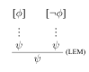

(a)

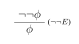

(b)

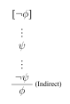

(c)

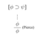

(d)

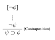

(e)

[An extended description of the figures in note 24 is in the supplement.]

[^note-25]: Fitch formulations for all these revised TONK rules are:

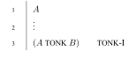

(a)

(b)

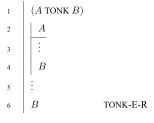

(c)

And the alternative formulation where the TONK-I rule gets altered is:

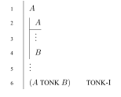

(d)

(e)

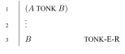

(f)

[An extended description of the figures in note 25 is in the supplement.]

[^note-26]: Although there have been various instances of this view of language throughout the history of philosophy and linguistics, it has usually attributed most strongly to Wittgenstein’s *Philosophical Investigations* and the many like-minded works of the mid-twentieth century.

[^anderson-1960]: Anderson, Alan Ross, 1960, “Completeness Theorems for the Systems E of Entailment and EQ of Entailment with Quantification”, *Zeitschrift für Mathematische Logik und Grundlagen der Mathematik*, 6(7–14): 201–216. doi:10.1002/malq.19600060709

[^anderson-1962a]: Anderson, Alan Ross and Nuel D. Belnap, 1962a, “Tautological Entailments”, *Philosophical Studies*, 13(1–2): 9–24. doi:10.1007/BF00818100

[^anderson-1962b]: –––, 1962b, “The Pure Calculus of Entailment”, *Journal of Symbolic Logic*, 27(1): 19–52. doi:10.2307/2963676

[^anderson-1975]: –––, 1975, *Entailment: The Logic of Relevance and Necessity, Volume 1*, Princeton, NJ: Princeton University Press.

[^avigad-2020]: Avigad, Jeremy and Richard Zach, 2020, “The Epsilon Calculus”, *The Stanford Encyclopedia of Philosophy* (Fall 2020), Edward N. Zalta (ed.). URL = <[https://plato.stanford.edu/archives/fall2020/entries/epsilon-calculus/](https://plato.stanford.edu/archives/fall2020/entries/epsilon-calculus/)>

[^belnap-1962]: Belnap, Nuel D., 1962, “Tonk, Plonk and Plink”, *Analysis*, 22(6): 130–134. doi:10.1093/analys/22.6.130

[^boričić-2024]: Boričić Joksimović, Marija, Nebojša Ikodinović, and Nenad Stojanović, 2024, “Probability and Natural Deduction”, *Journal of Logic and Computation*, 35(2): first online 06 March 2024. doi:10.1093/logcom/exae007

[^borisavljević-2022]: Borisavljević, Mirjana, 2022, “Maximum Segments as Natural Deduction Images of Some Cuts”, *Logica Universalis*, 16(3): 499–533. doi:10.1007/s11787-022-00309-5

[^brandom-1994]: Brandom, Robert, 1994, *Making It Explicit: Reasoning, Representing, and Discursive Commitment*, Cambridge, MA: Harvard University Press.

[^brandom-2000]: –––, 2000, *Articulating Reasons: An Introduction to Inferentialism*, Cambridge, MA: Harvard University Press.

[^cellucci-1992]: Cellucci, Carlo, 1992, “Existential Instantiation and Normalization in Sequent Natural Deduction”, *Annals of Pure and Applied Logic*, 58(2): 111–148. doi:10.1016/0168-0072(92)90002-H

[^cellucci-1995]: –––, 1995, “On Quine’s Approach to Natural Deduction”, in *On Quine: New Essays*, Paolo Leonardi and Marco Santambrogio (eds.), Cambridge: Cambridge University Press, 314–335.

[^copi-1954]: Copi, Irving, 1954, *Symbolic Logic*, New York: Macmillan Co.

[^curry-1950]: Curry, Haskell, 1950, *A Theory of Formal Deducibility*, Notre Dame, IN: University of Notre Dame Press.

[^curry-1963]: –––, 1963, *Foundations of Mathematical Logic*, New York: McGraw-Hill.

[^d’agostino-2020]: D’Agostino, Marcello, Dov Gabbay, and Sanjay Modgil, 2020, “Normality, Non-Contamination and Logical Depth in Classical Natural Deduction”, *Studia Logica*, 108(2): 291–357. doi:10.1007/s11225-019-09847-4

[^došen-2018]: Došen, Kosta and Miloš Adžić, 2018, “Gödel’s Natural Deduction”, *Studia Logica*, 106(2): 397–415. doi:10.1007/s11225-017-9744-x

[^dummett-1973]: Dummett, Michael, 1973, *Frege: Philosophy of Language*, Cambridge, MA: Harvard University Press.

[^dummett-1975]: –––, 1975 [1978], “The Philosophical Basis of Intuitionistic Logic”, in *Logic Colloquium ’73*, H. E. Rose and J. C. Shepherdson (eds.), (Studies in Logic and the Foundations of Mathematics 80), New York: Elsevier, 5–40. Reprinted in his *Truth and Other Enigmas*, London: Duckworth, 1978, 215–247. doi:10.1016/S0049-237X(08)71941-4

[^dummett-1977]: –––, 1977, *Elements of Intuitionism*, Oxford: Clarendon Press.

[^dummett-1991]: –––, 1991, *The Logical Basis of Metaphysics*, Cambridge, MA: Harvard University Press.

[^fine-1985a]: Fine, Kit, 1985a, “Natural Deduction and Arbitrary Objects”, *Journal of Philosophical Logic*, 14(1): 57–107. doi:10.1007/BF00542649

[^fine-1985b]: –––, 1985b, *Reasoning with Arbitrary Objects*, Oxford: Blackwell.

[^fitch-1952]: Fitch, Fredric, 1952, *Symbolic Logic: An Introduction*, New York: Ronald Press.

[^fitch-1966]: –––, 1966, “Natural Deduction Rules for Obligation”, *American Philosophical Quarterly*, 3(1): 27–28.

[^fitting-1983]: Fitting, Melvin, 1983, *Proof Methods for Modal and Intuitionistic Logics*, Dordrecht: Reidel. doi:10.1007/978-94-017-2794-5

[^francez-2015]: Francez, Nissim, 2015, *Proof-Theoretic Semantics*, London: College Publications.

[^francez-2021]: –––, 2021, “Proof-Theoretic Semantics for Natural Language”, *Topoi*, 40: 55–69. doi:10.1007/s11245-019-09662-5

[^freund-2019]: Freund, Max A., 2019, *The Logic of Sortals: A Conceptualist Approach*, (Synthese Library, 408), Cham: Springer International Publishing. doi:10.1007/978-3-030-18278-6

[^garson-2021]: Garson, James, 2021, “Modal Logic”, *The Stanford Encyclopedia of Philosophy* (Summer 2021), Edward N. Zalta (ed.). URL = <[https://plato.stanford.edu/archives/sum2021/entries/logic-modal/](https://plato.stanford.edu/archives/sum2021/entries/logic-modal/)

[^gentzen-1934]: Gentzen, Gerhard, 1934, “Untersuchungen über das logische Schließen. I & II”, *Mathematische Zeitschrift*, 39: 176–210 and 405–431. doi:10.1007/BF01201353 doi:10.1007/BF01201363. English translation “Investigations into Logical Deduction”, *American Philosophical Quarterly*, 1: 288–306 (1964), and 2: 204–218 (1965).

[^gentzen-1936]: –––, 1936, “Die Widerspruchsfreiheit der reinen Zahlentheorie”, *Mathematische Annalen*, 112: 493–565. doi:10.1007/BF01565428. English translation “The Consistency of Elementary Number Theory”, in M. E. Szabo (ed.) *The Collected Papers of Gerhard Gentzen*, North-Holland, Amsterdam, pp. 132–213 (1969).

[^gibbins-1987]: Gibbins, Peter, 1987, *Particles and Paradoxes: The Limits of Quantum Logic*, Cambridge: Cambridge University Press.

[^griffiths-2014]: Griffiths, Owen, 2014, “Harmonious Rules for Identity”, *The Review of Symbolic Logic*, 7(3): 499–510. doi:10.1017/S1755020314000161

[^hailperin-1957]: Hailperin, Theodore, 1957, “A Theory of Restricted Quantification, I and II”, *Journal of Symbolic Logic*, 22(1): 19–35 and 22(2): 113–129. doi:10.2307/2964055 doi:10.2307/2964173

[^hailperin-1960]: –––, 1960, “Corrections to a Theory of Restricted Quantification”, 25(1): 54–56. doi:10.2307/2964337

[^hazen-1987]: Hazen, Allen, 1987, “Natural Deduction and Hilbert’s ϵ-Operator”, *Journal of Philosophical Logic*, 16(4): 411–421. doi:10.1007/BF00431186

[^hazen-2014]: Hazen, Allen P. and Francis Jeffry Pelletier, 2014, “Gentzen and Jaśkowski Natural Deduction: Fundamentally Similar but Importantly Different”, *Studia Logica*, 102(6): 1103–1142. doi:10.1007/s11225-014-9564-1

[^jaśkowski-1934]: Jaśkowski, Stanisław, 1934, “On the Rules of Suppositions in Formal Logic”, *Studia Logica* (First Series), 1(1): 5–32. Reprinted in S. McCall (1967) *Polish Logic 1920–1939*. Oxford University Press, Oxford. pp. 232–258.

[^kalish-1964]: Kalish, Donald and Richard Montague, 1964, *Logic: Techniques of Formal Reasoning*, New York: Harcourt, Brace, World.

[^khlentzos-2021]: Khlentzos, Drew, 2021, “Challenges to Metaphysical Realism”, *The Stanford Encyclopedia of Philosophy* (Spring 2021), Edward N. Zalta (ed.). URL = <[https://plato.stanford.edu/archives/spr2021/entries/realism-sem-challenge/](https://plato.stanford.edu/archives/spr2021/entries/realism-sem-challenge/)>

[^klev-2019]: Klev, Ansten, 2019, “The Harmony of Identity”, *Journal of Philosophical Logic*, 48(5): 867–884. doi:10.1007/s10992-018-09499-0

[^kornell-2024]: Kornell, Andre, 2024, “A Natural Deduction System for Orthomodular Logic”, *Review of Symbolic Logic*, 17(3): 910–949. doi:10.1017/S1755020323000229

[^kremer-2007]: Kremer, Michael, 2007, “Read on Identity and Harmony: A Friendly Correction and Simplification”, *Analysis*, 67(2): 157–159. doi:10.1093/analys/67.2.157

[^lemmon-1965]: Lemmon, E. John, 1965, *Beginning Logic*, London: Nelson.

[^mancosu-2021]: Mancosu, Paolo, Sergio Galvan, and Richard Zach, 2021, *An Introduction to Proof Theory: Normalization, Cut-Elimination, and Consistency Proofs*, Oxford: Oxford University Press.

[^mares-2020]: Mares, Edwin, 2020, “Relevance Logic”, *The Stanford Encyclopedia of Philosophy* (Winter 2020), Edward N. Zalta (ed.). URL = <[https://plato.stanford.edu/archives/win2020/entries/logic-relevance/](https://plato.stanford.edu/archives/win2020/entries/logic-relevance/)>

[^mates-1965]: Mates, Benson, 1965, *Elementary Logic*, New York: Oxford University Press.

[^michael-1999]: Michael, Michaelis, 1999, “Dummett’s Argument against Classical Logic”, *Philosophia*, 27(3–4): 359–382. doi:10.1007/BF02383185

[^moschovakis-2018]: Moschovakis, Joan, 2018, “Intuitionistic Logic”, *The Stanford Encyclopedia of Philosophy* (Winter 2018), Edward N. Zalta (ed.). URL = <[https://plato.stanford.edu/archives/win2018/entries/logic-intuitionistic/](https://plato.stanford.edu/archives/win2018/entries/logic-intuitionistic/)>

[^nelson-1949]: Nelson, David, 1949, “Constructible Falsity”, *Journal of Symbolic Logic*, 14(1): 16–26. doi:10.2307/2268973

[^nolt-2020]: Nolt, John, 2020, “Free Logic”, *The Stanford Encyclopedia of Philosophy* (Winter 2020), Edward N. Zalta (ed.). URL = <[https://plato.stanford.edu/archives/win2020/entries/logic-free/](https://plato.stanford.edu/archives/win2020/entries/logic-free/)>

[^pelletier-1999]: Pelletier, Francis Jeffry, 1999, “A Brief History of Natural Deduction”, *History and Philosophy of Logic*, 20(1): 1–31. doi:10.1080/014453499298165

[^pelletier-2012]: Pelletier, Francis Jeffry and Allen P. Hazen, 2012, “A History of Natural Deduction”, in Dov M. Gabbay, Francis J. Pelletier, and John Woods (eds.), *Handbook of the History of Logic; Vol. 11: A History of Logic’s Central Concepts*, Amsterdam: Elsevier, 341–414.

[^plato-2001]: von Plato, Jan, 2001, “Natural Deduction with General Elimination Rules”, *Archive for Mathematical Logic*, 40(7): 541–567. doi:10.1007/s001530100091

[^plato-2008]: –––, 2008, “Gentzen’s Proof of Normalization for Natural Deduction”, *Bulletin of Symbolic Logic*, 14(2): 240–257. doi:10.2178/bsl/1208442829

[^plato-2012]: von Plato, Jan and Annika Siders, 2012, “Normal Derivability in Classical Natural Deduction”, *The Review of Symbolic Logic*, 5(2): 205–211. doi:10.1017/S1755020311000311

[^prawitz-1965]: Prawitz, Dag, 1965, *Natural Deduction: A Proof-Theoretical Study*, Stockholm: Almqvist & Wicksell.

[^prawitz-1971]: –––, 1971, “Ideas and Results in Proof Theory”, in *Proceedings of the Second Scandinavian Logic Symposium*, J. E. Fenstad (ed.), (Studies in Logic and the Foundations of Mathematics 63), Amsterdam: Elsevier, 235–307. doi:10.1016/S0049-237X(08)70849-8

[^prior-1960]: Prior, Arthur N., 1960, “The Runabout Inference-Ticket”, *Analysis*, 21(2): 38–39. doi:10.1093/analys/21.2.38

[^quine-1950a]: Quine, Willard V., 1950a, *Methods of Logic*, New York: Henry Holt & Co.

[^quine-1950b]: –––, 1950b, “On Natural Deduction”, *Journal of Symbolic Logic*, 15(2): 93–102. doi:10.2307/2266969

[^read-2004]: Read, Stephen, 2004, “Identity and Harmony”, *Analysis*, 64(2): 113–119. doi:10.1093/analys/64.2.113

[^read-2006]: –––, 2006, “Monism: The One True Logic”, in *A Logical Approach to Philosophy*, David Devidi and Tim Kenyon (eds.), (The Western Ontario Series in Philosophy of Science 69), Dordrecht: Springer-Verlag, 193–209. doi:10.1007/1-4020-4054-7_10

[^read-2008]: –––, 2008, “Harmony and Modality”, in *Dialogues, Logics and Other Strong Things: Essays in Honour of Shahid Rahman*, L. Kieff, C. Dégremont, and H. Rückert (eds.), London: College Publications, pp. 285–303.

[^read-2010]: –––, 2010, “General-Elimination Harmony and the Meaning of the Logical Constants”, *Journal of Philosophical Logic*, 39(5): 557–576. doi:10.1007/s10992-010-9133-7

[^read-2016]: –––, 2016, “Harmonic Inferentialism and the Logic of Identity”, *The Review of Symbolic Logic*, 9(2): 408–420. doi:10.1017/S1755020316000010

[^restall-2000]: Restall, Greg, 2000, *An Introduction to Substructural Logics*, New York/London: Methuen.

[^restall-2018]: –––, 2018, “Substructural Logics”, *The Stanford Encyclopedia of Philosophy* (Spring 2018), Edward N. Zalta (ed.). URL = <[https://plato.stanford.edu/archives/spr2018/entries/logic-substructural/](https://plato.stanford.edu/archives/spr2018/entries/logic-substructural/)>

[^routley-1973]: Routley, Richard and Robert K. Meyer, 1973, “The Semantics of Entailment (I)”, in *Truth, Syntax and Modality*, Hugues Leblanc (ed.), Amsterdam: North Holland, 194–243.

[^schroeder-heister-2018]: Schroeder-Heister, Peter, 2018, “Proof-Theoretic Semantics”, *The Stanford Encyclopedia of Philosophy* (Spring 2018), Edward N. Zalta (ed.). URL = <[https://plato.stanford.edu/archives/spr2018/entries/proof-theoretic-semantics/](https://plato.stanford.edu/archives/spr2018/entries/proof-theoretic-semantics/)>

[^shapiro-2021]: Shapiro, Stewart and Teresa Kouri Kissel, 2021, “Classical Logic”, *The Stanford Encyclopedia of Philosophy* (Spring 2021), Edward N. Zalta (ed.). URL = <[https://plato.stanford.edu/archives/spr2021/entries/logic-classical/](https://plato.stanford.edu/archives/spr2021/entries/logic-classical/)>

[^steinberger-2011]: Steinberger, Florian, 2011, “What Harmony Could and Could Not Be”, *Australasian Journal of Philosophy*, 89(4): 617–639. doi:10.1080/00048402.2010.528781

[^suppes-1957]: Suppes, Patrick, 1957, *Introduction to Logic*, Princeton, NJ: Van Nostrand/Reinhold Press.

[^troelstra-1996]: Troelstra, Anne Sjerp and Helmut Schwichtenberg, 1996, *Basic Proof Theory*, Cambridge: Cambridge University Press.
