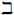

# Naturalism in the Philosophy of Mathematics
**First published Sun Aug 24, 2008; substantive revision Tue Jun 10, 2025**

*Paseau, Alexander, Marfori, Marianna Antonutti*

Contemporary philosophy’s three main naturalisms are methodological, ontological and epistemological. Methodological naturalism states that the only authoritative standards are those of science. Ontological and epistemological naturalism respectively state that all entities and all valid methods of inquiry are in some sense natural. In philosophy of mathematics of the past few decades methodological naturalism has received the lion’s share of the attention, so we concentrate on this. Ontological and epistemological naturalism in the philosophy of mathematics are discussed more briefly in section 6.

## 1. Methodological Naturalism

Methodological naturalism has three principal and related senses in the philosophy of mathematics. The first is that the only authoritative standards in the philosophy of mathematics are those of natural science (physics, biology, etc.). The second is that the only authoritative standards in the philosophy of mathematics are those of mathematics itself. The third, an amalgam of the first two, is that the authoritative standards are those of natural science and mathematics. We refer to these three naturalisms as *scientific*, *mathematical*, and *mathematical-cum-scientific*. Note that throughout this entry ‘science’ and cognate terms encompass only the natural sciences.

### 1.1 Mathematical Anti-Revisionism

Naturalism—‘methodological’ and ‘in the philosophy of mathematics’ hereafter understood—seems to have anti-revisionary consequences for mathematics. The mathematician-philosopher L.E.J. Brouwer developed intuitionistic mathematics, which sought to overthrow and replace standard (‘classical’) mathematics. Intuitionism does not condone the unrestricted use of principles such as the excluded middle, of impredicative definitions, or of inference rules such as reductio ad absurdum, which are used unrestrictedly in mathematical practice; as a consequence, many classical theorems do not hold in intuitionistic mathematics. Brouwer attempted to motivate intuitionistic mathematics philosophically with an intuition-based account of mathematical truth. A more recent exponent of intuitionistic mathematics is Michael Dummett, who has developed arguments from the philosophy of language, in particular the theory of meaning, on its behalf (see the entries on Luitzen Egbertus Jan Brouwer and on intuitionism in the philosophy of mathematics). Because it recommends radical revisions to the methodology, ontology, and epistemology of mathematics, as well as to the set of theorems accepted in mathematical and scientific practice, intuitionism is often taken as a prototypical example of a revisionist approach to mathematics. Yet scientific standards and scientific practice arguably condone classical over intuitionistic mathematics: even if present-day science could be entirely recast intuitionistically—a big if—it would be less simple and more cumbersome than its current classically-based version. Mathematicians also tend to view intuitionistic mathematics as inferior to classical mathematics if construed as a rival to it. Hence neither Brouwer nor Dummett’s intuitionism is apparently sanctioned by scientific or mathematical standards, so naturalism rules them out of court. Indeed, for many of its adherents, that is precisely the point of naturalism: to block fanciful attacks on established disciplines such as mathematics by disciplines with less secure methodologies.

Even though revisions in mathematics tend to be less common and less radical than revisions in science, axiomatic assumptions and methodologies are revised and updated as mathematics progresses (consider for example the history of the notion of function, or of the theory of infinitesimals). Naturalists certainly do not deny that (in fact, theory revision is at the core of scientific method). What they deny, based on observations of the history of science, is that scientific disciplines are revised on the basis of considerations that are external to the practice (for mathematics, this case has been made e.g. in Maddy 2007, IV.2)[^maddy-2007]. The question of revisionism is therefore connected to the boundary problem (see section 3.2). For a recent discussion of mathematical anti-revisionism and its importance in the context of naturalism, see Antonutti Marfori (2024).

## 2. Recent History of Methodological Naturalism

### 2.1 Recent Background

Contemporary interest in naturalism stems from Quine, whose naturalism is prominent in his later works. A representative quotation is that naturalism is ‘the recognition that it is within science itself, and not in some prior philosophy, that reality is to be identified and described’ (Quine 1981, 21)[^quine-1981]. Another major influence is Hilary Putnam, who articulates his scientific naturalism as follows:

> …it is silly to agree that a reason for believing that *p* warrants accepting *p* in all scientific circumstances, and then to add ‘but even so it is *not good enough*.’ Such a judgement could only be made if one accepted a trans-scientific method as superior to the scientific method; but this philosopher, at least, has no interest in doing *that*. (Putnam 1971, 356)[^putnam-1971]

Thus from this perspective mathematics is judged by scientific standards because everything is. Moreover, Quine and Putnam maintain that these standards sanction platonist mathematics because mathematics and its platonist construal are an indispensable part of our best scientific theories.

Although naturalism as a self-conscious position in the philosophy of mathematics emerges most fully with Quine there are, as always, precursors. The empiricist tradition in its various guises (logical positivism, Mill, Hume, etc.) is the most obvious precursor, though there are significant differences between pre-Quinean empiricists and contemporary naturalists. The rise of scientific naturalism in the philosophy of mathematics also coincides with a rise in a broader scientific naturalism, also in part attributable to Quine, which sees all philosophy—not just philosophy of mathematics—as taking place within natural science. Naturalism also goes hand in hand with a now generally prevalent pessimism about traditional philosophical modes of argumentation.

Some version of naturalism is attractive to virtually all philosophers today. That the methodologies of mathematics and science are the best we have seems a platitude, which philosophy should try to acknowledge and build on rather than ignore. The question is how exactly to do so.

### 2.2 Present context

The past couple of decades have seen a great surge of interest in naturalism. 1997 was an important year in recent philosophy of mathematics, as it saw the publication of four books articulating the positions of five leading philosophers of mathematics: John Burgess and Gideon Rosen’s *A Subject with No Object,* Penelope Maddy’s *Naturalism in Mathematics*, Michael Resnik’s *Mathematics as the Science of Patterns*, and Stewart Shapiro’s *Philosophy of Mathematics*. All four books are to various degrees and amongst other things naturalistic: the first two are naturalist manifestos, the third advocates a Quinean scientific naturalism, and the last, though mainly concerned with other matters, is sympathetic to naturalism. John Burgess’s naturalism, first set out in his (1983) and in the past few years elaborated with his colleague Gideon Rosen (1997, 2005), is perhaps most naturally construed as a version of mathematical-cum-scientific naturalism (1997, 211). Penelope Maddy’s naturalism is a heterogeneous form of naturalism which distinguishes between mathematics proper and the philosophy of mathematics, embracing mathematical naturalism about the former and scientific naturalism about the latter (section 5). Another position suggested by Maddy (1997) is a thoroughgoing mathematical naturalism that takes mathematical standards as authoritative within both mathematics and its philosophy.

Ignoring qualifications, the main contemporary versions of naturalism, with their representative advocates, may be tabulated as follows:

> |   | **Mathematics Proper** | Philosophy of Mathematics |
> | --- | --- | --- |
> | Scientific (Quine) | Scientific | Scientific |
> | Mathematical-Cum-Scientific (Burgess) | Mathematical-cum- Scientific | Mathematical-cum- Scientific |
> | Mathematical (?) | Mathematical | Mathematical |
> | Heterogeneous (Maddy 1997)[^maddy-1997] | Mathematical | Scientific |

To illustrate the difference between statements in mathematics proper and the philosophy of mathematics, consider as an example of the former the Green-Tao theorem, proved in 2004, which states that the sequence of prime numbers contains arbitrarily long arithmetic progressions (but of course no infinitely long one); as examples of the latter take the platonist claim that the number two exists and is abstract or the claim that because mathematical entities are created rather than discovered, impredicative definitions are not permissible. For any given philosopher, the Green-Tao theorem and its proof are to be assessed by the standards of the first column. For example, Quine accepts the theorem if and only if it is part of the best systematisation of science (which it is assuming that the principles from which it is deduced and the logic by which it is deduced from those principles are). Similarly, for any given philosopher, platonism and the stricture regarding impredicativity are to be assessed by the standards of the second column. For example, Quine accepts platonism because he takes it to be the scientifically sanctioned interpretation of mathematics: in his view, the mathematics contained in the best systematisation of science is platonic.

There are no clear exemplars of the view that mathematical standards should be authoritative in philosophy of mathematics, hence the question mark. David Lewis flirted with this position in his monograph on set theory (1991, viii–ix, 54), but by the time of his (1993) had already repudiated it. The position is suggested by remarks in Maddy (1997), though as we will see in section 5, Maddy (1997) is more naturally interpreted as advancing a heterogeneous form of naturalism. Several other philosophers of mathematics are also professed naturalists, notably Alan Baker (2001) and Mark Colyvan (2001).

## 3. Elucidating Methodological Naturalism

Like many –isms, naturalism is perhaps better thought of as an orientation with doctrinal implications than as a doctrine per se. Nevertheless, we may attempt to elucidate it along several dimensions.

### 3.1 Authoritative

How should we understand the claim that some set of standards ought to be authoritative in the philosophy of mathematics? We may preserve generality by referring to *X*-standards, the instances of interest to us being ‘scientific’, ‘mathematical’ or ‘scientific-cum-mathematical’. Here are some (non-exhaustive) readings of the authority claim:

1. Biconditional Naturalism: accept *p* iff *p* is sanctioned by *X*-standards
2. Trumping Naturalism: accept *p* if *p* is sanctioned by *X*-standards.
3. Emphasis Naturalism: In assessing whether *p*, give more emphasis to *X*-standards.
4. Compatibility Naturalism: do not accept *p* if *p* is incompatible with *X*-standards.

The biconditional reading is the strongest of the four. It expresses the thought that valid standards just are *X*-standards. In contrast with biconditional naturalism, the trumping version apparently allows that a statement in the philosophy of mathematics may be acceptable even if *X*-standards do not sanction it. For instance, Burgess and Rosen express their naturalism as follows:

> The naturalists’ commitment is … to the comparatively modest proposition that when science [understood to include mathematics] speaks with a firm and unified voice, the philosopher is either obliged to accept its conclusions or to offer what are recognizably scientific reasons for resisting them (1997, 65).

This is naturally glossed as a trumping version of scientific-cum-mathematical naturalism. It seems to allow that if mathematics and science do not speak with a firm voice on a question, we may accept the verdict of some other discipline. Rosen (2016) also endorses a version of trumping naturalism according to which:

> if a mathematical claim is fully acceptable by mathematical standards (and by the standards of every other science), it simply follows that we are justified in believing that it is true [...] A philosopher who favors an epistemic standard according to which the textbook proof of Euclid’s theorem does not provide good reasons for believing Euclid’s theorem is simply mistaken about what counts as a good reason for believing a mathematical proposition. […] These claims are fully justified by mathematical standards, so they are justified *tout court*. (2016, 278).

However, Rosen (2016, 279) explicitly concedes that philosophy has some authority, albeit a limited one, in overruling scientific claims. Even though the naturalist cannot establish the general norm that philosophy has no authority to overrule the sciences, the rejection of a well‐established scientific claim on the basis of philosophical considerations requires a very strong case.

Emphasis Naturalism is a vaguer doctrine. Various versions arise depending on how much emphasis is placed on *X*-standards. A modest version captures the position of naturalistically-inclined but not outright naturalist philosophers. We recover biconditional naturalism when *X*-standards are emphasised to the point where no others matter.

Compatibility naturalism is not as strong as trumping naturalism. If *p* is sanctioned by *X*-standards then compatibility naturalism enjoins the non-acceptance of ¬*p* but it does not necessarily enjoin the acceptance of *p*. Non-acceptance of ¬*p* falls short of acceptance of *p* since there is always the option to suspend judgment on *p*. The compatibility view is generally accepted by most contemporary philosophers. To take an example from outside the philosophy of mathematics, most philosophers would reject a philosophy of time that clashes with the theory of relativity (in this case *X* = science). Within the philosophy of mathematics, most philosophers would reject a philosophy of mathematics that implies, for instance, that complex analysis should be jettisoned (in this case *X* could be science, mathematics, or mathematics-cum-science).

Various weaker methodological theses are sometimes labelled ‘naturalist’, for instance the rejection of Cartesian foundationalism, but here we understand the term more robustly. Which of the above variants is the right way to develop naturalism depends of course on how naturalism is motivated (section 4).

### 3.2 The boundary problem and the scientific method

Naturalism sets up an opposition between *X*-standards (scientific, mathematical or scientific-cum-mathematical) and other types of standards, e.g., astrological, theological, or the standards of common sense. Another example of standards that the naturalist sees as on the wrong side of the tracks are ‘fundamental’ philosophical ones. Goodman and Quine (in his pre-naturalist phase) once began an article by declaring that the basis for their nominalism was a fundamental philosophical intuition irreducible to scientific grounds (1947). Naturalists reject appeal to such standards.

An apparent problem with naturalism is that there do not seem to be sharp boundaries between science and non-science and between mathematics and non-mathematics. For example, the transition from physics to philosophy of physics to physics-heavy metaphysics to common-or-garden metaphysics seems to be gradual. When a mathematician writes a research article, an undergraduate textbook, a popular book on mathematics, a book expounding their personal philosophy of mathematics and their psychological associations with various mathematical theories, at what point exactly have they stopped doing mathematics? When research mathematicians get together after the seminar and agree over coffee that the Riemann Hypothesis is the most important outstanding problem in mathematics, is this a strictly mathematical claim or a personal judgement recognised by mathematicians as outside the province of mathematics proper?

An answer to this problem also depends on what naturalists include under the label of ‘science’. While most naturalists argue that naturalism should not subscribe to a definition of science, on pain of excluding forms scientific activity which took place before the industrial revolution, or future kinds of science (see for example Papineau 2016), which disciplines are considered as ‘science’ affects the reply to this problem. For example, Quine had a broad notion of science that included not only empirical sciences but also “softer sciences” such as linguistics, economics, sociology, history, etc., and of course, mathematics. So when Quine says that scientific method is the ultimate arbiter of truth, scientific method includes methods of disciplines such as paleoanthropology, abstract algebra, computational linguistics, etc. (For a discussion of Quine’s notion of science, see Weir 2014.)[^weir-2014] Recently, Williamson (2025) has suggested that forms of ‘hard’ naturalism which do not include the ‘softer sciences’ are much more difficult to defend, because their legitimacy cannot be established by exclusive use of the experimental methods employed in the ‘hard sciences’.

Many philosophers follow Quine by citing a standard cluster of principles putatively constitutive of scientific standards: empirical adequacy, ontological economy, simplicity, fertility, and so on (Quine 1955, 247; Quine and Ullian 1970, chapter 5; Weir 2014: 119)[^quine-1955][^quine-1970][^weir-2014]. However, lists of this kind are unsatisfactory for several reasons. For one thing, the principles come in different versions. Yet it is doubtful whether the general versions are the scientifically sanctioned ones. Some writers claim, for example, that scientific appeal to ontological parsimony does not extend to the postulation of abstract objects (Burgess 1998)[^burgess-1998]. Others maintain that scientific appeals to simplicity are not best captured by the utterly general slogan ‘Prefer *any* theory *T*₁ to any less simple theory *T*₂ (in this respect)’ (Paseau 2007)[^paseau-2007]. Moreover, lists of this kind do not tell us how to balance desiderata against one another.

Since the explosion of science studies in the 1960s, more attention is now paid to the nuances of scientific practice. Yet a more precise articulation of scientific standards and their weights remains elusive. The existence of an algorithm encapsulating the scientific method is generally questioned (though many human beings apparently manage to implement the scientific method, so if the method is not algorithmic then neither are our minds). What is not questionable, however, is that its exhibition currently escapes us.

Having said that, it is not clear how serious the boundary problem is for naturalists. Perhaps mathematicians implicitly know when something counts as a piece of mathematics and when it is a non-mathematical commentary on mathematics. Perhaps naturalists can argue that there is a sufficiently sharp boundary, though one that is hard to define, and therefore that naturalism can survive the absence of a sharp boundary. For example, while Maddy 1997, 188–193 attempts to separate philosophical from mathematical considerations in the analysis of case studies from the history of set theory, Maddy 2007 and subsequent works take distance from this view, arguing that the naturalist can only differentiate the kinds of considerations that influence scientific practice piecemeal; for a recent discussion, see Antonutti Marfori 2024, Paseau 2024, and Maddy’s reply to Paseau in the same volume).

### 3.3 Methodological unity?

What if there are no global scientific standards, but just the standards of this or that part of science (e.g., physics or biology, or particle physics or fluid mechanics), or even just the standards of this or that group of scientists? In that case, scientific naturalism would fragment into several versions (e.g., physics-naturalism or biology-naturalism). If the motivation for scientific naturalism points to one of these finer-grained naturalisms over the others (e.g., physics-naturalism), or if they all return the same verdicts in the philosophy of mathematics, the potential fragmentation is not worrying. But if not, the scientific naturalist is in trouble, as all these competing naturalisms are by assumption equally valid. So far scientific naturalists have tended to assume that science operates with a single set of standards. Plausible though that assumption is, a rigorous naturalist will want to shore it up with detailed case studies. Similarly for mathematical naturalism and mathematical-cum-scientific naturalism.

### 3.4 Degree of sanction

Scientific standards sanction propositions to a certain degree rather than outright. The latest hypothesis at the research coalface adopted tentatively by a few experts does not have the same standing as a long-entrenched theory. Thus the black-or-white notion of scientific standards sanctioning or not sanctioning *p* will not do. (This is an idea which Bayesian confirmation theory takes seriously.) It might also be argued that this is also true for mathematical standards, for example by considering non-deductive grounds for belief in mathematical propositions. It seems reasonable to see Goldbach’s Conjecture, the claim that every even number greater than 4 is the sum of two primes, as supported to a high degree by the non-deductive evidence currently available for it. In the absence of a proof of Goldbach’s Conjecture, however, this degree falls short of 1. A more precise statement of the naturalist’s creed must therefore issue guidelines for apportioning credence in *p* in line with the degree and type of commitment to *p* scientific or mathematical standards recommend.

### 3.5 Standards and practitioners

It would be wrong to equate what *X*-standards sanction with what *X*-practitioners believe (for *X* = science or mathematics or more generally). For one thing, *X*-practitioners may not have given a particular question any thought. For another, *X*-practitioners might all be mistaken. Moreover, *X*-practitioners might self-consciously maintain the opposite of or at any rate something distinct from what *X*-standards sanction. For instance, a scientist may believe *p*, perhaps on the basis of a ‘gut feeling’ or on account of some overriding religious convictions or for whatever non-scientific reason, whilst still recognising that scientific standards support not-*p*. Or a mathematician may believe that the number 7 has mystical properties but not believe it *qua* mathematician. A tighter connection between practitioners and standards, then, might be this: what *X*-standards sanction is what *X*-practitioners are disposed to correctly believe *qua* *X*-practitioners. (This is not intended as a reductive analysis.)

Having said that, it takes special pleading to attribute widespread error to the community of *X*-practitioners regarding what *X*-standards sanction. Thus what *X*-practitioners in fact believe usually serves as good, though defeasible, evidence for what *X*-standards sanction.

### 3.6 Broader naturalisms

Scientific naturalism as here defined encompasses only *natural* science (and likewise for scientific-cum-mathematical naturalism). Broader naturalisms take in not just traditional natural science but also some of the other sciences: perhaps all of social science, perhaps only some of it, perhaps linguistics, perhaps cognitive science. Note that in later writings Quine himself adopts a broad version of naturalism (1995, 49; see also Weir 2014, 118)[^weir-2014]. Penelope Maddy has more recently made it clear that the form of scientific naturalism she espouses—‘Second Philosophy’ as she now prefers to call it—is very broad indeed, taking in not only the natural sciences but also psychology, linguistics, sociology, etc. (2007, 2).

Broadening scientific or scientific-cum-mathematical naturalism to include these disciplines has potentially significant consequences for the philosophy of mathematics. For instance, if semantics falls under the naturalist umbrella it may provide a naturalistic sanction for mathematical realism or platonism, as the face value semantics for mathematics seems to assimilate it to the uncontroversially literal parts of language—a point famously made in Benacerraf (1973).

Whether to construe naturalism broadly or narrowly depends on its motivation. The attractions of scientific or mathematical or scientific-cum-mathematical naturalism lie in the disciplines’ incomparable success (on some understanding of what this success comes to—see section 4). At this point in time, however, the non-natural sciences are less successful than the natural sciences. The less successful one deems the non-natural sciences compared to the natural ones, the less attractive a broader scientific or scientific-cum-mathematical naturalism becomes in comparison with a strictly natural-scientific one.

All naturalists, especially those of the broader variety, have to balance potentially competing standards. A broad naturalist might decide, say, to give the natural sciences 2/3-weighting and semantics 1/3-weighting. Or she might hold that a proposition in the philosophy of mathematics is acceptable if (or even: if and only if) all the sciences, natural or non-natural, sanction it—that is to say, when all the sciences speak with one voice. These balancing questions have unfortunately not been much addressed by naturalists. Perhaps that is because questions of this kind arise for everyone: whichever justificatory standards one accepts, the problem of how to adjudicate between them arises. But to the extent that naturalism is prescriptive and cannot rely on an implicit procedure that is already in place, it owes us an articulation of how to balance different sets of standards.

The balancing issue is particularly pressing for mathematical-cum-scientific naturalists. A scientific naturalist is in principle happy to say that if a mathematical theory *M* is scientifically superior but mathematically inferior to another mathematical theory *M*^{*} then *M* should be preferred to *M*^{*} (the next paragraph contains an example). Mathematical-cum-scientific naturalists, however, may come down on either side, depending on the details of the particular theories: it all depends on whether *M*’s scientific advantages compared to *M*^{*} are outweighed by its mathematical disadvantages. Now the philosophy of mathematics does not have an established tradition of weighing mathematical theories’ scientific and mathematical pros and cons against one another; nor does any other discipline. So the problem of how to balance mathematical and scientific standards is particularly pressing for the mathematical-cum-scientific naturalist.

To illustrate this problem, suppose, as many philosophers maintain, that the general principle of ontological economy—posit as few entities as possible—is a scientific standard. Suppose also, as Penelope Maddy maintains, that a set-theoretic version of ontological profligacy—posit as many sets as possible—is a mathematical standard (this is one way of cashing out the set-theoretic maxim Maddy calls *MAXIMIZE*). These two standards clash, as Maddy recognises (1997, 131). Thus given these assumptions a predicativist set theory which posits a relatively small number of sets, say of the kind developed in Hermann Weyl’s *Das Kontinuum*, might be scientifically superior to ZFC, which posits more sets. Yet ZFC is generally thought to be mathematically superior to a predicativist set theory. Perhaps the right diagnosis is that the clash is only superficial, since the correct scientific version of ontological economy is ‘posit as few *concrete* entities as possible’ and the correct mathematical version of ontological profligacy is ‘posit as many *abstract* entities as possible’. However that may be in this instance, the mathematical-cum-scientific naturalist has to come up with a general policy for dealing with potential clashes, or argue that no such clashes are possible.

## 4. Motivating Naturalism

One may simply adopt naturalism without providing an argument or motivation for it. But motivations for naturalism buttress it, making it internally stronger, and give it dialectical strength, increasing its appeal to non-naturalists. They answer the fundamental question: why exactly *those* standards?

(The same goes for naturalisms primarily conceived as approaches or stances rather than doctrines. Since the publication of her 1997 book, Penelope Maddy has clarified that her version of naturalism is a stance (Maddy 2001)[^maddy-2001] or a piecemeal approach/method of inquiry (2007, see e.g., p. 19 fn. 15, p. 403). However, stances and approaches to inquiry are attractive to the extent that they are well motivated.)

### 4.1 Naturalism is Revolutionary in some Respects

Naturalism is often thought to be a conservative philosophy of mathematics, as we suggested in section 1. But actually things are more complicated. Each of the three naturalisms of interest is revolutionary in some respect.

Our default view is that mathematical standards decide questions in mathematics proper, for example questions such as whether Fermat’s Last Theorem or the Axiom of Choice is true. Scientific standards are thought not to affect this: when Andrew Wiles proved Fermat’s Last Theorem in the mid-1990s, he was not particularly concerned with how his proof would go down in physics departments, or more generally its impact on empirical science. Similarly, the claim that if some large cardinal axiom is not scientifically sanctioned (perhaps because it leads to no new empirical consequences) then there is no good reason to accept it is, as Maddy points out, ‘out of step with the actual practice of set theory’ (1997, 132), and indeed out of step with the actual practice of much philosophy. For example, Quine argued against the adoption of large cardinal axioms because they are too far removed from any empirical application. Considerations of simplicity, conceptual and ontological economy, and naturalness support instead the adoption of the Axiom of Constructibility, *V = L* (Quine 1992, 95; for a discussion, see Antonutti Marfori 2020; Weir 2005)[^antonutti-2020][^weir-2005]. In mathematical practice, however, we do not usually judge large cardinal axioms by scientific standards; we judge them by mathematical standards. Quine was knowingly going against the grain when he rejected the higher flights of set theory on scientific grounds and claiming that the higher reaches of set theory are mathematical recreation without ontological rights (1986, 400).

Scientific naturalism about mathematics proper is thus a philosophically revolutionary view, since it advocates a different set of standards with which to judge mathematics (scientific ones) from the traditional ones (mathematical). It is also *potentially* revolutionary about mathematics itself, as it might lead to a revision of mathematics. (Notice that even if scientific naturalism does not entail a revision of mathematics, it still counts as philosophically revolutionary: advocating the replacement of *Y*-standards with *X*-standards as the proper arbiters in some domain is philosophically revolutionary even if the *Y*-standards and *X*-standards happen to endorse the same claims in that domain.) Having said that, recent scientific naturalists have tended to be mathematically conservative in temperament and have advocated little or no revision of mathematics.

These morals also apply to mathematical-cum-scientific naturalism, but to a lesser extent, as the latter gives some weight to mathematical standards in mathematical justification.

The third of the three naturalisms of interest, mathematical naturalism, is philosophically but not mathematically revolutionary. Mathematically, it is as conservative as can be: no standards other than mathematical ones are relevant to the assessment of mathematical claims. Thus no accepted mathematics is overturned from without. Yet mathematical naturalism is a revolutionary stance in the philosophy of mathematics. To see this, suppose that platonism is part of standard, accepted mathematical practice. In that case, mathematical naturalism entails that there is no further question of its truth. Loosely put, simply because mathematicians (*qua* mathematicians) are platonists, platonism is the correct philosophy of mathematics. This is clearly out of step with philosophical practice: philosophers look to mathematicians’ views (*qua* mathematicians) as defeasible data for the philosophy of mathematics, not its conclusion. Thus we see that the simple characterisation of mathematical naturalism as conservative is not quite right: though mathematically conservative, it is philosophically revolutionary.

In sum, scientific, mathematical, and mathematical-cum-scientific naturalism are each revolutionary in some respect and face a corresponding burden of proof. We may now appreciate the sense in which the general claim, expressed in section 1, that naturalism is anti-revisionary is true and the sense in which it is not.

This also shows that contemporary naturalism is different from the latter Wittgenstein’s superficially similar metaphilosophy. Wittgenstein’s anti-philosophy, like naturalism, bars philosophy from changing mathematics: “Philosophy may in no way interfere with the actual use of language…It leaves everything as it is. It also leaves mathematics as it is” (1953, §163). Naturalism’s revolutionary tenor, however, means that it does not leave everything as it is.

### 4.2 Dearth of Arguments in the Literature

Arguments for naturalism are lacking in the literature. Most naturalists simply posit their naturalism and work downstream from it, hoping that its consequences will prove attractive to the susceptible (Maddy 2007, 3)[^maddy-2007]. Naturalism thus effectively becomes a personal credo with little direct attempt to bring anyone else on board: *I* accept only *X*-standards in some domain because *I* find them more credible than others. Now perhaps at the end of the day one cannot do better. But we shouldn’t assume that at the outset. That is all the more important given naturalism’s revolutionary features, as explained earlier. A conservative theory of justification might sanction naturalism given a broadly naturalist starting point; but our starting point, as we have seen, is not that of trumping naturalism: it is at most compatibility naturalism. So an argument for anything more than the mildest version of naturalism would be welcome.

### 4.3 Current Success

Naturalists are motivated by the thought that scientific or mathematical standards are the most successful standards we possess. But what does success come to? Very roughly, the following could be taken to be a mark of a discipline’s success: (i) among its practitioners, there is a widely shared conception of the discipline’s guiding questions and permissible methodology; and (ii) there is progress within the discipline in addressing its guiding questions. One may then try to argue along these lines that physics is more successful than metaphysics, that psychology is more successful than parapsychology, and that astronomy is more successful than astrology.

An approach of this kind faces a twofold problem. If anything goes when it comes to methodology, all sorts of disciplines can achieve success without thereby achieving credibility. Consider Guru-ology, the discipline that takes its guiding questions to be those enunciated by some guru, and lays down as its methodology that acceptable answers are all and only the guru’s pronouncements (perhaps assuming consistency—so let us assume for good measure that the guru is consistent and more generally probabilistically coherent). These answers could be as fanciful as you like: we leave it to the reader’s imagination to devise examples of outlandish claims made by the guru. If we suppose that the guru answers each of the questions that he raises, Guru-ology is therefore progressive—it answers all the questions it raises—and it is therefore successful. But its success speaks nothing of its credibility.

In general, if the success of any given set of standards *S* is gauged on its own terms, i.e., by using *S*-standards, several self-supporting but intuitively unacceptable sets of standards count as successful. This relativism is clearly not what the naturalist wants. Likewise for the thought that success is to be determined by how well the standards help us to ‘cope with reality’; several non-scientific and non-mathematical naturalisms likewise self-vindicate under this criterion. Perhaps success should instead be measured by how well the standards explain and predict natural phenomena, i.e., with how they cope with the subject matter of natural science. But adopting our usual view of how to judge success in this respect would be question-begging in favour of scientific naturalism, since scientific standards are precisely the standards we have developed to cope with this portion of reality. Compare an astrological naturalism motivated by the idea that success is to be measured by how well the standards explain and predict ‘astrological phenomena’, understood as the astrologers do. So if a naturalist argument based on success is to succeed, some other naturalistically acceptable but non-question begging understanding of ‘success’ must be found.

The second problem with a success argument is that success in one sphere is no indication of success in another. Biology is rather successful at explaining and predicting biological phenomena. But why should that give it authority over questions in mathematics or the philosophy of mathematics? Likewise for other natural sciences. As we shall see, this point generalises.

### 4.4 Agreement

Traditional philosophy, a naturalist might say, leads to endless disagreement. Science and mathematics, on the other hand, usually reach broad agreement—often consensus—on questions within their domain. Hence scientific or mathematical standards are to be preferred to others. (Such arguments from disagreement and lack of convergence in opinion have featured prominently in other areas of philosophy, notably meta-ethics.)

However, the moral that the naturalist wishes to draw from patterns of agreement and disagreement seems unwarranted. Agreement or disagreement in a community is a contingent matter. A totalitarian state could achieve community-wide agreement with chilling efficacy by imposing some preferred set of standards on its subjects. In general, there are countless non-epistemic reasons for agreement or disagreement. It is therefore not agreement that matters, but rather the explanation of why agreement obtains.

A more sophisticated version of this argument might therefore be based on the tractability of disagreement rather than on its mere presence. Disagreement is rife in both philosophy and science, but only in the latter, it might be said, is disagreement tractable. At the very least, progress can be made and perhaps agreement can in principle always be reached. Actual patterns of agreement and disagreement might then be cited as evidence for the respective tractability or intractability of debates umpired by, say, scientific and non-scientific philosophical standards.

It is beyond the scope of this entry to assess this more sophisticated version of the argument, which in one form or another has recently garnered considerable attention outside the philosophy of mathematics. However, note a couple of prima facie difficulties.

In order to abstract from the contingencies of our epistemic situation, arguments about tractability usually proceed by considering highly idealised subjects, in particular subjects whose factual, logical, etc. knowledge far exceeds ours. But the problem with such idealisations is that they seem question-begging. For example, a theological anti-naturalist would maintain that factually highly-informed subjects will be apprised of facts about supernatural reality. Our grip on idealised subjects and how disagreement between them is likely to resolve itself may therefore be too loose to draw any substantive morals from such thought experiments. Either that or such arguments are likely to be question-begging.

Second, we may grant that considerations of tractability reveal that scientific and mathematical standards are more truth-conducive in their respective spheres. Yet that does not seem to provide a warrant for thinking that they will be successful in other spheres. (This is the same point we made in connection with the argument from success.)

### 4.5 Historical Success

Perhaps the most promising argument for naturalism is based on historical success. Scientific and mathematical standards have a better track record than others; therefore scientific and mathematical standards should be taken as authoritative, in the philosophy of mathematics and elsewhere. Observe that like the previous two arguments, this argument for naturalism in the philosophy of mathematics is an argument for global naturalism.

Some naturalists have explicitly relied on this motivation. For example, Lewis uses it to reject structuralism as the correct philosophy of set theory in *Parts of Classes* (1991, 58–9) even if he disclaims it as an argument; see also Colyvan (2001, 33), Shapiro (1997, 30) and Burgess (1998, 197). There is much to say about the argument, explored in Paseau (2005). Here we content ourselves with two critical observations.

Since philosophers deploy apparently different standards, it is not clear what it means to say that philosophy as a whole has a poor historical track record. Consider the early Popper (1935), who held that no amount of evidence can make an unfalsified theory probable (or at least no more probable than any other unfalsified theory). This is the kind of example David Lewis wields to poke fun at philosophy: surely—*surely*—the standards that led to this conclusion are not trustworthy. The theory of relativity is undoubtedly more probable than the as yet unfalsified hypothesis that the world will end in the year 2525. Yet if I do not share Popper’s 1935 standards, the fact that his then philosophy of science is from my point of view manifestly wrong does nothing to shake my faith in my own philosophical standards. Similarly, take Thomas Aquinas, whose philosophical standards included consonance with the Bible and more generally with the tenets of the Christian faith. If I am not a Christian, the fact that Aquinas’ philosophical theology is from my point of view wrong does nothing to shake my faith in my philosophical standards. Thus, that Sir Karl or St Thomas’ standards were, as I see it, no good does not tend to undermine my faith in my own.

I may therefore agree with the naturalist that philosophy has a worse track record than science and mathematics. But it does not follow that the (non-scientific or non-mathematical) standards that *I* use have a poor track record. *If* philosophers have consistently assumed a more or less uniform set of standards over the course of history, and *if* I too follow in that tradition by accepting them as mine, and furthermore *if* these standards demonstrably have a poorer track record than scientific or mathematical standards, that would be a reason for me to turn naturalist. But the first assumption is at least questionable, and it is not clear what remains of the argument from history if *my* standards’ antecedents do not have a poor track record.

A second problem with the argument has to do with its application to philosophical questions. Let us agree that scientific standards have a good track record when it comes to answering scientific questions, that mathematical standards have a good track record when it comes to answering mathematical questions, and moreover that these track records are better than philosophical standards’ track record in answering philosophical questions. These facts, however, do not seem to be relevant to the issue of which standards should be treated as authoritative when it comes to philosophical questions. A good track record in one sphere is not in itself evidence for truth-conduciveness in another.

This by now familiar objection may be illustrated by considering the debate between platonists and structuralists in the philosophy of mathematics. Platonists interpret ‘1 + 2 = 3’ as a claim about abstract objects. Structuralists on the other hand interpret ‘1 + 2 = 3’ as a claim about what is the case in any structure that satisfies the axioms of arithmetic. (Here we are thinking of structuralism as the type of view often labelled ‘eliminative structuralism’ following Charles Parsons, and whose most sophisticated book-length—and modal—version may be found in Hellman (1989).) Naturalists claim that mathematical standards have been more successful in the past and hence should be trusted on this issue. But it is by no means clear that this is the *type* of question concerning which mathematical standards have a better track record than philosophical ones. Mathematical standards have a good track record when it comes to questions such as whether 1 + 2 is equal to 3, or what the series 1 + 1/4 + 1/9 + 1/16 + … converges to, or whether the Poincaré Conjecture (concerning the classification of 3-manifolds) is true; but they do not have a proven track record when it comes to questions such as whether these truths are platonist or structuralist. (A related objection to the argument is that scientific standards do not speak to questions of interpretation, such as the question of which of platonism or structuralism to prefer. Cf. Paseau (2007).)

Paseau (2024) argues that the Track Record Argument is the strongest argument in favour of trumping naturalism, and analyses in detail different formulations of it. While Paseau believes that science should be given more weight than non-science in our reasoning and in our deliberations (including philosophy), he argues that the argument is not as strong as it is thought by many naturalists. In particular, the No Dogmatism objection undermines the Track Record Argument by pointing out that past failures cannot logically compel one to reject a belief-acquisition method: in fact, it is part of science that no proposition should be believed with complete certainty and that no method should be trusted entirely. The Schools objection, on the other hand, casts serious doubts also on forms of naturalims than are weaker than trumping naturalism. The Track Record Argument proceeds from the apparent epistemic authority of science, including mathematics, and infers from the comparative lack of agreement over philosophical questions that philosophy is not credible. While contemporary scientists mostly converge on scientific theories, and disagreements tend to be local, there is wide disagrement among philosohers. However, philosophers tend to belong to a philosophical tradition or school, and within any particular school, philosophers have a tendency to see their stance as being in agreement with that particular tradition’s history. That is, even though philosophical schools accept that there are past cases of philosophical failure, philosphers belonging to a given school will tend not to construct the history of their school as a history of failure. This lack of substantial disagreement among philophers weakens the Track Record Argument.

In sum, the need for naturalists to develop these arguments or to produce better ones remains pressing.

## 5. Heterogeneous Naturalism

So far we have considered three uniform types of methodological naturalism relating to mathematics: scientific, mathematical, and mathematical-cum-scientific. Consider now a heterogeneous methodological naturalism that accepts mathematical standards when it comes to mathematics proper but adopts scientific standards for the philosophy of mathematics and for philosophy more generally. Heterogeneous naturalism has been advanced by Penelope Maddy (1997), whose rich contributions have animated and incomparably influenced the debate on naturalism in the philosophy of mathematics over the past twenty years. (Maddy now prefers to call her naturalism ‘Second Philosophy’, as in the title of her 2007 book, but here we maintain the label ‘naturalism’ in keeping with the rest of the entry.)

To begin with, a representative quotation from Maddy:

> Where Quine holds that science is ‘not answerable to any supra-scientific tribunal, and not in need of any justification beyond observation and the hypothetico-deductive method’ …, the mathematical naturalist adds that mathematics is not answerable to any extra-mathematical tribunal and not in need of any justification beyond proof and the axiomatic method (1997, 184).

In our terminology, Maddy’s heterogeneous naturalism is a trumping thesis. As she puts it, ‘if our philosophical account of mathematics comes into conflict with successful mathematical practice, it is the philosophy that must give’ (1997, 161). Neither philosophy nor science can overturn mathematics’ ‘methodological verdicts’ (2007, 361), since they are both extra-mathematical tribunals. However, Maddy takes the philosophy of mathematics as opposed to mathematics proper to be a branch of natural science, as she explains in the following passage:

> So naturalistic philosophy of mathematics takes place within natural science, like naturalistic philosophy of science, but unlike naturalistic philosophy of science, it takes a hands-off attitude toward the naturalized model of mathematical practice (1997, 202).

These and similar passages (especially 1997, 200–203) indicate that Maddy takes the philosophy of mathematics to be answerable to (natural-) scientific standards.

The distinctiveness of heterogeneous naturalism is thus that it recommends one set of standards (mathematical) for settling some questions about mathematics—mathematical ones, such as which axioms to choose—and another set of standards (scientific) for settling other questions about mathematics left open by the practice itself—philosophical ones, such as how to interpret mathematics. This is in contrast to uniform naturalisms in the philosophy of mathematics, for example Quinean scientific naturalism, or Burgessian mathematical-cum-scientific naturalism, or a uniformly mathematical naturalism (also suggested by Maddy (1997) but in our view ultimately not advocated there).

To explain how this bivalent attitude might work in practice, take Maddy’s favourite example: set theory. Suppose that ZFC + LCA is our current accepted set theory, where LCA is some collection of large cardinal axioms. Given mathematical naturalism about mathematics proper, there is no question of rejecting ZFC + LCA in favour of, say, ZFC + the axiom that there are no inaccessibles, or some other set theory, say Quine’s New Foundations. Mathematical standards sanction ZFC + LCA, so that is the set theory we must accept. But how should we interpret ZFC + LCA? Platonistically, structurally or in some other way? That is a philosophical question, so given scientific naturalism about the philosophy of mathematics (and philosophy more generally) its correct answer is that sanctioned by scientific standards. For example, if an overriding scientific criterion of simplicity favours platonism over all other interpretations, that must be the correct interpretation of ZFC+LCA.

Maddy motivates her naturalism by appeal to the “fundamental spirit that underlies all naturalism: the conviction that a successful enterprise, be it science or mathematics, should be understood or evaluated on its own terms, that such an enterprise should not be subject to criticism from, and does not stand in need of support from, some external, supposedly higher point of view” (1997, 184). One strained reading of this sentence is that naturalism’s fundamental conviction by definition applies only to natural science and mathematics. A more natural reading is that it applies to any successful science whatsoever. Maddy then claims that as a matter of fact non-mathematical grounds have not impinged on mathematics. We can express this as the thesis that mathematics is *autonomous*.

The assessment of Maddy’s heterogeneous naturalism consists principally in the assessment of the autonomy thesis regarding mathematics and its implications. One question is whether the thesis is true. Another is whether, if true, the thesis supports heterogeneous naturalism.

### 5.1 Is Mathematics Methodologically Autonomous?

Maddy claims that the correct model of mathematical justification will vindicate the hypothesis that traditionally scientific or philosophical arguments do not enter into the justification of mathematical statements. For example, the French analysts Baire, Borel and Lebesgue criticised the Axiom of Choice on the basis of a definabilist methodology, according to which the existence of an object depends on its definability: functions should be definable rules, membership of a set should given in a definable way, etc. But definabilism ended up having no influence on the practice of mathematics, and its sympathisers were silenced or gave up on it when its mathematically undesirable features became clear. For example, the Axiom of Choice allows the taking of maximal ideals in rings and other structures; it entails the kinds of maximality principles that even the analysts were already using; it simplifies transfinite arithmetic; and despite its suspicious abstractness it turns out to be equivalent to ‘concrete’ and ‘mathematical’ statements such as the claim that every vector space has a basis. The reasons for accepting the Axiom of Choice were in the end purely mathematical.

Maddy also offers an admirably detailed account of the kinds of mathematical reasons that militate against the ‘Axiom’ of Constructibility, V = L, in particular the fact that its adoption goes against the set-theoretical maxim *MAXIMIZE,* which enjoins that the universe of sets should be as expansive as possible (by containing as many isomorphism types as possible). Schatz (2024) extends this idea to contemporary axiom candidates and suggests that *MAXIMIZE* should lead us to endorse forcing axioms like Martin’s Maximum, rather than inner model axioms like V = Ultimate L.

Most commentators have let the descriptive component of Maddy’s naturalism, the autonomy thesis, pass, focusing criticism instead on its normative implications. Yet the autonomy thesis is very radical. The usual picture of the interaction between mathematics and philosophy is of a two-way street. In particular, it is usually thought that philosophy impinges to some degree on mathematical practice. Intuitionists for example take the dependence to be profound: they think that all of mathematical practice rests on a false philosophical foundation and that once that foundation is removed, mathematics totters.

Maddy willingly concedes that philosophical doctrines such as definabilism or realism are important inspirations for mathematical development even if they fall short of justifications (1997, 192). And she accepts that “theories of mathematical truth or existence or knowledge do in fact appear in most mathematical debates over proper methods, alongside more typically mathematical considerations” (2007, 348). But she maintains that such theories have not in the end played an ‘instrumental role’ (2007, 359), and that they have racked up a ‘track record of irrelevance’ (2007, 366) in the development of mathematics.

So do philosophical (or more generally non-mathematical) considerations always fall on the side of inspiration rather than justification? Well, philosophical considerations are hardly ever advanced in mathematical journals or books. And whenever they are Maddy sees them as amounting, when one scratches the surface, to ‘intra-mathematical’ arguments (1997, 193), of which a naturalized model of the practice would be ‘purified’, because of their methodological irrelevance (1997, 197). If she is right, this reply generalises from this particular, rather restricted, type of context to all mathematical contexts.

One of the implications of this view is that the kinds of maxims Maddy sees as purely internal to mathematics, such as *MAXIMIZE* or *UNIFY*, are never themselves underlain by philosophical beliefs. *UNIFY* is a methodological consequence of set theory’s foundational ambition of providing ‘a single system in which all objects and structures of mathematics can be modelled or instantiated’ (1997, 208–9). Yet perhaps *UNIFY* and set theory’s foundational ambition—the fact that as Maddy correctly observes, “set theory is (at least partly) designed to provide a foundation for classical mathematics” (2007, 355)—are themselves in some small way, perhaps to some slight degree, underpinned by set-theoretic realism, i.e., the view that set theory is about a single universe of sets. Likewise for the Axiom of Choice, which on the surface owes its place in the set-theoretic canon partly—perhaps only to a small degree—to an ingrained realism about set theory. Several set theorists are on record as making claims to that effect, so the burden of proof is on Maddy to explain away these remarks.

Maddy also employs the following problematic style of argument. She thinks that the fact that philosophical debates (e.g., about realism) are wide open but that mathematics has developed in a particular way (e.g., to allow impredicative methods) shows that philosophical debates have not affected the outcome of modern mathematics (e.g., 2007, 348). But the fact that a debate about realism is wide open in philosophy does not mean that it is wide open in mathematics. Perhaps mathematicians have implicitly taken a realist stance, which in part underlies their acceptance of impredicativity, even as philosophers continue to debate the correctness of realism as a philosophy of mathematics. Mathematics may be philosophically *parti pris*, which is why it has developed the way it has.

These points against the autonomy thesis are hardly conclusive. To evaluate it, greater clarity is required on where the boundary between justification and inspiration lies and what exactly it means to say that something falls on one side or the other. And of course we then need to identify more precisely which of the factors in the evolution of mathematics are justificationally operative and which idle. However, even if the autonomy thesis is not true, perhaps it is almost true. And perhaps nothing quite as strong as an autonomy thesis is required to support trumping as opposed to biconditional naturalism.

### 5.2 If Mathematics is Methodologically Autonomous, does that establish Maddy’s Naturalism?

That a statement-issuing practice is as a matter of fact autonomous does not entail that its statements are thereby acceptable. Practices may be hermetically sealed from outside influence (e.g., astrology, dogmatic theology), but that does not in itself make their claims acceptable. What makes mathematics different?

Maddy recognises this problem for her position (1997, 203–5; 2005, 449; 2007, 346–7), which reviews and discussions of her work have seized upon (e.g., Dieterle 1999, Rosen 1999, Roland 2007; Antonutti Marfori 2012; only Tappenden (2001) is more sympathetic). She addresses it by making a distinction between pure and applied disciplines. Taking astrology as a foil, she notes that applied astrology may be construed as making claims about the empirical world. Using her ordinary scientific standards, the scientific naturalist appreciates that applied astrology is false (as it diverges from the accepted scientific story). Hence applied astrology does not deserve the naturalist’s respect. Pure astrology in contrast is astrology interpreted as treating of ‘certain supernatural vibrations that don’t interact causally with ordinary physical phenomena’ (1997, 204). However, there is no reason to believe in pure astrology, since it does not feature in our best scientific theory of the world. On either interpretation, then, astrology is disanalogous to mathematics.

Maddy seems to want to have her cake and eat it. The reason for mathematics’ credibility is supposed to be its application in science. But why should the fact that mathematics features in our best science be a reason for believing mathematicians’ utterances—that is, a reason for taking them to be true? The suspicion is that if featuring in best science is the mark of credibility, it should be scientific standards that ultimately determine mathematical theories’ acceptability. Maddy has indeed cited a feature distinguishing mathematics from pure astrology, as she points out (2007, 390); but what still remains unclear is why *this* feature should make mathematics rather than science authoritative with respect to questions in mathematics proper. Thus it seems that she has not explained how one can consistently be a mathematical naturalist about mathematical theories but a scientific naturalist about everything else, including the truth and nature of mathematics. More generally, given that a practice issues in truth-evaluable statements, it seems that one cannot advocate *X*-standards as the arbiters of these statements’ acceptability while simultaneously advocating a different set of standards, the *Y*-standards, as arbiters of whether or not the statements should be taken as true, how they should be interpreted, etc. Notice that this is a problem faced exclusively by heterogeneous as opposed to uniform naturalism.

The only way to avoid this apparent inconsistency is to suppose that to ‘accept’ a statement sanctioned by mathematical practice—a statement to which the autonomous practice of mathematics gives the thumbs-up—does not amount to taking it as true. Although suggested by a couple of passages in Maddy (1997), this interpretation is not one that can seriously be put on her book. Besides, it is tantamount to scientific naturalism in all but name. It amounts to the claim that whatever mathematicians spend their time saying, doing, and publishing should not be interfered with, but that we should be mindful only to believe those mathematical claims sanctioned on scientific grounds, whether or not they are given the thumbs-up in mathematicians’ language-game.

This picture has recently been complicated by Maddy’s claims that what she calls Arealism—not taking set theory and more generally mathematics to be true—may be just as scientifically respectable as Thin Realism—roughly, the view that sets have only the properties ascribed to them by set theory (2007, IV.4). Maddy develops these themes in much more detail in a further book, *Defending the Axioms* (2011). There, Maddy construes Arealism as a ‘sohpisticated if-thenism’: based on her analysis of set theoretic methodology, the naturalist comes to the conclusion that pure mathematics is not in the business of looking for and establishing truths, but rather using means-ends assessment to develop a theory that will serve diverse mathematical purposes. In a more recent essay (2022), Maddy develops the view that a central part of mathematical activity consists in selecting mathematically interesting concepts and axioms for the ‘if’ part of the if-thens. This is done on the basis of the preferences of mathematicians, not intended in a psychological or sociological way, but understood in terms of concrete mathematical facts and goals that are facilitated by the specific choice of ‘ifs’. A naturalistic analysis of those preference reveals their rationality in a way that does not appeal to the notion of mathematical truth (Maddy 2022, 277)[^maddy-2022]. This view is called ‘Enhanced if-thenism’, consisting in an enhanced version of the traditional ‘if-thenism’ which only conceives mathematics as the activity of working out what conclusions follow from which assumptions. Leng (2024) criticises Maddy’s claim that only mathematical practice uncovers depth, and argues that the objectivity of mathematical concepts is secured by their indispensability in empirical science by using Putnam’s indispensability argument for the objectivity of mathematics.

This entry does not have space to do justice to the twist in Maddy’s metaphilosophy. Suffice it to note the following. The issues just discussed seem to arise for the Thin Realist just as much as any other kind of realist. And the Arealist construal seems to transform Maddy’s position into something quite different from the heterogeneous naturalism under consideration here.

## 6. Ontological Naturalism

Turning away from methodological naturalism, consider now ontological naturalism, the view that all entities are natural. One way to read this is that only the entities posited by the natural sciences exist. A second and perhaps more natural reading is that only spatiotemporal entities exist (for a discussion of this second type of ontological naturalism and its relation to methodological naturalism, see the entry on physicalism). Ontological naturalism is motivated in general by the necessity of explaining what type of entities can have a causal effect in the world. Since mathematical entities are commonly thought as being abstract (non-spatiotemporally located), and causally disconnected from the world, naturalising the ontology of mathematics constitutes a special challenge for naturalists (see Montero & Papineau 2016, Roland 2016, Weir 2005)[^montero-2016][^roland-2016][^weir-2005]. We address both readings briefly in this final section, and take in epistemological naturalism briefly in 6.3.

### 6.1 Natural Science as the Arbiter of Ontology

On its first reading, ontological naturalism in the philosophy of mathematics is a straightforward consequence of methodological scientific naturalism. It states that the ontology of mathematics is the mathematical ontology of our best natural science (Paseau 2008, § 6.1)[^paseau-2008]. Scientific platonists claim, following Quine and Putnam, that this ontology is platonist, as do mathematical-cum-scientific platonists (e.g., Burgess and Rosen 1997, Rosen 2016)[^burgess-1997][^rosen-2016]. Since true mathematical statements are often thought to be necessarily true and a priori, justifying mathematical platonism on the basis of the applicability of mathematics to empirical phenomena may seem a non-starter (Bangu 2012, 1; Shapiro 2000, 246)[^bangu-2012][^shapiro-2000]. Scientific theories (for the scientific realist) are supposed to tell us what exists; however, they talk about entities which exist contingently. Abstract entites seem to be outside of the purview of scientific methods, which can only investigate spatiotemporal entites. Nonetheless, much recent literature has focused on the development of ‘explanatory’ or ‘enhanced’ forms of the Indispensability Argument in order to argue that scientific realists should be mathematical platonists: since explanation is usually taken as a guide to truth, all entities that are indispensable to our best scientific explanations should be included in our ontology (see Colyvan 2001, 2024 for a detailed discussion)[^colyvan-2001][^colyvan-2024]. Bangu (2012) uses the Explanatory Indispensability Argument to support ‘posit realism’, according to which mathematical objects must be posited only if they contribute to advancing our understanding of the world.

Resistance to scientific platonism and the associated indispensability argument has been mounted on several fronts (e.g., Field 1980, Sober 1993, Maddy 1997, ch. II.6, Paseau 2007; for a criticism of the strategy of naturalising mathematics via the indispensability argument, see Roland 2016)[^field-1980][^maddy-1997][^maddy-2007][^paseau-2007][^roland-2016][^sober-1993].

### 6.2 All Entities are Spatiotemporal

The second reading of ontological naturalism, according to which all entities are spatiotemporal, amounts to a version of anti-platonism in the philosophy of mathematics.

The position subdivides. On a reductionist view, mathematics is taken at logico-grammatical face value but its objects (numbers, functions, sets, etc.) are taken to be spatiotemporal. This view is advocated for sets in Armstrong (1991) and more generally in Bigelow (1988). Non-reductionist views are manifold. They include taking mathematics as meaningless symbol-manipulation (formalism), or as the exploration of what is true in all structures obeying the axioms (structuralism), or as the exploration of what is true in all possible structures obeying the axioms (modal-structuralism). Bueno (forthcoming) discusses various nominalisms, i.e., views which countenance only spatiotemporal entities. Since many of these nominalisms are compatible with non-naturalist as well as ontologically naturalist motivations, we do not discuss them here. We concentrate on a handful of issues relating mainly to reductionist versions of ontological realism.

Reductionist ontological naturalism and non-modal structuralism about set theory face an immediate problem: there are apparently far fewer entities in spacetime than there are sets. Even on the most liberal assumptions (spacetime points and arbitrary regions thereof exist, some smallish infinity of entities may be collocated at any of these points or regions), the size of spacetime and the objects in it is a relatively low infinite cardinality (surely no more than  _{ω}—even that is generous). Thus there are not enough spatiotemporal entities to interpret set theory literally nor to make a structural interpretation of set theory non-vacuously true, and hence to ensure that set-theoretic falsehoods come out false rather than true. See Paseau (2008) for discussion of this and other problems for set-theoretic reductionism.

Another problem is that even if spacetime were large enough to provide either a model for a literal interpretation of set theory or an instance for its structural interpretation, this would be a contingent fact about our universe. Set theory would be true but contingent. Since we typically think of mathematics as necessary, however, this is an untoward consequence for a philosophy of mathematics. Some might even call it a *reductio*.

Versions of these problems also affect Mill’s empiricism (1843). For Mill, mathematics and logic are natural sciences, and their principles are laws of nature. Arithmetic, for instance, is the theory of aggregates, i.e., the theory of collections of concrete entities. Geometry is the theory of idealised limits of concrete entities—lines, points, planes and so on—whose principles are “real facts with some of their circumstances exaggerated or omitted” (Mill 1843, vol. 1, bk. II, ch.v)[^mill-1843]. Millian philosophy of mathematics is susceptible to the cardinality problem just given. (Of course this is an anachronistic criticism, since infinitary set theory had yet to be developed in Mill’s time.) As for the contingency of mathematics, Mill bit the bullet and accepted it.

A related problem for a Millian view, which arises even for the mathematics of Mill’s day, is a dilemma concerning the existence of aggregates of aggregates, aggregates of aggregates of aggregates…. Higher-order aggregates, if they exist, can only be abstract—what else? But if they do not exist—if there are only first-order aggregates—then in particular there are no numbers of numbers, for instance it is meaningless or false to say that there are two primes between 20 and 30.

Kitcher (1983) is an attempt to resuscitate Mill’s philosophy of mathematics by modalising it. It accounts for mathematical truth in terms of the operations of a possible but non-actual ideal agent, and thus falls under the heading of modalist philosophies of mathematics. (Though Kitcher himself is not fond of the label (1983, 121–2).)

Other apparent problems for reductionist ontological naturalism include the problem of arbitrariness and the fact that it goes profoundly against mathematical method. Suppose arithmetic is the study of some particular spatiotemporal entities. Very well; but which ones? Surely it is arbitrary which spatiotemporal entity is chosen as the number zero. This criticism is a version of a general anti-reductionist argument presented in Benacerraf (1965). The response to it is usually that reductionism does not seek to uncover the meaning of number terms but instead proposes a theoretical identification (Paseau 2009)[^paseau-2009]. The charge of contradicting mathematical method is a serious one too. If mathematical objects are spatiotemporal, why do mathematicians not perform experiments to discover their properties? If mathematics were genuinely concerned with the spatiotemporal, surely its methodology would be more empirical.

Ontological naturalist views of the type discussed are for these and related reasons seen as problematic, and are consequently unpopular.

### 6.3 Naturalist Anti-Platonism and Epistemological Naturalism

Whatever their motivation, ontological naturalists are by definition (on this second reading of the doctrine) agreed that platonism is false. Sometimes ontological naturalism is motivated by metaphysical doctrines, for instance by the principle that everything that exists has causal powers. Subscribers to this principle include Armstrong (1997) who calls it the Eleatic Principle; for criticism, see Colyvan (2001 ch. 3) and Papineau (2009).

The most popular argument for ontological naturalism is epistemological, and consequently ontological naturalism is often allied with epistemological naturalism. If there are abstract entities then it seems we cannot know nor form reliable beliefs about them (Benacerraf 1973, Field 1989)[^benacerraf-1973][^field-1989], because of their causal isolation from us. Most philosophers take this to be the main problem afflicting platonism. Note that the argument typically leads to agnosticism rather than denial of abstract mathematical objects’ existence. This is not the place to engage with the argument—for more details, see Balaguer (2009)—save to sketch how a platonist who is also a scientific or mathematical-cum-scientific naturalist—e.g., Quine—responds to it.

The naturalist-platonist response is two-pronged (Burgess and Rosen 1997, 2005; for criticism, see Linnebo 2006, Chihara 2006)[^burgess-1997][^burgess-2005][^chihara-2006][^linnebo-2006]. The first prong is that no simple criterion for knowledge (or reliable belief or justified belief) has ever been devised that succeeds in ruling out knowledge of the abstract without thereby ruling out types of knowledge most naturalists would accept (Steiner 1975)[^steiner-1975]. A couple of examples: (i) the condition that *p* is a cause of the belief that *p* is too strong, as it rules out knowledge of the future; (ii) as the naturalist-platonist sees it, that abstract mathematical reality is thus-and-so is in fact part of the best explanation for the belief that *p*; hence an explanatory condition of this kind turns out to be compatible with platonism. Moreover, naturalist-platonists complain that even if a criterion were found that draws the line where the nominalist wishes it to be drawn, it would beg the question against platonism.

Secondly, naturalist-platonists run a standard Quinean line by construing any challenge to the reliability of our beliefs about platonic mathematical objects as a general challenge to the scientific method’s reliability. (This is from the point of view of the scientific naturalist; the scientific-cum-mathematical naturalist can run the same line with corresponding adjustments.) However, by our best lights—according to our best theory of the world, i.e., natural science, which posits abstract mathematical objects—belief in abstract mathematical entities is arrived at by a reliable method, namely the scientific method. This is not simply self-vindication, since the scientific method is here being used to explain the reliability of mathematical beliefs, albeit holistically. But of course if the reliability of the scientific method itself is put into question, the naturalist has no choice but to use the scientific method itself to explain its own reliability. The naturalist-platonist may add that we can do no better, and that anyone who questions the scientific method’s reliability has thereby abandoned the naturalist camp. From this perspective, then, there is no epistemological problem for platonism once it is settled that platonist mathematics is part of our best science.

## References（引用注释）

> 原文参考文献已转为脚注引用：文内“作者-年份”引用组后附 [^key] 标记，完整条目见本文末脚注定义。

## Academic Tools

> |   | [How to cite this entry](https://plato.stanford.edu/cgi-bin/encyclopedia/archinfo.cgi?entry=naturalism-mathematics). |
> | --- | --- |
> |   | [Preview the PDF version of this entry](https://leibniz.stanford.edu/friends/preview/naturalism-mathematics/) at the [Friends of the SEP Society](https://leibniz.stanford.edu/friends/). |
> |   | [Look up topics and thinkers related to this entry](https://www.inphoproject.org/entity?sep=naturalism-mathematics&redirect=True) at the Internet Philosophy Ontology Project (InPhO). |
> |   | [Enhanced bibliography for this entry](https://philpapers.org/sep/naturalism-mathematics/) at [PhilPapers](https://philpapers.org/), with links to its database. |

## Other Internet Resources

[Please contact the author with suggestions.]

## Related Entries

abstract objects | Brouwer, Luitzen Egbertus Jan | dependence, ontological | epsilon calculus | existence | logic: and ontology | logic: intuitionistic | mathematical: explanation | mathematics, philosophy of | mathematics, philosophy of: fictionalism | mathematics, philosophy of: formalism | mathematics, philosophy of: indispensability arguments in the | mathematics, philosophy of: nominalism | mathematics, philosophy of: Platonism | mathematics, philosophy of: structuralism | mathematics: constructive | mathematics: non-deductive methods in | naturalism | nominalism: in metaphysics | object | ontological commitment | Platonism: in metaphysics | Quine, Willard Van Orman: New Foundations | realism | realism: challenges to metaphysical | reism | scientific realism | set theory | set theory: early development | structural realism | truth | type theory | Wittgenstein, Ludwig: philosophy of mathematics

[^antonutti-2012]: Antonutti Marfori, M., 2012, “Naturalising Mathematics: A Critical Look at the Quine-Maddy Debate”, *Disputatio*, 4(32): 323–342.

[^antonutti-2020]: –––, 2020, “A New Look at Quine on Set Theory”, in F. Janssen-Lauret (ed.), *Quine, Structure, and Ontology*, Oxford: Oxford University Press, pp. 253–279.

[^antonutti-2024]: –––, 2024, “Mathematical Naturalism and Revisionism About Mathematics”, in A. Rieger, S. Leuenberger (eds.), *Themes from Weir: A Celebration of the Philosophy of Alan Weir* (Synthese Library: Volume 484), Cham: Springer, pp. 205–233.

[^armstrong-1991]: Armstrong, D.M., 1991, “Classes Are States of Affairs”, *Mind*, 100(2): 189–200.

[^armstrong-1997]: –––, 1997, *A World of States of Affairs,* Cambridge: Cambridge University Press.

[^baker-2001]: Baker, A., 2001, “Mathematics, Indispensability and Scientific Progress”, *Erkenntnis*, 55: 85–116.

[^balaguer-2024]: Balaguer, M., 2024, “Platonism in Metaphysics”, in *The Stanford Encyclopedia of Philosophy* (Spring 2025 Edition), Edward N. Zalta & Uri Nodelman (eds.), URL = <[https://plato.stanford.edu/archives/spr2025/entries/platonism/](https://plato.stanford.edu/archives/spr2025/entries/platonism/)>.

[^bangu-2012]: Bangu, S., 2012, *The Applicability of Mathematics in Science: Indispensability and Ontology*, London: Palgrave Macmillan.

[^bangu-2018]: –––, 2018, *Naturalizing Logico-Mathematical Knowledge* (ed.), New York: Routledge.

[^bigelow-1988]: Bigelow, J., 1988, *The Reality of Numbers*, Oxford: Clarendon Press.

[^benacerraf-1965]: Benacerraf, P., 1965, “What Numbers Could Not Be”, *Philosophical Review* 74, repr. in P. Benacerraf & H. Putnam (eds.), *Philosophy of Mathematics: Selected Readings* 1983, Cambridge University Press.

[^benacerraf-1973]: –––, 1973, “Mathematical Truth”, *Journal of Philosophy* 70, repr. in Benacerraf & Putnam (1983), *Philosophy of Mathematics: Selected Readings*, Cambridge: Cambridge University Press, pp. 403–420.

[^bigelow-1988-2]: Bigelow, J., 1988, *The Reality of Numbers*, Oxford: Clarendon Press.

[^bueno-2020]: Bueno, O, 2020, “Nominalism in the Philosophy of Mathematics”, *The Stanford Encyclopedia of Philosophy,* (Spring 2025 Edition), Edward N. Zalta & Uri Nodelman (eds.), URL = <[https://plato.stanford.edu/archives/fall2020/entries/nominalism-mathematics/](https://plato.stanford.edu/archives/fall2020/entries/nominalism-mathematics/)>.

[^burgess-1983]: Burgess, J., 1983, “Why I Am Not a Nominalist”, *Notre Dame Journal of Formal Logic*, 24: 93–105.

[^burgess-1990]: –––, 1990, ‘Epistemology and nominalism’, in A. D. Irvine (ed.), *Physicalism in Mathematics.* Dordrecht: Kluwer, pp. 1–15.

[^burgess-1998]: –––, 1998, “Occam’s Razor and Scientific Method”, in M. Schirn (ed.), *Philosophy of Mathematics Today*, New York: Oxford University Press, pp. 195–214.

[^burgess-1997]: Burgess, J. & Rosen, G., 1997, *A Subject With No Object*, New York: Oxford University Press.

[^burgess-2005]: –––, 2005, “Nominalism Reconsidered”, in S.Shapiro (ed.), *Oxford Handbook of the Philosophy of Mathematics and Logic*, Oxford: Oxford University Press, pp. 515–535.

[^chihara-2006]: Chihara, C., 2006, “Burgess’s ‘Scientific’ Arguments for the Existence of Mathematical Objects”, *Philosophia Mathematica* 14: 318–37.

[^colyvan-2001]: Colyvan, M., 2001, *The Indispensability of Mathematics*, New York: Oxford University Press.

[^colyvan-2024]: –––, 2024, “Indispensability Arguments in the Philosophy of Mathematics”, *The Stanford Encyclopedia of Philosophy* (Summer 2024 Edition), Edward N. Zalta & Uri Nodelman (eds.), URL = <[https://plato.stanford.edu/archives/sum2024/entries/mathphil-indis/](https://plato.stanford.edu/archives/sum2024/entries/mathphil-indis/)>.

[^dieterle-1999]: Dieterle, J.M., 1999, “Mathematical, Astrological, and Theological Naturalism”, *Philosophia Mathematica*, 7: 129–135.

[^field-1980]: Field, H., 1980, *Science Without Numbers*, Princeton: Princeton University Press.

[^field-1989]: –––, 1989, *Realism, Mathematics and Modality*, Oxford: Basil Blackwell.

[^goodman-1947]: Goodman, N. & Quine. W.V., 1947, “Steps Towards a Constructive Nominalism”, *Journal of Symbolic Logic*, 12: 105–122.

[^hellman-1989]: Hellman, G., 1989, *Mathematics Without Numbers*, Oxford: Oxford University Press.

[^kitcher-1983]: Kitcher, P., 1983, *The Nature of Mathematical Knowledge*, Oxford: Oxford University Press.

[^kitcher-1998]: –––, 1998, “Mill, Mathematics, and the Naturalist Tradition”, in J. Skorupski (ed.), *The Cambridge Companion to Mill*, New York: Cambridge University Press, pp. 57–111.

[^leng-2024]: Leng, M., 2024, “Enhanced ‘If-Thenism’, Fictionalism, and Realist Anti-Platonism”, in S. Arbeiter & J. Kennedy (eds.), *The Philosophy of Penelope Maddy*, Cham: Springer, pp. 225–234.

[^lewis-1991]: Lewis, D., 1991, *Parts of Classes*, Oxford: Blackwell.

[^lewis-1993]: –––, 1993, “Mathematics is Megethology”, *Philosophia Mathematica*, 3: 3–23.

[^linnebo-2006]: Linnebo, Ø, 2006, “Epistemological Challenges to Mathematical Platonism”, *Philosophical Studies*, 129: 545–574.

[^linsky-1995]: Linsky, B., and Zalta, E., 1995, “Naturalized Platonism vs. Platonized Naturalism”, *The Journal of Philosophy*, 92(10): 525–555 (October).

[^lycan-1988]: Lycan, W.G., 1988, *Judgement and Justification*, Cambridge: Cambridge University Press.

[^maddy-1997]: Maddy, P., 1997, *Naturalism in Mathematics*, Oxford: Oxford University Press.

[^maddy-2001]: –––, 2001, “Naturalism: Friends and Foes”, *Philosophical Perspectives*, 15: 37–67.

[^maddy-2005]: –––, 2005, “Three Forms of Naturalism” in S.Shapiro (ed.), *Oxford Handbook of the Philosophy of Mathematics and Logic*, Oxford: Oxford University Press, pp. 437–459.

[^maddy-2007]: –––, 2007, *Second Philosophy: A Naturalistic Method*, New York: Oxford University Press.

[^maddy-2011]: –––, 2011, *Defending the Axioms*, New York: Oxford University Press.

[^maddy-2017]: –––, 2017, “Set-theoretic foundations”, in A. Caicedo, J. Cummings, P. Koellner & P. Larson (eds.), *Foundations of mathematics: Essays in Honor of W. Hugh Woodin’s 60th birthday*, Providence, RI: American Mathematical Society, pp. 289–322.

[^maddy-2022]: –––, 2022, “Enhanced If-thenism”, in P. Maddy, *A Plea for Natural Philosophy and Other Essays*, New York: Oxford University Press, pp. 262–293.

[^mill-1843]: Mill, J.S., 1843, *A System of Logic*. [several editions]

[^montero-2016]: Montero, B. G. & Papineau, D., 2016, “Naturalism and Physicalism”, in K. J. Clarke (ed.), *The Blackwell Companion to Naturalism*, Malden, MA: John Wiley & Sons, pp. 182–195.

[^papineau-2023]: Papineau, D., 2023, “Naturalism”, *The Stanford Encyclopedia of Philosophy* (Spring 2025 Edition), Edward N. Zalta & Uri Nodelman (eds.), URL = <[https://plato.stanford.edu/archives/fall2023/entries/naturalism/](https://plato.stanford.edu/archives/fall2023/entries/naturalism/)>.

[^paseau-2005]: Paseau, A., 2005, “Naturalism in Mathematics and the Authority of Philosophy”, *British Journal for the Philosophy of Science*, 56: 399–418.

[^paseau-2007]: –––, 2007, “Scientific Platonism”, in M. Leng, A. Paseau & M. Potter (eds.), *Mathematical Knowledge*, Oxford: Oxford University Press, pp. 123–149.

[^paseau-2008]: –––, 2008, “Motivating Reductionism about Sets”, *Australasian Journal of Philosophy*, 86: 295–307.

[^paseau-2009]: –––, 2009, “Reducing Arithmetic to Set Theory”, in Ø. Linnebo & O. Bueno (eds.), *New Waves in the Philosophy of Mathematics*, Palgrave Macmillan.

[^paseau-2024]: –––, 2024, “Trumping Naturalism Revisited”, in S. Arbeiter & J. Kennedy (eds.), *The Philosophy of Penelope Maddy*, Cham: Springer, pp. 267–290.

[^popper-1935]: Popper, K.R., 1935, *Logik der Forschung*, Vienna: Springer.

[^putnam-1971]: Putnam, H., 1971, “Philosophy of Logic”, repr. in his *Mathematics, Matter and Method: Philosophical Papers* (Volume 1), Cambridge: Cambridge University Press, pp. 323–57.

[^quine-1955]: Quine, W.V., 1955, “Posits and Reality”, repr. in *The Ways of Paradox and Other Essays*, Cambridge, MA: Harvard University Press, pp. 246–54.

[^quine-1981]: –––, 1981, “Things and their places in theories” in his *Theories and Things*, Cambridge, MA: Harvard University Press, pp. 1–23.

[^quine-1986]: –––, 1986, “Reply to Charles Parsons”, in L. Hahn & P. Schilpp (eds.), *The Philosophy of W.V. Quine*, La Salle: Open Court, pp. 396–403.

[^quine-1990]: –––, 1990, *Pursuit of Truth*, Cambridge, MA: Harvard University Press.

[^quine-1995]: –––, 1995, *From Stimulus to Science*. Cambridge, MA: Harvard University Press.

[^quine-1970]: Quine, W.V. and Ullian, J., 1970, *The Web of Belief*, New York: McGraw Hill.

[^roland-2007]: Roland, J., 2007, “Maddy and Mathematics: Naturalism or Not”, *British Journal for the Philosophy of Science*, 58: 423–450.

[^roland-2009]: –––, 2009, “On Naturalizing the Epistemology of Mathematics”, *Pacific Philosophical Quarterly*, 90(1): 63–97.

[^roland-2016]: –––, 2016, “Naturalism and Mathematics: Some Problems”, in K. J. Clarke (ed.), *The Blackwell Companion to Naturalism*, Malden, MA: John Wiley & Sons, pp. 289–304.

[^rosen-1999]: Rosen, G., 1999, Review of Maddy (1997), *British Journal for the Philosophy of Science*, 50: 467–74.

[^rosen-2016]: –––, 2016, “Mathematics and Metaphysical Naturalism”, in K. J. Clarke (ed.), *The Blackwell Companion to Naturalism*, Malden, MA: John Wiley & Sons, pp. 277–288.

[^schatz-2024]: Schatz, J., 2024, “Maddy’s Notions of ‘Maximise’ and Strong Theories of Sets”, in S. Arbeiter & J. Kennedy (eds.), *The Philosophy of Penelope Maddy*, Springer, pp. 113–141.

[^shapiro-2000]: Shapiro, S., 2000, *Thinking About Mathematics*, New York: Oxford University Press.

[^shapiro-2009]: Shapiro, Stewart, and Patrick Reeder, 2009, “A Scientific Enterprise?: Penelope Maddy’s Second Philosophy”, *Philosophia Mathematica*, 17(2): 247–271.

[^sober-1993]: Sober, E., 1993, “Mathematics and Indispensability”, *Philosophical Review*, 102: 35–58.

[^steiner-1975]: Steiner, M., 1975, *Mathematical Knowledge*, Princeton: Princeton University Press.

[^tappenden-2001]: Tappenden, J., 2001, “Review: Recent Work in Philosophy of Mathematics”, *Journal of Philosophy*, 98: 488–97.

[^weir-2005]: Weir, A., 2005, “Naturalism Reconsidered”, in S. Shapiro (ed.), *The Oxford Handbook of Philosophy of Mathematics and Logic*, New York: Oxford University Press, pp. 460–482.

[^weir-2014]: –––, 2014, “Quine’s Naturalism”, in G. Harman & E. Lepore (eds.), *A Companion to W.V.O. Quine*, Malden, MA: John Wiley & Sons, pp. 114–147.

[^williamson-2025]: Williamson, T., 2025, “Remarks on Some Varieties of Naturalism”, in G. Kemp, A. H. Khani, H. S. Rezaee, H. Amiriara (eds.), *Naturalism and Its Challenges*, New York: Routledge, pp. 295–298.

[^wittgenstein-1953]: Wittgenstein, L., 1953, *Philosophical Investigations*, Oxford: Blackwell.
