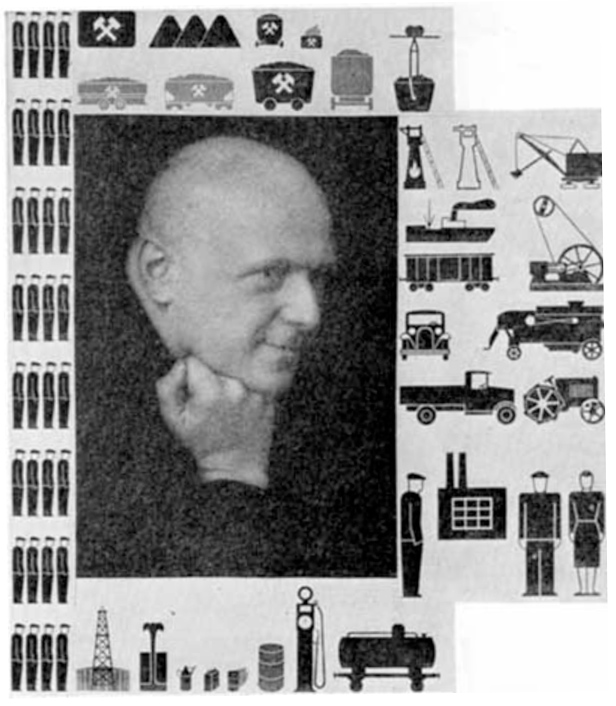

# Otto Neurath
**First published Sun Aug 15, 2010; substantive revision Fri Mar 1, 2024**

*Cat, Jordi*

Source: *Survey Graphic*, 25 (November 1936): 618.

Neurath was a social scientist and activist, scientific philosopher and maverick leader of the Vienna Circle who championed the so-called scientific attitude and the Unity of Science movement. He denied any value to philosophy over and above the pursuit of work on science, within science and for science and society. And scientific results, he argued, are not logically fixed, securely founded on experience or can be ordered in a System of knowledge. Uncertainty, decision and cooperation are intrinsic to scientific practice. From this naturalistic, holistic and pragmatist viewpoint, philosophy investigates the conditions of the possibility of science as apparent in science itself, namely, in terms of physical, biological, sociological, historical, psychological, linguistic, logical or mathematical conditions. His views on the language, method and unity of science were led throughout by his interest in the social life of individuals and their well-being. To theorize about society is inseparable from theorizing for and within society. Science is in every sense a social and historical enterprise and helps society understand the past, explore possibilities and engineer the future. It is as much about social objectives as it is about physical objects, and about social realizations as much as about empirical reality. Objectivity and rationality, epistemic values to constrain scientific thought, were radically social. His contributions to visual education –based on pictorial languages–, museology, urban planning, and political economy –especially on collective welfare, ecological economics and the unavoidability of multi-criterial evaluation– constitute concrete legacies that have regained relevance, interest and urgency. These are discussed in the supplements, [Political Economy](neurath.political-economy.md) and [Visual Education](neurath.visual-education.md).

## 1. Biographical sketch

Otto Neurath was born on 10 December 1882 in Vienna. He was the son of Gertrud Kaempffert and Wilhelm Neurath, a Hungarian Jewish political economist and social reformer. While benefitting from his father’s vast polymathic library, in Vienna he studied literature, mathematics, physics, history, philosophy and economics (although he formally enrolled at the University of Vienna only for two semesters in 1902–3). Next he followed the social scientist Ferdinand Tönnies’s advice to move to Berlin, where he received a doctoral degree in history of economics in 1906. He studied under leaders of the so-called Young German Historical School Eduard Meyer and Gustav Schmoller and he was awarded the degree for two studies of economic history of antiquity, one on Cicero’s *De Officiis* and the other with an emphasis on the non-monetary economy of Egypt.

On his return to Vienna, he joined other economists such as Joseph Schumpeter and Ludwig von Mises at postdoctoral seminars led by theoriests of Carl Menger’s so-called Austrian School Eugen von Böhm-Bawerk and Friedrich von Wieser. At the time Neurath engaged ongoing debates over the unity of the sciences –especially the distinction between Naturwissenschaften and Geisteswisshenschaften–, the role of values in science and goals and methods of economics (Uebel 2004)[^uebel-2004]. The debates would prompt early views on the practice of science and inform his subsequent positions within scientific philosophy and logical empiricism.

His first publications were in the history of political economy and logic, a subject he had formally learned at the University of Vienna. In the history of political economy, topics included the history of money and economic organizations in antiquity, and his publications included textbooks and readers either co-authored or co-edited with his first wife Anna Schapire-Neurath, expert in literature and social issues. The papers on logic focused on issues in algebraic logic and included one paper, of 1909, co-authored with his friend and second wife, Olga Hahn, a sister of the mathematician Hans Hahn (she shortly after received a doctorate for her logic work). Neurath’s subsequent theorizing on the social sciences and his contributions to debates on logical empiricism integrated both disciplines. With the mathematician Hans Hahn and the physicist Philip Frank, around 1910 Neurath formed in Vienna a philosophical discussion group focused on foundational crises in physics and mathematics and the philosophical ideas about science of Vienna’s positivist Ernst Mach and the French conventionalists Pierre Duhem, Abel Rey and Henri Poincaré. A great deal of philosophical and scientific concerns and insight were already in place in Neurath’s thinking and projects. With a grant from the Carnegie Endowment for International Peace, a subsequent study of the Balkan Wars and then World War I led him to develop a theory of war economy as a natural (non-monetary) economy, or economy in kind, and to propose models for its peacetime implementation as a solution to endemic socio-economic problems of capitalism.

In 1919 the short-lived Bavarian socialist government (November 1918-April 1919) appointed him head of the Central Planning Office. The fall of the subsequent Bavarian Soviet Republic in May 1919 got him expelled from his junior post teaching economic theory under Max Weber at Heidelberg University, where he had received his *Habilitation* in 1917. His program for full socialization of the economy was inspired by his studies of war economics and based on his theory of natural economy and a holistic requirement to bring different institutions and kinds of knowledge together in order to understand, predict and control the complex phenomena of the social world (see the supplementary material on [Political Economy](neurath.political-economy.md)). His driving social concern was collective welfare or happiness, which he came to consider not a form of utiltarianisn but of Epicurean socialism.

From 1921 until 1934 Neurath participated actively in the development of socialist politics, especially in housing and adult education, in so-called Red Vienna (on his political life, see Sandner 2014)[^sandner-2014]. He established the Social and Economic Museum of Vienna, where he developed and applied the ‘Vienna method’ of picture statistics and the ISOTYPE language (International System of Typographic Picture Education) (see the supplementary document on [Visual Education](neurath.visual-education.md)). Like the thought of other Viennese philosophers such as Ludwig Wittgenstein and Karl Popper, Neurath’s philosophy was inextricably linked to pedagogy, logic, critique of language and, in Popper’s case, political thought. In 1928, with members of the Austrian Freethinkers Association and the Vienna City Council and the scientifically-trained members of the informal circle around the current holder of Mach’s University Chair, the philosopher Moritz Schlick (1924–29), Neurath helped found the *Verein Ernst Mach*, the Ernst Mach Association for the Promotion of Science Education. The publication in 1929 of an intellectual manifesto gave way to the formation of the Vienna Circle, whose narrower goal was the articulation and promotion of a scientific world-conception and logical empiricism (on the Viennese intellectual landscape, see Stadler 2001)[^stadler-2001].

When in 1934 the Austrian government allied itself with the German Nazi government, Neurath fled to the Netherlands. As a result, his local, Viennese, socialist Enlightenment project turned into an internationalist, intellectual and social-political project. He created the International Foundation for Visual Education in The Hague, with his assistants from Vienna, and spearheaded the International Unity of Science movement. The latter, inspired by a tradition culminating in the Enlightenment’s French Encyclopedists, launched the project of an Encyclopedia of Unified Science. Together with the pictorial languages, the scientific encyclopedia would promote scientific and social cooperation and progress at an international level. After Austria became part of the German Reich in 1938, even though living in the Netherlands, Neurath was considered a German citizen and a ‘half-Jew’ and he was not allowed to marry his ‘Aryan’ assistant Marie Reidemeister—after his second wife, Olga, had died in 1937. During this period, he travelled abroad, including the United States, where logical empiricism had become entangled with the Cold War political and intellectual debates and witch hunts (on the Cold War phase, see Reich 2005). Carnap and Charles Morris at the University of Chicago acted as his co-editors of the International Encyclopedia of Unified Science. New York leftist intellectuals hosted him as an intellectual and political ally. And his maternal first cousin Waldemar Kaempffert, influential editor for *The New York Times* and *Popular Science*, introduced him as an international reformer and visionary, praising his science-oriented intellectual, social and educational ideas, especially his contribution to unity of science and visual language (see Reisch 2019)[^reisch-2019]. After the Nazi invasion of the Netherlands in 1940, Otto Neurath and Marie Reidemeister fled to England, on the small *Seaman’s Hope*. After nine months in an internment camp they resumed activities related to the Isotype language, public education and the unity of science. He died in Oxford on 22 December 1945 (on activities in the camp see Henning 2019; on activities after see Körber 2019 and Tuboly 2019)[^henning-2019][^körber-2019][^tuboly-2019].

## 2. From economic theory to political and scientific epistemology

As mentioned above, by 1910 Neurath had already been involved in debates on the issues of scientific unity and methodology. They were prompted by his research in economics as well as foundational issues in mathematics and physics and reading in positivism and conventionalism. His early metascientific, or philosophical, views developed along with his economic thinking and evolving historical context. In projects of socialized, planned economic reform and in his broader notion of economics, they featured interrelated concepts and concerns: unity, rationality, precision, possibility, planning, decision, control, construction –or engineering–, communication, coordination, history and their social dimensions and applications. The same issues –alongside illustrating references to boats and Robinson Crusoe– would later play a defining role in his epistemological and methodological contributions to logical empiricism (Nemeth 1991, Cat *et al*. 1991 and 1996 and Cat 2024)[^cat-2024][^cat-1991][^cat-1996][^nemeth-1991].

For instance: (1) a notion of theorizing in natural and social sciences, including history, based on the historical exploration of combinatorial possibilities and models, past and future; (2) the application in the social sciences of empirical goals and methods of the natural sciences; (3) a unifying public (objective and testable) language for scientific data and hypotheses, with a private-language argument anticipating Wittgenstein’s own and also illustrated by the case of Robinson Crusoe; (4) the evaluation and choice of data and hypotheses characterized by a logical under-determination of hypotheses by data and the conventional and pragmatic aspect of rational decision-making and control (with a role for so-called auxiliary motives); (5) the historical, social, cooperative, planned and constructive (engineering) dimensions of scientific research (a ‘republic of scientists’); (6), connectedly, a holistic approach to scientific knowledge and its application in the form of encyclopedic unification without hierarchical systems as a tool for successful prediction and engineering of events in a complex world –an ‘encyclopedia model’, by establishing cross-connections among disciplines, as in a Crusonian archipelago: a ‘great, rather badly coordinated mass of statements’ in which at best ‘systems develop like little islands, which we must try to enlarge’ (Neurath 1936/1983, 153)[^neurath-1983]–; and (7) the social relevance of scientific philosophy, especially the unification and demarcation of science against metaphysics.

Regarding unification, Neurath endorsed a broader notion of economics based on symbolic (or logical) rather than merely quantitative precision and a historical perspective that included the use of empirical methods and theoretical distinctions common in the natural sciences; the combination served the purpose of comparing and classifying past cases and future possibilities (Neurath 1910). In addition, Neurath’s proposal of a moneyless war economy sought to maximize human happiness rather than private profit, and was based on a set of incommensurable indicators rather than the uniform monetary measurement unit. An economic plan for a socialized economy required the consideration of the different indicators that in turn required a holistic organization of information and individuals to coordinate decisions and action (rather than a market). Prediction and action required different forms of unity.

This engineering value of unity applied equally to political governance and scientific action, since both are collective and pragmatic endeavors. According to Neurath, ‘scientific theories are sociological events’ (Neurath 1932a/1983, 88)[^neurath-1932a][^neurath-1983], and, since ‘our thinking is a tool’, in this case the ‘modern scientific world-conception’ aims to ‘create a unified science that can successfully serve all transforming activity’ (Neurath 1930/1983, 42)[^neurath-1930][^neurath-1983]. In both cases, Neurath noted, ‘common planned action is possible only if the participants make common predictions’ and group predictions yield more reliable results; therefore, he concluded, ‘common action presses us toward unified science’ (Neurath 1931/1973, 407)[^neurath-1973]. Indeed, all along, for Neurath scientific attitude and solidarity (and socialism) go together (Neurath 1928/1973, 252)[^neurath-1928][^neurath-1973].

Economic planning was a matter of consideration of possibilities and making rational decisions. But for Neurath, practical and theoretical rationality was not a matter of mechanical, objective calculation or reasoning alone –especially in the absence of full insight and a uniform quantitative monetary unit. In a study of psychology of decisions he dismissed such a standard of rationality as “pseudo-rationalism” (Neurath 1913)[^neurath-1913]. Planning was a pragmatic (social) engineering problem, namely, a matter of construction and control, and decisions among alternative possibilities that required judgement, external goals or just a coin flip –auxiliary motives (Neurath 1913)[^neurath-1913]. Both rationality and the irreducibly social perspective were matters of debate among economists, including Karl Marx, and illustrated, also by Neurath, with references to the fictional figure of Robinson Crusoe stranded on an island.

Along similar lines, we can place Neurath’s contributions to the Vienna Circle’s project of a scientific world-conception and logical empiricism in context of his evolving political epistemology. Considerations of knowledge at the theoretical or practical service of politics played a central role in his work on economic planning. He envisioned the role of rationality and the coordination of information and political goals mentioned above also in relation to socialist democratic model of participation of citizen workers. Deliberation and decision making required communication, also of social and economic information. For such education purpose, at the service of participation, Neurath designed a pictorial language (Sandner 2014, Groß 2019 and Nemeth 2019; see also supplementary material on visual education)[^groß-2019][^nemeth-2019][^sandner-2014]. This discursive approach to communication of knowledge and decision making was also part of his objection and alternative to models such as Hayek’s based on the role of markets and prices (Hayek 1935, Neurath 1942)[^neurath-1942][^hayek-1935]. Neurath’s economic planning was neither technocratic nor dictatorial (Chaloupek 2008)[^chaloupek-2008]. But it relied on expert proposals.

In exile in the 1940s the socialist internationalism of his social models turned more liberal, combining international planning for freedom and liberal democracy. Neurath addressed the role of experts and the distinction between esoteric and exoteric, or lay, knowledge and promoted the democratization of knowledge: ‘what we call democracy implies a rejection of experts in making decision[s]’ (Neurath 1996, 251)[^neurath-1996]. But how much democratization required or could achieve in such checks on expert power has been debated (Wussow 2021)[^wussow-2021].

Neurath formulated his empiricist epistemology through the 1930s in similar terms of checks and controls. Data statements he called control statements; and the dynamics of knowledge formation and revision was a matter of formal and empirical controls. Relative to the resulting unity in a theory or body of knowledge, metaphysical statements could be identified and rejected as uncontrolled and isolated (Neurath 1931a, 48 and 1936a, 137)[^neurath-1931a][^neurath-1931a-2][^neurath-1936a].

## 3. Neurath’s place in logical empiricism: physicalism, anti-foundationalism, holism, naturalism, externalism, pragmatism

### 3.1 Language

Neurath’s later views on the language and method of science expressed his simultaneous response to earlier problems in the social sciences and to philosophical issues addressed by the Vienna Circle between 1928 and 1934. A primary aim of the Vienna Circle was to account for the objectivity and intelligibility of scientific method and concepts and to demarcate scientific from metaphysical statements. Their philosophical approach was to adopt what the Circle member Gustav Bergmann called the linguistic turn, namely, to investigate the formal or structural, logical and linguistic framework of scientific knowledge. Within this framework members of the Circle pursued the aims of intelligibility and demarcation by means of two connected conditions of meaning and meaningfulness. The former –stronger– often was formulated mainly by Moritz Schlick (after Wittgenstein) as a condition of empirical verification. The latter –weaker– was a related semantic condition of empirical verifiability, formulated mainly by Rudolf Carnap in different ways over time, and was supplemented by a syntactic condition of formal or grammatical correctness (Uebel 2007)[^uebel-2007][^uebel-2007-2]. The formal approach encompassed logicism and logical analysis as views about the formation, interpretation, justification and acceptance especially of theoretical statements. The problem of empiricism became then the problem of coordination between the formal theoretical structures and the records of observations in such a way that it also offered an explication of how scientific knowledge can and should be formally constructed (especially in logic and mathematics), empirically grounded (except logic and mathematics), and thereby understood, evaluated and accepted.

Sources of Neurath’s attention to language are multiple. Besides Neurath’s own early interest in logic and classical and ancient languages, the value of attention to language was familiar to Neurath from the Austrian fin-de-siècle culture of critique of language (Janik and Toulmin 1973)[^janik-1973], his interest (and his first wife’s) in literature, especially in Goethe (Zemplen 2006)[^zemplen-2006], Marx and Engels’ attention to the radically social dimension of language (and its relation to money), the internationalist and utopianists efforts at introducing new universal languages such as Volapük and Esperanto, the emphasis on signs and universal languages – to be known as pasigraphy – in the scholastic and rationalist philosophical traditions, in the traditions of empirical taxonomies and in the interest in universal language as instrument of knowledge and social order in the Enlightenment, a semiotic tradition in scientific epistemology including Helmholtz, Mach, Duhem and Peirce (Cat 2019)[^cat-2019][^cat-2019-2] and the sociologist Ferdinand Tönnies’s formal approach to sociology and social signs (Tönnies 1899–1900 and Cartwright *et al*. 1996)[^cartwright-1996][^tönnies-1899]. The significance of the internationalist and philosophical projects of so-called pasigraphy were acknowledged also by Carnap. More “scientific” sources were recent technical developments in logic, philosophy of science and the foundation of mathematics often claiming Leibniz as a precursor (Leibniz’s logic and project of a universal characteristic had become widely recognized by the late nineteenth century (Peckhaus 2012)[^peckhaus-2012]). Leading figures in such developments were Frege, Hilbert, Whitehead, Russell and Wittgenstein.

Russell led the application of the new method of analytic philosophy that required solving or dissolving philosophical problems by analyzing their formulation in a more perspicuous technical, logical language. His student Wittgenstein, in turn, introduced a linguistic philosophy that limited the world to the scope of the application of an ideal symbolic languages, or calculus. As a result, the sole task of philosophy was, according to Wittgenstein, the critique of language in the form of an activity of clarification, without yielding a distinctive philosophical body of knowledge or set of propositions.

Looking to the rationalist traditions of Descartes and Leibniz, Jean van Heijenoort and Jaakko Hintikka have distinguished between two views of language that are relevant to the new linguistic turn (Mormann 1999)[^mormann-1999]: language as calculus (LC) and language as universal medium (LUM). The LC tradition, illustrated by Tarski’s views, aligned itself with the Cartesian ideal of a transparent language, with clear and distinctive meaning and explicit, mechanical combination and rule-following that extended to its use in reasoning. There are many possible constructed languages and each is an interpreted calculus with different possible semantics. The LUM tradition adopted the idea of a single actual or ideal language and one semantic or interpretation, to be elucidated, with no possibility of representing its relation to the world from outside. Views by Frege, who pointed to Leibniz on language and reasoning, and Wittgenstein illustrate this tradition, which in turn accommodates two versions, a Cartesian one (Frege and Russell) and a non-Cartesian one (Wittgenstein).

Members of the Vienna Circle pursued their shared philosophical goals through the discussion of language and its application in cognition. Their respective views on epistemic matters relied on different views on language and philosophy. Carnap and Neurath shared an epistemological naturalism –without a priori foundations– with a constructive metascientific standpoint; philosophy would require a scientific metatheory within the boundaries of unified science (Uebel 2007 and Bentley 2023)[^uebel-2007][^uebel-2007-2]. The difference rested in the goals and scientific disciplines they favored. Carnap looked to formal tools such as logic and syntax and sought rational reconstruction; Neurath looked to the empirical sciences, from psychology to history and sociology and sought pragmatic guidance to provide and improve scientists’ tools and decisions –and social applications.

Carnap’s conversion to semantics in the early 1930s took him to the LC Cartesian tradition seeking a universal language of rational reconstruction he had previously recognized in the language of physics. Neurath, by contrast, modeled his anti-metaphysical unification of the sciences in the LUM tradition, on a public –empirically testable and socially effective– universal mixed language he eventually called a ‘universal jargon’, with descriptions of spatio-temporal arrangements and connections he called physicalism, historically contingent use of vague and ordinary terms (see below). In this context Neurath adopted a militant syntacticism, avoiding semantic entities and properties such as truth-values, reference and correspondence. He unsurprisingly opposed and denounced Carnap’s defense of semantics and Schlick’s talk of reality as metaphysical (Anderson 2019)[^anderson-2019] –engaging along the way in heated terminological disputes that ignored Carnap’s commitment to ontological neutrality (Carus 2019)[^carus-2019].

Again, the Circle’s projects shared the aforementioned focus on language and experience. The linguistic approach was adopted as a philosophical tool in order to explicate the rationality and the objectivity—that is, inter-subjectivity—and communicability of thought. Lacking the transcendental dimension of Kant’s metaphysical apparatus, attention to language extended to non-scientific cases such as ‘ordinary language philosophy’ in Oxford. In the context of logical empiricism, the formal dimension of knowledge was thought to be manifest particularly in the exactness of scientific statements.

For Schlick, knowledge proper, whether of experience or transcendent reality, was such only by virtue of form or structure—‘only structure is knowable’. For Carnap, in addition, the formal dimension possessed distinct methodological values: it served the purpose of logical analysis and rational reconstruction of knowledge and helped expose and circumvent ‘pseudo-philosophical’ problems around metaphysical questions about reality (his objections to Heidegger appealed to failures of proper logical formulation and not just empirical verification). In 1934 he proposed as the task of philosophy the metalinguistic analysis of logical and linguistic features of scientific method and knowledge (the ‘thesis of metalogic’). For Neurath, this approach helped purge philosophy of deleterious metaphysical nonsense and dogmatism, and acknowledged the radically social nature of language and science. His approach to demarcation through significance or meaningfulness was pragmatic and looser than that of fellow Circle members. His approach to verification, or empirical control, and formal control of knowledge claims was contextual, pragmatic and holistic. He defended a corresponding distinction between controlled, integrated statements (unification) and uncontrolled, isolated metaphysical ones –or of some other kind. But this required a uniform language for scientific collaboration that he thought contained unavoidable vague terms and required uniform notational standards, even in logic.

Neurath’s plan was for a unified science against metaphysics, and this involved a plan to police the proper unifying, metaphysics-free language. The negative track of the plan was effectively carried out by the development and adoption of a list of ‘dangerous terms,’ which he sometimes referred to, semi-jokingly, as an *index verborum prohibitorum*: a list of forbidden terms such as ‘I’, ‘ego’, ‘substance,’ etc. (Neurath 1933, Neurath 1940/1984, 217)[^neurath-1933][^neurath-1933-2]. The positive track was the adoption of the universal language of physicalism: ‘*metaphysical terms divide*—*scientific terms unite*’ (1935, 23, orig. ital.).

### 3.2 Language, logic and rationality

Logic has long received philosophical attention as a language regulated by strict rules of reasoning, thus setting standards of clarity, rigor and rationality. Leibniz had given modern philosophical currency to the pasigraphic notion of a universal characteristic or Alphabet of Thought that both expressed reality and operated as a logical calculus of reasoning. In the Cartesian spirit, language and reason were inseparable instruments of knowledge and mathematical, logical and philosophical methods were identical. In the late nineteenth century and the early twentieth, Leibniz’s project became a common reference in works in mathematical logic. Not only did Frege see his philosophy of language and mathematical logic within this tradition, as did Peano; Russell penned a landmark study and logicians such as Ernst Schröder and Louis Couturat associated it distinctively with the development of algebraic logic since Boole, especially with Schröder’s own (Peckhaus 2012)[^peckhaus-2012].

Neurath enjoyed early attention and recognition for his logic work also reflected in early reminiscences of figures such as Popper and the mathematician Karl Menger. Perhaps surprisingly now, mentions of Neurath’s and Olga Hahn’s papers were included by the logicians C.I. Lewis, in 1918, and Alonzo Church, in 1936, in their canonical bibliographies on symbolic logic (Lewis 1918 and Church 1936)[^church-1936][^lewis-1918]. Neurath kept algebraic logic and its symbolic dimension as a recurrent standard and resource, first in his earlier work on the social sciences and pictorial language, and subsequently in related contributions to the discussions that informed logical empiricism.

Contrary to predominant accounts using attention to formal languages and logic to pit against each other wings and members of the logical empiricist movement, the symbolic logical standard may be considered a unifying framework for scientific philosophy that distinguished Neurath within it and not from it. It a unifying reference he willingly adopted when he coined the term ’logical empiricism.’ The differentiating role in Neurath’s positions can be identified in his shifting and progressively skeptical and critical attention to the standard and to his attention to algebraic logic rather than the newer logic familiar to Carnap from Frege’s and Russell’s works on logic and logicism.

By the late nineteenth century, in Austria as well as Germany, algebraic logic had found a central place in the raging controversies over the relationship between science and philosophy and, in particular, between mathematics, logic and psychology. Neurath and Olga Hahn became acquainted with algebraic logic at the University of Vienna sometime around 1902–3, but it wasn’t until 1909, after Olga had become blind and Neurath was back in Vienna providing assistance, that she started working on algebraic logic for her doctorate in philosophy and they began their collaboration and separate publications. Neurath published four papers, one with Hahn (Neurath 1909a, 1909b and 1910a, and Hahn and Neurath 1909)[^neurath-1909a][^neurath-1909b][^neurath-1910a][^hahn-1909][^hahn-1909-2]. Hahn separately published two others, the second submitted as her doctoral thesis (Hahn 1909 and 1910)[^hahn-1909][^hahn-1909-2][^hahn-1910].

Neurath’s logic writings focused on Schröder’s axiomatic systematization of algebraic logic, mainly in the monumental *Vorlesungen über die Algebra der Logik (exakte Logik)* (1890–95). There and in earlier writings, Schröder gave a fundamental role to the relation of subsumption and a law of duality. Subsumption was a part-whole relation defined over domains of objects. The law of duality established a systematic correspondence between theorems in terms of 1 and operation + and theorems in terms of 0 and operation x.

The papers were concerned with the equality relations and fundamental status of axioms of the system of algebraic logic, dominant in the second half of the nineteenth century and modeled, they objected, too closely after mathematical operations and equations. It was developed as a calculus of statements (propositional logic) and domains, more generally. Neurath distinguished between expression and denotation of signs to distinguish different uses and interpretations of equality signs and interpret symbolic identities as univocal relations and redundant expressions and rules of substitution in the logical manipulation of signs. In particular, he distinguished between definitional equality, symbolic equality and identity equality. Most of the papers focused on the case of the property of commutativity (‘ab=ba’) and Schröder’s proof. Neurath rejected the proof as based on unjustified mathematical notational assumptions. In particular, the symbolic equality between symbols for the same relation between the same objects renders one symbol meaningless, or redundant. The commutativity result is merely a symbolic equality, a notational stipulation.

In their joint paper, Hahn and Neurath also focused on the principle of duality as a basic symmetry principle for the generation of theorems for complementary domains and operations. They argued that duality is linked to the fundamental symmetric complementarity between positive and negative domains. It is a (meta)logical, not an empirical, inductive principle; so understood it could be applied more clearly and systematically. Neurath and Hahn’s attention to the relativity of fundamental logical axioms and symbolic notation paralleled similar conventionalist discussions in geometry, especially by Poincaré.

Rational decision-making became a central issue in Neurath’s economic thinking. All the more so when Neurath noted the limitations of the calculation of collective comparative pleasure and displeasure associated with different sets of goods (Neurath 1912)[^neurath-1912]. It is hardly surprising then that, even before engaging in debates over the rationality of socialist economic planning, Neurath continued examining reasoning and rationality –theoretical and practical– more generally. In Vienna, the intellectual and social project was connected to the spirit of the Enlightenment. In an essay of 1913, ‘The lost wanderers of Descartes and the auxiliary motive (on the psychology of decision)’ (Neurath 1913)[^neurath-1913] he criticized Descartes’ theoretical rationalism and examined his psychology of action to explore decision-making under uncertainty. He introduced a general distinction, for theoretical and practical reasoning, between rationality and pseudo-rationalism. He dismissed as pseudorationalism the ideal of replacing instinct and authority with formal reasoning and calculation as the sole and sufficient method of decision-making based on conclusions without awareness of cognitive limitations or incomplete insight.

Instead, he argued, conclusions about courses of action, including the acceptance of hypotheses, are typically in need of supplementing with additional considerations he called auxiliary motives. The recourse is justified pragmatically. In general, what counts as an auxiliary motive might be external motives, values or conventions (goals or constraints as reasons) and pure decision procedures including the drawing of lots –since making any decision is more important than any decision made– (on the pure proceduralist interpretation see Bentley 2023). This volutntarism, decisionism and pragmatism became central to his contributions to the scientific epistemology of logical empiricism. He referred then also to unavoidable extra-logical factors (Neurath 1934)[^neurath-1934].

### 3.3 Scientific and linguistic epistemology

Kant had delivered the latest grand attempt to address the relation between science and philosophy, by taking the former to provide objective empirical knowledge (exact, universal and necessary) and giving to the latter knowledge the task of laying out the a priori conditions of intelligibility and possibility of such knowledge as the sole, critical scope of metaphysics and legitimate exercise of reason. Kant’s standard of a priori, an expression of rationality, was challenged and relativized by Frege, Russell and Whitehead’s notions of mathematical numbers grounded in logic, by models of non-Euclidean geometry and their analysis by Poincaré and by the new notions of space and time in Einstein’s relativity theories. Neither mathematics was synthetic nor physics seemed a priori; as a result, in the new scientific landscape the metaphysical category of synthetic a priori was dismissed as empty of content.

With the scientific world-conception, logical empiricists followed in the footsteps and Helmholtz and Mach and considered a new post-Kantian problematic: investigating the possibility of objective empirical knowledge with a role for intellectual construction without universality or necessity, neither Kantian apriorism nor radical positivism. Logic, with scientific status linked to technical symbolism and the possibility of mathematics, was the sole last refuge for philosophy. The new problematic suggested a demarcation project with two inseparable tasks that were both descriptive and normative: a positive, unifying task to establish and promote the marks of scientific knowledge and the negative task to distinguish it from philosophy, especially the objects and concepts of metaphysics.

According to logical empiricists a priori knowledge claims expressed in exact theory were circumscribed to the analytic. Yet they were voided of universality and necessity (Kant’s marks of the a priori) and deflated by Schlick and Reichenbach to the character of definitions and conventions (following Poincaré). They were true or valid only relatively and by construction. Synthetic knowledge claims were exclusively a posteriori, their contents and validity grounded in experience.

The philosophical discussion that developed around the members of the Vienna Circle was associated with the formulation of logical empiricism and the rallying cry of ‘unity of science against metaphysics.’But it cannot be adequately understood without taking into account the diversity of evolving projects it accommodated. Carnap’s and Neurath’s respective metascientific stance has been mentioned above. Carnap was much borrowed from the neo-Kantian tradition, Einstein’s theories of relativity, Husserl’s phenomenology, Frege’s logic and, i.e., Hilbertian axiomatic approach to mathematics as well as Russell’s own logicism and his philosophical project of logical constructions. He was concerned with the conditions of the possibility of objective knowledge, which he considered especially manifest in the formal exactness of scientific claims (Carnap 1928)[^carnap-1928]. Schlick borrowed from turn-of-the-century French conventionalists such as Rey, Duhem and Poincaré, Wittgenstein’s philosophy of representation of facts, as well as Einstein’s relativity theories and Hilbert’s implicit definitions and axiomatic approach to mathematics. He was interested in the meaning of terms in which actual scientific knowledge of reality is expressed, as well as its foundation on true and certain beliefs about reality (Schlick 1918, 1934)[^schlick-1918][^schlick-1934]. Also Reichenbach had been influenced by and borrowed from Einstein, neo-Kantianism and Hilbert’s axiomatics. Neurath borrowed, among others, fromm Mach, varieties of French conventionalism, especially Duhem’s, and varieties of social thought including Marxism. He sought to explore the empirical and historical conditions of scientific practice in both the natural and social sciences (Neurath 1931/1973, 1932a/1983)[^neurath-1932a][^neurath-1973][^neurath-1983]. Outside the Vienna Circle, Popper borrowed from Hume, Kant and Austrian child psychology. He was interested in addressing the logical and normative issues of justification and demarcation of objective and empirical scientific knowledge, without relying on descriptive discussions of the psychology of subjective experience and meaning (Popper 1935/1951)[^popper-1935].

The linguistic turn framed the examination of the controversial role of experience and the form of its expression and relation to hypotheses. In that respect an ensuing discussions of data or so-called protocol sentences concerned their linguistic characteristics and their epistemological status (Uebel 1992)[^uebel-1992]. It served the Circle’s purpose of ascertaining the source, evaluation and acceptance of human knowledge and rejecting metaphysics as nonsense—often dangerous nonsense (Carnap, Hahn and Neurath 1929/1973, and Stadler 2007)[^neurath-1973][^carnap-1929][^stadler-2007].

Neurath’s departing position was a critique of Carnap. In his classic work *Der Logische Aufbau der Welt* (1928) (known as the *Aufbau* and translated as *The Logical Structure of the World*), Carnap investigated the logical ‘construction’ (Russell’s term) of objects/concepts of inter-subjective knowledge out of the simplest starting point or basic types. To reconstruct empirical knowledge, Carnap explored an empiricist, or phenomenological, model in terms of the immediate experiential basis was quickly understood by fellow members of the Vienna Circle as manifesting three philosophical positions that structured the debate: *reductionism*, *atomism* and *foundationalism*.

*Reductionism* took one set of terms to be fundamental or primitive; the rest would be logically connected to them.

*Atomism*, especially in Neurath’s reading, was manifest semantically and syntactically: semantically, in the analyzability of a term; syntactically or structurally, in the elementary structure of protocols in terms of a single experiential term—‘red circle here now.’ It appeared further in the possibility of an individual testing relation of a theoretical statement to one of more experiential statements.

*Foundationalism*, in the Cartesian tradition of a secure basis, took the beliefs in these terms held by the subject to be infallible, or not requiring verification, and the sole empirical source of epistemic warrant—or credibility—for all other beliefs. Descartes’s foundationalism is based on *a priori* knowledge; Carnap’s presentation of the empirical basis constitutes a more modest, naturalistic version (see also his 1932/1987).

Neurath first confronted Carnap on yet another alleged feature of his system, namely, subjectivism. On this issue dovetailed Carnaps’ Kantian problematic of explicating the objectivity of empirical knowledge and Neurath’s materialism and social –and socialist– perspective on economic, political and epistemic matters. Neurath rejected Carnap’s proposals on the grounds that if the language and the system of statements that constitute scientific knowledge are intersubjective, then phenomenalist talk of immediate subjective, private experiences should have no place. More generally, Neurath offered a private language argument, featuring Robinson Crusoe, to the effect that languages are necessarily intersubjective:

> The universal jargon…is the same for the child and for the adult. It is the same for a Robinson Crusoe as for a human society. If Robinson wants to join what is in a protocol of yesterday with what is in his protocol today, that is, if he wants to make use of language at all, he must make use of the ‘intersubjective’ language. The Robinson of yesterday and the Robinson of today stand precisely in the same relation in which Robinson stands to Friday…In other words, every language as such is intersubjective. (Neurath 1932b/1983, 96)[^neurath-1932b][^neurath-1983]

To replace Carnap’s phenomenalist language Neurath introduced in 1931 the language of physicalism (Neurath 1931/1983 and 1932a/1983)[^neurath-1932a][^neurath-1983]. Physicalism is, for Neurath, the view that the unity, intelligibility and objectivity of science rest on using statements in a language of public things, events and processes in space and time —including behavior and physiological events, hence not necessarily in the technical terms of physical theory. Carnap promptly adopted a more technical version of physicalism requiring translatability of protocols to the language of physics (Carnap 1932/1934)[^carnap-1932][^carnap-1932-2][^carnap-1934]. While inspired by anti-metaphysical materialism, for Neurath this was a methodological and linguistic rule, and not an ontological thesis. The syntacticism mentioned above concerns the emphasis on spatio-temporal order or patterns. Neurath’s view could claim that language was itself was a physical process and could express its own spatio-temporal structure. This was also in line with his typographic concerns in logic and visual communication.

That physicalism was to avoid metaphysical connotations can be seen further in that its linguistic nature was also central to its applications. Neurath insisted that statements can be compared only with statements, certainly not with some “reality”, nor with “things,” (Neurath 1931/1983, 53)[^neurath-1983]. Knowledge was a social matter of empirical control.

Neurath responded with a new doctrine of protocol statements that considered their distinctive linguistic form, contents and methodological status (Neurath 1932b/1983)[^neurath-1932b][^neurath-1983]. This doctrine was meant to explicate the idea of scientific evidence in the framework of empiricism, and it did so by specifying public conditions of evaluation and acceptance of a statement as empirical scientific evidence. In particular, Neurath intended the physicalist doctrine of protocol statements to circumvent the pitfalls of subjectivism, atomism, reductionism and foundationalism attributed to Carnap’s earlier discussion. It supported, instead, a holistic, anti-foundationalist, decisionistic, pragmatist, social view characterizing the scientific, empiricist attitude.

One informal but paradigmatic example of a protocol was:

> Otto’s protocol at 3:17 o’clock: [Otto’s speech-thinking at 3:16 was: (at 3:15 o’clock there was a table in the room perceived by Otto)].

Neurath offered examples over time featuring different numbers of parts, between two and four (on the debate around this issue, see Uebel 2007)[^uebel-2007][^uebel-2007-2]. Far from Carnap’s atomic sort of protocol statements, Neurath’s model manifested a distinctive complexity of terms and structure. The protocol contains a factual physicalist core in terms about the table and its location. It also contains the experiential term that provides the linguistic recording of the empirical character of protocols, that is, their experiential origin. Neurath was mindful to caution here that perception terms only admitted physicalistic meaning in terms, for instance, of behavior or physiological mechanisms of perception. It also contains the declarative level, marked with ‘Otto says’, which distinguishes the protocol as a linguistic statement. Finally, the other distinctive elements were the name of the protocolist and the times and locations of the experience and the reports, which provided an intersubjective, physicalist, public alternative to Carnap’s first-person, subjective ‘*I* see a red circle *here* *now*’.

Unlike Carnap’s ideal of basic statement, whether protocol or physicalist, Neurath’s protocols were not ‘clean’, precise or pure in their terms. For Neurath physicalist language, and hence science in turn, is inseparable from ordinary language of any time and place. In particular, it is muddled with imprecise, unanalyzed, cluster-like terms (*Ballungen*) that appear especially in the protocols: the name of the protocolist, ‘seeing’, ‘microscope’, etc. They were often to be further analyzed into more precise terms or mathematical co-ordinations, but they often would not be eliminated. Even the empirical character of protocol statements could not be pure and primitive, as physicalism allowed the introduction of theoretical—non-perception—terms. Physicalism, and thus unified science, were based on a universal ‘jargon’.

Neurath’s protocols didn’t have the atomic structure and the atomic testing role of Carnap’s. Their methodological role reflected Duhem’s *holism*: hypotheses are not tested individually; only clusters of statements confront empirical data. But their methodological value in the testing of other statements didn’t make them unrevisable. This is Neurath’s *anti-foundationalism*: Insofar as they were genuinely scientific statements, consistency with the spirit that opposed science to dogmatic speculation and, no less importantly, opposed naturalistic attention to actual practice, required that protocols too be testable. Physicalism challenges the epistemic authority of first-person private experience and enables the democratic socialization of empirical claims in the networks of scientific statements and collaborations.

From this follows the so-called *Neurath Principle*: in the face of conflict between a protocol and theoretical statements, the cancellation of a protocol statement is a methodological possibility as well (Neurath 1932b/1983, Haller 1982)[^neurath-1932b][^neurath-1983][^haller-1982]. The role of indeterminacy in the protocol language points to a distinction between a *special Neurath Principle* and a *general Neurath Principle* (Cartwright *et al*. 1996, Cat 1995)[^cartwright-1996][^cat-1995]. In the former, and earlier, Neurath assumed a determinate logical relation of inconsistency. In the latter, subsequent version, the scope of relations between hypotheses and protocol statements extended to indeterminate relations such that the principle behind the epistemic status of protocol statements is simply grounded on the voluntaristic and conventionalist doctrine that ‘[a]ll content statements of science, and also their protocol statements that are used for verification, are selected on the basis of decisions and can be altered in principle’ (Neurath 1934/1983, 102)[^neurath-1934][^neurath-1983].

The complex structure of the explicitly laid out protocol would provide an explication and synoptic visual tool for differentiating and integrating explicitly relevant testing conditions: the intersubjective conditions of evaluation and acceptance of the record and its core data, or record of core factual information to enter the relevant scientific field of empirical research. The different conditions could guide the control of relevant data by laying out the conditions of their origin, validity and fallibility (was Otto hallucinating? were all the parts of the experimental instrument working reliably? etc.).

Neurath’s dictum was meant to do justice to actual scientific practice and its normative standards with regards to the role of experimental data. It is up to the members of the scientific community to decide when a protocol can support or challenge a hypothesis, at last provisionally. Invalid protocols may change their status or be repurposed as data for historical or social studies of science (Uebel 2007 and Bentley 2023)[^uebel-2007][^uebel-2007-2]. What distinguishes the epistemic status of protocol sentences is not their foundational certainty (unlike for Schlick), but their stability as available and acceptable records over time and across projects and purposes. In this way they facilitate communication, cooperation and empirical inquiry.

The method of testing failed to meet a certain standard and expectation of rationality: It could not be carried out in a logically precise, determinate and conclusive manner. expecting calculability, determinism, omniscience and certainty (Neurath 1913/1983, Neurath 1934/1983 and Cat 1995)[^neurath-1913][^neurath-1934][^neurath-1983][^cat-1995]. By virtue of perception terms, protocol sentences could in fact provide certain stability in the permanence of information necessary for the generation of new expressions. But methodologically they could only bolster or shake our confidence. To acknowledge these limitations is a mark of proper rationality—which he opposed to *pseudorationality*.

A loose coherentist view of warrant, acceptance and unification is the only logical criterion available: ‘a statement is called correct if it can be incorporated in this totality’ of ‘existing statements that have already been harmonized with each other’ (Neurath 1931/1984, 66). Reasons underdetermine our actions and thus pragmatic extra-logical factors are required to make decisions about what hypotheses to accept. Thinking requires provisional rules, or auxiliary motives, that fix a conclusion by decision (Neurath 1913/1983)[^neurath-1913][^neurath-1983].

Scientific rationality is situated, contextually constrained by, practical rationality. The construction of knowledge is constrained by historically, socially, methodologically and theoretically accepted claims and standards –as well as other possible factors he called extra-logical. They bear limited stability, and cannot be rebuilt on pure, secure, infallible empirical foundations. This is the anti-Cartesian naturalism, non-foundationalism, fallibilism and holism of Neurath’s social model. This is also the basis for its corresponding decisonistic, conventionalist, constructivist normativity (Uebel 1996 and 2007 and Cartwright *et al*. 1996)[^cartwright-1996][^uebel-2007][^uebel-2007-2]. Without the norms and conventions self-issued within a community, there is no possibility of rationality or objectivity of knowledge. Neurath captured the main features of his doctrine of scientific knowledge in the image of a boat:

> There is no way to establish fully secured, neat protocol statements as starting points of the sciences. There is no *tabula rasa*. We are like sailors who have to rebuild their ship on the open sea, without ever being able to dismantle it in dry-dock and reconstruct it from its best components. Only metaphysics can disappear without a trace. Imprecise ‘verbal clusters’ [*Ballungen*] are somehow always part of the ship. If imprecision is diminished at one place, it may well re-appear at another place to a stronger degree. (Neurath 1932b/1983, 92)[^neurath-1932b][^neurath-1983]

Just like Neurath debated Carnap, he also entered an acrimonious debate with Popper and Schlick. By 1934, the year of the completion of his *Logic of Scientific Discovery* (*Logik der Forschung*), Popper had adopted an approach to scientific knowledge based on the logic of method, not on meaning, so that any talk of individual experience would have no linguistic expression (Popper 1935/1951)[^popper-1935]. He was concerned with the post-Kantian problematic of the rational objective validity of scientific knowledge claims.

Instead of protocols, Popper proposed to speak about basic statements—a term more attuned to their logical and functional role. They are basic relative to a theory under test. Their empirical character would invisibly reside in the requirement that basic statements be singular existential ones describing material objects in space and time—much like Neurath’s physicalism—which would be observable, in a further unspecified logical not psychological sense. Their components would not themselves be purely empirical terms since many would be understood in terms of dispositional properties, which, in turn, involved reference to law-like generalizations. But their ‘basic’ role was methodological ‘with no direct function of demarcation from metaphysics in terms of meaning, sense or cognitive significance’ and only provisional. They would be brought to methodological use for the purpose of falsifying theories and hypotheses ‘individually and conclusively’ only once they were conventionally and communally accepted by decision in order to stop infinite regress and further theoretical research.

But such acceptance, much as in Neurath’s model, could be in principle revoked. It is a contingent fact that scientists will stop at easily testable statements simply because it will be easier to reach an agreement. It is important that basic statements satisfy explicit conditions of testability or else they could not be rightful part of science. Popper could offer no rational theory of their acceptance on pain of having to have recourse to theories of psychology of perception and thereby weakening his normative criterion of demarcation. In his view, his method, unlike Neurath’s, didn’t lead to either arbitrariness or dogmatism or the abandonment of empiricism. As he had argued against Spengler in 1921, historical contingency provides the rich constraints that establish communities and communication and the possibility of knowledge and, in this holistic form, preclude radical relativism in practice; in historically situated practice, inherited or constructed stable Archimedean points always come into place; there is no *tabula rasa* (Neurath 1921/1973)[^neurath-1921][^neurath-1973]. Neurath rejected Popper’s approach for its stealth empiricism and its pseudorationalism: its misplaced emphasis on and faith in the normative uniqueness, precision and conclusiveness of a logical method—at the expense of its own limitations and pragmatic character (Zolo 1989, Cat 1995, Hacohen 2000)[^cat-1995][^hacohen-2000].

Finally, the most radical empiricist attitude toward protocol sentences within the Vienna Circle came from Schlick. Schlick endorsed, following Hilbert, a formal, structural notion of communicable, objective knowledge and meaning as well as a correspondence theory of truth. His realism opposed Neurath’s coherentism, and also the pragmatism and conventionalism of Carnap’s *Principle of Tolerance* in logical matters, as well as his Thesis of Metalogic. But like Carnap’s latter thesis and his syntactic approach of 1934, Schlick was concerned with both the Cartesian ideal of foundational certainty and Wittgenstein’s metalinguistic problem of how language represents the reality it is about; such relation could only be shown, not said. In 1934 Schlick proposed to treat the claims motivating protocol statements, left by Neurath with the status of little more than mere hypotheses, as key to the foundation of knowledge. They would be physicalistic statements that, albeit being fallible, could be subjectively linked to statements about immediate private experiences of reality such as ‘blue here now’ he called affirmations (*Konstatierungen*) (Schlick 1934)[^schlick-1934].

Affirmations carried certainty and elucidated what could be showed but not said, they provided the elusive confrontation or correspondence between theoretical propositions and facts of reality. In this sense they afforded, according to Schlick, the fixed starting points and foundation of all knowledge. But the foundation raised a psychological and semantic problem about the longer-term acceptance of a protocol. Affirmations, as acts of verification or giving meaning, lacked logical inferential force; in Schlick’s words, they ‘do not occur within science itself, and can neither be derived from scientific propositions, nor the latter from them’ (Schlick 1934, 95)[^schlick-1934]. Schlick’s empiricism regarding the role of protocol sentences suggests but does not support strong epistemological foundationalism. Schlick’s occasional references to a correspondence theory of truth were just as unacceptable and were felt to be even more of a philosophical betrayal within the framework of empiricism. Predictably, Neurath rejected Schlick’s doctrines as metaphysical, manifesting the pseudorationalist attitude (Neurath 1934/1983)[^neurath-1934][^neurath-1983].

## 4. Unity of Science and the Encyclopedia Model

Neurath’s concern with unity in the sciences has multiple sources and served different kinds of purposes; his proposals also had different forms and played different roles. In the contect of logical empiricism we may identify at least five: prediction, acceptance, cooperation, demarcation and metascience (or scientific philosophy).

Early in his intellectual life, at the turn of the twentieth century, Neurath was acquainted with at least four recent images and projects of unification of the sciences: (1) The scholastic (Llull) and rationalist (Leibniz) tradition of an ideal universal language and calculus of reasoning; (2) the Neo-Kantians and others’ emphasis on the distinction between the *Naturwissenschaften* and the *Geisteswissenschaften*; (3) Wundt’s comprehensive logical viewpoints associated with different sciences, or perspectival monism; and (4) the Monist movement more generally, with figures such as Ernst Haeckel and Wilhelm Ostwald that included the project of energetics, with Mach’s related bio-economic, neutral monism of elementary sensations.

By 1910, Neurath had engaged four connected debates: (1) The debate over the Neo-Kantian divide between natural and human, or cultural, sciences; (2) the debate over the distinctive role of value judgment in the social sciences; (3) the debate over the scope and validity of concepts, laws and methods in economics; and (4) the debate over the possibility of history as a positive science.

In the face of alternatives, he often sought synthetic positions, e.g., integrating the application of empirical inductive methods and theoretical deductive methods in the social sciences by the empirical standards of the natural sciences and within a historical perspective that explored and classified possible cases, past, present and future. In his programmatic theory of the social sciences of 1910 –a review of Wundt’s theory of the sciences– he declared: ‘True science consists in systematically examining all possible cases.’ (Neurath 2004, 278)[^neurath-2004]

He also argued for unity within a science and unity of the different individual sciences. He called it cooperative division of labor instead of specialized separation of labor (Neurath 2004, 265–288)[^neurath-2004]. The former is guided by general perspectives providing connecting links between individual sciences (he cited Llull and Leibniz as early relevant examples of the project of universal knowledge). Those links operate as auxiliary hypotheses and a better sense for what might be accepted and rejected –echoing and extending Duhem’s holistic methodological model of testing. Cooperation between generalist and specialized research, he declared, will supplement and correct each other; and collaborative efforts towards seeking connections from all specialized work will bring to specialized components significance in organization rather than chaos (Neurath 2004, 287)[^neurath-2004].

Unity became central to the Vienna Circle’s project. And Neurath made sure of it. In the Vienna Circle’s manifesto (Carnap et al., 1929)[^carnap-1929] and elsewhere, Neurath urged and welcomed a scientistic turn in philosophy he labelled the scientific world-conception. Beyond the intellectual value, he added, ‘*the scientific world-conception serves life and life receives it*’ (Carnap, Hahn and Neurath 1929/1973, 306, orig. ital.)[^neurath-1973][^carnap-1929]. Here the project of logical empiricism gets its Viennese Enlightenment dimension, with the old reforming, constructive and universalist ambitions, but with new and revised ideas and ideals of society, science and rationality (Uebel 1998)[^uebel-1998]. Neurath continued to maintain the view that, as predictive tools, all sciences are ‘aids to creative life’ (Neurath 1931/1973, 319)[^neurath-1973], alongside his view of the complexity of life, e.g., the earthly plane of the empirical world that includes the human. It cannot surprise, then, that in this new transformative joint philosophical-social project he would urge that ‘the goal ahead is *unified science*’ (Carnap et al. 1929/1973, 306, orig. ital.)[^carnap-1929]. Like science itself, unified science straddles any divide between theory and action, the world of physical objects and the world of social objectives, past and future, empirical reality and human realization. It is unity of science at the point of action (Cartwright et al 1991, Cartwright *et al*. 1996 and O’Neill 2003)[^cartwright-1996]. Not just philosophy; also science at the point of action is unified science.

The goal of science –and the key to its practical application–, he repeated, was empirical prediction. The focus on language placed unity of language at the center of unification. Physicalism and its universal jargon were, as mentioned above, precisely the key to achieving the social and intellectual goals of the scientific world-conception and logical empiricism. Physicalism also provided a unification of the natural and human sciences.

In addition, and based on an available connecting language for the sciences, Neurath introduced the holistic argument for unification from the complexity of life. It generalized, again, Duhem’s holistic argument about prediction and testing; and he illustrated it with the example of a forest fire:

> Certainly, different kinds of laws can be distinguished from each other: for example, chemical, biological or sociological laws; however, it can *not be said of a prediction of a concrete individual process that it depend on one definite kind of law only*. For example, whether a forest will burn down at a certain location on earth depends as much on the weather as on whether human intervention takes place or not. This intervention, however, can only be predicted if one knows the laws of human behaviour. *That is, under certain circumstances, it must be possible to connect all kinds of laws with each other*. Therefore all laws, whether chemical, climatological or sociological, must be conceived as parts of a system, namely of unified science. (Neurath 1931/1983, 59, orig. itals.)[^neurath-1983]

Laws of one kind may apply nicely to systems, phenomena or events purely of one kind, but such things are not concrete individuals in the real world. We may think of them as useful models or abstractions; reality behaves more like them only in controlled settings, the outcome of engineering, of planned design and construction, that is, the materialized form of abstraction. Idealizations, like ideal types, dangerously assume real separability between properties (Neurath 1941/1983, 225)[^neurath-1941][^neurath-1983]. In this sense, necessary experimentation for the purpose of prediction and testing that control is key to observation and in turn observation controls theory. In general, from that point of view, exactness and scope requires the possibility of composing models, laws and sciences of different kinds. Unity demands multiple levels of integration and social cooperation.

The argument from holism would also serves th purpose of empiricist demarcation against metaphysics: since metaphysical terms and metaphysicians divide, whereas scientific terms and scientists unite. Recall his practical standard of demarcation by integration mentioned above. Metaphysical claims are uncontrollble and isolated.

The boat images further illustrated Neurath’s aim of unity, within its proper epistemological framework: as a historically situated, non-foundational and collective enterprise. Science is a model and a resource for society and society is in turn a model and resource for science.

In the context of the rise of logical empiricism, Neurath’s campaign in support of the unity of science project was intellectual and practical. It relied on rhetorical appeals to references to historical precedents from such as Leibniz and L’Encyclopédie (see SCIENTIFIC UNITY) as well as a planned movement that involved a variety of institutions –Vienna Circle, Institute of Unified Science–, events –International Congresses for the Unity of Science– and publications –International Encyclopedia of Unified Science– (Neurath 1937a/1983, Reisch 1994, Symons et al. 2011)[^neurath-1937a][^neurath-1983][^neurath-1994][^reisch-1994][^symons-2011].

What is the proposed model of unity? What is the opposed alternative? Despite popular approaches suggesting a hierarchical, or pyramidal, structure, which he associated with, among others, Comte, Ostwald and then Carnap (in the *Aufbau* and in his subsequent doctrine of physicalism), Neurath opposed the ideal of ‘pyramidism’ and a ‘system-model’: an axiomatic, precisely and deductively closed and complete hierarchy of conceptually pure, distinct and fixed sciences. He also dismissed the idea of ONE method and ONE ideal language, for instance, mathematics or physics, followed by all the other sciences (Neurath 1936/1983 and Neurath 1937b/1983)[^neurath-1937b][^neurath-1983]. Since 1910 Neurath’s approach to the issue was thoroughly antireductionist: cognitively, logically and pragmatically. Each science would fail to deal with the connections to others (Neurath 1910/2004)[^neurath-2004]. In particular, electron talk, Neurath insisted, is irrelevant to understanding and predicting the complex behavior of social groups. He had identified hierarchical reductionism across disciplines in Carnap’s *Aufbau*. It is worth noting that Neurath’s encyclopedic disciplinary anti-reductionism is not in conflict with the conceptual reductionist character of his physicalism as a model of empiricism. In fact, this anti-reductionism may be thought the nomological part of the doctrine of physicalism, alongside its epistemological and metalinguistic elements (Uebel 2004)[^uebel-2004].

The imperative of unity required that ‘it must be possible to connect each law with every other law under certain circumstances, in order to obtain new formulations’ (Neurath 1931/1983, 59)[^neurath-1983]. Instead of the system-model, he proposed a weaker, dynamical and local model of integration he called the ‘encyclopedia-model’: a more or less coherent totality of scientific statements at a given time, in flux, incomplete, with linguistic imprecisions and logical indeterminacy and gaps, unified linguistically by the universal jargon of physicalist language (not Carnap’s physicalism)—a mixture of ‘cluster’ and ‘formula’—, the cooperative and empiricist spirit, and the acceptance of a number of methods or techniques (probability, statistics, etc), all providing ‘cross-connections’ (Neurath 1936/1983, 145–158 and 213–229)[^neurath-1983].

The evolution of the sciences could be said to proceed from encyclopedias to encyclopedias (a model weaker and more pluralistic than those based on Kuhn’s paradigms and Foucault’s *epistèmes*, but closer to Carnap’s later notion of linguistic frameworks; from this perspective, it seems less paradoxical that Carnap published Kuhn’s *The Structure of Scientific Revolutions* in the last volume of the International Encyclopedia of Unified Science). Neurath spoke of a ‘mosaic’, an ‘aggregation’, an interdisciplinary ‘orchestration’ of the sciences as ‘systematisation from below’ rather than a ‘system from above’, especially, after World War II, carefully excluding any form of ‘authoritative integration’, even favoring ‘cooperation in fruitful discussion’ to a socialist, Nazi or totalitarian-sounding talk of a ‘programme’ (Neurath 1936/1983 and Neurath 1946/1983, 230–242)[^neurath-1946][^neurath-1983]. Correspondingly, his later political writings emphasized internationalism, democracy and plurality of institutional loyalties.

## 5. Philosophy of psychology, education, and the social sciences

### 5.1 Philosophy of psychology

Neurath’s attention to psychology was part of new disciplinary landscape that connected and differentiated him from other thinkers. Vienna became an international capital of psychological research while logical empiricism started to develop a scientific epistemology and an epistemology of science. Freud’s psychoanalysis was more popular than J.B. Watson’s American behaviorism and Gestalt psychology was dominant neither in psychology nor in scientific philosophy. In the Vienna Circle’s manifesto, the official programmatic position was weariness and rejection of much contemporary psychological language. It was considered plagued with conceptual imprecision, logical inconsistency and, most fatally, meaningless, untestable metaphysical elements. The project’s emphasis on perception led to adopting behaviorist psychology as the natural intellectual ally consistent with the Circle’s scientific world-conception (Carnap, Hahn and Neurath 1929/1973, 314-5, Hardcastle 2007)[^neurath-1973][^carnap-1929][^hardcastle-2007].

Like Kant, Popper was interested in a transcendental and regulative philosophy, and, more so than Kant, he hailed science as the paradigm of intellectual activity. In 1928 Popper finished his doctoral dissertation, ‘On the Methodological Problem of Cognitive Psychology’. Popper set out to understand the relations between logic, biology and psychology in the production of knowledge and thereby to outline the methodological preconditions of cognitive psychology. Two alternative views of psychology were available to Popper through two doctoral examiners, Karl Bühler and Moritz Schlick.

Schlick represented Gestalt theory as psychology within the reductive framework of physicalism, that is, rejecting the existence of autonomous entities, laws and methods of psychology. Bühler’s career was central to Austrian psychology and to socialist Red Vienna culture. With Ostwald Külpe in Würtzburg he had engaged in empirical research on thought processes—contra Wundt’s atomistic psychology-; they paid special attention to imageless thought and the importance of language. In 1912 Bühler had originally contributed to Gestalt psychology with the discussion of simple Gestalt forms involved in the perception of proportions of geometrical figures and ended concentrating on his cognitive phenomenon of the ‘aha experience’, a sudden insight in problem solving.

In Vienna, Otto Glöckel, founder of the world-renowned Vienna School Reform movement and president of the Vienna School Board, offered to fund for the Bühler and his child-pscyhology wife a psychological laboratory. Child psychology and education were seen central to the socialsit project of creating a New Man. His interest in language and philosophy brought him closer to Schlick (Wittgenstein’s sister Margaret organized social occasions for Wittgenstein, the Bühlers and the Schlicks to meet) and he encouraged his students to attend Vienna Circle seminars (Egon Brunswick, Elsa Frankel, Marie Jahoda, Paul Lazersfeld, Rudolf Ekstein and Edith Weisskopf). In the wake of earlier discussions of crises in physics and mathematics, in 1927 he published *Die Krise der Psychologie* (*The Crisis of Psychology*). In the book, Bühler argued that the problem of explaining the social significance of language showed that psychology has lost the complexity and richness required to synthesize three levels of psychology: experience, behavior and intellectual structure (Bühler 1927, Hacohen 2000 and Humphrey 1951)[^bühler-1927][^hacohen-2000][^humphrey-1951]. A framework was needed for unifying the different narrow ‘schools’ of psychology: Behaviorism, Gestalt theory, psychoanalysis, associationism, and humanistic psychology. They were deficient in their narrow domain of application. The unity of psychology demanded methodological pluralism at the point of cooperation.

Initially Popper had tied the scientific status of psychology to the notion that induction is the empirical method of the natural sciences and wrote on the inductive basis of pedagogy (ter Hark 2002, and Gattei 2004, 453)[^gattei-2004][^hark-2002]. In his second thesis, on the method of cognitive psychology, Popper declared that psychology was better off autonomous, discovering empirically new laws and phenomena that only subsequently might or might not prove reducible to a material interpretation. Popper critiqued Gestalt psychology by analogy with Bühler’s problem regarding language: Gestalt psychology was too narrow to establish the conditions of possibility of cognitive psychology and the logic of intellectual structures. He was further interested in the Viennese Otto Selz’s holistic, functional notion of ‘total task’, based on a psychological mechanism of trial and error (this notion would later inspire not only Popper’s pedagogy, but elements of his scientific methodology of hypotheses and falsification, conjectures and refutations).

In the *Aufbau* Carnap associated Watson’s behaviorism with a physicalist basis for a construction system, whereas Gestalt psychology was better suited to reflect the origin of the concepts in our system of knowledge –it was also better than Mach’s atomism of sensations– (Carnap 1928 and 1932)[^carnap-1928][^carnap-1932][^carnap-1932-2]. Here Carnap was seeking to accommodate the epistemic value of individual experience while preserving the objective form of scientific knowledge (Friedman 1999)[^friedman-1999]. Experience contributed a complex holistic stream—a ‘true’, ‘organic’ whole—out of which the elementary empirical concepts must be abstracted, by the process he called quasi-analysis.

Like Wittgenstein and Popper, Neurath was interested in education and cognitive psychology (especially during the Red Vienna period; and, like Popper, also in connection with socialist goals). Neurath’s crusade for unified science against speculative metaphysics prompted him in 1931 to propose the unified framework of physicalism for all acceptable scientific concepts, statements and theories. As mentioned above, it was a materialist view that knowledge (science) can speak only of observable events, things and processes in space and time. This normative view aimed to unify the natural and the human sciences, yet it did not require any reduction to physics.

Neurath rejected, accordingly, the language of the unconscious and the ego, subjective mental states devoid of material (physiological), perceptual, or operational correlates. All events and processes, all perceptual, speech and thought terms involved in the production of empirical data were to be taken physicalistically, e.g., as descriptions of spatio-temporal structures involving behavior or bodily—anatomical and physiological- changes under given observed conditions (Neurath 1931/1983, 55)[^neurath-1983].

Neurath’s goal was also to achieve a unity of acceptable empirical formulations in psychology. The only acceptable psychological positions were the kinds of behaviorism championed by J.B. Watson, E.C. Tolman, and F.B. Skinner and physiological theories (Neurath 1931a/1983, 50; 1931b/1983, 55; 1932a/1983, 63, 67, and 73)[^neurath-1931a][^neurath-1931a-2][^neurath-1983]. Yet he also drew some distance between physicalism and behaviorism by declaring the latter both too narrow and too broad, and containing non-physicalist notions (Neurath 1936/1983, 164)[^neurath-1983]. He came to distinguish behaviorism, in this narrow sense, from ‘behavioristics’, the emphasis on perceptual considerations of behavior within the framework of physicalism (Neurath 1933/1987, 13)[^neurath-1933][^neurath-1933-2]. Neurath mentioned Gestalt theory as one of the schools of psychology alongside behaviorism and psychoanalysis disrupting the unity of psychology as a discipline (implicitly echoing Bühler’s earlier lamentations; Neurath 1937/1983, 172–3, and 1933/1987, 15)[^neurath-1933][^neurath-1933-2][^neurath-1983], but he did not mention Gestalt as an example of scientific psychology (on this point claims in Cat 2005 require qualification)[^cat-2005]. He merely pointed to the promise of its empirical contributions to scientific behaviorism with a rejection of its talk of holistic properties as metaphysical danglers (Neurath 1933/1987, 17–8)[^neurath-1933][^neurath-1933-2].

### 5.2 Philosophy of education

As mentioned above, psychology and pedagogy were inseparable in Vienna’s intellectual, scientific and political culture of the 1920s. Glöckel’s school reform movement of 1922 onwards advocated empirical research in pedagogy, it separated school from church and promoted social equality. Child welfare became a central concern and, for intellectual and or political reasons, attracted the pedagogical interest of Popper, Wittgenstein and Neurath (on Popper see Hacohen 2002; Wittgenstein see Bartley 1974 and Peters 2001)[^peters-2001]. In their pedagogical activities one can find the roots of some of their epistemological views. Popper and Wittgenstein became school-teachers and Wittgenstein even published in 1925 a spelling dictionary, *Wörterbuch für Volksschullen*.

Lili Roubiczek, a student of Maria Montessori in London and Karl Bühler in Vienna established a Montessori school in 1923 and soon Montessori ideas attracted educators and psychologists alike (from Charlotte Bühler to Anna Freud) (Kramer 1988)[^kramer-1988]. Montessori stressed the idea of the child’s capacity for active self-directed learning through sensory and motor interaction with the environment with guidance and error-correcting feedback. Gestalt psychologists, psychoanalysts and others defended similarly active models of the child’s mind. Popper’s awareness of Montessori methods in the 1920s stemmed from several opportunities: his pedagogical training, his friendship with a carpenter who made toys for a Montessori orphanage and turned him to cabinet-making and the Montessori-inspired ‘Socratic method’ of his admired Kantian critical philosopher Leonard Nelson (Hacohen 2000, 90 and 122)[^hacohen-2000].

Neurath’s views on education, as did his scientific epistemology, integrated social, political, scientific and empiricist elements in a mutually reinforcing manner. The most influential example and outcome of his views were the development and application of the ISOTYPE method of visual education (See the supplementary document [Visual Education](neurath.visual-education.md).).

For Neurath, education involves *argument* and *discussion*. It is in this sense dialogical. The term ‘argument’ was used by Neurath broadly, to include the case or point being made and communicated, both senses of demonstration. Neurath wrote that to argue requires one to distinguish between essentials and incidentals (Neurath 1945/1973, 239)[^neurath-1945][^neurath-1945-2][^neurath-1973]. So, a visual argument is ‘a combination of verbal and visual aids leading to the essentials’ (*ibid*., 240).

Under the aegis of the values of social cooperation, neutrality and universality that characterized his thinking, Neurath sought a universal medium for the communication of knowledge that combined visual perception and scientific information. Science is ‘the typical species of arguing which human beings of all nations, rich and poor, have in common’ (*ibid*., 229). The choice of the visual, later linked to his empiricism, was also prompted by models of education and interest in children. Quoting from the Victorian self-improvement author Samuel Smiles, he declared that ‘all persons are more or less apt to learn through the eyes rather than the ear… especially the case in early youth, when the eye is the chief inlet of knowledge’ (Neurath 1946, 100)[^neurath-1946]. This approach was consistent with Montessori’s and other contemporary educational theories as well as with typical approaches to science education. He repeatedly pointed to another Victorian hero of his, Britain’s foremost experimental scientist and popular science educator, Michael Faraday, and his *Course of Six* *Lectures on the Chemical History of a Candle* (1861), which was intended primarily for children. Given the importance he placed on scientific information, also socially, the main challenge he routinely took up became the concretization of abstract information, especially the visual communication of statistical information. In that regard, he also believed that visual education provided a unifying framework that bridged the gap between science and the humanities (Neurath 1945/1973, 234)[^neurath-1945][^neurath-1945-2][^neurath-1973].

Education requires *simplification*, that is, the empiricist notion of *abstraction* in the face of the complexity of facts. Teaching requires knowing what to leave out, what counts as superfluous detail and accuracy: ‘he who knows best what to omit is the best teacher’ and so ‘to remember simplified pictures is better than to forget accurate figures’ (Neurath 1933/1973, 220 and 1945a, 440)[^neurath-1933][^neurath-1933-2][^neurath-1945a][^neurath-1973]. The graphic, visual counterpart of this point constitutes the basis for his design of ISOTYPE icons, by analogy with the method of silhouettes, so popular in Austrian art, as a form of visual abstraction for the communication of information about types or general concepts. The approach was consistent with the empiricist anti-metaphysical spirit and Bauhaus and modernist aesthetics of the rejection of ornament famously advocated by the Viennese architect Adolf Loos in *Ornament and Crime* (1908) also echoed by Neurath in 1926: ‘the time of ornaments is over’ (recounted by Ernst Niekisch in Neurath 1973, 22)[^neurath-1973].

In line with the Viennese School Reform movement led by Glöckel and his own scientific attitude, he adopted an scientific approach to visual education: by applying accepted recent ideas from empirical disciplines such as developmental psychology, anthropology, art history, even ideas by his Encyclopedia co-editor Charles Morris in his *Foundations of a Theory of Signs* (Morris 1938)[^morris-1938]; and by testing the end-products, albeit with different degrees of rigor (see the supplementary document on [Visual Education](neurath.visual-education.md)).

Neurath was aware of the values and limitations of the elements of visual education (see below), and admitted the diversity of tools and values with the same kind of *pluralism*, *holism* and *pragmatism* he adopted in his economic theory and more general scientific epistemology: each educational media had educational characteristics of each own that are incomparable and non-additive, cannot be ranked and serve different purposes (Neurath 1944, 56, Neurath 1945/1973, 238 and Neurath 1946, 99)[^neurath-1945][^neurath-1945-2][^neurath-1946][^neurath-1973].

The sensual dimension of education is part of the larger goal of *humanization*: the elimination of secret knowledge and exclusive communities. Education involves the language of daily life and the avoidance of unnecessary technical terms, and thereby enables organized humanity, including international cooperation (Neurath 1945/1973, 231)[^neurath-1945][^neurath-1945-2][^neurath-1973].

More intellectually, education involves *comparison* (Neurath 1945/1973, 238)[^neurath-1945][^neurath-1945-2][^neurath-1973]. But the comparative analysis, which Hume made a staple of empiricist methodology, does not exhaust the gamut of intellectual values. The exploration of incomparable or alternative possibilities is a key cognitive goal of education that was to make the other specific practices possible (logically and psychologically). He called this *meditation*: besides handing out knowledge, education involves a transfer of criticism, a meditative mood and atmosphere, and the ability to consider matter under discussion from all sides (possible and actual perspectives within the pluralistic attitude) (*ibid*., 233). Again, this aspect of his philosophy of education featured also in his thinking on economic and social theory, practical rationality and scientific method.

Education should discourage narrow specialization (recall his early arguments for the unification of the sciences). Since the holistic and synthetic model of socialization, epistemology and science requires the consideration of alternative perspectives and the integration of different kinds of knowledge. Neurath praised the Danish pedagogical model of university education, a Philosophy Faculty in the medieval comprehensive, universalist spirit of the scholastic meaning of ‘university’. In the setting of one of the Congresses of the Unity of Science Movement, he praised the requirement at University of Copenhagen of mandatory science and philosophy courses for students of all specialties, and Joerg Joergensen’s lectures on scientific thinking based on historical explanation and logical reasoning (Neurath 1938)[^neurath-1938].

Education depends on *intellectual ethos and social values* as well. Education includes what he called also the habits of scientific attitude: habits of ‘*sincerity* of research and *integrity* of arguing’ (Neurath 1946/1973, 233)[^neurath-1946][^neurath-1973]. Education involves also *tolerance*: the transfer of tradition is a preference within one community, not an expression of an absolute higher point of view above other communities, also a preference among others within that community independent of that tradition (*ibid*., 229). It is worth noting that Neurath, and later his wife Anna Schapire, had been inspired very early on by the social views on education and feminism of the Swedish social reformer and educator Ellen Key (see Sandner 2014)[^sandner-2014].

The social dimension was a recurring theme even though with changing connotations or emphasis, from post-WWI socialism to post-WWII internationalism. Public education was dependent on an institutional basis consisting of a number of institutions: schools, museums and other places holding public exhibitions, and periodicals (Neurath 1931/1973, 222)[^neurath-1973]. Neurath was director of the Social and Economic Museum in Vienna from 1924 until 1934. Not coincidently, his cousin Waldemar Kaempffert planned and proceeded along lines similar to Neurath’s during his tenure as director of the Museum for Science and Industry of Chicago from 1928 until 1931.

The social dimension extended to groups, generations and nations related by education as the process of *group* *transfer of traditions*: ‘Education may be regarded as the transfer of certain traditions in a more or less systematized way, from one person to another person, from one group of persons to another group, particularly from one generation to the next. It is also the transfer of tradition from one nation to another’ (Neurath 1945/1973, 228)[^neurath-1945][^neurath-1945-2][^neurath-1973].

It also extended to political arrangements, from *socialism* and *democracy* to ideals of *international cooperation*. The earlier views emphasized the socialist significance of education as condition of democracy in the form of informed participation and of cooperation, since ‘successful collaboration is possible only when those who act fix on one possibility, whether by agreement or by propaganda’ (Neurath 1928/1973, 293)[^neurath-1928][^neurath-1973]. Education as spreading of knowledge is required for everyone involved in taking common decisions and hence for the working of democracy (Neurath 1945/1973, 230)[^neurath-1945][^neurath-1945-2][^neurath-1973]. Democratic society, Neurath concluded, requires a common language (*ibid*., 247). Post-WWII internationalism became a motivation for visual education (*ibid*., 234, 247). The goals of a common language without common laws and a common language for common knowledge and cooperation rendered visual language a socio-political tool, the non-dictatorial basis for a potential human brotherhood (*ibid*., 248). In both contexts, Neurath offered a criticism of elitist individualistic teaching with a contrast between Anglo-Saxon education methods linked to empiricism and utilitarianism and Nazi education linked to German romanticism and transcendentalism (Neurath 1945b, 370–1)[^neurath-1945b].

The social and political valence of education provided the framework for linking education to social structures such as entrenched institutions, techniques and habits involving advertising and entertainment that supported the relevant cognitive models such as visual media: ‘Modern man is conditioned by the cinema and a wealth of illustrations. He gets much of his knowledge during leisure hours in the most pleasing way through his eyes. If one wants to spread social knowledge, one should use means similar to modern advertisement’ (Neurath 1925/1973, 214)[^neurath-1925][^neurath-1973]. In the latter context, Neurath stressed the superiority of visual education to verbal education as the basis for international or general education: ‘words divide, pictures unite’ (Neurath 1931/1973, 217)[^neurath-1973].

### 5.3 Philosophy of the social sciences

As in the case of philosophy of psychology, Neurath intended his theory of the social sciences to be a bridge between the natural and the human sciences and an exmplary application of the logical empiricist framework. Philosophy was now the reflexive perspective of unified science and it was constituted by two meta-theoretical approaches to science: logical analysis and empirical theory, that is, the ‘logic of science’—emphasized by Carnap— and the ‘behavioristics of science’—emphasized by Neurath.

The application of physicalism encompassed psychology, history, economics, anthropology and sociology without reducing them to physics. Social sciences are scientific within the framework of physicalism, namely, insofar as they describe concrete spatially and temporally ordered events and processes and make predictions about them (Neurath 1931b/1973, 325)[^neurath-1931b][^neurath-1931b-2][^neurath-1973]. According to Neurath, social behavior is itself a complex and its prediction requires that sociology incorporate various sources such as history, ethics, jurisprudence, economics, ethnography, etc. (*ibid*., 328). One example was Marx’s study of capital. For Neurath it was important first and foremost as an instance of empirical research that brings together history and economics, and the most complete case of physicalist sociology (*ibid*., 349). Sociology is a synthetic effort part of in turn a larger synthetic effort that is unified science, the set of all connectible languages and laws required to describe and predict order. The synthetic dimension is inseparable from the empirical one: It is the formal, linguistic and conceptual, expression of the totalistic, holist approach required by the conception of empirical reality as a complex, including the phenomena of ‘concrete ways of life’.

The alliance between unity and empiricism, or physicalism, is thrown into further relief by contrast with the post-Diltheyan German sociology of Windelband, Rickert, Sombart and Weber. They distinguished between the natural and the social sciences and, as distinctive feature of the latter, in Weber’s sociology there appear non-scientific, non-behavioristic entities and activities such as the spirit of the age (*Zeitgeist*), and empathy or understanding, poetic activity that grounds what he calls ‘*Verstehende* sociology’ (*ibid*., 353). Neurath’s was willing to accept the use of some such concepts provided they could be given a physicalistic meaning (Uebel 2004 and 2019)[^uebel-2004][^uebel-2019].

Neurath emphasized attention to individuals and groups, individuated in terms of stimulus/response interrelationship and clusters of shared customs and habits, and, for instance, the transfer of such habits or traditions (*ibid*., 371), which is how he defined education (see above). Linked to Mach’s bio-economic ideas, Neurath’s sociology relied on biological elements.

The empirical conceptualization of the social units is Gestalt-like and holistic, like the silhouettes, patterns or profiles of total life plans: ‘Peoples, states, age groups, religious communities, all are complexes built up of single individuals. Such composite groups have certain interconnections which are ruled by laws, and they have a definite ‘physiognomy’. The separate features of these complexes are not independent of each other but are related’ (*ibid*., 387). Decisions and predictions, as in the case of social planning, often involved the ‘comparison of total complexes’ (*ibid*.).

Citing Mill, Neurath noted that empiricism brings the natural and the social sciences together, but so do some of its *limits*. The markers of empirical science are the practices of observation, experimentation and prediction. Laws are merely vehicles for taking us from the concrete and unique to the concrete and unique, whether in biology or history. Sociology is like geology and biology in that the possibility of many *experiments* is prevented by certain constraints of ethical values or scale (*ibid*., 365).

*Predictability* is characterized by nine conditions.

(1) It is based on the availability of generalizations about groups and (2) of stable conditions, or control, and for a limited period. Control is a key notion that connects empiricism and engineering, mechanical and social. Neurath didn’t think that laws of physics, for instance, are in that sense more universal or unconditioned: ‘Mariotte’s law in physics holds only within certain limits’ (*ibid*., 331).

(3) Correlations on which predictions are based are the product of induction, and inductive conclusions, in sociology as elsewhere, are based on a decision (Neurath 1931b/1973, 407)[^neurath-1931b][^neurath-1931b-2][^neurath-1973].

(4) Moreover, sociology, like the natural sciences, often has recourse to information, including laws, from other disciplines, in a local synthetic effort of predictive value (*ibid*., 364).

(5) Holism prevents sociology from the ‘ideal forecast’ associated with the fiction of the Laplacean mind and the availability of molecular descriptions of individuals free from instabilities (in a symposium on Pasqual Jordan’s quantum mechanics, Neurath addressed the new perspective from quantum mechanics on the problem of free will and its conflict with the determinism (causality) of natural laws as riddled with metaphysics (Neurath 1935)[^neurath-1935][^neurath-1935-2]). One may not expect, however, that aggregations or complexes will be always more predictable than individuals, since the evolution of the complex might depend on the interaction with individuals and the environment in a way affected by chance. Instead, it has to make do with ‘rough facts of a complex character’ (*ibid*., 405) in a ‘system of entangled habits’ (*ibid*., 371 and 374), and most social types of behavior in a group are not ‘autonomously computable’ and have to be regarded as ‘parts of the complex that is being investigated at the time’, considering ‘the whole of life’ of the group, since each ‘historical period = non-analysed complex of conditions’ (Neurath 1932a/1983, 76 and 85)[^neurath-1932a][^neurath-1983]; he would subsequently speak of aggregations (Neurath 1944a)[^neurath-1944a]. Any resulting prediction or explanation (retrodiction) of individual behavior is an approximation to a ‘world history without names.’

(6) A linguistic implication is that empiricism in general and the social sciences in particular are dependent on non-univocal, indistinct terms—‘a “clot” (German *Ballung*, French *grégat*)’—, in both protocol statements (see above) and theories insofar as they are sensitive to cultural phenomena and historically inherited concepts that cannot be usefully replaced with precise technical terms of the ‘modern international folklore’ (Neurath 1944a, 5–7, 18)[^neurath-1944a].

(7) The ‘multivocality’ of the relation between phenomena and theoretical interpretations is more pervasive than the sort of pluralism Duhem noted in physics, and lead Neurath to speak of ‘pluri-items’ (*ibid*., 14).

(8) Certain phenomena or entities such as inventions can only be predicted provided one has also the means to create them (Neurath 1931b/1973, 405)[^neurath-1931b][^neurath-1931b-2][^neurath-1973]; this insight is typically attributed to the critic of Neurath Popper, who published it much later (Uebel 2004)[^uebel-2004].

(9) Sociological predictions are co-determinants in the occurrence of the predicted event, for instance a position in the stock market or a political revolution (*ibid*., 405); the prediction may have a reinforcing or a preventive character (he wrote about self-fulfilling prophecies as early as 1921, in his polemic against Spengler; Neurath 1921)[^neurath-1921]. Theory becomes part of practice; scientist becomes part of the social scene (*ibid*., 406; Uebel 2004)[^uebel-2004].

A related issue is Max Weber’s issue of *value-freedom*, and objectivity, in the social sciences. Neurath noted, with Weber, that all sciences are based on values that determine the choice of relevant aspects, phenomena, quantities, etc. This is not just consistent with, but an implication of his voluntarism and his ‘rationalism’. He insisted on scientists exploring and. proposing technical solutions to social problems that eventually required non-technical social or political choices. Value-free methods are central, with qualifications, to scientific practice. The formulation of a question or the choice of a quantity might be value-dependent but their respective answer or measurement will not be so in the same sense (*ibid*., 364–5). Neurath formulated the same idea in terms of theory-dependence: the putting right questions and making the right observations require a ‘meta-concept’ or an ‘approximate theory’ (*ibid*., 388–89).

In spite of these caveats, the value of the social sciences remains attached to the value of empirical knowledge and the scientific attitude in the social roots of our life: ‘Even where sociologists cannot make predictions, they may provide men of action or meditation with empiricist material. (…) We argue differently and act differently when we know the material provided by the social sciences. (…) altering our scientific language is cohesive with altering out social and private life’ (Neurath 1944a, 46)[^neurath-1944a].

Finally, we should address the reflexive value of the social sciences insofar as science plays the meta-theoretical and critical role of philosophy, displacing any alternative, autonomous and speculative source of insight. History of science, for instance, will require adequate classifications for the purposes of advancing correlations. In that regard, it will benefit from avoiding narrow dichotomies of classification and adopt, instead, the notion of theory – applied in economic planning – that aims at exploring all possibilities in the form of a matrix of combinations, realized and unrealized (in the tradition of encyclopedic and symbolic calculus of Llull and Leibniz). Neurath himself provided an application to the case of optics (Neurath 1916/1983 and Neurath 1944a, 42)[^neurath-1916][^neurath-1944a][^neurath-1983]. Similarly for sociology, the search of an adequate classification of hypotheses in the first step.

From a historical perspective, Neurath followed anthropologists such as Frazer and Levy-Bruhl considering magical thinking primordial and universal. It acted as a primitive, empirical and causal thinking with instrumental value and unlike metaphysics, according to Neurath it resembled the modern empiricist scientific world-conception and facilitated its introduction, –which replaced it with unified science.

Notice, however, that the epistemological relativism associated with logical empiricism is not the outcome solely of such external sociological perspective or naturalistic and empirical considerations about scientific practice. It was implied by the philosophical rejection of Kant’s synthetic a priori and, as alternative to Kant’s approach to apriorism, the development of conventionalism by Carnap, Reichenbach and others inherited from Duhem, Poincaré and others concerning the exact sciences (Nemeth 2007, 283–4)[^nemeth-2007]. Otherwise, Neurath pointed to the reflexivity of the social character of science itself and declared that sociologists argued, decided and acted in science as they themselves and others do in society. They are on the same boat with us; the boat of social sciences is just like that of the unified science and of social planning itself. This notion of social scientists, thinking up and putting in place possibilities under conditions of uncertainty, prompted Neurath’s final version of the boat analogy:

> Imagine sailors, who, far out at sea, transform the shape of their clumsy vessel from a more circular to a more fishlike one. They make use of some drifting timber, besides the timber of the old structure, to modify the skeleton and the hull of their vessel. But they cannot put the ship in dock in order to start from scratch. During their work they stay on the old structure and deal with heavy gales and thundering waves. In transforming their ship they take care that dangerous leakages do not occur. A new ship grows out of the old one, step by step—and while they are still building, the sailors may already be thinking of a new structure, and they will not always agree with one another. The whole business will go on in a way that we cannot even anticipate today. That is our fate. (Neurath 1944a, 47)[^neurath-1944a]

Criticisms came from Viennese social scientists such as Karl Menger, Edgar Zilsel and Felix Kaufmann. Zilsel, an ally of the Circle, objected to the programmatic nature of Neurath’s foundational work, namely, that it was empiricism without empirical research. They all objected to the narrow strictures on the relation between the natural and the human sciences imposed by physicalism. Kaufmann, in particular, defended a phenomenological sociology, following Husserl much more closely than Carnap especially did, based on the value of introspective experience, although without the scientifically mysterious Weberian method of empathy (Uebel 2007, 255–57)[^uebel-2007][^uebel-2007-2].

Zilsel, Frank and Neurath had learned from Mach the value of history as a creative source of theoretical possibilities and critical perspective. Mach had called his approach ‘historical-critical method’ which echoed in his heirs’ ears with relevant references to Kant and Marx, and was understood to support the rejection of superhuman metaphysical inevitability. Like Reichenbach, Zilsel replaced the Kantian inquiry into the preconditions of the possibility scientific knowledge with more modest and anti-metaphysical projects, in his case, centered on the empirical—social political, economic-preconditions. Later on, Philip Frank advocated the empirical historical studies of science as part of the more complete answer to the question of the choice of hypotheses raised by Duhem and Poincaré, and the insufficiency of the logical inference that grounded their conventionalism. These are important sources and precedents of modern empirical studies of science.

## References（引用注释）

> 原文参考文献已转为脚注引用：文内“作者-年份”引用组后附 [^key] 标记，完整条目见本文末脚注定义。

### Primary Literature: Neurath’s Works

#### Collaborative Works

### Primary works by other authors and secondary Literature

## Academic Tools

> |   | [How to cite this entry](https://plato.stanford.edu/cgi-bin/encyclopedia/archinfo.cgi?entry=neurath). |
> | --- | --- |
> |   | [Preview the PDF version of this entry](https://leibniz.stanford.edu/friends/preview/neurath/) at the [Friends of the SEP Society](https://leibniz.stanford.edu/friends/). |
> |   | [Look up topics and thinkers related to this entry](https://www.inphoproject.org/entity?sep=neurath&redirect=True) at the Internet Philosophy Ontology Project (InPhO). |
> |   | [Enhanced bibliography for this entry](https://philpapers.org/sep/neurath/) at [PhilPapers](https://philpapers.org/), with links to its database. |

## Other Internet Resources

- [Institute Vienna Circle](https://philbild.univie.ac.at/en/about-us/departments/institute-vienna-circle/)
- [Typography and Graphic Communication Collections and Archives](https://www.reading.ac.uk/typography/collections-and-archives), at the University of Reading

## Related Entries

Carnap, Rudolf | ecology | economics: philosophy of | film, philosophy of | Marx, Karl | naturalism | physicalism | rationalism vs. empiricism | science: unity of | socialism | Vienna Circle

[^neurath-1909a]: 1909a,‘Ernst Schröders Beweis des 12. Theorems: Für die identischen Operationen gilt das ’Kommutationgesetz’’, in Neurath 1981, 1–3.

[^neurath-1909b]: 1909b, ‘Eindeutigkeit und Kommutativität’, in Neurath 1981, 17–18.

[^neurath-1909c]: 1909c, *Antike Wirtschaftgeschichte*, Leipzig: Teubner.

[^neurath-1910a]: 1910a, ‘Definitionsgleicheit und symbolische Gleicheit’, in Neurath 1981, 19–21.

[^neurath-1910b]: 1910b, ‘On the Theory of Social Science’, in Neurath 2004, 265–91.

[^neurath-1910c]: 1910c, *Lehrbuch der Volkwirtschaftslehre*, Vienna: Hölder.

[^neurath-1911]: 1911, ‘Nationalökonomie und Wertlehre’, *Zeitschrift für Volkswirtschaft, Sozialpolitik und Verwaltung*, 20: 52–114.

[^neurath-1912]: 1912/1973, ‘The Problem of the Pleasure Maximum’, in Neurath 1973, 113–22.

[^neurath-1913]: 1913/1983, ‘The Lost Wanderers of Descartes and the Auxiliary Motive (On the Psychology of Decision)’, in Neurath 1983, 1–12.

[^neurath-1916]: 1916/1983, ‘On the Classification of Systems of Hypotheses’, in Neurath 1983, 13–31.

[^neurath-1917]: 1917/2004, ‘The Conceptual Structure of Economics and Its Foundation’, in Neurath 2004, 312–344.

[^neurath-1919]: 1919/1973, ‘Through War Economy to Economy in Kind’, in Neurath 1973, 123–157.

[^neurath-1920]: 1920/1973, ‘Socialization of Bavaria’, in Neurath 1973, 18–28.

[^neurath-1920-2]: 1920/2004, ‘A System of Socialization’, in Neurath 2004, 345–370.

[^neurath-1921]: 1921/1973, ‘Anti-Spengler’, in Neurath 1973, 158–213.

[^neurath-1925]: 1925/1973, ‘The Social and Economic Museum in Vienna’, in Neurath 1973, 214.

[^neurath-1928]: 1928/1973, ‘Personal Life and Class Struggle’, in Neurath 1973, 249–98.

[^neurath-1930]: 1930/1983, ‘Ways of the Scientific World Conception’, in Neurath 1983, 32–47.

[^neurath-1931a]: 1931a/1973, ‘Visual Education and the Social and Economic Museum in Vienna’, in Neurath 1973, 215–218.

[^neurath-1931b]: 1931b/1973, ‘Empirical Sociology’, in Neurath 1973, 319–421.

[^neurath-1931a-2]: 1931a/1983, ‘Physicalism: The Philosophy of the Vienna Circle’, in Neurath 1983, 48–51.

[^neurath-1931b-2]: 1931b/1983, ‘Physicalism’, in Neurath 1983, 52–7.

[^neurath-1932a]: 1932a/1983, ‘Sociology in the Framework of Physicalism’, in Neurath 1983, 58–90.

[^neurath-1932b]: 1932b/1983, ‘Protocol Statements’, in Neurath 1983, 91–99.

[^neurath-1933]: 1933, ‘L’Urbanisme et le Lotissement du Sol en Representation Optique d’après la Méthode Viennoise’, *Annales Techniques* 44–46, 1153–4.

[^neurath-1933-2]: 1933/1987, ‘Unified Science and Psychology’, in B. McGuinness 1987, ed., *Unified Science*, Dordrecht: Reidel, 1–23.

[^neurath-1934]: 1934/1983, ‘Radical Physicalism and “the Real World”’, in Neurath 1983, 100–14.

[^neurath-1935]: 1935/1983, ‘Pseudorationalism of Falsification’, in Neurath 1983, 121–31.

[^neurath-1935-2]: 1935/1987, ‘What Is Meant by a Rational Economic Theory?’, in B. McGuinness 1987, ed., *Unified Science*, Dordrecht: Reidel, 67–109.

[^neurath-1936a]: 1936a/1983, ‘Individual Sciences, Unified Science, Pseudorationalism’, in Neurath 1983, 132–138.

[^neurath-1936b]: 1936b/1983, ‘Encyclopedia as Model’, in Neurath 1983, 145–58.

[^neurath-1937a]: 1937a/1983, ‘Unity of Science and its Encyclopedia’, in Neurath 1983, 172–82.

[^neurath-1937b]: 1937b/1983, ‘The Departmentalization of Unified Science’, in Neurath 1983, 200–5.

[^neurath-1938]: 1938, ‘Encyclopedism as a Pedagogical Aim: A Danish Approach’, *Philosophy of Science*, 5(4): 484–92.

[^neurath-1939]: 1939, *Modern Man in the Making*, New York: Knopf.

[^neurath-1941]: 1941/1983, ‘Universal Jargon and Terminology’, in Neurath 1983, 213–29.

[^neurath-1942]: 1942/1973, ‘International Planning for Freedom’, in Neurath 1973, 442–70.

[^neurath-1943]: 1943, ‘Planning or Managerial Revolution?’ *The New Commonwealth Quarterly*, 8(4): 148–54.

[^neurath-1944a]: 1944a, *Foundations of the Social Sciences*, in O. Neurath, R. Carnap, Ch. Morris, eds., *International Encyclopedia of Unified Science*, vol. 2, n.1, Chicago: University of Chicago Press.

[^neurath-1944b]: 1944b, ‘Visual Aids and Arguing’, *New Era*, 25(3): 51–61.

[^neurath-1945a]: 1945a, ‘Education Through the Eye’, *Journal of Education*, 77: 914.

[^neurath-1945b]: 1945b, ‘German Education and Democracy’, *Journal of Education*, 77: 370–1.

[^neurath-1945]: 1945/1973, ‘Visual Education: Humanisation versus Popularisation’, in Neurath 1973, 227–248.

[^neurath-1945-2]: 1945/2004, ‘Alternative to Market Competition. Review of *The Road to Serfdom*’, in Neurath 2004, 546–548.

[^neurath-1946]: 1946, ‘From Hieroglyphics to Isotypes’, extracts from a visual autobiography, with introduction by Paul Rotha, in *Future Books*, 46(3): 92–100.

[^neurath-1973]: 1973, *Empiricism and Sociology*, R. S. Cohen and M. Neurath, eds., Dordrecht: Reidel.

[^neurath-1981]: 1981, *Gesammelte philosophische und methodologische Schriften*, R. Haller and H. Rutte, eds., Vienna: Hölder-Pichler-Tempsky.

[^neurath-1983]: 1983, *Philosophical Papers 1913–1946*, R.S. Cohen and M. Neurath, eds., Dordrecht: Reidel.

[^neurath-1991]: 1991, *Gesammelte bildpädagogische Schriften*, R. Haller and R. Kinross, eds., Vienna: Hölder-Pichler-Tempsky.

[^neurath-1994]: 1994, *Otto Neurath oder Die Einheit von Wissenschaft und Gesellschaft*. P. Neurath and E. Nemeth (eds.), Vienna: Böhlau.

[^neurath-1996]: 1996, ‘Visual Education: Humanisation versus Popularisation’, in F. Stadler and E. Nemeth, eds., 1996, 245–335.

[^neurath-1998]: 1998, *Gesammelte ökonomische, soziologische und sozialpolitische Schriften*, vols. 1 and 2. R. Haller and U. Hoefer, eds., Vienna: Hölder-Pichler-Tempsky.

[^neurath-2004]: 2004, *Selected Economic Writings*, R.S. Cohen and T.E. Uebel (eds.), Dordrecht: Kluwer.

[^carnap-1929]: Carnap, R., H. Hahn and O. Neurath, 1929/1973, ‘The Scientific Conception of the World: The Vienna Circle’, in Neurath 1973, 299–318.

[^carnap-1970]: Carnap, R., Ch. Morris, and O. Neurath (eds.), 1970, *Foundations of the Unity of Science. Towards an International Encyclopedia of Unified Science*, vols. 1 and 2, Chicago: University of Chicago Press.

[^hahn-1909]: Hahn, O. and O. Neurath, 1909, ‘Zum Dualismus in der Logik’, in Neurath 1981, 5–16.

[^anderson-2019]: Anderson, D., 2019, ‘Rejecting Semantic Truth: On the Significance of Neurath’s Syntacticism’, in Cat and Tuboly (eds.) 2019, 363–82.

[^ballod-1898]: Ballod, K./Atlanticus (pseud.), 1898, *Produktion und Konsum im Sozialstaat*, Stuttgart: Dietz.

[^bartley-1973]: Bartley, W.W., 1973, *Wittgenstein*, New York: J.B. Lippincott.

[^bentley-2019]: Bentley, J., 2019, *Logical Empiricism and Naturalism. Neurath’s and Carnap’s Metatheory of Science* (Vienna Circle Library), Cham: Springer.

[^blaug-1996]: Blaug, M., 1996, *Economic Theory in Retrospect*, Cambridge: Cambridge University Press.

[^blaug-1997]: –––, 1997, *Great Economists Before Keynes*, Cheltenham: Edward Elgar.

[^bloor-1997]: Bloor, D., 1997, *Wittgenstein, Rules and Institutions*, London: Routledge.

[^boon-2008]: Boon, T., 2008, *Films of Fact. A history of Science in Documentary Films and Television*, London: Wallflower Press.

[^bühler-1927]: Bühler, K., 1927, *Die Krise der Psychologie*, Jena: Fischer.

[^burke-2014]: Burke, C., E. Kindel and S. Walker, eds., 2014, *Isotype. Design and Contexts 1925–1971*, London: Hyphen Press.

[^burke-1999]: Burke, M. and T. Haggitt, 1999, ‘Words Divide; Pictures Unite. Otto Neurath and British Propaganda Films of the Second World War’, *Imperial War Museum Review*, 12: 59–71.

[^carnap-1928]: Carnap, R., 1928, *Der logische Aufbau der Welt*, Berlin: Bernary.

[^carnap-1932]: –––, 1932/1987, ‘On Protocol Sentences’, *Noûs*, 21: 457–470.

[^carnap-1932-2]: –––, 1932/1934, *The Unity of Science*, London: Kegan Paul, Trench, Teubner and Co.

[^carnap-1934]: –––, 1934/1937, *The Logical Syntax of Language*, London: Kegan Paul, Trench, Trubner and Co.

[^cartwright-1996]: Cartwright, N., J. Cat, L. Fleck and T.E. Uebel, 1996, *Otto Neurath: Philosophy Between Science and Politics*, Cambridge: Cambridge University Press.

[^carus-2019]: Carus, A.W., 2019, ‘Neurath and Carnap on Semantics’, in Cat and Tuboly (eds.) 2019, 339–62.

[^cat-1995]: Cat, J., 1995, ‘The Popper-Neurath Debate and Neurath’s Attack on Scientific Method’, *Studies in the History and Philosophy of Science*, 26(2): 219–250.

[^cat-2005]: –––, 2005, ‘Switching Gestalts on Gestalt Psychology: On the Relation Between Science and Philosophy’, *Perspectives on Science*, 15(2): 131–177.

[^cat-2019]: –––, 2019, ‘Neurath and the Legacy of Algebraic Logic’, in Cat and Tuboly (eds.) 2019, 241–338.

[^cat-2024]: –––, 2024, ‘Money and Philosophy in Vienna: Otto Neurath and Ludwig Wittgenstein’, in J. Tinguely, ed., *Palgrave Handbook of Philosophy and Money* (Volume 2), London: Palgrave.

[^cat-1991]: Cat, J., N. Cartwright and H. Chang, 1991, ‘Otto Neurath: Unification as the Way to Socialism’, in J. Mittelstrass, ed., *Einheit der Wissenschaften*, Berlin: de Gruyter.

[^cat-1996]: –––, H. Chang and N. Cartwright, 1996, ‘Otto Neurath: Politics and the Unity of Science’, in P. Galison and D. Stump, eds., *The Disunity of Science*, Stanford: Stanford University Press, 347–69.

[^cat-2019-2]: Cat, J. and A. T. Tuboly (eds.), 2019, *Neurath Reconsidered. New sources and Perspectives*, Cham: Springer.

[^chaloupek-1990]: Chaloupek, G.K., 1990, ‘The Austrian Debate on Economic Calculation in a Socialist Economy’, *Journal of History of Political Economy*, 22: 659–75.

[^chaloupek-2008]: –––, 2008, ‘Otto Neurath’s Concepts of Socialization and Economic Calculation and His Socialist Critics’, in E. Nemeth et al. (eds.) 2008, 61–76.

[^chang-1997]: Chang, R. (ed.), 1997, *Incommensurability and Practical Reason*, Cambridge, MA: Harvard University Press.

[^church-1936]: Church, A., 1936, ‘A Bibliography of Symbolic Logic’, *Journal of Symbolic Logic*, 1(4): 121–216.

[^dahms-2001]: Dahms, H-J., 2001/2004, ‘Neue Sachlichkeit in der Architektur und Philosophie der zwanziger Jahre’, *Zeitschrift fuer Architektur und Staedtebau*, Mai 2001, 82–7, translated as ‘*Neue Sachlichkeit* in the Architecture and Philosophy of the 20s’, in S. Awodey and C. Klein, eds., 2004, *Carnap Brought Home: The View from Jena*, Chicago: Open Court, 357–75.

[^duhem-1906]: Duhem, P., 1906, *La Théorie Physique: Son Objet et sa Structure*, Paris: Vrin.

[^faludi-1989]: Faludi, A., 1989, ‘Planning According to the ‘Scientific Conception of the World’: the Work of Otto Neurath’, *Environment and Planning D: Society and Space*, 7: 397–418.

[^fechner-1860]: Fechner, G, 1860, *Elemente der Psychophysik*, 2 vols., Leipzig: Breitkopf and Hartl.

[^feyerabend-1975]: Feyerabend, P.K., 1975, *Against Method: Outline of an Anarchistic Theory of Knowledge*, London: Verso.

[^friedman-1999]: Friedman, M., 1999, *Reconsidering Logical Positivism*, New York: Cambridge University Press.

[^galison-1990]: Galison, P., 1990, ‘Aufbau/Bauhaus: Logical Positivism and Architectural Modernism’, *Critical Inquiry*, 16: 709–52.

[^galison-1996]: –––, 1996, ‘Constructing Modernism: The Cultural Location of *Aufbau*’, in R.N. Giere and A.W. Richardson (eds.), *Origins of Logical Empiricism*, Minnesota Studies in the Philosophy of Science VXI, Minneapolis: University of Minnesota Press, 17–44.

[^gattei-2004]: Gattei, S., 2004, ‘Karl Popper’s Philosophical Breakthrough’, *Philosophy of Science*, 71: 448–466.

[^grierson-1939]: Grierson, J., 1939, ‘Searchlight on Democracy’, *Documentary Newsletter*, December 1939; reprinted in Forsyth Hardy (ed.), *Grierson on Documentary*, London: Faber & Faber: 227–237.

[^grierson-1941]: –––, 1941, *Education and the New Order*, Toronto: Canadian Association for Adult Education

[^grimmer-solem-2003]: Grimmer-Solem, E., 2003, *Economics and Social Reform in Germany 1864–1894*, Oxford: Oxford University Press.

[^groß-2019]: Groß, A., 2019, ‘Generating Cognitive Tools: Neurath’s Educational Ideal and the Concept of Isotype’, in Cat and Tuboly (eds.) 2019, 177–96.

[^hacohen-2000]: Hacohen, M., 2000, *Karl Popper. The Formative Years, 1902–1945*, New York: Cambridge University Press.

[^hahn-1909-2]: Hahn, O., 1909, ‘Zur Axiomatik des logischen Gebietkalkuls’, *Archiv für systematische Philosophie* 15, 345–7; English translation in Cat and Tuboly (eds.) 2019, 507–9.

[^hahn-1910]: –––, 1910,‘Über die Koeffizienten einer logischen Gleichung und ihre Beziehung zur Lehre von den Schlüssen’, *Archiv für systematische Philosophie*, 16: 149–176.

[^haller-1982]: Haller, R., 1982, ‘The Neurath Principle: Its Grounds and Consequences’, in Uebel 1991, 117–30.

[^hardcastle-2007]: Hardcastle, G., 2007, ‘Logical Empiricism and the Philosophy of Psychology’, in Richardson and Uebel, eds., 2007, 228–249.

[^hayek-1935]: Hayek, F.A. von, ed., 1935, *Collectivist Economic Planning. Critical Studies on the Possibilities of Socialism*, London: Routledge.

[^henning-2019]: Henning, M. 2019, ‘Of Tennis Courts and Fireplaces: Neurath’s Internment on the Isle of Man and his Politics of Design’, in Cat and Tuboly (eds.) 2019, 413–34.

[^humphrey-1951]: Humphrey, G., 1951, *Thinking*, London: Methuen and Co.

[^janik-1973]: Janik, A. and S. Toulmin, 1973, *Wittgenstein’s Vienna*, New York: Simon and Schuster.

[^kaempffert-1938]: Kaempffert, W., 1938, ‘Towards Bridging the Gaps Between the Sciences’, *New York Times Book Review*, August 7, 1938, pp. 2, 18.

[^kaempffert-1939]: –––, 1939, ‘The Facts March On—with Neurath’, *Survey Graphic*, 28 (September 1939): 538–40.

[^kinross-1990]: Kinross, R., 1990, ‘Emigré Graphic Designers in Britain: Around the Second World War and Afterwards’, J. of *Design History*, 3(1): 35–57.

[^körber-2019]: Körber, S., ‘Thinking about the “Common Reader”: Otto Neurath, L. Susan Stebbing and the (Modern) Picture-Text Style’, in Cat and Tuboly (eds.) 2019, 451-70.

[^kramer-1988]: Kramer, R., 1988, *Maria Montessori: A Biography*, Boulder: Westview Press.

[^kraeutler-2008]: Kraeutler, H., 2008, *Otto Neurath. Museum and Exhibition Work*, Frankfurt: Peter Lang.

[^kripke-1989]: Kripke, S., 1989, *Wittgenstein on Rules and Private Language*, Oxford: Blackwell.

[^lavoie-1985]: Lavoie, D., 1985, *Rivalry and Central Planning. The Socialist Calculation Debate Reconsidered*, Cambridge: Cambridge University Press.

[^lewis-1918]: Lewis, C.I., 1918, *A Survey of Symbolic Logic*, Berkeley: University of California Press.

[^lindenfeld-1997]: Lindenfeld, D., 1997, *The Practical Imagination. The German Sciences of State in the Nineteenth Century*, Chicago: Chicago University Press.

[^low-1979]: Low, R., 1979, *The History of the British Film 1929–1939. Documentary and Educational Films of the 1930s*, London: Allen and Unwin.

[^lupton-1986]: Lupton, E., 1986, ‘Reading Isotype’, *Design Issues*, 3(2): 47–58.

[^martínez-alier-1987]: Martínez-Alier, J., 1987, *Ecological Economics.* *Energy, Environment and Society*, Oxford: Basil Blackwell.

[^marx-1887]: Marx, K., 1887/1973, *Capital*, Volume 1, New York: Free Press.

[^mises-1920]: Mises, L. von, 1920/1935, ‘Economic Calculation in the Socialist Commonwealth’, in Hayek 1935.

[^mises-1922]: –––, 1922/1981, *Socialism, an Economic and Sociological Analysis*, Indianapolis: Liberty Fund.

[^mooslechner-2008]: Mooslechner, P., 2008, ‘Neurath on Money: Some Reflections on Neurath’s Monetary Thought in the Context of the Birth of Modern Monetary Economics, in Nemeth, E., S.W. Schmitz and T.E. Uebel, eds., 2008, 101–114.

[^mormann-1999]: Mormann, T., 1999, ‘Neurath’s Opposition to Tarskian Semantics’, in J. Woleński and E. Köhler (eds.) 1999, *Alfred Tarski and the Vienna Circle*, Dordrecht: Springer, 165–78.

[^morris-1938]: Morris, Ch., 1938, ‘Foundations of the Theory of Signs’, *International Encyclopedia of Unified Science*, R. Carnap, Ch. Morris, and O. Neurath (eds.), Volumes 1 and 2, Chicago: University of Chicago Press.

[^morris-1960]: –––, 1960, ‘On the History of the International Encyclopaedia of Unified Science’ *Synthese*, 12: 517–21.

[^müller-1991]: Müller, K.H.,1991, ‘Neurath’s Theory of Pictorial-Statistical Representation’, in Uebel (ed.) 1991, 223–51.

[^nemeth-1991]: Nemeth 1991, ‘The Unity of Planned Economy and the Unity of Science’, in Uebel 1991, 275–84.

[^nemeth-2007]: –––, 2007, ‘Logical Empiricism and the History and Sociology of Science’, in Richardson and Uebel (eds.) 2007, 278–304.

[^nemeth-2019]: –––, 2019, ‘Visualizing Relations in Society and Economics: Otto Neurath’s Isotype-Method Against the Background of his Economic Thought’, in Cat and Tuboly (eds.) 2019, 117–40.

[^nemmeth-1996]: Nemmeth, E. and F. Stadler, eds., 1996, *Encyclopedia and Utopia. The Life and Work of Otto Neurath (1882–1945)*, Dordrecht: Kluwer.

[^nemeth-1999]: Nemeth, E. and R. Heinrich, eds., 1999, *Otto Neurath: Rationalität, Planung, Vielfalt*, Vienna: Olderbourg.

[^nemeth-2008]: Nemeth, E., S.W. Schmitz and T.E. Uebel, eds., 2008, *Otto Neurath’s Economics in Context*, Cham: Springer.

[^neurath-1974]: Neurath, M., 1974, ‘ISOTYPE’, *Instructional Science*, 3: 127–50.

[^o’neill-1993]: O’Neill, J., 1993, *Ecology, Policy and Politics. Human Well-being and the Natural World*, London: Routledge.

[^o’neill-1995]: –––, 1995, ‘In Praise of a Positivist’, in *Radical Philosophy*, 74: 29–58.

[^o’neill-1998]: –––, 1998, *The Market. Ethics, Knowledge and Politics*, London: Routledge.

[^o’neill-2002]: –––, 2002, ‘Socialist Calculation and Environmental Valuation: Money, Market and Ecology’, *Science and Society*, 66: 137–151.

[^o’neill-2008]: –––, 2008, ‘Pluralism and Economic Institutions’, in Uebel 2008: 77–100.

[^oakes-1988]: Oakes, G., 1988, *Weber and Rickert. Concept Formation in the Cultural Sciences*, Cambridge: MIT Press.

[^peckhaus-2012]: Peckhaus, V., 2012, ‘The Reception of Leibniz’s Logic in 19th Century German Philosophy’, in R. Krömer and Y. Chin-Drian, eds., 2012, *New essays on Leibniz Reception*, Basel: Springer.

[^peters-2001]: Peters, M. A., 2001, ‘Philosophy as Pedagogy: Wittgenstein’s Style of Thinking’ *Radical Pedagogy*, 3(3), [[Peters 2001 available online](http://radicalpedagogy.icaap.org/content/issue3_3/4-peters.html)].

[^poincaré-1906]: Poincaré, H., 1906, *Wissenschaft und Hypothese*, Leipzig: Teubner. German translation of *La Science et l’Hypothèse*, Paris: Flammarion.

[^polanyi-1958]: Polanyi, Michael, 1958, *Personal Knowledge*, Chicago: University of Chicago Press.

[^popper-1935]: Popper, K.R., 1935/1951, *Logic of Scientific Discovery*, London: Allen and Unwin.

[^popper-1950]: –––, 1950, *The Open Society and its Enemies*, Princeton: Princeton University Press.

[^popper-1957]: –––, 1957, *The Poverty of Historicism*, Boston: Beacon Press.

[^popper-lynkeus-1912]: Popper-Lynkeus, J., 1912, *Die allgemeine Nährpflicht als Lösung der Sozialen Frage*, Dresden: Reisner.

[^potochnik-2006]: Potochnik, A. and A. Yap, 2006, ‘Revisiting Galison’s ‘Aufbau/Bauhaus’ in light of Neurath’s Philosophical Projects’, *Stud. Hist. Phil. Sci.*, 37: 469–488.

[^reichenbach-1931]: Reichenbach, H, 1931/1959, *Modern Philosophy of Science*, London: Routledge and Kegan Paul.

[^reisch-1994]: Reisch, G.,1994, ‘Planning Science: Otto Neurath and the International Encyclopedia of Unified Science’, *British Journal for the Philosophy of Science*, 27: 153–75.

[^reisch-2005]: –––, 2005, *How the Cold War Transformed Philosophy of Science. To the Icy Slopes of Logic*, Cambridge: Cambridge University Press.

[^reisch-2019]: –––, 2019, ‘What a Difference a Decade Makes: The Planning Debates and the Fate of the Unity of Science Movement’, in Cat and Tuboly (eds.) 2019, 385–412.

[^richardson-2007]: Richardson, A.W. and T.E. Uebel (eds.), 2007, *The Cambridge Companion to Logical Empiricism*, New York: Cambridge University Press.

[^rotha-1936]: Rotha, P., 1936, *Documentary Film*, London: Faber and Faber.

[^sandner-2008]: Sandner, G., 2008, ‘Economy, Ideology and Culture: Otto Neurath’s Approach to a Precarious Relationship’, in Nemeth, E., S.W. Schmitz and T.E. Uebel (eds.) 2008, 141–57.

[^sandner-2014]: Sandner, G., 2014, *Otto Neurath. Eine politische Biographie*, Vienna: Paul Zsolnay.

[^schlick-1918]: Schlick, M., 1918, *Allgemeine Erkenntnislehre*, Berlin: Springer.

[^schlick-1934]: –––, 1934/1979, ‘The Foundation of Knowledge’, in M. Schlick, *Philosophical Papers Vol. II (1925–1936)*, H. L. Mulder and B. van de Velde-Schlick (eds.), Dordrecht: Reidel.

[^soulez-1997]: Soulez, A. (ed.), 1997, *Otto Neurath, un Philosophe entre Science et Guerre*, Paris: Harmattan.

[^stadler-2001]: Stadler, F., 2001, *The Vienna Circle. Studies in the Origins, Development, and Influence of Logical Empiricism*, Dordrecht: Springer.

[^stadler-2007]: –––, 2007, The Vienna Circle: Context, Profile and Development´, in Richardson and Uebel 2007, 13–40.

[^steele-1999]: Steele, D., 1999, *From Max to Mises. Post-capitalist Society and the Challenge of Economic Calculation*, Lasalle, IL: Open Court.

[^symons-2011]: Symons, J., O. Pombo and J.M. Torres, eds., 2011, *Otto Neurath and the Unity of Science*, New York: Springer.

[^hark-2002]: ter Hark, M., 2002, ‘Between Autobiography and Reality: Popper’s Inductive Years’, *Stud. Hist. Phil. Sci.*, 33: 79–103.

[^tönnies-1899]: Tönnies, F., 1899–1900, ‘Philosophical Terminology’, *Mind*, 8: 289–332, 467–91, and 9, 46–61.

[^tribe-1995]: Tribe, K., 1995, *Strategies of Economic Order.* *German Economic Discourse, 1750–1950*, Cambridge: Cambridge University Press.

[^tuboly-2019]: Tuboly, A.T., 2019, ‘United by Action: Neurath in England’, in Cat and Tuboly, eds., 2019, 89–116.

[^turk-2018]: Turk, M., 2018, *Otto Neurath and the History of Economics*, New York: Routledge.

[^uebel-1991]: Uebel, T.E., ed., 1991, *Rediscovering the Forgotten Vienna Circle*, Dordrecht: Kluwer.

[^uebel-1992]: –––, 1992, *Overcoming Logical Positivism From Within. The Emergence of Neurath’s Naturalism in the Vienna Circle’s Protocol Sentence Debate*, Amsterdam: Rodopi.

[^uebel-1995a]: –––, 1995a, ‘Otto Neurath’s Idealistic Inheritance: The Social and Economic Thought of Wilhelm Neurath’, *Synthese*, 103: 87–121.

[^uebel-1995b]: –––, 1995b, ‘Wittgenstein and the Vienna Circle’, K. Gavroglu, et al., eds., *Physics, Philosophy and the Scientific Community*, Dordrecht: Kluwer.

[^uebel-1998]: –––, 1998, ‘Enlightenment and the Vienna Circle’s Scientific World-Conception’, in A.E. Rorty (ed.), *Philosophers on Education. Historical Perspectives*, London: Routledge.

[^uebel-2004]: –––, 2004, ‘Preface’, in Neurath 2004.

[^uebel-2007]: –––, 2007, ‘Philosophy of Social Science in Early Logical Empiricism’, in Richardson and Uebel 2007, 250–77.

[^uebel-2007-2]: –––, 2007, *Empiricism at the Crossroads: The Vienna Circle’s Procol-Sentence Debate*, Chicago and LaSalle, IL: Open Court.

[^uebel-2008]: –––, 2008, ‘Otto Neurath as an Austrian Economist: Behind the Scenes of the Early Socialist Calculation Debate’, in E. Nemeth, S.W. Schmitz and T.E. Uebel (eds.) 2008, 37–60.

[^uebel-2019]: –––, 2019, ‘Rationality and Pseudo-Rationality in Political Economy: Neurath, Mises, Weber’, in Cat and Tuboly (eds.) 2019, 197–216.

[^vaughn-1994]: Vaughn K., 1994, ‘The Socialist Calculation Debate’, P., Boettke, ed., *The Elgar Companion to Austrian Economics*, Aldershot: Elgar, 478–84.

[^vossoughian-2008]: Vossoughian, N, 2008, *The Language of the Global Polis*, NAi Publishers.

[^weber-1921]: Weber, M., 1921, *Gesammelte politische Schriften*, München: Drei Masken.

[^weybright-1936]: Weybright, W., 1936, ‘Social Showman’, *Survey Graphic*, 25(11): 618–9.

[^wussow-2021]: Wussow, Ph. von, 2021, ‘The Political Ideas of Otto Neurath. Science, Judaism, and the Rise of Expertocracy’, *Azimuth* IX(18): 61–86.

[^zemplen-2006]: Zemplen, G.A., 2006, ‘The Development of the Neurath Principle: Unearthing the Romantic Link’, *Studies in History and Philosophy Science*, 37: 585–609.

[^zolo-1990]: Zolo, D., 1990, *Reflexive Epistemology and Social Complexity. The Philosophical Legacy of Otto Neurath*, Dordrecht: Kluwer.
