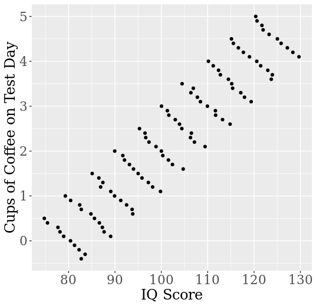

# Simpson’s Paradox
**First published Wed Mar 24, 2021; substantive revision Sat Jun 6, 2026**

*Sprenger, Jan, Weinberger, Naftali*

Simpson’s Paradox is a statistical phenomenon where an association between two variables in a population emerges, disappears or reverses when the population is divided into subpopulations. For instance, two variables may be positively associated in a population, but be independent or even negatively associated in all subpopulations. Cases exhibiting the paradox are unproblematic from the perspective of mathematics and probability theory, but nevertheless strike many people as surprising. Additionally, the paradox has implications for a range of areas that rely on probabilities, including decision theory, causal inference, and evolutionary biology. Finally, there are many instances of the paradox, including in epidemiology and in studies of discrimination, where understanding the paradox is essential for drawing the correct conclusions from the data.

The following article provides a mathematical analysis of the paradox, explains its role in causal reasoning and inference, compares theories of what makes the paradox seem paradoxical, and surveys its applications in different domains.

## 1. Introduction

We begin with an illustration of the paradox with concrete data. The numbers in Table 1 summarize the effect of a medical treatment for the overall population (N = 52), and separately for men and women:

*Table 1:*

|   | Full Population, $\bf N=52$ | Men $\bf(\r{M})$, $\bf N=20$ | Women $\bf(\neg \r{M})$, $\bf N=32$ |   |   |   |   |   |   |
| --- | --- | --- | --- | --- | --- | --- | --- | --- | --- |
|   | Success $\bf(\r{S})$ | Failure $\bf(\neg \r{S})$ | Success Rate | Success | Failure | Success Rate | Success | Failure | Success Rate |
| Treatment (T) | 20 | 20 | 50% | 8 | 5 | ≈ 61% | 12 | 15 | ≈ 44% |
| Control (¬T) | 6 | 6 | 50% | 4 | 3 | ≈ 57% | 2 | 3 | ≈ 40% |

Table 1: Simpson’s Paradox: the type of association at the population level (positive, negative, independent) changes at the level of subpopulations. Numbers taken from Simpson’s original example (1951).

For matters of exposition, we assume that these frequencies are unbiased estimates of the underlying probabilities. The treatment looks ineffective at the level of the overall population, but it leads to higher success percentages than the control both for men and for women (61% vs. 57% for men and 44% vs. 40% for women). Writing these proportions as conditional probabilities, with $\r{T}$=treatment, $\r{S}$=success/recovery, and $\r{M}$=male subpopulation, we obtain

$$ p(\r{S}\mid \r{T}) = p(\r{S}\mid \neg \r{T}) $$

but at the same time,

$$\begin{align*} p(\r{S}\mid \r{T}, \r{M}) & \gt p(\r{S}\mid \neg \r{T}, \r{M} ) \\ p(\r{S}\mid \r{T}, \neg \r{M}) &\gt p(\r{S}\mid \neg \r{T}, \neg \r{M}) \end{align*}$$

Should we use the treatment or not? When we know the gender of the patient, we would presumably administer the treatment, whereas it does not look like the right thing to do when we don’t know the patient’s gender—although we know that the patient is either male or female!

This phenomenon was first pointed out in papers by Karl G. Pearson (1899) and George U. Yule (1903), but it was Simpson’s short paper “The interpretation of interaction in contingency tables” (1951), discussing the interpretation of such association reversals, that led to the phenomenon being labeled as “Simpson’s Paradox”. The phenomenon is, however, broader than independence in the overall population and positive association in the subpopulations; for example, the associations may also be reversed. Nagel and Cohen (1934: ch. 16) provide an example of such a reversal as part of a exercise for logic students.

Understanding the paradox is essential for drawing the proper conclusions from statistical data. To give a recent example involving the paradox (Kügelgen, Gresele, & Schölkopf 2021), early data revealed that the case fatality rate for Covid-19 was higher in Italy than in China overall. Yet within every age group the fatality rate was higher in China than in Italy. One thus appears to get opposite conclusions about the comparative severity of the virus in the countries depending on whether one compares the whole populations or the age-partitioned populations. Having a proper analysis of what is going on is such cases is thus crucial for using statistics to inform policy.

In what follows, Section 2 explains different varieties of the paradox, clarifies the logical relationships between them, and identifies precise conditions for when the paradox can occur. While that section focuses on the mathematical characterization of the paradox, Section 3 focuses on its role in causal inference, its implications for probabilistic theories of causality, and its analysis by means of causal models based on directed acyclic graphs (DAGs: Spirtes, Glymour, & Scheines 2000; Pearl 2000 [2009])[^pearl-2000].

Based on these different approaches, Section 4 discusses different analyses of what makes Simpson’s Paradox look paradoxical, and what kind of error it reveals in human reasoning. This section also reports empirical findings on the prevalence of the paradox in reasoning and inference. Section 5 surveys the occurrence and interpretation of the paradox in applied statistics (regression models), philosophy of biology, decision theory and public policy. For example, Simpson’s Paradox is relevant when analyzing data to test for race or gender discrimination (Bickel, Hammel, & O’Connell 1975). Section 6 wraps up our findings and concludes.

## 2. Definition and Mathematical Characterization

This section shows how Simpson’s Paradox can be characterized mathematically, under which conditions it occurs, and how it can be avoided. We begin by further considering the concrete example from the introduction in order to build intuitions that will guide us through the more technical results.

The data in Table 1 can be translated into success or recovery rates, showing that treated men have a higher recovery rate than untreated men (roughly 61% vs. 57%), and the same for women (44% vs. 40%). Two observations are key to understanding why this positive association vanishes in the aggregate data. First, the recovery rate of untreated men is still higher than the recovery rate of women who receive treatment (57% vs. 44%), suggesting that not only treatment, but also gender is a relevant predictor of recovery. Second, while the treatment group is majority female (27 vs. 13), the control group is majority male (7 vs. 5). Speaking informally, the lack of population-level correlation between treatment and recovery results from men being both (i) more likely to recover from the treatment, and (ii) less likely to be in the treatment group.

This becomes evident when we use conditional probabilities to represent recovery rates given treatment and/or subpopulation. The overall recovery rates given treatment and control can, by the Law of Total Probability, be written as the weighted average of recovery rates in the subpopulations:

$$\begin{align*} p(\r{S}\mid \r{T}) &= p(\r{S}\mid \r{T},\r{M}) p(\r{M}\mid \r{T}) + p(\r{S}\mid \r{T}, \neg \r{M}) p(\neg \r{M}\mid \r{T}) \\ p(\r{S}\mid \neg \r{T}) &= p(\r{S}\mid \neg \r{T},\r{M}) p(\r{M}\mid \neg \r{T}) + p(\r{S}\mid \neg \r{T}, \neg \r{M}) p(\neg \r{M}\mid \neg \r{T})\end{align*}$$

Plugging in the numbers from Table 1 to calculate the overall recovery rates via these equations, we see that the first line is a weighted average of success rates for treated men and women (61% and 44%) while the second line is a weighted average of success rates of the two control groups (57% and 40%). These averages are weighted by the percentage of males and females in each group, and in the present case the gender disparity between the groups results in both averages being 50%. Since these weights can be different, the treatment may raise the probability of success among males and females without doing so in the combined population.

Later we will show that the positive association in the subpopulations cannot vanish if the correlation of treatment with gender is broken (e.g., by balancing gender rates in both conditions). The weights in each line are then identical—$p(\r{M}\mid \r{T}) = p(\r{M}\mid \neg \r{T})$—and associations in subpopulations are preserved for the aggregate data (Theorem 1 in Section 2.2). In fact, the absence of such a correlation rules out Simpson’s Paradox.

In what follows, we interpret Simpson’s paradox as a property of association between variables, expressed by conditional probabilities. This perspective is not uncontentious. For Spanos (2021), it amounts to a *deductive* take on the paradox, contrary to the original understanding of the paradox as a challenge for *inductive,* statistical learning. In Pearson’s and Yule’s original papers (and in applications involving linear regression models, see Section 5.1), the paradox is about models and data: estimating a model parameter yields spurious correlations that vanish when one refines the model and includes further variables. For Spanos, the paradox emerges as a consequence of statistical model misspecification. We get back to this statistics-centered perspective on Simpson’s paradox at the end of Section 4.

### 2.1 Varieties of Simpson’s Paradox

Simpson’s Paradox can occur for various types of data, but classically, it is formulated with respect to $2\times2$ contingency tables. Let $D_i = (a_i, b_i, c_i, d_i)$ be a four-dimensional vector of real numbers representing the $2\times2$ contingency table for treatment and success in the *i*-th subpopulation, and let

$$D = \sum_{i=1}^N D_i = \left(\sum a_i, \sum b_i, \sum c_i, \sum d_i\right)$$

be the aggregate data set over $N$ subpopulations. These data should be read as shown in Table 2.

*Table 2:*

|   | Population $\bf \i{D} = \i{D}_1+\i{D}_2$ | Subpopulation $\bf \i{D}_1$ | Subpopulation $\bf \i{D}_2$ |   |   |   |
| --- | --- | --- | --- | --- | --- | --- |
|   | Success ($\bf \i{S}$) | Failure ($\bf \neg \i{S}$) | Success ($\bf \i{S}$) | Failure ($\bf \neg \i{S}$) | Success ($\bf \i{S}$) | Failure ($\bf \neg \i{S}$) |
| Treatment ($\bf \i{T}$) | $a_1 + a_2$ | $b_1 + b_2$ | $a_1$ | $b_1$ | $a_2$ | $b_2$ |
| No Treatment ($\bf\neg \i{T}$) | $c_1 + c_2$ | $d_1 + d_2$ | $c_1$ | $d_1$ | $c_2$ | $d_2$ |

Table 2: Abstract representation of a $2 \times 2$ contingency table with subpopulations $D_1$ and $D_2$.

Let $\alpha (D_i)$ be a measure the strength of the probabilistic association between $T$ and $S$ in population $D_i$.[^note-1] By convention, $\alpha (D_i) = 0$ corresponds to no association between the variables, $\alpha (D_i) \gt 0$ indicates a positive association, and $\alpha (D_i) < 0$ a negative one. This can best be translated into the condition

$$\begin{align*} \tag{1} \alpha (D_i) & \begin{cases} > 0 & \qquad \text{if and only if} \qquad a_i \, d_i > b_i \, c_i; \\ = 0 & \qquad \text{if and only if} \qquad a_i \, d_i = b_i \, c_i; \\ > 0 & \qquad \text{if and only if} \qquad a_i \, d_i < b_i \, c_i. \end{cases}\end{align*}$$

The condition $a_i \, d_i > b_i \, c_i$ is equivalent to saying that the success rate in the first row (“treatment condition”) is higher than the success rate in the second row (“control condition”):

$$ a_i/(a_i+b_i) > c_i/(c_i+d_i).$$

Applying all this to our dataset in Table 1, we see that $\alpha(D) = 0$ although $\alpha(D_1) > 0$ and $\alpha(D_2) > 0$. This is a special case of what Samuels (1993) calls **Association Reversal (AR)**. Association reversal occurs if and only if there is a population such that the association in *all* partitioned subpopulations is either (i) positive (ii) negative, or (iii) zero, and the type of association in the population does not match that of the subpopulations. Writing this out mathematically, this means for a dataset $D = \sum_{i=1}^N D_i$ that one of the following two conditions holds,

$$\begin{align*} \alpha(D) &\le 0 \qquad \text{and} & \alpha(D_i) &\ge 0 \qquad \forall \; 1 \le i \le N \tag{AR1}\\ \alpha(D) &\ge 0 \qquad \text{and} & \alpha(D_i) &\le 0 \qquad \forall \; 1 \le i \le N \tag{AR2}\end{align*}$$

where at least one of the inequalities has to be strict. Association reversal is the standard variety of Simpson’s Paradox (Bandyopadhyay et al. 2011; Blyth 1972, 1973)[^bandyopadhyay-2011][^blyth-1972] and also the one that is most frequently investigated in the psychology of reasoning, or by philosophers analyzing the paradox (e.g., Cartwright 1979; Eells 1991; Malinas 2001)[^cartwright-1979][^eells-1991][^malinas-2001].

An important special case of AR occurs when there is no association in the subpopulations, but an association emerges in the overall dataset:

$$\begin{align*} \alpha(D_i) &= 0 \qquad \forall 1 \le i \le n \qquad \text{but} & \alpha(D) &\ne 0 \tag{YAP}\end{align*}$$

Referring to the pioneering work of the statistician George U. Yule (1903: 132–134), Mittal (1991) calls this **Yule’s Association Paradox (YAP)**. It is typical of spurious correlations between variables with a common cause, that is, variables that are dependent unconditionally ($\alpha(D) \ne 0$) but independent given the values of the common cause ($\alpha(D_i) = 0$). For example, sleeping in one’s clothes is correlated with having a headache the next morning. However, once we stratify the data according to the levels of alcohol intake on the previous night, the association vanishes: given the same level of drunkenness, people who undress before going to bed will have the same headache, ceteris paribus, as those who kept their clothes on.

Finally, the most general version of Simpson’s Paradox is the **Amalgamation Paradox (AMP)** identified by Good and Mittal (1987). This paradox occurs when the overall degree of association is bigger (or smaller) than each degree of association in the subpopulations, or mathematically,

$$\begin{align*} \alpha(D) &> \max_{1 \le i \le N} \alpha(D_i) \qquad \text{or} & \alpha(D) &< \min_{1 \le i \le N} \alpha(D_i). \tag{AMP} \end{align*}$$

AMP challenges the intuition that the degree of association in the general population, in virtue of being “the sum” of the individual subpopulations, has to fall in between the minimal and the maximal degree of association observed on that level. The logical strength of the paradoxes is inversely related to their generality and frequency of occurrence: $\text{YAP} \Rightarrow \text{AR} \Rightarrow \text{AMP}$. Variations of the paradox for non-categorical data (e.g., bivariate real-valued data) will be discussed in Section 5.1.

### 2.2 Necessary and Sufficient Conditions

We proceed to characterizing the mathematical conditions under which Simpson’s Paradox occurs. We have already suggested that the paradox arises in the medical example due to correlations between the treatment variable and the partitioning variable, and we can now make this more precise:

**Theorem 1 (Lindley & Novick 1981; Mittal 1991)[^lindley-1981][^mittal-1991]:** If $\alpha(D) > 0$ and association reversal occurs for the subpopulations characterized by attribute $\r{M}$ and $\neg\r{M}$, (i.e., $\alpha(D_1), \alpha(D_2) \le 0$), then either

1. $\r{M}$ is positively related to $\r{S}$ and $\r{T}$; or
2. $\r{M}$ is positively related to $\neg\r{S}$ and $\neg\r{T}$.

As Theorem 1 makes clear, the lack of correlation between $\r{M}$ and $\r{T}$ is sufficient to rule out association reversals (and thus YAP as well). Does it also rule out the more general amalgamation paradox? The answer to this depends on which **measure of association** one chooses for $\alpha$. Discussions of Simpson’s Paradox commonly treat association as the *difference* in the success rate between the treated and the untreated, but this is only one of many possibilities (Fitelson 1999)[^fitelson-1999]. While the lack of association between $M$ and $T$ is sufficient to rule out AMP for most measures (including the difference measure) it does not rule it out for all measures, as we will now explain. Readers not interested the specific details may skip to the following section.

Here are some widely used association measures for a dataset $(a, b, c, d)$:

$$\begin{align*} \pi_{D} &= \frac{a}{a+b} - \frac{c}{c+d} & \pi_{Y} &= \frac{ad -bc}{N^2}\\ \pi_{R} &= \log \left(\frac{a}{a+b} \cdot \frac{c+d}{c} \right) & \pi_{W} &= \log \left(\frac{a}{a+c} \cdot \frac{b+d}{b} \right) \\ \pi_{O} &= \log \frac{ad}{bc} & \pi_{C} &= \log \left(\frac{d}{c+d} \cdot \frac{a+b}{a} \right) \end{align*}$$

Some of these measures can be formulated probabilistically and have been suggested as measures of causal strength and outcome measures for clinical trials (Edwards 1963; Eells 1991; Fitelson & Hitchcock 2011; Greenland 1987; Peirce 1884; Sprenger 2018; Sprenger & Stegenga 2017)[^edwards-1963][^eells-1991][^fitelson-2011][^greenland-1987][^peirce-1884][^sprenger-2018][^sprenger-2017]. For example, $\pi_{D} = p(\r{S}\mid \r{T}) - p(\r{S}\mid \neg \r{T})$ represents the difference and $\pi_R = p(\r{S}\mid \r{T}) / p(\r{S}\mid \neg \r{T})$ the ratio of success rates in treatment and control conditions. $\pi_W$ can be interpreted as the prognostic weight of evidence that treatment provides for success (i.e., as the log-Bayes factor), $\pi_{Y}$ is Yule’s (1903) measure of association, $\pi_{O}$ is the log-odds ratio familiar from epidemiological data analysis, and $\pi_C$ is I.J. Good’s (1960) measure of causal strength.

We now consider the extent to which AMP for different measures is ruled out by different experimental designs. Suppose that individuals are uniformly assigned to the treatment and control condition across subpopulations. In such a case, where the ratio of persons assigned to the treatment and control condition is equal for each subpopulation, the experimental design is called **row-uniform**. Specifically, there has to be a $\lambda > 0$ such that for any subpopulation *i*

$$ a_i + b_i = \lambda (c_i+d_i) \tag{Row Uniformity} $$

In particular, row uniformity holds approximately if our sample is large and we sample at random from the population.

Row-uniform design of a trial ensures independence between a potential confounder $M$ and the treatment variable $T$. Accordingly, by Theorem 1, it rules out association reversals. Additionally, row-uniform design is sufficient to rule out the AMP for a wide class of association measures:

**Theorem 2 (Good & Mittal 1987)[^good-1987]:** If a dataset $D = \sum D_{i}$ satisfies row uniformity, then the Amalgamation Paradox is avoided for the measures $\pi_{D}$, $\pi_{R}$, $\pi_{Y}$ and $\pi_{W}$ and $\pi_{C}$. It is *not* avoided for the log-odds ratio $\pi_{O}$.

Some studies also exhibit **column-uniform design** where the proportion of successes and failures is constant across all subpopulations:

$$ a_i + c_i = \lambda (b_i+d_i) \tag{Column Uniformity} $$

Also then $\r{M}$ is independent of $\r{S}$. Column uniformity can occur in case-control studies with various subpopulations (e.g., different hospitals) where one does not match the number of persons with the explanatory attribute, like in an RCT. Instead, for each person with a certain attribute (e.g., a specific form of cancer), one selects a number of persons that does not have this attribute. Column-uniform design avoids AR as well, but among the presented association measures, it suffices to rule out AMP only for $\pi_Y$.

*Table 3:*

|   | Association Measure |   |   |   |   |   |
| --- | --- | --- | --- | --- | --- | --- |
| Avoids AMP? | $\pi_{D}$ | $\pi_{R}$ | $\pi_{O}$ | $\pi_{Y}$ | $\pi_{W}$ | $\pi_{C}$ |
| Row-uniform design | yes | yes | no | yes | yes | yes |
| Column-uniform design | no | no | no | yes | no | no |
| Both | yes | yes | yes | yes | yes | yes |

Table 3: An overview of how row- and column-uniform design avoid the amalgamation paradox for various association measures.

Table 3 summarizes the properties of all association measures with respect to the AMP and the different forms of experimental design. The behavior of the log-odds measure $\pi_O$, where neither row- nor column-uniform design suffices to rule out the AMP, will be discussed in Section 5.2.

We now identify one last fundamental condition for when data exhibit association reversal. Have a look at Figure 1 which displays the success proportions for treatment and control graphically.

*Figure 1:*

Figure 1: A geometrical representation of a necessary condition for the occurrence of Association Reversal. The paradox can occur if the proportions are ordered like in the left graph; it cannot occur if they are ordered like in the right graph. [An extended description of figure 1 is in the supplement.]

In both examples, the treatment success rate is for both subpopulations greater than the control success rate. When will this order be preserved at the overall level? We know that the overall success rate *for each condition* (treatment/control) is constrained by the success rates in the subpopulations:

**Fact 1:** Suppose $a_i, b_i > 0$ for all $1 \le i \le N$. Then also

$$\begin{align*}\tag{2} \min \frac{a_i}{a_i+b_i} \le \frac{\sum_{j=1}^N a_j}{\sum_{j=1}^N (a_j+b_j)} \le \max \frac{a_i}{a_i+b_i} \end{align*}$$

This fact follows directly from the Law of Total Probability (proof omitted) and it gives us a simple necessary condition for the occurrence of Association Reversal (AR): turning to Figure 1 again, it implies that the overall success rate per condition has to be on the solid lines. Thus AR *cannot* occur in the right part of Figure 1, but it can occur if the proportions are ordered as in the left part of Figure 1. Generally, AR is avoided when the following condition holds:

$$\tag{RH} \begin{align*} \max_{1 \le i \le N} \frac{a_i}{a_i+b_i} & < \min_{1 \le i \le N} \frac{c_i}{c_i+d_i} \\ \text{ or } \hspace{5.5em}\\ \min_{1 \le i \le N} \frac{a_i}{a_i+b_i} & > \max_{1 \le i \le N} \frac{c_i}{c_i+d_i} \end{align*} $$

Any dataset that satisfies (RH) will be called **row-homogenous**. By contrast, for any given set of proportions violating condition (RH), we can find datasets exhibiting these very same proportions such that AR indeed occurs (by fiddling with the size of the subpopulations; Lemma 3.1 in Mittal 1991)[^mittal-1991]. However, neither row homogeneity, nor the analogous condition of column homogeneity, nor their conjunction is sufficient for avoiding the amalgamation paradox AMP.

Finally, one might be interested in how frequently the paradox arises. Simulations by Pavlides and Perlman (2009) suggest that it should not occur frequently: the confidence interval for the probability of AR is a subset of the interval $[0;0.03]$ for both the uniform prior and the (objective) Jeffreys prior. Of course, the practical value of this diagnosis depends on whether the sampling assumptions are sensible, and whether the entire approach makes sense for real-life datasets where researchers can group the data into subpopulations along numerous dimensions.

## 3. Simpson’s Paradox and Causal Inference

Within the philosophical literature, Simpson’s Paradox received sustained attention due to its implications for accounts of causality that posit systematic connections between causal relationships and probability-raising. Specifically, the paradox reveals that facts about probability-raising will not necessarily be preserved when one partitions a population into subpopulations. This poses a number of important challenges to philosophical accounts of causal inference based on the concept of probability:

1. What is the appropriate set of background factors for determining when a probabilistic relationship is causal?
2. What do association reversals imply for causal inference?
3. Does Simpson’s Paradox threaten the objectivity of causal relationships?

Strategies for treating the paradox and answering these questions have contributed substantially to the development of theories of probabilistic causality (Cartwright 1979; Eells 1991)[^cartwright-1979][^eells-1991]. A different set of answers is provided by more recent work on the paradox in the framework of graphical causal models (e.g., Pearl 1988, 2000 [2009]; Spirtes et al. 2000)[^pearl-1988][^spirtes-2000], and we will discuss both accounts in turn. In particular, we will explain how Simpson’s Paradox can be analyzed through the notions of confounding and the identifiability of a causal effect.

### 3.1 Probabilistic Causality and Simpson’s Paradox

Early accounts of probabilistic causation (e.g., Reichenbach 1956; Suppes 1970)[^reichenbach-1956][^suppes-1970] sought to explicate causal claims purely in terms of probabilistic and temporal facts. On Suppes’ (1970) account, event $\r{C}$ is a *prima facie* cause of $\r{E}$ if and only if (i) $\r{C}$ occurs before $\r{E}$ and (ii) $\r{C}$ raises the probability of $\r{E}$.[^note-2] As we have already seen in Section 2.1, not all *prima facie* causes are genuine causes. If I drink a strong blond Belgian beer now, I will probably be happy during the day, but also have a headache tomorrow. However, being happy would not thereby by the cause of the headache: the correlation is explained by the common cause—the beer drinking. The variable for drinking the beer *screens off* the probabilistic relationship between its effects, meaning that the effects will be uncorrelated when one conditions on it. The crux of Suppes’ account is that a *prima facie* causal relationship between $\r{C}$ and $\r{E}$ is a genuine causal relationship iff there is no factor F prior to C that screens off $\r{C}$ from $\r{E}$.[^note-3]

Later theorists such as Cartwright (1979) and Eells (1991) developed this condition by making causal claims relative to a causally homogenous *background context*, which is specified by a set of variables $\b{K}$. Consider the following example of association reversal presented by Cartwright. Supposing that smoking $(\r{S})$ is a cause of heart disease $(\r{H})$, one might expect that smoking would raise the probability of heart disease. Yet this might not be the case. Suppose that in a population there is a strong correlation between smoking and exercising (X), and that exercise lowers the probability of heart disease by more than smoking raises its probability. In such a case, smoking might lower the probability of heart disease although conditional on either $X$ or $\neg X$, $\r{S}$ raises $\r{H}$’s probability.

Cartwright interprets this case as follows: causes always raise the probability of their effects, but this can be “concealed” by the correlation between the cause and some other variable (here, $X$). In order to isolate the genuine probabilistic relationship between $\r{C}$ and $\r{E}$, one needs to consider it in a context where such correlations cannot occur:

**Probabilistic Causality (Cartwright)** Let $\b{K}$ denote all and only the causes of $\r{E}$ *other than $\r{C}$ and effects of $\r{C}$*. Then $\r{C}$ causes $\r{E}$ if and only if relative to all combinations of values variables in $\b{K}$, $\r{C}$ raises the probability of $\r{E}$: $p(\r{C}\mid \r{E},\b{K}) > p(\r{C}\mid \neg{\r{E},\b{K}})$.

While Suppes defends a *reductive* account of probabilistic causality, where the elements of $\b{K}$ are determined without appeal to causal assumptions, Cartwright presents a *non-reductive* account where $\b{K}$ must include all and only the causes of $\r{E}$, excluding $C$ itself and any variables that are causally intermediate between $\r{C}$ and $\r{E}$. The current consensus is that it is impossible to give a probabilistic account of causation without relying and causal concepts, and thus that no non-reductive account is feasible (though see Spohn 2012 for a dissenting view)[^spohn-2012].

Although non-reductive accounts could not be used to explain causation to someone with no prior causal knowledge, they can nevertheless clarify how causal claims are tested, and illuminate the relationship between causation and probability (see also Woodward 2003: 20–22)[^woodward-2003]. Moreover, Cartwright argues that her general criterion for inclusion of background factors in $\b{K}$ avoids the reference class problem for purely statistical accounts of causal explanation, which arises when probabilistic facts arbitrarily depend on the way one partitions a population into subpopulations. Through specifying the relevant populations for evaluating causal claims, she aims to eliminate a threat to the objectivity of causal explanation. More detail is provided in the entry on probabilistic causality.

### 3.2 Specific Debates: Causal Interaction, Average Effects, Mediators

Cartwright’s innovations for probabilistic accounts of causality have triggered various debates related to Simpson’s Paradox. We highlight three of them here:

#### Debate 1: Causal Interaction

Cartwright claims that causes raise the probabilities of their effects across all background contexts,[^note-4] but many purported causes only raise the probabilities of their effects in some contexts. In the latter cases, causes *interact* with background factors in producing their effects. To give Cartwright’s own example (1979: 428), ingesting an acid poison generally causes death, except in contexts where one also ingests an alkali poison (in which case the two cancel one another out). The problem of such interactive causes for probabilistic accounts is that they threaten Cartwright’s picture on which the effect of probability-raising causes is “concealed” by a stronger negative cause which “dominates” them. These metaphors suggest that the probability-raising relationship between a cause and its effect reflects an intrinsic relationship between the variables that exists even when not manifested, an idea further developed in (Cartwright 1989)[^cartwright-1989]. Interaction means that causes do not operate in a vacuum, but rather only in the presence of background factors (for further discussion, see Otte 1985; Eells 1986; Hardcastle 1991)[^eells-1986][^hardcastle-1991][^otte-1985].

Simpson’s Paradox should not be conflated with causal interaction, however. What is distinctive of the paradox is not that the probabilistic relationship reverses upon partitioning, but rather that it reverses in *all* of the resulting subpopulations.

#### Debate 2: Average Effects

Cartwright requires $\b{K}$ to include all causes of $\r{E}$, and thus to evaluate effects relative to homogenous background contexts. The account thus does not allow for average effects. For example, suppose that a particular treatment $(\r{T})$ raises the probability of heart disease $(\r{H})$ in individuals who were born prematurely $(\r{P})$ but not individuals who were not, and that $\r{P}$ is not correlated with $\r{T}$. In the whole population, the amount by which $\r{T}$ lowers or raises the probability of $H$ will be an average of the effects in the $\r{P}$ and $\neg\r{P}$ populations, weighted by their size. Dupré (1984) argues for abandoning the requirement that $\b{K}$ include all causes of $E$, and thus for allowing average effects.

A tempting lesson to draw from our opening example is that Simpson’s Paradox arises as a result of averaging over the populations of males and females, and that the only way to eliminate it is by ruling out average effects. However, causal heterogeneity does not by itself lead to the paradox.[^note-5] Cases with heterogeneous background factors only produce association reversal if the factors are correlated with the causal variable—as demonstrated by Theorem 1 in Section 2.2.

#### Debate 3: Mediators

According to Cartwright, the set $\b{K}$ should not include variables that are causally intermediate between $C$ and $E$. Such variables are called **mediators**. To see why, imagine a drug reduces the risk of heart disease by producing a chemical, represented by variable $Z$, in the blood stream, and via no other factors. If $C$ and $E$ have no common causes, they will be probabilistically independent conditional on $Z$. Intuitively, one should not hold the blood chemical fixed in evaluating the effect, since it is the means by which the effect is brought about.

When there are **multiple paths between cause and effect**, the question becomes more complex. Hesslow (1976) provides an example where taking birth control pills promotes a blood-clotting condition called thrombosis via a chemical in the blood, but inhibits it via preventing pregnancy, which itself is a cause of thrombosis. As a result, taking birth control intuitively influences thrombosis both positively and negatively. If one is interested in the net effect of $C$ on $E$—as opposed to the effects via particular paths (Hitchcock 2001)[^hitchcock-2001]—then one should not condition on mediators. However, conditioning is necessary for calculating path-specific effects (e.g., Pearl 2001; Weinberger 2019)[^pearl-2001][^weinberger-2019].

Distinguishing mediators from common causes is crucial for analyses of Simpson’s Paradox. For example, the causal models $C\to Z \to E$ and $C\leftarrow Z \to E$ exhibit the same conditional independencies: $C$ and $E$ will be associated unconditionally, but independent conditional on $Z$. Only causal knowledge enables us to decide how we shall deal with the association reversal, and whether we need to condition upon $Z$ when estimating the causal effect of $C$ on $E$ (we do in the second model, but not in the first). See also Section 3.4.

### 3.3 DAGs and Causal Identifiability

In recent years, the formal analysis of causation has been significantly enhanced by the development of graphical methods for representing causal hypotheses and for choosing among candidate hypotheses given one’s evidence, in particular those using **directed acyclic graphs** (=DAGs: Pearl 1988, 2000 [2009]; Spirtes et al. 2000)[^pearl-1988][^spirtes-2000]. A DAG contains a set of nodes connected by a set of directed edges or arrows such that there are no cycles (one cannot get from a node back to itself via a set of directed arrows). In the causal context, the nodes in a DAG are random variables and the arrows correspond to direct causal relationships. It is common to assume that the set of variables in a DAG is *causally sufficient*, meaning that it includes all common causes of variables in the set.

DAGs enable one to systematically map the relationship between causal hypotheses and joint probability distributions. They overlap with and build on techniques in the literature on probabilistic causality, but provide significantly stronger tools and results. See the entries on causal models, causation and manipulability and counterfactual theories of causation for detailed introductions to causal inference with DAGs.

*Figure 2:*

Figure 2: The relationship between the variables *Treatment*, *Gender*, and *Success* represented in a DAG, without and with an intervention on Treatment.

Figure 2 (left part) presents a plausible DAG for our running example, including the variables *Treatment*, *Gender*, and *Success*. There are two ways in which *Treatment* provides information about *Success*. One is that people who take the treatment may be more (or less) likely to recover as a result of having taken it. The other is that learning that someone took the treatment provides information about whether they are likely to be male or female, and this information is relevant to determining whether they will recover regardless of whether they took the treatment.

The graphs can, however, also be interpreted causally, and here, the notion of an **ideal intervention** is crucial:

For an intervention on a variable $V$ to be **ideal** is for it to determine $V$’s value such that it no longer depends on its other causes in the DAG. Graphically, we can represent an intervention by adding an additional cause *I* that “breaks” all of the arrows that would otherwise go into $V$.

So, in Figure 2 *Intervention* is an ideal intervention on *Treatment*. Intervening on *Treatment* disrupts the evidential relationship with *Gender*—for example, by controlling for the proportion of male and female patients in each sample—so that any remaining probabilistic relationship between treatment and recovery can only be explained by having taken the treatment. Such an experimental design, where *Treatment* and *Gender* are made probabilistically independent, suffices to rule out association reversal (cf. Section 2.2).

Using the notion of an ideal intervention, one can explicate causation as follows (Pearl 2000 [2009]; Woodward 2003)[^pearl-2000][^woodward-2003]. $C$ causes $E$ if and only if it is possible to change the value or probability of $E$ via some ideal intervention on $C$. Such interventions distinguish between causal and merely probabilistic dependencies by eliminating any probabilistic relationship between $C$ or $E$ that can be traced to the influence of a common cause. This does not mean, however, that one can only get causal knowledge in cases where one can experimentally intervene. One of the key contributions of graphical causal models is that they enable one to systematically determine when one’s prior causal knowledge licenses one to interpret a particular probabilistic relationship causally.

The difference between the probability distributions resulting from conditioning and from intervening is formally represented by supplementing the probability calculus with the **do-operator** (**$\do(X)$**) where applying the operator to a variable formally represents intervening upon it. Taking $T$, $S$, and $M$ to denote *Treatment*, *Success*, and *Gender*, and given the graph in Figure 2, the observational probability distribution of $S$ given $T$ is not equal to the probability distribution of $S$ given an intervention on $T$:

$$\tag{3}\label{int} p(\r{S}\mid \r{T}) \ne p(\r{S}\mid \do(\r{T}))$$

The difference between these two quantities is due to the impact of $M$ on the distribution of $T$. In contrast, the following two expressions are equivalent given the DAG:

$$\tag{4}\label{cond} p(\r{S}\mid \r{T},\r{M}) = p(\r{S}\mid \do(\r{T}),\r{M})$$

Here one can infer the effect of $T$ on $S$ from the observational distribution by conditioning on $M$. In such a case, we say that (4) *identifies* the causal effect of $T$ on $S$. More generally, **identifiability** is a relationship between a DAG *G*, probability distribution $P$ and a causal quantity $\r{Q}$, such that $\r{Q}$ is identifiable if and only if it is uniquely determined by $P$ given $G$. By contrast, when there are unmeasured common cause(s) of $S$ and $T$, the probability distribution is compatible with any possible distribution for $p(\r{S}\mid \do (\r{T}))$.

### 3.4 Confounding and Pearl’s Analysis of the Paradox

The concept of identifiability is crucial for understanding confounding, and the analysis of Simpson’s Paradox through graphical causal models. The relationship between $X$ and $Y$ is **confounded** relative to variable set $\b{Z}$ just in case $P(Y\mid X,\b{Z}) \ne P(Y\mid \do(X),\b{Z})$ (i.e., the relationship is not identified). A **confounding set of variables** is one that *biases the effect measurement*. For instance, an unmeasured common cause is a confounder because it makes it impossible to disentangle the probabilistic dependence between the variables resulting from the common cause from that resulting from a causal relationship between them. Simpson’s Paradox emerges on this account due to confounding by the third variable. This notion of confounding diverges from a common colloquial understanding of confounders as alternative explanations of an observed outcome other than the treatment. Confounders threaten causal inference not by providing an alternate explanation of why an effect occurred, but by undermining the possibility of measuring the causal relationship.

A useful sufficient condition for identifiability is the **back-door criterion** (Pearl 1993, 2000 [2009: 79])[^pearl-1993]. First we need to introduce some graphical terminology. A *path* between $X$ and $Y$ be a set of connected edges between $X$ and $Y$ going in any direction. $Y$ is a *descendant* of $X$ if there is a path from $X$ to $Y$ in which all the arrows go in the same direction. When $X$ and $Y$ are connected via a single path including a common cause such as $X \leftarrow Z \rightarrow Y$, $X$ and $Y$ will typically[^note-6] be unconditionally probabilistically dependent, but will be independent conditional on $Z$. For such a path, we say that $Z$ *blocks* the path between $X$ and $Y$. In contrast, when $X$ and $Y$ are connected by a path including a common *effect*, such as $X \rightarrow Z \leftarrow Y$, then the path will be blocked provided that one does *not* condition on $Z$ or a descendant of $Z$. This reflects the fact that independent causes of a common effect will typically be dependent conditional on a common effect. An effect of $X$ on $Y$ is identifiable if there are no unblocked “back-door paths” between $X$ and $Y$: all paths that pass through common causes are blocked, and all other paths excepting those by which the cause influences its effect are open.

**Back-door Criterion (Pearl 1993)[^pearl-1993]** Given a variable pair $\{X,Y\}$ in a DAG G, the effect of $X$ on $Y$ is *identifiable* if there exists a variable set $\b{Z}$ in G satisfying the following conditions:

1. No node in $\b{Z}$ is a descendant of $X$, and
2. $\b{Z}$ blocks every path between $X$ and $Y$ containing an arrow into $X$.

In this case, the effect of $X$ on $Y$ is identified by the formula

$$\tag{5} p(\r{Y}\mid \do(\r{X})) = \sum_{Z} p(\r{Y}\mid \r{X},\r{Z}) \, p(\r{Z})$$

Equation (5) reveals that can be possible to derive a causal effect in a population by averaging over the effects in subpopulations partitioned by $Z$. This is what we already saw in Section 2.2: if there is no dependence between being treated and being a part of a subpopulation, associations cannot reverse at the general population level. Yet such a derivation is only licensed by causal assumptions about the relationships between the variables. The reader can verify that given the DAG in Figure 2, the variables satisfy the back-door criterion (with $\b{Z}=\{\textit{Gender}\}$).[^note-7]

In our original example, the treatment increased the probability of recovery in each subpopulation, but not in the population as a whole. Should one approve the drug or not? The causal approach makes it easy to see why one should. The probabilistic relationship between *Treatment* and *Success* in the population is an evidential rather than a causal one. Learning that someone took the drug provides evidence about their gender, and this information is relevant to predicting whether they will recover. But this does not tell one about whether the drug is causally efficacious. To learn this, one needs to know how the chances of recovery for individuals in the population would change given an *intervention* on treatment. This can be determined by conditioning on *gender* which enables one both to learn the gender-specific effects of the drug, and to derive the average effect in the whole population (using the back-door criterion).

*Figure 3:*

Figure 3: The DAG for the variables *Treatment*, *Gender* and *Success* (third variable = confounding factor), contrasted with the DAG for the variables *Birth Control*, *Pregnancy*, and *Thrombosis* (third variable = mediator).

Thus, whether one should partition the population based on a factor in order to identify a particular causal relationship does not depend only on the statistical distribution, but crucially on one’s causal background assumptions. Suppose that one was considering an intermediate variable such as *Pregnancy* in Hesslow’s (1976) example. Recall that in the example birth control influences thrombosis both positively via a blood chemical and negatively by reducing one’s chance of getting pregnant. This case is shown in Figure 3 and contrasted with our running example where the third variable is a confounding factor. In order to identify the effect of birth control on thrombosis, it is crucial that one does *not* condition on pregnancy. If there are no unmeasured common causes of birth control and thrombosis, then a probability-raising relationship between birth control and thrombosis in the population as a whole would reliably indicate that taking birth control pills promotes thrombosis.

It is worth emphasizing that there is no basis for distinguishing the two causal structures in Figure 3 using statistics alone. Any data generated by the model on the left could also have been generated by a model with the causal structure of that on the right. Accordingly the judgment that one should partition the population in one case but not the other cannot be based on the probabilities alone, but requires the additional information supplied by the causal model.

Coherent with Theorem 1, Pearl proves a causal version of Savage’s (1954) sure-thing principle (see also Section 5.3):

**Causal sure-thing principle (Pearl 2016)[^pearl-2016]** An action $\r{C}$ that increases the probability of an event $\r{E}$ in each subpopulation must also increase the probability of $\r{E}$ in the population as a whole, provided that the action does not change the distribution of the subpopulations.[^note-8]

For example, if one assumes that *Gender* is not an effect of *Treatment*, it cannot be the case that the drug raises the probability of recovery in both males and females, but has no effect on recovery in the general population. This result provides an error theory for why people often find Simpson’s Paradox to be paradoxical in the first place. Specifically, Pearl (2000 [2009], 2014) claims that people conflate observational claims that $\r{X}$ raises the probability of $\r{Y}$ with causal claims that *doing* $\r{X}$ (versus $\neg\r{X}$) would raise the probability of $\r{Y}$. And assuming that the partitioning variable is not an effect of $X$, it *is* impossible for doing $\r{X}$ to raise the probability of $\r{Y}$ in all subpopulations, but not in the population as a whole. So Pearl’s explanation of the paradox is that people conflate causal and non-causal expressions, and if the conditional probabilities in the examples are interpreted causally, Simpson’s reversals are impossible.

### 3.5 Implications

Whether Pearl provides the correct causal explanation of Simpson’s Paradox remains a topic of continued debate (Armistead 2014 see also Section 4)[^armistead-2014]. What should not, however, be controversial is that recent causal modeling techniques enable one to systematically distinguish between causal and probabilistic claims in a much more general and precise way than had previously been possible. While Cartwright required that *all* causes of $E$ be included in the background context, for the sake of eliminating confounding it is only necessary to hold fixed *common* causes (and other variables needed to block back-door paths). Theorists of probabilistic causality were to some extent aware that one did not need to hold fixed all causes of the effect in order to eliminate confounding, but they lacked a general account of which variable sets are sufficient for identifying the effect. Simpson’s Paradox was especially threatening, since there was no way to provide general conditions under which an apparent positive causal relationship in a population would disappear entirely upon partitioning. Using Pearl’s framework, it is trivial to show that as long as one does not condition on mediators, if a probabilistic expression identifies an average positive effect between $X$ and $Y$ in a population, intervening on $X$ must raise $Y$’s effect in at least *some* subpopulations (Weinberger 2015)[^weinberger-2015].

Turning back to the debate about average effects in the probabilistic framework, this fact vindicates Dupré’s (1984) liberal attitude toward average effects against critics such as Eells and Sober (1983: 54) who dismiss it as a “sorry excuse for a causal concept” (though see Hitchcock 2003: 13–15, and Hausman 2010: 56, for further nuances)[^hausman-2010][^hitchcock-2003]. Of course, a positive average effect is compatible with the cause lowering the probability of the effect significantly in many subpopulations. This reflects the fact that the partitioning variable(s) could interact with the cause of interest. But such possible interactions do not make the effect any less genuine as an average effect for the whole population.

This brings us to the issue of whether Simpson’s Paradox threatens the objectivity of causal relationships. Properly understood, it does not. It is certainly true that a cause can raise the probability of its effect in one population and lower it in another, or that it can have a positive effect in a whole population, but not in some of its subpopulations. But it is not as if only some of these causal relationships are genuine and that philosophers must therefore find a privileged background context within which the true relationship is revealed. It is simply a fact about causation that different populations can have different sets of interactive background factors, and thus the average effects will genuinely differ across the populations.

## 4. What Makes Simpson’s Paradox Paradoxical?

Simpson’s Paradox is not a paradox in the sense of presenting an inconsistent set of plausible propositions of which at least one must be rejected. As shown in Section 2.2, mathematics does not rule out associations being reversed at the level of subpopulations. Bandyopadhyay et al. (2011) helpfully distinguish between three questions one could ask about Simpson’s Paradox:

1. Why or in what sense is Simpson’s Paradox a paradox?
2. What is the proper analysis of the paradox?
3. How one should proceed when confronted with a typical case of the paradox?

Question (i) is essentially a question about the psychology of reasoning: one must offer an account of why the (mathematically innocent) association reversals seem paradoxical to many. Such accounts help to identify valid forms of inference that leads individuals to mistakenly rule out association reversals, and thereby provide answers to question (ii). Such analyses can differentiate among subtly different forms of reasoning, and open the door to empirical work testing whether humans systematically fail to attend to particular differences.

Section 3.4 already presented one analysis of the paradox. On Pearl’s **causal analysis**, the appearance of a paradox results from a *conflation between causal and probabilistic reasoning*. If one interprets the claim that taking the drug raises the probability of recovery as the causal statement that intervening to give the drug will make patients more likely to recover, and plausibly assumes that taking the drug has no influence on gender, then the drug cannot lower the probability of recovery both among males and among females. But, of course, if one is considering ordinary conditional probabilities without any do-operators, such reversals can occur. Accordingly, the appearance of paradox results from conflating ordinary conditional probabilities with conditional probabilities representing the results of interventions.

Pearl’s answer to (ii) has immediate implications for (iii). In evaluating the relationships between two variables $X$ and $Y$ and determining whether one should partition based on some variable (or variable set) $Z$, one should partition based on $Z$ only if doing so will enable one to *identify the causal relationship between $X$ and $Y$*. This answer presupposes that the aim of partitioning the population is to identify causal relationships. Questions about how to proceed in light of the paradox only make sense given a context and given the kind of inference one wishes to draw.

Pearl (2014) presents several reasons supporting his analysis of the paradox. First, he argues that were the surprise resulting from the paradox to be the result of a mere mathematical error, this could neither account for why the paradox “has captured the fascination of statisticians, mathematicians, and philosophers for over a century” (2014: 9) nor for the difficulty that reasoners have in avoiding the error even once they’ve been made aware of it. Only by means of a causal semantics can one demonstrate that Simpson’s reversals cannot occur when the conditional probabilities are interpreted causally. Second, he points to Simpson’s (1951) observation that judgments about whether the aggregated or non-aggregated population is relevant for evaluating the correlations depends on the *story* behind the what the frequencies represent. Pearl accounts for this story-relativity by showing that whether one should partition a population is decided not by the probabilities but rather by the causal model generating the probabilities. These causal models cannot be distinguished by conditional probabilities alone.

Bandyopadhyay et al. (2011) reject Pearl’s causal analysis of the paradox, and defend an alternative **mathematical explanation**. They note that there can be instances of the paradox that do not seem to invoke any causal notions. For example, suppose we take the proportions in Table 1 not to refer to the proportions of recovering/non-recovering patients among the treatment/non-treatment groups in male and female populations, but rather to the proportions of red and blue marbles among big or small marbles in two bags. Suppose that in either bag the big marbles have a higher red-to-blue ratio than the small marbles. Bandyopadhyay et al. plausibly claim that in this case, it would be surprising to discover that, were we to pour the bags into a single box, the small marbles have a higher red-to-blue ratio than the big ones. If there are cases of the paradox that still exhibit surprise despite having nothing to do with causality, then the general explanation of the paradox cannot be causal.[^note-9]

Bandyopadhyay et al. rephrase the paradox as being about ratios and proportions: when it is the case that

$$ \tag{6} \frac{a_1+b_1}{b_1} \gt \frac{c_1+d_1}{d_1} \quad \text{and} \quad \frac{a_2+b_2}{b_2} \gt \frac{c_2+d_2}{d_2} $$

—to be read as success proportions for treatment and control in the subpopulations, compare Table 2—many people expect that these equalities are preserved in the overall population:

$$\tag{7} \frac{a_1+a_2+b_1+b_2}{b_1+b_2} > \frac{c_1+c_2+d_1+d_2}{d_1+d_2}$$

As we know from Section 2, this need not be the case. Bandyopadhyay et al. conducted a survey with university students on this matter: only 12% give the correct answer that equations (6), by themselves, do not constrain the truth value of equation (7).

Given the widespread literature revealing how seemingly error-prone humans can be when reasoning about probabilities (e.g., Kahneman, Slovic, & Tversky 1982), the proposal that Simpson’s Paradox can be explained by appeal to an error in probabilistic reasoning is plausible. Yet Bandyopadhyay et al. do not specify what this error is. Or, more specifically, they do not propose a valid form of reasoning that reasoners are mistakenly appealing to when falling prey to the paradox. The fact that people expect that the ratios in subpopulations to be preserved in the combined population just shows that people are tricked by the paradox. It does not illuminate the underlying mistake that they are making when they are tricked. In this sense, Bandyopadhyay et al. do not answer their second question. They also, by their own admission, do not provide a general answer to (iii). They view this as a virtue of their account, since they believe that discussions of (iii) ought to be divorced from discussions of (i) and (ii).

Recently, Fitelson (2017) has proposed a **confirmation-theoretic explanation** of Simpson’s Paradox. His analysis relies on identifying confirmation with increasing the (subjective) probability of a proposition. Statements of the form “evidence $\r{E}$ confirms hypothesis $\r{H}$” are, however, usually evaluated with respect to background knowledge K, and this can lead to ambiguities. In particular, Fitelson distinguishes between the *suppositional* and *conjunctive* readings of a confirmation statement. In our running example, these statements would be as follows:

**Suppositional ($\bf \r{E}$ raises the probability of $\bf\r{H}$ given $\b{K}$):** If one is female, then receiving treatment increases one’s chance of recovery.

**Conjunctive ($\bf \r{E}\wedge\b{K}$ raises the probability of $\bf \r{H}$):** Being a female treatment-receiver increases one’s chance of recovery.

While the suppositional and conjunctive reading coincide for some accounts of confirmation (e.g., Carnap’s account of degree of confirmation as conditional probability), they can produce different outcomes for confirmation as *probability-raising*. For our data in Table 1, the suppositional reading is true: if one is in the female subpopulation, receiving treatment rather than being in the control group increases one’s chances of recovery. On the conjunctive reading, however, the statement is false: female treatment-receivers are less-likely to recover (12/27) compared to the set of individuals who are either male or did not receive the treatment (16/25). More importantly, while the suppositional reading allows for association reversals, on the conjunctive reading it cannot be the case both that being a female treatment-receiver and being a male treatment-receiver raises the probability of recovery, but being a treatment receiver simpliciter does not (Fitelson 2017: 300–302)[^fitelson-2017].

Fitelson’s confirmation-theoretic explanation of Simpson’s Paradox is that reasoners are not attentive to the difference between the suppositional and conjunctive readings of confirmation statements when considering the evidential relevance of learning an individual’s gender. In the conjunctive reading there cannot be association reversals, and because the suppositional and conjunctive reading do not differ for many accounts of confirmation, people mistakenly assume that there cannot be such reversals, even when they are relying on the suppositional reading.

Both Bandyopadhyay et al. and Fitelson claim that because the formulation of Simpson’s paradox does not itself appeal to causal considerations, it is a preferable to find a non-causal explanation for the paradox. Ultimately, it is an empirical question whether the paradox can be accounted for exclusively by errors in probabilistic reasoning, or, as Pearl suggests, due to a conflation of causal and probabilistic reasoning. One conceptual barrier to disentangling these hypotheses is that there are systematic relationships between causal and probabilistic claims For example, when the third variable $\r{M}$ is uncorrelated with treatment $T$ (i.e., $p(\r{T}\mid \r{M}) = p(\r{T})$), there can be no reversals (see also the theorems in Section 2.2). Does it follow that Simpson’s Paradox has a purely probabilistic explanation? Not necessarily. An alternative hypothesis is that the epistemic agent does not have knowledge of the relevant conditional probabilities, but does know that $M$ is not a cause of $T$ $(p(\r{T}\mid \do(\r{M})) = p(\r{T})$), preempting the occurrence of association reversals. The question of whether the source of the paradox is causal cannot be resolved purely by appeal to the mathematical conditions under which the it arises. Rather, it depends on substantive psychological hypotheses about the role of causal and probabilistic assumptions in human reasoning.[^note-10]

The empirical evidence on the paradox shows that reasoners find trivariate reasoning (i.e., with a causally relevant third variable) generally hard and fail to take its role properly into account, even if salient cues to its relevance are provided (Fiedler, Walther, Freytag, & Nickel 2003). Other studies point to the facilitative effect of causal model, statistical training and high motivation (Schaller 1992; Waldmann & Hagmayer 1995)[^schaller-1992][^waldmann-1995], but the significant difficulties that reasoners encounter in Simpson-like tasks make it unlikely that the question of the right analysis of the paradox will soon be decided empirically.

Our discussion so far has treated Simpson’s paradox as involving probabilities,presuming that the frequencies in our examples provide unbiased estimates of the corresponding probabilities. In cases where finite samples contain chance associations not due to the causal structure, this can give rise to Simpson’s-like association reversals that are not the result of confounding (Dong, Cai & Zhao 2025). In fact, Spanos (2021) argues that many of the paradigm empirical cases of Simpson’s paradox involve frequencies that do not reflect the underlying probabilities. This would have significant implications for psychological explanations of the paradox, as reasoners only have direct access to empirical frequencies.

We can illustrate Spanos’ argument using his example of the effect of income on education (2021, §3). He presents a linear regression for a whole population, and then for the male and female subpopulations, yielding a negative coefficient for the effect in the population, but positive coefficients for the subpopulations. He then argues that because the means for the populations differ, the model for the whole population is “statistically misspecified”, and fails to identify the probabilities. According to him, “gender” should not be represented as a random variable (i.e. with a probability distribution), but as a deterministic variable that orders the data.

Spanos’ argument critically depends on how one determines whether a variable is a random variable or a deterministic-ordering variable. His claim that mean-heterogeneity implies statistical misspecification would seem to rule out any genuine effect heterogeneity, contrary to what we’ve argued above. Of course, there might be grounds for saying that gender in particular cannot be given as a random variable – perhaps because one allegedly cannot intervene on it. This issue – and the related one of which variables count as causal – remains unresolved, and here we simply note that whether one can always eliminate Simpson’s paradox by conditioning on causal confounders partly depends on what counts as a cause or confounder (see Dong, Cai & Zhao 2025 for further discussion). Geographical cases of the paradox  (Sachdeva and Fotheringham 2023)[^sachdeva-2023], in which reversals occur as one changes the spatial scale, provide an interesting test case, since scale is not itself a cause, but possibly serves as a proxy for causally relevant variables.

## 5. Applications

### 5.1 Non-Categorical Data and Linear Regression

*Table 4:*

| Grade Point Average (GPA) | Distribution of Grades | Verbal SAT scores |   |   |
| --- | --- | --- | --- | --- |
| 1992 | 2002 | 1992 | 2002 |   |
| A+ | 5% | 7% | 619 | 607 |
| A | 12% | 17% | 575 | 565 |
| A− | 14% | 17% | 546 | 538 |
| B | 52% | 47% | 486 | 479 |
| C | 17% | 11% | 434 | 424 |
| All grades | 100% | 100% | 501 | 516 |

Table 4: Verbal SAT score data for American high schools, taken from Rinott & Tam (2003).

Simpson’s Paradox is not limited to categorical data: it can occur for cardinal data as well and show up in standard models for quantitative analysis. A famous example is the analysis of SAT scores—the results of college admission tests—in the United States as a function of the high school grade point average (GPA) of students. The data are given in Table 4: the overall SAT average rises from 1992 to 2002, but for each GPA group (A+/A/…), SAT averages are falling. This phenomenon is, however, very natural. As soon as there is a bit of grade inflation at high schools, each group loses their best students to the next higher group, lowering the SAT average per group. But this is of course consistent with the overall SAT average remaining equal, or even rising from 501 to 516, like in our dataset. A conclusion from the stratified data that “students are getting more stupid” would be mistaken. Since societal developments such as grade inflation affect both the grade distribution and the SAT scores, one should *not* condition on the GPA of a student when studying SAT scores over time (compare the back-door criterion from Section 3.4).[^note-11]

*Figure 4:*

Figure 4: A linear regression model that illustrates Simpson’s Paradox for bivariate cardinal data. Each cluster of values corresponds to a single person (repeated measurement).

A similar example is presented in Figure 4, adapted from Kievit, Frankenhuis, Waldorp, and Borsboom (2013). The figure shows the results of coffee intake on performance on an IQ test. Suppose that coffee actually decreases performance slightly because it makes drinkers more nervous and less focused. At the same time, coffee intake co-varies with education level (construction workers are too busy for drinking coffee all the time!) and education level co-varies with test performance. When we measure performance repeatedly for different individuals, we see that their performance is slightly negatively affected by their coffee intake. However, the (unconditional) regression model of performance as a function of coffee intake suggests misleadingly that coffee consumption strongly improves performance! The reason for the confounding is the causal impact of the hidden covariate, education level, on both coffee consumption and performance. Similar to the results from section 2, Simpson’s Paradox in linear models can be characterized formally by means of inequalities among regression coefficients (e.g., Pearl 2013)[^pearl-2013], and its occurrence depends on the nature of the causal interaction between the involved variables.

### 5.2 Epidemiology and Meta-Analysis

Simpson’s Paradox in its various forms has attracted a lot of attention in the epidemiological literature since it is relevant for determining and estimating the effect size of medical treatments, and the effect of exposure to risk factors (e.g., smoking, alcohol) on medical hazards.

One of the aims behind the methodology of randomized controlled trials (RCTs) is to eliminate the effect of potential confounders on whether a person is treated or not. This was described in Section 2.2 as row-uniform design (for experiments with categorical data). For example, if we ensure the same proportion of both genders in the treatment and control group, the same prevalence of different age groups, etc., we know that association reversal (AR) cannot occur with respect to those third variables, and also the amalgamation paradox (AMP) is ruled out for many measures.

However, the (log-)odds ratio, a popular measure of effect size in epidemiological research, shows a deviant behavior. Uniformly assigning individuals to treatment and control condition reliably *produces* the AMP for the odds ratio whenever the third variable (=the subpopulation attribute) influences the success rate, given the treatment level (Theorem 2.4, Samuels 1993). The odds ratio is thus a particularly tricky association measure. Greenland (1987) gives the instructive example of an odds ratio that is equal in all subpopulations with row-uniform design, but halved when data are pooled.

**Meta-analytic problems**, such as pooling various studies for determining the overall effect size of an intervention or risk factor give a particularly interesting twist to Simpson’s Paradox. How should such studies be aggregated? Naïvely, somebody may suggest to pool the data from all studies and to treat them as a single big study. This may work out if the study populations are very similar and the data are from RCTs, where the treatment/control ratio is typically 50:50. If this is indeed the case, then the overall dataset is row-uniform and AR (and for most measures, AMP) is avoided, as shown in Section 2.2. But for non-experimental data, there is no reason to assume that treatment/control proportions are equal across studies. Thus, the direction of the direction of the effect can be reversed when pooling (for examples, see Hanley & Thériault 2000; Reintjes, Boer, Pelt, & Mintjes-de Groot 2000; Rücker & Schumacher 2008)[^hanley-2000][^rücker-2008].

Another reason for not pooling the data is that study populations are often heterogenous and that calculating the strength of association (i.e., the effect size) on the basis of the data may bias the estimate in the direction of the study with the largest sample size, while the characteristics of patients in that study need not be representative of the target group as a whole. In particular, while at the level of studies patients are usually assigned randomly to the treatment or control group, this cannot be said about the aggregate data (Cates 2002)[^cates-2002]. Proper meta-analysis therefore proceeds on the basis of weighting the effects rather than pooling the data, either by a fixed effects model or (e.g., if the study populations are heterogenous) by introducing a random effect of the study in the statistical model. The question of how to conduct a meta-analysis of epidemiological studies is also entangled with the choice of an association or effect size measure (Altman & Deeks 2002; Cates 2002; Greenland 1987)[^altman-2002][^cates-2002][^greenland-1987], a question discussed in Section 2.2.

### 5.3 Decision Theory and the Sure-Thing Principle

Blyth (1972) argued that Simpson’s Paradox also constitutes a counterexample to the sure-thing principle of decision theory, or at least restricts its scope substantially. That principle is supposed to guide rational decisions under uncertainty, and has been stated by Savage as follows:

**Sure-Thing Principle (STP)** “If you would definitely prefer $g$ to $f$ either knowing that the event $\r{B}$ obtained, or knowing that the event B did not obtain, then you definitely prefer $g$ to $f$”. (Savage 1954: 21–22)[^savage-1954]

In his purported counterexample, Blyth treats $\r{B}$ and $\neg\r{B}$ as indicating the two subpopulations (e.g., two different hospitals). Suppose that treatment $\r{T}$ is positively associated with recovery $\r{R}$ for each subpopulation. In that case, assuming equal odds, we would rather bet on the recovery of a patient in the treatment group (action $g$) than on the recovery on the patient in a control group (action $f$)—regardless of whether that person is in group $\r{B}$ or group $\neg\r{B}$. Thus, since we prefer $g$ to $f$ in either subpopulation, and since all patients are either in group $\r{B}$ or in group $\neg\r{B}$, we can infer, by the Sure-Thing Principle, that $g$ is preferable to $f$ also when we don’t know whether a patient is in group $\r{B}$ or group $\neg\r{B}$. But this inference is mistaken if association reversal occurs: it is perfectly compatible with the above scenario that the overall frequency of recovery is higher for non-treated than for treated patients! Blyth (1972: 366) concludes that

> the Sure-Thing Principle […] seems not applicable to situations in which any action taken within $f$ or $g$ […] is allowed to be based sequentially on events dependent with [$B$].

See also Malinas (2001) for discussion.

To the extent that (conditional) degrees of belief just represent (conditional) dispositions to bet, Blyth’s reasoning is compelling. Association reversal means that

$$p(\r{R}\mid \r{T}) < (\r{R}\mid \neg \r{T})$$

although

$$p(\r{R}\mid \r{T}, \r{B}) > (R\mid \neg \r{T}, \neg \r{B})$$

and

$$p(\r{R}\mid \r{T}, \r{B}) > (R\mid \neg \r{T}, \neg \r{B}),$$

and thus preference for a conditional bet on $\r{T}$ (given the various levels of $B$) does not imply preference for the unconditional bet on $\r{T}$ (see Section 2). However, Savage certainly did not intend the sure-thing principle to be a theorem of probability. To evaluate it as a principle that guides proper decision-making, we must consider cases where the predictor variable (here: treatment/control) stands for a proper *act* that affects the outcome via multiple paths.

Jeffrey (1982) recalls Savage’s (1954: 21) example of a businessman who believes that it is advantageous to buy a property regardless of whether the Democratic or the Republican candidate will win the upcoming mayor elections. Jeffrey’s twist is that the businessman’s utility depends not only on the property deal, but also on the election outcome. Specifically, buying the property raises the chances that the Democratic candidate, whom he dislikes, will win. In that case he would certainly buy the property *after* the election, regardless of the outcome, but he may refrain from buying it *before* the election.

In response to this challenge, Jeffrey (1982: 720) restricts the sure-thing principle to the case where

> choice of one act or another is thought to have no tendency to facilitate or impede the coming about of any of the possible states of nature, and […] this is reflected in a probabilistic independence of states from acts.

That is, buying the property should not change our rational degree of belief in who wins the election. Pearl (2016) considers this response “overkill” and notes that probabilistic associations are not a good means of expressing causal tendencies. Therefore he proposes a causal sure-thing principle that we have encountered in Section 3.4: If one is considering two acts $f$ and $g$, and *the probability distribution of $\r{B}$ does not change depending on whether one intervenes to choose $f$ or $g$*, then if one prefers $f$ to $g$ whether or not $B$ occurs, one prefers $f$ unconditionally. The italicized condition ensures that the partitioning variable is not an effect of the intervention, and thus rules out Simpson’s reversals (see section 3.4). Note that Pearl’s formulation, but not Jeffrey’s, allows to apply the (causal) sure-thing principle to observational data, where states and acts may be statistically dependent without indicating genuine causation (e.g., because of self-selection effects).

Throughout this entry we have assumed knowledge of the causal facts pertinent to a situation. Scenarios in which an agent lacks such knowledge raise additional complications for decision theory. An agent typically cannot ensure that all confounders have been accounted for, and thus the possibility of repeated reversals raises questions about when one should adopt a promising policy that has not been experimentally tested (Peters, Janzing, & Schölkopf 2017: 174–175). A distinct concern is that an agent may not be sure whether her action counts as an intervention (e.g., in Newcomb scenarios), since it might not be clear whether she can manipulate a variable to render it independent of its prior causes (Stern 2019)[^stern-2019]. Whether Simpson’s Paradox raises novel difficulties in such decision-making contexts has not yet been explored. See the entries on decision theory and causal decision theory for further discussion.

### 5.4 Philosophy of Biology and Natural Selection

Within the philosophy of biology, the **units of selection** debate (Sober 2000 [2018: ch. 4], 2014; Williams 1966)[^sober-2000][^williams-1966] concerns whether natural selection operates only at the level of the individual or also on groups (where the individual is typically conceived either as the organism or the gene). This debate is especially important for understanding the evolution of altruism (Sober & Wilson 1999)[^sober-1999]. Since altruistic individuals harm their own chances of survival and reproduction, they are less fit, and it is thus unclear how altruism could evolve as a result of natural selection. If, however, groups with more altruists are fitter than groups with fewer, and selection can act on groups, this could potentially explain how altruism could still evolve. Within the units of selection debate, Simpson reversals have played an important role in explaining the possibility of group-level selection.

Consider the following naive argument against the conceptual possibility of group-level selection.[^note-12] Suppose that we define the fitness of a group as the average fitness of its individuals. In this context, altruistic individuals are, by definition, those with traits that reduce their individual fitness while improving the fitness of other group members. For instance, crows that issue warning cries when a predator approaches benefit the group while increasing the chances of being harmed themselves. Natural selection explains the evolution of traits on the basis that individuals with the trait are fitter than those without it (all else being equal). Since selfish individuals are by definition fitter than altruistic ones, it follows that groups with more altruistic individuals *cannot* be fitter. Or so one might argue.

By now it should be clear what is wrong with this type of argument—it does not follow from the fact that altruistic individuals are less fit than selfish ones in every population that populations which average over selfish and altruistic individuals cannot be fitter than populations with just selfish individuals. It could be that being an altruist is correlated with being in a population with more altruists, and that populations with more altruists are fitter. This dispenses with the naive argument. Note, however, that within every single group selfish individuals are fitter, so if the groups change membership only through reproduction (as opposed to migration and mutation) then over enough generations every group will end up consisting only of selfish individuals. So whether groups selection can occur depends on additional facts about population structure and dynamics. Hamilton’s (1964) Kin Selection theory explains how altruism can evolve in cases where altruists are more likely to associate with other altruists (possibly because it runs in the family).

The group selection hypothesis remains controversial among biologists. The present discussion reveals how the phenomenon of Simpson’s Paradox is relevant to theorizing how it might be possible, and more broadly reveals how philosophical work on causation and probability can aid in clarifying scientific debates.

Recently, Simpson’s Paradox has been invoked in an ongoing debate regarding whether natural selection should be understood as causal or statistical. Walsh (2010), a prominent defender of the statistical view, points to cases of Simpson’s Paradox as showing that selection cannot be understood causally, and Otsuka, Turner, Allen, & Lloyd (2011) rebut this claim. An important point that emerges from this debate is that the term “population” is used differently in discussions of Simpson’s Paradox than it is in biology (cf. Weinberger 2018)[^weinberger-2018]. Walsh presents an example in which a correlation in a population disappears when one splits the population into two parts. As Otsuka et al. point out, within population genetics, population size can be causally relevant to the fitness of its individuals. Note that Walsh’s example of dividing a population in half is not what we have been talking about in the context of Simpson’s Paradox. In the prior discussion, dividing the population was not a matter of changing its size, but rather of partitioning its probability distribution based on a variable.

### 5.5 Policy Questions: Interpreting Data on Discrimination

Bickel et al. (1975) present a classic example of Simpson’s Paradox involving a study of gender discrimination at Berkeley. The data revealed that men were more likely than women to be accepted to the university’s graduate programs, but the authors were unable to detect a bias towards men in any individual department. The authors use the paradox to explain why the higher university-wide acceptance rate for men does not show that any department discriminated against women. Specifically, women were more likely to apply to departments with lower acceptance rates. This leads to a probabilistic association between gender and the partitioning variable (department), which we have seen can lead to Simpson’s reversals.

While the probabilistic structure of the Berkeley case is similar to other instances of the paradox, it raises an additional question. On a natural way to understand the case, the applicant’s gender is a cause of his or her applying to a more or less selective departments. Exactly what it means for demographic variables such as gender or race to be a cause is a longer story for another day (Glymour & Glymour 2014; Sen & Wasow 2016)[^glymour-2014][^sen-2016]. But assuming that gender is a cause here, then the department variable is a *mediator*, and one should not condition on mediators in evaluating the mediated causal relationship. So what is the justification for conditioning on *department*?

The answer is that in evaluating discrimination, what often matters are **path-specific effects**, rather than the net effect along all paths (Pearl 2000 [2009: 4.5.3]; Zhang & Bareinboim 2018)[^pearl-2000][^zhang-2018]. To give a different example (Pearl 2001)[^pearl-2001], consider whether a hypothetical black job candidate was discriminated against based on her race. It is possible that as a result of prior racial discrimination, the candidate was denied opportunities to develop job-relevant qualifications, and as a result of lacking these qualifications was denied the job. This indirect effect of race hiring would not be relevant for determining whether an employer discriminated against the candidate. Rather, what matters is whether the employee would have been more likely to get the position had she been white, but had the same qualifications that she does as a result of being black. This is called the **natural direct effect** (Pearl 2001; Weinberger 2019)[^pearl-2001][^weinberger-2019]. In determining whether the employer discriminated, what matters is not whether being black made *any* difference in the person’s being hired, but rather whether their being black had a direct influence not via their job-relevant qualifications.

Simpson’s paradox continues to arise in empirical discussions of discrimination. Neil and Winship (2019) show how the paradox can undermine the benchmark statistics that are used to evaluate whether police discriminate against minorities in stops (though see Weinberger (2024) for critical discussion). Recently, Berggren and Bergh (2025) invoked Simpson’s paradox to explain the “gender-equality” paradox, in which countries with more equality have larger gendered differences in behavior. Whereas a common explanation for this is that equality creates more space for men and women to pursue their innate difference, the authors argue that these differences reflect regional cultural differences, and that within each region, equality leads to *fewer* gendered differences.

### 5.6 Using Statistics to Evaluate Task Performance

The common explanation for the Berkeley data, on which the paradox results from women applying to more selective department, points to a larger class of cases in which it is important to account for differences in the difficulty-level across tasks. In baseball, for instance, it appears that over time batters have been striking out more frequently, despite their improving in their ability to hit more difficult pitches while remaining as good at hitting less difficult ones (Watt 2016 [see Other Internet Resources]). This could be accounted for by the fact that pitchers have been throwing a higher proportion of difficult-to-hit pitches. This highlights the way that statistics about success rates in performing a task can be misleading in cases where the task-difficulty changes over time.

A related phenomenon within clinical pharmacology is the recently-identified *drug-titration paradox* (Schnider, Minto, Luginbühl, & Egan 2022). Normally one would expect higher doses to be correlated with higher effects, but this relationship appears to reverse when considering drugs that are titrated to achieve a desired effect. The explanation is straightforward: patients for whom the drug is less effective require a higher-dose of the drug to achieve the same effect. Schamberg and Brown (2021) identify this as a case of Simpson’s paradox, since patient sensitivity to the drug is a common cause of the dose and the effect. An alternate way to think about it is that at shorter time-scales, titration turns the dosage from a cause into an effect (of the drug’s effect). This highlights how the paradox can arise when a variable whose value is determined by an ideal intervention in one context (the fixed-dose regimen) is rendered dependent on the outcome in a different one (under titration).

## 6. Conclusions

Simpson’s Paradox is not only a surprising mathematical fact; it serves as a lens through which to understand the role of probabilities in data analysis, causal inference, and decision-making. In this article, we have characterized its mathematical properties, given necessary and sufficient conditions for its occurrence, discussed its influence on theories of causality, evaluated competing theories of the nature of the paradox, and surveyed its applications in a range of empirical domains.

Although Simpson’s Paradox has been known for over a century and has a straightforward probabilistic analysis, we predict that it will remain a source of fruitful philosophical discussion. Pearl’s causal analysis of the paradox is relatively recent, and it is only now that graphical causal models are starting to play a central role in philosophical discussions of the paradox. Despite the continuity between graphical accounts and earlier probabilistic theories of causality, here we have highlighted ways in which the newer methods lead one to draw substantially different implications from the paradox. Pearl’s account renders certain debates from the earlier literature moot, while opening up new debates about the proper interpretation of the paradox. The responses to Pearl considered in section 4 are only the first steps in a broader discussion about the relationships between causation, probability theory, and the psychology of reasoning. There remains room to clarify what it means to explain the paradox, and what counts as empirical support for a particular explanation. Such work would open the door to empirical testing, which has thus far been limited.

Finally, we would like to highlight connections between Simpson’s Paradox and other reasoning fallacies in the literature. First, the *base rate fallacy* is related to Simpson’s Paradox since the illusion that association reversal is impossible may be based on a neglect of the different base rates for treated and untreated people, given the third variable (Bar-Hillel 1990)[^bar-hillel-1990]. Second, the *fallacy of mistaking correlation for causation* may contribute to the appearance of paradoxicality since association reversal implies two contradicting causal claims, when combined with this fallacy. Third, in both Simpson’s Paradox and the *Monty Hall fallacy* reasoners fail to see the probabilistic relevance of causal information. While in Simpson’s Paradox, reasoners ignore the relevance of a back-door path for an observed association, in the Monty Hall problem, reasoners fail to take into account how Monty’s action depends on his knowledge of what is in back of the doors. Fourth, and last, the capacity of reasoners to detect the causes of association reversal also depends on the extent of the *confirmation bias* to which they are exposed (e.g., whether or not they find a discrimination mechanism plausible). We are unaware of systematic research into the connection between Simpson’s Paradox and these reasoning fallacies, but this could be a fruitful field for future research. There is perhaps nothing paradoxical about Simpson’s Paradox, but since we often struggle to understand it, our reasoning about association reversals may be entangled with various forms of reasoning that are susceptible to bias and error.

## References（引用注释）

> 原文参考文献已转为脚注引用：文内“作者-年份”引用组后附 [^key] 标记，完整条目见本文末脚注定义。

## Academic Tools

> |   | [How to cite this entry](https://plato.stanford.edu/cgi-bin/encyclopedia/archinfo.cgi?entry=paradox-simpson). |
> | --- | --- |
> |   | [Preview the PDF version of this entry](https://leibniz.stanford.edu/friends/preview/paradox-simpson/) at the [Friends of the SEP Society](https://leibniz.stanford.edu/friends/). |
> |   | [Look up topics and thinkers related to this entry](https://www.inphoproject.org/entity?sep=paradox-simpson&redirect=True) at the Internet Philosophy Ontology Project (InPhO). |
> |   | [Enhanced bibliography for this entry](https://philpapers.org/sep/paradox-simpson/) at [PhilPapers](https://philpapers.org/), with links to its database. |

## Other Internet Resources

- Watt, Rian, 2016, “[Pitchers Won’t Throw Strikes, so Batters Are Getting Better at Hitting Bad Pitches](https://fivethirtyeight.com/features/pitchers-wont-throw-strikes-so-batters-are-getting-better-at-hitting-bad-pitches/)”, *FiveThirtyEight*, 12 December 2016, accessed 3 March 2021.

## Related Entries

causal models | causation: and manipulability | causation: counterfactual theories of | causation: probabilistic | decision theory | decision theory: causal | statistics, philosophy of

### Acknowledgments

This research was supported by the European Research Council through Starting Investigator Grant No. 640638 (J.S.), the Italian Ministry for University and Research through PRIN project “From Models to Decisions” (J.S.) and a research fellowship of the Alexander Humboldt Foundation (N.W.). The authors would like to thank the editors for their invitation to contribute to the Stanford Encyclopedia of Philosophy, Reuben Stern for helpful feedback, and Judea Pearl for extensive comments on a previous draft. The authors have no conflicts of interests.

## Notes（原文脚注）

## Notes to Simpson’s Paradox

[^note-1]: We write variables $X$, $Y$, etc., in italics and their (binary) realizations $\r{X}$, $\neg\r{X}$, etc. in roman script.

[^note-2]: Whereas theorists of probabilistic causality viewed *events* as the causal relata, throughout this article, we use *variables*, which can represent a range of relata. We write binary and numerical variables $V$ in italics and their instantiations $\r{V}$ and $\neg\r{V}$ in roman letters.

[^note-3]: Reichenbach’s *Principle of the Common Cause* (1956: 163) states that if two events are probabilistically dependent but neither is the cause of the other, the dependence must be explained by a common cause. This principle has been generalized to the *causal Markov condition* in graphical approaches. Malinas (2001: 277) falsely claims that Simpson’s Paradox leads to counterexamples to Reichenbach’s principle, since any probabilistic dependency will be screened off by an indefinite number of partitioning variables, many of which are not common causes. But the principle does *not* entail that all screening off variables are common causes.

[^note-4]: Skyrms (1980) gives the weaker requirement that causes must raise the probabilities of their effects in some contexts and lower them in none. In the econometrics literature, this assumption has been studied extensively under the label “monotonicity” (Imbens & Angrist 1994)[^imbens-1994].

[^note-5]: In practical contexts, knowing the average effect of a treatment in a population may be of limited use for determining how an individual in the population would respond to the treatment. But this is an issue with averages generally, and does not make average effects any less genuinely causal (cf. Hausman 2010)[^hausman-2010]. See Pearl (2000 [2009: 396–400]) for further results about the quantitative relationship between the effects in populations and the effects for individuals.

[^note-6]: Here (and below) the qualification “typically” is a placeholder for “assuming the causal Faithfulness condition” (see Weinberger 2018)[^weinberger-2018].

[^note-7]: Note that while the back-door criterion is sufficient for identifiability, it is not necessary. For example, Pearl’s front-door criterion (2000 [2009: 82]) licenses identifiability in certain scenarios in which one cannot block all back-door paths. In such a case (and many others) the probabilistic formula identifying the effect will be more complicated, and the relationship between the effect in the population and subpopulations will be less transparent from looking at the formula.

[^note-8]: Here we follow Pearl in assuming that in decision-theoretic contexts, actions should be modeled as interventions. See Stern 2019 for critical discussion.

[^note-9]: Whether sampling assumptions in fact have “nothing” to do with causality is non-trivial, and has not been addressed in the literature. For instance, if, following Malinas (2001), the variables $T$, $R$, and $M$ refer to letters on balls in an urn in the same proportions as in table 1, then sorting the balls into two urns based on whether they have an $M$ or not prior to drawing from one of the urns would be probabilistically equivalent to intervening on $M$.

[^note-10]: Fitelson (2017: 305 fn. 17) conjectures that there are cases in which $T$ has a minor influence on $M$, and thus $p(\r{T}\mid \do (\r{M})) \neq p(\r{T})$, but where Simpson’s reversals would still seem paradoxical. These test cases suggest a basis for empirically distinguishing between Fitelson and Pearl’s explanations of the paradox.

[^note-11]: Cases such as this one in which certain factors change systematically with time need to be modeled using non-stationary time-series. The methods for establishing probabilistic association among non-stationary time-series are distinct from those for stationary time-series, and thus pose additional problems for causal inference from probabilities (Hoover 2003)[^hoover-2003]. These methods are beyond the scope of the present entry.

[^note-12]: The discussion here follows Sober (2000 [2018]).

[^altman-2002]: Altman, Douglas G and Jonathan J Deeks, 2002, “Meta-Analysis, Simpson’s Paradox, and the Number Needed to Treat”, *BMC Medical Research Methodology*, 2: art. 3. doi:10.1186/1471-2288-2-3

[^armistead-2014]: Armistead, Timothy W., 2014, “Resurrecting the Third Variable: A Critique of Pearl’s Causal Analysis of Simpson’s Paradox”, *The American Statistician*, 68(1): 1–7. doi:10.1080/00031305.2013.807750

[^bandyopadhyay-2011]: Bandyopadhyay, Prasanta S., Davin Nelson, Mark Greenwood, Gordon Brittan, and Jesse Berwald, 2011, “The Logic of Simpson’s Paradox”, *Synthese*, 181(2): 185–208. doi:10.1007/s11229-010-9797-0

[^bar-hillel-1990]: Bar-Hillel, Maya, 1990, “Back to Base Rates”, in *Insights in Decision Making: A Tribute to Hillel J. Einhorn*, Robin M. Hogarth (ed.), Chicago: University of Chicago Press, pp. 200–216.

[^bickel-1975]: Bickel, P. J., E. A. Hammel, and J. W. O’Connell, 1975, “Sex Bias in Graduate Admissions: Data from Berkeley”, *Science*, 187(4175): 398–404. doi:10.1126/science.187.4175.398

[^blyth-1972]: Blyth, Colin R., 1972, “On Simpson’s Paradox and the Sure-Thing Principle”, *Journal of the American Statistical Association*, 67(338): 364–366. doi:10.1080/01621459.1972.10482387

[^blyth-1973]: –––, 1973, “Simpson’s Paradox and Mutually Favorable Events”, *Journal of the American Statistical Association*, 68(343): 746–746. doi:10.1080/01621459.1973.10481419

[^cartwright-1979]: Cartwright, Nancy, 1979, “Causal Laws and Effective Strategies”, *Noûs*, 13(4): 419–437. doi:10.2307/2215337

[^cartwright-1989]: –––, 1989, *Nature’s Capacities and Their Measurement*, Oxford: Clarendon Press. doi:10.1093/0198235070.001.0001

[^cates-2002]: Cates, Christopher J, 2002, “Simpson’s Paradox and Calculation of Number Needed to Treat from Meta-Analysis”, *BMC Medical Research Methodology*, 2, art. 1. doi:10.1186/1471-2288-2-1

[^dong-2024]: Dong, Zili, Weixin Cai, and Shimin Zhao, 2024, “Simpson’s Paradox Beyond Confounding”, *European Journal for Philosophy of Science*, 14(3): article 44. doi:10.1007/s13194-024-00610-8

[^dupré-1984]: Dupré, John, 1984, “Probabilistic Causality Emancipated”, *Midwest Studies in Philosophy*, 9: 169–175. doi:10.1111/j.1475-4975.1984.tb00058.x

[^edwards-1963]: Edwards, A. W. F., 1963, “The Measure of Association in a 2 × 2 Table”, *Journal of the Royal Statistical Society. Series A (General)*, 126(1): 109. doi:10.2307/2982448

[^eells-1986]: Eells, Ellery, 1986, “Probabilistic Causal Interaction”, *Philosophy of Science*, 53(1): 52–64. doi:10.1086/289291

[^eells-1991]: –––, 1991, *Probabilistic Causality*, Cambridge: Cambridge University Press. doi:10.1017/CBO9780511570667

[^eells-1983]: Eells, Ellery and Elliott Sober, 1983, “Probabilistic Causality and the Question of Transitivity”, *Philosophy of Science*, 50(1): 35–57. doi:10.1086/289089

[^fiedler-2003]: Fiedler, Klaus, Eva Walther, Peter Freytag, and Stefanie Nickel, 2003, “Inductive Reasoning and Judgment Interference: Experiments on Simpson’s Paradox”, *Personality and Social Psychology Bulletin*, 29(1): 14–27. doi:10.1177/0146167202238368

[^fitelson-1999]: Fitelson, Branden, 1999, “The Plurality of Bayesian Measures of Confirmation and the Problem of Measure Sensitivity”, *Philosophy of Science*, 66(Supplement): S362–S378. doi:10.1086/392738

[^fitelson-2017]: –––, 2017, “Confirmation, Causation, and Simpson’s Paradox”, *Episteme*, 14(3): 297–309. doi:10.1017/epi.2017.25

[^fitelson-2011]: Fitelson, Branden and Christopher Hitchcock, 2011, “Probabilistic Measures of Causal Strength”, in Phyllis McKay Illari, Federica Russo, & Jon Williamson (eds.), *Causality in the Sciences*, Oxford: Oxford University Press, pp. 600–627.

[^glymour-2014]: Glymour, Clark and Madelyn R. Glymour, 2014, “Commentary: Race and Sex Are Causes”, *Epidemiology*, 25(4): 488–490. doi:10.1097/EDE.0000000000000122

[^good-1960]: Good, I. J., 1960, “Weight of Evidence, Corroboration, Explanatory Power, Information and the Utility of Experiments”, *Journal of the Royal Statistical Society: Series B (Methodological)*, 22(2): 319–331. doi:10.1111/j.2517-6161.1960.tb00378.x

[^good-1987]: Good, I. J. and Y. Mittal, 1987, “The Amalgamation and Geometry of Two-by-Two Contingency Tables”, *The Annals of Statistics*, 15(2): 694–711. doi:10.1214/aos/1176350369

[^greenland-1987]: Greenland, Sander, 1987, “Interpretation and Choice of Effect Measures in Epidemiologic Analyses”, *American Journal of Epidemiology*, 125(5): 761–768. doi:10.1093/oxfordjournals.aje.a114593

[^hamilton-1964]: Hamilton, William D., 1964, “The Genetical Evolution of Social Behaviour. II”, *Journal of Theoretical Biology*, 7(1): 17–52. doi:10.1016/0022-5193(64)90039-6

[^hanley-2000]: Hanley, James A. and Gilles Thériault, 2000, “Simpson’s Paradox in Meta-Analysis:”, *Epidemiology*, 11(5): 613. doi:10.1097/00001648-200009000-00022

[^hardcastle-1991]: Hardcastle, Valerie Gray, 1991, “Partitions, Probabilistic Causal Laws, and Simpson’s Paradox”, *Synthese*, 86(2): 209–228. doi:10.1007/BF00485809

[^hausman-2010]: Hausman, Daniel M., 2010, “Probabilistic Causality and Causal Generalizations”, in *The Place of Probability in Science*, Ellery Eells and J.H. Fetzer (eds.), (Boston Studies in the Philosophy of Science 284), Dordrecht: Springer Netherlands, 47–63. doi:10.1007/978-90-481-3615-5_2

[^hesslow-1976]: Hesslow, Germund, 1976, “Two Notes on the Probabilistic Approach to Causality”, *Philosophy of Science*, 43(2): 290–292. doi:10.1086/288684

[^hitchcock-2001]: Hitchcock, Christopher, 2001, “A Tale of Two Effects”, *The Philosophical Review*, 110(3): 361–396. doi:10.2307/2693649

[^hitchcock-2003]: –––, 2003, “Of Humean Bondage”, *The British Journal for the Philosophy of Science*, 54(1): 1–25. doi:10.1093/bjps/54.1.1

[^hoover-2003]: Hoover, Kevin D., 2003, “Nonstationary Time Series, Cointegration, and the Principle of the Common Cause”, *The British Journal for the Philosophy of Science*, 54(4): 527–551. doi:10.1093/bjps/54.4.527

[^imbens-1994]: Imbens, Guido W. and Joshua D. Angrist, 1994, “Identification and Estimation of Local Average Treatment Effects”, *Econometrica*, 62(2): 467–475. doi:10.2307/2951620

[^jeffrey-1982]: Jeffrey, Richard, 1982, “The Sure Thing Principle”, *PSA: Proceedings of the Biennial Meeting of the Philosophy of Science Association. Part 2: Symposia and Invited Papers*, Chicago: University of Chicago Press, 719–730. doi:10.1086/psaprocbienmeetp.1982.2.192456

[^kahneman-1982]: Kahneman, Daniel, Paul Slovic, and Amos Tversky (eds.), 1982, *Judgment under Uncertainty: Heuristics and Biases*, Cambridge: Cambridge University Press. doi:10.1017/CBO9780511809477

[^kievit-2013]: Kievit, Rogier A., Willem E. Frankenhuis, Lourens J. Waldorp, and Denny Borsboom, 2013, “Simpson’s Paradox in Psychological Science: A Practical Guide”, *Frontiers in Psychology*, 4: art 513. doi:10.3389/fpsyg.2013.00513

[^kügelgen-2021]: Kügelgen, Julius von, Luigi Gresele, and Bernhard Schölkopf, 2021, “Simpson’s Paradox in Covid-19 Case Fatality Rates: A Mediation Analysis of Age-Related Causal Effects”, *IEEE Transactions on Artificial Intelligence*, 2(1): 18–27.

[^lindley-1981]: Lindley, Dennis V. and Melvin R. Novick, 1981, “The Role of Exchangeability in Inference”, *The Annals of Statistics*, 9(1): 45–58. doi:10.1214/aos/1176345331

[^malinas-2001]: Malinas, Gary, 2001, “Simpson’s Paradox: A Logically Benign, Empirically Treacherous Hydra”, *Monist*, 84(2): 265–283. doi:10.5840/monist200184217

[^mittal-1991]: Mittal, Yashaswini, 1991, “Homogeneity of Subpopulations and Simpson’s Paradox”, *Journal of the American Statistical Association*, 86(413): 167–172. doi:10.1080/01621459.1991.10475016

[^nagel-1934]: Nagel, Ernest and Morris R. Cohen, 1934, *An Introduction to Logic and Scientific Method*, New York: Harcourt, Brace.

[^otsuka-2011]: Otsuka, Jun, Trin Turner, Colin Allen, and Elisabeth A. Lloyd, 2011, “Why the Causal View of Fitness Survives”, *Philosophy of Science*, 78(2): 209–224. doi:10.1086/659219

[^otte-1985]: Otte, Richard, 1985, “Probabilistic Causality and Simpson’s Paradox”, *Philosophy of Science*, 52(1): 110–125. doi:10.1086/289225

[^pavlides-2009]: Pavlides, Marios G. and Michael D. Perlman, 2009, “How Likely Is Simpson’s Paradox?”, *The American Statistician*, 63(3): 226–233. doi:10.1198/tast.2009.09007

[^pearl-1988]: Pearl, Judea, 1988, *Probabilistic Reasoning in Intelligent Systems: Networks of Plausible Inference*, San Mateo, CA: Morgan Kaufmann.

[^pearl-1993]: –––, 1993, “[Bayesian Analysis in Expert Systems]: Comment: Graphical Models, Causality and Intervention”, *Statistical Science*, 8(3): 266–269. doi:10.1214/ss/1177010894

[^pearl-2000]: –––, 2000 [2009], *Causality: Models, Reasoning, and Inference*, Cambridge: Cambridge University Press. Second edition 2009. doi:10.1017/CBO9780511803161

[^pearl-2001]: –––, 2001, “Direct and Indirect Effects”, in Jack Breese & Daphne Koller (eds.), *Proceedings of the Seventeenth Conference on Uncertainty in Artificial Intelligence*, San Francisco, CA: Morgan Kaufmann, pp. 411–420.

[^pearl-2013]: –––, 2013, “Linear Models: A Useful ‘Microscope’ for Causal Analysis”, *Journal of Causal Inference*, 1(1): 155–170. doi:10.1515/jci-2013-0003

[^pearl-2014]: –––, 2014, “Comment: Understanding Simpson’s Paradox”, *The American Statistician*, 68(1): 8–13. doi:10.1080/00031305.2014.876829

[^pearl-2016]: –––, 2016, “The Sure-Thing Principle”, *Journal of Causal Inference*, 4(1): 81–86. doi:10.1515/jci-2016-0005

[^pearson-1899]: Pearson, Karl, 1899, “On the Theory of Genetic (Reproductive) Selection”, *Philosophical Transaction of the Royal Society, Series A*, 192: 260–278.

[^peirce-1884]: Peirce, C. S., 1884, “The Numerical Measure of the Success of Predictions”, *Science*, new series 4(93): 453–454. doi:10.1126/science.ns-4.93.453-a

[^peters-2017]: Peters, Jonas, Dominik Janzing, and Bernhard Schölkopf, 2017, *Elements of Causal Inference: Foundations and Learning Algorithms*, Cambridge, MA: MIT press.

[^reichenbach-1956]: Reichenbach, Hans, 1956, *The Direction of Time*, Berkeley, CA: University of California Press.

[^reintjes-2000]: Reintjes, Ralf, Annette de Boer, Wilfrid van Pelt, and Joke Mintjes-de Groot, 2000, “Simpson’s Paradox: An Example from Hospital Epidemiology:”, *Epidemiology*, 11(1): 81–83. doi:10.1097/00001648-200001000-00017

[^rinott-2003]: Rinott, Yosef and Michael Tam, 2003, “Monotone Regrouping, Regression, and Simpson’s Paradox”, *The American Statistician*, 57(2): 139–141. doi:10.1198/0003130031397

[^rücker-2008]: Rücker, Gerta and Martin Schumacher, 2008, “Simpson’s Paradox Visualized: The Example of the Rosiglitazone Meta-Analysis”, *BMC Medical Research Methodology*, 8: art. 34. doi:10.1186/1471-2288-8-34

[^sachdeva-2023]: Sachdeva, Mehak, and A. Stewart Fotheringham, 2023, “A geographical perspective on Simpson’s paradox”, *Journal of Spatial Information Science*, 26, 1–25 Samuels, Myra L., 1993, “Simpson’s Paradox and Related Phenomena”, *Journal of the American Statistical Association*, 88(421): 81–88. doi:10.1080/01621459.1993.10594297

[^savage-1954]: Savage, Leonard J., 1954, *The Foundations of Statistics*, New York: Wiley. Second revised edition 1972.

[^schaller-1992]: Schaller, Mark, 1992, “In-Group Favoritism and Statistical Reasoning in Social Inference: Implications for Formation and Maintenance of Group Stereotypes.”, *Journal of Personality and Social Psychology*, 63(1): 61–74. doi:10.1037/0022-3514.63.1.61

[^schamberg-2021]: Schamberg, Gabriel, and Emery N. Brown, 2021, “The Drug Titration Paradox is Simpson’s Paradox”, *Clinical Pharmacology & Therapeutics*, 110(6): 1424–5

[^schnider-2022]: Schnider, Thomas W., Charles F. Minto, Martin Luginbühl, and Talmage D. Egan, 2022, “The Drug Titration Paradox: More Drug Does Not Correlate With More Effect in Individual Clinical Data”, *British Journal of Anaesthesia*, 129(6): 861–867

[^sen-2016]: Sen, Maya and Omar Wasow, 2016, “Race as a Bundle of Sticks: Designs That Estimate Effects of Seemingly Immutable Characteristics”, *Annual Review of Political Science*, 19: 499–522 doi:10.1146/annurev-polisci-032015-010015

[^simpson-1951]: Simpson, E. H., 1951, “The Interpretation of Interaction in Contingency Tables”, *Journal of the Royal Statistical Society: Series B (Methodological)*, 13(2): 238–241. doi:10.1111/j.2517-6161.1951.tb00088.x

[^skyrms-1980]: Skyrms, Brian, 1980, *Causal Necessity: a Pragmatic Investigation of the Necessity of Laws*, New Haven, CT: Yale University Press.

[^sober-2000]: Sober, Elliott, 2000 [2018], *Philosophy of Biology*, New York: Westview Press. Second edition, New York: Routledge, 2018.

[^sober-2014]: –––, 2014, *The Nature of Selection: Evolutionary Theory in Philosophical Focus*, University of Chicago Press.

[^sober-1999]: Sober, Elliott and David Sloan Wilson, 1999, *Unto Others: The Evolution and Psychology of Unselfish Behavior*, Cambridge, MA: Harvard University Press.

[^spanos-2021]: Spanos, Aris, 2021, “Yule–Simpson’s paradox: The probabilistic versus the empirical conundrum”, *Statistical Methods & Applications*, 30(2): 605–635.

[^spirtes-2000]: Spirtes, Peter, Clark Glymour, and Richard Scheines, 2000, *Causation, Prediction, and Search*, second edition, Cambridge, MA: MIT Press.

[^spohn-2012]: Spohn, Wolfgang, 2012, *The Laws of Belief: Ranking Theory and Its Philosophical Applications*, Oxford: Oxford University Press. doi:10.1093/acprof:oso/9780199697502.001.0001

[^sprenger-2018]: Sprenger, Jan, 2018, “Foundations of a Probabilistic Theory of Causal Strength”, *The Philosophical Review*, 127(3): 371–398. doi:10.1215/00318108-6718797

[^sprenger-2017]: Sprenger, Jan and Jacob Stegenga, 2017, “Three Arguments for Absolute Outcome Measures”, *Philosophy of Science*, 84(5): 840–852. doi:10.1086/693930

[^stern-2019]: Stern, Reuben, 2019, “Decision and Intervention”, *Erkenntnis*, 84(4): 783–804. doi:10.1007/s10670-018-9980-0

[^suppes-1970]: Suppes, Patrick, 1970, *A Probabilistic Theory of Causality*, Amsterdam: North-Holland.

[^waldmann-1995]: Waldmann, Michael and York Hagmayer, 1995, “Causal Paradox: When a Cause Simultaneously Produces and Prevents an Effect”, in J. D. Moore & J. F. Lehman (eds.), *Proceedings of the Seventeenth Annual Conference of the Cognitive Science Society*, Mahwah, NJ: Erlbaum, pp. 425–430.

[^walsh-2010]: Walsh, Denis M., 2010, “Not a Sure Thing: Fitness, Probability, and Causation*”, *Philosophy of Science*, 77(2): 147–171. doi:10.1086/651320

[^weinberger-2015]: Weinberger, Naftali, 2015, “If Intelligence Is a Cause, It Is a within-Subjects Cause”, *Theory & Psychology*, 25(3): 346–361. doi:10.1177/0959354315569832

[^weinberger-2018]: –––, 2018, “Faithfulness, Coordination and Causal Coincidences”, *Erkenntnis*, 83(2): 113–133. doi:10.1007/s10670-017-9882-6

[^weinberger-2019]: –––, 2019, “Path-Specific Effects”, *The British Journal for the Philosophy of Science*, 70(1): 53–76. doi:10.1093/bjps/axx040

[^williams-1966]: Williams, George C., 1966, *Adaptation and Natural Selection: A Critique of Some Current Evolutionary Thought* (Princeton Science Library), Princeton, NJ: Princeton University Press.

[^woodward-2003]: Woodward, James, 2003, *Making Things Happen: A Theory of Causal Explanation*, Oxford: Oxford University Press. doi:10.1093/0195155270.001.0001

[^yule-1903]: Yule, G. Undy, 1903, “Notes on the Theory of Association of Attributes in Statistics”, *Biometrika*, 2(2): 121–134. doi:10.1093/biomet/2.2.121

[^zhang-2018]: Zhang, Junzhe and Elias Bareinboim, 2018, “Fairness in Decision-Making—the Causal Explanation Formula”, in *Thirty-Second AAAI Conference on Artificial Intelligence*, 2037–2045. [[Zhang and Bareinboim 2018 available online](https://aaai.org/ocs/index.php/AAAI/AAAI18/paper/view/16949)]
