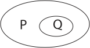
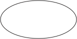
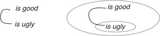

# Peirce’s Deductive Logic
**First published Fri Dec 15, 1995; substantive revision Fri May 20, 2022**

*Shin, Sun-Joo*

Charles Sanders Peirce was a philosopher, but it is not easy to classify him in philosophy because of the breadth of his work. (Please refer to the table of contents of the entry Charles Sanders Peirce.) Logic was one of the main topics on which Peirce wrote. If we focus on logic, however, it becomes apparent that both Peirce’s concept of logic and his work on logic were much broader than his predecessors’, his contemporaries’, and ours. First, Peirce located logic in his large architectonic framework of philosophy, which is why some strongly believe that Peirce’s logic cannot be properly understood without understanding his pragmatism and his semiotics, to mention but two of his other contributions. Even within the traditional boundaries of logic, Peirce made too many contributions to outline in a single article.

Acknowledging the nature of this next-to-impossible task, we single out the common theme of Peirce’s various contributions to modern logic—to extend logic, as characterized by the three different dimensions:

1. the scope of formalism (from monadic to relations),
2. the kinds of systems (from symbolic to diagrammatic systems), and
3. semantic values (from bivalence to three values).

The main goal of this entry is not only to present Peirce’s accomplishments in each of these three extensions, but also to explore the relations, if any, among these novel developments. The three sections of the entry will be devoted, respectively, to each of these three ways how the horizon of deductive logic is expanded by Peirce.

Peirce’s journey on formal deductive logic started with Boolean calculus and De Morgan’s logic of relatives. Boolean algebra created a path to generalize Aristotelian syllogism and De Morgan’s ambition to formalize relations opened a new territory to conquer. However, Peirce’s predicate logic is neither a mechanical expansion from the existing logics nor a simple combination of these two. A leap made by Peirce from his contemporary logic is qualitatively substantial enough to call Peirce a founder of modern deductive logic, as the entry explains. The first section explores Peirce’s development of predicate logic presented in his several well-known papers, by locating the root of Peirce’s introduction of quantifiers and bound variables. While formal details and notations of Peirce’s first-order logic can be overwhelming, one should not lose the sight of the bigger picture by paying attention to the main motivation behind Peirce’s enterprise for a new logic. Conquering new territory—relations—with new formal notation, Peirce’s adventure was launched into another dimension—a new mode of representation, that is, diagrammatic representation. This is the topic of the second section. While two systems of Peirce’s Existential Graphs (“EG” henceforth) are presented, the following perspective is at the background: Peirce’s EG were not invented just as random alternatives, logically equivalent to his own predicate logical notation, but a reflection of Peirce’s new approach to logic and formalization. As Peirce’s tireless attempts for predicate logic brought to us more powerful formal notation, Peirce’s search for better representation of relational states of affairs was pursued beyond his own symbolic system. Spatial, as opposed to linear, notation is still not familiar to some of us, and the second section introduces the basic notational aspects of Peirce’s EG, and discusses the fundamental differences between EG and symbolic systems. The third section about three-valued logic examines another new enterprise of Peirce, not in syntactic notation, but in semantic values. Peirce scholars propose various motivations behind Peirce’s three value semantics and those different views will be briefly discussed.

While the first contribution, that is, an extension from monadic to predicate logic, has positioned Peirce as a founder of modern logic along with Frege, it took much longer for Peirce’s other achievements to receive proper attention from logicians or philosophers. The entry aims to draw a road map for Peirce’s journey in deductive logic so that one may realize his accomplishments are very much connected with each other. More specifically, Peirce’s achievements in deductive logic were accumulative. After being able to formalize polyadic relations with new symbolic notation, Peirce devised a totally new form of representation—diagrammatic systems. What we can formalize is extended *and* how we can formalize what we can formalize is extended. And Peirce ventured into what our formalization represents and suggested a more fine-grained or a bigger territory of semantic values than binary True or False values.

## 1. From Monadic to Polyadic Logic

Peirce and Frege, independently of each other, took us from the traditional Aristotelian logic to modern logic—a large leap. Nobody could deny the power of formalization which has led early twentieth century mathematicians to surprising achievements and results.[^note-1] What is the essence of the leap made by Peirce and Frege? Is it just a matter of introducing new formal notations, i.e., quantifiers and variables, so that we may easily formalize our reasoning? If so, modern logic would be just dressing up Aristotelian logic with quantifiers/variables. This would equate one of Peirce’s main contributions in logic to the increase in formal vocabulary.

The enormous impact of the adoption of quantifiers/bound variables on the world of logic and mathematics cannot be denied. However, that should not overshadow Peirce’s insight behind the new extended formalism. This section will explore how Peirce’s conviction about the novelty of the logic of relations led him to the introduction of quantifiers/variables. Hence, quantification theory, according to Peirce, is not a matter of a linear extension of formal vocabulary, but an expansion into territory that is qualitatively different from what Aristotelian logic covers. At the same time, we should not forget that Peirce extended the territory of logic in the spirit of Boole’s algebra of logic.

In “An Improvement in Boole’s Calculus of Logic” (1867) Peirce hints at the need for an improvement of Boolean logic, not in the context of predicate logic, but in its inability to express existential statements in the context of term logic. His 1870 paper “Description of a Notation for the Logic of Relatives, Resulting from an Amplification of the Conceptions of Boole’s Calculus” (DNLR) reveals his ambition to marry Boole’s algebraic notation with De Morgan’s effort at relational representation. Many agree that this paper introduces essential vocabulary of first-order predicate logic for the first time in history. Subsequently, in “On the Algebra of Logic” (1880) Peirce investigates two kinds of operations over relations—relative sum and relative product—and “The Logic of Relatives” (known as “Note B”) published in his edited book *Studies in Logic by Members of the Johns Hopkins University* (1883) shows a major progress in quantification, influenced by the work of O. H. Mitchell (who was his student). Finally, Peirce’s 1885 paper “On the Algebra of Logic: A Contribution to the Philosophy of Notations” has been considered to be the place where Peirce fully presented his quantification theory.

Starting with DNLR, the first subsection examines Pierce’s subsequent steps until he presented the final form of his first-order logic in his 1885 paper “On the Algebra of Logic: a Contribution to the Philosophy of Notations”. (For a number of manuscripts written between these two papers, refer to Beatty 1969; Dipert 2004: 297–299; and Merrill 1978.)[^beatty-1969][^dipert-2004][^merrill-1978] The second subsection locates Peirce’s first-order predicate logic work in a larger context.

### 1.1 Relations and quantification formalized

Peirce’s quantification theory is presented in a comprehensive way together with axiomlike “icons” in his 1885 paper “On the Algebra of Logic: A contribution to the Philosophy of Notations”. Peirce’s not-short journey to modern logic started with his attempt to extend the territory of formalization. In this, Peirce was inspired by De Morgan’s struggle for the representation of relations, and at the same time Peirce was empowered with Boolean calculus which formalizes Aristotelian term logic. That is, Peirce took De Morgan’s ambition as a road map for the direction while being equipped with Boole’s method and notation for getting there. This subsection will follow Peirce’s journey to see how he reached the destination, by checking in at his main stops.

The title of Peirce’s 1870 paper “Description of a Notation for the Logic of Relatives, Resulting from an Amplification of the Conceptions of Boole’s Calculus” (DNLR) is spelled out at the beginning of the paper in the following way:

> [I]t is interesting to inquire whether it [Boole’s logical algebra] cannot be extended over to the whole realm of formal logic, instead of being restricted to that simplest and least useful part of the subject, the logic of absolute terms,…The object of this paper is to show that an affirmative answer can be given to this question. (DNLR [CP 3.45])

Boolean logic needs to be “extended” if we want to cover the entire realm of formal logic, Peirce states. What does Peirce mean by “the whole realm of formal logic”? Peirce answers: “Deductive logic can really not be understood without the study of the logic of relatives” (1911a [CP 3.641]).[^note-2]

Being encouraged by Boole’s algebra of logic, but at the same time taking his father, Professor Benjamin Peirce’s negative view of logic seriously,[^note-3] Peirce explored a way to apply Boole’s method to a larger domain of our reasoning so that relations may be formalized.

What are relations and why are they so special? Let’s compare three sentences: “John is an American”, “John is taller than Tom”, and “John is between Tom and Mary”. The first sentence has a unary predicate “is an American”, the second sentence a binary predicate “is taller than”, and the third sentence a ternary predicate “is between…and…”. A unary predicate stands for a property or quality, while a binary or ternary predicate stands for a relation. If a first-order logical system has only unary predicates, then we say it is monadic. Otherwise, predicate logic is assumed to have binary or other higher predicates.

When we move from monadic to polyadic logic, substantial changes take place. The following three changes are at the top of the list. *First* of all, a move from property to relation is a territory expansion. Noting that Aristotelian syllogisms are limited to unary predicates, one expects polyadic logic to represent more than the reasoning involved in Aristotelian syllogism, that is, term logic. *Second*, monadic logic is decidable while polyadic logic is not decidable, as Church’s theorem proved. In some sense, as the territory is expanded, we are losing its grip. *Third*, a change in notation is inevitable, which necessitates modern quantification theory. How are these three important aspects are handled by Peirce?

The realm of relations was a frontier where De Morgan did much of his creative and novel work on logic.[^note-4] However, his inquiry on the topic resides within the patterns of traditional syllogisms.[^note-5] Even more importantly, De Morgan did not have enough tools to formalize this newly extended realm.[^note-6] Hence, not surprisingly De Morgan’s relations are rather limited to a certain group which fit in syllogistic reasoning. As Merrill points out,

> De Morgan develops the general logic of relations only to the point where it can be used for his familiar syllogistic purposes. This means that he is especially interested in relations which are convertible and/or transitive,…. (Merrill 1990: 113)[^merrill-1990]

It is somewhat unclear and controversial whether Peirce’s interest in the logic of relations started independently of De Morgan’s work on the subject.[^note-7] Regardless of the origin of Peirce’s inquiry into relations, many have come to agree that it is Peirce (not De Morgan) who successfully formalized the logic of relations. Merrill, a De Morgan scholar, puts the matter in the following way:

> The most obvious problem with this view of the proposition [De Morgan’s way of handling relational arguments] is that it does not seem general enough. If we can unite two terms into a proposition by relating them, why not three or four or ten terms? De Morgan’s concern with the relational syllogism seems to have precluded this generalization; but there is no reason in principle why it could not be made. For this, though, we must wait for Frege and Peirce. (Merrill 1990: 110)[^merrill-1990]

Interestingly enough, Peirce’s writings before 1870 DNLR show Peirce also attempted to solve relational arguments by traditional syllogistic reasoning rules,[^note-8] but the approach taken in DNLR is totally different—not within a syllogistic frame but by introducing Boolean algebra notation. Peirce must have realized the power of generalization that Boolean notation could provide. Boole’s algebra formalized Aristotelian categorical syllogisms and opened a way for generalization of term logic.[^note-9] Peirce, who was impressed with Boole’s mathematical treatment of Aristotelian syllogisms, not surprisingly aimed to apply this method to relations. In that sense, modern predicate logic started in Peirce’s 1870 pioneering work. Hence, the goal of Peirce’s project—that is, to broaden the scope of formalization in logic—was a main motivation for the introduction of new vocabulary for quantifiers and bound variables. If so, Peirce’s insight early on as to the importance of reasoning involving relations is a key element in understanding a difference between Peirce’s and Frege’s developments of first-order logic.[^note-10] Furthermore, the next section will show how Peirce’s obsession with the logic of relations led him to the invention of Existential Graphs.

The logic of relations formalizes a larger territory than monadic logic, but there is a price to pay for obtaining the additional expressive power: While monadic logic is decidable, polyadic logic is not. Even though we need to wait until Church’s theorem to see the undecidability of first-order predicate logic, Peirce intuited a fundamental difference between the logic of non-relatives versus the logic of relations. Here are Peirce’s suggestive ideas over the comparisons between monadic and relational logic:

> The logic of relatives is highly multiform; it is characterized by innumerable immediate inferences, and by various distinct conclusions from the same set of premises. (1883a [CP 3.342])

And:

> [T]he old syllogistic inference can be worked by machinery, but characteristic relative inferences cannot be performed by any mere mechanical rule whatever. (1896: 330)

As Dipert correctly points out, Peirce’s remarks reveal his “*understanding* of the richness and difficulty which relations introduce into logic” (Dipert 1984a: 63)[^dipert-1984a].[^note-11]

In order to increase expressive power, Peirce left the traditional syllogistic pattern and brought in Boolean algebra of logic. The following comment emphasizes that Peirce’s choice of notation marks a clear departure from De Morgan’s pursuit of relational logic:

> De Morgan’s methodology is governed by the logic of syllogism while Peirce’s methodology is entirely algebraic. This algebraic model taken over from Boole is foreign to De Morgan’s methods. This difference in methodology reflects a significant difference at the level of definition. (Brunning 1991: 36)[^brunning-1991]

And after realizing the complicated nature of the logic of relations, Peirce explored new notation *beyond* Boolean calculus. That move is predicted in the following passage:

> The effect of these peculiarities [the non-mechanic nature of relative logic] cannot be subjected to hard and fast rules like those of the Boolian calculus. (1883a [CP 3.342])

Here is the third aspect of a transition from monadic to polyadic logic: The complication that relations bring in our reasoning, obviously, pushed Peirce to develop a new notational system. As the rest of this subsection shows, the process made over the course of 15 years—from DNLR to “On the algebra of logic”—is rather complicated. Importantly, Peirce’s introduction of quantifiers and bound variables could be seen as an inevitable outcome of his ambitious goal to expand the scope of formalization to cover relations, as Merrill says “The quantification complexities of many relational statements cried out for quantifiers” (1997: 158).

The third section of DNLR, as the title “Application of the Algebraic Signs to Logic” says, is one of the first places where Boolean algebraic notation and relational logic joined each other. In the first subsection Peirce makes it clear that the territory he aims to cover is relational, by including polyadic predicates in the following way:

(DNLR [CP 3.63–64]; the entry adopts our modern terminology instead of Peirce’s.)

| Predicates | Peirce’s terminology | Letters | Examples |
| --- | --- | --- | --- |
| unary | absolute terms | $\unary{a}, \unary{b}, \unary{c},$… (Roman alphabet) | Frenchman $(\unary{f})$, violinist $(\unary{u})$,… |
| binary | simple relative terms | $\binary{a}, \binary{b}, \binary{c}$,… (italics) | wife $(\binary{w})$), lover $(\binary{l})$, owner $(\binary{o})$,… |
| ternary | conjugative terms | $\ternary{a}, \ternary{b}, \ternary{c}$… (Kennerly [Kennerley]) | giver to — of — $(\ternary{g})$ |

For the rest of the third section, four kinds of algebraic signs are introduced to be applied on these predicate letters: the inclusion sign ($\inclusion$), the addition sign ($\cunion$), the multiplication sign (juxtaposition or “,”), and the involution sign (exponentiation).

First, he combines the sign equality “=” and the sign $<$ for “less than” to come up with the sign “$\inclusion;$” to represent inclusion:

> Thus,
>
> $$\unary{f} \inclusion \unary{m}$$
>
> means “every Frenchman is a man”, without saying whether there are any other men or not. So,
>
> $$\binary{m} \inclusion \binary{l}$$
>
> will mean that every mother of anything is a lover of the same thing; although this interpretation in some degree anticipates a convention to be made further on. (DNLR [CP 3.66])

Note that “$\unary{f} \inclusion \binary{m}$” (unlike “$\unary{f} \inclusion \unary{m}$”) would be ungrammatical since $\binary{m}$, being a binary predicate, cannot have an inclusion relation with a unary predicate $\unary{f}$.

For the sign of addition, Peirce brings in Boolean sign $+$, but with slight variation:

> The sign of addition is taken by Boole, so that
>
> $$x + y$$
>
> denotes everything denoted by $x$, and *besides*, everything denoted by $y$.…But if there is anything which is denoted by both the terms of the sum, the latter no longer stands for any logical term on account of its implying that the objects denoted by one term are to be taken *besides* the objects denoted by the other. For example,
>
> $$\unary{f} + \unary{u}$$
>
> means all Frenchmen besides all violinists, and, therefore, considered as a logical term, implies that all French violinists are *besides themselves*. For this reason alone…I preferred to take as the regular addition of logic a non-invertible process, such that
>
> $$\unary{m} \cunion \unary{b}$$
>
> stands for all men and black things, without implication that the black things are to be taken besides the men. (DNLR [CP 3.67])

Hence, Peirce’s slightly modified addition sign, $\cunion$ , denotes inclusive disjunction. “$\unary{f} \cunion \unary{u}$” denotes all those who are either a Frenchman or a violinist. The notation does not imply that no Frenchman is a violinist or no violinist is a Frenchman. Even though Peirce’s example is limited to unary predicates, we can extend the idea to binary. Using modern notation, $$\binary{l} \cunion \binary{s} = \{\langle x, y\rangle \mid lover(x, y) \lor servant(x,y)\}.$$ That is, it corresponds to a union of relations.

When the multiplication sign enters the picture, the logic of relations becomes powerful, and here is Peirce’s hallmark for the interpretation of multiplication:

> I shall adopt for the conception of multiplication *the application of a relation*, in such a way that, for example, $\binary{l}\unary{w}$ shall denote whatever is a lover of a woman.…$\binary{s}(\unary{m} \cunion \unary{w})$ will, then, denote whatever is a servant of anything of the class composed of men and women taken together. (DNLR [CP 3.68])

When polyadic predicates are in the picture, how to form a new relation becomes more interesting and complicated. This is why the multiplication operation of relative product is extremely important for further work on relational logic. A product between two predicates is much more interesting than an addition between two, depending on what kinds of predicates are involved:

1. The product between two properties is another property, being the intersection between two properties,
2. the product of a relation and a property is another new property, and
3. the product between relations produces a new relation.

Let’s try to understand Peirce’s concept of relative product in terms of modern terminology:

Let

- “$\unary{w}$” be a unary predicate, being a woman,
- “$\unary{u}$” be a unary predicate, being a violinist,
- “$\binary{l}$” a binary predicate, being a lover of, and
- “$\binary{s}$” be a binary one, being a servant of.

Then,

- $\unary{w}\bcomma\unary{u} = \{x \mid \textit{woman}(x) \land \textit{violinist}(x)\}$.[^note-12]
- $\binary{l}\unary{w} = \{ x \mid \exists y (\textit{lover}(x, y) \land \textit{woman}(y))\}$.
- $\binary{l}\binary{s} = \{ \langle x, z\rangle \mid \exists y (\textit{lover}(x, y) \land \textit{servant}(y, z))\}$.

In this modern translation, the existence of an existential quantifier is noticeable, even though Peirce himself did not mention it at all in DNLR.

Hidden quantifier implication becomes even more obvious in the operation of involution below.

> I shall take involution in such a sense that $x^y$ will denote everything which is an $x$ for every individual of $y$. Thus $\binary{l}^{\unary{w}}$ will be a lover of every woman. (DNLR [CP 3.77])

That is, $\binary{l}^{\unary{w}} = \{ x \mid \forall y (\textit{woman} (y) \rightarrow \textit{lover} (x,y))\}$. Here, a universal quantifier is present!

Before we go into the details of Peirce’s quantifiers, let’s summarize algebraic signs Peirce adopted to handle polyadic predicates:

| Algebraic Signs | Meanings/ Operations | Examples |
| --- | --- | --- |
| $\inclusion$ | inclusion | $\unary{w} \inclusion \unary{u}$ $\quad\forall x (\textit{woman} (x) \rightarrow \textit{violinist}(x))$ $\binary{l} \inclusion \binary{s}$ $\quad\forall x \forall y (\textit{lover}(x, y) \rightarrow \textit{servant}(x, y))$ |
| $\cunion$ | union | $\unary{w} \cunion \binary{u}$ $\quad\{ x\mid \textit{woman}(x) \lor \textit{violinist}(x)\}$ $\binary{l} \cunion \binary{s}$ $\quad\{ \langle x, y \rangle \mid \textit{lover}(x,y) \lor \textit{servant} (x, y)\}$ |
| $\bcomma$ | intersection | $\unary{w}\bcomma \unary{u}$ $\quad\{ x\mid \textit{woman}(x) \land \textit{violinist}(x)\}$ |
| (no comma) | relative product | $\binary{l}\unary{w}$ (a lover of *some* woman) $\quad\{ x \mid \exists y (\textit{lover}(x, y) \land \textit{woman}(y))\}$ $\binary{l}\binary{s} = \{ \langle x, z \rangle \mid \exists y (\textit{lover}(x, y) \land \textit{servant}(y, z)\}$ |
| $x^y$ | $x$ of every $y$ | $\binary{l}^{\unary{w}}$ (a lover of *every* woman) $\{ x \mid \forall y (\textit{woman} (y) \rightarrow \textit{lover} (x,y)\}$ |

Let’s focus on hidden but assumed presence of quantifiers in the case of multiplication and exponentiation: $\binary{l}\unary{w}$ is interpreted as “a lover of some woman” and $l^{\unary{w}}$ as “a lover of every woman”. Interestingly, in the process of introducing polyadic predicates, Peirce ends up bringing in quantifiers, *some* and *every*. On the other hand, considering that Aristotle’s syllogisms have two quantifiers, Peirce’s algebraic notation for quantifiers—*some* and *every*—should not surprise us. However, a crucial aspect of this development is that Boole’s unsatisfactory representation of existential propositions (as opposed to universal propositions) pushed Peirce and his student O. H. Mitchell to go beyond Boole’s logic.[^note-13] The way Peirce interprets a relative product—“$\binary{l}\unary{w}$” meaning “lover of some woman”—allows an existential quantifier to be expressed implicitly in terms of multiplication.

Let us see several different ways Peirce pursued to represent existential statements in a more explicit way. In the above for “$\binary{l}\unary{w}$”, the existential quantifier is carried out in the way relation $\binary{l}$ is applied to a unary predicate “$\unary{w}$”, but not explicitly. There are several different explicit ways Peirce represents existential statements. One method: borrowing exponentiation (in which a binary predicate is applied to a unary predicate, e.g., $\binary{l}^{\unary{w}}$), Peirce expresses an existential statement as a contradiction of a universal statement:

> Particular [existential] propositions are expressed by the consideration that they are contradictory of universal propositions. Thus, as $\unary{h}\bcomma(1-\unary{b})=0$ means every horse is black, so $0^{\unary{h}, (1-\unary{b})} = 0$ means that some horse is not black; and as $\unary{h}\bcomma \unary{b}= 0$ means that no horse is black, so $0^{\unary{h}, \unary{b}} = 0$ means that some horse is black. (DNLR [CP 3.141])

The number 1 represents the universe class and 0 the null class. However, Peirce’s notation of exponentiation whose base is 0 has some slightly different nuance. Let’s recall Peirce’s exponentiation operation:

$$ \binary{l}^{\unary{w}} = \{ x \mid \forall y (\textit{woman} (y) \rightarrow \textit{lover}(x,y))\}. $$

Then,

$$ 0^{0} = \{ x \mid \forall y (\textit{null-class}(y) \rightarrow \textit{null-relation}(x,y))\}. $$

[Note: The base 0 denotes a relation—the null relation, while the exponent 0 a class—the null class.]

There is no $y$ such that $\textit{null-class}(y)$, since noting could be in the *null-class*. Hence, vacuously, every object in the domain gets in $0^{0}$. That is, the class of things which has no relation to the null class is the universe class which is represented by 1. Hence, $0^{0} = 1$.

Suppose $\unary{m}\not = 0$.

$$ 0^{\unary{m}} = \{ x \mid \forall y (\textit{non-null-class}(y) \rightarrow \textit{null-relation}(x,y))\}. $$

Since nothing can bear the null-relation to every member of any non-null class, $0^{\unary{m}} = 0$. Hence, we get the following exponentiation notation:

$$\tag{*} \begin{align} 0^x = 0 &\quad \textrm{if } x \not =0\\ 0^x = 1 &\quad \textrm{if } x =0\\ \end{align} $$

Using this result, let’s unpack Peirce’s above quotation:

1. 1 represents the universe class and 0 the null class. (Boolean symbols)
2. “$\unary{h}\bcomma(1-\unary{b})$” denotes the class of non-black horses. (Multiplication operation for intersection)
3. “$\unary{h}\bcomma(1-\unary{b})=0$” says that there is nothing that is non-black horse. I.e., every horse is black. (by 1 and 2)
4. “$\unary{h}\bcomma(1-\unary{b}) \not = 0$” means it is not the case that every horse is black. I.e., some horse is not black. (by 3)
5. Since $\unary{h}\bcomma (1-\unary{b}) \not = 0, 0^{\unary{h},(1-\unary{b})} = 0$ (by (*) above)

Similarly, “$\unary{h}\bcomma\unary{b}=0$” means no horse is black. Hence, “$\unary{h}\bcomma \unary{b} \not = 0$” says some horse is black. Therefore, “$0^{\unary{h}\bcomma\unary{b}} = 0$” (being the exponent being not-zero) means that some horse is black.

The method presented in DNLR [CP 3.141] is interesting for several reasons. First of all, Peirce maintains Boole’s theme that all propositions are represented as equations. Another is that Peirce utilizes the contradictory relation between universal and existential propositions. Even more interestingly and importantly, Peirce brings in his exponentiation notation, exponentiation between relation to property (that is, between binary to unary predicates), to express existential statements.

After the rather complicated presentation of existential statements, focusing on the exponent part, Peirce suggests another, much simpler, way to express existential statements by using the inequality sign:

> Particular [Existential] propositions may also be expressed by means of the signs of inequality. Thus, some animals are horses, may be written $\unary{a}\bcomma\unary{h} > 0$. (DNLR [CP 3.143])

Another method Peirce adopts is to utilize the sign $\inclusion$ for inclusion and the sign $\bar{ \ \ }$ for complement. That is,

| All $a$ is $b$. | $a \inclusion b$ |
| --- | --- |
| No $a$ is $b$. | $a \inclusion \bar{b}$ |
| Some $a$ is $b$. | $\overline{[a \inclusion \bar{b}]}$ |
| Some $a$ is not $b$. | $\overline{[a \inclusion b]}$ |

However, these explicit ways to handle existential statements are limited to unary predicates or Aristotelian syllogisms, and cannot go beyond them. Instead, we would like to examine Peirce’s multiplication and exponential expressions between relations and properties more carefully. Let’s recall $\binary{l}\unary{w}$ means “a lover of some woman” while $\binary{l}^{\unary{w}}$ “a lover of every woman”. Here Peirce’s proposal for individual terms gets in the picture so that existential and universal quantifiers may become more explicitly represented. Peirce suggests individuals be denoted by capitals (DNLR [CP 3.96]). For example, for unary predicate $\unary{w}$, if $\unary{w} > 0$, then $\unary{w} = \unary{W}' \cunion \unary{W}'' \cunion \unary{W}''' \cunion \cdots$, where each of $\unary{W}'$, $\unary{W}''$, $\unary{W}'''$,…denotes an individual woman. Hence,

$$ \begin{align} \binary{l}\unary{w} & = \binary{l}(\unary{W}' \cunion \unary{W}'' \cunion \unary{W}''' \cunion \cdots)\\ &= \binary{l}\unary{W}' \cunion \binary{l}\unary{W}'' \cunion \binary{l}\unary{W}''' \cunion \cdots\\ \binary{l}^{\unary{w}} &= \binary{l}^{(\unary{W} ' \cunion \unary{W}'' \cunion \unary{W}''' \cunion \cdots)}\\ & = \binary{l}^{\unary{W}'}, \binary{l}^{\unary{W}''}, \binary{l}^{\unary{W}'''},\ldots\\ & = \binary{l}\unary{W}', \binary{l}\unary{W}'', \binary{l}\unary{W}''',\ldots (\binary{l}^{\unary{W}}=\binary{l}\unary{W}, \unary{W} \textrm{ being an individual term.}) \end{align} $$

At this point, Peirce makes a connection (i) between existential statements and the sign $\Sigma$ (as logical addition) and (ii) between universal statements and $\Pi$ (as logical multiplication), and the following passage is a precursor for the notations which appear in subsequent papers:

$$\Pi' \inclusion \Sigma',$$

where $\Pi'$ and $\Sigma'$ signify that the addition and the multiplication with commas are to be used. From this it follows that

$$s^{\unary{w}} \inclusion s\unary{w}. \qquad \textrm{(DNLR [CP 3.97])}$$

We have now come quite close to a modern notation of quantifiers. Dipert emphasizes the significance of Peirce’s notations found in DNLR:

> C. S. Peirce was the first person in the history of logic to use quantifier-like variable binding operators (briefly in 1870, W2, 392f, predating Frege’s *Begriffsschrift* (1879)). (Dipert 2004: 290)[^dipert-2004]

Ten years later, in a more comprehensive and more survey-style paper, “On the algebra of logic” (1880), we find Peirce’s ideas of DNLR emerge more tightly and more systematically. Below we will now summarize the developments of quantification presented in “Brief description of the algebra of relatives” (1882a), “The logic of relatives” (1883a), and “On the algebra of logic: A contribution to the philosophy of notations” (1885a plus 1885b).

First, he modifies the previous idea of representing a property in terms of individual terms and extends it to relations. In DNLR (1870), “$\unary{w}$”, which stands for the property “being a woman”, is expressed as

$$\unary{w} = \unary{W}' + \unary{W}'' + \unary{W}''' + \cdots$$

(where $\unary{W}'$,… denotes each individual woman). However, in 1882a, Peirce expresses a unary predicate using coefficients: For each unary predicate $x$ and for each object $a$ in the domain, Peirce defines the coefficient $(x)_a$ in the following way.

Continuing the example for the unary predicate $\unary{w},$ suppose the domain has objects $\unary{A},$ $\unary{B},$ $\unary{C},$….[^note-14] Some object is a woman and some is not. A coefficient $(\unary{w})_a$ is defined as follows:

$$ \begin{align} (\unary{w})_{a} A & = 1 \textrm{ if } A \textrm{ is woman.}\\ & = 0 \textrm{ if } A \textrm{ is not a woman.}\\ \end{align} $$

Then,

$$ \begin{align} \unary{w} & = (w)_{a} A + (w)_{b} B+ (w)_{c} C + \cdots\\ & = \Sigma_{i} (w)_{i} \binary{I}.\\ \end{align} $$

A unary predicate is successfully represented as a sum of individuals. Moving on to a binary predicate, a relation is modeled by a pair of objects:[^note-15]

> A dual relative term [binary predicate], such as “lover”, “benefactor”, “servant”, is a common name signifying a pair of objects. (1883a [CP 3.328])

And he expresses a pair of objects as “$A:B$”, where $A$ and $B$ are individual objects. Let $\binary{l}$ stand for “a lover”. Peirce defines a coefficient for each ordered pair of objects in the following way:

$$ \begin{align} (\binary{l})_{i, j} (A_i: A_j) & = 1 \textrm{ if } A_i \textrm{ is a lover of } A_j.\\ & = 0 \textrm{ if } A_i \textrm{ is not a lover of } A_j.\\ \end{align} $$

Then,

$$ \begin{align} \binary{l} & = (l)_{1,1}(A_{1}: A_{1}) + (l)_{1,2}(A_{1}: A_{2}) + (l)_{2,1}(A_{2}: A_{1}) + (l)_{2,2}(A_{2}: A_{2}) + \cdots\\ & = \Sigma_{i} \Sigma_{j}(l)_{i,j}(A_i: A_j).\\ \end{align} $$

Peirce’s generalization for a unary predicate $\unary{x}$ and a binary predicate $\binary{l}$ goes like this (1883a [CP 3.329]):

$$ \begin{align} \unary{x} & = \Sigma_{i} (\unary{x})_i \binary{I} & \textrm{ (1882a [CP 3.306])}\\ \binary{l} & = \Sigma_{i} \Sigma_{j}(\binary{l})_{i,j}(I: J) &\textrm{ (1883a [CP 3.329])}\\ \end{align} $$

This is what Peirce had in mind when he wrote “Every term [predicate] may be conceived as a limitless logical sum of individuals” (1880 [CP 3.217]). We take only objects whose coefficients are 1. Suppose $A$, $B$, and $D$ are women. Applying Peirce’s sign “+” as inclusive-or, $\unary{w} = \{ A, B, D\}$. Suppose $A$ is a lover of $C$, and $B$ is a lover of $D$. Then, $l = \{( A: C), (B: D)\}$.[^note-16]

The next task is how to utilize this tool to express an existential proposition. If there is at least one woman, say $K$, in the domain, there is at least one coefficient $\unary{w}_k$ such that it is 1. Hence, the sum of coefficients of the individuals in the domain is greater than 0. That is, $\Sigma_{i} w_i > 0$. If nobody is a woman, we will get $\Sigma_{i} w_i = 0$. In the case of the universal proposition that everybody is a woman, the product of coefficients is 0 as long as one coefficient is 0, that is, there is one person who is not a woman. That is, $\Pi_{i} w_i = 0$. When everybody is a woman, $\Pi _{i} w_i = 1$.

While the Boolean approach for quantifiers is limited to term logic, this way of handling quantifiers is so general that we can apply it directly to relations as well, as the following passage states:

> Any proposition whatever is equivalent to saying that some complexus of aggregates [sums] and products of such numerical coefficients is greater than zero. Thus,
>
> $$\Sigma_{i}\Sigma_{j} \binary{l}_{ij} > 0$$
>
> means that something is a lover of something; and
>
> $$\Pi_{i}\Sigma_{j} \binary{l}_{ij} > 0.$$
>
> means that everything is a lover of something. (1883a [CP 3.351])

And Peirce proposes to drop the $“>0”$ part:

> We shall, however, naturally omit, in writing the inequality, the $“>0”$ which terminates them all; and the above two propositions will appear as
>
> $\Sigma_{i}\Sigma_{j} \binary{l}_{ij}$ and $\Pi_{i}\Sigma_{j} \binary{l}_{ij}.\qquad$ (1883a [CP 3.351])

Getting to Peirce’s 1883 paper, we witness two significant steps taken: One is the use of index-subscripts in a crucial way, and the other is the alternation of $\Sigma$ and $\Pi$. After dropping “$>0$” Peirce draws our attention to the role of subscripts:

> The following are other examples:
>
> $$\Pi_i \Sigma_j (l)_{ij} (b)_{ij}$$
>
> means that everything is at once a lover and a benefactor of something.
>
> $$\Pi_i \Sigma_j (l)_{ij} (b)_{ji}$$
>
> means that everything is a lover of a benefactor of itself. (1883a [CP 3.352])

The order of index-subscripts is crucial to make a distinction between these two propositions. On the other hand, a difference between “Everybody loves some woman” and “There is a woman everybody loves” relies on the order of $\Pi$ and $\Sigma$:

$$\Pi_i \Sigma_j (\binary{l})_{ij} ({\unary{w}})_j \quad \textrm{ vs.}\quad \Sigma_j \Pi_i (\binary{l})_{ij }({\unary{w}})_j.$$

Finally in “On the Algebra of Logic: A contribution to the philosophy of notation” (1885a) all of these developments—(i) $\Sigma$ (sum) for *some* and $\Pi$ (product) for *all*, (ii) utilizing coefficients and their subscripts to drop denotation of individuals (e.g., from $(l)_{ij} (A_{i}: A_{j})$ to $(l)_{ij}$), (iii) mixing $\Sigma$ and $\Pi$, and (iv) omitting the “$>0$” part—have become official:

**In general, according to 1885a [CP 3.393]:**

$\Sigma_i x_i$ means that $x$ is true of some one of the individuals noted by $i$ or $$\Sigma_{i}x_i = x_i + x_j + x_k + \textit{etc.}$$ In the same way, $\Pi_i x_i$ means that $x$ is true of all these individuals, or $$\Pi_{i}x_i = x_i x_j x_k, \textit{etc.}$$ And if $x$ is a simple relation [binary predicate], $\Pi_i\Pi_j x_{i,j}$ means that every $i$ is in this relation to every $j$, $\Pi_j\Sigma_i x_{i,j}$ that every $j$ some $i$ or other is in this relation, $\Sigma_i\Sigma_j x_{i,j}$ that some $i$ is in this relation to some $j$.

**For example, according to 1885a [CP 3.394]:**

Let $l_{ij}$ mean that $i$ is a lover of $j$ and $b_{ij}$ that $i$ is a benefactor of $j$. Let $g_i$ mean that $i$ is a griffin, and $c_i$ that $i$ is a chimera. Then $\Pi_i\Sigma_j (l)_{ij }(b)_{ij}$ means that everything is at once a lover and a benefactor of something; and [I.e., $\forall x \exists y [\textit{Lover} (x, y) \land \textit{Benefactor} (x, y)]$, meaning that everybody is a lover and a benefactor of someone.] And $\Pi_i\Sigma_j (l)_{ij}(b)_{ji}$ means that everything is a lover of a benefactor of itself. [I.e., $\forall x \exists y [\textit{Lover} (x, y) \land \textit{Benefactor} (y, x)]$, meaning that everybody is a lover of a benefactor of himself/herself.]

And we find ourselves arriving at the land of modern logic. At the same time, we realize that the key concepts and vocabulary of first-order logic were already formed in his previous work discussed above. We also note that the goal outlined in the first section of the 1885 paper is more or less the same as the proposal made in his 1870 paper: “The first is the extension of the power of logical algebra over the whole of its proper realm” (1885a [CP 3.364]). Also, he almost reiterates the limit of the project which he “regrets” in 1870: “I shall not be able to perfect the algebra sufficiently to give facile methods of reaching logical conclusions” (1885a [CP 3.364]). That is, we should not expect a full-blown deductive system in this paper, but “I can only give a method by which any legitimate conclusion may be reached and any fallacious one avoided” (1885a [CP 3.364]). He carries out his promise in section 3 of the paper titled as “§3. First-intentional logic of relatives”,[^note-17] by suggesting a list of methods of transformation. He did not mean to claim this list is exhaustive, but “the one which seems to me the most useful tool on the whole” (1885a [CP 3.396]). The following are some of the rules involving quantifiers:[^note-18]

$$ \begin{align} \forall x \phi(x) \land \forall y \phi(y) & = \forall x\forall y (\phi(x) \land \phi(y))\\ \exists x \phi(x) \land \forall y \phi(y) & = \exists x\forall y (\phi(x) \land \phi(y))\\ \exists x \phi(x) \land \exists y \phi(y) & = \exists x\exists y (\phi(x) \land \phi(y))\\ \end{align} $$ $$ \begin{align} \forall x \forall y \chi(x,y) & = \forall y\forall x \chi(x,y)\\ \exists x \exists y \chi(x,y) & = \exists y\exists x \chi(x,y)\\ \forall x \exists y (\phi(x) \land \psi(y)) & = \exists y\forall x (\phi(x) \land \psi(y))\\ \forall x \exists y \chi(x,y) & \not = \exists y\forall x \chi(x,y), \textrm{ but}\\ \exists x\forall y \chi(x,y) & \Rightarrow \forall y \exists x \chi(x,y)\\ \end{align} $$ $$\exists x \forall y \chi(x,y) = \exists x \forall y (\chi(x,y)\land \chi(x,x))$$

In spite of the six-year interval between Frege’s *Begriffsschrift* (1879) and Peirce’s quantification theory in 1885, credit has been given to both logicians. We call them both the founders of modern logic, since Peirce was not aware of Frege’s work on the topic. Also, it should be noted that Frege presented a logical system equipped with axioms and rules, which was not pursued in Peirce’s work.

### 1.2 Boolean tradition—algebraic and model-theoretic

Boole’s aspiration to capture logic in terms of an algebraic system has inspired many mathematicians and logicians who are interested in connecting the two disciplines, logic and mathematics. As seen in the previous section, Peirce is clearly one of them. He pushed the Boolean idea of an algebraic system further in two ways: One is to improve Boole’s representation of particular proposition (i.e., “Some *A* is *B*”) so that traditional Aristotelian syllogisms may fit in an algebraic system. The other is to represent not only qualities but also relations so that a new algebraic system may reach beyond traditional syllogisms. In that process, new notations for quantifiers and variables were invented.

Peirce’s two-decade work made a major contribution to the algebra of logic tradition in two important ways. First, Peirce’s introduction of quantifiers and variables itself is a significant advance in formal logic, close to the predicate logic we know. Second, subsequent momentous work on mathematical logic was built on the new notation and extended logic by Peirce and his students, O. H. Mitchell and C. Ladd (later Ladd-Franklin). A decade after Peirce’s “On the Algebra of Logic”, (1885) Ernst Schröder published three volumes of mathematical logic *Vorlesungen über die Algebra der Logik* (1890–1905).[^note-19] His work was carried out squarely in the Boolean algebraic tradition, and two important aspects of the book reflect Peirce’s influence: He adopted Peirce’s notation (over Frege’s), and the third volume is devoted to the logic of relations. Goldfarb’s insightful paper expresses these two aspects of Peirce’s influence in the following way:

> Building on earlier work of Peirce, in the third volume of his *Lectures on the algebra of logic* [1895] Schröder develops the calculus of relatives (that is, relations). Quantifiers are defined as certain possibly infinite sums and products, over individuals or other relations. (Goldfarb 1979: 354)[^goldfarb-1979]

As seen in the previous subsection, including relations (not just qualities) in algebraic expressions and representing the universal quantifier as products (i.e., $\Pi$) and the existential quantifier as sums (i.e., $\Sigma$) were the main output of Peirce’s two decade tireless work. Considering Schröder’s book was the most popular logic textbook for mathematical logic students during that era, we can easily say Peirce’s legacy has lived on. Peckhaus, working on a delicate relation between Frege’s and Schröder’s quantification theory, locates where Schröder’s modern quantification theory originates from:

> This [Schröder’s *Vorlesungen über die Algebra der Logik* was the result of his learning modern quantification from Frege’s *Begriffsschrift*] is a simple and plausible answer, but it is false. Schröder never claimed any priority for his quantification theory, but he did not take it from Frege. Schröder himself gives the credit for his use of $\Sigma$ and $\Pi$ to Charles S. Peirce and Peirce’s student Oscar Howard Mitchell (Schröder 1891, 120–121). (Peckhaus 2004: 12)[^peckhaus-2004]

Afterwards well-known mathematicians and logicians, Löwenheim, Skolem and Zermelo, all used Peirce-Schröder notation. Peano was also very much familiar with Peirce-Schröder algebraic logic. Putnam includes Whitehead in this tradition as well:

> This [Whitehead’s *Universal Algebra*] is a work squarely in the tradition to which Boole, Schröder, and Peirce belonged, the tradition that treated general algebra and logic as virtually one subject. (Putnam 1982: 298)[^putnam-1982]

Interestingly enough, Putnam points out that this portion of Whitehead’s work was prior to his collaboration with Russell, and during this early period Whitehead’s work, especially on quantifiers, mentions Peirce and his students, but not Frege. Clearly we needed to wait until Russell drew our attention to Frege, but “it was Peirce who seems to have been known to the entire world logical community” (Putnam 1982: 297)[^putnam-1982]. Putnam’s label of the Peirce group as “effective” discoverers of the quantifier and Frege as a discoverer could be a resolution to the Frege-first versus Peirce-first debate.

While many have focused on the development of quantifiers, it is quite noteworthy that Tarski drew our attention to the importance of the algebra of relations in his 1941 paper “On the Calculus of Relations”.[^note-20] Just as Peirce did in his DNLR (1870) paper, Tarski acknowledges De Morgan’s contribution: It is De Morgan who first realized the necessity of representing relations as well as qualities and struggled over the limits of traditional logic. And Tarski gives full credit to Peirce in terms of solid advance over the calculus of relations.

> The title of creator of the theory of relations was reserved for C. S. Peirce. In several papers published between 1870 and 1882a, he introduced and made precise all the fundamental concepts of the theory of relations and formulated and established its fundamental laws.…In particular, his investigations made it clear that a large part of the theory of relations can be presented as a calculus which is formally much like the calculus of classes developed by G. Boole and W. S. Jevons, but which greatly exceeds it in richness of expression and is therefore incomparably more interesting from the deductive point of view. (Tarski 1941: 73)[^tarski-1941]

This passage not only situates Peirce’s logical achievement in the context of the algebra of logic tradition but also characterizes Peirce’s work as an extension of Boole’s and Jevons’ monadic logic. (For more details about Peirce’s position in Boole’s tradition, see the entry the algebra of logic tradition.)

Some Peirce scholars have also claimed that Peirce’s invention of quantifiers is a product of Peirce’s own philosophy of logic, which is different from Frege’s (Brady 1997; Burch 1997; Iliff 1997; Merrill 1997)[^brady-1997][^burch-1997][^iliff-1997][^merrill-1997]. Hintikka’s proposal (1997) to explain the main difference between Frege’s and Peirce’s contributions to modern logic is quite intriguing. Tracing back to Frege’s own distinction between *calculus ratiocinator* versus *a lingua characterica*, van Heijenoort adds a new dimension to these two opposing views of logic beyond what Frege alluded to (van Heijenoort 1967: footnote 1, p. 329).[^note-21] While Frege emphasized a difference between propositional and quantification logic, van Heijenoort located a difference in what is taken as a totality. Boole’s tradition does not make any ontological commitment about a totality, but it “can be changed at will” (1967: 325). On the other hand, Frege’s language is about *the* universe. Borrowing van Heijenoort’s distinction between Boole’s logic as a calculus and Frege’s universality of logic, Hintikka locates Peirce in Boole’s camp, calling it the model-theoretic tradition. Unlike Frege’s view of the universe, the model-theoretic tradition allows us to reinterpret a language and thus assign different universes to quantifiers. According to Hintikka, Peirce’s development of modal logic is a good piece of evidence to show how fruitful Peirce’s way of understanding quantifiers could be (Hintikka 1997)[^hintikka-1997]. In the next section where Peirce’s graphical systems are introduced, we will revisit this issue.

## 2. From Symbolic to Iconic Representation

So far, we have argued that Peirce’s insight on relations pushed him to extend the territory of logic *from* monadic, non-relational, propositional logic *to* polyadic, relational, quantification logic. This is the beginning of modern logic as we know it. In this section, taking up a different angle of Peirce’s adventure—to extend forms of representation *from* symbolic systems *to* diagrammatic systems, we present a story where his two different kinds of extension—one from non-relations to relations and the other from symbolic to diagrammatic—are connected with each other.

Peirce presented propositional logic, quantification logic, and modal logic in a graphical way, and invented three systems of Existential Graphs (EG)—Alpha, Beta, and Gamma, respectively. In spite of Peirce’s own evaluation of Existential Graphs as “my chef d’oeuvre”, EG had to wait to be understood for a half century until two philosophers—Don Roberts and Jay Zeman—produced their impressive work. In the 1980s, EG was receiving attention from new disciplines—computer science and artificial intelligence—thanks to John Sowa’s novel application of EG to knowledge representation in *Conceptual Structure* (1984). More recently, toward the end of the twentieth century interdisciplinary research on multi-modal reasoning has drawn our attention to non-symbolic systems (see, e.g., Barwise & Allwein [eds] 1996 and Barwise & Etchemendy 1991)[^barwise-1991] and EG, not surprisingly, occupied the top of their list. In that context, Shin (2002) focused on differences between symbolic versus diagrammatic systems and suggested a new way of understanding the EG system, though this was criticized in Pietarinen 2006.

While Peirce mainly presented linear expressions in his official writings from 1870 to 1885,[^note-22] the notation adopted in Frege’s 1879 *Begriffsschrift* is more iconic; it is at least not as linear as Peirce’s in the above period. However, it is Peirce, not Frege, who invented a full-blown non-symbolic system for first-order logic—Existential Graphs. It is Peirce’s EG, not his linear first-order notation, which is presented as a deductive system with inference rules. As the EG system has been investigated more rigorously, philosophical questions involving Peirce’s invention of the system have been raised as well. The discovery of EG’s power and novelty has naturally led us to other parts of Peirce’s philosophy. Why and how did the invention of EG come about? What does EG reveal about Peirce’s view of logic and representation?

Many have pointed to Peirce’s theory of signs, which classifies signs as being of three kinds—symbols, indices, and icons—as the foremost theoretical background for Peirce’s EG.[^note-23] For example, as will be shown below, ovals and lines, along with letters, are the basic vocabulary of Peirce’s EG. It is natural to connect Peirce’s interest in icons with his invention of graphical systems, and the connection is real (Shin 2002: 22–35)[^shin-2002]. However, to pinpoint the features of icons and the iconic nature of Peirce’s graphical systems requires much more work than our intuition provides. Moreover, there is a big gap between Peirce’s discussions of icons[^note-24] and his invention of full-blown graphical systems; something else has to be brought into the picture to explain how Peirce got from his initial ideas about icons all the way to his EG.

In a slightly different and bigger picture, van Heijenoort’s distinction between Boole’s *calculus ratiocinator* versus Frege’s *lingua characteristica* could be related to the topic. Agreeing with both Hintikka’s and Goldfarb’s evaluation that Peirce belongs to Boole’s tradition, Shin finds a connection between the model-theoretic view of logic (where Boole and Peirce are placed) and EG’s birth (see Shin 2002: 14–16 and Pietarinen 2006)[^pietarinen-2006][^shin-2002]. However, Peirce’s awareness of the re-interpretation of language is necessary, but not sufficient, for his pursuit of a different form of representation. While the acknowledgment of the possibility of different models of a given system was presupposed by Peirce’s project for various kinds of systems, not every Boolean has presented multiple systems. Boole himself

> was quite conscious of the idea of *disinterpretaion*, of the idea of using a mathematical system as an algorithm, transforming the signs purely mechanically without any reliance on meanings. (Putnam 1982: 294)[^putnam-1982]

On the other hand, Burris and Legris’s entry shows us how Boole’s algebra of logic tradition has led us to the development of model theory (see the entry on the algebra of logic tradition).

### 2.1 Pragmatic maxim applied to the logic of relations

Without challenging these existing explanations involving Peirce’s EG, in this entry we would like to bring in one overlooked but crucial aspect of Peirce’s journey to EG so that our story may fill in part of the puzzle of Peirce’s overall philosophy. Peirce’s mission for a new logic started with how to represent relations, which led him to invent quantifiers and bound variables, as we discussed in the previous section. The same commitment, that is, to represent relations in a logical system, we claim, was a main motivation behind Peirce’s search for a new kind of sign systems—iconic representation of relations. Peirce’s work on Euler/Venn diagrams provides us with another piece of evidence to support our claim that the main motivation behind EG was to represent relations. While improving Venn systems, Peirce realizes that the following defect cannot be eliminated:

> [T]he system [Venn’s] affords no means of exhibiting reasoning, the gist of which is of a relational or abstractional kind. It does not extend to the logic of relatives. (Peirce 1911b [CP 4.356])

Again, we do not think this is *the* crucial ingredient for the creation of EG, but one key element which works nicely together with his theory of signs and his model-theoretic view of logic.

Peirce’s graphical representation first appears in his 1897 paper “The Logic of Relatives”. After his own new linear notation came out in 1885 as seen above, why did Peirce revisit the logic of relations? The first paragraph of the paper provides a direct answer:

> I desire to convey some idea of what the new logic is, how two “algebras”, that is, systems of diagrammatical representation by means of letters and other characters, more or less analogous to those of the algebra of arithmetic, have been invented for the study of the logic of relatives, and…. (1897a [CP 3.456])

Two things should be noted. One is that diagrammatic systems are also called “algebra” by Peirce. That is, according to Peirce, algebra is not limited to symbolic systems. The other is that Peirce makes it clear that two different forms of algebra carry out *the* new logic, not new logic*s*.

In thinking about the scope of the logic of relations, the question arises: Why did Pierce feel the need for another form of representation different from the 1885 notation? “I must clearly show what a relation is” (1897a [CP 3.456]). The clear understanding of “relations”, Peirce believes, is a guide for his excursion into different forms of logical systems. Here we would like to draw reader’s attention to Peirce’s well-known paper “How To Make Our Ideas Clear ” (1878), where three sections are devoted to the three grades of meaning (see the entry on Peirce’s theory of signs).

The first grade of understanding the word “relation” comes from our ordinary experience, and the second grade is to have a more abstract and general definition-like understanding. According to Peirce, that is not enough to achieve a full understanding of the word “relation”. Finally, Peirce’s hallmark of the pragmatic maxim leads us to the third grade of clarity:

> It appears, then, the rule for attaining the third grade of clearness of apprehension is as follows: Consider what effects, which might conceivably have practical bearings, we conceive the object of our conception to have. Then the whole of our conception of those effects is the whole of our conception of the object. (1878 [CP 5.402])

In order to understand what a relation is, we need to know what follows from it. Then, the question is how we know what its consequences are. Here is one answer given by Peirce in the 1897a paper, as far as the term “relation” goes:

> The third grade of clearness consists in such a representation of the idea that fruitful reasoning can be made to turn upon it, and that it can be applied to the resolution of difficult practical problems. (1897a [CP 3.457])

Therefore, how a relation is represented is crucial in figuring out what follows from a relational state of affairs. Better representations will yield more “fruitful reasoning” and hence, will be more helpful for solving practical problems. It is obvious that in the paper Peirce intends to search for more *desirable* representations. Importantly, in section 4 when the third grade of clearness of the meaning “relation” is discussed, diagrammatic representation of relations makes its first appearance.

Influenced by A. B. Kempe’s graphic representation,[^note-25] Peirce finds an analogy between relations and chemical compounds:

> A chemical atom is quite like a relative in having a definite number of loose ends or “unsaturated bonds”, corresponding to the blanks of the relative. (1897a [CP 3.469])

A chemical molecule consists of chemical atoms, and how atoms are connected with one another is based on the number of loose ends of each atom. For example, chemical atom H has one loose end and chemical atom O has two. So, the following combination is possible, and it is a representation of the water molecule, H₂O:

An analogy to the logic of relations runs like this: A sentence consists of names (proper names or indices) and predicates, and each predicate has a fixed arity. For example, the predicate “love” needs two names and “give” three. Hence, the following diagrammatic representation is grammatical and it is a representation of the proposition “John loves Mary”.

Peirce created a novel and productive analogy in representation between chemistry and the logic of relation by adopting the doctrine of valency as the key element for the analogy, as shown in the above two diagrams. Believing that this graphic style of representation would help us conceive the consequences or effects of a given relation in a more efficient way,[^note-26] Peirce presents Entitative Graphs, which is a predecessor of EG.[^note-27]

EG keeps the representation of a relation developed here, and remains as Peirce’s final and the most cherished notation for the logic of relations (1903a). EG consists of three parts, Alpha, Beta, and Gamma, which correspond to propositional, first-order, and modal logic, respectively. After presenting the Alpha system in a formal way, we discuss the Beta system of EG focusing on Peirce’s novel ideas in expanding a propositional graphic system to a quantificational graphic system. For more details, we recommend works on EG by Roberts, Zeman, Sowa, and Shin.

### 2.2 Alpha system

Peirce’s Alpha graphs may be drawn on a blackboard, on a whiteboard, or on a sheet of paper. The basic unit is a simple sentence without any sentential connectives, that is, negation, conjunction, disjunction or conditional, etc. The following is an example of a basic Alpha graph, asserting that it is sunny.

When we would like to assert that it is sunny and windy, we juxtapose two basic Alpha graphs in the following way:

In order to make the Alpha Graph Boolean-functionally complete, all we need is to represent negation. The following Alpha graph says that it is not the case it is sunny, by enclosing the above graph with a cut:

When we have negation and conjunction, it is important to keep the order in the right way. “It is not sunny and it is not windy” is different from “It is not the case that it is sunny and windy”. Hence, the sentence “It is not the case that it is sunny and it is windy” is ambiguous, depending on the scope of “it is not the case”. In the case of sentential logic, parentheses get in to prevent this ambiguity: $\neg (S \land W)$ versus $\neg S \land W$. Peirce’s warning follows:

> The interpretation of existential graphs is *endoporeutic*, that is proceeds inwardly; so that a nest sucks the meaning from without inwards unto its centre, as a sponge absorbs water. (Peirce 1910a: 18, Ms 650)

Hence, the following Alpha graph should be read *not* as “$\neg P \land \neg Q$”, *but* as “$\neg(P \land \neg Q)$”:

This way of understanding Alpha Graphs is not incorrect, but has given a wrong impression that the Alpha system is equivalent to a sentential system with two connective symbols, negation and conjunction. We all prefer having more connectives than these two, especially when we use the language. The section explores an alternative reading of Alpha diagrams, beyond negation and conjunction only, without introducing any new syntactic device.

Below we introduce Alpha Graphs as a formal system equipped with its syntax and semantics. These tools not being available to Peirce, the presentation aims to show Peirce’s EG is not intrinsically different from other formal systems. At the same time, in order to place Peirce’s graphical systems in the traditional well-developed discourse of logic, there will be an intermediate stage, that is, to read off Peirce’s graphs into symbolic language. This will make Peirce’s graphs more accessible, and at the same time support our claim that Peirce extended forms of representations with the same scope of logic as symbolic representation.

#### Syntax

##### Vocabulary

1. Sentence symbols: $A_{1},$ $A_{2},$…
2. Cut 

##### Well-formed diagrams

1. An empty space is a well-formed diagram.
2. A sentence symbol is a well-formed diagram.
3. If $D$ is a well-formed diagram, then so is a single cut of $D$ (we write “$[D]$]”).
4. If $D_{1}$ and $D_{2}$ are well-formed diagrams, then so is the juxtaposition of $D_{1}$ and $D_{2}$ (write “$D_{1}\ D_{2}$”).
5. Nothing else is a well-formed diagram.

Here we present two equivalent reading methods for the system. The Endoporeutic reading algorithm, formalized based on Peirce’s own suggestion (as quoted above), is a traditional way to understand EG. An alternative reading method, the Multiple reading algorithm, was more recently presented to approach EG in a more efficient way.[^note-28]

#### Endoporeutic Reading Algorithm

1. If $D$ is an empty space, then it is translated into $\top$.
2. If $D$ is a sentence letter, say $A_{i}$, then it is translated into $A_{i}$.
3. Suppose the translation of $D$ is $\alpha$. Then, $[D]$ is translated into $(\neg \alpha)$.
4. Suppose the translation of $D_{1}$ is $\alpha_{1}$ and the translation of $D_{2}$ is $\alpha_{2}$. Then, the translation of $D_{1}\ D_{2}$ is $(\alpha_{1} \land \alpha_{2})$.

#### Multiple Readings Algorithm

1. If $D$ is an empty space, then it is translated into $\top$.
2. If $D$ is a sentence letter, say $A_{i}$, then it is translated into $A_{i}$.
3. Suppose the translation of $D$ is $\alpha$. Then, $[D]$ is translated into $(\neg \alpha)$.
4. Suppose the translation of $D_{1}$ is $\alpha_{1}$ and the translation of $D_{2}$ is $\alpha_{2}$.
5. the translation of $D_{1} D_{2}$ is $(\alpha_{1} \land \alpha_{2})$,
6. the translation of $[D_{1} D_{2}]$ is $(\neg\alpha_{1} \lor \neg \alpha_{2})$,
7. the translation of $[D_{1}\ [D_{2}]]$ is $(\alpha_{1} \rightarrow \alpha_{2})$, and
8. the translation of $[[D_{1}]\ [D_{2}]]$ is $(\alpha_{1} \lor \alpha_{2})$.

Each of these two readings has its own strength.[^note-29] The Endopreutic reading assures us that the Alpha system is truth-functionally complete, since it has power to express conjunction and negation. However, this traditional method has been partly responsible for the following two incorrect judgments about Alpha graphs:

1. There is not much difference between the Alpha system and a propositional language with only two connectives, $\land$ and $\neg$, except that Alpha graphs have cuts instead of symbolic connectives.
2. When it comes down to practical use, just as we do not want to use only two connectives in a language, we have no reason to adopt the Alpha system over propositional languages with more connectives.

Challenging these misconceptions, the Multiple readings algorithm shows that Alpha diagrams do not have to be read off as a sentence with “$\land$” and “$\neg$” only, but can be directly read off in terms of other connectives as well. Two questions may be raised:

1. Is there a redundancy in the Multiple readings method? For example, is clause 4(b) above dispensable in terms of clause 3 and clause 4(a)?
2. Does this new reading show that the Alpha system is just like a propositional language with various connectives?

Let us answer these questions through the following example.

##### Example

The following graph is translated into the following four formulas:

| 1. | $\neg(\neg R \land \neg S)$ | Endoporeutic Reading |
| --- | --- | --- |
| 2. | $R \lor S$ | 4(d) of Multiple Readings |
| 3. | $\neg R \rightarrow S$ | 3 and 4(c) of Multiple Readings |
| 4. | $\neg\neg R\lor \neg\neg S$ | 3 and 4(b) of Multiple Readings |

The Endoporeutic reading allows us to get the first reading only, but we may obtain different sentences by the Multiple Readings. Of course, all of these sentences are logically equivalent. Here is an interesting point: In the case of symbolic systems, we need to prove the equivalence among the above sentences by using inference rules. But, derivation processes are dispensable in the case of the Alpha system when the Multiple readings are adopted.[^note-30] Hence, having the clause 4(b) above in addition to clause 3 and clause 4(a) is not redundant, but instead highlights a fundamental difference between the Alpha system and a symbolic language with various connectives (see Shin 2002: §§4.3.2, 4.4.4, and 4.5.3)[^shin-2002].

Since we have the semantics for propositional logic and our reading methods translate Alpha diagrams into a propositional language, we can live without the direct semantics. However, if one insists on the direct semantics:

#### Semantics

Let $v$ be a truth function such that it assigns t or f to each sentence letter and t to an empty space. Now, we extend this function to $\overline{v}$ as follows:

1. $\overline{v}(D) = v(D)$ if $D$ is a sentence symbol or an empty space.
2. $\overline{v} ( {\bf [}D{\bf ]})$ = t iff $\overline{v}(D)$ = f.
3. $\overline{v}(D_{1} D_{2})$ = t iff $\overline{v}(D_{1}) =$t and $\overline{v}(D_{2})$ = t.

We also would like to emphasize that this is not the only way to approach Peirce’s EG. For example, some claim that game-theoretic semantics were foreshadowed by Peirce, and thus argue for a more dynamic understanding of EG from the game-theoretic point of view (Burch 1994; Hilpinen 1982; Hintikka 1997; Pietarinen 2006)[^burch-1994][^hilpinen-1982][^hintikka-1997][^pietarinen-2006].

Peirce makes it clear his EG is a deductive system equipped with inference rules:

> *The System of Existential Graphs* is a certain class of diagrams upon which it is permitted to operate certain transformations. (1903a [CP 4.414])

The inference rules for the Alpha system are presented as follows: (1903a [CP 4.415])[^note-31]

**Code of Permissions**

- Permission No. 1. In each special problem such graphs may be scribed on the sheet of assertion as the conditions of the special problem may warrant.
- Permission No. 2. Any graph on the sheet of assertion may be erased, except an enclosure with its area entirely blank.
- Permission No. 3. Whatever graph it is permitted to scribe on the sheet of assertion, it is permitted to scribe on any unoccupied part of the sheet of assertion, regardless of what is already on the sheet of assertion.
- Permission No. 4. Any graph which is scribed on the inner area of a double cut on the sheet of assertion may be scribed on the sheet of assertion.
- Permission No. 5. A double cut may be drawn on the sheet of assertion; and any graph that is scribed on the sheet of assertion may be scribed on the inner area of any double cut on the sheet of assertion.
- Permission No. 6. The reverse of any transformation that would be permissible on the sheet of assertion is permissible on the area of any cut that is upon the sheet of assertion.
- Permission No. 7. Whenever we are permitted to scribe any graph we like upon the sheet of assertion, we are authorized to declare that the conditions of the special problem are absurd.

Emphasizing the symmetry both in erasure versus insertion and in even versus odd number of cuts, Shin rewrote the rules (Shin 2002: 84–85)[^shin-2002]:

#### Reformulated Transformation Rules

1. RR1: In an E-area,[^note-32] say, area $a$,
2. we may *erase* any graph, and
3. we may *draw* graph $X$, if there is a token of $X$
4. in the same area, i.e., area $a$, or
5. in the next-outer area from area $a$.
6. RR2: In an O-area,[^note-33] say, area $a$,
7. we may *erase* graph $X$, if there is another token of $X$
8. in the same area, i.e., area $a$, or
9. in the next-outer area from area $a$, and
10. we may *draw* any graph.
11. RR3: A double cut may be erased or drawn around any part of a graph.

For examples of deduction sequences, refer to Roberts (1973: 45–46) and Shin (2002: 91).

### 2.3 Beta system

In §1.1, we showed that formalizing relations was a key motivation behind Peirce’s new logic—first-order logic. In §2.1, we established a connection between Peirce’s own pragmatic maxim and his graphic representation of relations. Peirce did not aim to present a new logic by inventing a graphic system, but rather to present another new notation for the logic carried out by quantifiers and bound variables. He almost took it for granted that a graphic representation of relations helps us observe their consequences in a more efficient way. Hence, the Beta system may be considered to be the final stop of Peirce’s long journey to search for better notation for the logic of relations, which started in 1870 at the latest.[^note-34]

We will not go into the formal details of the Beta system in this entry but will instead refer to Chapter 5 of Shin, where three slightly different approaches to Beta graphs—Zeman’s, Roberts’, and Shin’s—are discussed at a full length. While Zeman’s reading is comprehensive and formal, Roberts’ method seems to appeal to a more intuitive understanding of the system. Taking advantage of the merits of these two existing works, Shin developed a new reading method of Beta graphs and reformulated the transformation rules of the system.[^note-35] Her approach focuses on visual features of Beta graphs and highlights fundamental differences between symbolic versus diagrammatic systems. In the remaining part of the entry, we would like to examine how the essence of the logic of relations is graphically represented in the Beta system so that the reader may place EG in the larger context of Peirce’s enterprise.

The introduction of quantifiers and bound variables is believed to be one of the key steps of first-order logic in symbolic systems. This is why some logicians take Peirce’s 1885 paper “On the Algebra of Logic: A contribution to the Philosophy of Notations” to be the birthplace of modern logic. If this is the case, then how does Peirce represent quantifiers and bound variables in Beta graphs?

Interestingly enough, when Peirce considered a graphic system his first concern was representation of relations, not representation of quantifiers. As we said in §3.1, Peirce presented diagrammatic representation based on an analogy to chemical molecules for a full understanding of relations. Hence, the arity of a predicate is represented by the number of lines radiating from the predicate term. Next, Peirce extends the use of a line to connect predicates:

> In many reasonings it becomes necessary to write a copulative proposition in which two members relate to the same individual so as to distinguish these members.… [I]t is necessary that the signs of them should be connected in fact. No way of doing this can be more perfectly iconic than that exemplified in [the following graph]:
>
> 
>
> (1903b [CP 4.442])

The line connecting two predicates, representing *one and the same* object, is called a *line of identity* by Peirce. That is, the sameness is represented visually in Beta diagrams.[^note-36] In the case of a symbolic language, we may adopt one and the same quantified variable-type to represent the identity. For example, the above diagram says $\exists x(x <A \ \land \ B < x)$, and hence, the variable-type $x$ (roughly) corresponds to the identity line. However, the same variable-type is not sufficient for expressing the sameness in other cases, e.g., $\exists x(x <A \ \land \ B < x) \rightarrow \exists x (x < C)$.

The way universal and existential statements are represented in the Beta system highlights a difference between graphic and symbolic systems. Rather than adopting one more syntactic device for quantification, Peirce relies on the following visual features:

> [A]ny line of identity whose outermost part is evenly enclosed refers to **something**, and any one whose outermost part is oddly enclosed refers to **anything** there may be. (1903b [CP 4.458][^note-37])

Let us borrow the two following graphs from Roberts (1973: 51):[^note-38]

The first graph (where the outermost part of the line is evenly, zero, enclosed) says that something good is ugly, and the second graph (where the outermost part is enclosed once) says that everything good is ugly.[^note-39]

How about the scope problem which arises when multiple quantifiers are used? In the case of a symbolic system, the linear order takes care of the problem. Peirce’s solution for EG is to read off another kind of visuality: The less enclosed the outermost part of a line is, the larger the scope that the line gets.

Roberts’ following example illustrates the scope matter nicely (1973: 52):

The first graph says

$$\forall x (\textit{Catholic}(x) \rightarrow \exists y [\textit{Adores} (x,y) \land \textit{Woman}(y)])$$

and the second

$$\exists y (\textit{Woman}(y) \land \forall x [\textit{Catholic}(x) \rightarrow \textit{Adores} (x,y)]).$$

In the first graph, the line whose outermost part is oddly enclosed is less enclosed than the line whose outermost part is evenly enclosed. Therefore, the universal quantifier has larger scope than the existential quantifier. In the second graph, it is the other way around.

Let us summarize three interesting features of the Beta system:

1. Relations are represented graphically, not symbolically, in the Beta system, in terms of a line. We argued that ultimately Peirce’s pragmatic maxim was behind this alternative way of representation.
2. A distinction between universal versus existential statements is represented by the visual fact about whether the outermost part of a line lies in an area enclosed either by an odd number or by even number of cuts.
3. The order of quantification is represented by the following visuality: The less enclosed a line is, the more extensive scope it has.

## 3. From Bivalent to Triadic Logic

Fisch and Turquette (1966) discovered three crucial pages out of Peirce’s *Logic Notebook* (1865–1909, Ms 339).[^note-40] This shows that Peirce’s invention of three-valued sentential logic predates by at least a decade Jan Lukasiewicz’s and Emil Post’s achievements on the same topic. The three pages contain the essential elements of triadic logic and an intriguing passage about Peirce’s motivation behind triadic logic. If we put Peirce’s development of triadic logic in contemporary terms, Peirce seemed to be branching out to non-standard logic. If so, this adventure would be qualitatively different from the other two we have just discussed in the previous sections.

When Peirce developed relational logic, the territory of formalization was vastly expanded. New vocabulary, hence, new syntactic rules and semantic rules, were added. Naturally we welcome the territory of formalization and, hence, theoretical justification is not needed. From sentential to relational logic—this is an extension in a literal sense: We do not discard the previous results—hence they are preserved—but all we do is to expand them.

On the other hand, in the case of extension to non-symbolic languages, the logic itself stays the same, without addition or subtraction, but a new form of representation is introduced. That is, what to represent is not extended, but how to represent is. Some might not see the need for various forms of representation, and might not be convinced of the necessity of graphical systems. Nonetheless, at a theoretical level, Peirce’s EG does not demand lengthy theoretical justification. In some sense, the proof is in the pudding: Can this new graphical system carry out the same task as existing symbolic systems do? If so, which system is easier to use? Which system is more efficient? We might not arrive at a clean consensus, but the discussions are more or less predictable.

However, when one more semantic value is added to **T** (true) and **F** (false), logic is not preserved any more. When semantics is extended or changed, the new logic is neither a monotonic expansion of the territory of logic nor an alternative syntactic form of representation to existing symbolic systems. Triadic logic, by introducing one more semantic value, departs from the standard logic which is based on bivalence. Here, the status of the principle of excluded middle (“*Q* or not-*Q*”) is shaken. So is the law of contradiction. It is the burden of any non-standard logic to justify its being non-standard: Why the third value? What is the third value? Unknown? If so, is it an epistemological issue? Indeterminate? If so, does this require a metaphysical explanation?

The first subsection summarizes Peirce’s calculus of triadic logic and the second briefly discusses Peirce’s own motive for triadic logic.

### 3.1 Truth table of a three-valued system

Three values, **V**, **L**, and **F**, are introduced, where **V** is true, **L** indeterminate, and **F** false. The traditional semantic domain for sentential logic, true and false, is extended to include “indeterminate”. Based on this extended semantic territory, Peirce presents the semantics of several sentential operators, one unary and the others binary. Modifying Peirce’s presentation slightly to make it more similar to our conventional truth table style without changing content, we present the three operators’ truth tables.

The semantics of a unary operator, which corresponds to negation:

| $x$ | $\bar{x}$ |
| --- | --- |
| **V** | **F** |
| **L** | **L** |
| **F** | **V** |

The semantics for six binary connectives is presented:

| $x$ | $y$ | $\Phi(x, y)$ | $\Theta(x, y)$ | $\Psi(x, y)$ | $Z(x, y)$ | $\Omega(x, y)$ | $\Gamma(x, y)$ |
| --- | --- | --- | --- | --- | --- | --- | --- |
| **V** | **V** | **V** | **V** | **V** | **V** | **V** | **V** |
| **L** | **V** | **V** | **V** | **V** | **L** | **L** | **L** |
| **F** | **V** | **V** | **V** | **F** | **F** | **F** | **V** |
| **V** | **L** | **V** | **V** | **V** | **L** | **L** | **L** |
| **L** | **L** | **L** | **L** | **L** | **L** | **L** | **L** |
| **F** | **L** | **F** | **L** | **F** | **F** | **L** | **L** |
| **V** | **F** | **V** | **V** | **F** | **F** | **F** | **V** |
| **L** | **F** | **F** | **L** | **F** | **F** | **L** | **L** |
| **F** | **F** | **F** | **F** | **F** | **F** | **F** | **F** |

Why six? What is the rationale behind the semantics of these connectives? One way to understand them is to figure out a dominance hierarchy among the three values.

In the case of $\Phi$,

1. if at least one is **V**, then $\Phi(x, y)$ is **V**,
2. else if at least one is **F**, then $\Phi(x, y)$ is **F**, and
3. else $\Phi(x, y)$ is **L**.

That is, **V** is the most dominant, **F** next, and **L** is the least.

Six patterns of hierarchy emerges:

| $\Phi$ | **V** $>$ **F** $>$ **L** |
| --- | --- |
| $\Theta$ | **V** $>$ **L** $>$ **F** |
| $\Psi$ | **F** $>$ **V** $>$ **L** |
| $Z$ | **F** $>$ **L** $>$ **V** |
| $\Omega$ | **L** $>$ **F** $>$ **V** |
| $\Gamma$ | **L** $>$ **V** $>$ **F** |

Peirce’s $\Theta$ is our familiar disjunction and Peirce’s *Z* conjunction.

### 3.2 Why the third value?

In Peirce’s own words:

> Triadic Logic is that logic, which though not rejecting entirely the Principle of Excluded Middle, nevertheless recognizes that every proposition, *S* is *P*, is either true or false, or else has a lower mode of being such that it can neither be determinately *P*, nor determinately not-*P*, but is at the limit between *P* and not *P*. (Ms 339, copied from Fisch & Turquette 1966: 75)[^fisch-1966]

When do we have value **L** (indeterminate) for the proposition “*S* is *P*”? Sometimes *S*, Peirce says, has a lower mode of being *P* and is at the limit between *P* and not *P*. The crux of the matter is how to interpret the two phrases—“lower mode of being *P*” and “being at the limit between *P* and not *P*”. Existing literature offers two different explanations—modality versus continuity.

Fisch and Turquette, upon the discovery of Peirce’s notes on triadic logic, locate the root of indeterminacy in potentiality. That is, indeterminacy is the semantic value assigned to an unrealized situation; hence, we can say neither “*S* is *P*” nor “*S* is not *P*” at this point. Potentiality, according to this view, cannot be captured by dyadic logic. If so, Peirce’s triadic logic is directly related to modality talk, which Fisch and Turquette conclude:

> Essentially, Peirce seems to be saying that triadic logic may be interpreted as a modal logic which is designed to deal with the indeterminacies resulting from that mode of being which Peirce has called “Potentiality” and “Real Possibility”. Under such an interpretation, dyadic logic becomes a limiting case of triadic modal logic resulting from removing indeterminacy and being determined entirely by “Actuality”. (Fisch & Turquette 1966: 79)[^fisch-1966]

According to the modality interpretation, Peirce’s “lower mode of being *P*” means *P* not being actual, and Peirce’s third value **L**, being potential, is “at the limit between *P* (i.e., **T**) and not *P* (i.e., **F**)”. Later in the paper, suggesting a possible relation between Peirce’s triadic logic and MacColl’s implication (as opposed to material implication), the authors make an interesting remark:

> Considering MacColl’s rejection of Russell’s material implication, it is interesting to notice also that MacColl’s “Def. 13” gives what is now called “C. I. Lewis’s strict implication”. (Fisch & Turquette 1966: 83)[^fisch-1966]

Even though the connection was not pursued further in their paper, one cannot help realizing that their modality interpretation is boosted by a relation to MacColl’s implication since C. I. Lewis’ strict implication is a beginning of modal logic. However, equating Peirce’s triadic logic with modal logic, the modality view needs to explain the relation between Peirce’s Gamma graph lecture in 1903c (which is about modality) and the triadic logic notes written in 1909 ([Ms 339] 340v, 341v, 344r). Modal logic explored in Gamma graphs is the extension of classical logic, which required new vocabulary, e.g., broken cuts and tincture. Modal logic does not have to be non-standard. On the other hand, triadic logic does not add any vocabulary, but brings in different interpretations, and becomes non-standard logic. On a slightly different note, Fisch and Turquette’s suggests Peirce’s tychism (the view that indeterminacy is part of the reality) as a motivation for Peirce’s invention of triadic logic. If so, Peirce’s triadic logic is a reflection of his own metaphysics.

Challenging the modality view, Robert Lane proposes the continuity interpretation for Peirce’s triadic logic. According to Lane, Peirce’s indeterminate value **L** has nothing to do with modality, hence, Peirce’s development of triadic logic is not another mechanism for modal logic, but with Peirce’s synechism—the doctrine “that all that exists is continuous” (c. 1897b [CP 1.172])! How does Peirce’s philosophy of continuity justify the third value?

First, Lane makes a distinction between the principle of excluded middle (PEM, henceforth) *being false* with regard to a proposition and PEM *not being applied to* a proposition. If PEM is true or false, it means the principle is applied to it. And, Lane claims that PEM is applied to only non-general and non-modal propositions, citing the following passages from Peirce:

> anything is *general* in so far as the principle of excluded middle does not apply to it and is *vague* in so far as the principle of contradiction does not apply to it. (1905: 488 [CP 5.448])
>
> an assertion is said to be made in “the mode of necessity” if, and only if, the affirmation and the denial that [sic] which is so asserted could conceivably be both alike *false*. Thus if a person says “It will *certainly* rain tomorrow”, it may be alike false that it is certain to rain and that it is certain not to rain. (1910b: 26–28, Ms 678)

If a proposition is either general or expresses necessity, PEM is not false, but is not applied. Hence, focusing on individual and non-modal propositions, Lane draws our attention to a special nature of a predicate in **L**-propositions. Lane calls the kind of the property which results in **L**-propositions a “boundary-property”. Here is Peirce’s own example of a boundary-property:

> Thus, a blot is made on the sheet. Then every point of the sheet is unblackened or blackened. But there are points on the boundary line, and those points are insusceptible of being unblackened or of being blackened, since these predicates refer to the area about S and a line has no area about any point of it. (Ms 339: 344r, quoted in Lane 1999: 294)[^lane-1999]

Those points on the boundary line are neither black nor non-black. Consider the propositions “Point *O* is black” and “Point *O* is not black” (where point *O* is on the boundary line of a black blot). Neither of them is true, but false, either. These are prime examples of Peirce’s **L**-proposition. Using Peirce’s own truth-tables in the previous subsection, let’s compute the truth value of “Point *O* is black or point *O* is not black”.

Let $\alpha$ be the value of “Point *O* is black”, which is **L**.

| $\alpha$ | $\bar{\alpha}$ | $\Theta(\alpha, \bar{\alpha})$ |
| --- | --- | --- |
| **L** | **L** | **L** |

Note that PEM is applied, but not true, period.

Lane’s following conclusion would be welcomed by many Peirce scholars:

> [B]oundary-propositions were important to Peirce because continuity was important to him;…*this* [the thought that an actual breach of continuity possesses neither of the properties that are the boundary properties relative to that breach] led him to think that boundary-propositions are neither true nor false. To accommodate such propositions, and thus the phenomenon of continuity, within the bounds of formal reasoning, was, I contend, the motivation behind Peirce’s experiments in triadic logic. (Lane 1999: 304)[^lane-1999]

Regardless of endorsement of the continuity talk, some might not welcome metaphysics getting into logic. Moreover, if Peirce’s synechism is not embraced, Peirce’s triadic logic, which Lane argues is an attempt to formalize the continuity phenomenon, might lose its force.

The previous two sections showed that Peirce’s relational logic and graphical systems push us further both in what we do with logic and how we do logic so that we may formalize more and we may formalize in more diverse ways. Triadic logic, as explained at the beginning of this section, is neither just a monotonic extension to get further nor an alternative to get to the same place. By extending semantic entities, we have a different logic, for example, PEM being not true. That is why we call triadic logic a non-standard logic. However, Peirce’s way of introducing the third value gives us some pause. First of all, unlike with contemporary triadic logic, Peirce does not discard PEM completely:

> Triadic Logic…not rejecting entirely the Principle of Excluded Middle,… (Ms 339: 344r, copied from Fisch & Turquette 1966: 75)[^fisch-1966]
>
> I do not say that the Principle of Excluded Middle is downright *false*; (1909: 21–22 [NEM 3/2: 851], quoted in Fisch & Turquette 1966: 81)[^fisch-1966]

For certain (not all) properties, because of the way things are, we find ourselves caught at limits between clearly *P* and clearly non-*P*. If we want to formalize those cases as well, the third value, **L**, is needed to express the indeterminacy of boundary cases. Hence, Peirce himself does not think triadic logic is a new logic, but an addition or extension of the existing dyadic logic:

> The recognition [that there is an intermediate ground between *positive assertion* and *positive negation* which is just as Real as they are] does not involve any denial of existing logic, but it involves a great addition to it. (1909: 21–22 [NEM 3/2: 851], quoted in Fisch & Turquette 1966: 81)[^fisch-1966]

If we accept Peirce’s suggestion literally, his triadic logic is not a typical form of non-standard logic but Peirce’s another way to extend the territory of logic, along with his relational logic.

## References（引用注释）

> 原文参考文献已转为脚注引用：文内“作者-年份”引用组后附 [^key] 标记，完整条目见本文末脚注定义。

### A. Primary Sources: Works by C. S. Peirce cited in this entry

### B. Secondary Sources

## Academic Tools

> |   | [How to cite this entry](https://plato.stanford.edu/cgi-bin/encyclopedia/archinfo.cgi?entry=peirce-logic). |
> | --- | --- |
> |   | [Preview the PDF version of this entry](https://leibniz.stanford.edu/friends/preview/peirce-logic/) at the [Friends of the SEP Society](https://leibniz.stanford.edu/friends/). |
> |   | [Look up this entry topic](https://www.inphoproject.org/entity?sep=peirce-logic&redirect=True) at the [Internet Philosophy Ontology Project](https://www.inphoproject.org/) (InPhO). |
> |   | [Enhanced bibliography for this entry](https://philpapers.org/sep/peirce-logic/) at [PhilPapers](https://philpapers.org/), with links to its database. |

## Other Internet Resources

- Hammer, Eric, “Peirce’s Logic”, *Stanford Encyclopedia of Philosophy* (Fall 2010 Edition), Edward N. Zalta (ed.), URL = <[https://plato.stanford.edu/archives/fall2010/entries/peirce-logic/](https://plato.stanford.edu/archives/fall2010/entries/peirce-logic/)>. [This was the previous entry on Peirce’s logic in the *Stanford Encyclopedia of Philosophy*—see the [version history](https://plato.stanford.edu/cgi-bin/encyclopedia/archinfo.cgi?entry=peirce-logic).]

## Related Entries

algebra of logic tradition | Boole, George | diagrams: and diagrammatical reasoning | Frege, Gottlob: logic | Peirce, Benjamin | Peirce, Charles Sanders | Peirce, Charles Sanders: theory of signs | pragmatism | types and tokens

## Notes（原文脚注）

[^note-1]: Peano’s arithmetic, Russell and Whitehead’s systems, Gentzen’s natural deductive systems, Hilbert’s programs, and Gödel’s incompleteness theorems are prime examples.

[^note-2]: According to Peirce’s terminology, there are three kinds of predicates, “absolute terms”, “simple relative terms”, and “conjugative terms” (DNLR [CP 3.63]). These correspond to monadic, dyadic, and ternary predicates, in modern terminology. Also, there is a controversy over “relatives” versus “relations”. Refer to Merrill 1990: 160–163. “I conclude that [Peirce’s] simple relative terms stand for dyadic relations” (1990: 162).

[^note-3]: Benjamin Peirce placed mathematics before logic (see entry on Benjamin Peirce). Charles Peirce gave full credit to his father’s warning against not-so-mathematical philosophical reasoning for steering him away from his early ambition to combine philosophy, logic, and mathematics (CP 1.560 c. 1905).

[^note-4]: This occurs as early as his work, *Formal Logic* (De Morgan 1847).

[^note-5]: “De Morgan’s own outlook remaining essentially syllogistic, which …would liable to impede him, unfortunately, from definitively taking a radically novel point of view” (Hawkins 1995: 137)[^hawkins-1995].

[^note-6]: “In his [De Morgan’s] effort to break the bonds of traditional logic and to expand the limits of logical inquiry, he directed his attention to the general concept of relations and fully recognized its significance. Nevertheless, De Morgan cannot be regarded as the creator of the modern theory of relations, since he did not possess an adequate apparatus for treating the subject in which he was interested, and was apparently unable to create such an apparatus” (Tarski 1941: 73)[^tarski-1941].

[^note-7]: Emily Michael (1974) argues for Peirce’s independence, while Daniel Merrill (1978) presents a more nuanced picture by tracking down the correspondences between De Morgan and Peirce.

[^note-8]: For more details, see Michael (1974) and Merrill (1978: 257–266). The following is one of Peirce’s first examples for relational arguments:

> Everyone loves him whom he treats kindly.
> James treats John kindly.
> Therefore, James loves John.

(Peirce 1866: 10 and quoted in Merrill 1978: 258)[^merrill-1978]

[^note-9]: George Boole’s work (1847) has been considered as the first systematic and ambitious project to represent logical concepts in terms of algebra. For more details, see section 3 of the entry on George Boole.

[^note-10]: Houser correctly observes that “[w]hat is most evident in his work is the importance Peirce attached to his basic analysis of relations” (1997: 14).

[^note-11]: Some relate the distinction between property and relation in terms to Peirce’s own distinction between corollarial and theorematic reasoning. That is, for monadic inference, simple corollarial reasoning is carried out while the logic of relation involves more complicated and ingenious theorematic reasoning (Hintikka 1980 and Shin 1997)[^hintikka-1980][^hintikka-1997][^shin-1997].

[^note-12]: What does “,” mean here? For a record, the following citation is in order:

> Thus far, we have considered the multiplication of relative terms only. Since our conception of multiplication is the application of a relation, we can only multiply absolute terms by considering them as relatives. Now the absolute term “man” is really exactly equivalent to the relative term “man that is —,” and so with any other. I shall write a comma after any absolute term to show that it is so regarded as a relative term. (DNLR [CP 3.73])

This is interesting indeed, as Brady points out: “We see here an interesting feature of Peirce’s 1870 paper. Peirce takes the multiplication of relative terms as primitive” (Brady 2000: 35)[^brady-2000]. This interpretation is consistent with the citation from DNLR [CP 3.68], where Peirce himself starts with the application of a relation, not the relation of a property. A slightly different, but compatible, interpretation was suggested by the reviewer: Peirce’s symbol “,” is an interesting operation which turns a property into a relation.

[^note-13]: “Some *A*s are *B*s” is an existential statement. Peirce called them particular propositions. “As for particular propositions, Boole could not accurately express them at all” (DNLR [CP 3.138]).

[^note-14]: “These letters may be conceived to be finite in number or innumerable” (1882a [CP 3.306]).

[^note-15]: Even though the basic idea for ordered pairs existed in the 1870 paper, we can see more clearly how it is combined with quantifiers and bound variables in the 1883a Note.

[^note-16]: Using more familiar notation, $l = \{\langle A, C\rangle, \langle B, D\rangle\}$.

[^note-17]: The next section “Second-intentional logic” is the first place where second-order logic was discussed. “Peirce’s 1885 paper was his first attempt to formalize higher mathematical notions in the higher order theory of relatives” (Brady 2000: 132)[^brady-2000]. The representation of quantifiers led Peirce to explore whether relatives may be quantified. For this topic, refer to Putnam 1982 and Goldfarb 1979.

[^note-18]: 1885a [CP 3.396]. Our modern notation is used here. The expression “$\phi(x)$” is a formula whose unbound variable is $x$. More rules are found in the undated Note (see 1885b).

[^note-19]: Out of the three volumes Peirce’s influence was clear in Vol. 2 and part of Vol. 3, and both of them were published in 1895.

[^note-20]: “I do believe that the calculus of relations deserves much more attention than it receives” (Tarkski 1941: 89).

[^note-21]: Frege does not think these two features are not exclusive to each other mainly because he locates a difference between propositional and quantified logic. Hence, Frege believed that his own system *Begriffsschrift* is both *calculus ratiocinator* and *a lingua characterica*.

[^note-22]: Peirce’s letter (1882b) to O.H. Mitchell showed that he had started playing around with the possibility of graphically representing relations. See Roberts 1973: 18.

[^note-23]: Peirce’s theory of signs is complicated. See entry on Peirce’s theory of signs and Short 2007: ch. 8.

[^note-24]: For example, 1885a [CP 3.359–362], and part of 1903d [CP 2.247–249]. Also refer to Dipert 1996.

[^note-25]: See Grattan-Guinness 2002 and Shin 2012 for a discussion of the relationship between Peirce’s ideas and Kempe’s.

[^note-26]: Much more interesting work can be done for this claim.

[^note-27]: For the comparison between these two graphical systems, refer to Shin 2002: 48–53.

[^note-28]: For more details, refer to Shin 2002: §4.3.

[^note-29]: If we desire to match the syntax and the reading method in an obvious way, we may have the following alternative definition for well-formed diagrams:

1. An empty space is a well-formed diagram.
2. Any letter is a well-formed diagram.
3. If $D$ is a well-formed diagram, then a single cut of $D$ (“$[D]$”) is a well-formed diagram as well.
4. If $D_{1}$ and $D_{2}$ are well-formed diagrams, then all of the followings are also well-formed:
5. $D_{1}$ $D_{2}$
6. $[D_{1}\ D_{2}]$
7. $[D_{1}\ [D_{2}]]$
8. $[[D_{1}]\ [D_{2}]]$
9. Nothing else is a well-formed diagram.

[^note-30]: For the proof of the legitimacy of the Multiple readings algorithm, refer to Shin 2002, §4.2.2, where the equivalence of the Endoporeutic and the Multiple readings is proven.

[^note-31]: Roberts’ slightly rearranged version is:

**Transformation Rules**

- [R1] *The rule of erasure*. Any evenly enclosed graph may be erased.
- [R2] *The rule of insertion*. Any graph may be scribed on any oddly enclosed area.
- [R3] *The rule of iteration*. If a graph *P* occurs on SA [a sheet of assertion or a sheet of paper] or in a nest of cuts, it may be scribed on any area not part of *P*, which is contained by {*P*}.
- [R4] *The rule of deiteration*. Any graph whose occurrence could be the result of iteration may be erased.
- [R5] *The rule of the double cut*. The double cut may be inserted around or removed (where it occurs) from any graph on any area.

(see Roberts 1973: 40–45)[^roberts-1973]

[^note-32]: An area which is enclosed by an even number of cuts

[^note-33]: An area which is enclosed by an odd number of cuts

[^note-34]: As far as Peirce’s pursuit of graphical representation goes, one more EG system, Gamma graphs, was invented by Peirce after Beta graphs. Gamma graphs aim to represent modality by adding two kinds of signs to Beta graphs—broken cuts and tinctures (1903c, 1906).

[^note-35]: Although the matter is not yet settled, Dau (2006) has raised a question about one of the rules.

[^note-36]: Examples in Peirce 1903b [CP 4.455] nicely illustrate the visual effect of an identity line.

[^note-37]: *X* is evenly (oddly) enclosed if and only *X* is enclosed by an even (odd) number of cuts.

[^note-38]: For more complex examples, refer to Peirce 1903b [CP 4.502] and 1906 [CP 4.571].

[^note-39]: According to the Endoporeutic reading, we get the following reading first: “It is not the case that something is good but not ugly”. If we adopt the Multiple readings, we may directly obtain the above reading “Everything good is ugly”.

[^note-40]: Recently, Odland discovered three more pages from Peirce’s *Logic Notebook* related to his discussion on triadic logic in *Peirce’s Triadic Logic: Continuity, Modality, and L* (Odland 2020)[^odland-2020].

[^cp-1960]: [CP], *Collected Papers of Charles Sanders Peirce*, Charles Hartshorne and Paul Weiss (eds), Cambridge, MA: Harvard University Press, 1960, Volumes 1—5.

[^writings-nd]: [W], *Writings of Charles S. Peirce: A Chronological Edition*, 6 volumes, The Peirce Edition Project, M. Fisch, C. Kloesel, and N. Houser (eds), Bloomington, IN: Indiana University Press.

[^ms-1865]: [Ms 339] 1865–1909, “Logic Notebook”, unpublished manuscript, Ms 339. Pages 340v, 341v, 344r replicated in Fisch and Turquette 1966: 73–75.

[^ms-1866]: 1866, “Lowell Lectures on the Logic of Science 1866, Lecture II”, Ms 353. Parts quoted in Merrill 1978.

[^ms-1867]: 1867, “An Improvement in Boole’s Calculus of Logic”, *Proceedings of the American Academy of Arts and Sciences*, 7: 249–261. Reprinted in CP 3.1–19. doi:10.2307/20179565

[^dnlr-1870]: [DNLR] 1870, “Description of a Notation for the Logic of Relatives, Resulting from An Amplification of the Conceptions of Boole’s Calculus”, *Memoirs of the American Academy of Arts and Sciences*, 9(2): 317–378. Reprinted in CP 3.45–148. doi:10.2307/25058006

[^dnlr-1878]: 1878, “How To Make Our Ideas Clear”, *Popular Science Monthly*, 12(January): 286–302. Reprinted in CP 5.388–410.

[^dnlr-1880]: 1880, “On the Algebra of Logic”, *American Journal of Mathematics*, 3(1): 15–57. Reprinted in CP 3.154–251. doi:10.2307/2369442

[^dnlr-1882a]: 1882a, “Brief description of the algebra of relatives”, manuscript. Reprinted in CP 3.306–322.

[^dnlr-1882b]: 1882b, Letter to Oscar H. Mitchell, MS L 294 (21 December 1882), quoted in Roberts 1973, p. 18.

[^dnlr-1883a]: 1883a, “The Logic of Relatives” also known as “NoteB”, in Peirce (ed.) 1883b: 187–203. Reprinted in CP 3.328–358.

[^dnlr-1883b]: 1883b, editor, *Studies in Logic by Members of the Johns Hopkins University*, Boston: Little, Brown, and Company.

[^dnlr-1885a]: 1885a, “On the Algebra of Logic: A Contribution to the Philosophy of Notation”, *The American Journal of Mathematics*, 7(2): 180–202. Reprinted in CP 3.359–403. doi:10.2307/2369451

[^dnlr-1885b]: 1885b, “Note”, undated but written for the issue of *The American Journal of Mathematics* just after the previous article. Reprinted in CP 4.403A–403M.

[^dnlr-1896]: 1896, “Review of Schröder’s *Algebra und Logik der Relative*”, *The Nation*, 62: 330–331.

[^dnlr-1897a]: 1897a, “The Logic of Relatives”, *The Monist*, 7(2): 161–217. Reprinted in CP 3.456–552. doi:10.5840/monist18977231

[^dnlr-1897b]: c. 1897b, “Fallibilism, Continuity, and Evolution” (originally untitled), unpublished manuscript. Printed CP 1.141–175.

[^dnlr-1903a]: 1903a, “Existential Graphs”, in his *A Syllabus of Certain Topics of Logic*, Boston: Alfred Mudge & son, pp. 15–23. Reprinted in CP 4.394–417.

[^dnlr-1903b]: 1903b, “On Existential Graphs, Euler’s Diagrams, and Logical Algebra”, from “Logical Tracts, No. 2”. Reprinted in CP 4.418–529.

[^dnlr-1903c]: 1903c, “The Gamma Part of Existential Graphs”, *Lowell Lectures of 1903*, Lecture IV, unpublished. Printed in CP 4.510–529.

[^dnlr-1903d]: c. 1903d, “Nomenclature and Divisions of Triadic Relations, as Far as They Are Determined”, manuscript, Printed in CP: 2.233–272.

[^dnlr-1905]: 1905, “The Issues of Pragmaticism”:, *The Monist*, 15(4): 481–499. Reprinted in CP 5.438–463. doi:10.5840/monist19051544/

[^dnlr-1906]: 1906, “Prolegomena to an Apology for Pragmaticism”, *The Monist*, 16(4): 492–546. Reprinted in CP 4.530–572. doi:10.5840/monist190616436

[^dnlr-1909]: 1909, Letter to William James, 26 February 1909, 40 pages. Reprinted in Peirce’s *New Elements of Mathematics, volume 3/2: Mathematical Miscellanea 2*, Carolyn Eisele (ed.), Boston: De Gruyter, 1976, NEM 3/2: 836–866.

[^dnlr-1910a]: 1910a, “Diversions of Definitions”, unpublished, Ms 650.

[^dnlr-1910b]: 1910b, “The Art of Reasoning Elucidated”, unpublished, Ms 678.

[^dnlr-1911a]: 1911a, “Notes on Symbolic Logic and Mathematics”, with H. B. Fine, in *Dictionary of Philosophy and Psychology*, second edition, J. M. Baldwin (ed.), New York: Macmillan, volume 1, p. 518;. Reprinted in CP 3.609—3.645.

[^dnlr-1911b]: 1911b, “Euler’s Diagrams”, in *Dictionary of Philosophy and Psychology*, second edition, J. M. Baldwin (ed.), New York: Macmillan, vol. 2, p. 28. Reprinted in CP 4.347–371.

[^anellis-2012]: Anellis, Irving H., 2012, “Peirce’s Truth-Functional Analysis and the Origin of the Truth Table”, *History and Philosophy of Logic*, 33(1): 87–97. doi:10.1080/01445340.2011.621702

[^barwise-1996]: Barwise, Jon and Gerard Allwein (eds), 1996, *Logical Reasoning with Diagrams*, New York: Oxford University Press.

[^barwise-1991]: Barwise, Jon and John Etchemendy, 1991, “Visual Information and Valid Reasoning”, *Visualization in Teaching and Learning Mathematics*, Walter Zimmerman and Steve Cunningham (eds), Washington, DC: Mathematical Association of America, 9–24.

[^beatty-1969]: Beatty, Richard, 1969, “Peirce’s Development of Quantifiers and of Predicate Logic.”, *Notre Dame Journal of Formal Logic*, 10(1): 64–76. doi:10.1305/ndjfl/1093893587

[^boole-1847]: Boole, George, 1847, *The Mathematical Analysis of Logic, Being an Essay Towards a Calculus of Deductive Reasoning*, Cambridge: Macmillan, Barclay, & Macmillan.

[^brady-1997]: Brady, Geraldine, 1997, “From the Algebra of Relations to the Logic of Quantifiers”, in Houser, Roberts, and Van Evra 1997: 173–192 (ch. 10).

[^brady-2000]: –––, 2000, *From Peirce to Skolem: A Neglected Chapter in the History of Logic*, Amsterdam: Elsevier.

[^brunning-1991]: Brunning, Jacqueline, 1991, “C. S. Peirce’s Relative Product”, *Modern Logic*, 2(1): 33–49. [[Brunning 1991 available online](http://projecteuclid.org/journals/modern-logic/volume-2/issue-1/C-S-Peirces-relative-product/rml/1204834788.full)]

[^burch-1994]: Burch, Robert W., 1994, “Game-Theoretical Semantics for Peirce’s Existential Graphs”, *Synthese*, 99(3): 361–375. doi:10.1007/BF01063994

[^burch-1997]: –––, 1997, “Peirce on the Application of Relations to Relations”, in Houser, Roberts, and Van Evra 1997: 206—233 (ch. 12).

[^dau-2006]: Dau, Frithjof, 2006, “Fixing Shin’s Reading Algorithm for Peirce’s Existential Graphs”, in *Diagrammatic Representation and Inference*, Dave Barker-Plummer, Richard Cox, and Nik Swoboda (eds.), (Lecture Notes in Computer Science 4045), Berlin: Springer Berlin Heidelberg, 88–92. doi:10.1007/11783183_10

[^de-1847]: De Morgan, Augustus, 1847, *Formal Logic or, The Calculus of Inference, Necessary and Probable*, London: Taylor and Walton.

[^de-1864]: –––, 1864, “On the Syllogism, No. IV, and on the Logic of Relations”, *Cambridge Philosophical Transactions*, 10: 331—358. Originally written in 1859.

[^dipert-1984a]: Dipert, Randall R., 1984a, “Peirce, Frege, the Logic of Relations, and Church’s Theorem”, *History and Philosophy of Logic*, 5(1): 49–66. doi:10.1080/01445348408837062

[^dipert-1984b]: –––, 1984b, “Essay Review: *Studies in Logic by Members of the Johns Hopkins University*, 1883, Edited by Charles S. Peirce”, *History and Philosophy of Logic*, 5(2): 227–232. doi:10.1080/01445348408837072

[^dipert-1984c]: –––, 1984c, “Review of *Studies in Logic by Members of Johns Hopkins University*”, *Transactions of the Charles S. Peirce Society*, 20(4): 469–472.

[^dipert-1995]: –––, 1995, “Peirce’s Underestimated Place in the History of Logic: A Response to Quine”, in Ketner 1995: 32–58.

[^dipert-1996]: –––, 1996, “Reflections on Iconicity, Representation, and Resemblance: Peirce’s Theory of Signs, Goodman on Resemblance, and Modern Philosophies of Language and Mind”, *Synthese*, 106(3): 373–397. doi:10.1007/BF00413591

[^dipert-2004]: –––, 2004, “Peirce’s Deductive Logic: Its Development, Influence, and Philosophical Significance”, in *The Cambridge Companion to Peirce*, Cheryl Misak (ed.), Cambridge: Cambridge University Press, 287–324. doi:10.1017/CCOL0521570069.012

[^frege-1879]: Frege, Gottlob , 1879 [1972], *Begriffsschrift, eine der arithmetischen nachgebildete Formelsprache des reinen Denkens*, Halle a. S.: Louis Nebert. Translated as *Conceptual Notation, and Related Articles*, Terrell Ward Bynum (trans.), Oxford: Oxford University Press, 1972.

[^fisch-1966]: Fisch, Max and Atwell Turquette, 1966, “Peirce’s Triadic Logic”, *Transactions of the Charles S. Peirce Society*, 2(2): 71—85.

[^goldfarb-1979]: Goldfarb, Warren D., 1979, “Logic in the Twenties: The Nature of the Quantifier”, *Journal of Symbolic Logic*, 44(3): 351–368. doi:10.2307/2273128

[^grattan-guinness-2002]: Grattan-Guinness, I., 2002, “Re-interpreting ‘$\lambda$’: Kempe on multisets and Peirce on graphs, 1886–1905”, *Transactions of the Charles S. Peirce Society*, 38, 327–350.

[^hawkins-1995]: Hawkins, Benjamin S., Jr, 1995, “De Morgan, Victorian Syllogistic and Relational Logic”, in *Modern Logic*, 5(2) : 131–166. [[Hawkins 1995 available online](http://projecteuclid.org/journals/modern-logic/volume-5/issue-2/De-Morgan-Victorian-syllogistic-and-relational-logic/rml/1204835480.full)]

[^herzberger-1981]: Herzberger, Hans G., 1981, “Peirce’s Remarkable Theorem”, in *Pragmatism and Purpose: Essays Presented to Thomas A. Goudge*, Leonard Wayne Sumner, John G. Slater, and Fred Wilson (eds), Toronto: University of Toronto Press, 41–58 and 297–301.

[^hilpinen-1982]: Hilpinen, Risto, 1982, “On C. S. Peirce’s Theory of the Proposition: Peirce as a Precursor of Game-Theoretical Semantics”, *The Monist*, 65(2): 182–188. doi:10.5840/monist198265213

[^hilpinen-2004]: –––, 2004, “Peirce’s Logic”, *Handbook of the History of Logic: Volume 3, The Rise of Modern Logic: From Leibniz to Frege*, Dov M. Gabbay and John Woods (eds), Amsterdam: Elsevier, 611—658.

[^hintikka-1980]: Hintikka, Jaakko, 1980, “C. S. Peirce’s ‘First Real Discovery’ and Its Contemporary Relevance”, *The Monist*, 63(3): 304–315. doi:10.5840/monist198063316

[^hintikka-1988]: –––, 1988, “On the Development of the Model-Theoretic Viewpoint in Logical Theory”, *Synthese*, 77(1): 1–36. doi:10.1007/BF00869545

[^hintikka-1990]: –––, 1990, “Quine as a Member of the Tradition of the Universality of Language”, in *Perspectives on Quine*, Robert B. Barret and Roger F. Gibson (eds), Cambridge, MA: B. Blackwell, 59–175.

[^hintikka-1997]: –––, 1997, “The Place of C.S. Peirce in the History of Logical Theory”, in *The Rule of Reason: The Philosophy of Charles Sanders Peirce*, Jacqueline Brunning and Paul Forster (eds), Toronto: University of Toronto Press, 13–33.

[^houser-1997]: Houser, Nathan, 1997, “Introduction: Peirce as Logician”, in House, Roberts, and Van Evra 1997: 1–22.

[^houser-1997-2]: Houser, Nathan, Don D. Roberts, and James Van Evra (eds.), 1997, *Studies in the Logic of Charles Sanders Peirce*, Bloomington, IN: Indiana University Press.

[^ketner-1995]: Ketner, Kenneth Laine (ed.), 1995, *Peirce and Contemporary Thought: Philosophical Inquiries*, New York: Fordham University Press.

[^lane-1999]: Lane, Robert, 1999, “Peirce’s Triadic Logic Revisited”, *Transactions of the Charles S. Peirce Society*, 35(2): 284–311.

[^ladd-1883]: Ladd [Ladd-Franklin], Christine, 1883, “On a New Algebra of Logic”, in Peirce (ed.) 1883b: 17–71.

[^iliff-1997]: Iliff, Alan, 1997, “The Role of the Matrix Representation in Peirce’s Development of the Quantifiers”, in Houser, Roberts, and Van Evra 1997: 193–205 (ch. 11).

[^merrill-1978]: Merrill, Daniel D., 1978, “DeMorgan, Peirce and the Logic of Relations”, *Transactions of the Charles S. Peirce Society*, 14(4): 247–284.

[^merrill-1990]: –––, 1990, *Augustus De Morgan and the Logic of Relations*, Dordrecht: Kluwer. doi:10.1007/978-94-009-2047-7

[^merrill-1997]: –––, 1997, “Relations and Quantification in Peirce’s Logic, 1870–1885”, in Houser, Roberts, and Van Evra 1997: 158—172 (ch. 9).

[^michael-1974]: Michael, Emily, 1974, “Peirce’s Early Study of the Logic of Relations, 1865–1867”, *Transactions of the Charles S. Peirce Society*, 10(2): 63–75.

[^mitchell-1883]: Mitchell, O. H., 1883, “On a New Algebra of Logic”, in Peirce (ed.) 1883b: 72–106.

[^odland-2020]: Odland, Brent C., 2020, “Peirce’s Triadic Logic: Continuity,Modality, and L”, Master’s thesis, University of Calgary. [[Odland 2020 available online](http://hdl.handle.net/1880/112238)]

[^peckhaus-2004]: Peckhaus, Volker, 2004, “Calculus Ratiocinator versus Characteristica Universalis? The Two Traditions in Logic, Revisited”, *History and Philosophy of Logic*, 25(1): 3–14. doi:10.1080/01445340310001609315

[^pietarinen-2006]: Pietarinen, Ahti-Veikko, 2006, *Signs of logic : Peircean themes on the philosophy of language, games, and communication*, Dordrecht; [London] : Springer.

[^putnam-1982]: Putnam, Hilary, 1982, “Peirce the Logician”, *Historia Mathematica*, 9(3): 290–301. doi:10.1016/0315-0860(82)90123-9

[^quine-1985]: Quine, W. V. O, 1985, “In the Logical Vestibule”, *Times Literary Supplement*, 4293(12 July 1985): 767.

[^quine-1995]: –––, 1995, “Peirce’s Logic”, in Ketner 1995: 23–31.

[^roberts-1973]: Roberts, Don Davis, 1973, *The Existential Graphs of Charles S. Peirce*, The Hague: Mouton.

[^savan-1987]: Savan, David, 1987 [1988], *An Introduction to C. S. Peirce’s Full System of Semeiotic*, Toronto, Toronto Semiotic Circle. Revised edition 1988.

[^schröder-1880]: Schröder, Ernst, 1880, Review of Frege 1879, *Zeitschrift für Mathematik und Physik, Historisch-literarische Abt*, 25: 81–94.

[^schröder-1890]: –––, 1890–1905, *Vorlesungen über die Algebra der Logik*, 3 volumes, Leipzig : B. G. Teubner.

[^shin-1997]: Shin, Sun-joo, 1997, “Kant’s Syntheticity Revisited by Peirce”, *Synthese*, 113(1): 1–41. doi:10.1023/A:1005068218051

[^shin-2002]: –––, 2002, *The Iconic Logic of Peirce’s Graphs*, Cambridge, MA: MIT Press.

[^shin-2012]: –––, 2012, “How Do Existential Graphs Show What They Show?”, in *Das bildnerische Denken: Charles S. Peirce*, Franz Engel, Moritz Queisner, and Tullio Viola (eds), Berlin: Akademie Verlag, 219–233. doi:10.1524/9783050062532.219

[^short-2007]: Short, T. L., 2007, *Peirce’s Theory of Signs*, Cambridge: Cambridge University Press. doi:10.1017/CBO9780511498350

[^sowa-1984]: Sowa, John F., 1984, *Conceptual Structure: Information Processing in Mind and Machine*, Reading, MA: Addison-Wesley.

[^tarski-1941]: Tarski, Alfred, 1941, “On the Calculus of Relations”, *Journal of Symbolic Logic*, 6(3): 73–89. doi:10.2307/2268577

[^van-1997]: Van Evra, James, 1997, “Logic and Mathematics in Charles Sanders Peirce’s ‘Description of a Notation for the Logic of Relatives’”, in Houser, Roberts, and Van Evra 1997: 147–157 (ch. 8).

[^van-1967]: Van Heijenoort, Jean, 1967, “Logic as Calculus and Logic as Language”, *Synthese*, 17(1): 324–330. doi:10.1007/BF00485036

[^zeman-1964]: Zeman, J. Jay, 1964, *The Graphical Logic of C. S. Peirce*, Ph.D. thesis, University of Chicago.

[^zeman-1986]: –––, 1986, “Peirce’s Philosophy of Logic”, *Transactions of the Charles S. Peirce Society*, 22(1): 1–22.
