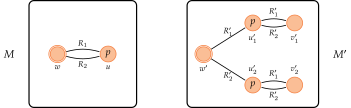

# phil-multimodallogic — appendix（supplement）

> （《phil-multimodallogic》词条补充材料，源：plato.stanford.edu/entries/phil-multimodallogic/appendix.html）

#### Supplement to Philosophical Aspects of Multi-Modal Logic

## Non-definability of distributed and common knowledge within $\cL_{\{\oK{1}, \ldots, \oK{n}\}}$

As mentioned in section 2.4, the distributed knowledge modality *D* is not syntactically definable in $\cL_{\left\{ \oK{1}, \ldots, \oK{n} \right\}}$. This is because, in the standard modal language, an intersection modality is not definable in terms of the modalities of the intersected relations. A simple counter-example showing this is given by the two pointed models below (reflexive edges omitted, undirected edges indicating symmetry, and evaluation point double-circled). They are bisimilar with respect to the relations $R_1, \ldots, R_n$, and therefore modally equivalent within $\cL_{\left\{ \oK{1}, \ldots, \oK{n} \right\}}$. Nevertheless, take ${\ohD \varphi} := \lnot {D\lnot\varphi}$: while ${\ohD p}$ holds in the first (i.e., $(M, w) \Vdash {\ohD p}$: there is a world reachable from *w* via the intersection of $R_1$ and $R_2$, namely *u*, where *p* holds), it fails in the second (i.e., $(M', w') \not\Vdash {\ohD p}$: there is no world reachable from $w'$ via the intersection of $R'_1$ and $R'_2$).

\*Figure 3\* [An extended description of figure 3 is in the supplement.]

Similarly, the common knowledge modality *C* is not syntactically definable in $\cL_{\left\{ \oK{1}, \ldots, \oK{n} \right\}}$. Intuitively, this is because, even when the set of agents is finite, its intuitive definition requires an *infinite* sequence

$$ {E\varphi} \land {EE\varphi} \land {EEE\varphi} \land \cdots, $$

which is not a formula of the language.

A more formal argument relies not on the concept of bisimulation, but rather on that of *compactness*. It is well-known that formulas in $\cL_{\left\{ \oK{1}, \ldots, \oK{n} \right\}}$ can be faithfully translated into formulas of the first-order predicate language, which has the compactness property: if *Φ* is a set of first-order formulas, and every finite subset of it is satisfiable (i.e., has a model), then *Φ* is satisfiable. However, the language $\cL_{\left\{ \oK{1}, \ldots, \oK{n}, C \right\}}$ does not have such property. Recall that ${E\varphi} := {\oK{1}\varphi} \land \cdots \land {\oK{n}\varphi}$, and define the modal dual ${\ohC\varphi} := \lnot {C\lnot\varphi}$. Now, consider the infinite set

$$ \Phi := {\left\{ {\ohC p} \right\} \cup \left\{ E^k \lnot p \mid k \geq 1 \right\}} \quad \text{with } E^k \text{ an abbreviation of } \underbrace{E\cdots E}_{k \text{ times}}. $$

Every finite subset of *Φ* is satisfiable: simply take the largest *k* such that $E^k \lnot p \in \Phi$, and built a model in which the unique *p* world is $k+1$ worlds away from the evaluation point. However, *Φ* is not satisfiable as, while $\ohC p \in \Phi$ states that a *p* world is reachable in a finite number of steps *k*, each potential such *k* is cancelled by its corresponding $E^k \lnot p \in \Phi$. Thus, $\cL_{\left\{ \oK{1}, \ldots, \oK{n}, C \right\}}$ is not compact, and hence *C* cannot be defined within $\cL_{\left\{ \oK{1}, \ldots, \oK{n} \right\}}$.
