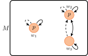
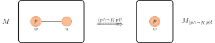

# Philosophical Aspects of Multi-Modal Logic
**First published Mon Jun 3, 2019; substantive revision Mon Dec 11, 2023**

*Smets, Sonja, Velázquez-Quesada, Fernando*

> Here is what I consider one of the biggest mistakes of all in modal logic: concentration on a system with just one modal operator. The only way to have any philosophically significant results in deontic logic or epistemic logic is to combine these operators with: tense operators (otherwise how can you formulate principles of change?); the logical operators (otherwise how can you compare the relative with the absolute?); the operators like *historical* or *physical* necessity (otherwise how can you relate the agent to his environment?); and so on and so on. —Dana Scott (1970: 161)[^scott-1970]

This entry focusses on a number of important aspects that appear in the study of modal logics involving different modal operators, as the above D. Scott’s quotation exemplifies. Indeed, when discussing different modal operators, one requires a system that allows us to deal not only with the different attitudes they represent, but also with the complex relationship between them. To make formal sense of these situations, one requires a *multi-modal* system.

In such systems, each one of the relevant modal operators comes equipped with an interpretation that allows us to reason about different possible worlds in which we vary the truth values of the propositions under consideration. Such systems claim an important place in current logico-philosophical studies. First, they drive the discussion on how certain modalities can be derived or defined in terms of others, as the discussion in epistemology on the definition of knowledge in terms of belief and vice versa. Moreover, they also illustrate how different basic operators interact with one another, as well-known puzzles and paradoxes based on the interplay of modal operators (e.g., Fitch’s paradox of knowability, Voorbraak’s puzzle and the Brandenburger-Kesler Paradox). This entry points the reader to both the logic-technical aspects of combining logical systems as well as to the philosophical aspects of multi-modal logic.

## 1. A Brief Presentation

Modal logics are particularly well suited to study a wide range of philosophical concepts, including different kinds of beliefs, obligations, knowledge, time, space, intentions, desires, obligations, evidence, preferences and diverse types of ontic and epistemic actions, among many others. Indeed, all these concepts have specific context-dependent features, which indicates that they can be best studied using models that can express different modes of truth (e.g., both global and local truth). Such an analysis provides us with the key insights of the basic building blocks and principles that regulate these different notions. This has proven to be useful in a wide range of academic disciplines, including Artificial Intelligence, Psychology, Social Sciences, Economics, Physics and so on. But, as Scott’s quote above suggests, there is something missing when such philosophical concepts are studied in isolation. A big part of what defines a concept lies in the way it interacts with others. For instance, *rational beliefs* are expected to rely on proper *arguments*, *justifications* or *evidence*; *disjunctions* may not behave as they do in natural language in the context of *obligations*; *knowledge* is better understood when looking for the *actions* that modify it; *intentions* may be understood as derived from *desires* and *beliefs*. What is required for this study are logical systems with more than one modal operator, commonly known as multi-modal logics, describing not only the isolated properties of the individual concepts, but also the way they relate to one another. Indeed, multi-modal logics have been designed for a wide range of applications, including reasoning about time, space, knowledge, beliefs, intentions, desires, obligations, actions such as public and private communication, observations, measurements, moves in a game and others.

The present text intends to give a brief (but broad) overview of the interaction between many different philosophical concepts, and to show how the use of multi-modal logical systems can shed some light on these concepts’ interaction. We start in section 2 (*Defining* concepts in terms of others) by discussing basic scenarios that, starting from existing systems, use a combination of ‘syntactic’ and ‘semantic’ strategies for defining further concepts. These cases are based on the idea that some notions can be defined in terms of others, with the famous understanding of knowledge as justified true belief being one of the most notable examples. An alternative to this idea is to consider that the involved concepts emerge independently, but are still somehow related, as the case of the relationship between knowledge and time. From a formal perspective, this amounts to looking at the different modes in which two (or more) existing systems can be combined. Section 3 on General strategies for *combining* modal systems presents an overview of some of the most relevant strategies. After this slightly technical excursion, the discussion takes a philosophical perspective, describing first combinations of multiple modalities (section 4 on *Significant interactions between modalities*), and finishing with examples of cases where the interaction between modalities sheds light on philosophical issues (section 5 on Multi-modal systems in philosophical discussions).

A note on notation and the level of technicality To discuss aspects of multi-modal logic, this entry assumes basic knowledge of modal logic, specifically about its language and its relational ‘possible worlds’ semantics (though other semantic models will be mentioned too). In particular, a relational model is understood as a tuple containing a set of possible worlds, one or more (typically binary) relations between them, and a valuation indicating what each possible world actually represents. Such structures can be described by different modal languages. We will use $\cL$ to denote the standard *propositional language*, and $\cL_{\left\{ O_1, \ldots, O_n \right\}}$ to denote its extension with modalities $O_1$, …, $O_n$. Given a relational model *M* and a formula *φ*, we will use $\llbracket \varphi \rrbracket^{M}$ to denote the set of worlds in *M* where *φ* holds. Readers can find more details about the basics of modal logic not only in the referred SEP entries, but also in the initial chapters of Blackburn, Rijke, & Venema (2001) and van Benthem (2010)[^benthem-2010][^benthem-2010-2][^benthem-2010-3], and also in Blackburn & van Benthem (2006)[^benthem-2006][^benthem-2006-2].

Still, the goal of this text is not to provide a comprehensive study of the topic, but rather to highlight the most interesting and intriguing aspects. Thus, although some level of formal discussion will be used, most technical details will be restricted to the [appendix](phil-multimodallogic.appendix.md).

## 2. *Defining* Concepts in Terms of Others

In order to use systems with multiple modalities, the question is how to build such settings. One of the most important points is to decide whether one of the concepts to be studied is ‘more fundamental’ than the other, in the sense that the latter can be defined in terms of the former. As mentioned, the famous understanding of knowledge as justified true belief is one of the most notable examples. Others are equally relevant, as a definition of beliefs in terms of the available arguments/evidence/justifications, or a definition of epistemic notions for a group in terms of the epistemic notions of its members. Yet, the basic *alethic* modal logic of necessity and possibility already provides a paradigmatic example of how to define the relationship between two concepts.

### 2.1 Necessity and Possibility

The basic alethic modal logic contains both a *possibility* $(\Diamond)$ and a *necessity* $(\Box)$ modality. Most formal presentations of this system take one of these modalities as the primitive syntactic operator (say, $\Diamond)$, and then define the other as its *modal* dual $(\oBox\varphi := \lnot \oDiamond \lnot \varphi)$. This is a seemingly harmless *syntactic* interdefinability, and comes from the fact that $\Diamond$ and $\Box$ are semantically interpreted in terms of the existential and universal quantifiers, respectively. It is, in some sense, similar to the interdefinability of Boolean operators in classic propositional logic. Nevertheless, it already reflects important underlying assumptions. From a *classic* point of view, something is necessary if and only if it is not the case that its negation is possible $(\oBox\varphi \leftrightarrow \lnot \oDiamond \lnot \varphi)$, and something is possible if and only if it is not the case that its negation is necessary $(\oDiamond \varphi \leftrightarrow \lnot \oBox\lnot \varphi)$. However, this may not be the case in all settings. For example, while $\oDiamond \varphi \rightarrow \lnot \Box \lnot\varphi$ is intuitionistically acceptable (the existence of a possibility where *φ* holds implies that not every possibility makes *φ* false), its converse $\lnot \oBox \lnot\varphi \rightarrow \oDiamond \varphi$ is not (the fact that not every possibility makes *φ* false is not enough to guarantee the *existence* of a possibility where *φ* is true). Thus, one should always be careful when defining a modality in terms of another.

### 2.2 Knowledge and Beliefs of Groups

Where the above examples started from a uni-modal logic, we provide now an example in which we start from a homogeneous multi-modal logic. Our setting is a logic consisting of a number of basic modalities of the same type, all being semantically interpreted via the same type of relation. Our example is the basic *multi-agent* epistemic logic. This setting is already multi-modal, as its language $\cL_{\left\{ \oK{1}, \ldots,\oK{n} \right\}}$ has a knowledge modality $K_i$ for each agent $i$ in the set $\ttA = \{1, \ldots, n\}$. (In fact, this basic multi-agent epistemic logic is the fusion (section 3.1) of several single-agent epistemic logic systems, one for each agent $i \in \ttA$.) Still, taking advantage of the finiteness of $\ttA$, one can define a brand new modality for the group epistemic notion of *everybody knows*:

$$ {E\varphi} := {\oK{1}\varphi} \land \cdots \land {\oK{n} \varphi} $$

In a similar way we can define a modality for *everybody believes* in the logic with language $\cL_{\left\{ \oB{1}, \ldots, \oB{n} \right\}}$ as

$$ \mathit{EB}\varphi := \oB{1}\varphi \land \cdots \land \oB{n}\varphi $$

These definitions assume that the knowledge/beliefs of a group of agents corresponds to the conjunction of the agent’s individual knowledge/beliefs. However, in the context of social epistemology, the reduction of group attitudes to the mere sum of those of the individuals is contentious, especially when one focuses on group beliefs.[^note-1]

### 2.3 A Simple Attempt at Relating Knowledge and Belief

Another example of the interdefinability of modal concepts deals with the relationship between *knowledge* and *belief*. In epistemology, researchers are searching for the correct characterization of knowledge, and a common trend has been to view knowledge as a form of justified true belief (an idea that can be traced back to Plato’s dialogue *Theaetetus*). Gettier’s famous counterexamples showed that such a simple characterization of knowledge is not sufficient: a further condition is required, such as safety, sensitivity, robustness or stability. In spite of this, a characterization of knowledge as justified true belief is an important first step. Classic epistemic logic does not explicitly deal with the notion of *justification*,[^note-2] so a starting point is a simpler understanding of knowledge as true belief.

Take a *doxastic* relational model with its relation $R_B$ being serial, transitive and Euclidean (a *KD45* setting), and use a modality *B* semantically interpreted with respect to $R_B$ in the standard way. In this setting, two options arise. The first one is *syntactic*, as in the examples that have been discussed so far, and consists in defining a modality for knowledge as ‘true belief’: $K'\varphi := B\varphi \land \varphi$. The second is *semantic*, and consists in defining an epistemic equivalence relation $R_K$ as the reflexive and symmetric closure of the doxastic relation, then using it in the standard way to give the semantic interpretation of a modality *K*.

It should be noted that the two approaches are not equivalent. Consider the following doxastic model (from Halpern, Samet, & Segev 2009a)[^halpern-2009a], with the serial, transitive and Euclidean *doxastic* relation $R_B$ represented by dashed arrows, and its derived reflexive, transitive and symmetric (i.e., equivalence) *epistemic* relation $R_K$ represented by solid ones.

\*Figure 1\* [An extended description of figure 1 is in the supplement.]

Note how the agent believes *p* on every world in the model, $\llbracket \oB{}p \rrbracket^{M} = \left\{ {w_1, w_2, w_3} \right\}$; then, as the syntactic approach states that ${K'\varphi}$ holds in those worlds in which $B\varphi \land \varphi$ is the case, we have

$$\llbracket K'p \rrbracket^{M} = \llbracket {\oB{}p} \land p \rrbracket^{M} = \left\{ {w_1, w_2} \right\}.$$

However, according to the semantic approach, $K\varphi$ holds in those worlds from which all epistemically accessible situations satisfy *φ*, so $\llbracket K p \rrbracket^{M} = \left\{ w_1 \right\}$. Thus, ${K'}$ and *K* are not equivalent. One of the reasons for this mismatch is that the two options do not enforce the same properties on the derived notion of knowledge. For example, while the semantic approach enforces negative introspection (by making $R_K$ an equivalence relation), the syntactic one does not. In fact, this property fails at $w_3$, as $\lnot {K'p}$ is true $({B p} \land p$ fails, as *p* fails) but still $K'\lnot{K'p}$ (unfolded as ${B (\lnot {B p} \lor \lnot p)} \land (\lnot B p \lor \lnot p))$ is false.[^note-3]

Section 4.1 comes back on the relationship between these two concepts, recalling alternative multi-modal accounts that relate knowledge and belief while doing justice to the involved epistemological subtleties.

### 2.4 Distributed and Common Knowledge

The second option in the previous case is, as described, semantic: it takes the semantic counterpart of an existing modality(ies), and then extracts from it (them) a further semantic component in terms of which a new modality can be defined. Here are two further examples of this strategy.

Consider again the basic multi-agent epistemic logic with language $\cL_{\left\{ \oK{1}, \ldots, \oK{n} \right\}}$. As mentioned above, this setting is multi-modal, as its language contains, for each agent $i \in \{1, \ldots, n\}$, a knowledge modality $K_i$ that is semantically interpreted in the standard way with respect to a matching epistemic relation $R_i$. While a modality for the concept of *everybody knows* (*E*) is syntactically definable (because the set of agents is finite), other group epistemic notions, such as distributed knowledge and common knowledge are not.[^note-4]

Consider first the notion of *distributed knowledge*, intuitively understood as all the logical consequences of the union of the agents’ individual knowledge (alternatively, what the members of the group can conclude by pooling all their information together). From this intuitive definition, it is clear that this concept can be defined semantically in terms of the agent’s individual epistemic relations. More precisely, a relation describing the distributed knowledge modality should correspond to the intersection of the individual epistemic relations, $R_D := \bigcap_{i \in \ttA} R_i$. Thus, given an evaluation point *w*, a world *u* will be considered possible after the agents share all they know if and only if all of them considered it possible before the communication (or, in other words, *u* will be considered possible if and only if *no one can discard it*). One simply extends the language with a modality *D*, semantically interpreted with respect to this new relation:

$$ (M, w) \Vdash D\varphi \quad\iffdef\quad \text{for all } u \in W, \text{ if } R_Dwu \text{ then } (M, u) \Vdash \varphi. $$

Another important notion, crucial in the study of social interaction, is common knowledge. This concept can be described as what everybody knows, everybody knows that everybody knows, everybody knows that everybody knows that everybody knows, and so on. Just as with distributed knowledge, this notion does not require the addition of further semantic components: the individual epistemic indistinguishability relations already provide everything that is needed to make the definition explicit. If one defines an epistemic relation for the *“everybody knows”* modality in the natural way $(R_E := \bigcup_{i \in \ttA} R_i)$, and then define $R_C$ as the transitive closure of $R_E$,

$$ R_C := (R_E)^+, $$

one can simply extend the language with a modality *C*, semantically interpreted in terms of $R_C$:

$$ (M, w) \Vdash {C\varphi} \quad\iffdef\quad \text{for all } u \in W, \text{ if } R_Cwu \text{ then } (M, u) \Vdash \varphi. $$

At world *w* a formula *φ* is commonly known among the agents if and only if *φ* is the case in *every* world (the *“for all”* in *C*’s semantic interpretation) that can be reached by *any* finite non-zero sequence of transitions in $R_E$ (the fact that $R_C$ is the transitive closure of $R_E)$. In other words, *φ* is commonly known among the agents if and only if everybody knows *φ* (any sequence of length 1), everybody knows that everybody knows *φ* (any sequence of length 2), and so on.[^note-5]

### 2.5 Beliefs in Terms of Evidence

There are more elaborated examples of frameworks extending a given setting with modalities that ‘extract’ further information from the semantic model. One of them is *evidence logic*, introduced in van Benthem & Pacuit (2011), and further developed in van Benthem, Fernández-Duque, & Pacuit (2014) and Baltag, Bezhanishvili, et al. (2016). It follows the idea of representing the evidence the agent has collected, and looks at how this evidence gives support to further epistemic notions (e.g., knowledge and beliefs). The semantics is given by a basic neighborhood model (Montague 1970; Scott 1970)[^montague-1970][^scott-1970]: a tuple of the form $M = {\langle W, N, V \rangle}$ where *W* and *V* are a non-empty set of possible worlds and an atomic valuation, respectively (as in standard relational models), and $N:W \to {\wp(\wp(W))}$ is a neighborhood function assigning, to every possible world, a set of *sets* of possible worlds (so $N(w) \subseteq {\wp(W)}$ is *w’s neighborhood*). In evidence logic, the neighborhood function is assumed to be constant (i.e., $N(w) = N(u)$ for any $w,u \in W)$, and thus the model can be simply understood as a tuple ${\langle W, E, V \rangle}$, with $E \subseteq {\wp(W)}$ the (constant) neighborhood. This neighborhood, intuitively containing the basic pieces of evidence the agent has collected, (a piece of evidence $U \subseteq W$ can be understood as indicating the agent that the real world is in $U$) is required to satisfy two additional properties: evidence *per se* is never contradictory $(\emptyset \not\in E)$, and the agent knows her ‘space’ $(W \in E)$.

Syntactically, a neighborhood model can be described by a modal language $\cL_{\left\{ \oBox \right\}}$, as is typically done in standard neighborhood models. There are at least two possibilities for the semantic interpretation of the ${\oBox}$ modality (Areces & Figueira 2009)[^areces-2009], and the one chosen in evidence logic is the following:

$$ (M, w) \Vdash {\oBox\varphi} \quad\iffdef\quad \text{there is } U \in E\text{ such that } U \subseteq {\llbracket \varphi \rrbracket^{M}}. $$

Thus, in this setting, ${\oBox\varphi}$ expresses that *“the agent has evidence supporting φ”*, corresponding semantically to the existence of a piece of evidence containing only *φ*-worlds.

What is the epistemic state of the agent that such a model entails? In other words, given such a model, how can we define epistemic notions such as knowledge and belief?

In the case of knowledge, one can follow the traditional single-agent idea: all worlds in the model play a role in the agent’s epistemic state, and thus one can say that the agent *knows* a given formula *φ* if and only if *φ* is true in every world of the model. For this, evidence logic uses a *global* modality *A*:

$$ (M, w) \Vdash {A\varphi} \quad\iffdef\quad {\llbracket \varphi \rrbracket^{M}} = W $$

In the case of beliefs, there are more alternatives. A straightforward idea says that the agent believes *φ* if and only if she has evidence supporting *φ* (a syntactic definition of the form $B\varphi := \oBox\varphi)$. However, this would allow the agent to have contradictory beliefs, as two pieces of evidence might contradict themselves (there may be $X, Y \in E$ such that $X \cap Y = \emptyset$, and thus $Bp \land B{\lnot p}$ could be satisfiable). More importantly, this would be a ‘lazy’ approach, as the agent would be able to collect evidence (thus defining *E*), but nevertheless she would not be doing any ‘reasoning’ with it.

A more interesting idea is to define (semantically) a notion of belief in terms of *combinations* of pieces of evidence. In van Benthem and Pacuit (2011), the authors propose (roughly speaking) that beliefs should be given by the *maximal consistent* ways in which evidence can be combined, stating that the agent believes *φ* if and only if *all* maximally consistent combination of pieces of evidence support *φ*. More precisely,

| $(M, w) \Vdash B\varphi$ | $\iffdef$ | $\bigcap \sX \subseteq {\llbracket \varphi \rrbracket^{M}}$ (support) for every $\sX \subseteq E$ satisfying: $\bigcap \sX \neq \emptyset$ (consistency) $\sX \subset \sY \subseteq E$ implies $\bigcap \sY = \emptyset$ (maximality) |
| --- | --- | --- |

Given these definitions, it is clear that knowledge implies both belief and evidence (i.e., both $A\varphi \rightarrow B\varphi$ and $A\varphi \rightarrow \oBox\varphi$ are valid). Still, it is interesting to note not only that the agent might believe a given *φ* without having a basic piece of evidence supporting it $(B \varphi \rightarrow \oBox\varphi$ is *NOT* valid, as beliefs are defined in terms of *combined* pieces of evidence), but also that she might have a basic piece of evidence supporting *φ* without believing *φ* $(\oBox\varphi \rightarrow B\varphi$ is *NOT* valid, as the basic evidence supporting *φ* might not be part of all maximally consistent combinations).

In this setting, at least when *E* is finite (and in many other cases), beliefs are consistent (i.e., $\neg B \bot)$; still, the setting also allows ‘bad’ models in which beliefs can turn out to be inconsistent. In Baltag, Bezhanishvili, et al. (2016), the authors provide an example of such a model, and then solve the problem by extending the setting to a topological approach. Indeed, the authors use the *topology* generated by *E*, which intuitively describes the different ways in which the available pieces of evidence can be combined.[^note-6] This is reasonable as, while *E* can be understood as containing the pieces of evidence the agent has received from external sources (observations, communication), the topology $\tau_{E}$ can be understood as the different ways in which she can ‘extract’ further information from them (i.e., the result of her own reasoning processes). Given the topology, it is possible to define (semantically) further epistemic notions, such as arguments, justifications, consistent beliefs, consistent conditional beliefs, and different forms of knowledge. For more on this, we refer to Baltag, Bezhanishvili, et al. (2016: Section 2).

### 2.6 Plausibility Models

As we have seen, a new modality can be introduced in syntactic terms (using the language to provide a formula defining the new concept), but also in a semantic way (using the semantic counterparts of the existing modalities to define a further semantic notion, which in turn is used to interpret the new modality). Our examples so far have been restricted to the use of one of these two strategies, but their interplay is also possible. The case to be discussed here concerns the plausibility models of Board (2004)[^board-2004]; Baltag and Smets (2006, 2008); van Benthem (2007)[^benthem-2007][^benthem-2007-2][^benthem-2007-3]; here, the presentation of Baltag and Smets (2008) is used.

A plausibility model is a relational model $M = {\langle W, \leq, V \rangle}$ in which the binary relation $\leq$ is interpreted as describing the *plausibility* ordering the agent assigns to her epistemic possibilities $(w \leq u$ indicates that, for the agent, world *w* is at least as plausible as world *u*). In the *single-agent* case, the plausibility relation $\leq$ is required to be a *well-preorder*: a total relation which is both reflexive and transitive, and such that every non-empty subset of the domain has $\leq$-minimal elements. These minimal elements in *W* are then understood as the agent’s *most plausible* worlds. We see below that what is true in all the most plausible worlds characterizes what an agent believes.

To start, take a modality $[\leq]$ semantically interpreted via the plausibility relation $\leq$,

$$ (M, w) \Vdash {[\leq]\varphi} \quad\iffdef\quad \text{for all } u \in W, \text{ if } u \leq w \text{ then } (M, u) \Vdash \varphi, $$

This modality has the properties of an S4 modal operator; hence, it is factive, positively introspective but not negatively introspective. In Baltag and Smets (2008), it is argued that this modality is well suited to express a version of Lehrer’s *indefeasible (“weak”, non-negatively-introspective) type of knowledge* (Lehrer 1990; Lehrer & Paxson 1969)[^lehrer-1990][^lehrer-1969], and the authors explain how it can be understood as belief that is persistent under revision with any *true* piece of information. Using this modality (also read as *safe belief* in Baltag & Smets 2008)[^baltag-2008], it is possible to define syntactically a notion of simple *belief* as *truth in the most plausible worlds*:

$$ B\varphi := \langle{\leq}\rangle [{\leq}]\varphi. $$

As simple as a plausibility model is, it is powerful enough to encode a wide range of different epistemic concepts, all of which can be brought to light by the proper semantic definitions. First, we define a relation of *epistemic* possibility (or indistinguishability) $\sim$ by taking it to be the universal relation,

$$ {\sim} := W \times W, $$

thus understanding that two worlds are epistemically indistinguishable if and only if they can be compared via $\leq$.[^note-7] Then, a notion of S5-knowledge can be expressed by introducing a modality *K* semantically interpreted via $\sim$:

$$ (M, w) \Vdash K\varphi \quad\iffdef\quad \text{for all } u \in W, \text{ if } w \sim u \text{ then } (M, u) \Vdash \varphi $$

With this new modality *K* it is possible to define, syntactically, the finer notion of *conditional belief* $B^{\psi}$, intuitively describing what the agent would have believed was true had she learnt that a certain condition *ψ* is the case. Indeed,

$$ B^{\psi}\varphi := \hK \psi \rightarrow \hK (\psi \rightarrow [{\leq}] (\psi \rightarrow\varphi)) $$

for ${\hK}$ the modal dual of *K* (i.e., $\hK\psi := \lnot K\lnot \psi)$. This extended language $\cL_{\left\{ [{\leq}], K \right\}}$ can also express a notion of *strong belief*, $Sb \varphi$, semantically understood as true whenever all *φ*-worlds are strictly more plausible than all $\lnot\varphi$-worlds, and syntactically defined as

$$ Sb\varphi := \langle{\leq}\rangle [{\leq}] \varphi \land K(\varphi \rightarrow [{\leq}] \varphi) $$

Finally, note how a plausibility relation defines, semantically, layers of equally-plausible worlds, with the layers themselves ordered according to their plausibility. Then, one can see this ordered sequence of layers as a collection of concentric spheres. Indeed, the contents of the innermost sphere, sphere \\#0, are exactly those worlds in the most plausible layer, layer \\#0; then, the contents of sphere \\#1 are those worlds in layer \\#0 together with those in the layer immediately below it, layer \\#1. The process continues, thus defining the worlds in sphere \\#$i$ as the union of the contents of layers \\#0 to layer \\#$i$. In this way, every plausibility corresponds to a sphere model (Spohn 1988; Grove 1988)[^grove-1988][^spohn-1988], making it perfectly fit to model belief revision. Still, even though in $\cL_{\left\{ [{\leq}], K \right\}}$ there are formulas expressing that *φ* holds in *the most plausible* sphere (the mentioned $B\varphi$, given by $\langle{\leq}\rangle[{\leq}]\varphi)$, no formula can express, e.g., that *φ* holds in the *next to* most plausible worlds. One way to fix this ‘problem’ is to define (now semantically) the *strict* plausibility relation ${<} := {\leq} \cup {\not\geq}$ (with $\geq$ the *converse* of $\leq$, defined in the standard way, ${\geq} := \left\{ (u,w) \in W \times W \mid w \leq u \right\})$, and then introduce a standard modality for it:

$$ (M, w) \Vdash [{<}]\varphi \quad\iffdef\quad \text{for all } u \in W, \text{ if } u < w \text{ then } (M, u) \Vdash \varphi $$

With this new modality, one can provide syntactic definitions for the concepts described above. Indeed, while the formula $\lambda_0 := [<]\bot$ characterizes the most plausible worlds (so $K (\lambda_0 \rightarrow\varphi)$ expresses that the most plausible worlds satisfy *φ*, just as $B\varphi$ does), the formula $\lambda_1 := \lnot \lambda_0 \land [<]\lambda_0$ characterizes the next to most plausible worlds (so $K(\lambda_1 \rightarrow\varphi)$ expresses that the next to most plausible worlds satisfy $\varphi)$. This procedure can be repeated, producing formulas $\lambda_i$ characterizing each layer, and thus it is possible to deal syntactically with a qualitative *degree of beliefs* (Grove 1988; Spohn 1988)[^grove-1988][^spohn-1988], looking for what holds ‘from some level up’. (See Velázquez-Quesada 2017 for more on the use of this modality within plausibility models, and Andersen, Bolander, van Ditmarsch, & Jensen 2017 for a comparison between different languages describing these structures.)[^andersen-2017][^velázquez-quesada-2017]

This new modality $[<]$ allows us to define even more epistemic notions. For example, a formula *φ* is *weakly safely believed* (a belief which might be lost but is never reversed when revising with true information) if and only if $\varphi \land [{<}] \varphi$ holds. More details can be found in Baltag and Smets (2008: Subsection 2.4).

### 2.7 Infinite Modalities via Syntactic Constructors

Just as some multi-modal systems are created by extending existing ones, some others are born with multiple modalities in mind. Among them, propositional dynamic logic (Harel, Kozen, & Tiuryn 2000)[^harel-2000] and *Boolean modal logic* (Gargov & Passy 1990; Gargov, Passy, & Tinchev 1987)[^gargov-1990][^gargov-1987] deserve a special mention. The reason is that they both define, within the language, operators for building new modalities from a collection of basic ones. As a consequence, both systems contain an *infinite* number of modalities.

Following earlier approaches to reason about programs in Engeler (1967)[^engeler-1967] and Hoare (1969)[^hoare-1969], Propositional dynamic logic (*PDL*), the logic of programs (Harel, Kozen, & Tiuryn 2000)[^harel-2000], intends to describe what programs can achieve. Semantically, programs are interpreted in standard relational models, with one binary relation $R_a$ for every *basic program* *a*; syntactically, the language contains a modality $[a]$ for each such *a*.

So far, *PDL* is technically similar to a multi-agent epistemic logic (the difference being, besides the symbols used for the modalities, the fact that there are no restrictions on the relations for the basic programs).[^note-8] The crucial insight is, however, that basic programs can be *composed* in order to create more complex ones: one can think of executing one program after another, or repeating some of them a number of times. Thus, these basic modalities are not enough. For this, a new syntactic entity is created: besides formulas, the language of *PDL* contains a set of *basic programs* together with *program constructors* representing those for *regular expressions* (Kleene 1956)[^kleene-1956]. Formally, *formulas φ* and *programs α* of the *PDL*-language $\cL_{\textit{PDL}}$ are defined simultaneously via mutual recursion as

$$ \begin{align} \varphi & ::= p \mid \lnot \varphi \mid \varphi \land \varphi \mid [\alpha]\varphi\\ \alpha & ::= a \mid \varphi \qbin \mid \alpha \scbin \alpha \mid \alpha \bcup \alpha \mid \alpha^{\ast} \end{align} $$

with *p* an atomic proposition coming from a given set, and *a* a basic program coming from a given set. For formulas, the intended reading of the Boolean operators is standard, and formulas of the form $[\alpha]\varphi$ express that *“every execution of program α from the current state leads to a state satisfying φ”*. For programs, while the basic programs simply represent themselves, “$\varphi \qbin$” is a program that ‘does nothing’ when *φ* is the case but ‘fails’ otherwise (essentially, a *test* for $\varphi)$, “$\alpha \scbin \beta$” represents the program that results from executing *α* and then executing *β* (their *sequential composition*), “$\alpha \bcup \beta$” represents the program that results from executing either *α* or else *β* (their *non-deterministic choice*), and “${\alpha^{\ast}}$” represents the program that results from repeating *α* a finite number of times $(\alpha$’s *iteration*).

With these program constructors it is possible to build more complex programs. Famous examples are

| $(\varphi \qbin \scbin \alpha) \bcup (\lnot\varphi \qbin \scbin \beta)$ | “if *φ* holds, then do *α*, and otherwise do *β*”, |
| --- | --- |
| $(\varphi \qbin \scbin \alpha)^{\ast} \scbin {\lnot\varphi} \qbin$ | “while *φ* holds, do *α*”, |
| $\alpha \scbin ({\lnot\varphi} \qbin \scbin\alpha)^{\ast} \scbin {\varphi \qbin}$ | “repeat *α* until *φ* holds”. |

Then, it is possible to build formulas as $p \rightarrow [(q \qbin \scbin a) \bcup (\lnot q \qbin \scbin b)]r$ (*“if p holds, then r will be achieved by choosing between actions a and b according to whether q holds”*) and $\lnot p \rightarrow \langle a \scbin (\lnot q \qbin \scbin a)^{\ast} \scbin q \qbin \rangle p$ (*“if the desired requirement p is not true yet, it is possible to achieve it by a repeated execution of a”*).

For the semantic interpretation, a relation $R_\alpha$ is required for each program *α*. However, while the relations $R_a$ for basic programs are arbitrary, those for complex programs should behave according to their intended meaning. The simplest way to obtain this is to take the relations for the basic programs, and then *define* those for complex programs in an inductive way. This and further details about *PDL* can be found in Section 2 of the SEP entry on dynamic logic.

The *Boolean modal logic* of Gargov and Passy 1990 and Gargov, Passy, and Tinchev 1987) follows a similar strategy. The difference is that, while *PDL* focuses on constructors for regular expressions (sequential composition, non-deterministic choice, finite iteration), Boolean modal logic focuses on constructors for the Boolean algebra over relations: complement $(\bdash)$, union $(\bcup)$ and intersection $(\bcap)$, together with a ‘global’ constant $(\boldsymbol{1})$. More precisely,

$$ \begin{align} \varphi & ::= p \mid \lnot \varphi \mid \varphi \land \varphi \mid [\alpha]\varphi\\ \alpha & ::= a \mid \boldsymbol{1} \mid \bdash \alpha \mid \alpha \bcup \alpha \mid \alpha \bcap\alpha\\ \end{align} $$

The semantic interpretation follows the same steps as in *PDL*: relations $R_a$ for the basic modalities *a* are assumed, and relations for complex ones are defined in the expected way (with ${\boldsymbol{1}}$ being interpreted with respect to the global relation $W \times W)$.

Interestingly, by combining the negation over formulas and the Boolean complement over relations, it is possible to define the following operator (often called *window*; see Goldblatt 1974; van Benthem 1979; Gargov, Passy, & Tinchev 1987)[^benthem-1979][^gargov-1987][^goldblatt-1974]:

$$ \oubracket{.7em}{\alpha} \varphi := [\bdash\alpha] \lnot\varphi $$

Window is an extremely natural operator that complements the standard universal modality. Indeed, while formulas of the form $[\alpha]\varphi$ express that *all* executions of *α* reach a *φ*-state,

$$ (M, w) \Vdash [\alpha]\varphi \quad\tiff\quad \text{for all } u \in W, \; \text{ if } R_{\alpha}wu \text{ then } (M, u) \Vdash \varphi, $$

formulas of the form $\oubracket{.7em}{\alpha}\varphi$ express that *all* *φ*-states are reachable by an execution of *α*:

$$ (M, w) \Vdash \oubracket{.7em}{\alpha} \varphi \quad\tiff\quad \text{for all } u \in W, \; \text{ if } (M, u) \Vdash \varphi \text{ then } R_{\alpha}wu $$

Not only that: window allows a smooth interaction between the constructors $\bcup$ and $\bcap$. As discussed in Blackburn, Rijke, and Venema (2001: 427),

> [i]n a sense, the relations are divided into two kingdoms: the ordinary $[\alpha]$ modalities govern relations built with $\bcup$, the window modalities $\oubracket{.7em}{\alpha}$ govern the relations built with $\bcap$, and the $\bdash$ constructor acts as a bridge between the two realms:
>
> $$ \begin{align} \Vdash {[\alpha \bcup\beta]\varphi} &\leftrightarrow ([\alpha] \varphi \land [\beta]\varphi), & \Vdash {[\bdash\alpha]\varphi} &\leftrightarrow \oubracket{.7em}{\alpha} \lnot\varphi \\ \Vdash \oubracket{3.1em}{\alpha \bcap\beta} \varphi &\leftrightarrow \left(\oubracket{1em}{\alpha} \varphi \land \oubracket{.8em}{\beta} \varphi\right), & \Vdash [\alpha]\lnot\varphi &\leftrightarrow \oubracket{1.8em}{\bdash\alpha}\varphi.\\ \end{align} $$

Of course, many other program constructors can be used. Among them, one worthy of mention is that for the converse of a given relation. Modalities for the converse of a relation have been used in, e.g., tense logic, with the ‘past’ modalities (*H* and *P*, the universal and existential versions, respectively) interpreted semantically in terms of the converse of the relation used for interpreting the ‘future’ modalities (*G* and *F*, respectively).

### 2.8 The *Dynamic Epistemic Logic* Approach

The case of *dynamic epistemic logic*, the study of modal logics of model change, is of particular interest. In these systems, the relationship between their modalities is special. Here we will only recall the basic notions, referring the reader to the SEP entry by Baltag and Renne (2016) for an in-depth discussion

In a nutshell, a *dynamic epistemic logic* (*DEL*) framework has two components. The ‘static’ part consists of a ‘standard’ modal system: a language including one or more modalities for the one or more concepts under study, together with the semantic model on which the formulas are interpreted. The ‘dynamic’ part consists of modalities expressing different ways in which the studied concept(s) might change, with the crucial insight being that these modalities are semantically interpreted not on the given model, but rather on one that results from *transforming* the given one in an appropriate way.

The discussion here will focus on the paradigmatic *DEL* case, public announcement logic (*PAL*), which studies the interaction of knowledge and public communication.[^note-9] Syntactically, its language extends the basic epistemic language $\cL_{\left\{ K \right\}}$ with a modality $[\chi{!}]$ (for *χ* a formula of the language), thanks to which it is possible to build formulas of the form $[\chi{!}]\varphi$: *“after χ is publicly announced, φ will be the case”*. Within this new language $\cL_{\left\{ K, {!} \right\}}$ it is possible to build formulas describing the *knowledge* the agent will have after a public communication action; one example is $[(p \land q){!}] Kq$, expressing that *“after $p \land q$ is publicly announced, the agent will know q”*. For the semantic interpretation, the public announcement of any given *χ* is taken to be completely trustworthy; thus, the agent reacts to it by eliminating all $\lnot\chi$ possibilities from consideration. More precisely, given a model $M = {\langle W, R, V \rangle}$ and a formula $\chi \in \cL_{\left\{ K, {!} \right\}}$, the model $M_{\chi{!}} = \langle W_{\chi{!}}, R_{\chi{!}}, V_{\chi{!}} \rangle$ is defined as

$$ \begin{align} W_{\chi{!}} &:= \left\{ w \in W \mid (M, w) \Vdash \chi \right\}\\ R_{\chi{!}} &:= R \cap (W_{\chi{!}} \times W_{\chi{!}})\\ V_{\chi{!}}(p) &:= V(p) \cap W_{\chi{!}} \end{align} $$

Note how, while $W_{\chi{!}}$ is the set of worlds of the original model where *χ* holds, $R_{\chi{!}}$ is the restriction of the original epistemic relation to the new domain, and so is the new valuation function $V_{\chi{!}}$. Then,

$$ (M, w) \Vdash [\chi{!}] \varphi \quad\iffdef\quad (M, w) \Vdash \chi \text{ implies } (M_{\chi{!}}, w) \Vdash \varphi. $$

Thus, *φ* is the case after *χ* is publicly announced at *w* in *M* (in symbols, $(M, w) \Vdash [\chi{!}]\varphi)$ if and only if *φ* is true at *w* in the situation that results from *χ*’s announcement (in symbols, $(M_{\chi{!}}, w) \Vdash \varphi)$ whenever *χ* can actually be announced (in symbols, $(M, w) \Vdash \chi)$.[^note-10] Note that the public announcement modality $[\chi{!}]$ is introduced *semantically*, as its semantic interpretation requires ‘extracting’ further information from the initial model, just as the intersection of individual epistemic relations is used to create the relation for distributed knowledge. Still, it uses a ‘more advanced’ version of such a strategy: it performs an operation *over the full model*, thus creating a new one in order to evaluate formulas that fall inside the scope of the new modality.

With the semantic interpretation of $[\chi{!}]$ given, it is now possible to answer the crucial question in this setting: what is the effect of a public announcement on an agent’s knowledge? Or, more precisely, how is the agent’s knowledge *after* an announcement related to her knowledge *before* it? Here is the answer:

$$ \Vdash [\chi{!}] K \varphi \leftrightarrow (\chi \rightarrow K(\chi \rightarrow [\chi{!}] \varphi)) $$

This validity characterizes the agent’s knowledge after the action in terms of the knowledge she had, before the action, *about the effects* of the action. It tells us that after the public announcement of *χ* the agent will know *φ*, $[\chi{!}]K\varphi$, if and only if, provided *χ* could be announced, ‘$\chi \rightarrow $’, she knew that its truthful public announcement would make *φ* true, $K(\chi \rightarrow [\chi{!}]\varphi)$. Note how this *bridge* principle, relating the two involved modalities, is not ‘chosen’: it arises as a consequence of the given definition of what knowledge is (truth in all epistemic possibilities) and the given understanding of what a public announcement does (discard all possibilities where the announcement fails).

The given semantic interpretation of $[\chi{!}]$ also gives rise to other validities. Among them, consider the following:

$$ \begin{align} \Vdash [\chi{!}]p & \leftrightarrow (\chi \rightarrow p), \\ \Vdash [\chi{!}]\lnot \varphi & \leftrightarrow (\chi \rightarrow \lnot [\chi{!}]\varphi), \\ \Vdash [\chi{!}](\varphi \land \psi) & \leftrightarrow ([\chi{!}]\varphi \land [\chi{!}]\psi). \\ \end{align} $$

These validities, together with the previous one characterizing $[\chi{!}]K\varphi$, are known as the *reduction axioms*. Here is our first twist: a careful look at these formulas reveals that each one of them characterizes the truth of an announcement formula $[\chi{!}]\varphi$ (the left-hand side of $\leftrightarrow$) in terms of formulas (the right-hand side of $\leftrightarrow$) whose sub-formulas appearing under the scope of $[\chi{!}]$ are *less complex*. Moreover: the formula dealing with atoms eliminates $[\chi{!}]$. Thus, given any concrete formula in $\cL_{\left\{ K, {!} \right\}}$, successive applications of these axioms will eventually produce a *semantically equivalent* formula where no $[\chi{!}]$ modality appears. This indicates that, *expressivity-wise*, the public announcement modalities $[\chi{!}]$ are not really needed: anything that can be expressed with them can be also expressed by a formula without them. More precisely, for any formula *φ* in $\cL_{\left\{ K, {!} \right\}}$, there is a formula ${\operatorname{tr}(\varphi)}$ in $\cL_{\left\{ K \right\}}$ such that, for any $(M, w)$,

$$ (M, w) \Vdash \varphi \qquad\text{if and only if}\qquad (M, w) \Vdash {\operatorname{tr}(\varphi)} $$

This *truth-preserving* translation, whose precise definition can be found in van Ditmarsch, van der Hoek, and Kooi (2008: Section 7.4), shows that the public announcement modality can also be seen as having a *syntactic* definition: any formula involving $[\chi{!}]$ can be rewritten within $\cL_{\left\{ K \right\}}$.[^note-11] Nevertheless, this is not a ‘one line’ definition, as it is the case, e.g., for the ‘everybody knows’ modality *E*. The translation is given by a *recursive* approach, with the modality defined in a different way depending on the formula one needs to place under its scope. This leads us to the second twist: because of this recursive definition, even though adding $[\chi{!}]$ does not increases the language’s expressivity, its addition does change the properties of the logical system. Indeed, in $\cL_{\left\{ K, {!} \right\}}$, the rule of *uniform substitution* of atomic propositions by arbitrary formulas is not validity-preserving anymore. Consider the following formula, stating that *“after the public announcement of p, the agent will know that p is the case”*: $$ \Vdash [p{!}]Kp. $$ The formula is valid: a truthful public announcement of *p* discards worlds from the original model *M* where *p* was not the case. Hence, the resulting $M_{p{!}}$ will have only worlds satisfying *p*, thus making $Kp$ true Now consider the formula below, which results from substituting *p* by $p \land \lnot Kp$ in the previous validity: $$ [(p \land \lnot Kp){!}] K(p \land \lnot Kp). $$ The above formula states now that

> *after the public announcement of “p is true and the agent does not know it”, she will know that “p is true and she does not know it”.*

This formula can be equivalently stated (by distributing *K* over $\land$ in the sub-formula under the scope of $[(p \land \lnot Kp){!}]$) as

$$[(p \land \lnot Kp){!}](Kp \land K\lnot Kp):$$

> *after the public announcement of “p is true and you do not know it”, the agent will know both that p is true and that she does not know it.*

But now something is odd: after hearing $p \land \lnot Kp$, the agent surely should know that *p* is the case $(Kp)$. But then, how is it possible that, at the same time, she knows that she does not know it $(K\lnot Kp)$?

The suspicions are correct: the formula is not valid, and the model below on the left provides a counter-example.

\*Figure 2\* [An extended description of figure 2 is in the supplement.]

In $(M, w)$, the atomic proposition *p* is the case, but the agent does not know it: $(M, w) \Vdash p \land \lnot Kp$. Thus, $p \land \lnot Kp$ can be truthfully announced, which produces the pointed model $(M_{(p \land \lnot Kp){!}}, w)$ on the right. Note how *w* has survived the operation (it satisfies $p \land \lnot Kp)$, but *u* has not (it does not satisfy $p \land \lnot Kp$, as it makes *p* false). In the resulting pointed model, the agent indeed knows that *p* is the case: $(M_{(p \land \lnot Kp){!}}, w) \Vdash Kp$. Nevertheless, she does not know that she does not know *p*: $(M_{(p \land \lnot Kp){!}}, w) \not\Vdash K\lnot Kp$; in fact, she knows that she knows *p*: $(M_{(p \land \lnot Kp){!}}, w) \Vdash KKp$.[^note-12]

Recapitulating, dynamic epistemic logics deal with modal operators for model operations, thus allowing the explicit representation of actions and the way they affect the concept under study. The particular relationship between the ‘static’ concept and the ‘dynamic’ action can be described by bridge principles that arise naturally, and yet this does not come with an additional cost, as the model-operation and dynamic-modality machinery can be embedded into the static base logic. This has important repercussions, particularly *complexity-wise*, as will be discussed in section 3.4.

## 3. General Strategies for *Combining* Modal Systems

The previous section focused on some of the ways one can take a system with a single modality and create a system with multiple modalities from it. Another alternative to build a multi-modal system is to take existing uni-modal systems, and then put them together by using a particular strategy. This section contains a brief description of some of the possible techniques; for a deeper discussion, the reader is referred to the SEP entry on combining logics by Carnielli and Coniglio (2016).

### 3.1 Fusion

The method of fusion of *modal logics* (introduced in Thomason 1984)[^thomason-1984] was developed with the idea of *combining* relation-based (hence *normal*) modal logics in both a syntactic way (by putting together their respective Hilbert-style axiom systems) and a semantic way (by taking the relations corresponding to the modality of each system, and putting them together in a single model).[^note-13] Although the fusion of modal systems is fairly simple, the *transference* results that guarantee that properties are preserved (e.g., whether the combination of the sound and complete axiomatization of the existing systems is indeed sound and complete for the resulting one) are not straightforward (see, e.g., Kracht & Wolter 1991, 1997; Fine & Schurz 1996; Schurz 2011)[^fine-1996][^kracht-1991][^kracht-1997][^schurz-2011].

When this strategy is followed, and leaving technical details aside, the most important decision is the possible introduction of *bridge* principles that link the main modalities of the systems to be combined. Paraphrasing Schurz (1991)[^schurz-1991], a schema *φ* is a *bridge principle* if and only if it contains at least one schematic letter which has at least one occurrence within the scope of the modality of one system and at least one occurrence within the scope of the modality of the other. (This definition was given in the context of the David Hume’s discussion on whether *ought* can be derived from *is*; see Section 1 of combining logics.)

In order to provide a better explanation of this technique, here we will discuss the construction of a simple temporal epistemic logic. On the epistemic side, recall that the basic epistemic logic system is given, syntactically, by the language $\cL_{\left\{ K \right\}}$, and semantically, by a relational model. In it, the modality *K* is semantically interpreted in terms of a binary relation $R_K$. On the temporal side, define the ‘future’ fragment of the basic temporal (tense) logic as a system which is syntactically specified by the language $\cL_{\left\{ G \right\}}$ (with *G* a *universal* quantification on the future, and *F* its *existential* counterpart given by $F\varphi := \lnot G\lnot \varphi)$, and semantically, by a relational model with $R_G$ as the crucial relation.

The *fusion* of these systems is syntactically specified by the language $\cL_{\left\{ K, G \right\}}$ (i.e., a language freely generated by the union of the modalities of $\cL_{\left\{ K \right\}}$ and $\cL_{\left\{ G \right\}})$. Formulas of this language are semantically interpreted in *relational* models of the form ${\langle W, R_K, R_G, V \rangle}$ such that ${\langle W, R_K, V \rangle}$ is a model for $\cL_{\left\{ K \right\}}$ and ${\langle W, R_G, V \rangle}$ is a model for $\cL_{\left\{ G \right\}}$. For the semantic interpretation, formulas of the new language are interpreted in the standard way, with each modality using its correspondent relation. With respect to axiom systems, it is enough to put together those of the individual logics.

But we are not done yet. As mentioned before, the most interesting part is the possible inclusion of bridge principles. So, which is the proper interaction between time and knowledge? One might require *perfect recall*: the agent’s knowledge is not decreased over time or, in other words, uncertainty at any moment should have been ‘inherited’ from uncertainty from the past. This corresponds to the following bridge principle:

$$ K\varphi \rightarrow GK\varphi \qquad (\text{equivalently, } F\hK\varphi \rightarrow \hK\varphi). $$

This is clearly an idealization, and as such it makes sense only under certain interpretations; still, it might imply more than meets the eye. Assuming that the agent never forgets the truth-value of an atomic proposition *p* might be reasonable; but, what if *φ* is a more complex formula, in particular one involving the epistemic modality? For example, take the formula $\lnot Kp \land \lnot K\lnot p$ (*“the agent does not know whether p”*), yielding the instance $K(\lnot Kp \land \lnot K\lnot p) \rightarrow GK(\lnot Kp \land \lnot K\lnot p)$ (*“if the agent knows of her ignorance about whether p, then she will always know about such ignorance”*). Is this within the expected consequences?

A related property is that of *no learning* (the agent’s knowledge is not increased over time; in other words, any current uncertainty will be preserved). This property corresponds to

$$ FK\varphi \rightarrow K\varphi \qquad (\text{equivalently, } \hK\varphi \rightarrow G\hK\varphi). $$

A slight elaboration on these and related properties can be found on the discussion on time and knowledge (section 4.2; for a deeper study, see Halpern & Vardi 1989; van Benthem & Pacuit 2006, albeit in a different semantic setting)[^benthem-2006][^benthem-2006-2][^halpern-1989][^pacuit-2006].

#### 3.1.1 ‘Temporalizing’ a System

The fusion method provides a simple yet powerful strategy for adding a further aspect to an existing modal system by using another already existing system dealing with this further aspect independently. Indeed, the discussed example can be seen as adding a *temporal* aspect to the standard study of the properties of knowledge. Besides the traditional epistemic questions (e.g., whether knowledge should be positively/negatively introspective), one can also discuss not only whether knowledge should change, but also the different ways in which it might do so.

This idea of adding a temporal aspect makes sense not only for knowledge, but also for other modal concepts. For example, one can think of adding a temporal feature to a modal system for preferences, thus discussing different ways in which the preferences of an agent might change over time (and also *why* they do so, if further *dynamic* machinery is added to talk about *actions* and their consequences; Grüne-Yanoff & Hansson 2009; Liu 2011)[^grüne-yanoff-2009][^liu-2011]. Similarly, adding a temporal aspect to modal systems of deontic logic raises interesting concepts and questions, an example being the notion of *deontic deadlines*, discussed in section 4.7 on obligations and time.

#### 3.1.2 ‘Epistemizing’ a System

The study of some concepts such as preferences or obligations gives raise to an epistemic concern: how much do the involved agents *know* about such preferences and obligations? In most examples where such concepts play a role, whether or not the agent knows about the involved preferences or obligations makes an important difference. In case of the first, should an agent act according to her and other agents’ preferences, even when she does not know what these preferences are? In case of the second, is an agent compelled to obey a duty even when she does not know what the duty is?

The fusion of a basic preference/deontic setting and epistemic logic provides basic formal tools to discuss the epistemic aspects of preferences and obligations. For example, consider the paradox of epistemic obligation: a bank is being robbed (*r*), and the guards ought to know about the robbery $(OKr)$. But knowledge is factive $(Kr \rightarrow r)$, so then the bank ought to be robbed $(Or)$! More on these concerns (under different formal systems) can be found within the discussion on knowledge and obligations (section 4.8).

For a deeper study on the fusion of modal logics, the reader is referred to Wolter (1998)[^wolter-1998], Gabbay, Kurucz, Wolter, and Zakharyaschev (2003: Chapter 4), and Kurucz (2006: Section 2). Further examples of fusion can be found in the SEP entry discussing methods for combining logics. Still, before closing this subsection, we add a word of caution. One needs to be careful when building the fusion of modal systems. This is because, in the system that results from the fusion, there are already formulas combining the modalities of its different fragments. Then, even if no particular bridge (valid) principles are enforced, the language might gain in *expressive power*, which might increase its complexity profile. Section 3.4 on complexity issues elaborates on this important but often forgotten aspect.

### 3.2 Product

The fusion of modal systems produces a rich language that allows us to express the different ways in which the involved modalities interact (the bridge principles). Still, from a semantic perspective, there is still just *one* point of reference, as all formulas of this richer language are still evaluated on a single possible world.

The strategy of defining a product of modal logics (introduced in Segerberg 1973 and Šehtman 1978)[^segerberg-1973] shares the idea of using a language that is freely generated by the union of the modalities of the original languages. But, on the semantic side, the approach is quite different: instead of working on a one-dimension domain, it works on a *multi-dimensional* domain that has one dimension for each one of the involved aspects (i.e., modalities). More precisely, if the semantic models of the to-be-combined systems are $M_1 = {\langle W_1, R_1, V_1 \rangle}$ and $M_2 = {\langle W_2, R_2, V_2 \rangle}$, the models where formulas of the resulting language are evaluated are now of the form $M' = {\langle W_1 \times W_2, R'_1, R'_2, V_1 \times V_2 \rangle}$. The domain $W_1 \times W_2$ is, then, the standard Cartesian product of the original domains, and the valuation $V_1 \times V_2$ is such than an atom *p* is true in a world $(w_1, w_2)$ if and only if *p* was true at $w_1$ in $M_1$ and also true at $w_2$ in $M_2$ (i.e., $(V_1 \times V_2)(p) := V_1(p) \times V_2(p))$. For the relations, each one of them is given as in their original models, restricted now to their respective dimensions:

$$ \begin{align} R'_1(w_1, w_2)(u_1, u_2) &\quad \iffdef\quad R_1w_1u_1 \text{ and } w_2=u_2 \\ R'_2(w_1, w_2)(u_1, u_2) & \quad \iffdef\quad w_1=u_1 \text{ and } R_2w_2u_2 \\ \end{align} $$

The product of modal logics is a *many-dimensional modal logic* (Gabbay et al. 2003; Marx & Venema 1997; Venema 1992)[^gabbay-2003][^marx-1997][^venema-1992]. Within these models, formulas are now evaluated in pairs $(w_1, w_2)$, with each modality semantically interpreted in the standard way (but now with respect the new version of its matching relation):

$$ \begin{align} (M', (w_1, w_2)) \Vdash \Box_{1}\varphi \quad \iffdef \quad {}& \text{for all } (u_1, u_2) \in W', \\ & \text{ if } R'_1(w_1, w_2)(u_1, u_2) \\ &\text{ then } (M', (u_1, u_2)) \Vdash \varphi \\ (M', (w_1, w_2)) \Vdash \Box_{2}\varphi \quad \iffdef \quad {}&\text{for all } (u_1, u_2) \in W', \\ & \text{ if } R'_2(w_1, w_2)(u_1, u_2) \\ &\text{ then } (M', (u_1, u_2)) \Vdash \varphi \end{align} $$

This specific way of interpreting each one of the original modalities yields another crucial difference between the fusion and the product of modal systems: the latter enforces, by its own nature, certain bridge principles (on top of those that might be added). Indeed, because of the definition of the relations and the modalities’ semantic interpretation, the following schemas are valid:

$$ \begin{align} \text{Commutativity 1:} & &\Diamond_{1} \Diamond_{2}\varphi \rightarrow \Diamond_{2} \Diamond_{1}\varphi \\ \text{Commutativity 2:} & & \Diamond_{2}\Diamond_{1}\varphi \rightarrow \Diamond_{1} \Diamond_{2}\varphi \\ \text{Church-Rosser property:} & & \Diamond_{1}\Box_{2}\varphi \rightarrow \Box_{2}\Diamond_{1}\varphi \\ \end{align} $$

The product of modal systems, with its *n*-dimensional nature, is a very useful tool and, in particular, it has been of help for dealing with the philosophical semantics technique of two-dimensionalism (see also Chalmers 2006; Stalnaker 1978)[^chalmers-2006][^stalnaker-1978]. This technique has been applied in different fields. In linguistics, it is the basis of David Kaplan’s semantic framework for indexicals (Kaplan 1989)[^kaplan-1989], which in turn has been used to explain conventional semantic rules governing context-dependent expressions as *‘I’* and *‘now’*. Consider, for example, a setting built to talk about the features of a group of friends at different times; the context in which formulas will be evaluated can be defined as a tuple $(w, a, m)$, with $w \in W$ a possible world, $a \in \ttA$ an agent within that world and $m \in T$ a moment in time when the agent exists in that world. Then, a sentence of the form *“I am tired now”* corresponds simply to an atom “*tired*”, with its truth-value being potentially different in different contexts, depending on whether, in the given world *w*, the given agent *a* is tired at the given moment *m*. Moreover: suppose the setting contains an alethic possibility relation between worlds $(R \subseteq W \times W)$, a *friendship* relation between agents $({\asymp} \subseteq \ttA\times \ttA)$ and a temporal *future* relation between moments $(R_G \subseteq T \times T)$. Then, one can use matching modalities (the universal ones, $\oBox$ and $[\asymp]$, for the first two; the existential one ${F}$ for the third) to express sentences as *“I have a friend who is playing right now and necessarily will be tired at some moment later”* $(\langle \asymp\rangle(\textit{playing} \land \oBox F\textit{ tired}))$ and *“if one of my friends is playing now, all of them might be playing later”* $(\langle\asymp\rangle \textit{playing} \rightarrow \Diamond F[\asymp]\textit{playing})$.

In philosophy of mind, two-dimensional semantics has been used by David Chalmers (combining both epistemic and modal domains) to provide arguments against *materialism* in philosophy of mind (details can be found in Chalmers 2009)[^chalmers-2009].

A final example of the product of two modal logics (though not originally conceived as such, and presented in a slightly different way), is the *Facebook Logic* of Seligman, Liu, & Girard (2011, 2013), useful for talking about friends and social information flow. The setting can be seen as the combination of a standard single-agent epistemic logic and a modal logic for social networks (cf. Baltag, Christoff, Rendsvig, & Smets 2019; Smets & Velázquez-Quesada 2017)[^baltag-2019][^smets-2017][^velázquez-quesada-2017]. Its semantic model consists on two domains (possible worlds *W*, agents $\ttA)$ and two relations: a binary epistemic relation ${\sim_a} \subseteq (W \times W)$ for each agent $a \in \ttA$, and a binary friendship relation ${\asymp_w} \subseteq (\ttA\times \ttA)$ for each world $w \in W$. On the syntactic side, the language is freely generated by the standard Boolean operators and two universal modalities, *K* (knowledge) and $[\asymp]$ (friendship). These formulas are evaluated in pairs (*world*, *agent*), with the key clauses being the following:

$$ \begin{align} (M, w, a) \Vdash K\varphi & \quad\iffdef\quad \text{for all } u \in W, \text{ if } w \sim_a u \text{ then } (M, u, a) \Vdash \varphi \\ (M, w, a) \Vdash [\asymp]\varphi & \quad\iffdef\quad \text{for all } b \in \ttA, \text{ if } a \asymp_w b \text{ then } (M, w, b) \Vdash \varphi \\ \end{align} $$

Note that the modalities are *indexical* in both the world *and* the agent. Thus, while formulas of the form $K\varphi$ are read as *“I know φ”*, formulas of the form $[\asymp]\varphi$ are read as *“all my friends satisfy φ”*.

The given examples show how the product strategy can be used to ‘temporalize’ and/or ‘epistemize’ a given modal system (Kaplan’s semantic framework can be understood as the temporalization of an alethic system, and the described *Facebook Logic* can be understood as the ‘epistemization’ of a social network setting). For more on the products of modal logics, the reader is referred to the already-mentioned combining logics, and also to Gabbay et al. (2003: Chapter 5), Kurucz (2006: Section 3) and van Benthem, Bezhanishvili, et al. (2006).

### 3.3 Modal Fibring

The strategies of fusion and product for combining modal logics rely in merging both the languages and the semantic models of the modal logics to be combined. In the fibring strategy (called *fibring by functions* in Carnielli, Coniglio, et al. 2008)[^carnielli-2008], the languages are also merged, but the semantic models remain separated. Formulas can be evaluated in pointed models of any of the original systems, in the following way. When the modality to be semantically evaluated ‘matches’ the chosen semantic model, the evaluation is done as in the original system; when the modality comes from the other system, the fibring strategy uses a *transfer mapping* to obtain a model and an evaluation point in the class of models for the modality under evaluation, and then the evaluation proceeds as in the original system. Thus, modal fibring requires a correspondence between the class of models of each one of the systems, and uses it to move between them when the modality under evaluation requires it.

More precisely, let $\cL_{\left\{ \Box_{1} \right\}}$ and $\cL_{\left\{ \Box_{2} \right\}}$ be the languages of the system to be combined, and let $\cM_1$ and $\cM_2$ be their correspondent *classes* of models. Let $h_1$ be a *transfer mapping*, taking a world of any model in $\cM_1$, and returning a pair consisting of a model $M_2$ in $\cM_2$ and a world $w_2$ in $M_2$; let $h_2$ be a *transfer mapping* in the other direction, taking a world of any model in $\cM_2$, and returning a pair consisting of a model $M_1$ in $\cM_1$ and a world $w_1$ in $M_1$. Formulas of the language $\cL_{\left\{ \Box_{1}, \Box_{2} \right\}}$ can be evaluated in either tuples of the form $\langle h_1, h_2, M_1, w_1 \rangle$ (with $w_1$ in $M_1 = \langle W_1, R_1, V_1 \rangle$ and $M_1$ in $\cM_1)$ or else tuples of the form $\langle h_1, h_2, M_2, w_2 \rangle$ (with $w_2$ in $M_2 = \langle W_2, R_2, V_2 \rangle$ and $M_2$ in $\cM_2)$. In the first case, the semantic interpretation of Boolean operators is as usual; for the modality $\Box_{1}$,

| $\langle h_1, h_2, M_1, w_1 \rangle \Vdash \Box_{1}\varphi$ | $\iffdef$ | for all $u_1 \in W_1$, if $R_1wu$ then $\langle h_1, h_2, M_1, u_1 \rangle \Vdash \varphi.$ |
| --- | --- | --- |

Thus, modalities ‘matching’ the model are evaluated as in their original systems. Then, for the modality $\Box_{2}$ of the other system, the transfer mapping $h_1$ is used:

$$ \langle h_1, h_2, M_1, w_1 \rangle \Vdash \Box_{2}\varphi \quad\iffdef\quad \langle h_1, h_2, h_1(w_1) \rangle \Vdash \Box_{2}\varphi $$

In other words, when $\Box_{2}$ needs to be evaluated, the transfer mapping uses current evaluation point $w_1$ to obtain a pointed semantic model $h_1(w_1) = (M_2, w_2)$ where the modality will be evaluated. When the analogous situation arises, facing the evaluation of $\Box_{1}$ on a tuple $\langle h_1, h_2, M_2, w_2 \rangle$, it is the turn of the second transfer function $h_2$ to make its appearance, taking us then from $\langle h_1, h_2, M_2, w_2 \rangle \Vdash \Box_{2}\varphi$ to $\langle h_1, h_2, h_2(w_2) \rangle \Vdash \Box_{2}\varphi$.

For more details on the fibring of modal logics, the reader is referred to Gabbay (1999: Chapter 3). For other forms of fibring, see Section 4.3 of combining logics.

### 3.4 Complexity Issues

So far, this text has described different ways in which a multi-modal system can emerge. We have briefly discussed how a single modal system can give rise to a multi-modal one by providing either syntactic or semantic definitions of new concepts (section 2), and also how two or more modal systems can be combined in order to produce a multi-modal one (section 3). As the provided examples have shown (and the examples in section 4 will continue to do), the addition of modalities allows us to establish and/or find significant relationships between the involved concepts, thus providing a better understanding of what each one of them is.

But there is also another side to this coin. By adding modalities to a system, one increases its expressivity, and this may also have the undesirable consequence of raising its computational complexity. Indeed, a modal language allows us to describe a certain class of models. If the language is fairly simple, then deciding whether a given formula is true in a given world of a given model (the *model-checking* problem) and deciding whether a given formula is true in all worlds of all models in a given class (the *validity* problem) are simple tasks. Now suppose a more expressive language is used. It is then possible to distinguish models that were, from the first language’s perspective, the same (see, e.g., the appendix on the non-definability of distributed and common knowledge within $\cL_{\left\{ \oK{1}, \ldots, \oK{n} \right\}}$). However, intuitively, we might then need to make a stronger effort to see those differences: we might need more time to make the calculations, and we might need more space to save intermediate results. In a single sentence, expressivity and complexity go hand in hand, and an increase in the first typically produces an increase in the second.

The simplest example of this phenomenon is given by the relationship between the two best-known logical languages, the propositional and the first-order predicate one, when used to describe first-order models. The validity problem for the propositional language, which can be understood as one that only allows us to talk about the properties (i.e., monadic predicates) of a single object and their Boolean combination, is *decidable*: there are effective procedures that can answer the validity question for any given propositional formula. The first-order predicate language can see much more (all objects of the domain, together with their properties and their *n*-ary relations, among others), but this comes at a price: its validity problem is *undecidable*, as there is no effective procedure that can answer the validity question for all its formulas.

In the modal realm there are also such cases, some of them in which seemingly harmless combinations produce dramatic results. An example of this can be found in Blackburn, Rijke, and Venema (2001: Section 6.5), where it is shown that the fusion of two decidable systems, a *PDL*-like system (with sequential composition and intersection as the syntactic constructors) and a system with the global modality (Goranko & Passy 1992)[^goranko-1992], crosses the border into undecidability. Even if the new multi-agent system turns out not to be undecidable, its complexity might be such that solving its validity problem for relatively small instances is, for all practical purposes, impossible. An example of such case is the basic multi-agent epistemic logic, with no requirements on the accessibility relations. The validity problem for formulas in $\cL_{\left\{ \oK{1}, \ldots, \oK{n} \right\}}$ is PSPACE: the space (and thus time) required to decide whether any given *φ* is valid is given by a polynomial function. However, adding the common knowledge operator makes the validity problem for formulas in $\cL_{\left\{ \oK{1}, \ldots, \oK{n}, C \right\}}$ EXPTIME (sometimes also called EXP): the required time is now given by an exponential function.[^note-14]

A major methodological issue is then to strike a proper balance between expressive power and computational complexity, with the best multi-modal systems being those that manage to achieve a good compromise in this sense. We end this section noticing briefly that, in the case of the *combination* of modal logics, complexity depends deeply on the assumed bridge axioms. A famous example of this is the landmark paper by Halpern & Vardi (1989) on the complexity of (96!) epistemic and temporal logics over *interpreted systems*, all of them differing on the used language (single or multiple-agents, common knowledge or lack of) and the assumed bridge principles (the aforementioned *perfect recall* and *no learning*, *synchronicity*, unique or multiple initial state).

## 4. Significant Interactions Between Modalities

The previous sections have described several ways of obtaining multi-modal systems. The current one presents some of the most interesting examples, together with the discussions that arise from the interplay of the modalities involved.

### 4.1 The Relationship Between Knowledge and Beliefs

The interplay between knowledge and belief is an important topic in epistemology. Historically, one of the most important proposals is Plato’s characterization of knowledge as justified true belief, which has been one of the motivations used in the development of justification logic. However, can knowledge be truly defined as justified true belief? The examples provided (among others) in Gettier (1963)[^gettier-1963] seem to go against this idea. Gettier describes situations in which an agent believes a given *φ* and has a justification for it; moreover, *φ* is indeed the case. Nevertheless, the justification is not an appropriate one: *φ* happens to be the case because of some other lucky unrelated circumstances. This has lead to proposals that focus on the requirement of a *correct* justification (the *no false lemma*: Clark 1963; Armstrong 1973; Shope 1983)[^armstrong-1973][^clark-1963][^shope-1983]. Some others have used a stronger *indefeasibility* requirement, stating that knowledge is justified true belief that cannot be defeated by true information, i.e., there is no true proposition *ψ* such that, if the agent were to learn that *ψ* was the case, would lead her to give up her belief, or to be no longer justified in holding it (Klein 1971; Lehrer & Paxson 1969; Swain 1974)[^klein-1971][^lehrer-1969][^swain-1974]. The aforementioned topological modal approach of Baltag, Bezhanishvili, et al. (2016) relates this idea with other epistemic concepts, and a deeper discussion on what it means to know something can be found in the analysis of knowledge by Ichikawa and Steup (2018).

There are also other alternatives. An interesting proposal, discussed in Lenzen (1978)[^lenzen-1978] and Williamson (2002)[^williamson-2002], follows the other direction: start from a chosen notion of knowledge, and then weaken it in order to obtain a ‘good’ (e.g., consistent, introspective, possibly false) notion of belief. These ideas have been discussed in formal settings. In Stalnaker (2006)[^stalnaker-2006], the author argues that the “true” logic of knowledge is the modal logic S4.2, given by the standard *K* axiom $(K(\varphi \rightarrow\psi) \rightarrow (K\varphi \rightarrow K\psi))$ and the generalization rule $(K\varphi$ for every validity $\varphi)$, together with veridicality $(K\varphi \rightarrow \varphi$: knowledge is truthful), positive introspection $(K\varphi \rightarrow KK\varphi$: if the agent knows *φ*, then she knows that she knows it) and the ‘convergence’ principle $(\hK K\varphi \rightarrow K\hK\varphi$: if the agent considers it possible to know *φ*, then she knows that she considers *φ* a possibility). In this setting, Stalnaker (2006)[^stalnaker-2006] argues that belief can be defined as the epistemic possibility of knowledge, that is,

$$ B\varphi := \hK K\varphi $$

Note how this is exactly what the definition of belief in the previously discussed plausibility models entails: if the modality $[\leq]$ is understood as indefeasible knowledge (Lehrer 1990; Lehrer & Paxson 1969)[^lehrer-1990][^lehrer-1969], then $B\varphi := \langle{\leq}\rangle[{\leq}]\varphi$ states that belief is the possibility of knowledge. In this context, it is a small step to move from studying simple beliefs to conditional beliefs. A complete axiomatization of the logic of indefeasible knowledge and conditional belief, first posed as an open question in Board (2004)[^board-2004], was provided with a solution in Baltag and Smets (2008).

A further proposal that uses knowledge as the basic notion is that of Baltag, Bezhanishvili, Özgün, and Smets (2013), which generalizes Stalnaker’s (2006)[^stalnaker-2006] formalization by using a *topological* (neighborhood) semantics. An important feature of the notion of belief that arises in this setting is that it is subjectively indistinguishable from knowledge: an agent believes *φ* $(B\varphi)$ if and only if she believes that she knows it $(BK\varphi)$.

### 4.2 Time and Knowledge

Temporal-epistemic approaches have been briefly mentioned in this text. Indeed, many logical systems have been used to describe the way in which the knowledge of agents changes over time. The proposals include not only *interpreted systems* (*IS*; Fagin et al. 1995)[^fagin-1995] but also *epistemic-temporal logic* (*ETL*; Parikh & Ramanujam 2003)[^parikh-2003], logics of agency (e.g., *see to it that* logic, STIT; Belnap, Perloff, & Xu 2001)[^belnap-2001] and the *DEL* approach mentioned before (section 2.8). In all of them, an important point of discussion is the interaction between the temporal and epistemic modalities.

As mentioned before, two famous requirements have been those of *perfect recall* (the agent’s knowledge is not decreased over time) and *no learning* (the agent’s knowledge is not increased over time). In the simple fusion of epistemic logic and the future fragment of tense logic described above, these two requirements can be expressed, respectively, as

$$ K\varphi \rightarrow GK\varphi \quad \text{ and } \quad FK\varphi \rightarrow K\varphi. $$

For some, the *no learning* condition might be too harsh, as it seems to say that the passage of time never helps to increase knowledge. A related but more reasonable condition is that of *no miracles*, introduced in a slightly richer setting in van Benthem and Pacuit (2006)[^pacuit-2006], which states that the uncertainty of the agents cannot be erased *by the same event*.[^note-15] A further interaction property is that of *synchronicity*, which states that epistemic uncertainty only happens among epistemic situations that occur at the same moment of time. For example, the agent always knows ‘what time it is’, as she might not know which action was executed, but she always knows that some action has taken place.

For more information on the interaction of time and knowledge, the reader is referred, among others, to Halpern, van der Meyden, and Vardi (2004); van Benthem, Gerbrandy, et al. (2009). See also van Benthem and Dégremont (2010)[^dégremont-2010] and Dégremont (2010)[^dégremont-2010] for analogous interactions between time and *beliefs*, with the latter represented by plausibility preorders similar to the plausibility models described before.

### 4.3 Knowledge and Questions

The interplay between questions and propositions is an important factor in driving reasoning, communication, and general processes of investigation (Hintikka 2007; Hintikka, Halonen, & Mutanen 2002)[^hintikka-2007][^hintikka-2002]. Indeed,

> [s]cientific investigation and explanation proceed in part through the posing and answering of questions, and human-computer interaction is often structured in terms of queries and answers. (from the SEP entry on questions by Cross & Roelofsen 2018)[^cross-2018]

But then, what is the relationship between an agent’s knowledge and her questions? Maybe more important: given that different agents might be posing different questions (i.e., they might be interested in different issues), what is the relationship between the knowledge of different agents?

The proposal of Boddy (2014)[^boddy-2014] and Baltag, Boddy, and Smets (2018) studies these concerns (then also studying what the ‘real’ common and distributed knowledge of a group is). Their model (based on the *epistemic issue* model introduced in van Benthem & Minica 2012)[^benthem-2012] assumes that agents have not only their individual knowledge, but also their individual *issues*: the topics that each one of them has put on the table, which determine their individual agenda on what is currently under investigation. On the syntactic side, besides the standard knowledge modality $(K_i$ for each agent *i*), there is also a modality $Q_{i}\varphi$, read as *“φ can be known solely based on learnable answers to i’s questions”*. In other words, $Q_a$ describes the maximum knowledge agent *a* can acquire, given her questions and the answers that are learnable for her. Thus, as a principle, if *a* knows *φ*, she can know it solely based on answers to her question(s):

$$ K_{a}\varphi \rightarrow Q_{a}\varphi $$

More interesting is the relationship between agent *a*’s knowledge and that of other agent *b*: in order for an agent to consider any potential knowledge, such knowledge must be relevant for her in the sense that she can distinguish it as a possible answer to one of her questions. In other words,

> [a]gents are therefore only able to coherently represent the knowledge of others […] if the fact that they (the others) possess this knowledge […] is relevant to them. (Boddy 2014: 28)[^boddy-2014]

Thus, “if *b* knows something that is relevant to *a*, then it is relevant to *a* that *b* knows this” and

> if *b* can know (given her issue) anything that is relevant to *a*, then this fact (that *b*’s potential knowledge includes potential knowledge of *a*) is itself relevant to *a*.

In symbols,

$$ K_{b}Q_{a}\varphi \rightarrow Q_{a} K_{b}\varphi \quad \text{ and } \quad Q_{b} Q_{a}\varphi \rightarrow Q_{a}Q_{b}\varphi. $$

A more in-depth discussion about the consequences of adding the agent’s issues to the picture (including alternative definitions for the group’s distributed and common knowledge) can be found in the above references.

### 4.4 Agents

In the context of the design and implementation of autonomous agents, one of the most famous architectures is the *belief-desire-intention* (*BDI*) model (Bratman 1987; Herzig, Lorini, Perrussel, & Xiao 2017)[^bratman-1987][^herzig-2017].

Developed initially as a model of human practical reasoning (Bratman 1987)[^bratman-1987], the *BDI* model proposes an explanation of practical reasoning involving action, intention, belief, goal, will, deliberation and several other concepts. Thus, it is natural to think about combining simple modal logics for some of these notions in order to define logics for such richer settings. Indeed, several formal semantics for such models have been proposed, some of them based on diverse temporal logics (Cohen & Levesque 1990; Governatori, Padmanabhan, & Sattar 2002; Rao & Georgeff 1991)[^cohen-1990][^governatori-2002][^rao-1991], some others based on dynamic logics (van der Hoek, van Linder, & Meyer 1999; Singh 1998)[^hoek-1999][^singh-1998], and some based on both (Wooldridge 2000)[^wooldridge-2000]. The crucial part in most of them is the interaction between these different attitudes. For example, on the one hand, if an agent intends to achieve something (say, $I\varphi)$, one would expect for her to desire that something $(D\varphi)$; otherwise, it does not make sense to devote resources to achieve it. On the other hand, desiring something should not imply an intention to achieve it: it does not seem reasonable to commit resources to all our desires, even the unrealistic ones (and, perhaps more importantly, intention and desires would collapse into a single notion). Moreover, it seems clear that an agent who desires to be rich $(Dr)$ does not necessarily believe that she is rich $(Br)$. Finally, if an agent has an intention to write a book $(Ib)$, should she believe that she will write it $(BFb)$, thus ruling out all possible unforeseen circumstances that could prevent her from doing it?

A concise description of this interaction in some of these proposals can be found in the first part of Subsection 4.2 in the SEP entry on the logic of action written by Segerberg, Meyer, and Kracht (2016).

### 4.5 Modal First-Order Logic

Modal first-order (i.e., quantified modal) logic is perhaps one of the most intriguing multi-modal systems, as the combination of quantifiers and modalities raises several interesting questions. Here we will discuss briefly two important points; readers interested in a further discussion are referred to the SEP discussion on quantified modal logic by Garson (2018)[^garson-2018].

The modal first-order language is built in a straightforward way: simply take the classical first-order language, with its universal $(\forall)$ and existential $(\exists)$ operators indicating quantification over objects, and add the two basic modal alethic operators, necessity $(\Box)$ and possibility $(\Diamond)$, usually interpreted as quantifying over possible situations. The resulting language turns out to be very expressive, allowing us to distinguish between the *de dicto* and the *de re* readings of natural language sentences (a contrast that can be traced back to Aristotle; see Nortmann 2002)[^nortmann-2002]. For example, assume that an individual *f* has exactly 3 sisters, and consider the sentence *“the number of sisters of f is necessarily greater than 2”*. The claim can be understood in two different ways. Under a *de dicto* interpretation, it states that *the number of sisters that f has* is necessarily greater than 2, but this is clearly questionable: under different circumstances, *f* might have had two or fewer sisters. However, under a *de re* interpretation, the claim states that the *number* of sisters that *f* has, the number 3, is necessarily greater than 2: this is definitely true, at least when restricting ourselves to the standard understanding of numbers.

In modal first-order logic, the difference between *de re* and *de dicto* is given by the scope of the involved quantifiers and modal operators. On the one hand, a *de dicto* (“of the proposition”) sentence indicates a property of a proposition, with the involved quantifier occurring under the scope of modalities. For example, the *de dicto* reading of the previous sentence is given by the formula $\oBox\left(\exists x (x = s(f) \land x > 2) \right)$ (with *s* a function returning its parameter’s number of sisters). On the other hand, a *de re* (“of the thing”) sentence indicates a property of an object, with the involved modality occurring under the scope of quantifiers. For example, the *de re* reading of the previous sentence is given by the formula $\exists x \left( x = s(f) \land \oBox(x > 2) \right)$. This crucial distinction can be exemplified by the difference between some agent *i* knowing that there is someone that makes her *H*appy (but maybe without knowing who this person is), $K_i\exists x H(x, i)$, and the always preferred existence of someone who *i* knows makes her happy $(\exists x K_i H(x, i))$.

But the expressivity comes with a cost. As usual in multi-modal systems, the crucial question is the interaction between the involved modalities, and in this case, the discussion typically centers on the following two properties: the *Barcan formula*, $\forall x \oBox Px \rightarrow \oBox\forall x Px$, and its converse, $\oBox\forall x Px \rightarrow \forall x \oBox Px$ (see Barcan 1946)[^barcan-1946]. The reason for the controversy becomes clear when the generic predicate *P* is replaced by, say, the formula $\exists x (x=y)$, which can be read as *“x exists”*. Then, the first formula becomes

$$\forall x \oBox\exists x (x=y) \rightarrow \oBox\forall x \exists x (x=y),$$

stating that if everything exists necessarily then it is necessary that everything exists. In terms of a possible worlds semantic model, this boils down to stating that every object existing in an alternative possible world should also exist in the current one: when one moves to alternative scenarios, the domain does not grow. Analogously, the second formula becomes

$$\oBox\forall x \exists x (x=y) \rightarrow \forall x \oBox\exists x (x=y),$$

stating that if it is necessary that everything exists then everything exists necessarily. In terms of a possible worlds semantic model, this boils down to stating that every object existing in the current world should also exist in an alternative possible one: when one moves to alternative scenarios, the domain does not shrink.

Thus, a decision about whether such principles hold corresponds to answering a crucial question when building a model for the modal first-order language: what is the relationship between the domains of the different possible worlds? On the one hand, from the perspective of actualism, everything there is (everything that can in any sense be said to be) is actual, that is, it *exists*; hence, there is a fixed domain across all possibilities. On the other hand, from the perspective of possibilism, ‘the things that exist’ include possible but non-actual objects; hence, different possible worlds might have different domains. There is a large literature on the discussion between these two positions, as shown in the SEP entry on the possibilism-actualism debate.

### 4.6 Dynamics of Intentions

The notion of intention is crucial in *BDI* systems, as it in some sense defines the choices the agent will make, thus affecting her behavior. Thus, the *dynamics* of intention is also a crucial subject, as it describes the way intentions are generated, preserved, modified or discarded.

For an initial point, how do intentions change after the agent learns a new piece of information? According to Roy (2008: Chapter 5), if the original intentions are compatible with the new information, then they are ‘reshaped’; otherwise, the agent discards them without creating any new intention (or, analogously, generating an intention for something that has been already achieved). Thus, after an announcement of *χ* the agent intends to do *φ* if and only if *χ* is compatible with her intentions and *φ* is a restricted consequence of the agent’s initial intentions, or else *φ* is a ‘known’ consequence of *χ*’s announcement. In a formula,

$$ [\chi{!}]I\varphi \leftrightarrow \left( \left(\hI\chi \land I\left(\chi \rightarrow [\chi{!}]\varphi\right)\right) \lor \left(\lnot \hI\chi \land [\chi{!}]A\varphi\right) \right) $$

There are other proposals. In van der Hoek, Jamroga, and Wooldridge (2007), intentions are defined, roughly speaking, as plans the agent believes have not yet been fulfilled. As a consequence of this, changes in the agent’s beliefs lead to changes on her intentions. For example, after any observation, the agent will drop intentions that she believes have been accomplished:

$$ [\chi{!}]B\varphi \rightarrow [\chi{!}]\lnot I\varphi $$

Moreover, she will drop any intention she believes it is impossible to achieve:

$$ [\chi{!}]B\lnot\varphi \rightarrow [\chi{!}]\lnot I\varphi $$

But, just as changes in the agent’s information (knowledge, beliefs) should trigger changes in her intentions, changes in her intentions may also trigger changes in (some of) her beliefs. Intuitively, having the intention to achieve a given *φ* reduces the actions that the agent ‘can’ perform, from the ones she can actually carry on, to those that will still allow (and maybe assure) that *φ* will be achieved. In other words, a change in the agent’s intentions triggers also a change in her beliefs about the (sequence of) actions that will be available in the future. This is the idea followed in Icard, Pacuit, and Shoham (2010), which studies the interaction between intention revision and belief revision by introducing postulates for both actions, with these postulates describing the two processes’ interplay. In the interesting case of intention revision, the postulates state that (i) a new intention will take precedence over previous ones (and thus old ones should be eliminated when in conflict), (ii) modulo coherence, no further change should be made on the agent’s intentions (in particular, no extraneous intentions should be added), and (iii) non-contingent beliefs do not change with intention revision.[^note-16]

### 4.7 Obligations and Time

As the reader might guess, adding a temporal dimension is typically a good idea, as in most cases it enriches the initial system by allowing us to talk about how the concept *changes*. Besides epistemic settings, others that benefit from this are systems of deontic logic, which study the properties of concepts as *permissions* (e.g., “*φ* is allowed”) and *obligations* (e.g., “*φ* is required”). Such systems are extremely useful, as they involve topics such as law, social and business organizations, and even security systems.

One of the interesting concepts that arise when time and obligations interact with each other is the notion of *deontic deadlines*: obligations that need to be fulfilled *only once*, at a time of one’s choosing, as long as it is before certain condition become true. Indeed,

> […] deontic deadlines are interactions between two dimensions: a deontic (normative) dimension and a temporal dimension. So, to study [them], it makes sense to take a […] temporal logic […] and a standard deontic logic […], and combine the two in one system. (Broersen, Dignum, Dignum, & Meyer 2004: 43)[^broersen-2004]

Such formal systems help to provide a proper understanding of what a deadline is: as the aforementioned reference asks,

> is a deadline (1) an obligation at a certain point in time to achieve something before another point in time, or (2) is a deadline simply an obligation that persists in time until a deadline is reached, or (3) is it both?

Then, the formal setting also allows the possibility to make further finer distinctions, as the one between an obligation to always satisfy a given *φ* (in symbols, and with *O* a modality for obligation, $OG\varphi)$ and an obligation for *φ* that should be always fulfilled $(GO\varphi)$. Further and deeper discussions on deontic deadlines can be found in Broersen et al. (2004); Broersen (2006)[^broersen-2006]; Brunel, Bodeveix, & Filali (2006); Demolombe, Bretier, & Louis (2006); Governatori, Hulstijn, Riveret, & Rotolo (2007); and Demolombe (2014)[^demolombe-2014], among others.

### 4.8 Knowledge and Obligations

Equally important is the relationship between knowledge and obligations, as it is shown by the aforementioned paradox of epistemic obligation, which arises within the fusion (section 3.1) of a standard deontic logic and a standard epistemic logic. But the relationship between these concepts goes beyond their interaction in such a basic system. For example, if an agent does not know about the existence of an obligation, should she be expected to fulfill it? In some cases the answer seems to be “no”: a physician whose neighbor is having a heart attack has no obligation to provide assistance unless she knows about the emergency. Still, in some other cases, the answer seems to be “yes”: the juridical principle “*ignorantia juris non excusat*” (roughly, ignorance of the law is not excuse) is an example of this.

There have been proposals dealing with these issues. One of them is by Pacuit, Parikh, & Cogan (2006), which uses a setting in which actions can be considered “good” or “bad”. It introduces a notion of *knowledge-based obligation* under which an agent is obliged to perform an action *α* if and only if *α* is an action which the agent can perform and she *knows* that it is good to perform *α*. This is then a form of *absolute* obligation which remains until the agent performs the required action.

Interestingly, the involvement of knowledge gives raise to forms of ‘defeasible’ obligations that can disappear in the light of new information. For example, having being informed about her neighbor’s illness, the physician could have the obligation to administer a certain drug; however, this obligation would disappear if she were to learn that the neighbor is allergic to this medication. This ‘weaker’ form of obligation can also be captured within the setting discussed in Pacuit et al. (2006).

The interaction between knowledge and obligations is not limited to the way knowledge ‘defines’ obligations. An important role is also played by whether the agent consciously violates her commitments. In fact, most juridical systems contain the principle that an act is only unlawful if the agent conducting it has a ‘guilty mind’ (*mens rea*): for the agent to be guilty, she must have committed the act intentionally/purposely. Of course, there are different levels of ‘guilty minds’, and some legal systems distinguish between them in order to assign ‘degrees of culpability’ (e.g., an homicide is considered more severe if done intentionally rather than accidentally). For example, on the one hand, stating that it is illegal to do *α* *negligently* means that it is illegal to do *α* while being aware that the action carries a substantial and unjustifiable risk. On the other hand, stating that it is illegal to do *α* *knowingly* means that it is illegal to do *α* while being certain that this conduct will lead to the result.[^note-17] These and other modes of *mens rea* are formalized in Broersen (2011)[^broersen-2011] within the STIT logic framework.

## 5. Multi-Modal Systems in Philosophical Discussions

As the previous sections indicate, the specific interplay between different modalities (the way they are combined and which bridge principles hold) is crucial to provide an accurate representation and analysis of different philosophical concepts. In fact, in several occasions, the combination of different modalities have shed light on philosophical issues. We will illustrate this for the concepts of abduction, knowability, ‘believing to know’, truthmakers and the interplay between assumptions and beliefs while keeping in mind an endless list of other philosophical paradoxes and problems that all arise in a multi-modal setting. (Among many others, see the Yablo paradox in Yablo (1985, 1993)[^yablo-1985][^yablo-1993] as well as the SEP discussions on deontic paradoxes and on paradoxes without self-reference. See also the SEP analyses on the knower paradox, on dynamic epistemic paradoxes and on the surprise examination paradox; for the latter, see also a proposed solution in Baltag and Smets (2010 Other Internet Resources).)

### 5.1 Abductive Reasoning

The term abduction has been used in related but sometimes different senses. Roughly speaking, abductive reasoning (also called [or closely connected to concepts as] *inference to the best explanation*, *retroduction*, and *hypothetical*, *adductive* or *presumptive* reasoning, among many other terms) can be understood as the *process* through which an agent (or a group of them) looks for an explanation of a surprising observation. Many forms of intellectual tasks, such as medical and fault diagnosis, legal reasoning, natural language understanding, and (last but not least) scientific discovery, belong to this category, thus making abduction one of the most important reasoning processes.

In its simplest form, abduction can best be described with Peirce’s 1903 schema (Hartshorne & Weiss 1934: CP 5.189)[^hartshorne-1934]:

| The surprising fact, *C*, is observed. |
| --- |
| But if *A* were true, *C* would be a matter of course. |
| Hence, there is reason to suspect that *A* is true. |

This is the understanding that has been most frequently cited and used when providing formal approaches to abductive reasoning. Still, typical definitions of an abductive problem and its solution(s) have been given in terms of a (propositional, first-order) theory and a formula, leaving the attitudes of the involved agents out of the picture.

However, there have been also proposals that formalize (parts of) the abductive process in terms of diverse epistemic concepts (e.g., Levesque 1989; Boutilier & Becher 1995)[^boutilier-1995][^levesque-1989]. Among them, Velázquez-Quesada, Soler-Toscano, & Nepomuceno-Fernández (2013) understand abductive reasoning as a process of belief change that is triggered by an observation and guided by the knowledge the agent has. In symbols (Velázquez-Quesada 2015)[^velázquez-quesada-2015], abductive reasoning from a surprising observation *ψ* to a belief *φ* can be described as

$$ K(\varphi \rightarrow \psi) \rightarrow [\psi{!}](K\psi \rightarrow \langle\varphi\Uparrow\rangle B\varphi, $$

stating thus that if the agent knows $\varphi \rightarrow \psi$ and an announcement of *ψ* (“$[\psi{!}]$”) makes her know it $(\psi)$, then she can perform an act of *belief revision* with *φ* (“$[\varphi\Uparrow]$”) in order to believe it. This formalization emphasizes not only that the agent’s initial knowledge plays a crucial role in the generation of possible abductive solutions, but also that the chosen solution can only be accepted in a weak way (so the agent believes it but is not certain about it), therefore making it a candidate for being revised/discarded in the light of further information.

Other proposals have incorporated further aspects into the picture. One of them, Ma & Pietarinen (2016), follows Peirce’s latter understanding of abductive reasoning (called then *retroduction*: “given a (surprising) fact *C*, if *A* implies *C*, then it is to be inquired whether *A* plausibly holds”; Peirce 1967: 856) as a form of reasoning from surprise to *inquiry*. This can be connected to the notions of issues and questions described in section 4.3. As the authors mention,

> [t]he important discovery is that [, in the new formulation,] the conclusion is presented in a kind of interrogative mood. But the interrogative mood does not merely mean that a question is raised. In fact, it means that the possible conjecture *A* becomes the subject of inquiry: the purpose is to determine whether that *A* is indeed plausible or not. Peirce termed such mood “the investigand mood”. Hence abduction can be viewed as the dynamic process toward a plausible conjecture and, ultimately, toward a limited set of the most plausible conjectures.

### 5.2 Fitch Knowability Paradox

This paradox emerges from what is commonly known as the verificationist thesis (*VT*), which claims that all truths are verifiable. Formalizing this thesis in a multi-modal logic that combines a knowledge operator with a possibility operator would yield

$$ \varphi \to \Diamond K\varphi, $$

with $\Diamond K\varphi$ read as *“it is possible to know φ”*. In this context, the paradox refers to Fitch’s argument containing an idea conveyed to him in 1945 which shows that, if all truths are knowable, then all truths are already known. As the argument goes, we clearly do not know all truths (as we are not omniscient!); hence, the premise has to be false: not all truths are knowable. The paradox can be summarized by the derivation

$$ p \rightarrow \Diamond Kp \vdash ( p \rightarrow Kp), $$

which poses a problem for the non-omniscient verificationist. The derivation that leads to the paradox as we have stated it here is based on a multi-modal logical system in which at least the following principles hold: (i) the principle of non-contradiction, to capture that contradictions cannot be true and thus are not possible, (ii) the classical laws of double negation, transitivity of the material implication and substitution, (iii) normality of the modal logic operator *K*, the modal logic principle *T* stating that knowledge is truthful, and the normality of the modal possibility operator $\Diamond$. One of the simplest presentations of the paradox, which shows how it leads to the unwanted equivalence between truth and knowledge, can be found in van Benthem (2004)[^benthem-2004]. Start with the formula stating the verificationist thesis, $\varphi \to \Diamond K\varphi$, and substitute *φ* with $(p \land \lnot Kp)$:

| (1) | $(p \land \lnot Kp) \to \Diamond K (p \land \lnot Kp)$ | Substituting *φ* with $(p \land \lnot Kp)$ in *VT* |
| --- | --- | --- |
| (2) | $\Diamond K(p \land \lnot Kp) \to \Diamond(Kp \land K\lnot Kp)$ | *K* distributes over $\land$ |
| (3) | $\Diamond(Kp \land K\lnot Kp) \to \Diamond(Kp \land \lnot Kp)$ | Knowledge is truthful in the modal logic *T* |
| (4) | $\Diamond(Kp \land \lnot Kp) \to \bot$ | Minimal modal logic for $\Diamond$ |
| (5) | $(p \land \lnot Kp) \to \bot$ | transitivity of $\rightarrow $, from (1) to (4) |
| (6) | $p \rightarrow Kp$ | propositional reasoning |

This paradox gave rise to an active debate in the philosophical literature, leading us to signal out two main types of proposed solutions: those proposing a weakening of our logical principles (as in paraconsistent, intuitionistic or weaker modal logics) while keeping the verification thesis, and those that in contrast do not change/restrict the underlying logic but propose a specific formalization or reading of the verificationist thesis.[^note-18] While we refer the reader to the SEP entry on epistemic paradoxes for an overview of these proposed solutions, here it is illustrative to highlight how this paradox, which in some sense arises from combining a modal logic for knowledge (*K*) with a modal logic for possibility $(\Diamond)$, can be ‘demystified’ by the further introduction of a modality for communication (related to the public announcement modality of *PAL*). Indeed, according to van Benthem (2004)[^benthem-2004], what the verificationist thesis expresses is not about ‘static’ *knowability*, but rather about a form of *learnability*: “what is true may come to be known” (van Benthem 2004)[^benthem-2004]. This statement can be formally stated in a suitable *arbitrary announcement* framework as:

$$ \varphi \rightarrow \exists \psi \langle\psi{!}\rangle K\varphi, $$

which is read as *“if φ is the case, then there is a formula ψ after whose announcement φ will be known”*.[^note-19] This reading of the verificationist thesis brings us in touch with a number of results in dynamic epistemic logic on *unsuccessful* formulas (those that become false after being truthfully announced; van Ditmarsch & Kooi 2006; van Benthem 2011; Holliday & Icard 2010)[^benthem-2011][^benthem-2011-2][^benthem-2011-3][^ditmarsch-2006][^holliday-2010][^icard-2010], which indicate that indeed not all sentences are learnable. In fact, this solution shows us that

> […] there is no saving VT—but there is also no such gloom. For in losing a principle, we gain a general logical study of knowledge and learning actions, and their subtle properties. The failure of naive verificationism just highlights the intriguing ways in which human communication works. (van Benthem 2004: 105)[^benthem-2004]

### 5.3 The paradox of the perfect believer

On first sight it seems natural to say that one can believe to ‘know’ something, even when in fact one does not actually know it. So believing to know something is philosophically conceived to be different from claiming true knowledge. Yet, under the assumption that what is known is also believed, this specific interplay between modalities for knowledge and belief can lead us into trouble if we identify belief with a **KD45**-modality *B*, and knowledge with a **S5**-modality for *K*. For suppose $BK\varphi \land \lnot K\varphi$ is assumed. Then, by negative introspection of the second conjunct, we derive $K\lnot K\varphi$. But as knowledge implies belief, we derive $B\lnot K\varphi$. This together with the first conjunct $BK\varphi$ will give us, by additivity of belief, $B(K\varphi \land \lnot K\varphi)$. Hence we derive the belief in a contradiction, which is not compatible with the assumption of consistency of beliefs (axiom **D**) in **KD45**. This problem is known as the paradox of the *perfect believer* (and also as the Voorbraak paradox), as it was originally (but equivalently) described (Voorbraak 1993)[^voorbraak-1993] as the derivability of the *bridge* principle $BK\varphi \rightarrow K\varphi$, which states that a belief in knowing a given *φ* is enough to know *φ*. (The derivation of $BK\varphi \rightarrow K\varphi$ also relies on the negative introspection of knowledge, the normality and consistency of beliefs, and the bridge principle stating that knowledge implies belief; Gochet & Gribomont 2006: 114.)[^gochet-2006]

After presenting this problem, Voorbraak (1993)[^voorbraak-1993] proposed to deal with it by discarding the bridge principle $K\varphi \rightarrow {B\varphi}$. Another option is to allow inconsistent beliefs (Gochet & Gribomont 2006: Section 2.6)[^gochet-2006]. Still, a further possible solution, closer to the spirit of these notes, is to consider an intermediate notion of ’knowledge’ that is not as strong as the absolute irrevisable (i.e., irrevocable) notion given by the **S5** modal operator *K*. More precisely, the proposal in Baltag and Smets (2008) looks at Lehrer’s *defeasibility* theory of knowledge (Lehrer 1990; Lehrer & Paxson 1969)[^lehrer-1990][^lehrer-1969], and works with the *indefeasible (“weak”, non-negatively-introspective) knowledge* given, in the plausibility models discussed above, by the modality $[\leq]$ (read before also as *safe belief*). Indeed, Lehrer and Stalnaker call this concept *defeasible* knowledge, a form of knowledge that might be defeated by *false* evidence, but cannot be defeated by *true* evidence. The concept satisfies both the truth axiom $([\leq]\varphi \rightarrow \varphi)$ and positive introspection $([\leq]\varphi \rightarrow [\leq][\leq]\varphi)$, but it lacks negative introspection; thus, the previous derivation of inconsistent beliefs from an agent mistakenly believing that she (defeasibly) knows *φ* $({B[\leq]\varphi} \land \lnot [\leq]\varphi)$ is no longer possible. Instead, it can be easily shown how a belief in defeasible knowledge, ${B[\leq]\varphi}$, is equivalent to a simple belief, ${B\varphi}$.

### 5.4 Truthmakers from a modal perspective

Paraphrasing Fine (2017)[^fine-2017], a *truthmaker* is something on the side of the world, as a fact or a state of affairs, making true something on the side of language or thought, as a statement or a proposition. Truthmaking has been an important topic in both metaphysics and semantics. For the first, “truthmaking serves as a conduit taking us from language or thought to an understanding of the world” (Fine 2017: 556)[^fine-2017]; for the second, it provides adequate semantics for a given language by establishing how the world makes sentences of the language true.

In Fine (2017)[^fine-2017], the author explains the basic framework of truthmaker (‘exact’) semantics for propositional logic. It is based not on *possible worlds*, but rather on *states* or *situations*; the crucial difference is that, while a possible world settles the truth-value of any possible statement (i.e., given a formula and a possible world, the formula is either true or else false), a situation might not be enough to decide whether a given sentence holds.

Formally, a *state space* is a tuple ${\langle S, \sqsubseteq \rangle}$ where *S* is a non-empty set of states and ${\sqsubseteq} \subseteq (S \times S)$ is a partial order (i.e., a reflexive, transitive and antisymmetric relation), with $s_1 \sqsubseteq s_2$ understood as *“state $s_2$ extends state $s_1$”*. It is assumed that any pair of states has a *least upper bound* (i.e., a *supremum*); formally, for any $s_1, s_2 \in S$ there is $t_1 \sqcup t_2 \in S$ satisfying

1. $t_1 \sqsubseteq (t_1 \sqcup t_2)$ and $t_2 \sqsubseteq (t_1 \sqcup t_2)$ (so $t_1 \sqcup t_2$ is an upper bound of both $t_1$ and $t_2)$, and
2. if *t* is an upper bound of both $t_1$ and $t_2$, then $(t_1 \sqcup t_2) \sqsubseteq t$ (so $t_1 \sqcup t_2$ is the *least* upper bound).

This supremum $t_1 \sqcup t_2$ (its uniqueness follows from $\sqsubseteq$’s antisymmetry) can be understood as the ‘sum’, ‘merge’ or ‘fusion’ of states $t_1$ and $t_2$, and it provides the crucial tool for deciding whether a ‘conjunction’ is the case, as shown below.

A *state model* is a tuple ${\langle S, \sqsubseteq, V \rangle}$ with ${\langle S, \sqsubseteq \rangle}$ a state space and $V:\mathtt{P}\to (\wp(S) \times \wp(S))$ a valuation function returning not only set of states that make a given atom *p* true (abbreviated as $V^+(p))$, but also the set of states that make it false (abbreviated as $V^-(p))$. In principle, given an atom *p*, there needs to be no relation between the two sets. They might be overlapping $(V^+(p) \cap V^-(p) \neq \emptyset)$, thus yielding a state that makes *p* both true and false; they might be limited $(V^+(p) \cup V^-(p) \neq S)$, thus yielding a state that makes *p* neither true nor false; they might be neither, thus being exclusive $(V^+(p) \cap V^-(p) = \emptyset)$ and exhaustive $(V^+(p) \cup V^-(p) = S)$, and making the states behave as possible worlds with respect to *p*.

Given a state model, the relations $\Vvdash_v$ (*verified* by a state) and $\Vvdash_f$ (*falsified* by a state) are defined as follows.

| $(M, s) \Vvdash_v p$ | $\iffdef$ | $s \in V^+(p)$ |
| --- | --- | --- |
| $(M, s) \Vvdash_v \lnot \varphi$ | $\iffdef$ | $(M, s) \Vvdash_f \varphi$ |
| $(M, s) \Vvdash_v \varphi \land \psi$ | $\iffdef$ | there are $t_1, t_2 \in S$ with $s = t_1 \sqcup t_2$ such that $(M, t_1) \Vvdash_v \varphi$ and $(M, t_2) \Vvdash_v \psi$ |
| $(M, s) \Vvdash_v \varphi \lor \psi$ | $\iffdef$ | $(M, s) \Vvdash_v \varphi$ or $(M, s) \Vvdash_v \psi$ |
|   |   |   |
| $(M, s) \Vvdash_f p$ | $\iffdef$ | $s \in V^-(p)$ |
| $(M, s) \Vvdash_f \lnot \varphi$ | $\iffdef$ | $(M, s) \Vvdash_v \varphi$ |
| $(M, s) \Vvdash_f \varphi \land \psi$ | $\iffdef$ | $(M, s) \Vvdash_f \varphi$ or $(M, s) \Vvdash_f \psi$ |
| $(M, s) \Vvdash_f \varphi \lor \psi$ | $\iffdef$ | there are $t_1, t_2 \in S$ with $s = t_1 \sqcup t_2$ such that $(M, t_1) \Vvdash_f \varphi$ and $(M, t_2) \Vvdash_f \psi$ |

Note the clauses for verifying a conjunction and falsifying a disjunction. A state makes a conjunction true if and only if it is the fusion of states that verify the respective conjuncts *φ* and *ψ*. Analogously, a state makes a disjunction false if and only if it is the fusion of states that falsify the respective disjuncts *φ* and *ψ*.

Truthmaker semantics can be seen from a (multi)modal perspective (van Benthem 1989)[^benthem-1989], since a state model ${\langle S, \sqsubseteq, V \rangle}$ can be understood as a modal information logic, and thus can be described by modal languages. One interesting possibility (van Benthem 2019: Section 12)[^benthem-2019] starts by taking two modalities, $\langle\sqsubseteq\rangle\varphi$ and $\langle\sqsupseteq\rangle\varphi$, whose semantic interpretation is given in the standard modal way, with the first modality relying on the partial order $\sqsubseteq$, and the second relying on its converse $\sqsupseteq$.[^note-20] Then, one can add a (binary) modality describing least upper bound

| $(M, s) \Vdash \langle\textit{sup}\rangle(\varphi, \psi)$ | $\iffdef$ | there are $t_1, t_2 \in S$ with $s = t_1 \sqcup t_2$ such that $(M, t_1) \Vdash \varphi$ and $(M, t_2) \Vdash \psi$ |
| --- | --- | --- |

and a ‘dual’ one describing the *infimum* (the greatest lower bound)[^note-21]

| $(M, s) \Vdash \langle\textit{inf}\rangle(\varphi, \psi)$ | $\iffdef$ | there are $t_1, t_2 \in S$ with $s = t_1 \sqcap t_2$ such that $(M, t_1) \Vdash \varphi$ and $(M, t_2) \Vdash \psi$ |
| --- | --- | --- |

With these tools, it is possible to define a faithful translation from truthmaker logic into modal information logic (see van Benthem 2018: Section 13 for details). This translation brings methods from modal logic to the study of truthmaking. More important is the fact that it makes truthmaker semantics, a framework that works by providing a new meaning to Boolean connectives, completely compatible with classical (modal) logic, which keeps standard definitions but extends the framework’s expressivity by studying much richer languages.

### 5.5 The Brandenburger-Keisler Paradox

Consider the following situation (Brandenburger & Keisler 2006)[^brandenburger-2006] involving two epistemic attitudes, *belief* and *assumption*.

> *Ann believes that Bob assumes that* $\underbrace{\textit{Ann believes that Bob’s assumption is wrong}.}_{\varphi}$

Given this, the question is the following: is *φ* (*“Ann believes that Bob’s assumption is wrong”*) true or false?

Paraphrasing Pacuit and Roy (2017:Section 2.4), suppose *φ* is true. So, what *φ* represents is true, that is, Ann believes that Bob’s assumption is wrong. Moreover, by belief introspection, she believes that *“she believes Bob’s assumption is wrong”*, that is, she believes Bob’s assumption. But the description of the situation tells us that Ann believes that Bob assumes *φ*; then, in fact, Ann believes that Bob’s assumption is correct. Thus, *φ*, *“Ann believes that Bob’s assumption is wrong”*, is false.

But now suppose *φ* is false. Then, following Pacuit and Roy (2017:Section 2.4) again, Ann believes that Bob’s assumption is correct, that is, Ann believes *φ* is correct. Furthermore, the description of the situation states that *“Ann believes that Bob assumes that Ann believes that Bob’s assumption is wrong”*, which, given that *φ* is Bob’s assumption, can be rewritten as *“Ann believes that Bob assumes that Ann believes that φ is wrong”*. But then, not only Ann believes that she believes that *φ* is correct; she also believes that Bob assumption is that she believes that *φ* is wrong. Thus, it is the case that she believes Bob’s assumption is wrong (Ann believes that Bob’s assumption is that she believes that *φ* is wrong, but she believes that is wrong: she believes that *φ* is correct). So, *φ* is true.

This paradox is interesting because it suggests that not every description of beliefs can be ‘represented’ (just as Russell’s paradox suggests that not every collection can constitute a set). As explained in Pacuit (2007)[^pacuit-2007], in order to show that this situation cannot be ‘represented’, the original paper (Brandenburger & Keisler 2006)[^brandenburger-2006] introduces a *belief model*. This structure represents each agent’s beliefs about the beliefs of the other agent. More precisely, a belief model is a two-sorted structure, one sort for each agent, with each sort representing an epistemic state that its agent might have. The model’s first component is its domain, given by the union of $W_a$ and $W_b$, the disjoint sets of states of Ann and Bob, respectively. The model also has a relation for each agent, $R_a$ and $R_b$, with $R_auv$ (restricted to $u \in W_a$ and $v \in W_b)$ read as *“in state u, Ann considers v possible*, and analogous for $R_bvu$. Note how each collection $\cU_b$ of subsets of $W_b$ can be understood as a language for Ann (the beliefs she might have about Bob’s beliefs), and analogous for Bob. A full language is then defined as the union of a language for each agent. The epistemic attitudes featured in the situation under discussion can be defined as follows. On the one hand, beliefs have a somehow standard interpretation: Ann *believes* a given $U \in \U_b$ if and only if the set of states that she considers possible is *a subset* of $U$. On the other hand, an assumption is understood as the strongest belief: Ann *assumes*a given $U \in \U_b$ if and only if the set of states she considers possible is \\emph{exactly} $U$.

With these tools, it is now possible to make precise the claim that the situation described above cannot be represented. A language is said to be *complete* for a belief model if and only if every possible statement in a player’s language (i.e., every statement in her language that is true in at least one state) can be assumed by the player. It is then possible to show, using a diagonal argument, that no belief model is complete for ‘its first-order language’, i.e., the language containing all first-order definable subsets of the model’s domain.

### Closing Words

The study of multi-modal logics and their applications is an on-going field of study. While we have illustrated some of the main developments in this area, many more combinations of modal operators have emerged as tools for the formal analysis of different interesting phenomena, with many of them being still currently further explored. Some examples are related to ‘old’ questions. An instance is the famous logical omniscience problem (Hintikka 1962; Stalnaker 1991)[^hintikka-1962][^stalnaker-1991], whose multi-modal discussion involves not only the concepts of implicit and explicit knowledge/beliefs (e.g., Levesque 1984; Lakemeyer 1986; Velázquez-Quesada 2013; Lorini 2020)[^lakemeyer-1986][^levesque-1984][^lorini-2020][^velázquez-quesada-2013][^velázquez-quesada-2013-2] but also the relationship between knowledge and *awareness* (see, e.g., Fagin and Halpern 1988; Halpern & Rêgo 2009, van Benthem & Velázquez-Quesada 2010; Belardinelli & Schipper 2023)[^belardinelli-2023][^benthem-2010][^benthem-2010-2][^benthem-2010-3][^fagin-1988][^halpern-2009]. Some other examples have emerged from new developments. An instance is the combination of modal operators to reason about the flow of quantum information (Baltag and Smets 2022)[^baltag-2022][^baltag-2022-2]. A very fruitful area has been that of *games* (see, e.g., Baltag, Li, & Pedersen 2022; van Benthem, Pacuit, & Roy 2011, van Benthem 2014)[^baltag-2022][^baltag-2022-2][^benthem-2011][^benthem-2014][^benthem-2014-2][^benthem-2011-2][^benthem-2011-3], where many different attitudes and concepts (knowledge, beliefs, preferences, intentions, awareness, actions and so on) converge. The applications of multi-modal logics are numerous and reach well beyond the aspects of studies connected to the area of multi-agent systems in AI and Philosophical Logic that have been covered in this entry.

## References（引用注释）

> 原文参考文献已转为脚注引用：文内“作者-年份”引用组后附 [^key] 标记，完整条目见本文末脚注定义。

## Academic Tools

> |   | [How to cite this entry](https://plato.stanford.edu/cgi-bin/encyclopedia/archinfo.cgi?entry=phil-multimodallogic). |
> | --- | --- |
> |   | [Preview the PDF version of this entry](https://leibniz.stanford.edu/friends/preview/phil-multimodallogic/) at the [Friends of the SEP Society](https://leibniz.stanford.edu/friends/). |
> |   | [Look up topics and thinkers related to this entry](https://www.inphoproject.org/entity?sep=phil-multimodallogic&redirect=True) at the Internet Philosophy Ontology Project (InPhO). |
> |   | [Enhanced bibliography for this entry](https://philpapers.org/sep/phil-multimodallogic/) at [PhilPapers](https://philpapers.org/), with links to its database. |

## Other Internet Resources

- Baltag, Alexandru and Sonja Smets, 2010, *Multi-Agent Belief Dynamics*, course at NASSLLI’10. URL = <[https://sites.google.com/site/thesonjasmetssite/teaching/nasslli-2010](https://sites.google.com/site/thesonjasmetssite/teaching/nasslli-2010)>
- [Yablo paradox](https://www.iep.utm.edu/yablo-pa/), Internet Encyclopedia of Philosophy

## Related Entries

abduction | agency | common knowledge | computational complexity theory | epistemic paradoxes | epistemology | epistemology: social | game theory: epistemic foundations of | indexicals | intention | knowledge: analysis of | logic: action | logic: classical | logic: combining | logic: deontic | logic: dynamic epistemic | logic: epistemic | logic: justification | logic: modal | logic: of belief revision | logic: propositional dynamic | logic: temporal | model theory: first-order | Peirce, Charles Sanders | possibilism-actualism debate | possible worlds | quantifiers and quantification | questions | Russell’s paradox | self-reference | semantics: two-dimensional

## Notes（原文脚注）

[^note-1]: See the discussions between *summativism* (e.g., Quinton 1976)[^quinton-1976] and non-summativism (e.g., Gilbert 1987)[^gilbert-1987].

[^note-2]: For proposals of systems in which justifications are made explicit, see the semantic representations of *evidence* in van Benthem & Pacuit (2011); Baltag, Bezhanishvili, Özgün, & Smets (2016); van Benthem, Fernández-Duque, & Pacuit (2014), as well as the more syntactic accounts in Baltag, Renne, & Smets (2012, 2014) and in the entry on justification logic.

[^note-3]: For more details on the notions of explicit and implicit *Beth definability* of knowledge in terms of beliefs in modal settings, the reader is referred to the aforementioned Halpern, Samet, and Segev (2009a); for a general treatment of definability in modal logic, the reader is referred to Halpern, Samet, & Segev (2009b).

[^note-4]: More precisely, they are not definable *within* $\cL_{\left\{ \oK{1}, \ldots, \oK{n} \right\}}$. Of course, they might be definable if the language is extended with further operators. Details about this non-definability of distributed and common knowledge can be found in the [appendix](phil-multimodallogic.appendix.md).

[^note-5]: Note: this approach uses the transitive closure of $R_E$ instead of its transitive *and reflexive* closure. Thus, the *factivity* of common knowledge (the desired validity $C\varphi \rightarrow \varphi$) is not embedded in its definition; it is rather a consequence of the factivity of the knowledge of the group's agents. Indeed, if the knowledge of all agents is factive (i.e., all individual epistemic relations $R_i$ are reflexive), then so is their common knowledge ($R_C$ is reflexive).

[^note-6]: The *topology* generated by $E\subseteq \wp(W)$ is the smallest set $\tau_{E} \subseteq \wp(W)$ that extends *E* ($E \subseteq \tau_{E}$), contains both $\emptyset$ and *W* ($\left\{ {\emptyset,W} \right\} \subseteq \tau_{E}$), and is closed under finite intersections and arbitrary unions.

[^note-7]: It should be noted that, in a multi-agent setting, an epistemic indistinguishability relation would need to be defined in a different way, as some worlds might be considered possible by some agent, but not by some other. In fact, in a multi-agent setting, the plausibility relation is now required to be a *locally-well* preorder: a reflexive and transitive relation such that *its restriction to each comparability class* is a well-preorder (with the comparability class of each world given by all those worlds that are $\leq$-comparable to it).

[^note-8]: Still, when a particular interpretation is attached, some properties might be required. For example, one can give *PDL* an *epistemic* interpretation (van Benthem, van Eijck, & Kooi 2006)[^benthem-2006][^benthem-2006-2].

[^note-9]: For our purposes, the single-agent case will be enough.

[^note-10]: Note how a formula needs to be true in order to be announced (for other alternatives, see van Ditmarsch, van Eijck, Sietsma, & Wang 2012; Ågotnes, van Ditmarsch, & Wang 2016; van Ditmarsch 2014)[^ditmarsch-2014][^ditmarsch-2012]; hence $[\chi{!}] \varphi$ is vacuously true for any *φ* whenever *χ* is not the case.

[^note-11]: Still, the expressivity equivalence between $\cL_{\left\{ K, {!} \right\}}$ and $\cL_{\left\{ K \right\}}$ does not mean that the modality $[\chi{!}]$ is useless. A quick inspection at the translation function suggests that, even though $[\chi{!}]$ is not required expressivity-wise (anything that can be expressed with it can be also expressed without it), such modality does make a big difference *succinctness-wise*. This is indeed the case: formulas using $[\chi{!}]$ are more succinct that their semantically equivalent counterparts in $\cL_{\left\{ K \right\}}$ (Lutz 2006; French, van der Hoek, Iliev, & Kooi 2013)[^french-2013][^lutz-2006].

[^note-12]: The question of finding those valid principles for which all substitution instances are valid (and, moreover, whether such set of “schematically valid” principles is even decidable) was raised in van Benthem (2006a, 2006b)[^benthem-2006a][^benthem-2006b], and answered in Holliday, Hoshi, & Icard (2012, 2013).

[^note-13]: Note the difference between a syntactic/semantic *definition*, as discussed in section 2 (take a modal system, then use either a formula or else a semantic component in order to define a new concept), and a syntactic/semantic *combination*, as discussed in this section (take *two* or more systems, then put their components together).

[^note-14]: For more on the computational complexity of epistemic logics, see Fagin, Halpern, Moses, & Vardi (1995: Chapter 3).

[^note-15]: More general formulations can be found in van Benthem, Gerbrandy, & Pacuit (2007)[^pacuit-2007]; van Benthem, Gerbrandy, Hoshi, & Pacuit (2009).

[^note-16]: Technically, the generation and reconsideration of intentions can be represented in different ways. For example, while Icard, Pacuity, & Shoham (2010) simply ‘adds’ the new intention, Lorini, Dastani, van Ditmarsch, Herzig, & Meyer (2009) models intention dynamics by means of local operations on an agent’s choices.

[^note-17]: For more on these different levels of *mens rea*, the reader is referred to Dubber (2002)[^dubber-2002].

[^note-18]: It is important to note that replacing the knowledge modality by a belief modality in the above setting will not in itself solve the paradox. Indeed, if we replace *K* with an introspective and serial non-factive operator *B* stating “it is rationally believed that”, then we get a different but related version of the paradox.

[^note-19]: Following the setting proposed by Balbiani et al. (2007, 2008), in which $\langle\ast\rangle \varphi$ is read as *“there is a formula that can be announced such that, afterwards, φ is the case”*, the statement can be expressed with the formula $\varphi \rightarrow \langle\ast\rangle K \varphi$.

[^note-20]: Given the properties of $\sqsubseteq$, this yields an *S4* temporal logic.

[^note-21]: This infimum, the greatest lower bound, can be alternatively defined as the least upper bound (i.e., the supremum) *of the converse relation $\sqsupseteq$*.

[^ågotnes-2018]: Ågotnes, Thomas, Hans van Ditmarsch, and Yanjing Wang, 2018, “True Lies”, *Synthese*, 195(10): 4581–4615. doi:10.1007/s11229-017-1423-y [[Ågotnes et al. 2018 available online](http://arxiv.org/abs/1606.08333)]

[^andersen-2017]: Andersen, Mikkel B., Thomas Bolander, Hans van Ditmarsch, and Martin H. Jensen, 2017, “Bisimulation and Expressivity for Conditional Belief, Degrees of Belief, and Safe Belief”, *Synthese*, 194(7): 2447–2487. doi:10.1007/s11229-016-1060-x

[^areces-2009]: Areces, Carlos, and Diego Figueira, 2009, “Which Semantics for Neighbourhood Semantics?” in Craig Boutilier (ed.), *IJCAI 2009, Proceedings of the 21st International Joint Conference on Artificial Intelligence, Pasadena, California, USA, July 11-17, 2009*, pp. 671–676. [[Areces & Figueira available online](http://ijcai.org/Proceedings/09/Papers/117.pdf)]

[^armstrong-1973]: Armstrong, David Malet, 1973, *Belief, Truth and Knowledge*, Cambridge: Cambridge University Press. doi:10.1017/CBO9780511570827

[^balbiani-2007]: Balbiani, Philippe, Alexandru Baltag, Hans P. van Ditmarsch, Andreas Herzig, Tomohiro Hoshi, and Tiago De de Lima, 2007, “What Can We Achieve by Arbitrary Announcements?: A Dynamic Take on Fitch’s Knowability”, in *Proceedings of the 11th Conference on Theoretical Aspects of Rationality and Knowledge: TARK ’07, Brussels, Belgium*, ACM Press, 42–51. doi:10.1145/1324249.1324259

[^balbiani-2008]: –––, 2008, “‘Knowable’ as ‘Known after an Announcement’”, *The Review of Symbolic Logic*, 1(3): 305–334. doi:10.1017/S1755020308080210

[^baltag-2016]: Baltag, Alexandru and Bryan Renne, 2016, “Dynamic Epistemic Logic”, *The Stanford Encyclopedia of Philosophy* (Winter 2016 Edition), Edward N. Zalta (ed.). URL = <[https://plato.stanford.edu/archives/win2016/entries/dynamic-epistemic/](https://plato.stanford.edu/archives/win2016/entries/dynamic-epistemic/)>

[^baltag-2006]: Baltag, Alexandru and Sonja Smets, 2006, “Dynamic Belief Revision over Multi-Agent Plausibility Models”, in *Proceedings of the 7th Conference on Logic and the Foundations of Game and Decision (LOFT 2006)*, Giacomo Bonanno, Wiebe van der Hoek, and Michael Wooldridge (eds.), Liverpool, UK: University of Liverpool, 11–24. [[Baltag & Smets 2006 available online](http://www.vub.ac.be/CLWF/SS/loft.pdf)]

[^baltag-2008]: –––, 2008, “A Qualitative Theory of Dynamic Interactive Belief Revision”, in *Logic and the Foundations of Game and Decision Theory (LOFT 7)*, Giacomo Bonanno, Wiebe van der Hoek, and Michael Wooldridge (eds.), (Texts in Logic and Games 3), Amsterdam: Amsterdam University Press, 13–60. [[Baltag & Smets 2008 available online](http://www.vub.ac.be/CLWF/SS/chapter.pdf)]

[^baltag-2022]: –––, 2022, “Reasoning about quantum information: An overview of quantum dynamic logic”, *Applied Sciences*, 12(9): 4458. doi:10.3390/app12094458

[^baltag-2013]: Baltag, Alexandru, Nick Bezhanishvili, Aybüke Özgün, and Sonja Smets, 2013, “The Topology of Belief, Belief Revision and Defeasible Knowledge”, in *Logic, Rationality, and Interaction: 4th International Workshop, LORI 2013, Hangzhou, China, October 9-12, 2013*, Davide Grossi, Olivier Roy, and Huaxin Huang (eds.), (Lecture Notes in Computer Science 8196), Berlin, Heidelberg: Springer, 27–40. doi:10.1007/978-3-642-40948-6_3

[^baltag-2016-2]: –––, 2016, “Justified Belief and the Topology of Evidence”, in *Logic, Language, Information, and Computation: 23rd International Workshop, Wollic 2016, Puebla, Mexico, August 16-19th, 2016*, Jouko Väänänen, Åsa Hirvonen, and Ruy de Queiroz (eds.), (Lecture Notes in Computer Science 9803), Berlin, Heidelberg: Springer, 83–103. doi:10.1007/978-3-662-52921-8_6

[^baltag-2018]: Baltag, Alexandru, Rachel Boddy, and Sonja Smets, 2018, “Group Knowledge in Interrogative Epistemology”, in *Jaakko Hintikka on Knowledge and Game-Theoretical Semantics*, Hans van Ditmarsch and Gabriel Sandu (eds.), (Outstanding Contributions to Logic 12), Cham: Springer International Publishing, 131–164. doi:10.1007/978-3-319-62864-6_5

[^baltag-2019]: Baltag, Alexandru, Zoé Christoff, Rasmus K. Rendsvig, and Sonja Smets, 2019, “Dynamic Epistemic Logics of Diffusion and Prediction in Social Networks”, *Studia Logica*, 107(3): 489–531. doi:10.1007/s11225-018-9804-x

[^baltag-2022-2]: Baltag, Alexandru, Dazhu Li, and Mina Y. Pedersen, 2022, “A modal logic for supervised learning”, *Journal of Logic, Language and Information*, 31(2): 213–234. doi:10.1007/s10849-022-09359-w

[^baltag-2012]: Baltag, Alexandru, Bryan Renne, and Sonja Smets, 2012, “The Logic of Justified Belief Change, Soft Evidence and Defeasible Knowledge”, in *Logic, Language, Information and Computation: 19th International Workshop, Wollic 2012, Buenos Aires, Argentina, September 3-6, 2012*, Luke Ong and Ruy de Queiroz (eds.), (Lecture Notes in Computer Science 7456), Berlin, Heidelberg: Springer, 168–190. doi:10.1007/978-3-642-32621-9_13

[^baltag-2014]: –––, 2014, “The Logic of Justified Belief, Explicit Knowledge, and Conclusive Evidence”, *Annals of Pure and Applied Logic*, 165(1): 49–81. doi:10.1016/j.apal.2013.07.005

[^barcan-1946]: Barcan, Ruth C., 1946, “A Functional Calculus of First Order Based on Strict Implication”, *The Journal of Symbolic Logic*, 11(1): 1–16. doi:10.2307/2269159

[^belardinelli-2023]: Belardinelli, Gaia and Burkhard C. Schipper, 2023, “Implicit knowledge in unawareness structures - extended abstract”, in *Proceedings of the 19th Conference on Theoretical Aspects of Rationality and Knowledge (TARK 2023), Oxford, United Kingdom, 28–30th June 2023*, R. Verbrugge (ed.), volume 379 of EPTCS, pp. 93–112. doi:10.4204/EPTCS.379.10

[^belnap-2001]: Belnap, Nuel D., Michael Perloff, and Ming Xu, 2001, *Facing the Future: Agents and Choices in Our Indeterminist World*, Oxford: Oxford University Press.

[^benthem-1979]: van Benthem, Johan, 1979, “Minimal Deontic Logic (Abstract)”, *Bulletin of the Section of Logic*, 8(1): 36–41.

[^benthem-1989]: –––, 1989, “Semantic Parallels in Natural Language and Computation”, in *Logic Colloquium ’87*, H.-D. Ebbinghaus, J. Fernandez-Prida, M. Garrido, D. Lascar, and M. Rodriquez Artalejo (eds.), (Studies in Logic and the Foundations of Mathematics 129), Amsterdam, North-Holland: Elsevier, 331–375. doi:10.1016/S0049-237X(08)70133-2

[^benthem-2004]: –––, 2004, “What One May Come to Know”, *Analysis*, 64(2): 95–105. doi:10.1093/analys/64.2.95

[^benthem-2006a]: –––, 2006a, “‘One Is a Lonely Number’: Logic and Communication”, in *Logic Colloquium ’02*, Zoe Chatzidakis, Peter Koepke, and Wolfram Pohlers (eds.), Cambridge: Cambridge University Press, 96–129. doi:10.1017/9781316755723.006

[^benthem-2006b]: –––, 2006b, “Open Problems in Logical Dynamics”, in *Mathematical Problems from Applied Logic I*, Dov M. Gabbay, Sergei S. Goncharov, and Michael Zakharyaschev (eds.), (International Mathematical Series 4), New York: Springer New York, 137–192. doi:10.1007/0-387-31072-X_3

[^benthem-2007]: –––, 2007, “Dynamic Logic for Belief Revision”, *Journal of Applied Non-Classical Logics*, 17(2): 129–155. doi:10.3166/jancl.17.129-155

[^benthem-2010]: –––, 2010, *Modal Logic for Open Minds*, (CSLI Lecture Notes 199), Stanford, CA: CSLI Publications.

[^benthem-2011]: –––, 2011, *Logical Dynamics of Information and Interaction*, Cambridge: Cambridge University Press. doi:10.1017/CBO9780511974533

[^benthem-2014]: –––, 2014, *Logic in Games*, Cambridge, MA: The MIT Press.

[^benthem-2019]: –––, 2019, “Implicit and Explicit Stances in Logic”, *Journal of Philosophical Logic*, 48(3): 571–601. doi:10.1007/s10992-018-9485-y

[^benthem-2010-2]: van Benthem, Johan and Cédric Dégremont, 2010, “Bridges between Dynamic Doxastic and Doxastic Temporal Logics”, in *Logic and the Foundations of Game and Decision Theory: LOFT 8*, Giacomo Bonanno, Benedikt Löwe, and Wiebe van der Hoek (eds.), (Lecture Notes in Computer Science 6006), Berlin, Heidelberg: Springer, 151–173. doi:10.1007/978-3-642-15164-4_8

[^benthem-2012]: van Benthem, Johan and Ştefan Minică, 2012, “Toward a Dynamic Logic of Questions”, *Journal of Philosophical Logic*, 41(4): 633–669. doi:10.1007/s10992-012-9233-7

[^benthem-2007-2]: van Benthem, Johan, Guram Bezhanishvili, Balder ten Cate, and Darko Sarenac, 2007, “Multimodal Logics of Products of Topologies”, *Studia Logica*, 84(3): 369–392. doi:10.1007/s11225-006-9013-x

[^benthem-2006]: van Benthem, Johan, Jan van Eijck, and Barteld Kooi, 2006, “Logics of Communication and Change”, *Information and Computation*, 204(11): 1620–1662. doi:10.1016/j.ic.2006.04.006

[^benthem-2014-2]: van Benthem, Johan, David Fernández-Duque, and Eric Pacuit, 2014, “Evidence and Plausibility in Neighborhood Structures”, *Annals of Pure and Applied Logic*, 165(1): 106–133. doi:10.1016/j.apal.2013.07.007

[^benthem-2009]: van Benthem, Johan, Jelle Gerbrandy, Tomohiro Hoshi, and Eric Pacuit, 2009, “Merging Frameworks for Interaction”, *Journal of Philosophical Logic*, 38(5): 491–526. doi:10.1007/s10992-008-9099-x

[^benthem-2007-3]: van Benthem, Johan, Jelle Gerbrandy, and Eric Pacuit, 2007, “Merging Frameworks for Interaction: DEL and ETL”, in *Proceedings of the 11th Conference on Theoretical Aspects of Rationality and Knowledge (TARK ’07), Brussels, Belgium, June 25–27, 2007*, ACM Press, 72–81. doi:10.1145/1324249.1324262

[^benthem-2006-2]: van Benthem, Johan and Eric Pacuit, 2006, “The Tree of Knowledge in Action: Towards a Common Perspective”, in *Advances in Modal Logic 6, Papers from the Sixth Conference on “Advances in Modal Logic”, Held in Noosa, Queensland, Australia, on 25-28 September 2006*, Guido Governatori, Ian M. Hodkinson, & Yde Venema (eds.), London: College Publications, 87–106, [[Benthem and Pacuit 2006 available online](http://www.aiml.net/volumes/volume6/vanBenthem-Pacuit.ps)]

[^benthem-2011-2]: –––, 2011, “Dynamic Logics of Evidence-Based Beliefs”, *Studia Logica*, 99(1–3): 61–92. doi:10.1007/s11225-011-9347-x

[^benthem-2011-3]: van Benthem, Johan, Eric Pacuit, and Olivier Roy, 2011, “Toward a theory of play: A logical perspective on games and interaction”, *Games*, 2(1): 52–86. doi:10.3390/g2010052

[^benthem-2010-3]: van Benthem, Johan and Fernando R. Velázquez-Quesada, 2010, “The dynamics of awareness”, *Synthese (Knowledge, Rationality and Action)*, 177(Supplement 1): 5–27. doi:10.1007/s11229-010-9764-9

[^blackburn-2006]: Blackburn, Patrick and Johan van Benthem, 2006, “Modal Logic: A Semantic Perspective”, in *Studies in Logic and Practical Reasoning, Volume 3*, Patrick Blackburn, Johan van Benthem, and Frank Wolter (eds.), Amsterdam: Elsevier, 1–84. doi:10.1016/S1570-2464(07)80004-8 [[Blackburn & Benthem available online](http://www.illc.uva.nl/Publications/ResearchReports/PP-2006-30.text.pdf)]

[^blackburn-2001]: Blackburn, Patrick, Maarten de Rijke, and Yde Venema, 2001, *Modal Logic*, Cambridge: Cambridge University Press. doi:10.1017/CBO9781107050884

[^board-2004]: Board, Oliver, 2004, “Dynamic Interactive Epistemology”, *Games and Economic Behavior*, 49(1): 49–80. doi:10.1016/j.geb.2003.10.006

[^boddy-2014]: Boddy, Rachel, 2014, *Epistemic Issues and Group Knowledge*, Master’s thesis, Institute for Logic, Language; Computation (University of Amsterdam). [[Boddy 2014 available online](http://www.illc.uva.nl/Research/Publications/Reports/MoL-2014-03.text.pdf)]

[^boutilier-1995]: Boutilier, Craig and Veronica Beche, 1995, “Abduction as Belief Revision”, *Artificial Intelligence*, 77(1): 43–94. doi:10.1016/0004-3702(94)00025-V

[^brandenburger-2006]: Brandenburger, Adam and H. Jerome Keisler, 2006, “An Impossibility Theorem on Beliefs in Games”, *Studia Logica*, 84(2): 211–240. doi:10.1007/s11225-006-9011-z

[^bratman-1987]: Bratman, Michael E., 1987, *Intention, Plans, and Practical Reason*, Cambridge, MA: Harvard University Press.

[^broersen-2006]: Broersen, Jan, 2006, “Strategic Deontic Temporal Logic as a Reduction to ATL, with an Application to Chisholm’s Scenario”, in Goble and Meyer 2006: 53–68. doi:10.1007/11786849_7

[^broersen-2011]: –––, 2011, “Deontic Epistemic Stit Logic Distinguishing Modes of Mens Rea”, *Journal of Applied Logic*, 9(2): 137–152. doi:10.1016/j.jal.2010.06.002

[^broersen-2004]: Broersen, Jan, Frank Dignum, Virginia Dignum, and John-Jules Ch. Meyer, 2004, “Designing a Deontic Logic of Deadlines”, in *Deontic Logic in Computer Science: 7th International Workshop on Deontic Logic in Computer Science, DEON 2004, Madeira, Portugal, May 26-28, 2004*, Alessio Lomuscio and Donald Nute (eds.), Berlin, Heidelberg: Springer, 43–56. doi:10.1007/978-3-540-25927-5_5

[^brunel-2006]: Brunel, Julien, Jean-Paul Bodeveix, and Mamoun Filali, 2006, “A State/Event Temporal Deontic Logic”, in Goble and Meyer 2006: 85–100. doi:10.1007/11786849_9

[^carnielli-2016]: Carnielli, Walter and Marcelo Esteban Coniglio, 2016, “Combining Logics”, in *The Stanford Encyclopedia of Philosophy* (Winter 2016 Edition), Edward N. Zalta (ed.). URL = <[https://plato.stanford.edu/archives/win2016/entries/logic-combining/](https://plato.stanford.edu/archives/win2016/entries/logic-combining/)>

[^carnielli-2008]: Carnielli, Walter, Marcelo Coniglio, Dov M. Gabbay, Paula Gouveia, and Cristina Sernadas, 2008, *Analysis and Synthesis of Logics*, (Applied Logic Series 35), Dordrecht: Springer Netherlands. doi:10.1007/978-1-4020-6782-2

[^chalmers-2006]: Chalmers, David, 2006, “The Foundations of Two-Dimensional Semantics”, in *Two-Dimensional Semantics: Foundations and Applications*, Manuel García-Carpintero & Josep Macià (eds.), Oxford: Oxford University Press, pp. 55–140. [[Chalmers 2006 available online](http://consc.net/papers/foundations.html)]

[^chalmers-2009]: Chalmers, David J., 2009, “The Two-Dimensional Argument Against Materialism”, in *The Oxford Handbook of Philosophy of Mind*, Ansgar Beckermann, Brian P. McLaughlin, & Sven Walter (eds.), Oxford: Oxford University Press, pp. 313–335,. doi:10.1093/oxfordhb/9780199262618.003.0019

[^clark-1963]: Clark, Michael, 1963, “Knowledge and Grounds: A Comment on Mr. Gettier’s Paper”, *Analysis*, 24(2): 46–48. doi:10.1093/analys/24.2.46

[^cohen-1990]: Cohen, Philip R. and Hector J. Levesque, 1990, “Intention Is Choice with Commitment”, *Artificial Intelligence*, 42(2–3): 213–261. doi:10.1016/0004-3702(90)90055-5

[^cross-2018]: Cross, Charles and Floris Roelofsen, 2018, “Questions”, in *The Stanford Encyclopedia of Philosophy* (Spring 2018 Edition), Edward N. Zalta (ed.). URL = <[https://plato.stanford.edu/archives/spr2018/entries/questions/](https://plato.stanford.edu/archives/spr2018/entries/questions/)>

[^dégremont-2010]: Dégremont, Cédric, 2010, *The Temporal Mind: Observations on Belief Change in Temporal Systems*, PhD thesis, Institute for Logic, Language; Computation (ILLC), Universiteit van Amsterdam (UvA), Amsterdam, The Netherlands. [[Dégremont 2010 available online](https://www.illc.uva.nl/Research/Publications/Dissertations/DS-2010-03.text.pdf)]

[^demolombe-2014]: Demolombe, Robert, 2014, “Obligations with Deadlines: A Formalization in Dynamic Deontic Logic”, *Journal of Logic and Computation*, 24(1): 1–17. doi:10.1093/logcom/exs015

[^demolombe-2006]: Demolombe, Robert, Philippe Bretier, and Vincent Louis, 2006, “Norms with Deadlines in Dynamic Deontic Logic”, in *ECAI 2006, 17th European Conference on Artificial Intelligence, August 29–September 1, 2006, Riva Del Garda, Italy, Including Prestigious Applications of Intelligent Systems (PAIS 2006)*, Gerhard Brewka, Silvia Coradeschi, Anna Perini, & Paolo Traverso (eds.), (Frontiers in Artificial Intelligence and Applications 141), IOS Press, pp. 751–752.

[^ditmarsch-2014]: van Ditmarsch, Hans, 2014, “Dynamics of Lying”, *Synthese*, 191(5): 745–777. doi:10.1007/s11229-013-0275-3

[^ditmarsch-2006]: van Ditmarsch, Hans and Barteld Kooi, 2006, “The Secret of My Success”, *Synthese*, 151(2): 201–232. doi:10.1007/s11229-005-3384-9

[^ditmarsch-2012]: van Ditmarsch, Hans, Jan van Eijck, Floor Sietsma, and Yanjing Wang, 2012, “On the Logic of Lying”, in *Games, Actions and Social Software: Multidisciplinary Aspects*, Jan van Eijck and Rineke Verbrugge (eds.), Berlin, Heidelberg: Springer, 41–72. doi:10.1007/978-3-642-29326-9_4

[^ditmarsch-2007]: van Ditmarsch, Hans, Wiebe van der Hoek, and Barteld Kooi, 2007, *Dynamic Epistemic Logic*, Dordrecht: Springer Netherlands. doi:10.1007/978-1-4020-5839-4

[^dubber-2002]: Dubber, Markus D., 2002, *Criminal Law: Model Penal Code*, Foundation Press.

[^engeler-1967]: Engeler, Erwin, 1967, “Algorithmic Properties of Structures”, *Mathematical Systems Theory*, 1(2): 183–195. doi:10.1007/BF01705528

[^fagin-1988]: Fagin, Ronald and Joseph. Y. Halpern, 1988, “Belief, awareness, and limited reasoning”, *Artificial Intelligence*, 34(1): 39–76. doi:10.1016/0004-3702(87)90003-8

[^fagin-1995]: Fagin, Ronald, Joseph Y. Halpern, Yoram Moses, and Moshe Y. Vardi, 1995, *Reasoning about Knowledge*, Cambridge, MA: The MIT Press.

[^fine-2017]: Fine, Kit, 2017, “Truthmaker Semantics”, in *A Companion to the Philosophy of Language*, second edition, Bob Hale, Crispin Wright, and Alexander Miller (eds.), Chichester, UK: John Wiley & Sons, Ltd, 2: 556–577. doi:10.1002/9781118972090.ch22

[^fine-1996]: Fine, Kit and Gerhard Schurz, 1996, “Transfer Theorems for Multimodal Logics”, in *Logic and Reality: Essays on the Legacy of Arthur Prior*, B.J. Copeland (ed.), Oxford: Oxford University Press, pp. 169–213.

[^french-2013]: French, Tim, Wiebe van der Hoek, Petar Iliev, and Barteld Kooi, 2013, “On the Succinctness of Some Modal Logics”, *Artificial Intelligence*, 197): 56–85. doi:10.1016/j.artint.2013.02.003

[^gabbay-1999]: Gabbay, Dov M. (ed.), 1999, *Fibring Logics*, (Oxford Logic Guides 38), Oxford, UK: Clarendon Press.

[^gabbay-2003]: Gabbay, Dov M., Agi Kurucz, Frank Wolter, and Michael Zakharyaschev, 2003, *Many-Dimensional Modal Logics: Theory and Applications*, (Studies in Logic and the Foundations of Mathematics 148), North Holland: Elsevier.

[^gargov-1990]: Gargov, George and Solomon Passy, 1990, “A Note on Boolean Modal Logic”, in *Mathematical Logic*, Petio Petrov Petkov (ed.), Plenum Press, 311–321. doi:10.1007/978-1-4613-0609-2_21

[^gargov-1987]: Gargov, George, Solomon Passy, and Tinko Tinchev, 1987, “Modal Environment for Boolean Speculations”, in *Mathematical Logic and Its Applications*, Dimiter G. Skordev (ed.), Boston, MA: Springer US, 253–263. doi:10.1007/978-1-4613-0897-3_17

[^garson-2018]: Garson, James, 2018, “Modal Logic”, in *The Stanford Encyclopedia of Philosophy* (Fall 2018 Edition), Edward N. Zalta (ed.). URL = <[https://plato.stanford.edu/archives/fall2018/entries/logic-modal/](https://plato.stanford.edu/archives/fall2018/entries/logic-modal/)>

[^gettier-1963]: Gettier, Edmund L., 1963, “Is Justified True Belief Knowledge?”, *Analysis*, 23(6): 121–123. doi:10.1093/analys/23.6.121

[^gilbert-1987]: Gilbert, Margaret, 1987, “Modelling Collective Belief”, *Synthese*, 73(1): 185–204. doi:10.1007/BF00485446

[^goble-2006]: Goble, Lou and John-Jules Ch. Meyer (eds.), 2006, *Deontic Logic and Artificial Normative Systems: 8th International Workshop on Deontic Logic in Computer Science, DEON 2006, Utrecht, The Netherlands, July 12-14, 2006*, (Lecture Notes in Computer Science 4048), Berlin, Heidelberg: Springer. doi:10.1007/11786849

[^gochet-2006]: Gochet, Paul and Pascal Gribomont, 2006, “Epistemic Logic”, in *Handbook of the History of Logic, Volume 7: Logic and the Modalities in the Twentieth Century*, Dov M. Gabbay & John Woods (eds.), Amsterdam: North-Holland, 99–195. doi:10.1016/S1874-5857(06)80028-2

[^goldblatt-1974]: Goldblatt, Robert I., 1974, “Semantic Analysis of Orthologic”, *Journal of Philosophical Logic*, 3(1–2): 19–35. doi:10.1007/BF00652069

[^goranko-1992]: Goranko, Valentin and Solomon Passy, 1992, “Using the Universal Modality: Gains and Questions”, *Journal of Logic and Computation*, 2(1): 5–30. doi:10.1093/logcom/2.1.5

[^governatori-2007]: Governatori, Guido, Joris Hulstijn, Régis Riveret, and Antonino Rotolo, 2007, “Characterising Deadlines in Temporal Modal Defeasible Logic”, in *AI 2007: Advances in Artificial Intelligence, 20th Australian Joint Conference on Artificial Intelligence, Gold Coast, Australia, December 2-6, 2007*, Mehmet A. Orgun and John Thornton (eds.), (Lecture Notes in Computer Science 4830), Berlin, Heidelberg: Springer, 486–496. doi:10.1007/978-3-540-76928-6_50

[^governatori-2002]: Governatori, Guido, Vineet Padmanabhan, and Abdul Sattar, 2002, “On Fibring Semantics for BDI Logics”, in *Logics in Artificial Intelligence: European Conference, JELIA 2002, Cosenza, Italy, September, 23-26*, Sergio Flesca, Sergio Greco, Giovambattista Ianni, and Nicola Leone (eds.), (Lecture Notes in Computer Science 2424), Berlin, Heidelberg: Springer, 198–210. doi:10.1007/3-540-45757-7_17

[^grove-1988]: Grove, Adam, 1988, “Two Modellings for Theory Change”, *Journal of Philosophical Logic*, 17(2). doi:10.1007/BF00247909

[^grüne-yanoff-2009]: Grüne-Yanoff, Till and Sven Ove Hansson, 2009, “Preference Change: An Introduction”, in *Preference Change*, Till Grüne-Yanoff and Sven Ove Hansson (eds.), Dordrecht: Springer Netherlands, 1–26. doi:10.1007/978-90-481-2593-7_1

[^halpern-2004]: Halpern, Joseph Y., Ron van der Meyden, and Moshe Y. Vardi, 2004, “Complete Axiomatizations for Reasoning about Knowledge and Time”, *SIAM Journal on Computing*, 33(3): 674–703. doi:10.1137/S0097539797320906

[^halpern-2009]: Halpern, Joseph Y. and Leandro C. Rêgo, 2009, “Reasoning about knowledge of unawareness”, *Games and Economic Behavior*, 67(2): 503–525. doi:10.1016/j.geb.2009.02.001

[^halpern-2009a]: Halpern, Joseph Y., Dov Samet, and Ella Segev, 2009a, “Defining Knowledge in Terms of Belief: The Modal Logic Perspective”, *The Review of Symbolic Logic*, 2(03): 469. doi:10.1017/S1755020309990141

[^halpern-2009b]: –––, 2009b, “On Definability in Multimodal Logic”, *The Review of Symbolic Logic*, 2(03): 451. doi:10.1017/S175502030999013X

[^halpern-1989]: Halpern, Joseph Y. and Moshe Y. Vardi, 1989, “The Complexity of Reasoning about Knowledge and Time. I. Lower Bounds”, *Journal of Computer and System Sciences*, 38(1): 195–237. doi:10.1016/0022-0000(89)90039-1

[^harel-2000]: Harel, David, Dexter Kozen, and Jerzy Tiuryn, 2000, *Dynamic Logic*, Cambridge, MA: MIT Press.

[^hartshorne-1934]: Hartshorne, Charles and Paul Weiss (eds.), 1934, *Collected Papers of Charles S. Peirce* Vol. V (Pragmatism and Pramaticism) and VI (Scientific Metaphysics), Cambridge: Belknap Press.

[^herzig-2017]: Herzig, Andreas, Emiliano Lorini, Laurent Perrussel, and Zhanhao Xiao, 2017, “BDI Logics for BDI Architectures: Old Problems, New Perspectives”, *Künstliche Intelligenz*, 31(1): 73–83. doi:10.1007/s13218-016-0457-5

[^hintikka-1962]: Hintikka, Jaakko, 1962, *Knowledge and Belief: An Introduction to the Logic of the Two Notions*, Ithaca, NY: Cornell University Press.

[^hintikka-2007]: –––, 2007, *Socratic Epistemology: Explorations of Knowledge-Seeking by Questioning*, Cambridge: Cambridge University Press.

[^hintikka-2002]: Hintikka, Jaakko, Ilpo Halonen, and Arto Mutanen, 2002, “Interrogative Logic as a General Theory of Reasoning”, in *Handbook of the Logic of Argument and Inference*, Dov M. Gabbay, Ralph H. Johnson, Hans Jürgen Ohlbach, and John Woods (eds.), Amsterdam: Elsevier, 295–337.

[^hoare-1969]: Hoare, Charles Antony Richard, 1969, “An axiomatic basis for computer programming”, *Communications of the ACM*, 12(10): 576–580. doi:10.1145/363235.363259

[^hoek-2007]: van der Hoek, Wiebe, Wojciech Jamroga, and Michael Wooldridge, 2007, “Towards a Theory of Intention Revision”, *Synthese*, 155(2): 265–290. doi:10.1007/s11229-006-9145-6

[^hoek-1999]: van der Hoek, Wiebe, Bernd van Linder, and John-Jules Ch. Meyer, 1999, “An Integrated Modal Approach to Rational Agents”, in *Foundations of Rational Agency*, Michael Wooldridge and Anand Rao (eds.), (Applied Logic Series 14), Dordrecht: Springer Netherlands, 133–167. doi:10.1007/978-94-015-9204-8_7

[^holliday-2010]: Holliday, Wesley H. and Thomas F. Icard III, 2010, “Moorean Phenomena in Epistemic Logic”, in *Advances in Modal Logic 8, Papers from the Eighth Conference on “Advances in Modal Logic”, Held in Moscow, Russia, 24-27 August 2010*, Lev D. Beklemishev, Valentin Goranko, & Valentin B. Shehtman (eds.), College Publications, pp. 178–199. [[Holliday and Icard 2010 available online](http://www.aiml.net/volumes/volume8/Holliday-Icard.pdf)]

[^holliday-2012]: Holliday, Wesley H., Tomohiro Hoshi, and Thomas F. Icard III, 2012, “A Uniform Logic of Information Dynamics”, in *Advances in Modal Logic 9, Papers from the Ninth Conference on “Advances in Modal Logic”, Held in Copenhagen, Denmark, 22-25 August 2012*, Thomas Bolander, Torben Braüner, Silvio Ghilardi, & Lawrence S. Moss (eds.), College Publications, pp. 348–367. [[Holliday, Hoshi, et al. 2012 available online](http://www.aiml.net/volumes/volume9/Holliday-Hoshi-Icard.pdf)

[^holliday-2013]: –––, 2013, “Information Dynamics and Uniform Substitution”, *Synthese*, 190(S1): 31–55. doi:10.1007/s11229-013-0278-0

[^icard-2010]: Icard III, Thomas F., Eric Pacuit, and Yoav Shoham, 2010, “Joint Revision of Belief and Intention”, in *Principles of Knowledge Representation and Reasoning: Proceedings of the Twelfth International Conference, KR 2010, Toronto, Ontario, Canada, May 9-13, 2010*, Fangzhen Lin, Ulrike Sattler, & Miroslaw Truszczynski (eds.), AAAI Press. [[Icard, Pacuit, and Shoham 2010 available online](http://aaai.org/ocs/index.php/KR/KR2010/paper/view/1297)]

[^ichikawa-2018]: Ichikawa, Jonathan Jenkins and Matthias Steup, 2018, “The Analysis of Knowledge”, in *The Stanford Encyclopedia of Philosophy* (Summer 2018 Edition), Edward N. Zalta (ed.). URL = <[https://plato.stanford.edu/archives/sum2018/entries/knowledge-analysis/](https://plato.stanford.edu/archives/sum2018/entries/knowledge-analysis/)>

[^kaplan-1989]: Kaplan, David, 1989, “Demonstratives. an Essay on the Semantics, Logic, Metaphysics, and Epistemology of Demonstratives and Other Indexicals”, in *Themes from Kaplan*, Joseph Almog, John Perry, & Howard Wettstein (eds.), Oxford: Oxford University Press, pp. 481–563.

[^kleene-1956]: Kleene, Stephen C., 1956, “Representation of Events in Nerve Nets and Finite Automata”, in *Automata Studies*, Claude E. Shannon & John McCarthy (eds.), Princeton, NJ: Princeton University Press, pp. 3–42.

[^klein-1971]: Klein, Peter D., 1971, “A Proposed Definition of Propositional Knowledge”, *The Journal of Philosophy*, 68(16): 471. doi:10.2307/2024845

[^kracht-1991]: Kracht, Marcus and Frank Wolter, 1991, “Properties of Independently Axiomatizable Bimodal Logics”, *The Journal of Symbolic Logic*, 56(4): 1469–1485. doi:10.2307/2275487

[^kracht-1997]: –––, 1997, “Simulation and Transfer Results in Modal Logic: A Survey”, *Studia Logica*, 59(2): 149–177. doi:10.1023/A:1004900300438

[^kurucz-2006]: Kurucz, Agi, 2006, “Combining Modal Logics”, in *Handbook of Modal Logic*, Vol. 3, Patrick Blackburn, Johan van Benthem, & Frank Wolter (eds.), Amsterdam: Elsevier Science, pp. 869–924.

[^lakemeyer-1986]: Lakemeyer, Gerhard, 1986, “Steps towards a first-order logic of explicit and implicit belief”, in *Proceedings of the 1st Conference on Theoretical Aspects of Rationality and Knowledge (TARK)*, J. Y. Halpern (ed.), San Francisco: Morgan Kaufmann, pp. 325–340.

[^lehrer-1990]: Lehrer, Keith, 1990, *Theory of Knowledge*, London, UK: Routledge.

[^lehrer-1969]: Lehrer, Keith and Thomas Paxson, Jr, 1969, “Knowledge: Undefeated Justified True Belief”, *The Journal of Philosophy*, 66(8): 225–237. doi:10.2307/2024435

[^lenzen-1978]: Lenzen, Wolfgang, 1978, *Recent Work in Epistemic Logic*, North-Holland: Acta Philosophica Fennica.

[^levesque-1984]: Levesque, Hector J., 1984, “A logic of implicit and explicit belief”, in *Proceedings of the National Conference on Artificial Intelligence. Austin, TX, August 6-10*, R. J. Brachman (ed.), AAAI Press, pp. 198–202. [[Levesque 1984 available online](http://www.aaai.org/Library/AAAI/1984/aaai84-038.php)]

[^levesque-1989]: –––, 1989, “A Knowledge-Level Account of Abduction”, in *Proceedings of the 11th International Joint Conference on Artificial Intelligence. Detroit, MI, USA, August 1989*, N.S. Stidharan (ed.), Morgan Kaufmann, 1061–1067. [[Levesque 1989 available online](http://ijcai.org/Proceedings/89-2/)]

[^liu-2011]: Liu, Fenrong, 2011, *Reasoning about Preference Dynamics*, (Synthese Library 354), Dordrecht: Springer Netherlands. doi:10.1007/978-94-007-1344-4

[^lorini-2020]: Lorini, Emiliano, 2020, “Rethinking epistemic logic with belief bases”, *Artificial Intelligence*, 282: 103233. doi:10.1016/j.artint.2020.103233

[^lorini-2009]: Lorini, Emiliano, Mehdi Dastani, Hans van Ditmarsch, Andreas Herzig, and John-Jules Meyer, 2009, “Intentions and Assignments”, in *Logic, Rationality, and Interaction: Second International Workshop, LORI 2009, Chongqing, China, October 8-11, 2009. Proceedings*, Xiangdong He, John Horty, and Eric Pacuit (eds.) (Lecture Notes in Computer Science 5834), Berlin, Heidelberg: Springer, 198–211. doi:10.1007/978-3-642-04893-7_16

[^lutz-2006]: Lutz, Carsten, 2006, “Complexity and Succinctness of Public Announcement Logic”, in *5th International Joint Conference on Autonomous Agents and Multiagent Systems (AAMAS 2006), Hakodate, Japan, May 8-12, 2006*, Hideyuki Nakashima, Michael P. Wellman, Gerhard Weiss, and Peter Stone (eds.), ACM Press, 137–143. doi:10.1145/1160633.1160657

[^ma-2016]: Ma, Minghui and Ahti-Veikko Pietarinen, 2016, “A Dynamic Approach to Peirce’s Interrogative Construal of Abductive Logic”, *IfCoLog Journal of Logics and Their Applications*, 3(1): 73–104. [[Ma and Pietarinen 2016 available online](http://www.collegepublications.co.uk/downloads/ifcolog00005.pdf)]

[^marx-1997]: Marx, Maarten and Yde Venema, 1997, *Multi-Dimensional Modal Logic*, (Applied Logic Series 4), Dordrecht: Springer Netherlands. doi:10.1007/978-94-011-5694-3

[^montague-1970]: Montague, Richard, 1970, “Universal Grammar”, *Theoria*, 36(3): 373–398. doi:10.1111/j.1755-2567.1970.tb00434.x

[^nortmann-2002]: Nortmann, Ulrich, 2002, “The Logic of Necessity in Aristotle: an Outline of Approaches to the Modal Syllogistic, Together with a General Account of de Dicto—and de Re—Necessity”, *History and Philosophy of Logic*, 23(4): 253–265. doi:10.1080/0144534021000050506

[^pacuit-2007]: Pacuit, Eric, 2007, “Understanding the Brandenburger-Keisler Paradox”, *Studia Logica*, 86(3): 435–454. doi:10.1007/s11225-007-9069-2

[^pacuit-2017]: Pacuit, Eric and Olivier Roy, 2017, “Epistemic Foundations of Game Theory”, in *The Stanford Encyclopedia of Philosophy* (Summer 2017 Edition), Edward N. Zalta (ed.). URL = <[https://plato.stanford.edu/archives/sum2017/entries/epistemic-game/](https://plato.stanford.edu/archives/sum2017/entries/epistemic-game/)>

[^pacuit-2006]: Pacuit, Eric, Rohit Parikh, and Eva Cogan, 2006, “The Logic of Knowledge Based Obligation”, *Synthese*, 149(2): 311–341. doi:10.1007/s11229-005-3877-6

[^parikh-2003]: Parikh, Rohit and Ramaswamy Ramanujam, 2003, “A Knowledge Based Semantics of Messages”, *Journal of Logic, Language and Information*, 12(4): 453–467. doi:10.1023/A:1025007018583

[^peirce-1967]: Peirce, Charles S., 1967, “Manuscripts in the Houghton Library of Harvard University, as Identified by Richard Robin”, in *Annotated Catalogue of the Papers of Charles S. Peirce*, Amherst: University of Massachusetts Press.

[^quinton-1976]: Quinton, Anthony, 1976, “The Presidential Address : Social Objects”, *Proceedings of the Aristotelian Society*, 76(1): 1–28. doi:10.1093/aristotelian/76.1.1

[^rao-1991]: Rao, Anand S. and Michael P. Georgeff, 1991, “Modeling Rational Agents Within a Bdi-Architecture”, in *Proceedings of the 2nd International Conference on Principles of Knowledge Representation and Reasoning (Kr’91). Cambridge, Ma, Usa, April 22–25, 1991.*, James F. Allen, Richard Fikes, & Erik Sandewall (eds.), Morgan Kaufmann, pp. 473–484.

[^roy-2008]: Roy, Olivier, 2008, *Thinking Before Acting. Intentions, Logic, Rational Choice*, PhD thesis, Institute for Logic, Language; Computation (ILLC), Universiteit van Amsterdam (UvA), Amsterdam, The Netherlands. [[Roy 2008 available online](http://www.illc.uva.nl/Research/Dissertations/DS-2008-03.text.pdf)]

[^schurz-1991]: Schurz, Gerhard, 1991, “How Far Can Hume’s Is-Ought Thesis Be Generalized?: An Investigation in Alethic-Deontic Modal Predicate Logic”, *Journal of Philosophical Logic*, 20(1): 37–95. doi:10.1007/BF00454742

[^schurz-2011]: –––, 2011, “Combinations and Completeness Transfer for Quantified Modal Logics”, *Logic Journal of IGPL*, 19(4): 598–616. doi:10.1093/jigpal/jzp085

[^scott-1970]: Scott, Dana, 1970, “Advice on Modal Logic”, in *Philosophical Problems in Logic*, Karel Lambert (ed.), Dordrecht: Springer Netherlands, 143–173. doi:10.1007/978-94-010-3272-8_7

[^segerberg-1973]: Segerberg, Krister, 1973, “Two-Dimensional Modal Logic”, *Journal of Philosophical Logic*, 2(1): 77–96. doi:10.1007/BF02115610

[^segerberg-2016]: Segerberg, Krister, John-Jules Meyer, and Marcus Kracht, 2016, “The Logic of Action”, in *The Stanford Encyclopedia of Philosophy* (Winter 2016 Edition), Edward N. Zalta (ed.). URl = <[https://plato.stanford.edu/archives/win2016/entries/logic-action/](https://plato.stanford.edu/archives/win2016/entries/logic-action/)>

[^valentin-1978]: Šehtman, Valentin B., 1978, “Two-Dimensional Modal Logic”, *Matematicheskie Zametki*, 23(5): 759–772. [[Šehtman 1978 available online](http://mi.mathnet.ru/eng/mz10005)]

[^seligman-2011]: Seligman, Jeremy, Fenrong Liu, and Patrick Girard, 2011, “Logic in the Community”, in *Logic and Its Applications*, Mohua Banerjee and Anil Seth (eds.), (Lecture Notes in Computer Science 6521), Berlin, Heidelberg: Springer, 178–188. doi:10.1007/978-3-642-18026-2_15

[^seligman-2013]: –––, 2013, “Facebook and the Epistemic Logic of Friendship”, in *Proceedings of the 14th Conference on Theoretical Aspects of Rationality and Knowledge (TARK 2013), Chennai, India, January 7-9, 2013*, Burkhard C. Schipper (ed.), pp. 229–238. [[Seligman, Liu, and Girard 2013 available online](http://www.tark.org/proceedings/tark_jan7_13/p229-seligman.pdf)]

[^shope-1983]: Shope, Robert K., 1983, *The Analysis of Knowing. a Decade of Research*, Princeton, ,NJ: Princeton University Press.

[^singh-1998]: Singh, Munindar P., 1998, “Semantical Considerations on Intention Dynamics for BDI Agents”, *Journal of Experimental & Theoretical Artificial Intelligence*, 10(4): 551–564. doi:10.1080/095281398146752

[^smets-2017]: Smets, Sonja, and Fernando R. Velázquez-Quesada, 2017, “How to Make Friends: A Logical Approach to Social Group Creation”, in *Logic, Rationality, and Interaction - Proceedings of the 6th International Workshop, LORI 2017*, A. Baltag, J. Seligman, & T. Yamada (ed.), Berlin, Heidelberg: Springer, 377–390 doi:10.1007/978-3-662-55665-8_26

[^spohn-1988]: Spohn, Wolfgang, 1988, “Ordinal Conditional Functions: A Dynamic Theory of Epistemic States”, in *Causation in Decision, Belief Change, and Statistics: Proceedings of the Irvine Conference on Probability and Causation*, William L. Harper and Brian Skyrms (eds.), Dordrecht: Springer Netherlands, 105–134. doi:10.1007/978-94-009-2865-7_6

[^stalnaker-1978]: Stalnaker, Robert, 1978, “Assertion”, in *Pragmatics*, Peter Cole (ed.), New York: Academic Press, pp. 315–332.

[^stalnaker-1991]: –––, 1991, “The problem of logical omniscience, I”, *Synthese*, 89(3): 425–440. doi:10.1007/BF00413506

[^stalnaker-2006]: –––, 2006, “On Logics of Knowledge and Belief”, *Philosophical Studies*, 128(1): 169–199. doi:10.1007/s11098-005-4062-y

[^swain-1974]: Swain, Marshall, 1974, “Epistemic Defeasibility”, *The American Philosophical Quarterly*, 11(1): 15–25.

[^thomason-1984]: Thomason, Richmond H., 1984, “Combinations of Tense and Modality”, in *Handbook of Philosophical Logic*, volume 2, Dov Gabbay and Franz Guenthner (eds.), Dordrecht: Springer Netherlands, 135–165. doi:10.1007/978-94-009-6259-0_3

[^troquard-2019]: Troquard, Nicolas and Philippe Balbiani, 2019, “Propositional Dynamic Logic”, in *The Stanford Encyclopedia of Philosophy* (Spring 2019 Edition), Edward N. Zalta (ed.). URL = <[https://plato.stanford.edu/archives/spr2019/entries/logic-dynamic/](https://plato.stanford.edu/archives/spr2019/entries/logic-dynamic/)>;

[^velázquez-quesada-2013]: Velázquez-Quesada, Fernando R., 2013, “Explicit and implicit knowledge in neighbourhood models”, in *Logic, Rationality, and Interaction - Proceedings of the 4th International Workshop, LORI 2013*, D. Grossi, O. Roy, and H. Huang (ed.), Berlin, Heidelberg: Springer, 239–252.

[^velázquez-quesada-2015]: –––, 2015, “Reasoning Processes as Epistemic Dynamics”, *Axiomathes*, 25(1): 41–60. doi:10.1007/s10516-014-9255-6

[^velázquez-quesada-2017]: –––, 2017, “On Subtler Belief Revision Policies”, in *Logic, Rationality, and Interaction - Proceedings of the 6th International Workshop, LORI 2017*, A. Baltag, J. Seligman, & T. Yamada (ed.), Berlin, Heidelberg: Springer, 314–329 doi:10.1007/978-3-662-55665-8_22

[^velázquez-quesada-2013-2]: Velázquez-Quesada, Fernando R., Fernando Soler-Toscano, and Ángel Nepomuceno-Fernández, 2013, “An Epistemic and Dynamic Approach to Abductive Reasoning: Abductive Problem and Abductive Solution”, *Journal of Applied Logic*, 11(4): 505–522. doi:10.1016/j.jal.2013.07.002

[^venema-1992]: Venema, Yde, 1992, *Many-Dimensional Modal Logic*, PhD thesis, Universiteit van Amsterdam, Amsterdam, The Netherlands. [[Venema 1992 available online](https://eprints.illc.uva.nl/id/eprint/1836/3/HDS-04-Yde-Venema.text.pdf)]

[^voorbraak-1993]: Voorbraak, Frans, 1993, *As Far as I Know. Epistemic Logic and Uncertainty*, PhD thesis, Department of Philosophy, University of Utrecht, Utretch, The Netherlands.

[^williamson-2002]: Williamson, Timothy, 2002, *Knowledge and Its Limits*, Oxford: Oxford University Press. doi:10.1093/019925656X.001.0001

[^wolter-1998]: Wolter, Frank, 1998, “Fusions of Modal Logics Revisited”, in *Advances in Modal Logic, Volume 1*, Marcus Kracht, Maarten de Rijke, Heinrich Wansing, & Michael Zakharyaschev (eds.), (CSLI Lecture Notes 87), Stanford, CA: CSLI Publications, pp. 361–379.

[^wooldridge-2000]: Wooldridge, Michael, 2000, *Reasoning About Rational Agents*, Cambridge, MA: The MIT Press.

[^yablo-1985]: Yablo, Stephen, 1985, “Truth and Reflection”, *Journal of Philosophical Logic*, 14(3): 297–349. doi:10.1007/BF00249368

[^yablo-1993]: –––, 1993, “Paradox without Self-Reference”, *Analysis*, 53(4): 251–252. doi:10.1093/analys/53.4.251
