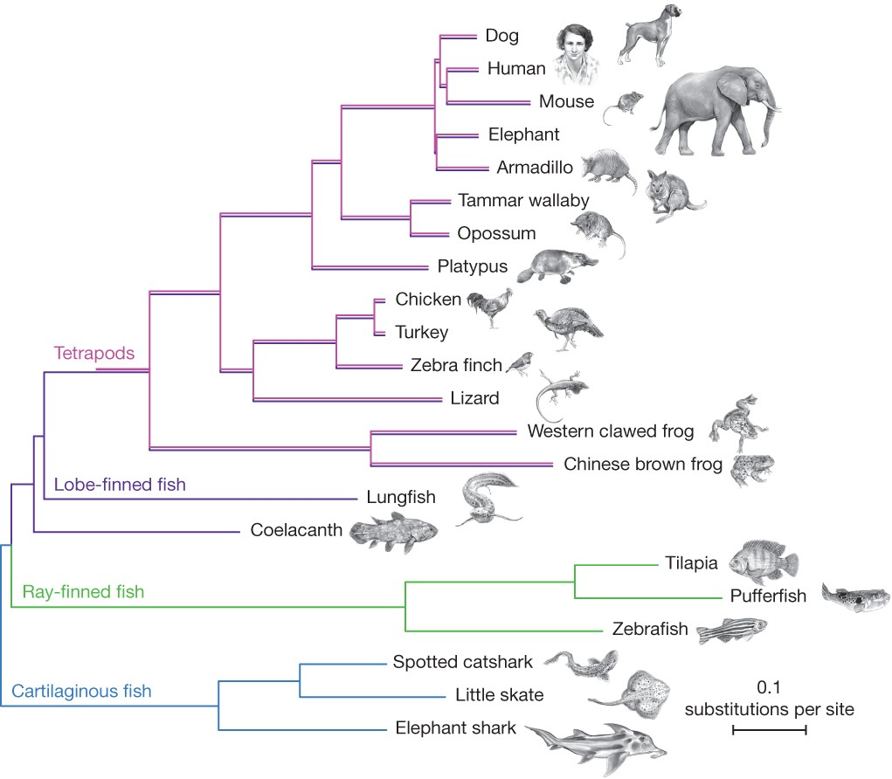

# Phylogenetic Inference
**First published Wed Dec 8, 2021; substantive revision Thu Jun 30, 2022**

*Haber, Matt, Velasco, Joel*

*Phylogenetics* is the study of the evolutionary history and relationships among individuals, groups of organisms (e.g., populations, species, or higher taxa), or other biological entities with evolutionary histories (e.g., genes, biochemicals, or developmental mechanisms). *Phylogenetic inference* is the task of inferring this history, and as with other problems of inference, there are interesting and difficult questions regarding how these inferences are justified.

In this entry, we examine what phylogenetic inference is and how it works. In the first section, we briefly introduce the field of phylogenetics and its history. In section 2, we explore how phylogenetic inference provides useful problems for philosophers to examine, and where philosophical approaches have contributed to the scientific examination of phylogenetics. This will help display why phylogenetic inference is not merely a biological research problem, but a philosophical one as well. Finally in section 3, we will move to a discussion of some of the contemporary debates about foundational issues in phylogenetics, and what the future of phylogenetic inference looks like.

## 1. Phylogenetic Inference in Biology

### 1.1 Primer and Introduction to Phylogenetics

A phylogeny is a reconstruction of evolutionary history. Thus the discovery of evolution is a good starting point for the history of phylogenetics. While Darwin was not the first to propose that some species were genealogically related to others, it was *On The Origin of Species* (Darwin 1859)[^darwin-1859] that convinced many biologists to accept common ancestry and to start building phylogenies. One of the immediate—and ongoing—impacts was the question this raised in how phylogenies (i.e., reconstructions of evolutionary history) relate to taxonomies (i.e., how we group taxa).

[^amemiya-2013]

\*Figure 1\* Phylogenetic (or evolutionary) trees have become commonplace in biology research articles. This tree displays a recent hypothesis on the relative placement of lungfish and coelacanth in the evolutionary history of tetrapods (Amemiya et al. 2013: 312, fig. 1)[^amemiya-2013]. [An extended description of figure 6 is in the supplement.]

Pre-Darwinian taxonomy focused on classifying according to the “natural system” where taxa were united into large groups due to their “natural affinities” (Winsor 1976)[^winsor-1976]. In an effort to clarify the concept of affinity, Richard Owen used the term “homologue” to refer to “the same organ in different animals under every variety of form and function” (Owen 1843)[^owen-1843]. Put into an evolutionary framework, the natural affinities uniting these groups were regarded as the result of descent with modification from common ancestors and “homology” has since become a central term in comparative biology (Donoghue 1992; Hall 1994)[^donoghue-1992][^hall-1994]. To see how homology relates to phylogenetic inference, as well as to introduce some basic terminology, it will be useful to consider an example phylogeny (Figure 1).

Figure 1 provides a typical contemporary example of a *phylogenetic tree*—a branching diagram that displays genealogical relationships. Phylogenetic trees like these include branches (the lines) and nodes (where the lines branch or come together, depending on the direction you are reading the tree). Terminal branches are marked with the entities whose evolutionary relationships are being studied. In this case those entities are species or higher taxa, but trees may be constructed for other taxonomic levels, or any other biological entities whose evolutionary relationship can be studied (e.g., viruses, stretches of DNA, extinct taxa). Phylogenetic methods can even be employed to study ontogeny or cultural evolution, e.g., they have been used to construct cell fate maps to reveal how the developmental parts of a single organism are related (Salipante & Horwitz 2006)[^salipante-2006], and used to reconstruct the expansion of language families and help estimate historical human migration patterns (Gray & Jordan 2000; Gray & Atkinson 2003; Gray, Drummond, & Greenhill 2009)[^gray-2003][^gray-2009][^gray-2000]. More recently, phylogenetic tools have been used to aid epidemiology studies of COVID-19 (Lemieux et al. 2021)[^lemieux-2021].

Since so much of modern biology requires the ability to read phylogenetic trees, good guides are commonplace. This includes journal articles (e.g., Baum, Smith, & Donovan 2005; Baum 2008; Yang & Rannala 2012)[^baum-2008][^baum-2005][^yang-2012], online guides (e.g., *Understanding Evolution*, Other Internet Resources), and more comprehensive textbooks (e.g., Felsenstein 2004; Lemey, Salemi, & Vandamme [eds] 2009; Wiley & Lieberman 2011; Baum & Smith 2013)[^baum-2013][^felsenstein-2004][^wiley-2011]. Here, we provide only a brief introduction, but recommend any of these (among others) to readers looking for a more thorough and technical introduction.

On the phylogenetic tree in Figure 1, time passes from left to right with extant groups labeled on the terminals of branches on the right.[^note-1] Starting from the left there are two distinct branches, one leading to Cartilaginous fish (sharks and rays), and the other to a node. From that node the branches split, with one leading to Ray-finned fishes, and the other leading to another, more recent node (that ultimately leads to frogs, lizards, and mammals, among other taxa). Branches may be read as representing ancestral lineages, with nodes representing common ancestors that diverged (or split) into distinct lineal branches.

We can also read the tree in Figure 1 by starting with the groups on the right and moving leftward, tracing branches back to where they join at nodes. This direction takes us backwards in time, and allows us to read off which groups are more closely related to others by looking at recency of common ancestry. For example, lungfish are more closely related to frogs than they are to pufferfish since lungfish and frogs share a more recent common ancestor with each other than either does with the pufferfish. To see this, trace back along the branches from each group, starting on the right and moving left. You will converge on a node between the lungfish and frogs before reaching the node between either of those taxa and the pufferfish. Another way of saying this is that there is a *monophyletic group* (or *clade*) that includes lungfish and frogs that does not include pufferfish.

A monophyletic group consists of an ancestor and all of its descendants. Some familiar groups turn out not to be monophyletic. For example, if we tried to unite pufferfish and sharks into a single group that excluded frogs and other tetrapods (such as the traditional Pisces) we get what is called a *paraphyletic* group. Individuals in paraphyletic groups all share a single common ancestor, but exclude some descendants of that ancestor. Artificial groups like “flying tetrapods” (birds plus the bats) would be called *polyphyletic* since they have multiple, distinct origins. Because paraphyletic and polyphyletic groups do not share a single history that is unique just to them (i.e., there is no branch on the tree that leads just to this group), they cannot feature in explanations in the same way that monophyletic groups can, i.e., they lack the utility and explanatory power of monophyletic groups (Velasco 2008a)[^velasco-2008a]. For example, biologists might be interested in studying whether flower diversity is driven by pollinator syndrome (i.e., moth, bird, or bee) or vice-versa. Phylogenetic principles predict different patterns of monophyly on these competing hypotheses, which can be tested empirically and used by biologists as they design experiments to test for the evidence of selection in cases like these (Whittall & Hodges 2007)[^whittall-2007]. This is simply unavailable without the explanatory and organizing principles of monophyly, and one reason it has grown to dominate systematics.

Each node on a tree is the origin of a monophyletic group. For example, the claim that the mammals form a single, united monophyletic group just means that all and only mammals share (i.e., are descended from) a common ancestor. We have very good reasons to believe that this is true. For example, all and only the mammals have certain traits (or characters) such as mammary glands, hair, and ossicles (three bones in the middle ear). Each of these traits are *homologues*, i.e., their similarity is due to shared ancestry. (Homologous characters are typically contrasted with *analogous characters*, i.e., traits whose similarity is not explained by common ancestry, but by some other process, e.g., convergent evolution or reversal). The mammary glands in humans and in elephants are homologous because the trait has been inherited from their common ancestor. In figure 1, the ancestor of the mammals is located at the node with branches leading to the platypus and the rest of the mammals. Once traits emerge (as evolutionary novelties) on a branch they can be passed down (unchanged or modified) to the descendants of that lineage. Since platypuses and mice have mammary glands, but no taxa stemming away from earlier nodes do, we can infer that mammary glands evolved after the node where mammals and birds split, but prior to the mammalian node. That is one way phylogenetic trees support inferential claims in biology. If mammary glands had evolved prior to the node joining mammals and birds, then we might expect to find mammary glands on birds or lizards. Platypuses and mice are also born inside an amniotic sac, as are turkeys and lizards. However, frogs do not have an amniotic sac. This tells us that the amniotic sac evolved after the frog lineage branched off from the other tetrapods. Parallel reasoning allows us to infer the history of the evolution of bones, tetrapod limb structure, feathers, etc. These homologies form a nested hierarchy of traits just as the monophyletic groups are nested, so, for example, the mammals are a part of amniotes which themselves are a part of the tetrapods. On the other hand, while the mammals and the birds are both part of the amniotes, they do not overlap at all. And indeed, no organisms have both mammary glands and feathers.

Explaining character distributions thus requires knowing which groups are clades (i.e., monophyletic groups). Phylogenetic trees depict precisely that, stating which groups are clades. This information is called the *topology* of the tree, which conveys the relative order of the nodes and nothing about their absolute dating in time. Knowing which groups are clades allows us to reconstruct the evolution of character traits, and it is the distribution of character traits that is the basic way that we infer which groups are clades in the first place. This style of reasoning (dubbed “reciprocal illumination” by Willi Hennig (1966)[^hennig-1966] led to charges of circular reasoning from critics of phylogenetic inference (e.g., Sokal & Sneath 1963)[^sokal-1963], whereas advocates have sought to explain why this worry is misplaced (see Wiley 1975; Sober 1988b, among many others)[^sober-1988b][^wiley-1975]. In fact, the nested hierarchies of traits is what led systematists to classify taxa into a nested hierarchy in the first place, and it was the nested hierarchy of the taxonomic system that Darwin took to be the most important evidence for common ancestry (Winsor 2009; Sober 2009, 2010)[^sober-2009][^sober-2010][^winsor-2009]. The problems of understanding what it means for traits to be homologous and of inferring homology will be discussed later (§2.1). Complicating things, groups of homologies do not always form unambiguous nested hierarchies, and sorting out what phylogenetic hypotheses are best supported in these cases is a big part of what generates debates over phylogenetic inference (more on this in §2 and §3.

Explaining character trait distributions is just the tip of the iceberg. Phylogenies are centrally important for all research in evolutionary biology. Phylogenetics lies at the heart of the linking of the fields of systematics[^note-2] and population genetics. Knowing a phylogeny is an important first step to studying problems in evolutionary biology, functional genetics, comparative anatomy, and evolutionary developmental biology. Just as evolution is the unifying, organizing theme in biology, phylogenetics is the backbone of biological inference more generally. As Sterelny & Griffiths (1999: 379) put it, “Nothing in biology makes sense except in the context of its place in phylogeny”.

### 1.2 From Darwin to Today: Three Interweaving Histories

For roughly 100 years after Darwin’s *Origin*, phylogenetic research in biology was common and important. Yet, phylogenetics proceeded without much in the way of underlying theory or explicable methodology—rather, the systematist with extensive knowledge of some group simply relied on their judgment as to which character traits looked genuinely homologous and which character transformations seemed plausible. Some phylogenies were widely agreed upon due to the fact that when homologies are clear, inference is easy. As early as the late 1800s, there was a general consensus among systematists around the branching order of many of the groups presented in Figure 1. However, the relative placement of the coelacanth and lungfish was disputed almost immediately upon discovery of the former in 1938 (Thomson 1991)[^thomson-1991]—a dispute that has continued to draw attention from biologists (e.g., Bockmann, De Carvalho, & De Carvalho 2013; Amemiya et al. 2013; Takezaki & Nishihara 2017)[^amemiya-2013][^bockmann-2013][^takezaki-2017].

The lungfish and the coelacanth appear key to understanding the origins of the tetrapods, which has remained a major question in the reconstruction of evolutionary history since Darwin. But this is just one example among many. Bowler (1996)[^bowler-1996] surveys the development of phylogenetics over this time period and examines a number of these debates in more detail such as whether the arthropods form a monophyletic group, and the question of the origin of birds, and, in particular, how they are related to the extinct dinosaurs.

While there are still important disagreements regarding phylogenies, the nature of these disputes have changed substantially as phylogeneticists no longer rely largely on individual expert judgment. The mid-twentieth century saw the introduction of competing accounts of the theoretical foundations of systematics (§1.2.1), a flurry of new algorithmic methods for constructing phylogenies and taxonomic classifications, and the beginning of relatively easy access to and employment of computational power (§1.2.3), all combined with new sources of evidence in the form of various kinds of molecular data (§1.2.2). As biologists sought to incorporate these emerging features into phylogenetic method and theory, debates arose over how (or whether) this fundamentally changed the nature of systematics. At the same time, debates about the foundations of systematics and the proper methods for classification and taxonomy became highly prevalent and interwoven with arguments about these new methods and newly available data.

Traditionally, the emergence of phylogenetics has been presented largely in the context of debates between three major schools of twentieth century taxonomic thought, often called “The Systematics Wars” (§1.2.1). As centrally important as this was, a singular focus on that history risks overshadowing the impact of the molecular revolution (§1.2.2) and ever-increasing access to greater computing power (§1.2.3) on the establishment of phylogenetics. Below we consider how each of these twentieth century developments impacted the emergence of phylogenetics as a distinct field of research. Yet, there are many overlapping themes cross-cutting these developments (often reinforced by allegiances between individual researchers), suggesting that, ultimately, an integrated approach is needed for a rich, nuanced history of phylogenetics.

#### 1.2.1 The Systematics Wars

Historically, phylogenetics emerged out of the larger field of biological systematics, the field of biology that studies the diversity of life and the relationships of living things through time. Today, systematists typically treat “relatedness” solely in terms of recency of common ancestry, but this was not always the case. Pre-Darwinian taxonomists discussed the relationships of various groups and their place in the “natural system”, and while the rise of evolutionary theory allowed that one sense of relatedness was genealogical, it did not eliminate the idea of the broader notion. Debates about the role of phylogeny in classification and taxonomy were widespread (e.g., Huxley [ed.] 1940; Winsor 1995)[^winsor-1995] though they began to take on a new form beginning in the late 1950s as collaborations turned into organized research programs pushing their agendas.

In his analysis of the period, David Hull (1988: ch. 5) titled one of his chapters “Systematists at War” and thus the name “The Systematics Wars” is sometimes used to describe the debates of the period. Hull (1970)[^hull-1970] influentially compared three “contemporary systematic philosophies”, typically called *pheneticism*, (or *numerical taxonomy*, after the seminal Sokal & Sneath (1963) textbook of the same name), *cladistics* or *phylogenetic systematics* (after Hennig’s 1966 foundational text, an earlier version of which was published in German in 1950)[^hennig-1966], and *evolutionary systematics* (following the lead of proponents like Simpson [1961] and Mayr [1969] and others).

The pheneticists disputed that we were in a position to know common ancestry with enough certainty to justify adopting it as foundational to our notion of “relatedness”, and maintained that the taxonomists’ job was discovering clusters of similarity (Sokal & Sneath 1963)[^sokal-1963]. Pheneticists were critical of what they viewed as the entrenched approach to systematics, arguing that the traditional approach to selecting between hypotheses largely relied on the relative prominence or status of the biologist rather than good scientific methodology. They explicitly framed their views in the context of arguments about what constituted “good science” and sought to promote independent and objective modes of assessing competing taxonomic groupings that relied on transparent and repeatable methods. This included advocating for a greater separation between biological theory and the construction of similarity groups.

Around the same time, another group (phylogenetic systematists) insisted that recency of common ancestry provided the best theoretically-motivated foundation for relatedness (Hennig 1966)[^hennig-1966]. Like the pheneticists, they too sought to promote good scientific methods in systematics, and were similarly critical of established approaches. The phylogenetic systematists can be characterized by their insistence that all taxonomic groups above the species level should be monophyletic. Thus, if birds are descended from dinosaurs then they *are* dinosaurs (Padian & Horner 2002)[^padian-2002]. If the dinosaurs (or the reptiles more generally) are defined in a way that excludes birds, then the group is paraphyletic and thus cannot be a taxon in a phylogenetic taxonomic system. Ernst Mayr derisively named them “cladists” for their obsessive focus on recovering clades (i.e., monophyletic groups) (Mayr 1965a)[^mayr-1965a], though its practitioners were happy to embrace the name. When consistently carried out, phylogenetic taxonomic principles led to major revisions in long-standing, traditional classifications—revisions that often generated deep controversy (e.g., Halstead 1978; Gardiner et al. 1979)[^gardiner-1979][^halstead-1978].

Both pheneticism and cladism were developed in opposition to entrenched views in systematics. In response, biologists committed to more traditional methods sought to articulate the theoretical underpinnings of their approach, which came to be known as evolutionary systematics. With Ernst Mayr as their most prominent advocate, evolutionary systematists sought to incorporate phylogeny into classifications, but permitted that classifications might also (or even instead) represent important adaptive differences between groups (Simpson 1961; Mayr 1969)[^mayr-1969][^simpson-1961]. A prominent example that regularly featured in these debates is the taxonomic placement of the birds and crocodiles. Mayr argued that though birds are descended from dinosaurs and reptiles more generally, birds share a cluster of adaptations which justify classifying them as a distinctive group at a taxonomically equivalent rank as reptiles. However, even though crocodiles are more closely related to birds than to lizards and thus belong to a clade with birds that lizards are not a part of, Mayr still classifies crocodiles as part of the reptile “grade”—a group characterized by a well integrated adaptive complex (Mayr 1974)[^mayr-1974]. Thus unlike the cladists, evolutionary systematists advocated for the inclusion of reptiles and other paraphyletic groups in taxonomy.

One natural way to understand these debates is to recognize them as systematists sorting out “reconstructing a phylogeny” and “classifying a group of taxa” as two distinct tasks, and working out how (if at all) these tasks ought to be reciprocally informative (Mayr 1965a, 1974; Griffiths 1974; Hennig 1975; de Queiroz & Gauthier 1990, 1992)[^queiroz-1990][^queiroz-1992][^griffiths-1974][^hennig-1975][^mayr-1965a][^mayr-1974]. With respect to this particular issue, cladistics has largely won; today when scientists designate higher taxa they are typically always describing monophyletic groups. The principle of monophyly has proven to be such a powerful explanatory and organizing tool that the commitment to it has grown widely and now dominates systematics–in addition to informing both theory and methodology across fields of biology This is one reason why this period is sometimes referred to as “The Cladistic Revolution” (Hull 1988; Kearney 2007; Haber 2009)[^haber-2009][^hull-1988][^kearney-2007].

Yet, another framing is available. Namely, that as biologists shifted to using phylogenies (rather than traditional taxonomies) to support their explanations and justify their inferences, disagreements over taxonomic classifications faded into the background. On this account, it is disagreements over phylogenetic hypotheses that are impactful; disputes over classifications become less consequential as they get replaced in scientific inference by phylogenies. Joseph Felsenstein (2004: 145)[^felsenstein-2004] dubs this the “It-Doesn’t-Matter-Very-Much school”, arguing that “systematists ‘voted with their feet’ to establish this school, long before I announced its existence”. How phylogenetics ought to influence, inform, or constrain taxonomic classifications is still a live debate (see Ereshefsky 2001 as well as debates over the adoption of the PhyloCode, among other debates about phylogenetic taxonomy)[^ereshefsky-2001], though one that is orthogonal to the inference of phylogenies. Contemporary debates on taxonomic classification are largely over how to draw inferences *from* phylogenies *for* classifications; there is very little dispute over the coherency of reconstructing phylogenies. Biological classification, on this account, is not viewed as a competitor to phylogenetics, but dependent on it—and not the other way around. Phylogeneticists, like Felsenstein, can largely proceed in reconstructing phylogenies without paying attention to classificatory questions, though some of the metaphysical questions about the units of phylogenetics can come back to impact the inference of phylogeny itself (see §2.6.2)

As an important aside, we say ‘largely’ in the previous paragraph because—as in many cases in biology—there is not unanimity. Notably, biologists that identify as *pattern cladists* would dispute many of the chacterizations we have offered about phylogenetics, including the very first sentence of this entry, i.e., “a phylogeny is a reconstruction of evolutionary history.” Though there are a number of views that might be identified with pattern cladism, all would typically regard that claim as unjustifiably reading a process into what is largely a claim about patterns only. On pattern cladism, phylogenetic trees are typically regarded as graphical representations of evidence from characters; in that regard, a phylogeny would just be a classification of those characters. For the pattern cladist, directly inferring process or evolutionary history from phylogenies—or, worse, building evolutionary process assumptions into phylogenetic inference—is a mistake. They defend this for numerous reasons, often on philosophical grounds, i.e., that pattern cladism embodies good scientific inference, or that evolutionary claims require additional inferential steps that need to be made explicit (Farris 1983)[^farris-1983]. This has contributed to a split in the larger cladistics community. One upshot of this process/pattern split is that the term ‘cladist’ has become ambiguous, contested, and imprecise, and it is not always clear who gets regarded as what kind of cladist (Carpenter 1987, The Editors 2016, Quinn 2017, Brower 2018a, Williams and Ebach 2018)[^brower-2018a][^carpenter-1987][^editors-2016][^quinn-2017][^williams-2018]. For example, while pattern cladists reject any *a priori* assumptions about evolution (Brower 2019)[^brower-2019], so-called *process* (or, sometimes, *phylogenetic*) *cladists* regard evolutionary claims as foundational to phylogenetics, while others (e.g., *statistical phylogeneticists*) have distanced themselves from using ‘cladist’ as a label altogether (see §2.3 and the subsection §2.3.1 for more on this disputed taxonomy). We recommend that philosophers writing in this area carefully specify the precise sense of ‘cladist/m’, if they use that term at all, and caution against using it interchangeably with ‘phylogenetics’.

Philosophers have largely focused on other topics in systematics than the pattern/process split. This is somewhat surprising as there are rich philosophical topics that could be fruitfully unpacked or drawn on as data by philosophers of science, especially for those interested in the nature of scientific explanation and inference, or the role of theory in biological methodology. For foundational literature on process versus pattern cladism see Beatty’s (1982)[^beatty-1982] introduction of the designation of pattern cladism, with responses by Brady (1982)[^brady-1982], Patterson (1982)[^patterson-1982], and Platnick (1982)[^platnick-1982]. Two good recent pattern cladist textbooks include Williams & Ebach (2020) and Brower & Schuh (2021). There is an expansive though well contained literature within cladistics featuring debates between pattern and process cladists, e.g., Carpenter (1987)[^carpenter-1987], Brower (2000, 2002, 2019)[^brower-2000][^brower-2002][^brower-2019], and Lee (2002)[^lee-2002] are just a very small selection of a large literature that philosophers interested in the justification of scientific inference and methology might explore.

Regardless of whether disputes about taxonomic philosophy died down because systematists came to agree or because they became less important, it is a mistake for philosophers to treat the Systematics Wars as a live dispute, as opposed to an historical one. Yet, it remains an important episode in the history of systematics, and the core conceptual debates left their mark on contemporary debates in phylogenetics (Haber 2009)[^haber-2009]. At stake was not merely what notion of “relatedness” systematists ought to adopt, but what constituted good science in the context of inferring history and constructing classifications, and the relative value (and even coherence) of concepts like objectivity, testability, and repeatability in science. But systematists no longer dispute *whether* phylogenetic inference may be justified as a scientific activity, but, rather, over how best to carry it out. A large part of why this change took place has to do with the availability of new sources of molecular data and the introduction of new methods to take advantage of it. It is to this history that we now turn.

#### 1.2.2 The Molecular Revolution

Like Felsenstein, Sterner and Lidgard (2018) encourage historians and philosophers of biology to “move past the systematics wars”. Their point is not that this was unimportant, but that a singular focus on it tends to overshadow the impact of other important historical advances during this period. We agree. To remedy this, Sterner and Lidgard suggest paying attention to the *practice* of systematists in this period, rather than more narrowly focusing on definitional disputes (embodying the so-called philosophy of science in practice approach (Ankeny, Chang, Boumans, & Boon 2011)[^ankeny-2011]). Doing so reveals that alongside the Systematics Wars were the dual methodological revolutions of the mathematization of systematics and the incorporation of molecular data. These trends cut across the separate schools of systematics, generating their own set of controversies. This is particularly acute in phylogenetics, where the rise of the use of mathematical and computational tools was both enthusiastically embraced and deeply resisted. We start with a short description of the impact of molecular data on phylogenetics, before moving to how mathematical and statistical tools were incorporated into phylogenetic methods in section 1.2.3 (for other histories on these topics see Dietrich 1994, 1998; Hagen 2001; Sterner & Lidgard 2018)[^dietrich-1994][^dietrich-1998][^hagen-2001][^sterner-2018].

Let’s first consider the appeal of including molecular data in phylogenetic analyses—perhaps even to the exclusion of morphological characters (e.g., Scotland, Olmstead, & Bennett 2003 though see Wiens 2004)[^scotland-2003][^wiens-2004]. One of the most important aspects of the molecular revolution for phylogenetics was the sheer amount of new data available to systematists, including for groups such as bacteria, where fossil data were scarce or severely lacking. Yet it was not merely the scale and availability of molecular data that held such appeal. As it became easier to collect, code, and collate these data, biologists argued that molecular phylogenetics provided an independent source of evidence from morphological studies that bolstered evidence for common ancestry and patterns of phylogeny (Zuckerkandl & Pauling 1965)[^zuckerkandl-1965]. In contrast, more traditional systematists such as Theodosius Dobzhanksy, Ernst Mayr and George Gaylord Simpson were skeptical of molecular evolution studies quite generally, and, in particular, the idea that they were in some way superior or could replace morphological studies (Dietrich 1998)[^dietrich-1998].

Many of the earliest molecular studies typically supported established phylogenies, e.g., Margoliash (1963)[^margoliash-1963] discusses the evolution of cytochrome *c*, though simply presumes the received phylogeny of species as correct. Later, Fitch & Margoliash (1967) construct a phylogeny solely from the cytochrome *c* data, primarily to demonstrate molecular phylogenetic methods and how to test the reliability of results. Interestingly, one of the “anomalies” they mention is that turtles are placed closer to birds than to snakes—but this turns out to be no anomaly! The vast majority of molecular studies have since placed the turtles as a sister group to the archosaurs (a group which includes the birds and the crocodiles) including the largest genome-scale studies done to date (Crawford et al. 2015)[^crawford-2015].

The case of the phylogeny of turtles as well as other recent molecular studies (e.g., of the lungfish and the coelacanth, see Amemiya et al. 2013; Takezaki & Nishihara 2017)[^amemiya-2013][^takezaki-2017] illustrate a general point. Even in groups where we have extensive fossils and easily accessible living specimens with detailed anatomical and morphological studies, molecular evidence has often been taken to settle disputes and even to overturn previously widely held views. This is in part due to the sheer volume of molecular data, which can overwhelm other sources of evidence, but also because of the way molecular data may be viewed as evolving “neutrally”, i.e., as the result of mutation and genetic drift rather than natural selection (Duret 2008)[^duret-2008], and, thus, be less prone to displaying *analogies* (the result of convergent evolution), which can be mistaken for *homologies* (the result of descent from common ancestry). (An analogy is the similarity relation between two analogous characters, and is a kind of “homoplasy” relation, i.e., characters whose similarity is not due to descent from common ancestors.)

Analogies are false positives of evidence of common ancestry. Morphological traits, it is presumed, are more subject to selective pressures that can generate these false positives, and so molecular data from sources less subject to selective pressures (i.e., neutral sites) are preferable for reconstructing phylogenetic history. From those phylogenies, analogies can be better identified, offering evidence for appeals to natural selection (in the form of convergent evolution or other evolutionary processes) as an explanation for the pattern of biodiversity and trait distribution (Whittall & Hodges 2007 provides a good example of this reasoning in regard to pollinator mode and morphology)[^whittall-2007]. Put another way, molecular data helps biologists explain why what appear to be homologies fail to form nested hierarchies. Molecular data can identify which of those might be analogies instead, and this helps resolve what would otherwise appear to be conflicts in phylogenetic inference. This is one way biologists use phylogenies to offer data-driven, theoretically-grounded evolutionary explanations, in contrast to “just-so” stories.

In addition to adding more evidence in cases where systematists already had a great deal of it, molecular studies can shed light on cases where other sources of evidence are extremely weak. For example, molecular data may preserve deep phylogenetic history otherwise obscured at the morphological level by millions of years of adaptive changes. Phylogeneticists depicting the very earliest branches in plant and animal phylogenies, as well as relationships between the different groups of eukaryotes, recognized how molecular data could both test and enrich these deep phylogenetic hypotheses (Kenrick & Crane 1997; Baldauf 2003)[^baldauf-2003][^kenrick-1997]. Subsequent molecular phylogentic analyses have demonstrated the fruitfulness of using molecular data (e.g., amino acid sequences, RNA transcriptomes, and nuclear and mitochondrial genomes) for constructing deep phylogeny hypotheses (Heckman et al. 2001; Dunn, Giribet, Edgecombe, & Hejnol 2014)[^dunn-2014][^heckman-2001].

Emile Zuckerkandl and Linus Pauling’s introduction and use of the hypothesis of a molecular clock provides a good example of the powerful utility of molecular data and was an important early episode in the history of molecular phylogenetics. The term “molecular clock” was coined in Zuckerkandl & Pauling (1965), but they had already used it without naming it in earlier publications (Zuckerkandl & Pauling 1962; Pauling & Zuckerkandl 1963)[^pauling-1963][^zuckerkandl-1962]. The basic idea is fairly simple. Given some estimated rate of molecular evolution, the relative ages of branches and nodes may be estimated given some set of molecular data mapped onto a phylogenetic topology. Thus, molecular models of evolution were incorporated into phylogenetic methods (§1.2.3).

As more sequences of proteins became available, Zuckerkandl and Pauling noted that homologous proteins displayed slight yet systematically different sequences across taxa. For example, while there were 18 amino acid differences between the human and horse hemoglobin α-chains, there was thought to be only two differences between gorillas and humans.[^note-3]

Zuckerkandl and Pauling then assumed that amino acid changes were roughly linearly proportional to time, and thus the time between the divergence of humans and horses was nine times greater than that between humans and gorillas. Using paleontological estimates for calibration, Zuckerkandl and Pauling concluded that the humans and gorillas diverged a mere 14.5 million years ago—much more recent than traditionally was thought. This line of inference is not limited to molecular phylogenetics, but has been imported for application to other data types, e.g., similar reasoning from phylogenetic techniques has been applied to language-tree divergence times to estimate Indo-European and Polynesian human migration (Gray & Jordan 2000; Gray & Atkinson 2003; Gray, Drummond, & Greenhill 2009)[^gray-2003][^gray-2009][^gray-2000]. (For more on the early development of the molecular clock, see Morgan 1998.)[^morgan-1998]

Later, it was thought that the neutral theory of evolution[^note-4] provided some theoretical justification for the molecular clock hypothesis (Kimura 1968, 1969; Duret 2008)[^duret-2008][^kimura-1968][^kimura-1969], though Dietrich (1994)[^dietrich-1994] argues that the relationship goes in the other direction with Zuckerkandl and Pauling’s research providing an essential foundation for the development of the neutral theory in the first place.

The molecular clock is but one of many examples of the importance of molecular biology to phylogenetics. Importantly, incorporating molecular data helped extend phylogenetic studies beyond eukaryotes, i.e., the molecular revolution has fundamentally altered (or, arguably, created) the field of microbial phylogenetics. Beginning in 1969, Carl Woese began to sequence ribosomal RNA (rRNA) from across the prokaryotic kingdom in an effort to understand bacterial phylogeny. The work was slow and difficult, but by 1975 Woese and his lab had sequenced the rRNA of 27 different bacterial taxa (Woese et al. 1975)[^woese-1975]. In 1977, Woese and George Fox dropped a bombshell. They had sequenced genes from a number of prokaryotic organisms whose rRNA genes lacked the standard signatures of all previously known bacterial rRNA genes and which appeared as distantly related to the bacteria as did the eukaryotes. Woese and Fox named them the “Archaebacteria” to emphasize their distinctness (Woese & Fox 1977)[^woese-1977]. In 1990, Woese, Kandler, and Wheelis (1990) produced the first attempt at building a universal tree of life that included bacteria, archaebacteria, and the eukaryotes based on molecular data, with the project continuing to this day (Ciccarelli et al. 2006; Hinchliff et al. 2015; Hug et al. 2016)[^ciccarelli-2006][^hinchliff-2015][^hug-2016]. All of this is only possible because of molecular sequence data.

#### 1.2.3 The Mathematization of Phylogenetics and Introduction of Basic Phylogenetic Methods

The introduction of molecular data was highly significant in phylogenetics. In addition to the amount of data it generated, and the way molecular data provided evidence where other data were scarce, this new type of data was also significant in how it promoted the mathematization of phylogenetics. Molecular data lends itself to mathematical and statistical analysis, in part due to (a) the ease by which molecular data may be encoded; (b) the systematic way molecular evolution may be mathematically modeled and subsequently incorporated into statistical methods; and (c) the manner by which mathematical and statistical tools help analyze the large volume of molecular data under consideration. So though the molecular revolution and mathematization of systematics need not go hand-in-hand, it is hardly surprising that they do.

A number of authors have discussed the rise of mathematical thinking and computational tools in systematics—especially in connection with numerical taxonomy and phenetic classification (e.g., Hagen 2001; Sterner & Lidgard 2014, 2018)[^hagen-2001][^sterner-2014][^sterner-2018]. Here we focus on the rise of statistical methods for inferring phylogenies and later (§2) we discuss the philosophical debates that arose regarding the use of these methods. Good and more thorough textbook introductions for phylogenetic methods include Felsenstein (2004)[^felsenstein-2004], Lemey et al. (2009) and Baum & Smith (2013). Yang and Rannala (2012) provide a helpful recent review in the context of molecular phylogenetics.)

Incorporating molecular data both encourages and is facilitated by the adoption of mathematical tools. We got a hint of that in the discussion of molecular clocks (§1.2.2), which use estimated rates of molecular evolution to estimate divergence times. Around the same time, Anthony Edwards and Luca Cavalli-Sforza—both students of R.A. Fisher—began thinking of phylogenetic inference as a problem for statistics. After initially working independently on the problem, they collaborated to produce what are perhaps the first set of papers presenting phylogenetic inference in a statistical framework (as attributed by (Felsenstein 2001, 2004)[^felsenstein-2001][^felsenstein-2004]; Edwards’ own recollections of this work can be found in Edwards (1996)[^edwards-1996]).

Among the earliest algorithmic methods for inferring phylogenies are those known as “distance” methods. “Distance” could represent whichever character coding scheme we might be using to construct the tree, molecular or morphological, e.g., the number of nucleotide differences between two sampled sequences of DNA. A distance method uses these pair-wise distances to infer the phylogeny.

The first distance method developed is among the best justified statistically, namely, the *least-squares method* of Cavalli-Sforza and Edwards (1967). Here each topology has a set of “best-fitting” branch lengths where fit is measured by summing the squared differences between the expected distance and the actual distance between each pair of taxa. The best tree topology is the one whose best fit branch lengths are a better fit than any other tree’s best fit.

An alternative class of methods are known as parsimony methods. Here we simply need a measure of how many steps it takes for one character state to transform into another. Recall that different tree hypotheses generate different explanations of the current character distributions. The basic idea behind parsimony is that the tree hypothesis that explains these character distributions with the fewest number of evolutionary changes is to be preferred.

The first parsimony algorithm was published in Camin and Sokal (1965) and a number of variants of parsimony have since been developed. For example, one might want to weight certain kinds of changes relative to others or even disallow certain kinds of changes (such as reversals) all together. A survey of such methods as well as a collection of different algorithms for carrying them out can be found in Felsenstein (2004)[^felsenstein-2004]. Parsimony was the chosen method for the Cladistic school which is part of the reason that the history sketched in “The Systematics Wars” (§1.2.1) above is intertwined with the history of mathematization sketched here. Philosophical arguments for and against the superiority of parsimony as an inference method will be discussed later in section 2.3.

If we think of phylogenetic inference as an instance of statistical inference more generally, then likelihood and Bayesian methods spring to mind as methods that exemplify more general, statistical paradigms. Both require calculating probabilities and thus will require models of evolutionary change i.e., some description of the process of evolution and assignment of probabilities to possible changes in character states (such as from one nucleotide to another). Let’s briefly walk through what that means, as how and whether to incorporate models of evolution in phylogenetic inference has been a major topic of debate.

If the data are observed nucleotide sequences from different groups of terminal taxa, then the calculation we are after is the probability that those observed sequences of nucleotides would arise on the tips of competing phylogenetic hypotheses. The simplest way to calculate that is to use the Jukes-Cantor model of evolution (Jukes & Cantor 1969)[^jukes-1969]. This model assumes an equal frequency of the four nucleotides, and a uniform probability that any one nucleotide might change to another. (These assumptions are typically violated, but reflecting that in a model of evolution introduces additional parameters, which increases computing time—a valuable and limited resource in 1969.) The Jukes-Cantor model provides a model of evolution on which the relevant probability that any given sequence might have evolved from another more primitive sequence may be calculated. Different tree topologies will generate different probabilities that the observed sequences evolved from a hypothetical ancestral state. This conditional probability, $P(\text{Data} | \text{Tree})$, is called the likelihood of the tree.

Though the Jukes-Cantor model is still used, more sophisticated models of evolution are available, e.g., the K80 (Kimura 1980)[^kimura-1980], HKY85 (Hasegawa, Kishino, & Yano 1985)[^hasegawa-1985] and Tamura-Nei (Tamura & Nei 1993)[^tamura-1993] models of evolution. These introduce more parameters, e.g., assumptions about equal frequencies of nucleotides and/or the uniform probability of changing nucleotide states may be relaxed and even customized; models may also incorporate molecular clock assumptions.

These parameter-rich models reflect a better understanding of molecular evolution (e.g., that transversion and transition[^note-5] rates between nucleotides are rarely equivalent) and the combination of lowered costs and increasing accessibility to growing computational power that permits more parameter rich analyses. The large number of models available leads to an interesting statistical problem in its own right known as the problem of model selection, i.e., which model of evolution do we use in our phylogenetic tools? For discussions of this problem in the context of phylogenetics, see (Posada & Crandall 1998; Sullivan & Joyce 2005; Posada 2008)[^posada-2008][^posada-1998][^sullivan-2005].

Once we choose a model or collection of models to work with, we can now calculate probabilities conditional on these additional parameters (*θ*). This likelihood may be formally represented as:

$$ L(\text{Tree}, \theta | \text{Data}) = P(\text{Data} | \text{Tree}, \theta) $$

As a reminder, the likelihood of a hypothesis given a set of data is just equal to the conditional probability of those data given that hypothesis. On these model-based phylogenetic approaches, the data are conditional on both a particular phylogenetic tree hypothesis *and* the stipulated parameters.

Using different values for the parameters in your model will lead to different likelihoods for the tree. The maximum likelihood estimate is the tree hypothesis along with the fitted parameters which maximizes this likelihood. Felsenstein (1981)[^felsenstein-1981] gave the first computationally feasible algorithm for calculating likelihoods, and with modern computing power combined with the huge amounts of sequence data available, likelihood methods have become the most commonly used methods in phylogenetics.

Just as with likelihood methods, Bayesian methods require a model of evolution before any inferences are possible. The fundamental difference is that likelihood inference treats parameters of the model as nuisance parameters which have a fixed but unknown value. In the frequentist method of maximum likelihood, these parameters are set to their best fitting value. Bayesian inference treats parameters as random variables with unknown distributions and probabilities are used as a measure of uncertainty. The probability of a tree is a conditional probability $P(\text{Tree} | \text{Data})$ under the assumption of a particular model. When we incorporate the model parameters *θ*, by Bayes’ theorem, we have:

$$P(\text{Tree}, \theta | \text{Data}) = \frac{P(\text{Data} | \text{Tree}, \theta)*P(\text{Tree}) }{P(\text{Data})}.$$

Controversially, this requires that we attach prior probabilities to the possible hypotheses as well as the parameters in our model. Pickett and Randle (2005) claim that it is impossible to assign priors in a consistent way. Velasco (2007)[^velasco-2007] argues that this claim rests on a mistake, though the problem remains a difficult one. He later advocates assigning priors to tree topologies, but leaves open the more difficult problem of priors on branch lengths or model parameters (Velasco 2008b)[^velasco-2008b]. Alfaro and Holder (2006) attempt to address some of these issues.

Anthony Edwards (1970)[^edwards-1970] was the first to discuss Bayesian methods in phylogenetics, but it was computationally impossible to carry these inferences out at the time. In the 1990s, three groups independently developed methods for carrying out Bayesian inferences of phylogenies in practice (Rannala & Yang 1996; Mau & Newton 1997; Yang & Rannala 1997; Li, Pearl, & Doss 2000)[^mau-1997][^rannala-1996][^yang-1996][^yang-1997]. Each group used Bayesian Markov chain Monte Carlo (MCMC) algorithms to estimate posterior probabilities, which other groups further refined (e.g., Larget & Simon 1999; Ané, Larget, Baum, Smith, & Rokas 2007; Huelsenbeck, Ané, Larget, & Ronquist 2008)[^ané-2007][^baum-2007][^huelsenbeck-2008][^larget-1999]. (See Archibald, Mort, & Crawford 2003 for an early and non-technical primer on Bayesian phylogenetic methods.)[^archibald-2003] With further statistical and computational improvements, Bayesian methods are now fairly commonplace in the literature alongside likelihood methods.

## 2. Phylogenetic Inference and Philosophy

Section 1 served as an introduction to the history and problem of phylogenetic inference. In this section, we will look at how phylogenetics and philosophy are intertwined—in particular, we will examine some foundational debates in phylogenetics that have a distinctly philosophical flavor, and we will point out more traditional philosophical questions that the study of phylogenetics can shed light on.

At its core, phylogenetic inference is about evaluating competing hypotheses. In an important sense, phylogeneticists are faced with what philosophers of science would identify as a problem of underdetermination of theory by evidence . Multiple competing phylogenetic trees can explain the same data, though in conflicting ways; it is the phylogeneticists task to identify which of those hypotheses best explains those data. It will be useful to separate the problem into two parts:

1. identifying what the evidence is; and
2. constructing a phylogeny to explain the evidence we have.

In the case of phylogenetic inference, we are in the philosophically interesting and puzzling situation where it seems that these two questions cannot really be separated.

### 2.1 Alignment and Character Coding

The question of which method of phylogenetic inference is best justified is clearly important, but skips over an important step in phylogenetic inference—the construction of a data matrix of characters. Mishler (2005)[^mishler-2005], for one, argues that it is the most important step! Following Winther (2009)[^winther-2009], we can separate *character analysis* which results in the construction of a data matrix from *phylogenetic analysis* which treats the data as input and produces a phylogeny. This first stage of character analysis has been widely discussed in biology (though surely less widely discussed than the second stage). In addition to the voluminous literature on homology, useful collections of work on characters include those edited by Wagner (2000)[^wagner-2000] and Scotland & Pennington (2000).

Character analysis includes identifying characters of the organisms we are looking at, and in particular, identifying when a character in one organism is the same character as in another organism. This is the problem of homology. A different, but related problem, is assigning character states. For example, one bear might have black fur while another has white fur. Here, “fur” is the character, but it is in a different state (fur color) in the two organisms. Though it is standard to treat characters and character states separately, the extent to which these are genuinely different problems rather than than aspects of the same problem is a matter of debate (Stevens 2000; Freudenstein 2005; Sereno 2005)[^freudenstein-2005][^sereno-2005][^stevens-2000].

Identifying and coding characters is certainly a biological problem, but it is a philosophical one as well. On what basis can we judge that one character is homologous to another? Debates on this extend back to the very beginning of contemporary biology, e.g., Richard Owen’s influential pre-Darwinian notion of homologue to Ernst Haeckel working to develop accounts of homology in the context of Darwinian evolution. In the mid-twentieth century, the pheneticists argued that character identification must be “theory-free” and advocated using raw similarity as a guide to identifying homology (Sokal & Sneath 1963; Sneath & Sokal 1973)[^sneath-1973][^sokal-1963]. There are well known philosophical and biological problems with trying to use similarity in this way (e.g., Goodman 1972)[^goodman-1972], many of which were raised as objections to strict pheneticism during the Systematics Wars (e.g., Mayr 1965b; Neff 1986; Rieppel & Kearney 2002 though see Lewens 2012 for a recent defense of pheneticism in a contemporary context)[^lewens-2012][^mayr-1965b][^neff-1986][^rieppel-2002].

In a phylogenetic context, homologies are regarded as the result of descent with modification from common ancestors. Similarity and identity, in that context, is an expression of shared evolutionary history. At the same time, homologies are also treated as hypotheses from which we can infer phylogenetic hypotheses (and, subsequently, both test and explain our hypotheses of homology). Clearly, even in a contemporary phylogenetic context, questions remain on how to individuate characters and identify homologies. Richards (2002, 2003)[^richards-2002][^richards-2003] worries that since there is no algorithm for individuating characters, we rely on illegitimate, nonscientific factors rendering character identification and phylogenetic analysis ultimately subjective. Rieppel and Kearney (2007)[^kearney-2007] and Winther (2009)[^winther-2009] respond that character analysis can be considered objective since it relies on various kinds of causal criteria; Kendig (2016)[^kendig-2016] adopts a slightly different strategy, rejecting the idea that we need to develop an analytic definition of “homology”, instead looking to biological practice as a guide for individuating characters.

While character analysis and phylogenetic analysis are logically separate tasks, in theory they should be intertwined. A given phylogeny can make an assessment of homology more or less plausible. One proposal to avoid this problem is the introduction of a distinction between “primary” homologies (an initial character identification based on structural features) and “secondary” homologies (similarity due to common ancestry) which are inferred through phylogenetic analysis (Pinna 1991; see Roffe 2020 for a recent philosophical treatment of this distinction)[^pinna-1991]. On the other hand, Rieppel and Kearney (2002) argue that character hypotheses need to be independently testable and phylogenetic analysis can clearly provide evidence for miscoding of characters—even if this is not the intended goal.

Molecular data presents a different set of challenges for individuating characters and coding them into a matrix, nicely illustrated by DNA sequence data. With only four base nucleotides, coding is easy (§1.2.3), and modern laboratory techniques provide highly reliable sequences of nucleotides in a stretch of DNA. But here, the problem is *alignment*. How do we know that one stretch of nucleotide sequences should correspond to similar stretches in other taxa? We might consider chromosomal location, or even functional similarities, though each of these raise other questions of how we decide what ought to be treated as homologous characters (even contingently) across taxa. This becomes even more complicated as we consider how historical processes like gene duplication/loss or recombination add complexity to these questions. This is the problem of positional homology. Like morphological character coding, molecular alignment is intertwined with phylogenetic analysis and various methods of joint inference have been proposed (Redelings & Suchard 2005; Wheeler et al. 2006)[^redelings-2005][^wheeler-2006].

### 2.2 Computational Limits and Big Data

Bearing in mind what we said above about the interconnectedness of character analysis and phylogenetic analysis, we will now proceed to the second part, analysis of the data. At this stage, computational limits loom large. Even if we are concerned only with inferring the topology of a phylogeny, the number of possible trees grows exponentially relative to the number of terminal branches we include on a tree. The formula for calculating the number of possible tree topologies is relatively straight-forward (Felsenstein 2004)[^felsenstein-2004]:

$$\frac{(2n-3)!}{2^{n-2}(n-2)!}$$

where *n* is the number of taxa. The upshot is that even a small expansion of terminal branches results in an exponential increase in the number of possible topologies. So, for example, there are 15 possible phylogenetic trees for a group of 4 species, over 34 million for 10 species, and $8 \times 10^{21}$ with 20 species.[^note-6]

This means that exhaustive evaluation of all possible hypotheses very quickly becomes all but impossible—even as our capacity for this has grown with increased computing power. Finding the most parsimonious tree, the maximum likelihood tree, and even doing a multiple sequence alignment to begin with are all NP-complete problems[^note-7] (Graham & Foulds 1982; Wang & Jiang 1994; Chor & Tuller 2005)[^chor-2005][^graham-1982][^wang-1994]. Bayesian inference is similarly computationally intractable (Ronquist, Mark, & Huelsenbeck 2009)[^ronquist-2009].

In response, researchers have developed heuristic search strategies to explore possible tree space. For example, in Bayesian analysis the probability space of possible trees is so large that starting by randomly selecting a tree will be highly inefficient. It will almost surely fail to provide a good estimate of the posterior probability distribution, since the interesting regions will only occupy a small part of that distribution space (Ronquist et al. 2009)[^ronquist-2009]. A common heuristic is to start with a parsimony or distance-methods tree. Though these methods typically perform worse than model-based approaches, they are much less computationally expensive and can quickly generate an initially plausible tree that Bayesian phylogeneticists use as a launching off point to explore the tree probability space (e.g., using hill-climbing algorithms such as Markov Chain Monte Carlo (MCMC) sampling). Innovations like these are one reason that computational phylogenetics is an important field in both statistics and computer science. Philosophers of science interested in how scientists explore and use so-called “Big Data” would profit from examining how phylogeneticists have developed, adapted, and employed heuristic search strategies.

Setting aside computational and practical problems leaves us with what appears to be a straightforward epistemological question—which methods are best justified in licensing phylogenetic inferences? We begin our examination of this question by looking at arguments in favor of a particular method, parsimony.

### 2.3 Justifications of Parsimony

Parsimony methods were among the very first adopted by cladists. This is often taken to include Hennig (1966)[^hennig-1966], who laid out a process of phylogenetic inference that is now referred to as “Hennigian reasoning” in his seminal text *Phylogenetic Systematics* (Baum & Smith 2013)[^baum-2013]. Like other forms of parsimony, this method sought to identify the tree that explained the distribution of homologies by appeal to the fewest number of evolutionary events.

Parsimony techniques have grown more sophisticated, and, as larger data sets have been assessed and bigger trees constructed, justifications of parsimony approaches advanced and adapted. Early on, much of this took place in the context of the Systematics Wars (§1.2.1), where a premium was placed on defending approaches as properly scientific. Thus, these debates tended to veer into philosophy of science, with systematists disputing what counted as doing good science in the context of inferring history. This helps explain the influence of Karl Popper’s work . Early proponents of parsimony were attracted to Popper’s falsificationist account of the scientific method, both in the way it provided demarcation criteria for scientific activity, and in the way it was positioned as critical of logical positivist approaches. Falsificationist justifications were employed to criticize numerical taxonomists as verificationists relying on flawed hypothetico-deductive methods.

Wiley (1975)[^wiley-1975] provides a representative example of a falsificationist defense of parsimony that proved deeply influential, e.g., Eldredge & Cracraft (1980) adopt Wiley’s core justification in their influential textbook, as does Farris (1983)[^farris-1983] in his impactful defense of parsimony. On Wiley’s account, each taxonomic character is treated as an homology, and considered independently of all others. For each homology, a tree hypothesis is generated that requires the fewest number of evolutionary changes to explain the pattern of character distribution across taxa. These are hypotheses of homology and, on the falsificationist account, these hypotheses are mutually testable. That is, the tree hypotheses generated for each character constitutes a test of the trees hypothesized for every other character; falsified hypotheses of homology are treated as ad hoc assumptions of homoplasy. The maximum parsimony tree is that topology which generates the fewest falsified hypotheses of homology, and is regarded as the most corroborated tree. Adding new characters or taxa constitutes further testing of these hypotheses, and generates more potential falsifiers. In this way, parsimony is simultaneously a mode of tree construction and evaluation (Haber 2009)[^haber-2009]; Wiley (1975)[^wiley-1975], Eldredge and Cracraft (1980), and Farris (1983)[^farris-1983] describe this as a logical basis of reasoning about phylogenetic inference, citing the philosophical justification of falsificationism.

Whether this represents a faithful account of Popper’s falsificationism, or whether falsificationism represents *the* optimal (or even a desirable) mode of scientific reasoning has been a matter taken up by philosophers (Hull 1983, 1999; Sober 1988b)[^hull-1983][^hull-1999][^sober-1988b], though that is, in some ways, beside the point. (For a philosophically-minded biologist’s survey of the role of Popper in systematics, see Gaffney 1979, Rieppel 2008, or Santis 2020.)[^gaffney-1979][^rieppel-2008][^santis-2020] Regardless, characterizing parsimony in falsificationist terms provided an important justification that resonates to this day. More recent invocations of Popper in phylogenetic inference have focused on whether parsimony or model-based methods such as Maximum Likelihood (§1.2.3) better align with falsificationism (e.g., Siddall & Kluge 1997; de Queiroz & Poe 2001, 2003; Kluge 2001)[^queiroz-2001][^queiroz-2003][^kluge-2001][^siddall-1997], and whether probabilistic and statistical reasoning is relevant for studying singular historical events (Siddall & Kluge 1997; Haber 2005)[^haber-2005][^siddall-1997]. (See Turner 2007; Cleland 2011;Currie 2018, 2019, for general philosophy of historical science.)[^cleland-2011][^currie-2018][^currie-2019][^turner-2007] In section 2.4 we describe how Felsenstein’s (1978)[^felsenstein-1978] discovery that parsimony is prone to systematic errors poses a serious challenge to this underlying falsificationist justification.

Parsimony can be defended without falsificationism, and other justifications have been offered that appeal to the method’s namesake, i.e., the principle of parsimonious reasoning or appeals to Ockham’s Razor (e.g., Kluge 2005)[^kluge-2005]. It amounts to (i) defending parsimony (the principle) as the criterion by which we ought to assess competing phylogenetic hypotheses, and (ii) arguing that parsimony (the method) is the best mode for achieving that goal by seeking out that tree that minimizes the number of evolutionary novelties required to explain the distribution of characters. This may also be presented as identifying that tree that minimizes the number of ad hoc assumptions of homoplasy. Though this appeal to simplicity may be wedded to falsificationist justifications (as we saw above), they are logically independent defenses. There is certainly an intuitive appeal to the principle of parsimony in the sciences, and Ockham’s razor remains influential for good reason. But justifying parsimony methods by appeal to simplicity is not so straight-forward. Evaluating which phylogenetic approaches are justified by Ockham’s Razor depends on what is being counted (Haber 2009)[^haber-2009]. Sober (1988b, 2015 among others) provide useful discussions of the role of simplicity and the principle of parsimony in phylogenetics.

Other philosophical justifications of parsimony have been offered. Fitzhugh (2008 and elsewhere) has argued that the problem of phylogenetic inference is best understood as an abductive problem, and that treating it as a problem for statistical (or inductive) inference amounts to a category error. Sober (1988b)[^sober-1988b] agrees that phylogenetics involves abductive reasoning, though argues that this *justifies* the use of statistical approaches (especially likelihood).

It is also worth recalling why pattern cladists in particular object to model-based methods of phylogeny reconstruction. Pattern cladists typically reject *any* method of phylogeny reconstruction that includes assumptions about the evolutionary process (§1.2.1), e.g., Brower (2019: 717)[^brower-2019] identifies a centrral commitment distinguishing pattern from process (or traditional or phylogenetic) cladism as the rejection of “*a priori* evolutionary background assumptions from the inference of patterns of relationships among taxa.” As such, pattern cladists have strongly objected to likelihood and other model-based phylogenetic methods, as those explicitly incorporate evolutionary models (§1.2.3 and §2.4). This has typically gone hand-in-hand with a rejection of statistical approaches more generally, and a commitment to parsimony, e.g., “the statistical approach to phylogenetic inference was wrong from the start, for it rests on the idea that to study phylogeny at all, one must first know in great detail how evolution has proceeded. That cannot very well be the way in which scientific knowledge is obtained” (Farris 1983: 17)[^farris-1983].

In response, statistical phylogeneticists have argued that parsimony methods implicitly include evolutionary models, which model-based methods simply make explicit and, thus, subject to interrogation (de Queiroz & Poe 2001, 2003; Swofford & Sullivan 2009)[^queiroz-2001][^queiroz-2003][^swofford-2009]. This fault line is further reflected in the way pattern cladists view other proponents of parsimony as allies in this debate, as Brower (2019: 717)[^brower-2019], approvingly citing Kluge & Farris (1999)[^farris-1999], makes clear: “despite this difference of opinion regarding critical background knowledge, there is no practical distinction between pattern and process cladists’ evidence, analyses or results. From a methodological perspective, all cladists group by synapomorphy alone.” That is, it is in the interpretation of methodology and inferential justification that distinctions are drawn between pattern and process cladists; in the larger debate with statistical phylogeneticists they are allied. Note, however, that ever finer distinctions of the term ‘cladist’ are being introduced (let alone ‘statistical phylogeneticists’, who typically associate with model-based approaches). This reflects the way this term has grown contested and associated with various competing sets of commitments. It is worth taking a brief detour in section 2.3.1 to sort through this a bit.

#### 2.3.1 Who Owns the Term “Cladist”?

In section 1.2.1, we used the term “cladistics” to refer to a school of taxonomy which held that higher taxa must be monophyletic, and stood in contrast to the competing schools of phenetics/numerical taxonomy and evolutionary taxonomy. In this historical context, “cladistics” was sometimes used interchangeably with “phylogenetics”. We caution against that practice, especially when discussing more contemporary practices. Though it is hard to pin down a precise date when these terms began to carry different connotations, Felsenstein (1978)[^felsenstein-1978] and Beatty (1982)[^beatty-1982] are as good a marker as any for when these terms began to diverge and take on more nuanced senses. This is particularly true of the term “cladist”, which has become a highly disputed term, and one that has been claimed by sub-groups within the larger field of phylogenetics.

An apt example of this is the journal *Cladistics*, whose editors published a controversial editorial in 2016 stating that submitted manuscripts should reflect the philosophical commitments of the journal and its sponsoring professional society (*The Willi Hennig Society*) (Editors 2016)[^editors-2016]. They write,

> The epistemological paradigm of this journal is parsimony. There are strong philosophical arguments in support of parsimony versus other methods of phylogenetic inference (e.g., Farris 1983)[^farris-1983].

The editorial continues, stipulating that “Phylogenetic data sets submitted to this journal should be analysed using parsimony”. If trees generated by alternative methods show different results, these may be included if authors prefer those topologies, but only if authors are “prepared to defend it on philosophical grounds” (all quotes from Editors 2016: 1)[^editors-2016]. The editors, here, are using the imprimatur of the journal *Cladistics* to stake out a specific sense of how “cladistics” ought to be understood, and what calling oneself a “Cladist” signals about the underlying theoretical and philosophical commitments held about phylogenetic inference, i.e., an exclusive commitment to parsimony methods—going so far as to reject model-based statistical approaches entirely.

Aleta Quinn (2017)[^quinn-2017] argues that the term “cladist” remains one claimed by multiple overlapping (yet importantly distinct) camps. She tackles the ambiguity head on, providing a useful “foreign language dictionary” of ways that “cladist” gets used in systematics. Quinn argues that the term is in need of disambiguation, drawing seven different senses from the literature. This includes systematists that advocate adherence to particular phylogenetic methods (e.g., parsimony, as in the case of the *Cladistics* editorial) or philosophical justifications (especially to a version of Popperian falsificationism), though the various distinctions of competing senses of “cladist” go well beyond this. In response to Quinn, Williams and Ebach (2018) propose an eighth (and their preferred) sense of cladist, and Brower (2018a)[^brower-2018a] offers a focused commentary on Quinn’s article, as well as other attempts to clarify the philosophical foundations and commitments of pattern cladism. For example, a distinguishing feature of pattern cladism is the rejection of *a priori* assumptions about evolutionary theory in phylogenetic methods. This has been interpreted as a claim of theory-neutrality or minimality by some philosophers and biologists (e.g., Pearson 2010)[^pearson-2010]. Brower (2019)[^brower-2019] contests this interpretation, arguing that the claim of theory neutrality is specific to evolutionary assumptions, as opposed to a more general claim.

The primary take away is that care should be taken when philosophers use the term “cladist”. Though there are a lot of interesting philosophical topics to unpack around this term, it must be acknowledged that it has become ambiguous. There are simply too many senses of this term for it to be used without clearly specifying precisely what sense is being invoked. We encourage philosophers writing about phylogenetics to follow the lead of systematists, and avoid using the terms “cladist”, “cladistics”, and other cognates as synonymous with “phylogenetics”. Instead, philosophers should reserve usage of those terms and carefully specify which sub-set of phylogeneticists (or their work) those terms are referring to.

### 2.4 Long-Branch Attraction and model based methods

In section 2.3 we mentioned that the falsificationist justification of parsimony was met with a serious challenge by the discovery that it was subject to making systematic errors under certain conditions. Joseph Felsenstein’s (1978)[^felsenstein-1978] paper, “Cases in which Parsimony or Compatibility Methods Will be Positively Misleading” first describes what came to be known as the phenomenon of “long-branch attraction”. Though hardly the beginning of debates between parsimony and model-based phylogenetic methods, it represents an important inflection point in discussions about phylogenetic inference.

Long-branch attraction refers to the tendency of some methods to preferentially group together long branches (those with more evolutionary changes) regardless of their actual history. Methods designed to identify trees requiring the fewest number of evolutionary changes to explain the data will prefer explanations of shared ancestry over convergent evolution—even in cases where convergent evolution occurred. For example, imagine two branches with rapidly evolving DNA sequences. By chance alone, the two branches might have the same mutation at the same site which parsimony treats as evidence that these branches share a recent history. In a range of cases, the chances of these similar mutations occurring is so high that we expect the number of these convergent cases to overwhelm the signal from the true homologies. In these cases, the parsimony method is statistically inconsistent. A method is statistically consistent when it is guaranteed, as more data are added, to identify the correct solution. Methods that fail to do this are statistically inconsistent. In this case, not only does parsimony fail to be consistent, but the method reliably returns increased support for a specific, incorrect outcome as more data are added and hence is “positively misleading”.

Long-branch attraction is more than just an operational problem, it also challenges the falsificationist underpinnings of parsimony (Haber 2009)[^haber-2009]. Recall that on Wiley’s (1975)[^wiley-1975] influential account, phylogenetic trees are subject to being falsified as more data (characters) are discovered or added (§2.3). If a more parsimonious tree is available to explain those data, the previously most parsimonious tree is treated as falsified (or as containing more ad hoc hypotheses of homoplasy). Felsenstein’s discovery was that in some circumstances, as more characters are included in a parsimony analysis, parsimony will be prone to rejecting hypotheses that report the actual phylogenetic relations, while corroborating more parsimonious—but incorrect—phylogenetic hypotheses. This undermines the logical justification of parsimony analysis.

Felsenstein (1978)[^felsenstein-1978] was (and remains) an immensely impactful paper, generating numerous research programs. It is a largely theoretical and abstract paper that considers how different methods perform under different biological conditions. One natural question that might be posed concerns how prevalent these conditions are in the actual systems being studied. This is an empirical question, of course, and can be studied as such, though disputes over how to interpret empirical cases have proven controversial (Huelsenbeck 1997; Whiting 1998; Siddall & Whiting 1999; Yang & Rannala 2012)[^huelsenbeck-1997][^siddall-1999][^whiting-1998][^yang-2012].

In the 1990s experimental phylogeneticists used empirical and simulation studies to more rigorously empirically test claims of performance of competing phylogenetic methods. This included testing competing methods to reconstruct known in-vivo phylogenies (of bacteriophage) that were carefully constructed, tracked, and archived over many generations and more complex simulated phylogenies (taking advantage of the ever-growing processing power available on the lab bench) (Hillis, Bull, White, Badgett, & Molineux 1992; Hillis & Bull 1993; Hillis, Huelsenbeck, & Cunningham 1994)[^hillis-1993][^hillis-1992][^hillis-1994]. These largely confirmed that distance and parsimony methods were subject to long-branch attraction, where model-based statistical methods such as likelihood avoided these epistemic traps.

### 2.5 Phylogenetics & Philosophy of Statistics

Felsenstein’s (1978)[^felsenstein-1978] paper is also impactful because of his commitment to statistical consistency as *the* standard bearer for evaluating competing statistical approaches. For Felsenstein and many other phylogeneticists, showing that parsimony is statistically inconsistent is a fatal blow. But not everyone agrees. In fact, some authors argue that it is close to an irrelevant consideration. We now turn to this debate about the importance of consistency as an example of how philosophy plays a central role in phylogenetic theory.

Like Edwards and Cavalli-Sforza before him, Felsenstein (1978)[^felsenstein-1978] treats phylogenetic inference as a problem for statistics. Jerzy Neyman (1971)[^neyman-1971] pointed to the emerging field of molecular phylogenetics as a source of novel and interesting statistical problems. In the intervening fifty years the field has only expanded in importance to the point where phylogenetic inference is now one of the central problems in statistics. Similarly, research on algorithms for inferring phylogenies has been important in computer science for decades.

If phylogenetic inference is seen as a problem in statistical inference, it might be thought that general arguments for ideal statistical methods will just apply in this case. Maximum likelihood or Bayesian methods could be defended on these grounds for example. In this light, parsimony is a statistical method and as such, we can study its statistical properties (Felsenstein 1983, 2004)[^felsenstein-1983][^felsenstein-2004]. Anthony Edwards (1996)[^edwards-1996] claims that his initial usage of the “minimum evolution” principle was as an approximation to the maximum likelihood solution which he believed to be justified on general, statistical grounds, i.e., parsimony methods could be assessed as a statistical approach. Since that time, a number of authors have shown exact connections (ordinally equivalent rankings) between parsimony and likelihood in a range of cases (Felsenstein 1973; Sober 1985; Tuffley & Steel 1997; Steel & Penny 2000)[^felsenstein-1973][^sober-1985][^steel-2000][^tuffley-1997].

In an exchange on parsimony and likelihood between Felsenstein and Elliott Sober, Felsenstein defends the idea that consistency “is a fundamental property” and in particular, that it is more fundamental than likelihood (Felsenstein & Sober 1986)[^felsenstein-1986]. He reiterates his earlier claim that

> maximum likelihood methods are not desirable in themselves, but because they have desirable statistical properties such as consistency and asymptotic efficiency. (Felsenstein 1978: 408)[^felsenstein-1978]

With this attitude, Felsenstein is merely following an old and venerable position in statistics. For example, Fisher (1956: 141)[^fisher-1956] called consistency “the fundamental criterion of estimation” and said that inconsistent estimators are “outside the pale of decent usage” (Fisher 1935 [1950: 11])[^fisher-1935]. Neyman (1952: 188)[^neyman-1952] agrees.

Contrary to Felsenstein’s position, Sober claims that

> One does not “justify” a method by showing that there is an extremely special case in which it does its work well; nor does one “refute” a method by showing that there is another special case in which it makes a hash of things. (Sober 1988b: 76)[^sober-1988b]

One particular argument that he gives against consistency is that it can conflict with likelihood. Sober (1988a)[^sober-1988a] presents an example in which likelihood inference can fail to be consistent. But Sober follows Anthony Edwards (1972)[^edwards-1972] in positing that likelihood is a “primitive postulate” which does not need justification based on repeated sampling. If a likelihood inference can fail to be statistically consistent but is still justified, then clearly consistency cannot be a necessary criterion of justified inference.

A different kind of worry about consistency is expressed by authors who point out that it is not clear what consistent method we could use. As the editors of *Cladistics* put it in their editorial defending the use of parsimony,

> we do not consider the hypothetical problem of statistical inconsistency to constitute a philosophical argument for the rejection of parsimony. All phylogenetic methods, including parsimony, may produce inconsistent or otherwise inaccurate results for a given data set. (Editors 2016)[^editors-2016]

Maximum likelihood estimation is known to be provably consistent under a wide variety of conditions (Wald 1949)[^wald-1949], but several authors have argued that these conditions do not apply to estimating the tree topology since tree topologies are discrete, not continuous, parameters (Yang 1996; Siddall 1998; Farris 1999)[^farris-1999][^siddall-1998][^yang-1996]. However, Swofford et al. (2001) argue that Wald’s conditions do apply and Yang (1994)[^yang-1994], Chang (1996)[^chang-1996], and Rogers (2001)[^rogers-2001] prove that maximum likelihood is consistent under different assumptions about character evolution. But regardless of which assumptions suffice for likelihood to be consistent, some assumptions about the evolutionary process are definitely required. But what happens when the model we use is not the correct model? This is especially problematic when combined with the view that to be a correct model it should be true, and that we could never know that our model was true or perhaps even that there is no such thing as a true model, as some pattern cladists have claimed (e.g., Brower 2016, 2018b)[^brower-2016][^brower-2018b]. As Felsenstein (2004: 272)[^felsenstein-2004] puts it,

> likelihood is usually consistent if we use the correct model in our analysis. When we use the wrong model, there are few guarantees.

### 2.6 Phylogenetics and Philosophy

The philosophy of statistics is but one area among many where philosophical arguments contribute to work in phylogenetics. Though phylogenetics is a subfield of biology (and, arguably, of statistics and computer science), phylogenetic inference is a topic on which both philosophers and biologists work, often in overlapping ways. Indeed, the boundary between science and philosophy here is blurry in a way reminiscent of some of the natural philosophy of the seventeenth and eighteenth centuries. An upshot of this is that phylogenetic inference is an enormously rich area for philosophers to explore. Biologists are actively debating the conceptual foundations of phylogenetic methodology, justification, goals, explanatory models, etc. It is not uncommon to see philosophers playing a central role in these debates (e.g., Hull 1988; Sober 1988b)[^hull-1988][^sober-1988b]. It also means that many biologists are eager to engage with philosophers in meaningful and deeply informed ways (e.g., Sterner & Lidgard 2018; Havstad & Smith 2019)[^havstad-2019][^sterner-2018].

Phylogenetic inference is, generally, best categorized as a problem of epistemology. It is, after all, a problem of inference, albeit specialized to how we justify or ground our beliefs about phylogeny. An epistemologist who wonders how we can have knowledge of the past can hardly do better than to look to phylogenetics (Sober 1988b)[^sober-1988b]. And as we have seen, philosophy of statistics and of inductive inference more generally looms large. But moving beyond epistemology, any philosopher interested in how science works can learn from phylogenetics. Here we will look at the cases of metaphysics and the general philosophy of science.

#### 2.6.1 Phylogenetic inference as general philosophy of science

Understanding details of the evolutionary history of life is not simply a stand-alone problem (as interesting as that problem would be). The history of life and the history of the planet are tied together such that knowledge in one domain aids our inferences in the other. Knowing what types of fossils are embedded in rocks together with a phylogeny can help scientists date the rocks just as dating the rocks through independent means aids in dating the fossils and thus in estimating aspects of the phylogeny (Grantham 2004)[^grantham-2004]. And just as the physics and chemistry of the planet have shaped living things, life has shaped the planet as well. Photosynthetic cyanobacteria were partially responsible for the great oxygenation event roughly 2.4 billion years ago, where oxygen build up in the Earth’s atmosphere fundamentally altered the chemistry and physics of the earth.

This entanglement with other sciences makes phylogenetics a rich source for philosophers of science. It provides a model to better understand how science works when specialized fields inform and rely on each other. Philosophers might draw on phylogenetics to better understand the social structure of complexes of sciences (Longino 1990, 2019)[^longino-1990][^longino-2019] (and complex sciences that draw on other fields), or to characterize what constitutes good scientific activity for what might be called “service sciences”, i.e., sciences whose products are largely used by other scientists as end-users.

One way to frame debates in the Systematics Wars is as scientists wrestling over the question of what constitutes good science. Here we take the opportunity to highlight what may be an under-appreciated aspect of this debate. Namely, does good science require theory? Though many of the traditional sciences studied by philosophers of science are clearly driven by (or, at least, tightly linked to) theory, this does not always appear to be the case for other sciences. Contrast Newtonian mechanics or population genetics with, say, the study of stem cells (Fagan 2013)[^fagan-2013] or developmental biology (Love 2014)[^love-2014], where it is unclear whether there are *any* underlying theoretical structures.

In the case of systematics, it is unclear how to articulate a *precise* theory for any of these competing views. It is probably more accurately portrayed as competing sets of commitments, some of which may resemble (or be) scientific theories (depending on the characterizations of “scientific theory”), where other commitments might be better described in terms of scientific practice or mode of reasoning (Giere 1979 [1997]; Griesemer 2000)[^giere-1979][^griesemer-2000].

Whether and what the theoretical structure of phylogenetics is remains an open debate. Yet, though scientists that research, study, and develop phylogenetic methods have a lot at stake in these debates, most of the end *users* of these methods are rather agnostic about those competing methods (and, in many cases, the underlying theories supporting those methods). In practice, most biologists that *use* phylogenetic methods typically use lots of them. Philosophers of science might consider whether this amounts to an adoption of methodological pluralism or theory agnosticism, and whether trees produced under competing methodologies constitute robust results (e.g., when identifying the same monophyletic groups or homologies).

Phylogenetic inference should also be of interest to a wider range of philosophers for the way it can function as a case study for other philosophical issues. The recent history of phylogenetics has provided philosophers with test cases for how scientists shift from one set of commitments to another (Hull 1988)[^hull-1988], for the role of inductive logic and probability in both explanation and model construction (Sober 1988a,b; Haber 2005)[^haber-2005][^sober-1988a], and for what constitutes a good scientific explanation (Felsenstein & Sober 1986; Sober 2004; Haber 2009)[^felsenstein-1986][^haber-2009][^sober-2004]. O’Hara (1988)[^o’hara-1988] and Ereshefsky (2012)[^ereshefsky-2012] look to phylogenetics to see how narrative or historical explanations function in the sciences. Other examples of philosophers using phylogenetics to assess philosophical theses include Velasco (2012)[^velasco-2012] and Vassend (2020)[^vassend-2020] using phylogenetics to examine practices of modeling and idealization, and Haber (2005)[^haber-2005] looking at what phylogenetic inference tells us of how probabilistic reasoning may be used to assess singular historical events. Aleta Quinn proposes a taxonomy of disputes in contemporary systematics that she argues stems from disputes over application of the principle of total evidence (2019), and uses the case of phylogenetics to examine a well known objection leveled against proponents of inference to the best explanation in the sciences (2016), the “best of the bad lot argument” (van Fraassen 1989)[^fraassen-1989], or the “underconsideration objection” (Lipton 2004)[^lipton-2004]. And finally, Andreasen (1998, 2000)[^andreasen-1998][^andreasen-2000] looks to phylogenetics to answer the question of whether biological races are real.

#### 2.6.2 Phylogenetic inference as a problem of metaphysics

Though phylogenetics as we described it is largely an epistemological enterprise, biological systematics as a whole is filled with important and controversial metaphysical issues which might seem to be largely independent of problems of inference. Whether you treat taxa as traditional natural kinds (Devitt 2008)[^devitt-2008], homeostatic property clusters (Boyd 1999; Wilson, Barker, & Brigandt 2007)[^boyd-1999][^wilson-2007], individuals (Ghiselin 1966, 1974; Hull 1976, 1978; Sober 1980; Ereshefsky 1991; Haber 2016a)[^ereshefsky-1991][^ghiselin-1966][^ghiselin-1974][^haber-2016a][^hull-1976][^hull-1978][^sober-1980] or something else (Slater 2013, 2014)[^slater-2013] will typically carry little to no impact on debates about phylogenetic inference—especially as those played out in the philosophical literature.

Yet, early phylogeneticists certainly saw metaphysical implications of their views, and this impacted how they approach the problem of reconstructing phylogeny. Simply put, if you think that taxa are historical entities, and that the aim of phylogeny is the reconstruction of their histories, the task is very different than if you take the aim to be to find ahistorical similarities or shared essential characters (Hull 1970; Griffiths 1974)[^griffiths-1974][^hull-1970]. Though given the ubiquitous adoption of the phylogenetic project (in a broad sense), debates over how metaphysics ought to impact inferential methods continues in some areas of phylogenetics.

Do competing metaphysical views in systematics impact phylogenetic inference? Yes, though only obliquely and indirectly, and it’s very important to take care not to conflate issues of classification with the problem of reconstructing phylogenies—even when they overlap. Let’s take a very brief look at the former, followed by some commentary on the oblique and indirect way it may overlap with phylogenetic inference.

Ereshefsky (2001)[^ereshefsky-2001] argues that a commitment to phylogenetic principles entails a reformation of the practice and norms around biological classification. Specifically, he recommends leaving behind the traditional Linnaean classification naming practices in favor of a phylogenetically informed practice. This follows a tradition stemming back to the very earliest phylogenetic literature that sought to reform biological classification around the principle of monophyly (e.g., Hennig 1966; Griffiths 1976; Wiley 1981)[^griffiths-1976][^hennig-1966][^wiley-1981]. For many phylogeneticists this goal continues to this day—most recently around the development of the PhyloCode (see Other Internet Resources; de Queiroz & Gauthier 1990, 1992, 1994; Cantino & de Queiroz 2020)[^cantino-2020][^queiroz-1990][^queiroz-1992][^queiroz-1994]. Though structural reforms to wholly replace Linnaean taxonomy have struggled to gain wide-scale traction and adoption, taxonomists *have* largely adopted monophyly as a guiding principle in classification and systematics—even in the context of so-called traditional taxonomy (though microbial systematics has proven more resistant; see §3.1).

Of course, *how* biologists reconstruct a phylogeny and identify monophyletic groups is a matter of taxonomic freedom on the PhyloCode and other phylogenetic classifications. That’s just to say that phylogenetic inference will operate largely independently of these metaphysical and classificatory issues—except insofar as these classifications inform biologists about *what* it is that they are aiming to reconstruct a history of in the first place. Haber (2019)[^haber-2019][^haber-2019-2] provides a framing for this challenge, arguing that the units of phylogeny are the units of divergence and diversification. Where Ereshefsky (2001)[^ereshefsky-2001] and other advocates of phylogenetic classification provide a specific way of cashing out those units, Haber describes this as a rich, general research project, similar to other “unit” problems in philosophy of biology. In much the same way that how we cash out, say, the units of selection may impact how we study or draw inferences about evolutionary processes, how we identify the units of divergence and diversification will impact how we draw inferences in phylogenetics. (See de Queiroz 2007 for related foundational issues.)[^queiroz-2007]

Padian & Horner (2002) offer a coarse-grained example of how a metaphysical commitment overlaps with issues of phylogenetic inference in their defense of treating Aves as the sole living branch of dinosaurs. In this case, they identify “transformationist” thinking against typological thinking. In the former, the identity of taxa is associated with historical continuity, and untethered from the expression of any intrinsic characters. Thus, the transformation of ancient theropod dinosaurs into the living clade of birds means that birds *are* dinosaurs, and that this ought to be reflected in our phylogenetic reconstructions. In contrast, they argue, a typological account will treat birds as distinct from dinosaurs, and risks a phylogenetic reconstruction that misrepresents the historical relationship of these taxa. Moreover, they argue that transformationist and typological approaches will differentially categorize features of avian and ancient theropods as evidence and data; what even counts as inferentially relevant is itself at stake. Padian and Horner, here, are identifying metaphysical commitments from phylogenetics to argue how paleontologists ought to reconstruct evolutionary history, what counts as evidence, and what kinds of evidence are important for drawing those inferences, i.e., how characters are coded is treated as a methodological dispute entailed by theoretical commitments. (See Haber 2016b in Other Internet Resources for further discussion.)

## 3. Looking Ahead: New Challenges and Opportunities

We began by noting that a phylogeny reconstructs evolutionary history and that different types of entities have an evolutionary history—for example, genes, organisms, populations, and species all have genealogical histories. Assume that we are trying to reconstruct the history of species or higher taxa (indeed, “phylogeny” itself is sometimes defined this way, e.g., Wiley 1981; S. Edwards 2009)[^edwards-2009][^wiley-1981]. Standard methods such as parsimony, likelihood, and bayesian methods all directly infer the history of characters. So what is the connection between the history of these characters and the phylogeny of the species? The unstated assumption is that the histories of these characters are the same and line up with the species history. We conclude this entry by acknowledging that this unstated assumption is often violated and we consider what effect this has on the theory and practice of phylogenetic inference. As we will see, examining this unstated assumption forces us to directly face the question of what a phylogeny actually represents and thus what “phylogenetic inference” even means.

In order to facilitate an entry point into this topic we treated phylogenetic trees and the histories they represent as simple bifurcating entities, i.e., as straight-forward branch-and-node structures. Yet, this is an idealization, and actual phylogenetic histories are typically more complex than this. Branches can fuse together, and branching events turn out to be more complex than the unidimensional instantaneous point a node might suggest.

As philosophers of science are well aware, idealization in science is both common and serves important purposes (e.g., Cartwright 1983; McMullin 1985; Wimsatt 2007; Weisberg 2007)[^cartwright-1983][^mcmullin-1985][^weisberg-2007][^wimsatt-2007]. Yet, it can be fruitful to pause and consider if some of these idealizations and simplifying assumptions need to be re-examined, are hindering studies, or generating other road blocks. Indeed, that’s precisely what has happened recently in phylogenetics. Re-examining the utility of simplifying assumptions in phylogenetics has come both from outside the field (particularly from microbiology) and internally (as phylogeneticists began to appreciate what might be gained from incorporating more complexity). This is (or, at least, can be) a good and healthy thing for a science. It puts pressure on scientists and philosophers to further articulate the central commitments of a science, and to consider how to account for new challenges. Challenges can also push a science to adapt and revise those central commitments as new evidence, theories, and tools are discovered or developed, or to revisit the utility of underlying simplifying assumptions and idealizations. This, in turn, helps philosophers of science understand how science can advance. (Haber 2019 describes this in the context of phylogenetics as *productive disruptions*.)[^haber-2019][^haber-2019-2]

Revisiting the utility of idealizing away the complexity of phylogenetic histories has generated both hard challenges and new opportunities for phylogeneticists moving forward (Haber 2012, 2019; Velasco 2012)[^haber-2012][^haber-2019][^haber-2019-2][^velasco-2012]. Here we provide a brief overview of what relaxing these assumptions amounts to, and what kinds of complexity we are acknowledging when these assumptions no longer hold. Following this, we briefly describe how this impacts the central commitments and project of phylogenetics.

### 3.1 Reticulation & Discordance

In the previous sections we treated phylogenetic trees as straight-forwardly bifurcating models, regularly referring back to Figure 1. Branches represent ancestral lineages, and nodes represent lineage splits. Yet, this view of phylogenetics is also highly idealized, reflecting at least three simplifying assumptions: (1) that lineages split but do not fuse; (2) that changes on one lineage do not affect other lineages, and (3) that splits are singular, simple events. Each of these assumptions turn out to be false.

In order to think about how lineages split or fuse, we have to first answer the question of what a lineage represents. In the case of a phylogeny where the tips are species, the natural answer is that the lineages are tracking species through time and the nodes represent speciation events. But consider the assumption that lineages split but do not fuse. For many readers, hybridization may be the most obvious counter-example. After all, hybridization is relatively familiar, especially for cases involving sexually reproducing charismatic mega-fauna and, even more frequently, plants.

In the case of speciation by hybridization, it is clear that entire lineages can fuse. Exactly how often this occurs is disputed and of course will depend on how you define species in the first place. But it is a widespread occurrence in plants and is known to happen in animals as well (Mallet 2007; Schumer, Rosenthal, & Andolfatto 2014)[^mallet-2007][^schumer-2014].

While most occurrences of hybridization do not lead to new species, many often lead to introgression–that is, the introduction of genetic information from one lineage to another. If we model this as one lineage connecting to another, we violate the assumption that a phylogeny is a strictly branching tree diagram. But if we instead do not depict these lineages as directly connected, then we violate another background assumption in phylogenetics, namely, that changes along one branch do not affect any other branches. In either case, we now have a situation where the branching history of some characters is not the same as the history of others or of the history of the species as a whole. In the case of genetic history, this is known as *genealogical discordance*.

While hybridization among sexually reproducing species already provides good counter-examples to our assumptions about the independence of lineages, the bigger challenges have come from microbiology . More specifically, what we find in microbial genomics are high levels of horizontal (or lateral) gene transfer (HGT or LGT). For readers unfamiliar with microbial genomics, this can be thought of as the microbial analogue to hybridization, though there are important qualitative and quantitative differences.

Qualitatively, HGT is not a mode of reproduction, though it does involve the transfer of genomic parts between microbes. Unlike in reproduction, the genomic transfer is not (typically) between parent and offspring microbes, but adjacent ones. Roughly, when microbes make contact, they can exchange parts of their genome, which means that the history of these genomic parts may be distinct from the history of the microbial organisms in which we find those genetic units. HGT can be highly advantageous for microbes, and genomic parts can quickly spread through microbial populations, especially if they carry beneficial characteristics. Quantitatively, the rate of HGT in microbes is enormously high and commonplace, especially relative to hybridization in, say, mammalian species.

The upshot of widespread HGT is that microbial genes will frequently have different histories, and genetic parts will sometimes flow from one lineage to very distantly related lineages. Microbialists and philosophers of biology have taken up the question of whether reticulation in microbial histories is enough to entirely undercut the utility of phylogenetics in microbial genomics, and how this has impacted the utility of the *tree of life* metaphor more generally (e.g., Martin 1999; Doolittle 1999; Velasco 2013 see too the special issue of *Biology & Philosophy* [O’Malley, Martin, & Dupré 2010])[^doolittle-1999][^martin-1999][^o’malley-2010][^velasco-2013].

The final simplifying assumption treats lineage splits as singular events that wholly separate a lineage into two distinct new branches that we can cleanly track. When we think about the process of speciation, it is clear that speciation and lineage separation more generally is often not instantaneous (de Queiroz 1998; Harrison 1998)[^queiroz-1998][^harrison-1998]. What is less clear is how this matters to phylogenetics. Thinking carefully about lineage splits and the internal structure of lineages forces us to examine the nature and relationships of the multilevel organization of the lineages we track (Haber 2012, 2019)[^haber-2012][^haber-2019][^haber-2019-2]. More inclusive lineages contain less-inclusive lineages as parts, reflecting the hierarchical organization found in biology–a feature of lineages well appreciated by early phylogeneticists, e.g., Hennig 1966; Griffiths 1974). Species trees, for example, contain gene trees within their branches (Maddison 1997)[^maddison-1997].

When individual gene histories are incongruent with each other or with their containing species trees we have genealogical discordance. We have already seen how hybridization and horizontal gene transfer can cause discordance, but as systematics has become increasingly connected with population genetics, another source of discordance has loomed large—incomplete lineage sorting. Any two copies of a gene in a population will share a common ancestor in the past called their point of coalescence. If two gene lineages in the same species lineage fail to coalesce within that species branch (that is, their point of coalescence is earlier than than the most recent speciation or lineage branching) we have what is called *incomplete lineage sorting* (ILS). In a case of incomplete lineage sorting it is possible that one of the gene lineages first coalesces with a gene lineage from another species and thus is a case of genealogical discordance. This generates what Avise and Robinson (2008) have termed *hemiplasies*, i.e., homologous characters whose phylogenetic histories are topologically discordant with higher level phylogenies due to ILS. Maddison (1997)[^maddison-1997] provides a very readable introduction to the relationship between gene trees and species trees and the problems of genealogical discordance while Degnan and Rosenberg (2009) is a slightly more advanced introduction to the biology of incomplete lineage sorting and its affects on phylogenetic inference.

To summarize, we first discussed phylogenetic inference as it was typically done prior to around the 1990s. First, infer the history of a number of characters (for example, genes). Each of these histories is a particular, branching tree. Now assume that these histories are the same as the species history. It is this assumption that allows methods such as parsimony or likelihood to evaluate competing hypotheses. The species history is then also a branching tree even though we know that in general, this is a kind of idealization assuming that (1) that lineages split but do not fuse, (2) that information is not transferred between lineages , and (3) that splits are singular, simple events. Each of these assumptions turn out to be false.

### 3.2 Impacts on Phylogenetic Inference

The reticulation and genealogical discordance generated by hybridization, HGT, ILS, and other complexities stemming from the structure and processes involving biological lineages have, historically, been obscured by idealizing assumptions in phylogenetics. In many cases treating phylogenetic trees as idealized models of genealogical history is useful and appropriate for the research question at hand. Figure 1 offers a good example of this. This reflects how the level of resolution relative to our research questions can drive the way we use phylogenetic tools (O’Hara 1993)[^o’hara-1993].

But what happens when these idealizing assumptions are critically interrogated? First, the fact that different entities have different, often incompatible, genealogical histories brings into question the very nature of phylogeny. One line of thought is that a phylogeny should directly track genetic history rather than the history of speciation. As Maddison (1995: 285)[^maddison-1995] puts it,

> one possible interpretation of a species phylogeny is that it depicts the lines by which genetic information was passed on and nothing more.

Baum and Shaw (1995), Baum (2007)[^baum-2007], and Velasco (2010, 2019)[^velasco-2010][^velasco-2019] represent a series of papers devoted to developing this “concordance tree” idea. Baum (2009)[^baum-2009] incorporates this line of thought about phylogenetic history into the debate over the nature of species and other taxa.

Philosophers have paid particular attention to reticulation in the context of microbial genomics, and for good reason (O’Malley et al. 2010 is a notable special edition dedicated to this topic and is a useful resource)[^o’malley-2010]. These are often framed as challenges to the phylogenetic approach itself, or, in other cases, how and whether the tools of phylogenetics apply to microbial genomics (Martin 1999; Doolittle 1999)[^doolittle-1999][^martin-1999]. The breadth of HGT in microbial systems has also led to challenges to the more conceptual and metaphysical commitments about species and other phylogenetic units (Franklin 2007)[^franklin-2007].

However, the majority of work in phylogenetics today continues with the same goals as before, but with biologists using better and more powerful tools for incorporating these complexities into their phylogenetic models. Haber (2019)[^haber-2019][^haber-2019-2] offers a philosophical treatment of how reticulation and genealogical discordance introduces both challenges and opportunities in the context of phylogenetic inference, asking whether the branches of phylogenetic trees are “too thin” and obscure relevant details found in the internal structure of those lineages. There are a lot of good reasons phylogeneticists might aim to include reticulate structure in their phylogenetic reconstructions. Among other things, it means treating genealogical discordance as data that can be mined, as opposed to noise that needs to be filtered out (Haber 2012, 2019)[^haber-2012][^haber-2019][^haber-2019-2]. Philosophers have begun paying more attention to ways that reticulation and discordance have impacted phylogenetic inference beyond microbial genomics. Rather than coming as challenges from cognate fields, these include ways that practicing phylogeneticists have sought to account for and accommodate what we have come to understand about reticulation and discordance (see Haber & Molter 2019 for a special issue dedicated to this topic)[^haber-2019][^haber-2019-2].

Population biologists were among the first to operationalize methods for extracting information about the history of lineages from the internal structure of those lineages, i.e., by examining the structure of individuals in a populations, population biologists developed methods for inferring historical coalescent points of those individuals (Hudson 1983; Kingman 1982, 2000; Tajima 1983)[^hudson-1983][^kingman-1982][^kingman-2000][^tajima-1983]. These methods exploit the fact that after a lineage splits it takes time for that split to be wholly reflected in the kinship relations of the parts of those lineages. Or, to put it in more familiar terms, it takes time for the parts of a lineage to all be more closely related to each other than any are to parts in other lineages These approaches can be viewed as the continued development of methods in the larger context of the close ties between the application of statistical tools and molecular biology (§1.2.3).

Maddison (1997)[^maddison-1997] represents a more recent launching point for a new appreciation of the role that the internal structure of lineages can play in phylogenetic inference. Briefly, the continued advancement of molecular and computational techniques provided the opportunity to produce ever-finely resolved phylogenies of the systems of interest. What quickly became apparent was a confirmation of what is only implicit in Hennig (1966)[^hennig-1966]: that the hierarchical structure of taxa may result in discordant phylogenies at different levels (or even within levels) of the biological hierarchy. As an example, Maddison describes how the phylogenies of individual genes or nucleotides may display different phylogenetic topographies from the organisms or populations in which we sampled those genes. This is not a result of error or homoplasy, but of genuine phylogenetic discordance between gene level lineages and the higher-level lineages in which they reside.

Maddison (1997)[^maddison-1997] is also directly about how we ought to incorporate what we learn about the internal structure of lineages into our models of phylogenetic inference, and how we might build on the earlier work on coalescent models. Maddison is among the first to deeply appreciate how impactful the then-new work on genomics might be for phylogenetics, both in the ways that discordance will present serious challenges and opportunities for phylogenetic inference. This has helped spur new developments in this field of phylogenetics, (e.g., Maddison & Knowles 2006; Degnan & Rosenberg 2006, 2009; Baum 2007; Nakhleh 2013; Hahn & Nakhleh 2016; Mallet, Besansky, & Hahn 2016)[^baum-2007][^degnan-2006][^degnan-2009][^hahn-2016][^maddison-2006][^mallet-2016][^nakhleh-2013].

Haber (2019)[^haber-2019][^haber-2019-2] offers two reasons why these new developments in phylogenetic inference should be of interest to philosophers. First, he offers a real-time example of scientists shifting from treating a feature of a system as noise to recognizing it as powerful evidence. Pease et al. (2016) is a prime example of this. They use some of the new tools developed to draw phylogenetic inference in highly discordant systems to offer a reconstruction of the tomato clade. Where earlier analyses regarded the system as too noisy to pull out a strong phylogenetic signal, these new models permitted a reconstruction that recognized specific patterns of discordance. This represents a substantial advancement in the level of resolution phylogeneticists are able to reconstruct and identify.

Second, the new attitudes toward discordance and reticulation in phylogenetics provide an example of a community of scientists shifting from one set of commitments to another. Haber (2019)[^haber-2019][^haber-2019-2] offers a specific example. He describes one of the entrenched core commitments in phylogenetic methodology as being the goal of “resolving” competing phylogenetic trees (Felsenstein 1988)[^felsenstein-1988]. That is, in cases where different analyses or data are generating conflicting phylogenetic trees, the goal should be to resolve this conflict by identifying which of those trees is best supported. On a model that recognizes genealogical discordance, though, conflicting trees may accurately reflect a reticulate or discordant phylogenetic history, e.g., if different data strongly support different phylogenetic trees, one possible explanation is that we have discovered an instance of discordance. Nakhleh (2013)[^nakhleh-2013] recommends that this entails that phylogeneticists must now also consider whether conflicting trees may be “reconciled” rather than resolved. Haber (2019)[^haber-2019][^haber-2019-2] argues that this is an example of what he calls a “productive disruption”, which is one way that science might advance.

The conceptual and epistemological impacts of discordance on phylogenetic inference come together in recent debates over Sukumaran and Knowles’ (2017) work and commentary on the multispecies coalescent (Rannala & Yang 2003; Yang & Rannala 2010)[^rannala-2003][^yang-2010]. Very roughly, the multispecies coalescent extends the principle of the coalescent from population genetics to phylogenetics. In population genetics, a gene can be sampled from multiple individuals in a single population; coalescent theory provides a way to model the ancestral history of that gene to a common ancestor, i.e., where that history coalesces. The multispecies coalescent does something similar, but with samples from multiple populations (or even species). These and other techniques were developed in response to the challenge posed by Maddison (1997)[^maddison-1997] to develop methods that recognize speciation as an extended process. Roughly, the lineages of genes, individual organisms, populations, and species within a taxa can all “come apart”, or have different phylogenetic histories, and display “a fractal hierarchy of divergences” (Sukumaran & Knowles 2017: 1607)[^sukumaran-2017]. Multispecies coalescent techniques help reveal the fine-grained structure of complex multi-level lineages (Haber 2012)[^haber-2012], which has generated discussion on how these internal lineage structures relate to species delimitation and other phylogenetic inferences (e.g., de Queiroz 2007; Knowles & Carstens 2007; Haber 2012; Carstens, Pelletier, Reid, & Satler 2013; Hahn & Nakhleh 2016; Mallet et al. 2016; Velasco 2019)[^carstens-2013][^queiroz-2007][^haber-2012][^hahn-2016][^knowles-2007][^mallet-2016][^velasco-2019].

Sukumaran and Knowles (2017) provide a good example of the discussions over what kinds of inferences are licensed by the multispecies coalescent, and the way that metaphysical concerns overlap with epistemological ones. They focus on what kinds of inferences may be drawn from multispecies coalescent methods, arguing that it is a mistake to simply treat the units identified by these methods as species, when they may turn out to be population-level structures instead (i.e., populations of a species, rather than distinct species). They seek to highlight that mistaking population structures for species (or too quickly drawing the inference of the latter from the former, without further evidence), can undermine precisely the sorts of inferences that phylogenetics seeks to license by artificially and unjustifiably inflating species counts:

> Specifically, all fields that rely on species as units of analysis, from conservation biology to studies of macroevolutionary dynamics, will be impacted by inflated estimates of the number of species, especially as genomic resources provide unprecedented power for detecting increasingly finer-scaled genetic structure under the multispecies coalescent. (Sukumaran & Knowles 2017: 1607)[^sukumaran-2017]

This may be framed as a claim about the units of divergence and diversification being identified by these multispecies coalescent methods (a metaphysical claim), and the sorts of inferences that may be drawn about those units from these methods (an epistemological claim) (Haber 2019)[^haber-2019][^haber-2019-2].

To be clear, the relation between the metaphysics and epistemology is not direct, but oblique, yet important in regard to the inferences licensed by phylogenetic methods. Sukumaran and Knowles (2017), for example, conclude by issuing a plea for phylogeneticists to exercise a more careful stance towards relying on genomic data alone, and in using multispecies coalescent as a straight-forward way to identify species. They instead propose a more cautious inferential stance, identifying the units identified by the multispecies coalescent as population-level structures (which may or may not correspond to species delimitation). This is merely an example of the rich sorts of discussions around good scientific inference that is available to philosophers willing to dive into this literature.

## References（引用注释）

> 原文参考文献已转为脚注引用：文内“作者-年份”引用组后附 [^key] 标记，完整条目见本文末脚注定义。

## Academic Tools

> |   | [How to cite this entry](https://plato.stanford.edu/cgi-bin/encyclopedia/archinfo.cgi?entry=phylogenetic-inference). |
> | --- | --- |
> |   | [Preview the PDF version of this entry](https://leibniz.stanford.edu/friends/preview/phylogenetic-inference/) at the [Friends of the SEP Society](https://leibniz.stanford.edu/friends/). |
> |   | [Look up topics and thinkers related to this entry](https://www.inphoproject.org/entity?sep=phylogenetic-inference&redirect=True) at the Internet Philosophy Ontology Project (InPhO). |
> |   | [Enhanced bibliography for this entry](https://philpapers.org/sep/phylogenetic-inference/) at [PhilPapers](https://philpapers.org/), with links to its database. |

## Other Internet Resources

- Haber, Matthew H., 2016b, “[Transformation, Persistence, and Identity](https://www.extinctblog.org/extinct/2016/9/12/transformation-persistence-and-identity)”, *Extinct: The Philosophy of Paleontology Blog*.
- “[Understanding Evolution](https://evolution.berkeley.edu/evolibrary/article/evo_05)”, University of California/Berkeley.
- [PhyloCode](http://phylonames.org/code/)
- [PhyloCode Literature](http://phylonames.org/literature/), foundational literature, critiques, reply to critics, etc.
- [The Society of Systematic Biologists](https://www.systbio.org/about-ssb.html)
- “[Bears, Species, and DNA](https://learn.genetics.utah.edu/content/evolution/bears/)”, the University of Utah Genetic Science Learning Center.

## Related Entries

adaptationism | biology: philosophy of | developmental biology | developmental biology: evolution and development | empiricism: logical | evolution | evolution: cultural | genetics: ecological | genomics and postgenomics | microbiology, philosophy of | molecular biology | Popper, Karl | species | statistics, philosophy of | underdetermination, of scientific theories

## Notes（原文脚注）

[^note-1]: Conventionally, phylogenetic trees are often oriented with time passing from left to right or bottom to top, with many exceptions. The oldest part of a tree is called the “root”, with branches and nodes describing the genealogical path to “terminal taxa” at the tree’s tips. In figure 1 the terminal taxa are extant groups, though they need not be. Likewise, in figure 1 the branch lengths represent the amount of molecular evolution along the branch, whereas on other trees, branch lengths could represent time or other units, or, in many cases, not be biologically meaningful at all.

[^note-2]: Systematics is the study of biological diversity and its origins, and generally encompasses biological classification, nomenclature, and taxonomy.

[^note-3]: Zuckerkandl and Pauling believed that there were two differences in this chain based on the work of Zuckerkandl and Schroeder (1961) whereas today we know there is only one residue difference (Morgan 1998)[^morgan-1998]. We continue to use this example for exposition because of its historical importance.

[^note-4]: The neutral theory of evolution arose in the 1960s, arguing that a substantial portion of molecular variation was the result of mutation and genetic drift, rather than natural selection. This was especially intended to explain variation in non-coding sequences of DNA, etc. There continues to be a rich and ongoing controversy over the relative importance of natural selection and genetic drift (Dietrich 1994, 1998; Duret 2008)[^dietrich-1994][^dietrich-1998][^duret-2008].

[^note-5]: DNA is made up of four different nucleotides, adenine, thymine, cytosine, and guanine (ATCG). These come in two different shapes; adenine and guanine are purine rings, cytosine and thymine are pyrimidine rings. *Transitions* are the exchange of nucleotides of the same shape, e.g., $\text{A} \leftrightarrow \text{G}$ or $\text{C}\leftrightarrow\text{T}$. *Transversions* are the exchange of nucleotides of different shapes.

[^note-6]: These numbers reflect the number of possible trees if we are counting rooted, bifurcating trees. “Rooted” trees indicate a direction of ancestry by identifying a node or branch as the most basal ancestor, i.e., the oldest part of the tree; unrooted trees do not designate which branch is basal. There are fewer unrooted trees. On the other hand, If we relax the constraint that the trees must be bifurcating, the numbers get even larger faster. This becomes even more important once we begin asking how (or whether) phylogenetics might incorporate things like lateral gene transfer, which produce reticulate (i.e., non-bifurcating) tree structures (see §3.1).

[^note-7]: A problem is NP-complete when it is in NP (so a solution can be verified in polynomial time) and any NP problem can be reduced to it in polynomial time. No efficient algorithms for any such problems are known and if $\text{P} \neq \text{NP}$ as is generally suspected, then no efficient algorithm is possible.

[^albert-2006]: Albert, Victor A., 2006, *Parsimony, Phylogeny, and Genomics*, Oxford: Oxford University Press. doi:10.1093/acprof:oso/9780199297306.001.0001

[^alfaro-2006]: Alfaro, Michael E. and Mark T. Holder, 2006, “The Posterior and the Prior in Bayesian Phylogenetics”, *Annual Review of Ecology, Evolution, and Systematics*, 37: 19–42. doi:10.1146/annurev.ecolsys.37.091305.110021

[^amemiya-2013]: Amemiya, Chris T., Jessica Alföldi, Alison P. Lee, Shaohua Fan, Hervé Philippe, Iain MacCallum, Ingo Braasch, Tereza Manousaki, Igor Schneider, Nicolas Rohner, Chris Organ, Domitille Chalopin, Jeramiah J. Smith, Mark Robinson, Rosemary A. Dorrington, Marco Gerdol, Bronwen Aken, Maria Assunta Biscotti, Marco Barucca, Denis Baurain, et al., 2013, “The African Coelacanth Genome Provides Insights into Tetrapod Evolution”, *Nature*, 496(7445): 311–316. doi:10.1038/nature12027

[^andreasen-1998]: Andreasen, Robin O., 1998, “A New Perspective on the Race Debate”, *The British Journal for the Philosophy of Science*, 49(2): 199–225. doi:10.1093/bjps/49.2.199

[^andreasen-2000]: –––, 2000, “Race: Biological Reality or Social Construct?”, *Philosophy of Science*, 67: S653–S666. doi:10.1086/392853

[^ané-2007]: Ané, Cécile, Bret Larget, David A. Baum, Stacey D. Smith, and Antonis Rokas, 2007, “Bayesian Estimation of Concordance among Gene Trees”, *Molecular Biology and Evolution*, 24(2): 412–426. doi:10.1093/molbev/msl170

[^ankeny-2011]: Ankeny, Rachel, Hasok Chang, Marcel Boumans, and Mieke Boon, 2011, “Introduction: Philosophy of Science in Practice”, *European Journal for Philosophy of Science*, 1(3): 303–307. doi:10.1007/s13194-011-0036-4

[^archibald-2003]: Archibald, Jenny K., Mark E. Mort, and Daniel J. Crawford, 2003, “Bayesian Inference of Phylogeny: A Non-Technical Primer”, *TAXON*, 52(2): 187–191. doi:10.2307/3647388

[^avise-2008]: Avise, John C. and Terence J. Robinson, 2008, “Hemiplasy: A New Term in the Lexicon of Phylogenetics”, *Systematic Biology*, 57(3): 503–507. doi:10.1080/10635150802164587

[^baldauf-2003]: Baldauf, S. L., 2003, “The Deep Roots of Eukaryotes”, *Science*, 300(5626): 1703–1706. doi:10.1126/science.1085544

[^baum-2007]: Baum, David A., 2007, “Concordance Trees, Concordance Factors, and the Exploration of Reticulate Genealogy”, *TAXON*, 56(2): 417–426. doi:10.1002/tax.562013

[^baum-2008]: –––, 2008, “Reading a Phylogenetic Tree: The Meaning of Monophyletic Groups”, *Nature Education*, 1(1): 190.

[^baum-2009]: –––, 2009, “Species as Ranked Taxa”, *Systematic Biology*, 58(1): 74–86. doi:10.1093/sysbio/syp011

[^baum-1995]: Baum, David A. and Kerry L. Shaw, 1995, “Genealogical Perspectives of the Species Problem”, in Hoch and Stephenson 1995: 289–303,

[^baum-2013]: Baum, David A. and Stacey D. Smith, 2013, *Tree Thinking: An Introduction to Phylogenetic Biology*, Greenwood Village, CO: Roberts and co.

[^baum-2005]: Baum, David A., Stacey DeWitt Smith, and Samuel S. S. Donovan, 2005, “The Tree-Thinking Challenge”, *Science*, 310(5750): 979–980. doi:10.1126/science.1117727

[^beatty-1982]: Beatty, John, 1982, “Classes and Cladists”, *Systematic Biology*, 31(1): 25–34. doi:10.1093/sysbio/31.1.25

[^bockmann-2013]: Bockmann, Flávio A., Marcelo R. De Carvalho, and Murilo De Carvalho, 2013, “The Salmon, the Lungfish (or the Coelacanth) and the Cow: A Revival?”, *Zootaxa*, 3750(3): 265–276. doi:10.11646/zootaxa.3750.3.6

[^bowler-1996]: Bowler, Peter J., 1996, *Life’s Splendid Drama: Evolutionary Biology and the Reconstruction of Life’s Ancestry, 1860–1940*, Chicago, IL: University of Chicago Press.

[^boyd-1999]: Boyd, Richard, 1999, “Homeostasis, Species and Higher Taxa”, in *Species: New Interdisciplinary Essays*, Robert A. Wilson (ed.), Cambridge, MA: MIT Press, pp. 141–185.

[^brady-1982]: Brady, Ronald H., 1982, “Theoretical Issues and ‘Pattern Cladistics’”, *Systematic Biology*, 31(3): 286–291. doi:10.1093/sysbio/31.3.286

[^brower-2000]: Brower, Andrew V.Z., 2000, “Evolution is Not a Necessary Assumption of Cladistics”, *Cladistics*, 16(1):143–154. doi:10.1111/j.1096-0031.2000.tb00351.x

[^brower-2002]: –––, 2002, “Cladistics, Phylogeny, Evidence and Explanation—a Reply to Lee”, *Zoologica Scripta*, 31(2): 221–223. doi:10.1046/j.1463-6409.2002.00102.x

[^brower-2016]: –––, 2016, “Are We All Cladists?”, in *The Future of Phylogenetic Systematics: The Legacy of Willi Hennig*, David Williams, Michael Schmitt, and Quentin Wheeler (eds.), (Systematics Association Special Volume Series 86), Cambridge: Cambridge University Press, 88–114. doi:10.1017/CBO9781316338797.007

[^brower-2018a]: –––, 2018a, “Fifty Shades of Cladism”, *Biology & Philosophy*, 33(1): 8. doi:10.1007/s10539-018-9622-6

[^brower-2018b]: –––, 2018b, “Statistical Consistency and Phylogenetic Inference: A Brief Review”, *Cladistics*, 34(5): 562–567. doi:10.1111/cla.12216

[^brower-2019]: –––, 2019, “Background Knowledge: The Assumptions of Pattern Cladistics”, *Cladistics*, 35(6): 717-731. doi:10.1111/cla.12379

[^brower-2021]: Brower, Andrew V.Z. and Randall T. Schuh, 2021, *Biological Systematics: Principles and Applications*, Ithaca, NY: Cornell University Press.

[^camin-1965]: Camin, Joseph H. and Robert R. Sokal, 1965, “A Method for Deducing Branching Sequences in Phylogeny”, *Evolution*, 19(3): 311–326. doi:10.1111/j.1558-5646.1965.tb01722.x

[^cantino-2020]: Cantino, Philip D. and Kevin de Queiroz, 2020, “*International Code of Phylogenetic Nomenclature*, Version 6”, [[Cantion & de Queiroz 2020 available online](http://phylonames.org/code/)].

[^carstens-2013]: Carstens, Bryan C., Tara A. Pelletier, Noah M. Reid, and Jordan D. Satler, 2013, “How to Fail at Species Delimitation”, *Molecular Ecology*, 22(17): 4369–4383. doi:10.1111/mec.12413

[^carpenter-1987]: Carpenter, James M., 1987, “Cladistics of Cladists”, *Cladistics*, 3(4): 363–375. doi:10.1111/j.1096-0031.1987.tb00899.x

[^cartwright-1983]: Cartwright, Nancy, 1983, *How the Laws of Physics Lie*, Oxford: Oxford University Press. doi:10.1093/0198247044.001.0001

[^cavalli-sforza-1967]: Cavalli-Sforza, L. L. and A. W. Edwards, 1967, “Phylogenetic Analysis. Models and Estimation Procedures”, *American Journal of Human Genetics*, 19(3 Pt 1): 233–257. [[Cavalli-Sforza and Edwards 1967 available online](https://pubmed.ncbi.nlm.nih.gov/6026583)]

[^chang-1996]: Chang, Joseph T., 1996, “Full Reconstruction of Markov Models on Evolutionary Trees: Identifiability and Consistency”, *Mathematical Biosciences*, 137(1): 51–73. doi:10.1016/S0025-5564(96)00075-2

[^chor-2005]: Chor, Benny and Tamir Tuller, 2005, “Maximum Likelihood of Evolutionary Trees: Hardness and Approximation”, *Bioinformatics*, 21(suppl 1), Oxford University Press: i97–i106. doi:10.1093/bioinformatics/bti1027

[^ciccarelli-2006]: Ciccarelli, Francesca D., Tobias Doerks, Christian von Mering, Christopher J. Creevey, Berend Snel, and Peer Bork, 2006, “Toward Automatic Reconstruction of a Highly Resolved Tree of Life”, *Science*, 311(5765): 1283–1287. doi:10.1126/science.1123061

[^cleland-2011]: Cleland, Carol E., 2011, “Prediction and Explanation in Historical Natural Science”, *The British Journal for the Philosophy of Science*, 62(3): 551–582. doi:10.1093/bjps/axq024

[^crawford-2015]: Crawford, Nicholas G., James F. Parham, Anna B. Sellas, Brant C. Faircloth, Travis C. Glenn, Theodore J. Papenfuss, James B. Henderson, Madison H. Hansen, and W. Brian Simison, 2015, “A Phylogenomic Analysis of Turtles”, *Molecular Phylogenetics and Evolution*, 83: 250–257. doi:10.1016/j.ympev.2014.10.021

[^currie-2018]: Currie, Adrian, 2018, *Rock, Bone, and Ruin: An Optimist’s Guide to the Historical Sciences*, Boston, MA: MIT Press.

[^currie-2019]: –––, 2019, *Scientific Knowledge and the Deep Past: History Matters*, Cambridge: Cambridge University Press. doi:10.1017/9781108582490

[^darwin-1859]: Darwin, Charles, 1859, *On the Origin of Species*, London: John Murray.

[^degnan-2006]: Degnan, James H. and Noah A. Rosenberg, 2006, “Discordance of Species Trees with Their Most Likely Gene Trees”, *PLoS Genetics*, 2(5): e68. doi:10.1371/journal.pgen.0020068

[^degnan-2009]: –––, 2009, “Gene Tree Discordance, Phylogenetic Inference and the Multispecies Coalescent”, *Trends in Ecology & Evolution*, 24(6): 332–340. doi:10.1016/j.tree.2009.01.009

[^queiroz-1998]: de Queiroz, Kevin, 1998, “The General Lineage Concept of Species, Species Criteria, and the Process of Speciation: A Conceptual Unification and Terminological Recommendations”, in Howard and Berlocher 1998: 57–75.

[^queiroz-2007]: –––, 2007, “Species Concepts and Species Delimitation”, *Systematic Biology*, 56(6): 879–886. doi:10.1080/10635150701701083

[^queiroz-1990]: de Queiroz, Kevin and Jacques Gauthier, 1990, “Phylogeny as a Central Principle in Taxonomy: Phylogenetic Definitions of Taxon Names”, *Systematic Zoology*, 39(4): 307–322. doi:10.2307/2992353

[^queiroz-1992]: –––, 1992, “Phylogenetic Taxonomy”, *Annual Review of Ecology and Systematics*, 23(1): 449–480. doi:10.1146/annurev.es.23.110192.002313

[^queiroz-1994]: –––, 1994, “Toward a Phylogenetic System of Biological Nomenclature”, *Trends in Ecology & Evolution*, 9(1): 27–31. doi:10.1016/0169-5347(94)90231-3

[^queiroz-2001]: de Queiroz, Kevin and Steven Poe, 2001, “Philosophy and Phylogenetic Inference: A Comparison of Likelihood and Parsimony Methods in the Context of Karl Popper’s Writings on Corroboration”, *Systematic Biology*, 50(3): 305–321. doi:10.1080/106351501300317941

[^queiroz-2003]: –––, 2003, “Failed Refutations: Further Comments on Parsimony and Likelihood Methods and Their Relationship to Popper’s Degree of Corroboration”, *Systematic Biology*, 52(3): 352–367. doi:10.1080/10635150309324

[^devitt-2008]: Devitt, Michael, 2008, “Resurrecting Biological Essentialism”, *Philosophy of Science*, 75(3): 344–382. doi:10.1086/593566

[^dietrich-1994]: Dietrich, Michael R., 1994, “The Origins of the Neutral Theory of Molecular Evolution”, *Journal of the History of Biology*, 27(1): 21–59. doi:10.1007/BF01058626

[^dietrich-1998]: –––, 1998, “Paradox and Persuasion: Negotiating the Place of Molecular Evolution within Evolutionary Biology”, *Journal of the History of Biology*, 31(1): 85–111. doi:10.1023/A:1004257523100

[^donoghue-1992]: Donoghue, Michael J., 1992, “Homology”, in *Keywords in Evolutionary Biology*, Evelyn Fox Keller and Elisabeth A. Lloyd (eds.), Cambridge, MA: Harvard University Press, 170–179.

[^doolittle-1999]: Doolittle, W. Ford, 1999, “Phylogenetic Classification and the Universal Tree”, *Science*, 284(5423): 2124–2128. doi:10.1126/science.284.5423.2124

[^dunn-2014]: Dunn, Casey W., Gonzalo Giribet, Gregory D. Edgecombe, and Andreas Hejnol, 2014, “Animal Phylogeny and Its Evolutionary Implications”, *Annual Review of Ecology, Evolution, and Systematics*, 45: 371–395. doi:10.1146/annurev-ecolsys-120213-091627

[^duret-2008]: Duret, Laurent, 2008, “Neutral Theory: The Null Hypothesis of Molecular Evolution”, *Nature Education*, 1(1): 218.

[^editors-2016]: Editors, 2016, “Editorial”, *Cladistics*, 32(1): 1. doi:10.1111/cla.12148

[^edwards-1970]: Edwards, Anthony W. F., 1970, “Estimation of the Branch Points of a Branching Diffusion Process”, *Journal of the Royal Statistical Society: Series B (Methodological)*, 32(2): 155–164. doi:10.1111/j.2517-6161.1970.tb00828.x

[^edwards-1972]: –––, 1972, *Likelihood: An Account of the Statistical Concept of Likelihood and Its Application to Scientific Inference*, Cambridge: Cambridge University Press.

[^edwards-1996]: –––, 1996, “The Origin and Early Development of the Method of Minimum Evolution for the Reconstruction of Phylogenetic Trees”, *Systematic Biology*, 45(1): 79–91. doi:10.1093/sysbio/45.1.79

[^edwards-2009]: Edwards, Scott V., 2009, “Is a New and General Theory of Molecular Systematics Emerging?”, *Evolution*, 63(1): 1–19. doi:10.1111/j.1558-5646.2008.00549.x

[^eldredge-1980]: Eldredge, Niles and Joel Cracraft, 1980, *Phylogenetic Patterns and the Evolutionary Process*, New York: Columbia University Press.

[^ereshefsky-1991]: Ereshefsky, Marc, 1991, “Species, Higher Taxa, and the Units of Evolution”, *Philosophy of Science*, 58(1): 84–101. doi:10.1086/289600

[^ereshefsky-2001]: –––, 2001, *The Poverty of the Linnaean Hierarchy*, Cambridge: Cambridge University Press. doi:10.1017/CBO9780511498459

[^ereshefsky-2012]: –––, 2012, “Homology Thinking”, *Biology and Philosophy*, 27(3): 381–400. doi:10.1007/s10539-012-9313-7

[^fagan-2013]: Fagan, Melinda Bonnie, 2013, *Philosophy of Stem Cell Biology: Knowledge in Flesh and Blood*, New York: Palgrave Macmillan. doi:10.1057/9781137296023

[^farris-1983]: Farris, James S., 1983, “The Logical Basis of Phylogenetic Analysis”, in *Advances in Cladistics: Proceedings of the Third Meeting of the Willi Hennig Society*, Vol. 2, N. I. Platnick & V. A. Funk (eds.), New York: Columbia University Press, pp. 7–36.

[^farris-1999]: –––, 1999, “Likelihood and Inconsistency”, *Cladistics*, 15(2): 199–204. doi:10.1111/j.1096-0031.1999.tb00262.x

[^felsenstein-1973]: Felsenstein, Joseph, 1973, “Maximum Likelihood and Minimum-Steps Methods for Estimating Evolutionary Trees from Data on Discrete Characters”, *Systematic Zoology*, 22(3): 240–249. doi:10.1093/sysbio/22.3.240

[^felsenstein-1978]: –––, 1978, “Cases in Which Parsimony or Compatibility Methods Will Be Positively Misleading”, *Systematic Zoology*, 27(4): 401–410. doi:10.2307/2412923

[^felsenstein-1981]: –––, 1981, “Evolutionary Trees from DNA Sequences: A Maximum Likelihood Approach”, *Journal of Molecular Evolution*, 17(6): 368–376. doi:10.1007/BF01734359

[^felsenstein-1983]: –––, 1983, “Parsimony in Systematics: Biological and Statistical Issues”, *Annual Review of Ecology and Systematics*, 14(1): 313–333. doi:10.1146/annurev.es.14.110183.001525

[^felsenstein-1988]: –––, 1988, “Phylogenies from Molecular Sequences: Inference and Reliability”, *Annual Review of Genetics*, 22(1): 521–565. doi:10.1146/annurev.ge.22.120188.002513

[^felsenstein-2001]: –––, 2001, “The Troubled Growth of Statistical Phylogenetics”, *Systematic Biology*, 50(4): 465–467. doi:10.1080/10635150119297

[^felsenstein-2004]: –––, 2004, *Inferring Phylogenies*, volume 2, Sunderland, MA: Sinauer Associates.

[^felsenstein-1986]: Felsenstein, Joseph and Elliott Sober, 1986, “Parsimony and Likelihood: An Exchange”, *Systematic Zoology*, 35(4): 617–626. doi:10.2307/2413121

[^fisher-1935]: Fisher, Ronald A., 1935 [1950], *Statistical Methods for Research Workers*, Edinburgh: Oliver and Boyd. Eleventh edition 1950.

[^fisher-1956]: –––, 1956, *Statistical Methods and Scientific Inference*, first edition, Edinburgh: Oliver and Boyd.

[^fitch-1967]: Fitch, Walter M. and Emanuel Margoliash, 1967, “Construction of Phylogenetic Trees: A Method Based on Mutation Distances as Estimated from Cytochrome *c* Sequences Is of General Applicability”, *Science*, 155(3760): 279–284. doi:10.1126/science.155.3760.279

[^fitzhugh-2008]: Fitzhugh, Kirk, 2008, “Abductive Inference: Implications for ‘Linnean’ and ‘Phylogenetic’ Approaches for Representing Biological Systematization”, *Evolutionary Biology*, 35(1): 52–82. doi:10.1007/s11692-008-9015-x

[^franklin-2007]: Franklin, L. R., 2007, “Bacteria, Sex, and Systematics”, *Philosophy of Science*, 74(1): 69–95. doi:10.1086/519476

[^freudenstein-2005]: Freudenstein, John V., 2005, “Characters, States and Homology”, *Systematic Biology*, 54(6): 965–973. doi:10.1080/10635150500354654

[^gaffney-1979]: Gaffney, Eugene S., 1979, “An Introduction to the Logic of Phylogeny Reconstruction”, in *Phylogenetic Analysis and Paleontology*, Joel Cracraft and Niles Eldredge (eds), New York: Columbia University Press, pp. 79–111.

[^gardiner-1979]: Gardiner, B. G., P. Janvier, C. Patterson, P. L. Forey, P. H. Greenwood, R. S. Miles, and R. P. S. Jefferies, 1979, “The Salmon, the Lungfish and the Cow: A Reply”, *Nature*, 277(5693): 175–176. doi:10.1038/277175b0

[^ghiselin-1966]: Ghiselin, Michael T., 1966, “On Psychologism in the Logic of Taxonomic Controversies”, *Systematic Zoology*, 15(3): 207–215. doi:10.2307/2411392

[^ghiselin-1974]: –––, 1974, “A Radical Solution to the Species Problem”, *Systematic Zoology*, 23(4): 536–544. doi:10.2307/2412471

[^giere-1979]: Giere, Ronald N., 1979 [1997], *Understanding Scientific Reasoning*, New York: Holt, Rinehart, and Winston. Fourth edition, Fort Worth, TX: Harcourt Brace College Publishers, 1997.

[^goodman-1972]: Goodman, Nelson, 1972, “Seven Strictures on Similarity”, in his *Problems and Projects*, Indianapolis, IN: The Bobbs-Merrill Company, pp. 437–446.

[^graham-1982]: Graham, R.L. and L.R. Foulds, 1982, “Unlikelihood That Minimal Phylogenies for a Realistic Biological Study Can Be Constructed in Reasonable Computational Time”, *Mathematical Biosciences*, 60(2): 133–142. doi:10.1016/0025-5564(82)90125-0

[^grantham-2004]: Grantham, Todd, 2004, “The Role of Fossils in Phylogeny Reconstruction: Why Is It so Difficult to Integrate Paleobiological and Neontological Evolutionary Biology?”, *Biology and Philosophy*, 19(5): 687–720. doi:10.1007/s10539-005-0370-z

[^gray-2003]: Gray, Russell D. and Quentin D. Atkinson, 2003, “Language-Tree Divergence Times Support the Anatolian Theory of Indo-European Origin”, *Nature*, 426(6965): 435–439. doi:10.1038/nature02029

[^gray-2009]: Gray, Russell D., A. J. Drummond, and S. J. Greenhill, 2009, “Language Phylogenies Reveal Expansion Pulses and Pauses in Pacific Settlement”, *Science*, 323(5913): 479–483. doi:10.1126/science.1166858

[^gray-2000]: Gray, Russell D. and Fiona M. Jordan, 2000, “Language Trees Support the Express-Train Sequence of Austronesian Expansion”, *Nature*, 405(6790): 1052–1055. doi:10.1038/35016575

[^griesemer-2000]: Griesemer, James, 2000, “Development, Culture, and the Units of Inheritance”, *Philosophy of Science*, 67(S1): S348–S368. doi:10.1086/392831

[^griffiths-1974]: Griffiths, Graham C. D., 1974, “On the Foundations of Biological Systematics”, *Acta Biotheoretica*, 23(3–4): 85–131. doi:10.1007/BF01556343

[^griffiths-1976]: –––, 1976, “The Future of Linnaean Nomenclature”, *Systematic Zoology*, 25(2): 168–173. doi:10.2307/2412743

[^haber-2005]: Haber, Matthew H., 2005, “On Probability and Systematics: Possibility, Probability, and Phylogenetic Inference”, *Systematic Biology*, 54(5): 831–841. doi:10.1080/106351591007444

[^haber-2009]: –––, 2009, “Phylogenetic Inference”, in *A Companion to the Philosophy of History and Historiography*, Aviezer Tucker (ed.), (Blackwell Companions to Philosophy 41), Oxford, UK: Wiley-Blackwell, 231–242. doi:10.1002/9781444304916.ch20

[^haber-2012]: –––, 2012, “Multilevel Lineages and Multidimensional Trees: The Levels of Lineage and Phylogeny Reconstruction”, *Philosophy of Science*, 79(5): 609–623. doi:10.1086/667849

[^haber-2016a]: –––, 2016a, “The Individuality Thesis (3 Ways)”, *Biology & Philosophy*, 31(6): 913–930. doi:10.1007/s10539-016-9548-9

[^haber-2019]: –––, 2019, “Species in the Age of Discordance”, *Philosophy, Theory, and Practice in Biology*, 11: art. 21. doi:10.3998/ptpbio.16039257.0011.021

[^haber-2019-2]: Haber, Matthew H. and Daniel J. Molter, 2019, “Species in the Age of Discordance: Meeting Report and Introduction”, *Philosophy, Theory, and Practice in Biology*, 11: art. 12. doi:10.3998/ptpbio.16039257.0011.012

[^hagen-2001]: Hagen, Joel B., 2001, “The Introduction of Computers into Systematic Research in the United States during the 1960s”, *Studies in History and Philosophy of Science Part C: Studies in History and Philosophy of Biological and Biomedical Sciences*, 32(2): 291–314. doi:10.1016/S1369-8486(01)00005-X

[^hahn-2016]: Hahn, Matthew W. and Luay Nakhleh, 2016, “Irrational Exuberance for Resolved Species Trees”, *Evolution*, 70(1): 7–17. doi:10.1111/evo.12832

[^hall-1994]: Hall, Brian K., 1994, *Homology: The Hierarchical Basis of Comparative Biology*, San Diego, CA: Academic Press.

[^halstead-1978]: Halstead, L. B., 1978, “The Cladistic Revolution–Can It Make the Grade?”, *Nature*, 276(5690): 759–760. doi:10.1038/276759a0

[^harrison-1998]: Harrison, Richard G., 1998, “Linking Evolutionary Pattern and Process”, in Howard and Berlocher 1998: 19–31.

[^hasegawa-1985]: Hasegawa, Masami, Hirohisa Kishino, and Taka-aki Yano, 1985, “Dating of the Human-Ape Splitting by a Molecular Clock of Mitochondrial DNA”, *Journal of Molecular Evolution*, 22(2): 160–174. doi:10.1007/BF02101694

[^havstad-2019]: Havstad, Joyce C. and N. Adam Smith, 2019, “Fossils with Feathers and Philosophy of Science”, *Systematic Biology*, 68(5): 840–851. doi:10.1093/sysbio/syz010

[^heckman-2001]: Heckman, Daniel S., David M. Geiser, Brooke R. Eidell, Rebecca L. Stauffer, Natalie L. Kardos, and S. Blair Hedges, 2001, “Molecular Evidence for the Early Colonization of Land by Fungi and Plants”, *Science*, 293(5532): 1129–1133. doi:10.1126/science.1061457

[^hennig-1966]: Hennig, Willi, 1966, *Phylogenetic Systematics*, D. Dwight Davis and Rainer Zangerl (trans.), Urbana, IL: University of Illinois Press; this is a revised and translated version of the German original, *Grundzüge einer Theorie der phylogenetischen Systematik*, Berlin: Deutscher Zentralverlag, 1950.

[^hennig-1975]: –––, 1975, “‘Cladistic Analysis or Cladistic Classification’: A Reply to Ernst Mayr”, *Systematic Zoology*, 24(2): 244–256. doi:10.1093/sysbio/24.2.244

[^hillis-1993]: Hillis, David M. and James J. Bull, 1993, “An Empirical Test of Bootstrapping as a Method for Assessing Confidence in Phylogenetic Analysis”, *Systematic Biology*, 42(2): 182–192. doi:10.1093/sysbio/42.2.182

[^hillis-1992]: Hillis, David M., James J. Bull, Mary E. White, Marty R. Badgett, and Ian J. Molineux, 1992, “Experimental Phylogenetics: Generation of a Known Phylogeny”, *Science*, 255(5044): 589–592. doi:10.1126/science.1736360

[^hillis-1994]: Hillis, David M., John P. Huelsenbeck, and Clifford W. Cunningham, 1994, “Application and Accuracy of Molecular Phylogenies”, *Science*, 264(5159): 671–677. doi:10.1126/science.8171318

[^hinchliff-2015]: Hinchliff, Cody E., Stephen A. Smith, James F. Allman, J. Gordon Burleigh, Ruchi Chaudhary, Lyndon M. Coghill, Keith A. Crandall, Jiabin Deng, Bryan T. Drew, Romina Gazis, Karl Gude, David S. Hibbett, Laura A. Katz, H. Dail Laughinghouse, Emily Jane McTavish, Peter E. Midford, Christopher L. Owen, Richard H. Ree, Jonathan A. Rees, Douglas E. Soltis, et al., 2015, “Synthesis of Phylogeny and Taxonomy into a Comprehensive Tree of Life”, *Proceedings of the National Academy of Sciences*, 112(41): 12764–12769. doi:10.1073/pnas.1423041112

[^hoch-1995]: Hoch, Peter C. and A. G. Stephenson (eds), 1995, *Experimental and Molecular Approaches to Plant Biosystematics*, St. Louis, MO: Proceedings of the Fifth International Symposium of the International Organization of Plant Biosystematists; Missouri Botanical Garden Press.

[^howard-1998]: Howard, Daniel J. and Stewart H. Berlocher (eds.), 1998, *Endless Forms: Species and Speciation*, New York: Oxford University Press.

[^hudson-1983]: Hudson, Richard R., 1983, “Properties of a Neutral Allele Model with Intragenic Recombination”, *Theoretical Population Biology*, 23(2): 183–201. doi:10.1016/0040-5809(83)90013-8

[^huelsenbeck-1997]: Huelsenbeck, John P., 1997, “Is the Felsenstein Zone a Fly Trap?”, *Systematic Biology*, 46(1): 69–74. doi:10.1093/sysbio/46.1.69

[^huelsenbeck-2008]: Huelsenbeck, John P., Cécile Ané, Bret Larget, and Fredrik Ronquist, 2008, “A Bayesian Perspective on a Non-Parsimonious Parsimony Model”, *Systematic Biology*, 57(3): 406–419. doi:10.1080/10635150802166046

[^hug-2016]: Hug, Laura A., Brett J. Baker, Karthik Anantharaman, Christopher T. Brown, Alexander J. Probst, Cindy J. Castelle, Cristina N. Butterfield, Alex W. Hernsdorf, Yuki Amano, Kotaro Ise, Yohey Suzuki, Natasha Dudek, David A. Relman, Kari M. Finstad, Ronald Amundson, Brian C. Thomas, and Jillian F. Banfield, 2016, “A New View of the Tree of Life”, *Nature Microbiology*, 1(5): 16048. doi:10.1038/nmicrobiol.2016.48

[^hull-1970]: Hull, David L., 1970, “Contemporary Systematic Philosophies”, *Annual Review of Ecology and Systematics*, 1(1): 19–54. doi:10.1146/annurev.es.01.110170.000315

[^hull-1976]: –––, 1976, “Are Species Really Individuals?”, *Systematic Zoology*, 25(2): 174–191. doi:10.2307/2412744

[^hull-1978]: –––, 1978, “A Matter of Individuality”, *Philosophy of Science*, 45(3): 335–360. doi:10.1086/288811

[^hull-1983]: –––, 1983, “Karl Popper and Plato’s Metaphor”, in *Advances in Cladistics*, Vol. 2, N. I. Platnick & V. A. Funk (eds.), New York: Columbia University Press, pp. 177–189.

[^hull-1988]: –––, 1988, *Science as a Process: An Evolutionary Account of the Social and Conceptual Development of Science*, Chicago, IL: The University of Chicago Press.

[^hull-1999]: –––, 1999, “The Use and Abuse of Sir Karl Popper”, *Biology and Philosophy*, 14(4): 481–504. doi:10.1023/A:1006554919188

[^huxley-1940]: Huxley, Julian (ed.), 1940, *The New Systematics.*, Oxford: Clarendon Press.

[^jukes-1969]: Jukes, Thomas H. and Charles R. Cantor, 1969, “Evolution of Protein Molecules”, in *Mammalian Protein Metabolism*, volume 3, New York: Academic Press, 21–132. doi:10.1016/B978-1-4832-3211-9.50009-7

[^kearney-2007]: Kearney, Maureen, 2007, “Philosophy and Phylogenetics: Historical and Current Connections”, in *The Cambridge Companion to the Philosophy of Biology*, David L. Hull and Michael Ruse (eds.), Cambridge: Cambridge University Press, 211–232. doi:10.1017/CCOL9780521851282.011

[^kendig-2016]: Kendig, Catherine, 2016, “Homologizing as Kinding”, in *Natural Kinds and Classification in Scientific Practice*, Catherine Kendig (ed.), London: Routledge, 106-125.

[^kenrick-1997]: Kenrick, Paul and Peter R. Crane, 1997, “The Origin and Early Evolution of Plants on Land”, *Nature*, 389(6646): 33–39. doi:10.1038/37918

[^kimura-1968]: Kimura, Motoo, 1968, “Evolutionary Rate at the Molecular Level”, *Nature*, 217(5129): 624–626. doi:10.1038/217624a0

[^kimura-1969]: –––, 1969, “The Rate of Molecular Evolution Considered from the Standpoint of Population Genetics”, *Proceedings of the National Academy of Sciences*, 63(4): 1181–1188. doi:10.1073/pnas.63.4.1181

[^kimura-1980]: –––, 1980, “A Simple Method for Estimating Evolutionary Rates of Base Substitutions through Comparative Studies of Nucleotide Sequences”, *Journal of Molecular Evolution*, 16(2): 111–120. doi:10.1007/BF01731581

[^kingman-1982]: Kingman, J. F. C., 1982, “On the Genealogy of Large Populations”, *Journal of Applied Probability*, 19: 27–43. doi:10.2307/3213548

[^kingman-2000]: –––, 2000, “Origins of the Coalescent: 1974–1982”, *Genetics*, 156(4): 1461–1463.

[^kluge-2001]: Kluge, Arnold G., 2001, “Philosophical Conjectures and Their Refutation”, *Systematic Biology*, 50(3): 322–330. doi:10.1080/10635150119615

[^kluge-2005]: –––, 2005, “What Is the Rationale for ‘Ockham’s Razor’(aka Parsimony) in Phylogenetic Inference”, in Albert 2005: 15–42.

[^kluge-1999]: Kluge, Arnold G. and James S. Farris, 1999, “Taxic Homology = Overall Similarity”, *Cladistics*, 15(2): 205–212. doi:10.1111/j.1096-0031.1999.tb00263.x

[^knowles-2007]: Knowles, L. Lacey and Bryan C. Carstens, 2007, “Delimiting Species without Monophyletic Gene Trees”, *Systematic Biology*, 56(6): 887–895. doi:10.1080/10635150701701091

[^larget-1999]: Larget, Bret and Donald L. Simon, 1999, “Markov Chain Monte Carlo Algorithms for the Bayesian Analysis of Phylogenetic Trees”, *Molecular Biology and Evolution*, 16(6): 750–759. doi:10.1093/oxfordjournals.molbev.a026160

[^lee-2002]: Lee, Michael S.Y., 2002, “Divergent Evolution, Hierarchy, and Cladistics”, *Zoologica Scripta*, 31(2): 217–219. doi:10.1046/j.1463-6409.2002.00101.x

[^lemey-2009]: Lemey, Philippe, Marco Salemi, and Anne-Mieke Vandamme (eds.), 2009, *The Phylogenetic Handbook: A Practical Approach to Phylogenetic Analysis and Hypothesis Testing*, second edition, Cambridge: Cambridge University Press. doi:10.1017/CBO9780511819049

[^lemieux-2021]: Lemieux, Jacob E., Katherine J. Siddle, Bennett M. Shaw, Christine Loreth, Stephen F. Schaffner, Adrianne Gladden-Young, Gordon Adams, Timelia Fink, Christopher H. Tomkins-Tinch, Lydia A. Krasilnikova, Katherine C. DeRuff, Melissa Rudy, Matthew R. Bauer, Kim A. Lagerborg, Erica Normandin, Sinéad B. Chapman, Steven K. Reilly, Melis N. Anahtar, Aaron E. Lin, Amber Carter, et al., 2021, “Phylogenetic Analysis of SARS-CoV-2 in Boston Highlights the Impact of Superspreading Events”, *Science*, 371(6529): 574–575. doi:10.1126/science.abe3261

[^lewens-2012]: Lewens, Tim, 2012, “Pheneticism Reconsidered”, *Biology and Philosophy*, 27(2), Springer Netherlands: 159–177. doi:10.1007/s10539-011-9302-2

[^li-2000]: Li, Shuying, Dennis K. Pearl, and Hani Doss, 2000, “Phylogenetic Tree Construction Using Markov Chain Monte Carlo”, *Journal of the American Statistical Association*, 95(450): 493–508. doi:10.1080/01621459.2000.10474227

[^lipton-2004]: Lipton, Peter, 2004, *Inference to the Best Explanation*, second edition, London: Routledge. doi:10.4324/9780203470855

[^longino-1990]: Longino, Helen E., 1990, *Science as Social Knowledge: Values and Objectivity in Scientific Inquiry*, Princeton, NJ: Princeton University Press.

[^longino-2019]: –––, 2019, “The Social Dimensions of Scientific Knowledge”, in *The Stanford Encyclopedia of Philosophy* (Summer 2019), Edward N. Zalta (ed.). URL= <[https://plato.stanford.edu/archives/sum2019/entries/scientific-knowledge-social/](https://plato.stanford.edu/archives/sum2019/entries/scientific-knowledge-social/)>

[^love-2014]: Love, Alan C., 2014, “The Erotetic Organization of Developmental Biology”, in *Towards a Theory of Development*, Alessandro Minelli and Thomas Pradeu (eds.), Oxford: Oxford University Press, 33–55. doi:10.1093/acprof:oso/9780199671427.003.0003

[^maddison-1995]: Maddison, Wayne P., 1995, “Phylogenetic Histories Within and Among Species”, in Hoch and Stephenson 1995: 273–287.

[^maddison-1997]: –––, 1997, “Gene Trees in Species Trees”, *Systematic Biology*, 46(3): 523–536. doi:10.1093/sysbio/46.3.523

[^maddison-2006]: Maddison, Wayne P. and L. Lacey Knowles, 2006, “Inferring Phylogeny Despite Incomplete Lineage Sorting”, *Systematic Biology*, 55(1): 21–30. doi:10.1080/10635150500354928

[^mallet-2007]: Mallet, James, 2007, “Hybrid Speciation”, *Nature*, 446(7133): 279–283. doi:10.1038/nature05706

[^mallet-2016]: Mallet, James, Nora Besansky, and Matthew W. Hahn, 2016, “How Reticulated Are Species?”, *BioEssays*, 38(2): 140–149. doi:10.1002/bies.201500149

[^margoliash-1963]: Margoliash, Emanuel, 1963, “Primary Structure and Evolution of Cytochrome *c*”, *Proceedings of the National Academy of Sciences*, 50(4): 672–679. doi:10.1073/pnas.50.4.672

[^martin-1999]: Martin, William, 1999, “Mosaic Bacterial Chromosomes: A Challenge En Route to a Tree of Genomes”, *BioEssays*, 21(2): 99–104. doi:10.1002/(SICI)1521-1878(199902)21:2<99::AID-BIES3>3.0.CO;2-B

[^mau-1997]: Mau, Bob and Michael A. Newton, 1997, “Phylogenetic Inference for Binary Data on Dendograms Using Markov Chain Monte Carlo”, *Journal of Computational and Graphical Statistics*, 6(1): 122–131. doi:10.1080/10618600.1997.10474731

[^mayr-1965a]: Mayr, Ernst, 1965a, “Classification and Phylogeny”, *American Zoologist*, 5(1): 165–174. doi:10.1093/icb/5.1.165

[^mayr-1965b]: –––, 1965b, “Numerical Phenetics and Taxonomic Theory”, *Systematic Zoology*, 14(2): 73–97. doi:10.2307/2411730

[^mayr-1969]: –––, 1969, *Principles of Systematic Zoology*, New York: MacGraw-Hill.

[^mayr-1974]: –––, 1974, “Cladistic Analysis or Cladistic Classification?”, *Journal of Zoological Systematics and Evolutionary Research*, 12(1): 94–128. doi:10.1111/j.1439-0469.1974.tb00160.x

[^mcmullin-1985]: McMullin, Ernan, 1985, “Galilean Idealization”, *Studies in History and Philosophy of Science Part A*, 16(3): 247–273. doi:10.1016/0039-3681(85)90003-2

[^mishler-2005]: Mishler, Brent D., 2005, “The Logic of the Data Matrix in Phylogenetic Analysis”, in Albert 2005: 57–70.

[^morgan-1998]: Morgan, Gregory J., 1998, “Emile Zuckerkandl, Linus Pauling, and the Molecular Evolutionary Clock, 1959-1965”, *Journal of the History of Biology*, 31(2): 155–178. doi:10.1023/A:1004394418084

[^nakhleh-2013]: Nakhleh, Luay, 2013, “Computational Approaches to Species Phylogeny Inference and Gene Tree Reconciliation”, *Trends in Ecology & Evolution*, 28(12): 719–728. doi:https://doi.org/10.1016/j.tree.2013.09.004

[^neff-1986]: Neff, Nancy A., 1986, “A Rational Basis for a Priori Character Weighting”, *Systematic Zoology*, 35(1): 110–123. doi:10.1093/sysbio/35.1.110

[^neyman-1952]: Neyman, Jerzy, 1952, *Lectures and Conferences on Mathematical Statistics and Probability*, second edition, Washington, DC: Graduate School, United States Department of Agriculture.

[^neyman-1971]: –––, 1971, “Molecular Studies of Evolution: A Source of Novel Statistical Problems”, in *Statistical Decision Theory and Related Topics*, Shanti S. Gupta and James Yackel (eds), New York: Academic Press, 1–27.

[^o’hara-1988]: O’Hara, Robert J., 1988, “Homage to Clio, or, Toward an Historical Philosophy for Evolutionary Biology”, *Systematic Zoology*, 37(2): 142–155. doi:10.2307/2992272

[^o’hara-1993]: –––, 1993, “Systematic Generalization, Historical Fate, and the Species Problem”, *Systematic Biology*, 42(3): 231–246. doi:10.1093/sysbio/42.3.231

[^o’malley-2010]: O’Malley, Maureen A., William Martin, and John Dupré, 2010, “The Tree of Life: Introduction to an Evolutionary Debate”, *Biology and Philosophy*, 25(4): 441–453. doi:10.1007/s10539-010-9208-4

[^owen-1843]: Owen, Richard, 1843, *Lectures on the Comparative Anatomy and Physiology of the Invertebrate Animals*, London: Longman, Brown, Greene, and Longmans.

[^padian-2002]: Padian, Kevin and John R. Horner, 2002, “Typology versus Transformation in the Origin of Birds”, *Trends in Ecology & Evolution*, 17(3): 120–124. doi:10.1016/S0169-5347(01)02409-0

[^patterson-1982]: Patterson, Colin, 1982, “Classes and Cladists or Individuals and Evolution”, *Systematic Biology*, 31(3): 284–286. doi:10.1093/sysbio/31.3.284

[^pauling-1963]: Pauling, Linus and Emile Zuckerkandl, 1963, “Chemical Paleogenetics. Molecular ‘Restoration Studies’ of Extinct Forms of Life”, *Acta Chemica Scandinavica*, 17 supl.: 9–16. doi:10.3891/acta.chem.scand.17s-0009

[^pearson-2010]: Pearson, Christopher H., 2010, “Pattern Cladism, Homology, and Theory-Neutrality”, *History and Philosophy of the Life Sciences*, 32(4): 475–492.

[^pease-2016]: Pease, James B., David C. Haak, Matthew W. Hahn, and Leonie C. Moyle, 2016, “Phylogenomics Reveals Three Sources of Adaptive Variation during a Rapid Radiation”, *PLOS Biology*, 14(2): 1–24. doi:10.1371/journal.pbio.1002379

[^pickett-2005]: Pickett, K. M. and Randle, C. P., 2005, “Strange bayes indeed: uniform topological priors imply non–uniform clade priors”, *Molecular Phylogenetics and Evolution*, 34(1): 203–211. doing:10.1016/j.ympev.2004.09.001

[^pinna-1991]: Pinna, Mário C. C. de, 1991, “Concepts and Tests of Homology in the Cladistic Paradigm”, *Cladistics*, 7(4): 367–394. doi:10.1111/j.1096-0031.1991.tb00045.x

[^platnick-1982]: Platnick, Norman I., 1982, “Defining Characters and Evolutionary Groups”, *Systematic Biology*, 31(3): 282–282. doi:10.1093/sysbio/31.3.282

[^posada-2008]: Posada, David, 2008, “JModelTest: Phylogenetic Model Averaging”, *Molecular Biology and Evolution*, 25(7): 1253–1256. doi:10.1093/molbev/msn083

[^posada-1998]: Posada, David and Keith A. Crandall, 1998, “MODELTEST: Testing the Model of DNA Substitution”, *Bioinformatics*, 14(9): 817–818. doi:10.1093/bioinformatics/14.9.817

[^quinn-2016]: Quinn, Aleta, 2016, “Phylogenetic Inference to the Best Explanation and the Bad Lot Argument”, *Synthese*, 193(9): 3025–3039. doi:10.1007/s11229-015-0908-9

[^quinn-2017]: –––, 2017, “When Is a Cladist Not a Cladist?”, *Biology & Philosophy*, 32(4): 581–598. doi:10.1007/s10539-017-9577-z

[^quinn-2019]: –––, 2019, “Diagnosing Discordance: Signal in Data, Conflict in Paradigms”, *Philosophy, Theory, and Practice in Biology*, 11(July): art. 017. doi:10.3998/ptpbio.16039257.0011.017

[^rannala-1996]: Rannala, Bruce and Ziheng Yang, 1996, “Probability Distribution of Molecular Evolutionary Trees: A New Method of Phylogenetic Inference”, *Journal of Molecular Evolution*, 43(3): 304–311. doi:10.1007/BF02338839

[^rannala-2003]: –––, 2003, “Bayes Estimation of Species Divergence Times and Ancestral Population Sizes Using DNA Sequences from Multiple Loci”, *Genetics*, 164(4): 1645–1656. doi:10.1093/genetics/164.4.1645

[^redelings-2005]: Redelings, Benjamin D. and Marc A. Suchard, 2005, “Joint Bayesian Estimation of Alignment and Phylogeny”, *Systematic Biology*, 54(3): 401–418. doi:10.1080/10635150590947041

[^richards-2002]: Richards, Richard, 2002, “Kuhnian Values and Cladistic Parsimony”, *Perspectives on Science*, 10(1): 1–27. doi:10.1162/106361402762674780

[^richards-2003]: –––, 2003, “Character Individuation in Phylogenetic Inference”, *Philosophy of Science*, 70(2): 264–279. doi:10.1086/375467

[^rieppel-2008]: Rieppel, Olivier, 2008, “Re-Writing Popper’s Philosophy of Science for Systematics”, *History and Philosophy of the Life Sciences*, 30(3–4): 293–316.

[^rieppel-2002]: Rieppel, Olivier and Maureen Kearney, 2002, “Similarity”, *Biological Journal of the Linnean Society*, 75(1): 59–82. doi:10.1046/j.1095-8312.2002.00006.x

[^rieppel-2007]: –––, 2007, “The Poverty of Taxonomic Characters”, *Biology & Philosophy*, 22(1): 95–113. doi:10.1007/s10539-006-9024-z

[^roffé-2020]: Roffé, Ariel Jonathan, 2020, “Dynamic Homology and Circularity in Cladistic Analysis”, *Biology & Philosophy*, 35(1): art. 21. doi:10.1007/s10539-020-9737-4

[^rogers-2001]: Rogers, James S., 2001, “Maximum Likelihood Estimation of Phylogenetic Trees Is Consistent When Substitution Rates Vary According to the Invariable Sites plus Gamma Distribution”, *Systematic Biology*, 50(5): 713–722. doi:10.1080/106351501753328839

[^ronquist-2009]: Ronquist, Fredrik, Paul van der Mark, and John P. Huelsenbeck, 2009, “Bayesian Phylogenetic Analysis Using MRBAYES”, in Lemey, Salemi, and Vandamme 2009: 210–266. doi:10.1017/CBO9780511819049.009

[^salipante-2006]: Salipante, Stephen J. and Marshall S. Horwitz, 2006, “Phylogenetic Fate Mapping”, *Proceedings of the National Academy of Sciences*, 103(14): 5448–5453. doi:10.1073/pnas.0601265103

[^santis-2020]: Santis, Marcelo Domingos de, 2020, “Popper as a process: revisiting the appropriation of the Popperian philosophy by the cladists during the ‘systematics wars’”, *Arquivos De Zoologia*, 51(2): 13–20. doi:10.11606/2176-7793/2020.51.02

[^schumer-2014]: Schumer, Molly, Gil G. Rosenthal, and Peter Andolfatto, 2014, “How Common Is Homoploid Hybrid Speciation?”, *Evolution*, 68(6): 1553–1560. doi:10.1111/evo.12399

[^scotland-2000]: Scotland, Robert and R. Toby Pennington (eds.), 2000, *Homology and Systematics: Coding Characters for Phylogenetic Analysis*, London: CRC Press. doi:10.1201/9781482268249

[^scotland-2003]: Scotland, Robert W., Richard G. Olmstead, and Jonathan R. Bennett, 2003, “Phylogeny Reconstruction: The Role of Morphology”, *Systematic Biology*, 52(4): 539–548. doi:10.1080/10635150309309

[^sereno-2005]: Sereno, Paul C., 2005, “The Logical Basis of Phylogenetic Taxonomy”, *Systematic Biology*, 54(4): 595–619. doi:10.1080/106351591007453

[^siddall-1998]: Siddall, Mark E., 1998, “Success of Parsimony in the Four-Taxon Case: Long-Branch Repulsion by Likelihood in the Farris Zone”, *Cladistics*, 14(3): 209–220. doi:10.1111/j.1096-0031.1998.tb00334.x

[^siddall-1997]: Siddall, Mark E. and Arnold G. Kluge, 1997, “Probabilism and Phylogenetic Inference”, *Cladistics*, 13(4): 313–336. doi:10.1111/j.1096-0031.1997.tb00322.x

[^siddall-1999]: Siddall, Mark E. and Michael F. Whiting, 1999, “Long-Branch Abstractions”, *Cladistics*, 15(1): 9–24. doi:10.1111/j.1096-0031.1999.tb00391.x

[^simpson-1961]: Simpson, George Gaylord, 1961, *Principles of Animal Taxonomy*, New York: Columbia University Press.

[^slater-2013]: Slater, Matthew H., 2013, *Are Species Real? An Essay on the Metaphysics of Species*, (New Directions in the Philosophy of Science), New York: Palgrave Macmillan. doi:10.1057/9780230393233

[^slater-2015]: –––, 2015, “Natural Kindness”, *The British Journal for the Philosophy of Science*, 66(2): 375–411. doi:10.1093/bjps/axt033

[^sneath-1973]: Sneath, Peter H. A. and Robert R. Sokal, 1973, *Numerical Taxonomy. The Principles and Practice of Numerical Classification.*, San Francisco, CA: W. H. Freeman.

[^sober-1980]: Sober, Elliott, 1980, “Evolution, Population Thinking, and Essentialism”, *Philosophy of Science*, 47(3): 350–383. doi:10.1086/288942

[^sober-1985]: –––, 1985, “A Likelihood Justification of Parsimony”, *Cladistics*, 1(3): 209–233. doi:10.1111/j.1096-0031.1985.tb00424.x

[^sober-1988a]: –––, 1988a, “Likelihood and Convergence”, *Philosophy of Science*, 55(2): 228–237. doi:10.1086/289429

[^sober-1988b]: –––, 1988b, *Reconstructing the Past: Parsimony, Evolution, and Inference*, Cambridge, MA: MIT Press.

[^sober-2004]: –––, 2004, “The Contest Between Parsimony and Likelihood”, *Systematic Biology*, 53(4): 644–653. doi:10.1080/10635150490468657

[^sober-2009]: –––, 2009, “Did Darwin Write the Origin Backwards?”, *Proceedings of the National Academy of Sciences*, 106(Supplement 1): 10048–10055. doi:10.1073/pnas.0901109106

[^sober-2010]: –––, 2010, *Did Darwin Write the “Origin” Backwards? Philosophical Essays on Darwin’s Theory*, Amherst, NY: Prometheus Books.

[^sober-2015]: –––, 2015, *Ockham’s Razors: A User’s Manual*, Cambridge: Cambridge University Press. doi:10.1017/CBO9781107705937

[^sokal-1963]: Sokal, Robert R. and Peter H. A. Sneath, 1963, *Principles of Numerical Taxonomy*, San Francisco, CA: W. H. Freeman.

[^steel-2000]: Steel, Mike and David Penny, 2000, “Parsimony, Likelihood, and the Role of Models in Molecular Phylogenetics”, *Molecular Biology and Evolution*, 17(6): 839–850. doi:10.1093/oxfordjournals.molbev.a026364

[^sterelny-1999]: Sterelny, Kim and Paul Griffiths, 1999, *Sex and Death: An Introduction to Philosophy of Biology*, (Science and Its Conceptual Foundations), Chicago, IL: University of Chicago Press.

[^sterner-2014]: Sterner, Beckett and Scott Lidgard, 2014, “The Normative Structure of Mathematization in Systematic Biology”, *Studies in History and Philosophy of Science Part C: Studies in History and Philosophy of Biological and Biomedical Sciences*, 46: 44–54. doi:http://dx.doi.org/10.1016/j.shpsc.2014.03.001

[^sterner-2018]: –––, 2018, “Moving Past the Systematics Wars”, *Journal of the History of Biology*, 51(1): 31–67. doi:10.1007/s10739-017-9471-1

[^stevens-2000]: Stevens, Peter F., 2000, “On Characters and Character States: Do Overlapping and Non-Overlapping Variation, Morphology and Molecules All Yield Data of the Same Value?”, in Scotland and Pennington 2000: 81–105.

[^sukumaran-2017]: Sukumaran, Jeet and L. Lacey Knowles, 2017, “Multispecies Coalescent Delimits Structure, Not Species”, *Proceedings of the National Academy of Sciences*, 114(7): 1607–1612. doi:10.1073/pnas.1607921114

[^sullivan-2005]: Sullivan, Jack and Paul Joyce, 2005, “Model Selection in Phylogenetics”, *Annual Review of Ecology, Evolution, and Systematics*, 36: 445–466. doi:10.1146/annurev.ecolsys.36.102003.152633

[^swofford-2009]: Swofford, David L. and Jack Sullivan, 2009, “Phylogeny Inference Based on Parsimony and Other Methods Using PAUP”, in *The Phylogenetic Handbook: A Practical Approach to Phylogenetic Analysis and Hypothesis Testing*, P. Lemey, M. Salemi, and A-M, Vandamme (eds.), Cambridge: Cambridge University Press., pp. 267-312.

[^swofford-2001]: Swofford, David L., Peter J. Waddell, John P. Huelsenbeck, Peter G. Foster, Paul O. Lewis, and James S. Rogers, 2001, “Bias in Phylogenetic Estimation and Its Relevance to the Choice between Parsimony and Likelihood Methods”, *Systematic Biology*, 50(4): 525–539. doi:10.1080/106351501750435086

[^tajima-1983]: Tajima, Fumio, 1983, “Evolutionary Relationship of DNA Sequences in Finite Populations”, *Genetics*, 105(2): 437–460. doi:10.1093/genetics/105.2.437

[^takezaki-2017]: Takezaki, Naoko and Hidenori Nishihara, 2017, “Support for Lungfish as the Closest Relative of Tetrapods by Using Slowly Evolving Ray-Finned Fish as the Outgroup”, *Genome Biology and Evolution*, 9(1): 93–101. doi:10.1093/gbe/evw288

[^tamura-1993]: Tamura, K. and M. Nei, 1993, “Estimation of the Number of Nucleotide Substitutions in the Control Region of Mitochondrial DNA in Humans and Chimpanzees”, *Molecular Biology and Evolution*, 10(3): 512–526. doi:10.1093/oxfordjournals.molbev.a040023

[^thomson-1991]: Thomson, Keith Stewart, 1991, *Living Fossil: The Story of the Coelacanth*, New York: W.W. Norton.

[^tuffley-1997]: Tuffley, Chris and Mike Steel, 1997, “Links between Maximum Likelihood and Maximum Parsimony under a Simple Model of Site Substitution”, *Bulletin of Mathematical Biology*, 59(3): 581–607. doi:10.1007/BF02459467

[^turner-2007]: Turner, Derek, 2007, *Making Prehistory: Historical Science and the Scientific Realism Debate*, Cambridge: Cambridge University Press. doi:10.1017/CBO9780511487385

[^fraassen-1989]: van Fraassen, Bas C., 1989, *Laws and Symmetry*, Oxford: Oxford University Press. doi:10.1093/0198248601.001.0001

[^vassend-2020]: Vassend, Olav B., 2020, “A Verisimilitude Framework for Inductive Inference, with an Application to Phylogenetics”, *The British Journal for the Philosophy of Science*, 71(4): 1359–1383. doi:10.1093/bjps/axy054

[^velasco-2007]: Velasco, Joel D., 2007, “Why Non-Uniform Priors on Clades Are Both Unavoidable and Unobjectionable”, *Molecular Phylogenetics and Evolution*, 45(2): 748–749. doi:10.1016/j.ympev.2007.08.003

[^velasco-2008a]: –––, 2008a, “Species Concepts Should Not Conflict with Evolutionary History, but Often Do”, *Studies in History and Philosophy of Science Part C: Studies in History and Philosophy of Biological and Biomedical Sciences*, 39(4): 407–414. doi:10.1016/j.shpsc.2008.09.007

[^velasco-2008b]: –––, 2008b, “The Prior Probabilities of Phylogenetic Trees”, *Biology & Philosophy*, 23(4): 455–473. doi:10.1007/s10539-007-9105-7

[^velasco-2010]: –––, 2010, “Species, Genes, and the Tree of Life”, *The British Journal for the Philosophy of Science*, 61(3): 599–619. doi:10.1093/bjps/axp051

[^velasco-2012]: –––, 2012, “The Future of Systematics: Tree Thinking without the Tree”, *Philosophy of Science*, 79(5): 624–636. doi:10.1086/667878

[^velasco-2013]: –––, 2013, “The Tree of Life”, in *The Cambridge Encyclopedia of Darwin and Evolutionary Thought*, Michael Ruse (ed.), Cambridge: Cambridge University Press, 340–345. doi:10.1017/CBO9781139026895.043

[^velasco-2019]: –––, 2019, “The Foundations of Concordance Views of Phylogeny”, *Philosophy, Theory, and Practice in Biology*, 11(July): art. 020. doi:10.3998/ptpbio.16039257.0011.020

[^wagner-2000]: Wagner, Günter P. (ed.), 2000, *The Character Concept in Evolutionary Biology*, San Diego, CA: Academic Press. doi:10.1016/B978-0-12-730055-9.X5005-8

[^wald-1949]: Wald, Abraham, 1949, “Note on the Consistency of the Maximum Likelihood Estimate”, *The Annals of Mathematical Statistics*, 20(4): 595–601. doi:10.1214/aoms/1177729952

[^wang-1994]: Wang, Lusheng and Tao Jiang, 1994, “On the Complexity of Multiple Sequence Alignment”, *Journal of Computational Biology*, 1(4): 337–348. doi:10.1089/cmb.1994.1.337

[^weisberg-2007]: Weisberg, Michael, 2007, “Three Kinds of Idealization”, *Journal of Philosophy*, 104(12): 639–659. doi:10.5840/jphil20071041240

[^wheeler-2006]: Wheeler, Ward C., Lone Aagesen, Claudia P. Arango, Julián Faivovich, Taran Grant, Cyrille D’Haese, Daniel Janies, William Leo Smith, Andrés Varón, and Gonzalo Giribet, 2006, *Dynamic Homology and Phylogenetic Systematics: A Unified Approach Using POY*, Washington, DC: American Museum of Natural History.

[^whiting-1998]: Whiting, Michael F., 1998, “Long-Branch Distraction and the Strepsiptera”, *Systematic Biology*, 47(1): 134–137. doi:10.1080/106351598261076

[^whittall-2007]: Whittall, Justen B. and Scott A. Hodges, 2007, “Pollinator Shifts Drive Increasingly Long Nectar Spurs in Columbine Flowers”, *Nature*, 447(7145): 706–709. doi:10.1038/nature05857

[^wiens-2004]: Wiens, John J., 2004, “The Role of Morphological Data in Phylogeny Reconstruction”, *Systematic Biology*, 53(4): 653–661. doi:10.1080/10635150490472959

[^wiley-1975]: Wiley, E. O., 1975, “Karl R. Popper, Systematics, and Classification: A Reply to Walter Bock and Other Evolutionary Taxonomists”, *Systematic Zoology*, 24(2): 233–243. doi:10.1093/sysbio/24.2.233

[^wiley-1981]: –––, 1981, *Phylogenetics: The Theory and Practice of Phylogenetic Systematics*, New York: Wiley. Second edition is Wiley and Lieberman 2011.

[^wiley-2011]: Wiley, E. O. and Bruce S. Lieberman, 2011, *Phylogenetics: Theory and Practice of Phylogenetic Systematics*, second edition, Hoboken, NJ: John Wiley & Sons. See Wiley 1981 for first edition. doi:10.1002/9781118017883

[^williams-2018]: Williams, David M. and Malte C. Ebach, 2018, “A Cladist Is a Systematist Who Seeks a Natural Classification: Some Comments on Quinn (2017)”, *Biology & Philosophy*, 33(1–2): art. 10. doi:10.1007/s10539-018-9621-7

[^williams-nd]: Williams, David M. and Malte C. Ebach, *Cladistics: A Guide to Biological Classification*, 3rd Edition, Cambridge: Cambridge University Press. doi:10.1017/9781139047678.

[^wilson-2007]: Wilson, Robert A., Matthew J. Barker, and Ingo Brigandt, 2007, “When Traditional Essentialism Fails: Biological Natural Kinds”, *Philosophical Topics*, 35(1–2): 189–215. doi:10.5840/philtopics2007351/29

[^wimsatt-2007]: Wimsatt, William C., 2007, *Re-Engineering Philosophy for Limited Beings: Piecewise Approximations to Reality*, Cambridge, MA: Harvard University Press.

[^winsor-1976]: Winsor, Mary Pickard, 1976, *Starfish, Jellyfish, and the Order of Life: Issues in Nineteenth Century Science*, New Haven, CT: Yale University Press.

[^winsor-1995]: –––, 1995, “The English Debate on Taxonomy and Phylogeny, 1937–1940”, *History and Philosophy of the Life Sciences*, 17(2): 227–252.

[^winsor-2009]: –––, 2009, “Taxonomy Was the Foundation of Darwin’s Evolution”, *TAXON*, 58(1): 43–49. doi:10.1002/tax.581007

[^winther-2009]: Winther, Rasmus Grønfeldt, 2009, “Character Analysis in Cladistics: Abstraction, Reification, and the Search for Objectivity”, *Acta Biotheoretica*, 57(1–2): 129–162. doi:10.1007/s10441-008-9064-7

[^woese-1977]: Woese, Carl R. and George E. Fox, 1977, “Phylogenetic Structure of the Prokaryotic Domain: The Primary Kingdoms”, *Proceedings of the National Academy of Sciences*, 74(11): 5088–5090. doi:10.1073/pnas.74.11.5088

[^woese-1975]: Woese, Carl R., George E. Fox, Lawrence Zablen, Tsuneko Uchida, Linda Bonen, Kenneth Pechman, Bobby J. Lewis, and David Stahl, 1975, “Conservation of Primary Structure in 16S Ribosomal RNA”, *Nature*, 254(5495): 83–86. doi:10.1038/254083a0

[^woese-1990]: Woese, Carl R., Otto Kandler, and Mark L. Wheelis, 1990, “Towards a Natural System of Organisms: Proposal for the Domains Archaea, Bacteria, and Eucarya”, *Proceedings of the National Academy of Sciences*, 87(12): 4576–4579. doi:10.1073/pnas.87.12.4576

[^yang-1994]: Yang, Ziheng, 1994, “Statistical Properties of the Maximum Likelihood Method of Phylogenetic Estimation and Comparison with Distance Matrix Methods”, *Systematic Biology*, 43(3): 329–342. doi:10.1093/sysbio/43.3.329

[^yang-1996]: –––, 1996, “Phylogenetic Analysis Using Parsimony and Likelihood Methods”, *Journal of Molecular Evolution*, 42(2): 294–307. doi:10.1007/BF02198856

[^yang-1997]: Yang, Ziheng and Bruce Rannala, 1997, “Bayesian Phylogenetic Inference Using DNA Sequences: A Markov Chain Monte Carlo Method”, *Molecular Biology and Evolution*, 14(7): 717–724. doi:10.1093/oxfordjournals.molbev.a025811

[^yang-2010]: –––, 2010, “Bayesian Species Delimitation Using Multilocus Sequence Data”, *Proceedings of the National Academy of Sciences*, 107(20): 9264–9269. doi:10.1073/pnas.0913022107

[^yang-2012]: –––, 2012, “Molecular Phylogenetics: Principles and Practice”, *Nature Reviews Genetics*, 13(5): 303–314. doi:10.1038/nrg3186

[^zuckerkandl-1962]: Zuckerkandl, Emile and Linus Pauling, 1962, “Molecular Disease, Evolution, and Genic Heterogeneity”, in *Horizons in Biochemistry: Albert Szent-Györgyi Dedicatory Volume*, Michael Kasha and Bernard Pullman (eds.), New York: Academic Press, 189–225.

[^zuckerkandl-1965]: –––, 1965, “Evolutionary Divergence and Convergence in Proteins”, in *Evolving Genes and Proteins*, Vernon Bryson and Henry J. Vogel (eds.), New York: Academic Press, 97–166. doi:10.1016/B978-1-4832-2734-4.50017-6

[^zuckerkandl-1961]: Zuckerkandl, Emile and Walter A. Schroeder, 1961, “Amino-Acid Composition of the Polypeptide Chains of Gorilla Haemoglobin”, *Nature*, 192(4806): 984–985. doi:10.1038/192984a0
