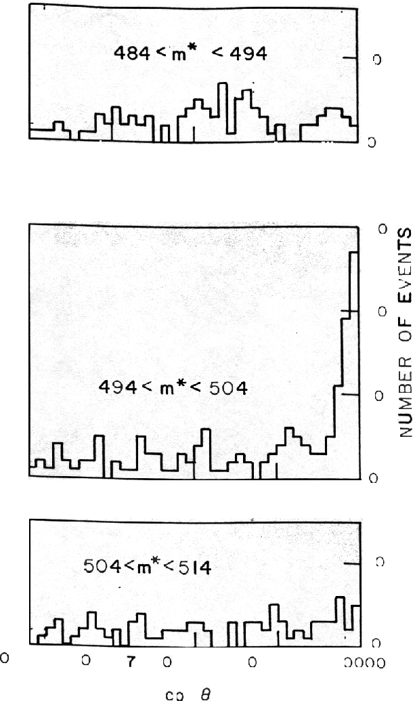

# physics-experiment — app2（supplement）

> （《physics-experiment》词条补充材料，源：plato.stanford.edu/entries/physics-experiment/app2.html）

#### Supplement to Experiment in Physics

## Appendix 2: The Discovery of CP Violation: A Persuasive Experiment

A group at Princeton University, led by Cronin and Fitch, decided to test CP conservation. The experimenters were quite aware of the relevance of their experiment to the question of CP violation, but they did not expect to observe it. As Val Fitch, one of the group leaders remarked, “Not many of our colleagues would have given credit for studying CP invariance, but we did so anyway” (Fitch 1981, p. 991). A preliminary estimate indicated that the CP phase of the experiment would detect about 7500 $\ce{K2^0}$ decays and thus reduce the limit on CP violation from the then current limit of 1/300 (0.3%) to 1/7500 (For details of this episode see Franklin (1986, Ch. 3)).

The experimental beam contained only $\ce{K2^0}$ mesons. (The $\ce{K1^0}$ meson has a much shorter lifetime than the $\ce{K2^0}$ meson, so that if we start with a beam containing both types of particles, after a time only the $\ce{K2^0}$ mesons will remain). The experimental apparatus detected two charged particles from the decay of the $\ce{K2^0}$ meson. The vector momentum of each of the two decay products from the $\ce{K2^0}$ beam and the invariant mass $m^*$ were computed assuming that each product had the mass of a pion:

$$ m^* = [(E_1 + E_2)^2 - (\bp_1 + \bp_2)^2]^{\bfrac{1}{2}}, $$

where E and $\bp$ are the energy and vector momenta of the pions, respectively. If both particles were indeed pions from $\ce{K2^0}$ decay, $m^*$ would equal the $\ce{K2^0}$ mass. The experimenters also computed the vector sum of the two momenta and the angle between this sum and the direction of the $\ce{K2^0}$ beam. This angle should be zero for two-body decays, but not, in general, for three-body decays.

*Figure 3.* Angular distributions in three mass ranges for events with $\cos(\theta) \gt 0.9995$. From Christenson et al. (1964).

This was exactly what the Princeton group observed (Christenson et al. 1964). As seen clearly in Figure 3, there is a peak at the $\ce{K^0}$ mass, 498 MeV/c², for events with $\cos(\theta)$ greater than 0.9999 ($\cos(\theta)$ approximately equal to 1 means $\theta$ is approximately equal to 0). No such peak is seen in the mass regions just above or just below the $\ce{K^0}$ mass. The experimenters reported a total of $45\pm 9$ two-pion $\ce{K2^0}$ decays out of a total of 22,700 $\ce{K2^0}$ decays. This was a branching ratio of $(1.95\pm 0.2) \times 10^{-3}$, or approximately 0.2 percent.

The most obvious interpretation of the Princeton result was that CP symmetry was violated. This was the view taken in three out of four theoretical papers written during the period immediately following the report of that result. The Princeton result had persuaded most of the physics community that CP symmetry was violated. The remaining theoretical papers offered alternative explanations.[^note-A2-1] These alternatives relied on one or more of three arguments: (1) the Princeton results are caused by a CP asymmetry (the local preponderance of matter over antimatter) in the environment of the experiment, (2) $\ce{K2^0}$ decay into two pions does not necessarily imply CP violation, and ( 3) the Princeton observations did not arise from two-pion $\ce{K2^0}$ decay. This last argument can divided into the assertions that (3a) the decaying particle was not a $\ce{K2^0}$ meson, (3b) the decay products were not pions, and (3c) another unobserved particle was emitted in the decay. Included in these alternatives were three suggestions that cast doubt on well-supported fundamental assumptions of modern physics. These were: (1) pions are not bosons, (2) the principle of superposition in quantum mechanics is violated, and (3) the exponential decay law fails. Although by the end of 1967 all of these alternatives had been experimentally tested and found wanting, the majority of the physics community had accepted CP violation by the end of 1965, even though all the tests had not yet been completed. As Prentki, a theoretical particle physicist, remarked, this was because in some cases “the price one has to pay in order to save CP becomes extremely high,” and because other alternatives were “even more unpleasant” (Prentki 1965).

This is an example of what one might call a pragmatic solution to the Duhem-Quine problem.[^note-A2-2] The alternative explanations and the auxiliary hypotheses were refuted, leaving CP violation unprotected. One might worry that other plausible alternatives were never suggested or considered. This is not a serious problem in the actual practice of physics. No fewer than ten alternative explanations of the Princeton result were offered, and not all of them were very plausible. Had others been suggested they, too, would have been considered by the physics community. Consider the model of Nishijima and Saffouri (1965). They explained two-pion $\ce{K2^0}$ decay by the existence of a “shadow” universe in touch with our “real” universe only through the weak interactions. They attributed to the two pion decay observed to the decay of the $\ce{K^0}$ from the shadow universe. This implausible model was not merely considered, it was also experimentally tested. Everett (1965) noted that if the $\ce{K^0}$, the shadow $\ce{K^0}$ postulated by Nishijima and Saffouri existed, then a shadow pion should also exist, and the decays of the $\ce{K+}$ into a positive pion and a neutral pion and of the $\ce{K+}$ into a positive pion and a neutral shadow pion and should occur with equal rates. The presence of the shadow pion could be detected by measuring the ordinary $\ce{K+}$ branching ratio in two different experiments, one in which the neutral pion was detected and one in which it was not. If the shadow pion existed the two measurements would differ. They didn’t. There was no shadow pion and thus, no $\KOp$

What was the difference between the episodes of parity nonconservation and CP violation. In the former parity nonconservation was immediately accepted. No alternative explanations were offered. There was a convincing and decisive set of experiments. In the latter at least ten alternatives were proposed, and although CP violation was accepted rather quickly, the alternatives were tested. In both cases there are only two classes of theories, those that conserve parity or CP, and those that do not. The difference lies in the length and complexity of the derivation linking the hypothesis to the experimental result, or to the number of auxiliary hypotheses required for the derivation. In the case of parity nonconservation the experiment could be seen by inspection to violate mirror symmetry (See Figure 1). In the CP episode what was observed was $\ce{K2^0}$ decay into two pions. In order to connect this observation to CP conservation one had to assume (1) the principle of superposition, (2) that the exponential decay law held to 300 lifetimes, (3) that the decay particles were both “real” pions and that pions were bosons, (4) that no other particle was emitted in the decay, (5) that no other similar particle was produced, and (6) that there were no external conditions present that might regenerate $\ce{K1^0}$ mesons. It was these auxiliary assumptions that were tested and eliminated as alternative explanations by subsequent experiments.

The discovery of CP violation called for a theoretical explanation, a call that is still unanswered.

Return to Experiment in Physics
