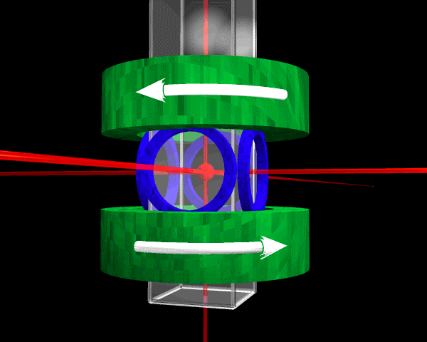
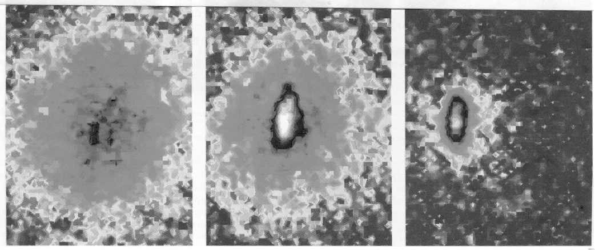
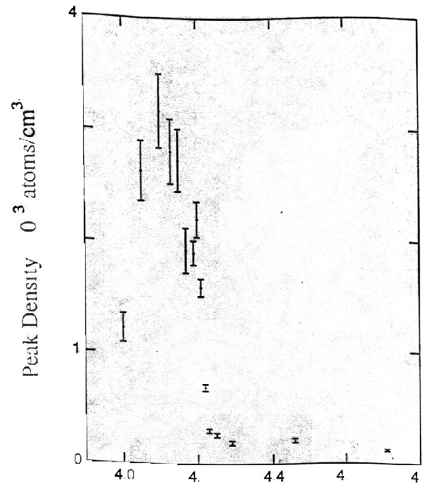
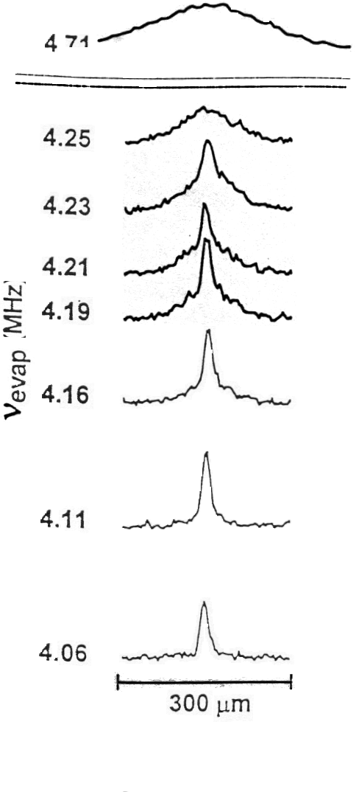

# physics-experiment — app3（supplement）

> （《physics-experiment》词条补充材料，源：plato.stanford.edu/entries/physics-experiment/app3.html）

#### Supplement to Experiment in Physics

## Appendix 3: The Discovery of Bose-Einstein Condensation: Confirmation After 70 Years

In both of the episodes discussed previously, those of parity nonconservation and of CP violation, we saw a decision between two competing classes of theories. This episode, the discovery of Bose-Einstein condensation (BEC), illustrates the confirmation of a specific theoretical prediction 70 years after the theoretical prediction was first made. Bose (1924) and Einstein (1924; 1925) predicted that a gas of noninteracting bosonic atoms will, below a certain temperature, suddenly develop a macroscopic population in the lowest energy quantum state.[^note-A3-1] An interesting aspect of this episode is that the phenomenon in question had never been observed previously. This raises an interesting epistemological problem. How do you know you have observed something that has never been seen before?

Elementary particles can be divided onto two classes: bosons with integral spin $(0,1,2,\ldots)$, and fermions with half-integral spin $(\bfrac{1}{2},\bfrac{3}{2},\bfrac{5}{2},\ldots)$. Fermions, such as electrons obey the Pauli Exclusion Principle. Two fermions cannot be in the same quantum mechanical state. This explains the shell structure of electrons in atoms and the periodic table. On the other hand, any number of bosons can occupy the same state. At sufficiently low temperatures, when thermal motions are very small, there is a strong tendency for a group of bosons to all go into the same state.

*Figure 4.*

Figure 4. Schematic of the BEC apparatus. From Anderson et al. (1995).

The experiment that first demonstrated the existence of BEC was done by Carl Wieman, Eric Cornell, and their collaborators (Anderson et al. 1995). The experimental apparatus is shown is Figure 4. In outline the experiment was as follows. A sample of $\ce{^{87}Rb}$ atoms was cooled in a magneto-optical trap. It was then loaded into a magnetic trap and further cooled by evaporation. The condensate was formed and the trap removed, allowing the condensate to expand. The expanded condensate was illuminated with laser light and the resulting shadow of the cloud was imaged, digitized, and stored.[^note-A3-2]

*Figure 5.*

Figure 5. False color images of the velocity distribution of the rubidium BEC cloud (from the left): just before the appearance of the condensate, just after the appearance of the condensate, and after further evaporation has left a sample of nearly pure condensate. From Anderson et al. (1995).

The experimental results are shown in Figures 5–7. Figure 5 shows the velocity distribution of the rubidium gas cloud (a) just before the appearance of the condensate, (b) just after, and (c) after further evaporation of the cloud has left a sample of nearly pure condensate. This figure also shows the spatial distribution of the gas. Although the measurement process destroyed the condensate sample, the entire process can be repeated so that one can measure the cloud at different stages. Figure 6 shows the peak density of the gas as a function of the RF frequency used to excite the atoms into a non-confined state and to assist the cooling by evaporation). There is a sharp increase in density at a frequency of 4.23 MHz. This indicates the appearance of Bose-Einstein condensation. As the sample is further cooled one expects to observe a two-component cloud with a dense central condensate surrounded by a diffuse non-condensate. This is seen clearly in both Figures 5 and 7. Figure 7 shows horizontal sections of the rubidium cloud. At 4.71 MHz, above the transition temperature, one sees only a broad thermal distribution. Beginning at 4.23 MHz one sees the appearance of a sharp central peak, the Bose-Einstein condensate, above the thermal distribution. At 4.11 MHz the cloud is almost a pure condensate.

*Figure 6.*

Figure 6. Peak density at the center of the sample as a function of the final depth of the evaporative cut on the RF frequency. As evaporation progresses to smaller values of the frequency, the cloud shrinks and cools, causing a modest increase in peak density until the frequency reaches 4.23 MHz. The sudden discontinuity at 4.23 MHz indicates the first appearance of the high-density condensate as the cloud undergoes a phase transition. From Anderson et al. (1995).

*Figure 7.*

Figure 7. Horizontal sections taken through the velocity distribution at progressively lower values of the RF frequency show the appearance of the condensate fraction. From Anderson et al. (1995).

There are three clear indications of the presence of Bose-Einstein condensation: (1) the velocity distribution of the gas shows two distinct components, (2) the sudden increase in density as the temperature decreases, and (3) the elliptical shape of the velocity distribution (Figure 5). The velocity distribution should be elliptical because for the harmonic trap used, the force in the $z$ direction was eight times larger than in the $x$ and $y$ directions. No phenomenon other than Bose-Einstein condensation could plausibly explain these results

This result was sufficiently credible that Keith Burnett, an atomic physicist at Oxford University remarked, in the same issue of *Science* in which Wieman and Cornell reported their result, “In short, they have observed the phenomenon called Bose-Einstein condensation (BEC) in a gas of atoms for the first time. The term Holy Grail seems quite appropriate given the singular importance of this discovery” (Burnett 1995, p. 182).

A theoretical prediction had been confirmed after 70 years.

Return to Experiment in Physics
