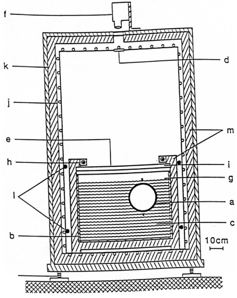
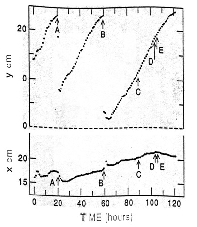
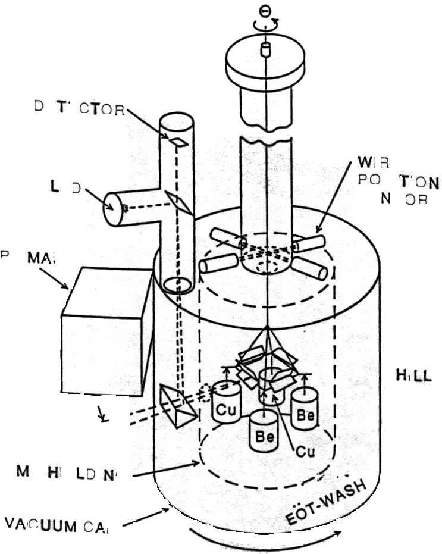
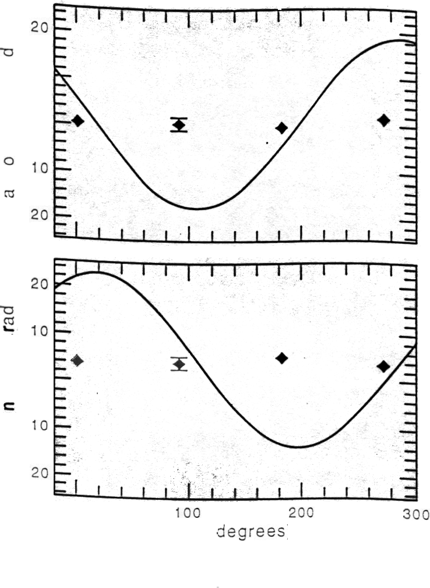

# physics-experiment — app4（supplement）

> （《physics-experiment》词条补充材料，源：plato.stanford.edu/entries/physics-experiment/app4.html）

#### Supplement to Experiment in Physics

## Appendix 4: The Fall of the Fifth Force

In this episode we will examine a case of the refutation of a hypothesis, but only after a disagreement between experimental results was resolved. The “Fifth Force” was a proposed modification of Newton’s Law of Universal Gravitation. The initial experiments gave conflicting results: one supported the existence of the Fifth Force whereas the other regued against it. After numerous repetitions of the experiment, the discord was resolved and a consensus reached that the Fifth Force did not exist. A reanalysis of the original Eötvös experiment[^note-A4-1] by Fischbach and his collaborators (1986) had shown a suggestive deviation from the law of gravity. The Fifth Force, in contrast to the famous Galileo experiment, depended on the composition of the objects. Thus, the Fifth Force between a copper mass and an aluminum mass would differ from that between a copper mass and a lead mass. Fischbach and collaborators also suggested modifying the gravitational potential between two masses from

$$ V = - \frac{G m_1 m_2 }{r} $$

to

$$ V = - \frac{G m_1 m_2 }{r} [1 + \alpha e^{-r/\lambda}], $$

where the second term gives the Fifth Force with strength $\alpha$ and range $\lambda$. The reanalysis also suggested that $\alpha$ was approximately 0.01 and $\lambda$ was approximately 100m. (For details of this episode see (Franklin 1993)).

*Figure 8.*

Figure 8. Schematic diagram of the differential accelerometer used in Thieberger’s experiment. A precisely balanced hollow copper sphere (a) floats in a copper-lined tank (b) filled with distilled water (c). The sphere can be viewed through windows (d) and (e) by means of a television camera (f). The multiple-pane window (e) is provided with a transparent x-y coordinate grid for position determination on top with a fine copper mesh (g) on the bottom. The sphere is illuminated for one second per hour by four lamps (h) provided with infrared filters (i). Constant temperature is maintained by mea ns of a thermostatically controlled copper shield (j) surrounded by a wooden box lined with Styrofoam insulation (m). The Mumetal shield (k) reduces possible effects du e to magnetic field gradients and four circular coils (l) are used for positioning the sphere through forces due to ac-produced eddy currents, and for dc tests. From Thieberger (1987).

*Figure 9.*

Figure 9. Position of the center of the sphere as a function of time. The y axis points away from the cliff. The position of the sphere was reset at points A and B by engaging the coils shown in Figure 21. From Thieberger (1987).

In this episode, we have a hitherto unobserved phenomenon along with discordant experimental results. The first two experiments on the Fifth Force gave contradictory answers. One experiment supported the existence of the Fifth Force, whereas the other found no evidence for it. The first experiment, that of Peter Thieberger (1987a) looked for a composition-dependent force using a new type of experimental apparatus, which measured the differential acceleration between copper and water. The experiment was conducted near the edge of the Palisades cliff in New Jersey to enhance the effect of an intermediate-range force. The experimental apparatus is shown in Figure 8. The horizontal acceleration of the copper sphere relative to the water can be determined by measuring the steady-state velocity of the sphere and applying Stokes’ law for motion in a resistive medium. Thieberger’s results are shown in Figure 9. The sphere clearly has a velocity, indicating the presence of a force. Thieberger concluded, “The present results are compatible with the existence of a medium-range, substance-dependent force” (p. 1068).

*Figure 10.*

Figure 10. Schematic view of the University of Washington torsion pendulum experiment. The Helmholtz coils are not shown. From Stubbs et al. (1987).

*Figure 11.*

Figure 11. Deflection signal as a function of degrees. The theoretical curves correspond to the signal expected for alpha = 0.01 and lambda = 100m. From Raab (1987).

The second experiment, by the whimsically named Eöt-Wash group, was also designed to look for a substance-dependent, intermediate range force (Raab 1987; Stubbs et al. 1987). The apparatus was located on a hillside on the University of Washington campus, in Seattle (Figure 10). If the hill attracted the copper and beryllium bodies differently, then the torsion pendulum would experience a net torque. This torque could be observed by measuring shifts in the equilibrium angle of the torsion pendulum as the pendulum was moved relative to a fixed geophysical point. Their experimental results are shown in Figure 11. The theoretical curves were calculated with the assumed values of 0.01 and 100m, for the Fifth Force parameters $\alpha$ and $\lambda$, respectively. These were the best values for the parameters at the time. There is no evidence for such a Fifth Force in this experiment.

The problem was, however, that both experiments appeared to be carefully done, with no apparent mistakes in either experiment. Ultimately, the discord between Thieberger’s result and that of the Eöt-Wash group was resolved by an overwhelming preponderance of evidence in favor of the Eöt-Wash result (The issue was actually more complex. There were also discordant results on the distance dependence of the Fifth Force. For details see Franklin (1993; 1995a)). The subsequent history is an illustration of one way in which the scientific community deals with conflicting experimental evidence. Rather than making an immediate decision as to which were the valid results, this seemed extremely difficult to do on methodological or epistemological grounds, the community chose to await further measurements and analysis before coming to any conclusion about the evidence. The torsion-balance experiments of Eöt-Wash were repeated by others including (Cowsik et al. 1988; Fitch, Isaila and Palmer 1988; Adelberger 1989; Bennett 1989; Newman, Graham and Nelson 1989; Stubbs et al. 1989; Cowsik et al. 1990; Nelson, Graham and Newman 1990). These repetitions, in different locations and using different substances, gave consistently negative results. In addition, Bizzeti and collaborators (1989a; 1989b), using a float apparatus similar to that of Thieberger, also obtained results showing no evidence of a Fifth Force. There is, in fact, no explanation of either Thieberger’s original, presumably incorrect, results. The scientific community has chosen, I believe quite reasonably, to regard the preponderance of negative results as conclusive.[^note-A4-2] Experiment had shown that there is no Fifth Force.

Return to Experiment in Physics
