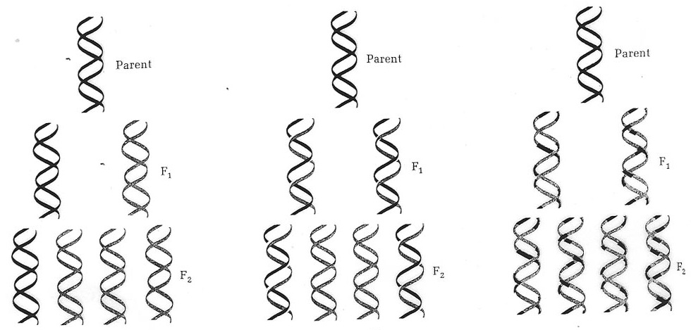
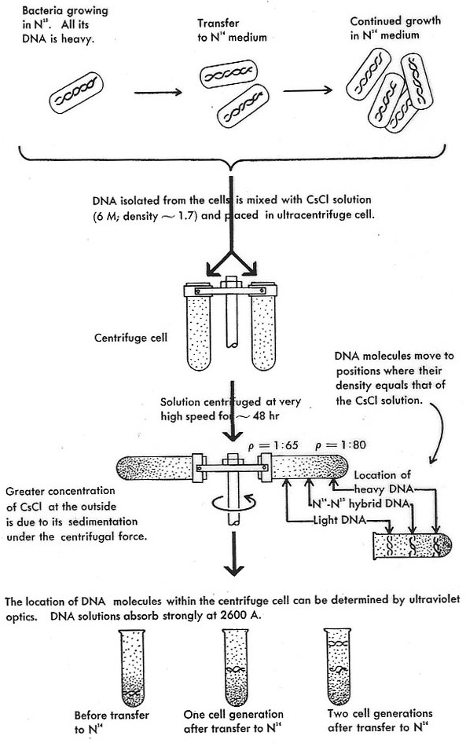
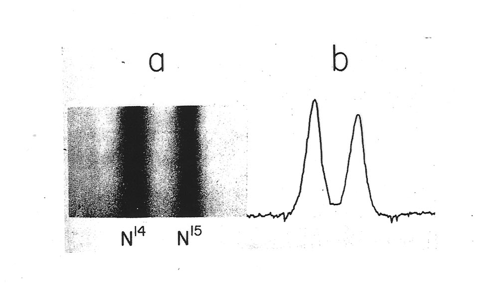
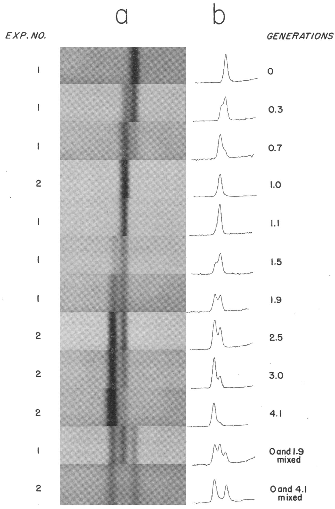

# Experiment in Physics
**First published Mon Oct 5, 1998; substantive revision Fri Jun 2, 2023**

*Franklin, Allan, Perovic, Slobodan*

Physics, and natural science in general, is a reasonable enterprise based on valid experimental evidence, criticism, and rational discussion. It provides us with knowledge of the physical world, and it is experiment that provides the evidence that grounds this knowledge. Experiment plays many roles in science. One of its important roles is to test theories and to provide the basis for scientific knowledge.[^note-1] It can also call for a new theory, either by showing that an accepted theory is incorrect, or by exhibiting a new phenomenon that is in need of explanation. Experiment can provide hints toward the structure or mathematical form of a theory and it can provide evidence for the existence of the entities involved in our theories. Finally, it may also have a life of its own, independent of theory. Scientists may investigate a phenomenon just because it looks interesting. Such experiments may provide evidence for a future theory to explain. [Examples of these different roles will be presented below.] As we shall see below, a single experiment may play several of these roles at once.

If experiment is to play these important roles in science then we must have good reasons to believe experimental results, for science is a fallible enterprise. Theoretical calculations, experimental results, or the comparison between experiment and theory may all be wrong. Science is more complex than “The scientist proposes, Nature disposes.” It may not always be clear what the scientist is proposing. Theories often need to be articulated and clarified. It also may not be clear how Nature is disposing. Experiments may not always give clear-cut results, and may even disagree for a time.

In what follows, the reader will find an epistemology of experiment, a set of strategies that provides reasonable belief in experimental results. Scientific knowledge can then be reasonably based on these experimental results.

## 1. Introduction: Epistemology of Experiment

Epistemology of experiment is a branch of philosophy of science focusing on the diverse roles that experiment plays in science, its various connections to theory, to the understanding and functions of experimental apparatus, and to the structure and culture of the scientific community in the laboratory setting. The epistemological analysis of experiments ranges from highly abstract philosophical arguments with only indirect connection to actual practice, to analysis immersed in reflective case studies. For a long time experiments in physics have been the leading edge of experimental science, pioneering experimental techniques, methods and innovative settings. This is why much of epistemology of experiment has focused on physics.

The 17th century witnessed the first philosophical reflections on the nature of experimentation. This should not be surprising given that experiment was emerging as a central scientific tool at the time. The aim of these reflections was to uncover why nature reveals its hidden aspects to us when we force experimental methods upon it.

Some natural philosophers believed that scientific knowledge was little more than the proper application of observational and experimental techniques on natural phenomena. Francis Bacon went so far as to claim that it was possible to perform what he called a crucial experiment (experimentum crucis), an ideal experiment of sorts that can determine alone which of two rival hypotheses is correct. And even some of the giants of modern science such as Newton subscribed to the view that scientific theories are directly induced from experimental results and observations without the help of untested hypotheses. It is little wonder, then, that many natural philosophers thought that experimental techniques and their proper application should be a primary object of philosophical study of science.

Yet not everybody agreed. Hobbes, for instance pointed out that human reason preceded experimental techniques and their application. He thought that human reasoning reveals to us the natural law, and criticized Boyle’s optimism regarding experimental method’s ability to reveal it (Shapin and Schaffer 1984). Doesn’t human reason guide experimenter’s actions, in the way it leads us to choose data and samples, and the way it allows us to interpret them, after all? If so, we should focus on the philosophical study of reason and theoretical scientific reasoning rather than on the study of experimental techniques and their applications.

This vigorous early debate in many ways anticipated the main points of disagreement in debates to come. Yet the philosophical interest in experimentation almost completely lost its steam at the end of the 19th century and did not recover until fairly late in the 20th century.

During that period philosophers turned much of their attention to the study of the logical structure of scientific theories and its connection to evidence. The tenets of logical positivism influenced this area of investigation — as well as philosophy more generally — at the time. One of these tenets stated that observational and theoretical propositions in science are separable. My readings of the gradation on the scale of a mercury thermometer can be separated from rather complicated theoretical statements concerning heat transfer and the theoretical concept of temperature.

In fact, not only can one separate theory and observation, but the former is considered justified only in light of its correspondence with the latter. The theory of heat transfer is confirmed by propositions originating in the kind of readings I perform on my mercury thermometer. Thus, observational propositions are simply a result of an experiment or a set of observations a scientist performs in order to confirm or refute a theory.

Thomas Kuhn and Paul Feyerabend vigorously criticized this view. They argued that observations and experimental results are already part of a theoretical framework and thus cannot confirm a theory independently. Nor there is a theory-neutral language for capturing observations. Even a simple reading of a mercury thermometer inevitably depends on a theoretically-charged concept of temperature. In short, the evidence is always theory-laden.

Yet neither the proponents of logical positivism nor their critics ever attempted to explain the nature of experimentation that produces all-important observational statements. And the reason for this was very simple: they didn’t think that there was anything interesting to explain. Their views on the relationship between theory and evidence were diametrically opposed, but they all found only the final product of experimentation, namely observational statements, philosophically interesting. As a result, the experimental process itself was set aside in their philosophical study of science. This has gradually changed only with the advent of New Experimentalism, with Ian Hacking’s work at its forefront.

## 2. Experimental Results

### 2.1 Learning From Experiment

#### 2.1.1 Representing and Intervening

It has been more than three decades since Ian Hacking asked, “Do we see through a microscope?” (Hacking 1981)[^hacking-1981]. Hacking’s question really asked how do we come to believe in an experimental result obtained with a complex experimental apparatus? How do we distinguish between a valid result[^note-2] and an artifact created by that apparatus? If experiment is to play all of the important roles in science mentioned above and to provide the evidential basis for scientific knowledge, then we must have good reasons to believe in those results. Hacking provided an extended answer in the second half of *Representing and Intervening* (1983). He pointed out that even though an experimental apparatus is laden with, at the very least, the theory of the apparatus, observations remain robust despite changes in the theory of the apparatus or in the theory of the phenomenon. His illustration was the sustained belief in microscope images despite the major change in the theory of the microscope when Abbe pointed out the importance of diffraction in its operation. One reason Hacking gave for this is that in making such observations the experimenters intervened—they manipulated the object under observation. Thus, in looking at a cell through a microscope, one might inject fluid into the cell or stain the specimen. One expects the cell to change shape or color when this is done. Observing the predicted effect strengthens our belief in both the proper operation of the microscope and in the observation. This is true in general. Observing the predicted effect of an intervention strengthens our belief in both the proper operation of the experimental apparatus and in the observations made with it.

Hacking also discussed the strengthening of one’s belief in an observation by independent confirmation. The fact that the same pattern of dots—dense bodies in cells—is seen with “different” microscopes, (e.g. ordinary, polarizing, phase-contrast, fluorescence, interference, electron, acoustic etc.) argues for the validity of the observation. One might question whether “different” is a theory-laden term. After all, it is our theory of light and of the microscope that allows us to consider these microscopes as different from each other. Nevertheless, the argument holds. Hacking correctly argues that it would be a preposterous coincidence if the same pattern of dots were produced in two totally different kinds of physical systems. Different apparatuses have different backgrounds and systematic errors, making the coincidence, if it is an artifact, most unlikely. If it is a correct result, and the instruments are working properly, the coincidence of results is understandable.

#### 2.1.2 Experimental Strategies

Hacking’s answer is correct as far as it goes. It is, however, incomplete. What happens when one can perform the experiment with only one type of apparatus, such as an electron microscope or a radio telescope, or when intervention is either impossible or extremely difficult? Other strategies are needed to validate the observation.[^note-3] These may include:

1. Experimental checks and calibration, in which the experimental apparatus reproduces known phenomena. For example, if we wish to argue that the spectrum of a substance obtained with a new type of spectrometer is correct, we might check that this new spectrometer could reproduce the known Balmer series in hydrogen. If we correctly observe the Balmer Series then we strengthen our belief that the spectrometer is working properly. This also strengthens our belief in the results obtained with that spectrometer. If the check fails then we have good reason to question the results obtained with that apparatus.
2. Reproducing artifacts that are known in advance to be present. An example of this comes from experiments to measure the infrared spectra of organic molecules (Randall et al. 1949)[^randall-1949]. It was not always possible to prepare a pure sample of such material. Sometimes the experimenters had to place the substance in an oil paste or in solution. In such cases, one expects to observe the spectrum of the oil or the solvent, superimposed on that of the substance. One can then compare the composite spectrum with the known spectrum of the oil or the solvent. Observation then of this artifact gives confidence in other measurements made with the spectrometer.
3. Elimination of plausible sources of error and alternative explanations of the result (the Sherlock Holmes strategy).[^note-4] Thus, when scientists claimed to have observed electric discharges in the rings of Saturn, they argued for their result by showing that it could not have been caused by defects in the telemetry, interaction with the environment of Saturn, lightning, or dust. The only remaining explanation of their result was that it was due to electric discharges in the rings—there was no other plausible explanation of the observation. (In addition, the same result was observed by both Voyager 1 and Voyager 2. This provided independent confirmation. Often, several epistemological strategies are used in the same experiment.)
4. Using the results themselves to argue for their validity. Consider the problem of Galileo’s telescopic observations of the moons of Jupiter. Although one might very well believe that his primitive, early telescope might have produced spurious spots of light, it is extremely implausible that the telescope would create images that they would appear to be a eclipses and other phenomena consistent with the motions of a small planetary system. It would have been even more implausible to believe that the created spots would satisfy Kepler’s Third Law ($\bfrac{R^3}{T^2} = $ constant). A similar argument was used by Robert Millikan to support his observation of the quantization of electric charge and his measurement of the charge of the electron. Millikan remarked, “The total number of changes which we have observed would be between one and two thousand, and *in not one single instance has there been any change which did not represent the advent upon the drop of one definite invariable quantity of electricity or a very small multiple of that quantity*” (Millikan 1911, p. 360)[^millikan-1911]. In both of these cases one is arguing that there was no plausible malfunction of the apparatus, or background, that would explain the observations.
5. Using an independently well-corroborated theory of the phenomena to explain the results. This was illustrated in the discovery of the $\ce{W^{\pm}}$, the charged intermediate vector boson required by the Weinberg-Salam unified theory of electroweak interactions. Although these experiments used very complex apparatuses and used other epistemological strategies (for details see Franklin 1986, pp. 170–72)[^franklin-1986]. I believe that the agreement of the observations with the theoretical predictions of the particle properties helped to validate the experimental results. In this case the particle candidates were observed in events that contained an electron with high transverse momentum and in which there were no particle jets, just as predicted by the theory. In addition, the measured particle mass of $81\pm 5$ GeV/c² and $80^{+10}_{-6}$ GeV/c², found in the two experiments (note the independent confirmation also), was in good agreement with the theoretical prediction of $82\pm 2.4$ GeV/c². It was very improbable that any background effect, which might mimic the presence of the particle, would be in agreement with theory.
6. Using an apparatus based on a well-corroborated theory. In this case the support for the theory inspires confidence in the apparatus based on that theory. This is the case with the electron microscope and the radio telescope, whose operations are based on a well-supported theories, although other strategies are also used to validate the observations made with these instruments.
7. Using statistical arguments. An interesting example of this arose in the 1960s when the search for new particles and resonances occupied a substantial fraction of the time and effort of those physicists working in experimental high-energy physics. The usual technique was to plot the number of events observed as a function of the invariant mass of the final-state particles and to look for bumps above a smooth background. The usual informal criterion for the presence of a new particle was that it resulted in a three standard-deviation effect above the background, a result that had a probability of 0.27% of occurring in a single bin. This criterion was later changed to four standard deviations, which had a probability of 0.0064% when it was pointed out that the number of graphs plotted each year by high-energy physicists made it rather probable, on statistical grounds, that a three standard-deviation effect would be observed.

These strategies along with Hacking’s intervention and independent confirmation constitute an epistemology of experiment. They provide us with good reasons for belief in experimental results, They do not, however, guarantee that the results are correct. There are many experiments in which these strategies are applied, but whose results are later shown to be incorrect (examples will be presented below). Experiment is fallible. Neither are these strategies exclusive or exhaustive. No single one of them, or fixed combination of them, guarantees the validity of an experimental result. Physicists use as many of the strategies as they can conveniently apply in any given experiment.

#### 2.1.3 Complexity of Experimental Practice

In *How Experiments End* (1987), Peter Galison extended the discussion of experiment to more complex situations. In his histories of the measurements of the gyromagnetic ratio of the electron, the discovery of the muon, and the discovery of weak neutral currents, he considered a series of experiments measuring a single quantity, a set of different experiments culminating in a discovery, and two high- energy physics experiments performed by large groups with complex experimental apparatus.

Galison’s view is that experiments end when the experimenters believe that they have a result that will stand up in court—a result that I believe includes the use of the epistemological strategies discussed earlier. Thus, David Cline, one of the weak neutral-current experimenters remarked, “At present I don’t see how to make these effects [the weak neutral current event candidates] go away” (Galison, 1987, p. 235)[^galison-1987].

Galison emphasizes that, within a large experimental group, different members of the group may find different pieces of evidence most convincing. Thus, in the Gargamelle weak neutral current experiment, several group members found the single photograph of a neutrino-electron scattering event particularly important, whereas for others the difference in spatial distribution between the observed neutral current candidates and the neutron background was decisive. Galison attributes this, in large part, to differences in experimental traditions, in which scientists develop skill in using certain types of instruments or apparatus. In particle physics, for example, there is the tradition of visual detectors, such as the cloud chamber or the bubble chamber, in contrast to the electronic tradition of Geiger and scintillation counters and spark chambers. Scientists within the visual tradition tend to prefer “golden events” that clearly demonstrate the phenomenon in question, whereas those in the electronic tradition tend to find statistical arguments more persuasive and important than individual events. (For further discussion of this issue see Galison 1997)[^galison-1997].

Galison points out that major changes in theory and in experimental practice and instruments do not necessarily occur at the same time. This persistence of experimental results provides continuity across these conceptual changes. Thus, the experiments on the gyromagnetic ratio spanned classical electromagnetism, Bohr’s old quantum theory, and the new quantum mechanics of Heisenberg and Schrodinger. Robert Ackermann has offered a similar view in his discussion of scientific instruments.

> The advantages of a scientific instrument are that it cannot change theories. Instruments embody theories, to be sure, or we wouldn’t have any grasp of the significance of their operation….Instruments create an invariant relationship between their operations and the world, at least when we abstract from the expertise involved in their correct use. When our theories change, we may conceive of the significance of the instrument and the world with which it is interacting differently, and the datum of an instrument may change in significance, but the datum can nonetheless stay the same, and will typically be expected to do so. An instrument reads 2 when exposed to some phenomenon. After a change in theory,[^note-5] it will continue to show the same reading, even though we may take the reading to be no longer important, or to tell us something other than what we thought originally (Ackermann 1985, p. 33)[^ackermann-1985].

Galison also discusses other aspects of the interaction between experiment and theory. Theory may influence what is considered to be a real effect, demanding explanation, and what is considered background. In his discussion of the discovery of the muon, he argues that the calculation of Oppenheimer and Carlson, which showed that showers were to be expected in the passage of electrons through matter, left the penetrating particles, later shown to be muons, as the unexplained phenomenon. Prior to their work, physicists thought the showering particles were the problem, whereas the penetrating particles seemed to be understood.

The role of theory as an “enabling theory,” (i.e., one that allows calculation or estimation of the size of the expected effect and also the size of expected backgrounds) is also discussed by Galison. (See also (Franklin 1995)[^franklin-1995] and the discussion of the Stern-Gerlach experiment below). Such a theory can help to determine whether an experiment is feasible. Galison also emphasizes that elimination of background that might simulate or mask an effect is central to the experimental enterprise, and not a peripheral activity. In the case of the weak neutral current experiments, the existence of the currents depended crucially on showing that the event candidates could not all be due to neutron background.[^note-6]

There is also a danger that the design of an experiment may preclude observation of a phenomenon. Galison points out that the original design of one of the neutral current experiments, which included a muon trigger, would not have allowed the observation of neutral currents. In its original form the experiment was designed to observe charged currents, which produce a high energy muon. Neutral currents do not. Therefore, having a muon trigger precluded their observation. Only after the theoretical importance of the search for neutral currents was emphasized to the experimenters was the trigger changed. Changing the design did not, of course, guarantee that neutral currents would be observed.

Galison also shows that the theoretical presuppositions of the experimenters may enter into the decision to end an experiment and report the result. Einstein and de Haas ended their search for systematic errors when their value for the gyromagnetic ratio of the electron, $g = 1$, agreed with their theoretical model of orbiting electrons. This effect of presuppositions might cause one to be skeptical of both experimental results and their role in theory evaluation. Galison’s history shows, however, that, in this case, the importance of the measurement led to many repetitions of the measurement. This resulted in an agreed-upon result that disagreed with theoretical expectations.

Galison has eventually modified his views. In *Image and Logic*, an extended study of instrumentation in 20th-century high-energy physics, Galison (1997)[^galison-1997] has extended his argument that there are two distinct experimental traditions within that field—the visual (or image) tradition and the electronic (or logic) tradition. The image tradition uses detectors such as cloud chambers or bubble chambers, which provide detailed and extensive information about each individual event. The electronic detectors used by the logic tradition, such as geiger counters, scintillation counters, and spark chambers, provide less detailed information about individual events, but detect more events. Galison’s view is that experimenters working in these two traditions form distinct epistemic and linguistic groups that rely on different forms of argument. The visual tradition emphasizes the single “golden” event. “On the image side resides a deep-seated commitment to the ‘golden event’: the single picture of such clarity and distinctness that it commands acceptance.” (Galison, 1997, p. 22)[^galison-1997] “The golden event was the exemplar of the image tradition: an individual instance so complete and well defined, so ‘manifestly’ free of distortion and background that no further data had to be involved” (p. 23). Because the individual events provided in the logic detectors contained less detailed information than the pictures of the visual tradition, statistical arguments based on large numbers of events were required.

Kent Staley (1999)[^staley-1999] disagrees. He argues that the two traditions are not as distinct as Galison believes:

> I show that discoveries in both traditions have employed the same statistical [I would add “and/or probabilistic”] form of argument, even when basing discovery claims on single, golden events. Where Galison sees an epistemic divide between two communities that can only be bridged by creole- or pidgin-like ‘interlanguage,’ there is in fact a shared commitment to a statistical form of experimental argument. (p. 96).

Staley believes that although there is certainly epistemic continuity within a given tradition, there is also a continuity between the traditions. This does not, I believe, mean that the shared commitment comprises all of the arguments offered in any particular instance, but rather that the same methods are often used by both communities. Galison does not deny that statistical methods are used in the image tradition, but he thinks that they are relatively unimportant. “While statistics could certainly be used within the image tradition, it was by no means necessary for most applications” (Galison, 1997, p. 451)[^galison-1997]. In contrast, Galison believes that arguments in the logic tradition “were inherently and inalienably statistical. Estimation of probable errors and the statistical excess over background is not a side issue in these detectors—it is central to the possibility of any demonstration at all” (p. 451).

Although a detailed discussion of the disagreement between Staley and Galison would take us too far from the subject of this essay, they both agree that arguments are offered for the correctness of experimental results. Their disagreement concerns the nature of those arguments. (For further discussion see Franklin, (2002), pp. 9–17).

### 2.2 The Case Against Learning From Experiment

#### 2.2.1 The Experimenters’ Regress

H. Collins, A. Pickering, and others, have raised objections to the view that experimental results are accepted on the basis of epistemological arguments. They point out that “a sufficiently determined critic can always find a reason to dispute any alleged ‘result’” (MacKenzie 1989, p. 412)[^mackenzie-1989]. Harry Collins, for example, is well known for his skepticism concerning both experimental results and evidence. He develops an argument that he calls the “experimenters’ regress” (Collins 1985, chapter 4, pp. 79–111)[^collins-1985]: What scientists take to be a correct result is one obtained with a good, that is, properly functioning, experimental apparatus. But a good experimental apparatus is simply one that gives correct results. Collins claims that there are no formal criteria that one can apply to decide whether or not an experimental apparatus is working properly. In particular, he argues that calibrating an experimental apparatus by using a surrogate signal cannot provide an independent reason for considering the apparatus to be reliable.

In Collins’ view the regress is eventually broken by negotiation within the appropriate scientific community, a process driven by factors such as the career, social, and cognitive interests of the scientists, and the perceived utility for future work, but one that is not decided by what we might call epistemological criteria, or reasoned judgment. Thus, Collins concludes that his regress raises serious questions concerning both experimental evidence and its use in the evaluation of scientific hypotheses and theories. Indeed, if no way out of the regress can be found, then he has a point.

Collins strongest candidate for an example of the experimenters’ regress is presented in his history of the early attempts to detect gravitational radiation, or gravity waves. (For more detailed discussion of this episode see (Collins 1985; 1994; Franklin 1994; 1997a)[^collins-1985][^franklin-1994] In this case, the physics community was forced to compare J. Weber’s claims that he had observed gravity waves with the reports from six other experiments that failed to detect them. On the one hand, Collins argues that the decision between these conflicting experimental results could not be made on epistemological or methodological grounds—he claims that the six negative experiments could not legitimately be regarded as replications[^note-7] and hence become less impressive. On the other hand, Weber’s apparatus, precisely because the experiments used a new type of apparatus to try to detect a hitherto unobserved phenomenon,[^note-8] could not be subjected to standard calibration techniques.

The results presented by Weber’s critics were not only more numerous, but they had also been carefully cross-checked. The groups had exchanged both data and analysis programs and confirmed their results. The critics had also investigated whether or not their analysis procedure, the use of a linear algorithm, could account for their failure to observe Weber’s reported results. They had used Weber’s preferred procedure, a nonlinear algorithm, to analyze their own data, and still found no sign of an effect. They had also calibrated their experimental apparatuses by inserting acoustic pulses of known energy and finding that they could detect a signal. Weber, on the other hand, as well as his critics using his analysis procedure, could not detect such calibration pulses.

There were, in addition, several other serious questions raised about Weber’s analysis procedures. These included an admitted programming error that generated spurious coincidences between Weber’s two detectors, possible selection bias by Weber, Weber’s report of coincidences between two detectors when the data had been taken four hours apart, and whether or not Weber’s experimental apparatus could produce the narrow coincidences claimed.

It seems clear that the critics’ results were far more credible than Weber’s. They had checked their results by independent confirmation, which included the sharing of data and analysis programs. They had also eliminated a plausible source of error, that of the pulses being longer than expected, by analyzing their results using the nonlinear algorithm and by explicitly searching for such long pulses.[^note-9] They had also calibrated their apparatuses by injecting pulses of known energy and observing the output.

Contrary to Collins, I believe that the scientific community made a reasoned judgment and rejected Weber’s results and accepted those of his critics. Although no formal rules were applied (e.g. if you make four errors, rather than three, your results lack credibility; or if there are five, but not six, conflicting results, your work is still credible) the procedure was reasonable.

Pickering has argued that the reasons for accepting results are the future utility of such results for both theoretical and experimental practice and the agreement of such results with the existing community commitments. In discussing the discovery of weak neutral currents, Pickering states,

> Quite simply, particle physicists accepted the existence of the neutral current because they could see how to ply their trade more profitably in a world in which the neutral current was real. (1984b, p. 87)
>
> Scientific communities tend to reject data that conflict with group commitments and, obversely, to adjust their experimental techniques to tune in on phenomena consistent with those commitments. (1981, p. 236)

The emphasis on future utility and existing commitments is clear. These two criteria do not necessarily agree. For example, there are episodes in the history of science in which more opportunity for future work is provided by the overthrow of existing theory. (See, for example, the history of the overthrow of parity conservation and of CP symmetry discussed below and in Franklin 1986, Ch. 1, 3.)[^franklin-1986]

#### 2.2.2 Communal Opportunism and Plastic Resources

Pickering offered a different view of experimental results in late 1980s. In his view the material procedure (including the experimental apparatus itself along with setting it up, running it, and monitoring its operation), the theoretical model of that apparatus, and the theoretical model of the phenomena under investigation are all plastic resources that the investigator brings into relations of mutual support. (Pickering 1987; Pickering 1989)[^pickering-1987][^pickering-1989]. He says:

> Achieving such relations of mutual support is, I suggest, the defining characteristic of the successful experiment. (1987, p. 199)

He uses Morpurgo’s search for free quarks, or fractional charges of $\tfrac{1}{3} e$ or $\tfrac{2}{3} e$, where $e$ is the charge of the electron. (See also Gooding 1992.)[^gooding-1992] Morpurgo used a modern Millikan-type apparatus and initially found a continuous distribution of charge values. Following some tinkering with the apparatus, Morpurgo found that if he separated the capacitor plates he obtained only integral values of charge. “After some theoretical analysis, Morpurgo concluded that he now had his apparatus working properly, and reported his failure to find any evidence for fractional charges” (Pickering 1987, p. 197)[^pickering-1987].

Pickering goes on to note that Morpurgo did not tinker with the two competing theories of the phenomena then on offer, those of integral and fractional charge:

> The initial source of doubt about the adequacy of the early stages of the experiment was precisely the fact that their findings—continuously distributed charges—were consonant with neither of the phenomenal models which Morpurgo was prepared to countenance. And what motivated the search for a new instrumental model was Morpurgo’s eventual success in producing findings in accordance with one of the phenomenal models he was willing to accept
>
> The conclusion of Morpurgo’s first series of experiments, then, and the production of the observation report which they sustained, was marked by bringing into relations of mutual support of the three elements I have discussed: the material form of the apparatus and the two conceptual models, one instrumental and the other phenomenal. Achieving such relations of mutual support is, I suggest, the defining characteristic of the successful experiment. (p. 199)

Pickering has made several important and valid points concerning experiment. Most importantly, he has emphasized that an experimental apparatus is initially rarely capable of producing a valid experimental results and that some adjustment, or tinkering, is required before it does. He has also recognized that both the theory of the apparatus and the theory of the phenomena can enter into the production of a valid experimental result. What one may question, however, is the emphasis he places on these theoretical components. From Millikan onwards, experiments had strongly supported the existence of a fundamental unit of charge and charge quantization. The failure of Morpurgo’s apparatus to produce measurements of integral charge indicated that it was not operating properly and that his theoretical understanding of it was faulty. It was the failure to produce measurements in agreement with what was already known (i.e., the failure of an important experimental check) that caused doubts about Morpurgo’s measurements. This was true regardless of the theoretical models available, or those that Morpurgo was willing to accept. It was only when Morpurgo’s apparatus could reproduce known measurements that it could be trusted and used to search for fractional charge. To be sure, Pickering has allowed a role for the natural world in the production of the experimental result, but it does not seem to be decisive.

#### 2.2.3 Critical Responses

Ackermann has offered a modification of Pickering’s view. He suggests that the experimental apparatus itself is a less plastic resource then either the theoretical model of the apparatus or that of the phenomenon.

> To repeat, changes in $A$ [the apparatus] can often be seen (in real time, without waiting for accommodation by $B$ [the theoretical model of the apparatus]) as improvements, whereas ‘improvements’ in $B$ don’t begin to count unless $A$ is actually altered and realizes the improvements conjectured. It’s conceivable that this small asymmetry can account, ultimately, for large scale directions of scientific progress and for the objectivity and rationality of those directions. (Ackermann 1991, p. 456)[^ackermann-1991]

Hacking (1992)[^hacking-1992] has also offered a more complex version of Pickering’s later view. He suggests that the results of mature laboratory science achieve stability and are self-vindicating when the elements of laboratory science are brought into mutual consistency and support. These are (1) ideas: questions, background knowledge, systematic theory, topical hypotheses, and modeling of the apparatus; (2) things: target, source of modification, detectors, tools, and data generators; and (3) marks and the manipulation of marks: data, data assessment, data reduction, data analysis, and interpretation.

> Stable laboratory science arises when theories and laboratory equipment evolve in such a way that they match each other and are mutually self-vindicating. (1992, p. 56)
>
> We invent devices that produce data and isolate or create phenomena, and a network of different levels of theory is true to these phenomena. Conversely we may in the end count them only as phenomena only when the data can be interpreted by theory. (pp. 57–8)

One might ask whether such mutual adjustment between theory and experimental results can always be achieved? What happens when an experimental result is produced by an apparatus on which several of the epistemological strategies, discussed earlier, have been successfully applied, and the result is in disagreement with our theory of the phenomenon? Accepted theories can be refuted. Several examples will be presented below.

Hacking himself worries about what happens when a laboratory science that is true to the phenomena generated in the laboratory, thanks to mutual adjustment and self-vindication, is successfully applied to the world outside the laboratory. Does this argue for the truth of the science. In Hacking’s view it does not. If laboratory science does produce happy effects in the “untamed world,… it is not the truth of anything that causes or explains the happy effects” (1992, p. 60).

#### 2.2.4 The Dance of Agency

Pickering offered yet another, a somewhat revised account of science. “My basic image of science is a performative one, in which the performances the doings of human and material agency come to the fore. Scientists are human agents in a field of material agency which they struggle to capture in machines (Pickering, 1995, p. 21)[^pickering-1995][^pickering-1995-2].” He then discusses the complex interaction between human and material agency, which I interpret as the interaction between experimenters, their apparatus, and the natural world.

> The dance of agency, seen asymmetrically from the human end, thus takes the form of a *dialectic of resistance and accommodations,* where resistance denotes the failure to achieve an intended capture of agency in practice, and accommodation an active human strategy of response to resistance, which can include revisions to goals and intentions as well as to the material form of the machine in question and to the human frame of gestures and social relations that surround it (p. 22).“

Pickering’s idea of resistance is illustrated by Morpurgo’s observation of continuous, rather than integral or fractional, electrical charge, which did not agree with his expectations. Morpurgo’s accommodation consisted of changing his experimental apparatus by using a larger separation between his plates, and also by modifying his theoretical account of the apparatus. That being done, integral charges were observed and the result stabilized by the mutual agreement of the apparatus, the theory of the apparatus, and the theory of the phenomenon. Pickering notes that ”the outcomes depend on how the world is (p. 182).“ ”In this way, then, *how the material world is* leaks into and infects our representations of it in a nontrivial and consequential fashion. My analysis thus displays an intimate and responsive engagement between scientific knowledge and the material world that is integral to scientific practice (p. 183).“

Nevertheless there is something confusing about Pickering’s invocation of the natural world. Although Pickering acknowledges the importance of the natural world, his use of the term ”infects“ seems to indicate that he isn’t entirely happy with this. Nor does the natural world seem to have much efficacy. It never seems to be decisive in any of Pickering’s case studies. Recall that he argued that physicists accepted the existence of weak neutral currents because ”they could ply their trade more profitably in a world in which the neutral current was real.“ In his account, Morpurgo’s observation of continuous charge is important only because it disagrees with his theoretical models of the phenomenon. The fact that it disagreed with numerous previous observations of integral charge doesn’t seem to matter. This is further illustrated by Pickering’s discussion of the conflict between Morpurgo and Fairbank. As we have seen, Morpurgo reported that he did not observe fractional electrical charges. On the other hand, in the late 1970s and early 1980s, Fairbank and his collaborators published a series of papers in which they claimed to have observed fractional charges (See, for example, LaRue, Phillips et al. 1981 ). Faced with this discord Pickering concludes,

> In Chapter 3, I traced out Morpurgo’s route to his findings in terms of the particular vectors of cultural extension that he pursued, the particular resistances and accommodations thus precipitated, and the particular interactive stabilizations he achieved. The same could be done, I am sure, in respect of Fairbank. And these tracings are all that needs to said about their divergence. It just happened that the contingencies of resistance and accommodation worked out differently in the two instances. Differences like these are, I think, continually bubbling up in practice, without any special causes behind them (pp. 211–212).

The natural world seems to have disappeared from Pickering’s account. There is a real question here as to whether or not fractional charges exist in nature. The conclusions reached by Fairbank and by Morpurgo about their existence cannot both be correct. It seems insufficient to merely state, as Pickering does, that Fairbank and Morpurgo achieved their individual stabilizations and to leave the conflict unresolved. (Pickering does comment that one could follow the subsequent history and see how the conflict was resolved, and he does give some brief statements about it, but its resolution is not important for him). At the very least one should consider the actions of the scientific community. Scientific knowledge is not determined individually, but communally. Pickering seems to acknowledge this. ”One might, therefore, want to set up a metric and say that items of scientific knowledge are more or less objective depending on the extent to which they are threaded into the rest of scientific culture, socially stabilized over time, and so on. I can see nothing wrong with thinking this way…. (p. 196).“ The fact that Fairbank believed in the existence of fractional electrical charges, or that Weber strongly believed that he had observed gravity waves, does not make them right. These are questions about the natural world that can be resolved. Either fractional charges and gravity waves exist or they don’t, or to be more cautious we might say that we have good reasons to support our claims about their existence, or we do not.

Another issue neglected by Pickering is the question of whether a particular mutual adjustment of theory, of the apparatus or the phenomenon, and the experimental apparatus and evidence is justified. Pickering seems to believe that any such adjustment that provides stabilization, either for an individual or for the community, is acceptable. Others disagree. They note that experimenters sometimes exclude data and engage in selective analysis procedures in producing experimental results. These practices are, at the very least, questionable as is the use of the results produced by such practices in science. There are, in fact, procedures in the normal practice of science that provide safeguards against them. (For details see Franklin, 2002, Section 1)[^franklin-2002].

The difference in attitudes toward the resolution of discord is one of the important distinctions between Pickering’s and Franklin’s view of science. Franklin remarks that it is insufficient simply to say that the resolution is socially stabilized. The important question is how that resolution was achieved and what were the reasons offered for that resolution. If we are faced with discordant experimental results and both experimenters have offered reasonable arguments for their correctness, then clearly more work is needed. It seems reasonable, in such cases, for the physics community to search for an error in one, or both, of the experiments.

Pickering discusses yet another difference between his view and that of Franklin. Pickering sees traditional philosophy of science as regarding objectivity ”as stemming from a peculiar kind of mental hygiene or policing of thought. This police function relates specifically to theory choice in science, which,… is usually discussed in terms of the rational rules or methods responsible for closure in theoretical debate (p. 197).“ He goes on to remark that,

> The most action in recent methodological thought has centered on attempts like Allan Franklin’s to extend the methodological approach to experiments by setting up a set of rules for their proper performance. Franklin thus seeks to extend classical discussions of objectivity to the empirical base of science (a topic hitherto neglected in the philosophical tradition but one that, of course the mangle [Pickering’s view] also addresses). For an argument between myself and Franklin on the same lines as that laid out below, see (Franklin 1990, Chapter 8; Franklin 1991)[^franklin-1990]; and (Pickering 1991)[^pickering-1991]; and for commentaries related to that debate, (Ackermann 1991)[^ackermann-1991] and (Lynch 1991)[^lynch-1991] (p. 197).”

For further discussion see Franklin 1993b. Although Franklin’s epistemology of experiment is designed to offer good reasons for belief in experimental results, they are not a set of rules. Franklin regards them as a set of strategies, from which physicists choose, in order to argue for the correctness of their results. As noted above, the strategies offered are neither exclusive or exhaustive.

There is another point of disagreement between Pickering and Franklin. Pickering claims to be dealing with the practice of science, and yet he excludes certain practices from his discussions. One scientific practice is the application of the epistemological strategies outlined above to argue for the correctness of an experimental results. In fact, one of the essential features of an experimental paper is the presentation of such arguments. Writing such papers, a performative act, is also a scientific practice and it would seem reasonable to examine both the structure and content of those papers.

#### 2.2.5 Hacking’s ‘The Social Construction of What’?

Ian Hacking (1999, chapter 3) provided an incisive and interesting discussion of the issues that divide the constructivists (Collins, Pickering, etc.) from the rationalists (Stuewer, Franklin, Buchwald, etc.). He sets out three sticking points between the two views: 1) contingency, 2) nominalism, and 3) external explanations of stability.

Contingency is the idea that science is not predetermined, that it could have developed in any one of several successful ways. This is the view adopted by constructivists. Hacking illustrates this with Pickering’s account of high-energy physics during the 1970s during which the quark model came to dominate. (See Pickering 1984a)[^pickering-1984a].

> The constructionist maintains a contingency thesis. In the case of physics, (a) physics theoretical, experimental, material) could have developed in, for example, a nonquarky way, and, by the detailed standards that would have evolved with this alternative physics, could have been as successful as recent physics has been by its detailed standards. Moreover, (b) there is no sense in which this imagined physics would be equivalent to present physics. The physicist denies that. (Hacking 1999, pp. 78–79)[^hacking-1999].
>
> To sum up Pickering’s doctrine: there could have been a research program as successful (“progressive”) as that of high-energy physics in the 1970s, but with different theories, phenomenology, schematic descriptions of apparatus, and apparatus, and with a different, and progressive, series of robust fits between these ingredients. Moreover and this is something badly in need of clarification the “different” physics would not have been equivalent to present physics. Not logically incompatible with, just different.
>
> The constructionist about (the idea) of quarks thus claims that the upshot of this process of accommodation and resistance is not fully predetermined. Laboratory work requires that we get a robust fit between apparatus, beliefs about the apparatus, interpretations and analyses of data, and theories. *Before a robust fit has been achieved, it is not determined what that fit will be. Not determined by how the world is, not determined by technology now in existence, not determined by the social practices of scientists, not determined by interests or networks, not determined by genius, not determined by anything* (pp. 72–73, emphasis added).

Much depends here on what Hacking means by “determined.” If he means entailed then one must agree with him. It is doubtful that the world, or more properly, what we can learn about it, entails a unique theory. If not, as seems more plausible, he means that the way the world is places no restrictions on that successful science, then the rationalists disagree strongly. They want to argue that the way the world is restricts the kinds of theories that will fit the phenomena, the kinds of apparatus we can build, and the results we can obtain with such apparatuses. To think otherwise seems silly. Consider a homey example. It seems highly unlikely that someone can come up with a successful theory in which objects whose density is greater than that of air fall upwards. This is not a caricature of the view Hacking describes. Describing Pickering’s view, he states, “Physics did not need to take a route that involved Maxwell’s Equations, the Second Law of Thermodynamics, or the present values of the velocity of light (p. 70).” Although one may have some sympathy for this view as regards Maxwell’s Equations or the Second Law of Thermodynamics, one may not agree about the value of the speed of light. That is determined by the way the world is. Any successful theory of light must give that value for its speed.

At the other extreme are the “inevitablists,” among whom Hacking classifies most scientists. He cites Sheldon Glashow, a Nobel Prize winner, “Any intelligent alien anywhere would have come upon the same logical system as we have to explain the structure of protons and the nature of supernovae (Glashow 1992, p. 28)[^glashow-1992].”

Another difference between Pickering and Franklin on contingency concerns the question of not whether an alternative is possible, but rather whether there are reasons why that alternative should be pursued. Pickering seems to identify *can* with *ought*.

In the late 1970s there was a disagreement between the results of low-energy experiments on atomic parity violation (the violation of left-right symmetry) performed at the University of Washington and at Oxford University and the result of a high-energy experiment on the scattering of polarized electrons from deuterium (the SLAC E122 experiment). The atomic-parity violation experiments failed to observe the parity-violating effects predicted by the Weinberg- Salam (W-S) unified theory of electroweak interactions, whereas the SLAC experiment observed the predicted effect. These early atomic physics results were quite uncertain in themselves and that uncertainty was increased by positive results obtained in similar experiments at Berkeley and Novosibirsk. At the time the theory had other evidential support, but was not universally accepted. Pickering and Franklin are in agreement that the W-S theory was accepted on the basis of the SLAC E122 result. They differ dramatically in their discussions of the experiments. Their difference on contingency concerns a particular theoretical alternative that was proposed at the time to explain the discrepancy between the experimental results.

Pickering asked why a theorist might not have attempted to find a variant of electroweak gauge theory that might have reconciled the Washington-Oxford atomic parity results with the positive E122 result. (What such a theorist was supposed to do with the supportive atomic parity results later provided by experiments at Berkeley and at Novosibirsk is never mentioned). “But though it is true that E122 analysed their data in a way that displayed the improbability [the probability of the fit to the hybrid model was 6 × 10^{−4}] of a particular class of variant gauge theories, the so-called ‘hybrid models,’ I do not believe that it would have been impossible to devise yet more variants” (Pickering 1991, p. 462)[^pickering-1991]. Pickering notes that open-ended recipes for constructing such variants had been written down as early as 1972 (p. 467). It would have been possible to do so, but one may ask whether or not a scientist might have wished to do so. If the scientist agreed with Franklin’s view that the SLAC E122 experiment provided considerable evidential weight in support of the W-S theory and that a set of conflicting and uncertain results from atomic parity-violation experiments gave an equivocal answer on that support, what reason would they have had to invent an alternative?

This is not to suggest that scientists do not, or should not, engage in speculation, but rather that there was no necessity to do so in this case. Theorists often do propose alternatives to existing, well-confirmed theories.

Constructivist case studies always seem to result in the support of existing, accepted theory (Pickering 1984a; 1984b; 1991; Collins 1985; Collins and Pinch 1993)[^collins-1985][^collins-1993][^pickering-1984a]. One criticism implied in such cases is that alternatives are not considered, that the hypothesis space of acceptable alternatives is either very small or empty. One may seriously question this. Thus, when the experiment of Christenson *et al*. (1964) detected $\ce{K2^0}$ decay into two pions, which seemed to show that CP symmetry (combined particle-antiparticle and space inversion symmetry) was violated, no fewer than 10 alternatives were offered. These included (1) the cosmological model resulting from the local dysymmetry of matter and antimatter, (2) external fields, (3) the decay of the $\ce{K2^0}$ into a $\ce{K1^0}$ with the subsequent decay of the $\ce{K1^0}$into two pions, which was allowed by the symmetry, (4) the emission of another neutral particle, “the paritino,” in the $\ce{K2^0}$ decay, similar to the emission of the neutrino in beta decay, (5) that one of the pions emitted in the decay was in fact a “spion,” a pion with spin one rather than zero, (6) that the decay was due to another neutral particle, the L, produced coherently with the $\ce{K^0}$, (7) the existence of a “shadow” universe, which interacted with out universe only through the weak interactions, and that the decay seen was the decay of the “shadow $\ce{K2^0}$,” (8) the failure of the exponential decay law, 9) the failure of the principle of superposition in quantum mechanics, and 10) that the decay pions were not bosons.

As one can see, the limits placed on alternatives were not very stringent. By the end of 1967, all of the alternatives had been tested and found wanting, leaving CP symmetry unprotected. Here the differing judgments of the scientific community about what was worth proposing and pursuing led to a wide variety of alternatives being tested.

Hacking’s second sticking point is nominalism, or name-ism. He notes that in its most extreme form nominalism denies that there is anything in common or peculiar to objects selected by a name, such as “Douglas fir” other than that they are called Douglas fir. Opponents contend that good names, or good accounts of nature, tell us something correct about the world. This is related to the realism-antirealism debate concerning the status of unobservable entities that has plagued philosophers for millennia. For example Bas van Fraassen (1980)[^fraassen-1980], an antirealist, holds that we have no grounds for belief in unobservable entities such as the electron and that accepting theories about the electron means only that we believe that the things the theory says about observables is true. A realist claims that electrons really exist and that as, for example, Wilfred Sellars remarked, “to have good reason for holding a theory is *ipso facto* to have good reason for holding that the entities postulated by the theory exist (Sellars 1962, p. 97)[^sellars-1962].” In Hacking’s view a scientific nominalist is more radical than an antirealist and is just as skeptical about fir trees as they are about electrons. A nominalist further believes that the structures we conceive of are properties of our representations of the world and not of the world itself. Hacking refers to opponents of that view as inherent structuralists.

Hacking also remarks that this point is related to the question of “scientific facts.” Thus, constructivists Latour and Woolgar originally entitled their book *Laboratory Life: The Social Construction of Scientific Facts* (1979). Andrew Pickering entitled his history of the quark model *Constructing Quarks* (Pickering 1984a)[^pickering-1984a]. Physicists argue that this demeans their work. Steven Weinberg, a realist and a physicist, criticized Pickering’s title by noting that no mountaineer would ever name a book *Constructing Everest*. For Weinberg, quarks and Mount Everest have the same ontological status. They are both facts about the world. Hacking argues that constructivists do not, despite appearances, believe that facts do not exist, or that there is no such thing as reality. He cites Latour and Woolgar “that ‘out-there-ness’ is a *consequence* of scientific work rather than its cause (Latour and Woolgar 1986, p. 180)[^latour-1986].” Hacking reasonably concludes that,

> Latour and Woolgar were surely right. We should not *explain* why some people believe that $p$ by saying that $p$ is true, or corresponds to a fact, or the facts. For example: someone believes that the universe began with what for brevity we call a big bang. A host of reasons now supports this belief. But after you have listed all the reasons, you should not add, as if it were an additional reason for believing in the big bang, ‘and it is true that the universe began with a big bang.’ Or ‘and it is a fact.’This observation has nothing peculiarly to do with social construction. It could equally have been advanced by an old-fashioned philosopher of language. It is a remark about the grammar of the verb ‘to explain’ (Hacking 1999, pp. 80–81)[^hacking-1999].

One might add, however, that the reasons Hacking cites as supporting that belief are given to us by valid experimental evidence and not by the social and personal interests of scientists. Latour and Woolgar might not agree. Franklin argues that we have good reasons to believe in facts, and in the entities involved in our theories, always remembering, of course, that science is fallible.

Hacking’s third sticking point is the external explanations of stability.

> The constructionist holds that explanations for the stability of scientific belief involve, at least in part, elements that are external to the content of science. These elements typically include social factors, interests, networks, or however they be described. Opponents hold that whatever be the context of discovery, the explanation of stability is internal to the science itself (Hacking 1999, p. 92)[^hacking-1999].
>
> Rationalists think that most science proceeds as it does in the light of good reasons produced by research. Some bodies of knowledge become stable because of the wealth of good theoretical and experimental reasons that can be adduced for them. Constructivists think that the reasons are not decisive for the course of science. Nelson (1994)[^nelson-1994][^nelson-1994-2][^nelson-1994-3] concludes that this issue will never be decided. Rationalists, at least retrospectively, can always adduce reasons that satisfy them. Constructivists, with equal ingenuity, can always find to their own satisfaction an openness where the upshot of research is settled by something other than reason. Something external. That is one way of saying we have found an irresoluble “sticking point” (pp. 91–92)

Thus, there is a rather severe disagreement on the reasons for the acceptance of experimental results. For some, like Staley, Galison and Franklin, it is because of epistemological arguments. For others, like Pickering, the reasons are utility for future practice and agreement with existing theoretical commitments. Although the history of science shows that the overthrow of a well-accepted theory leads to an enormous amount of theoretical and experimental work, proponents of this view seem to accept it as unproblematical that it is always agreement with existing theory that has more future utility. Hacking and Pickering also suggest that experimental results are accepted on the basis of the mutual adjustment of elements which includes the theory of the phenomenon.

Nevertheless, everyone seems to agree that a consensus does arise on experimental results.

### 2.3 Measuring, Calibrating, Predicting

We have encountered (Section 2.2.1) Franklin’s definition of calibration as the use of a surrogate signal that has been established independently of the apparatus being calibrated, or as the reproduction of independently (on an independent apparatus) well established phenomena. He used this account in order to argue against Collins’s view of the viciousness of the experimenter’s regress. Yet other accounts of calibration explaining the process of measurement evoke similar worries.

E. Tal defines calibration as “the activity of establishing a correlation between indications of a measuring instrument and quantity values associated with a measurement standard” (Tal 2017a, 243)[^tal-2017a]. Mere “instrument indications” (Tal 2017a)[^tal-2017a] become “measurement outcomes” when interpreted in a larger context of theoretical background and calibration of the measuring instrument. Yet Boyd (2021, 43) worries that this leaves the measurement open to the vicious regress akin to the experimenter’s regress H. Collins has argued for (see Section 2.2.1), since the experimenters do not “have access to true values of the measurand [i.e., whatever is measured] to use as standards of calibration”.

The regress may be blocked by comparisons across measuring outcomes performed in differently modeled measurements, i.e. across different measurement contexts (the context being constituted by intricacies of the operational and theoretical background of apparata). (Tal 2017a, 239)[^tal-2017a] These different contexts are idealized and then compared in order to establish whether they cohere to the predictions concerning the measurand. Thus, calibration is “the activity of modeling different processes and testing the consequences of such models for mutual compatibility” (Tal 2017a, 246)[^tal-2017a]. An act of calibration is effectively the comparison of idealized models across measuring processes, where an act of measurement becomes justified by the models’ mutual coherence.

Boyd (2021, 46) states that idealizations of measurement processes cannot provide the foundation for objective measurement since idealizations strip the context of its key details. In fact, the measurement has an epistemic utility by virtue of the context-sensitive details. The measurement outcomes gain epistemic value only as “enriched evidence”, i.e., in the wider empirical and theoretical context.

Moreover, Tal’s view conflates prediction and calibration (Boyd 2021, 48) taking us back to the viciousness of the experimenter’s regress. Thus, “Calibration was supposed to disrupt the regress because an instrument could be judged to be working correctly in virtue of something other than success at its principal aim” (Boyd 2021, 48). Calibration has to provide a point outside the web of cohering predictions if it is to break the regress, e.g. by the subtle processing of instrument indications.

Progressive coherentism’s attempted way out of the vicious regress, as proposed by Hasok Chang (2004, 2007)[^chang-2004][^chang-2007], points to a historical trajectory of the development of measuring procedures and calibration. The web of cohering measuring process is dynamic: it unfolds in time as a spiral. And the measurement process that initially aims at prediction eventually becomes a result used for calibrating processes. Yet, such spiraling progress may be just an elaborate dynamic coherence web of Collins’ type where inter-subjective agreement is the foundation, if other non-empirical virtues such as “creative achievement” play as important role as the empirical ones as claimed by Chang (2007)[^chang-2007]. If so, calibration does not offer an independent leverage to the measurement outcomes after all.

Perović (2017) analyzes in-situ calibration procedures in the Large Hadron Collider pointing out that calibration serves as an epistemic leverage of Franklin’s type during the commissioning phase of the experimental apparatus. But various calibration procedures continue all along and gradually feed into the measurement itself during the entire measurement process. Boyd (2021) further explores commissioning procedures and the gradual transition from “engineering data“ to “science data”, where criteria of prediction significantly change. The apparatus initially relies on the existing well-known data but then coherence with other apparata that Tal insists on becomes increasingly less significant in justifying the measurement outcomes.

### 2.4 Big Science Physics: Theory-ladenness in High Energy Physics

Authors like Thomas Kuhn and Paul Feyerabend put forward the view that evidence does not confirm or refute a scientific theory since it is laden by it. Evidence is not a set of observational sentences autonomous from theoretical ones, as logical positivists believed. Each new theory or a theoretical paradigm, as Kuhn labeled larger theoretical frameworks, produces, as it were, evidence anew.

Thus, theoretical concepts infect the entire experimental process from the stage of design and preparation to the production and analysis of data. A simple example that is supposed to convincingly illustrate this view are measurements of temperature with a mercury thermometer one uses in order to test whether objects expand when their temperature increases. Note that in such a case one tests the hypothesis by relying on the very assumption that the expansion of mercury indicates increase in temperature.

There may be a fairly simple way out of the vicious circle in which theory and experiment are caught in this particular case of theory-ladenness. It may suffice to calibrate the mercury thermometer with a constant volume gas thermometer, for example, where its use does not rely on the tested hypothesis but on the proportionality of the pressure of the gas and its absolute temperature (Franklin et al. 1989)[^franklin-1989].

Although most experiments are far more complex than this toy example, one could certainly approach the view that experimental results are theory-laden on a case-by-case basis. Yet there may be a more general problem with the view.

Bogen and Woodward (1988) argued that debate on the relationship between theory and observation overlooks a key ingredient in the production of experimental evidence, namely the experimental phenomena. The experimentalists distill experimental phenomena from raw experimental data (e.g. electronic or digital tracks in particle colliders) using various tools of statistical analysis. Thus, identification of an experimental phenomenon as significant (e.g. a peak at a particular energy of colliding beams) is free of the theory that the experiment may be designed to test (e.g. the prediction of a particular particle). Only when significant phenomenon has been identified can a stage of data analysis begin in which the phenomenon is deemed to either support or refute a theory. Thus, the theory-ladenness of evidence thesis fails at least in some experiments in physics.

The authors substantiate their argument in part through an analysis of experiments that led to a breakthrough discovery of weak neutral currents. It is a type of force produced by so-called bosons — short-lived particles responsible for energy transfer between other particles such as hadrons and leptons. The relevant peaks were recognized as significant via statistical analysis of data, and later on interpreted as evidence for the existence of the bosons.

This view and the case study have been challenged by Schindler (2011)[^schindler-2011]. He argues that the tested theory was critical in the assessment of the reliability of data in the experiments with weak neutral currents. He also points out that, on occasion, experimental data can even be ignored if they are deemed irrelevant from a theoretical perspective that physicists find particularly compelling. This was the case in experiments with so-called zebra pattern magnetic anomalies on the ocean floor. The readings of new apparatuses used to scan the ocean floor produced intriguing signals. Yet the researchers could not interpret these signals meaningfully or satisfyingly distinguish them from noise unless they relied on some theoretical account of both the structure of the ocean floor and the earth’s magnetic field.

Karaca (2013)[^karaca-2013] points out that a crude theory-observation distinction is particularly unhelpful in understanding high-energy physics experiments. It fails to capture the complexity of relevant theoretical structures and their relation to experimental data. Theoretical structures can be composed of background, model, and phenomenological theories. Background theories are very general theories (e.g. quantum field theory or quantum electrodynamics) that define the general properties of physical particles and their interactions. Models are specific instances of background theories that define particular particles and their properties. While phenomenological theories develop testable predictions based on these models.

Now, each of these theoretical segments stands in a different relationship to experimental data—the experiments can be laden by a different segment to a different extent. This requires a nuanced categorization of theory-ladeness, from weak to strong.

Thus, an experimental apparatus can be designed to test a very specific theoretical model. UA1 and UA2 detectors at CERN’s Super Proton Synchrotron were designed to detect particles only in a very specific energy regime in which W and Z bosons of the Standard Model were expected to exist.

In contrast, exploratory experiments approach phenomena without relying on a particular theoretical model. Thus, sometimes a theoretical framework for an experiment consists of phenomenological theory alone. Karaca argues that experiments with deep-inelastic electron-proton scattering in the late 1960s and early 1970s are example of such weakly theory-laden experiments. The application of merely phenomenological parameters in the experiment resulted in the very important discovery of the composite rather than point-like structure of hadrons (protons and neutrons), or the so-called scaling law. And this eventually led to a successful theoretical model of the composition of hadrons, namely quantum chromodynamics, or the quark-model of strong interactions.

## 3. The Roles of Experiment

### 3.1 A Life of Its Own

Although experiment often takes its importance from its relation to theory, Hacking pointed out that it often has a life of its own, independent of theory. He notes the pristine observations of Carolyn Herschel’s discovery of comets, William Herschel’s work on “radiant heat,” and Davy’s observation of the gas emitted by algae and the flaring of a taper in that gas. In none of these cases did the experimenter have any theory of the phenomenon under investigation. One may also note the nineteenth century measurements of atomic spectra and the work on the masses and properties on elementary particles during the 1960s. Both of these sequences were conducted without any guidance from theory.

In deciding what experimental investigation to pursue, scientists may very well be influenced by the equipment available and their own ability to use that equipment (McKinney 1992)[^mckinney-1992]. Thus, when the Mann-O’Neill collaboration was doing high energy physics experiments at the Princeton-Pennsylvania Accelerator during the late 1960s, the sequence of experiments was (1) measurement of the $\ce{K+}$ decay rates, (2) measurement of the $\ce{K+_{e 3}}$ branching ratio and decay spectrum, (3) measurement of the $\ce{K+_{e 2}}$ branching ratio, and (4) measurement of the form factor in $\ce{K+_{e 3}}$ decay. These experiments were performed with basically the same experimental apparatus, but with relatively minor modifications for each particular experiment. By the end of the sequence the experimenters had become quite expert in the use of the apparatus and knowledgeable about the backgrounds and experimental problems. This allowed the group to successfully perform the technically more difficult experiments later in the sequence. We might refer to this as “instrumental loyalty” and the “recycling of expertise” (Franklin 1997b)[^franklin-1997b]. This meshes nicely with Galison’s view of experimental traditions. Scientists, both theorists and experimentalists, tend to pursue experiments and problems in which their training and expertise can be used.

Hacking also remarks on the “noteworthy observations” on Iceland Spar by Bartholin, on diffraction by Hooke and Grimaldi, and on the dispersion of light by Newton. “Now of course Bartholin, Grimaldi, Hooke, and Newton were not mindless empiricists without an ‘idea’ in their heads. They saw what they saw because they were curious, inquisitive, reflective people. They were attempting to form theories. But in all these cases it is clear that the observations preceded any formulation of theory” (Hacking 1983, p. 156)[^hacking-1983]. In all of these cases we may say that these were observations waiting for, or perhaps even calling for, a theory. The discovery of any unexpected phenomenon calls for a theoretical explanation.

### 3.2 Confirmation and Refutation

Nevertheless several of the important roles of experiment involve its relation to theory. Experiment may confirm a theory, refute a theory, or give hints to the mathematical structure of a theory.

#### 3.2.1 A Crucial Experiment: The Discovery of Parity Nonconservation

Let us consider first an episode in which the relation between theory and experiment was clear and straightforward. This was a “crucial” experiment, one that decided unequivocally between two competing theories, or classes of theory. The episode was that of the discovery that parity, mirror-reflection symmetry or left-right symmetry, is not conserved in the weak interactions. (For details of this episode see Franklin (1986, Ch. 1) and [Appendix 1](physics-experiment.app1.md)). Experiments showed that in the beta decay of nuclei the number of electrons emitted in the same direction as the nuclear spin was different from the number emitted opposite to the spin direction. This was a clear demonstration of parity violation in the weak interactions.

#### 3.2.2 A Persuasive Experiment: The Discovery of CP Violation

After the discovery of parity and charge conjugation nonconservation, and following a suggestion by Landau, physicists considered CP (combined parity and particle-antiparticle symmetry), which was still conserved in the experiments, as the appropriate symmetry. One consequence of this scheme, if CP were conserved, was that the $\ce{K1^0}$ meson could decay into two pions, whereas the $\ce{K2^0}$ meson could not.[^note-10] Thus, observation of the decay of $\ce{K2^0}$ into two pions would indicate CP violation. The decay was observed by a group at Princeton University. Although several alternative explanations were offered, experiments eliminated each of the alternatives leaving only CP violation as an explanation of the experimental result. (For details of this episode see Franklin (1986, Ch. 3) and [Appendix 2](physics-experiment.app2.md).)

#### 3.2.3 Confirmation After 70 Years: The Discovery of Bose-Einstein Condensation

In both of the episodes discussed previously, those of parity nonconservation and of CP violation, we saw a decision between two competing classes of theories. This episode, the discovery of Bose-Einstein condensation (BEC), illustrates the confirmation of a specific theoretical prediction 70 years after the theoretical prediction was first made. Bose (1924)[^bose-1924] and Einstein (1924; 1925)[^einstein-1924][^einstein-1925] predicted that a gas of noninteracting bosonic atoms will, below a certain temperature, suddenly develop a macroscopic population in the lowest energy quantum state.[^note-11] (For details of this episode see [Appendix 3](physics-experiment.app3.md).)

### 3.3 Complications

In the three episodes discussed in the previous section, the relation between experiment and theory was clear. The experiments gave unequivocal results and there was no ambiguity about what theory was predicting. None of the conclusions reached has since been questioned. Parity and CP symmetry are violated in the weak interactions and Bose-Einstein condensation is an accepted phenomenon. In the practice of science things are often more complex. Experimental results may be in conflict, or may even be incorrect. Theoretical calculations may also be in error or a correct theory may be incorrectly applied. There are even cases in which both experiment and theory are wrong. As noted earlier, science is fallible. In this section I will discuss several episodes which illustrate these complexities.

#### 3.3.1 The Fall of the Fifth Force

The episode of the fifth force is the case of a refutation of an hypothesis, but only after a disagreement between experimental results was resolved. The “Fifth Force” was a proposed modification of Newton’s Law of Universal Gravitation. The initial experiments gave conflicting results: one supported the existence of the Fifth Force whereas the other argued against it. After numerous repetitions of the experiment, the discord was resolved and a consensus reached that the Fifth Force did not exist. (For details of this episode see [Appendix 4](physics-experiment.app4.md).)

#### 3.3.2 Right Experiment, Wrong Theory: The Stern-Gerlach Experiment

The Stern-Gerlach experiment was regarded as crucial at the time it was performed, but, in fact, wasn’t.[^note-12] In the view of the physics community it decided the issue between two theories, refuting one and supporting the other. In the light of later work, however, the refutation stood, but the confirmation was questionable. In fact, the experimental result posed problems for the theory it had seemingly confirmed. A new theory was proposed and although the Stern-Gerlach result initially also posed problems for the new theory, after a modification of that new theory, the result confirmed it. In a sense, it was crucial after all. It just took some time.

The Stern-Gerlach experiment provides evidence for the existence of electron spin. These experimental results were first published in 1922, although the idea of electron spin wasn’t proposed by Goudsmit and Uhlenbeck until 1925 (1925; 1926). One might say that electron spin was discovered before it was invented. (For details of this episode see [Appendix 5](physics-experiment.app5.md)).

#### 3.3.3 Sometimes Refutation Doesn’t Work: The Double-Scattering of Electrons

In the last section we saw some of the difficulty inherent in experiment-theory comparison. One is sometimes faced with the question of whether the experimental apparatus satisfies the conditions required by theory, or conversely, whether the appropriate theory is being compared to the experimental result. A case in point is the history of experiments on the double-scattering of electrons by heavy nuclei (Mott scattering) during the 1930s and the relation of these results to Dirac’s theory of the electron, an episode in which the question of whether or not the experiment satisfied the conditions of the theoretical calculation was central. Initially, experiments disagreed with Mott’s calculation, casting doubt on the underlying Dirac theory. After more than a decade of work, both experimental and theoretical, it was realized that there was a background effect in the experiments that masked the predicted effect. When the background was eliminated experiment and theory agreed. ([Appendix 6](physics-experiment.app6.md))

#### 3.3.4 The Failure to Detect Anomalies

Ever vaster amounts of data have been produced by particle colliders as they have grown from room-size apparata, to tens of kilometers long mega-labs. Vast numbers of background interactions that are well understood and theoretically uninteresting occur in the detector. These have to be combed in order to identify interactions of potential interest. This is especially true of hadron (proton-proton) colliders like the Large Hadron Collider (LHC), where the Higgs boson was discovered. Protons that collide in the LHC and similar hadron colliders are composed of more elementary particles, collectively labeled partons. Partons mutually interact, exponentially increasing the number of background interactions. In fact, a minuscule number of interactions are selected from the overwhelming number that occur in the detector. (In contrast, lepton collisions, such as collisions of electrons and positrons, produce much lower backgrounds, since leptons are not composed of more elementary particles.)

Thus, a successful search for new elementary particles critically depends on successfully crafting selection criteria and techniques at the stage of data collection and at the stage of data analysis. But gradual development and changes in data selection procedures in the colliders raises an important epistemological concern. The main reason for this concern is nicely anticipated by the following question, which was posed by one of the most prominent experimentalists in particle physics: “What is the extent to which we are negating the discovery potential of very-high-energy proton machines by the necessity of rejecting, a priori, the events we cannot afford to record?” (Panofsky 1994, 133)[^panofsky-1994]. In other words, how does one decide which interactions to detect and analyze in a multitude, in order to minimize the possibility of throwing out novel and unexplored ones?

One way of searching through vast amounts of data that are already in, i.e. those that the detector has already delivered, is to look for occurrences that remain robust under varying conditions of detection. Physicists employ the technique of data cuts in such analysis. They cut out data that may be unreliable—when, for instance, a data set may be an artefact rather than a genuine particle interaction the experimenters expect. E.g. a colliding beam may interact with the walls of the detector and not with the other colliding beam, while producing a signal identical to the signal the experimenters expected the beam-beam interaction to produce. Thus, if under various data cuts a result remains stable, then it is increasingly likely to be correct and to represent the genuine phenomenon the physicists think it represents. The robustness of the result under various data cuts minimizes the possibility that the detected phenomenon only mimics the genuine one (Franklin 2013, 224–5)[^franklin-2013].

At the data-acquisition stage, however, this strategy does not seem applicable. As Panofsky suggests, one does not know with certainty which of the vast number of the events in the detector may be of interest.

Yet, Karaca (2011)[^karaca-2011][^note-13] argues that a form of robustness is in play even at the acquisition stage. This experimental approach amalgamates theoretical expectations and empirical results, as the example of the hypothesis of specific heavy particles is supposed to illustrate.

Along with the Standard Model of particle physics, a number of alternative models have been proposed. Their predictions of how elementary particles should behave often differ substantially. Yet in contrast to the Standard Model, they all share the hypothesis that there exist heavy particles that decay into particles with high transverse momentum.

Physicists apply a robustness analysis in testing this hypothesis, the argument goes. First, they check whether the apparatus can detect known particles similar to those predicted. Second, guided by the hypothesis, they establish various trigger algorithms. (The trigger algorithms, or “the triggers”, determine at what exact point in time and under which conditions a detector should record interactions. They are necessary because the frequency and the number of interactions far exceed the limited recording capacity.) And, finally, they observe whether any results remain stable across the triggers.

Yet even in this theoretical-empirical form of robustness, as Franklin (2013, 225)[^franklin-2013] points out, “there is an underlying assumption that any new physics will resemble known physics”—usually a theory of the day. And one way around this problem is for physicists to produce as many alternative models as possible, including those that may even seem implausible at the time.

Perovic (2011)[^perovic-2011] suggests that such a potential failure, namely to spot potentially relevant events occurring in the detector, may be also a consequence of the gradual automation of the detection process.

The early days of experimentation in particle physics, around WWII, saw the direct involvement of the experimenters in the process. Experimental particle physics was a decentralized discipline where experimenters running individual labs had full control over the triggers and analysis. The experimenters could also control the goals and the design of experiments. Fixed target accelerators, where the beam hits the detector instead of another beam, produced a number of particle interactions that was manageable for such labs. The chance of missing an anomalous event not predicted by the current theory was not a major concern in such an environment.

Yet such labs could process a comparatively small amount of data. This has gradually become an obstacle, with the advent of hadron colliders. They work at ever-higher energies and produce an ever-vaster number of background interactions. That is why the experimental process has become increasingly automated and much more indirect. Trained technicians instead of experimenters themselves at some point started to scan the recordings. Eventually, these human scanners were replaced by computers, and a full automation of detection in hadron colliders has enabled the processing of vast number of interactions. This was the first significant change in the transition from small individual labs to mega-labs.

The second significant change concerned the organization and goals of the labs. The mega-detectors and the amounts of data they produced required exponentially more staff and scientists. This in turn led to even more centralized and hierarchical labs and even longer periods of design and performance of the experiments. As a result, focusing on confirming existing dominant hypotheses rather than on exploratory particle searches was the least risky way of achieving results that would justify unprecedented investments.

Now, an indirect detection process combined with mostly confirmatory goals is conducive to overlooking of unexpected interactions. As such, it may impede potentially crucial theoretical advances stemming from missed interactions.

This possibility that physicists such as Panofsky have acknowledged is not a mere speculation. In fact, the use of semi-automated, rather than fully-automated regimes of detection turned out to be essential for a number of surprising discoveries that led to theoretical breakthroughs.

Perovic (2011)[^perovic-2011] analyzes several such cases, most notably the discovery of the J/psi particle that provided the first substantial piece of evidence for the existence of the charmed quark. In the experiments, physicists were able to perform exploratory detection and visual analysis of practically individual interactions due to low number of background interactions in the linear electron-positron collider. And they could afford to do this in an energy range that the existing theory did not recognize as significant, which led to them making the discovery. None of this could have been done in the fully automated detecting regime of hadron colliders that are indispensable when dealing with an environment that contains huge numbers of background interactions.

And in some cases, such as the Fermilab experiments that aimed to discover weak neutral currents, an automated and confirmatory regime of data analysis contributed to the failure to detect particles that were readily produced in the apparatus.

#### 3.3.5 The ‘Look Elsewhere’ Effect: Discovering the Higgs Boson

The complexity of the discovery process in particle physics does not end with concerns about what exact data should be chosen out of the sea of interactions. The so-called look-elsewhere effect results in a tantalizing dilemma at the stage of data analysis.

Suppose that our theory tells us that we will find a particle in an energy range. And suppose we find a significant signal in a section of that very range. Perhaps we should keep looking elsewhere within the range to make sure it is not another particle altogether we have discovered. It may be a particle that left other undetected traces in the range that our theory does not predict, along with the trace we found. The question is to what extent we should look elsewhere before we reach a satisfying level of certainty that it is the predicted particle we have discovered.

Physicists faced such a dilemma during the search for the Higgs boson at the Large Hadron Collider at CERN (Dawid 2015)[^dawid-2015].

The Higgs boson is a particle responsible for the mass of other particles. It is a scalar field that “pulls back” moving and interacting particles. This pull, which we call mass, is different for different particles. It is predicted by the Standard Model, whereas alternative models predict somewhat similar Higgs-like particles.

A prediction based on the Standard Model tells us with high probability that we will find the Higgs particle in a particular range. Yet a simple and an inevitable fact of finding it in a particular section of that range may prompt us to doubt whether we have truly found the exact particle our theory predicted. Our initial excitement may vanish when we realize that we are much more likely to find a particle of any sort—not just the predicted particle—within the entire range than in a particular section of that range. Thus, the probability of finding the Higgs anywhere within a given energy range (consisting of eighty energy ‘bins’) is much higher than the probability of finding it at a particular energy scale within that range (i.e. in any individual bin). In fact, the likelihood of us finding it in a particular bin of the range is about hundred times lower.

In other words, the fact that we will inevitably find the particle in a particular bin, not only in a particular range, decreases the certainty that it was the Higgs we found. Given this fact alone we should keep looking elsewhere for other possible traces in the range once we find a significant signal in a bin. We should not proclaim the discovery of a particle predicted by the Standard Model (or any model for that matter) too soon. But for how long should we keep looking elsewhere? And what level of certainty do we need to achieve before we proclaim discovery?

The answer boils down to the weight one gives the theory and its predictions. This is the reason the experimentalists and theoreticians had divergent views on the criterion for determining the precise point at which they could justifiably state ‘Our data indicate that we have discovered the Higgs boson’. Theoreticians were confident that a finding within the range (any of eighty bins) that was of standard reliability (of three or four sigma), coupled with the theoretical expectations that Higgs would be found, would be sufficient. In contrast, experimentalists argued that at no point of data analysis should the pertinence of the look-elsewhere effect be reduced, and the search proclaimed successful, with the help of the theoretical expectations concerning Higgs. One needs to be as careful in combing the range as one practically may. As a result, the experimentalists’ preferred value of sigmas for announcing the discovery was five. This is a standard under which very few findings have turned out to be a fluctuation in the past.

Dawid argues that a question of an appropriate statistical analysis of data is at the heart of the dispute. The reasoning of the experimentalists relied on a frequentist approach that does not specify the probability of the tested hypothesis. It actually isolates statistical analysis of data from the prior probabilities. The theoreticians, however, relied on Bayesian analysis. It starts with prior probabilities of initial assumptions and ends with the assessment of the probability of tested hypothesis based on the collected evidence. The question remains whether the experimentalists’ reasoning was fully justified. The prior expectations that the theoreticians had included in their analysis had already been empirically corroborated by previous experiments after all.

### 3.4 Other Roles

#### 3.4.1 Evidence for a New Entity: J.J. Thomson and the Electron

Experiment can also provide us with evidence for the existence of the entities involved in our theories. J.J. Thomson’s experiments on cathode rays provided grounds for belief in the existence of electrons. (For details of this episode see [Appendix 7](physics-experiment.app7.md)).

#### 3.4.2 The Articulation of Theory: Weak Interactions

Experiment can also help to articulate a theory. Experiments on beta decay during from the 1930s to the 1950s determined the precise mathematical form of Fermi’s theory of beta decay. (For details of this episode see [Appendix 8](physics-experiment.app8.md).)

## 4. Experiment and Observation

The distinction between observation and experiment is relatively little discussed in philosophical literature, despite its continuous relevance to the scientific community and beyond in understanding specific traits and segments of the scientific process and the knowledge it produces.

Daston and her coauthors (Daston 2011; Daston and Lunbeck 2011; Daston and Galison 2007)[^daston-2011][^daston-2007][^daston-2011-2] have convincingly demonstrated that the distinction has played a role in delineating various features of scientific practice. It has helped scientists articulate their reflections on their own practice.

Observation is philosophically a loaded term, yet the epistemic status of scientific observation has evolved gradually with the advance of scientific techniques of inquiry and the scientific communities pursuing them. Daston succinctly summarizes this evolution in the following passage:

> Characteristic of the emergent epistemic genre of the observations was, first, an emphasis on singular events, witnessed first hand (autopsia) by a named author (in contrast to the accumulation of anonymous data over centuries described by Cicero and Pliny as typical of observationes); second, a deliberate effort to separate observation from conjecture (in contrast to the medieval Scholastic connection of observation with the conjectural sciences, such as astrology); and third, the creation of virtual communities of observers dispersed over time and space, who communicated and pooled their observations in letters and publications (in contrast to passing them down from father to son or teacher to student as rare and precious treasures). (2011, 81)

Observation gradually became juxtaposed to other, more complex modes of inquiry such as experiment, “whose meaning shifted from the broad and heterogeneous sense of experimentum as recipe, trial, or just common experience to a concertedly artificial manipulation, often using special instruments and designed to probe hidden causes” (Daston 2011, 82)[^daston-2011][^daston-2011-2].

In the 17th century, observation and experiment were seen as “an inseparable pair” (Daston 2011, 82)[^daston-2011][^daston-2011-2] and by the 19th century they were understood to be essentially opposed, with the observer increasingly seen as passive and thus epistemically inferior to the experimenter. In fact, already Leibniz anticipated this view stating that “[t]here are certain experiments that would be better called observations, in which one considers rather than produces the work” (Daston 2011, 86)[^daston-2011][^daston-2011-2]. This aspect of the distinction has been a mainstay of understanding scientific practice ever since.

Shapere (1982)[^shapere-1982] pointed out that the usage of the notion of observation is embedded in scientific practice, including testing and justification of scientific theories. Neutrinos arriving from the Sun are said to be observed in the detector but are also said to be an observation of the Sun’s core. Yet, the background knowledge provides the foundation for a meaningful distinction. One the one hand there are weakly interacting neutrinos leaving the Sun’s core and entering detector practically interrupted. This may be justifiably qualified as “direct observation” of the Sun’s core. On the other hand, there is a rather indirect observation of the core via detection of light-photons that travel for billions of years from the Sun’s core through the plasma to the electromagnetic detectors.

There are currently two prominent and opposed views of the experiment-observation distinction. Ian Hacking has characterized it as well-defined, while avoiding the claim that observation and experiment are opposites (Hacking 1983, 173)[^hacking-1983]. According to him, the notions signify different things in scientific practice. The experiment is a thorough manipulation that creates a new phenomenon, and observation of the phenomenon is its outcome. If scientists can manipulate a domain of nature to such an extent that they can create a new phenomenon in a lab, a phenomenon that normally cannot be observed in nature, then they have truly observed the phenomenon (Hacking 1989, 1992)[^hacking-1989][^hacking-1992].

Meanwhile, other authors concur that “the familiar distinction between observation and experiment … [is] an artefact of the disembodied, reconstructed character of retrospective accounts” (Gooding 1992, 68)[^gooding-1992]. The distinction “collapses” when we are faced with actual scientific practice as a process, and “Hacking’s observation versus experiment framework does not survive intact when put to the test in a range of cases of scientific experimentation” (Malik 2017, 85)[^malik-2017]. First, the uses of the distinction cannot be compared across scientific fields. And second, as Gooding (1992)[^gooding-1992] suggests, observation is a process too, not simply a static result of manipulation. Thus, both observation and experiment are seen as concurrent processes blended together in scientific practice.

Malik (2017, 86)[^malik-2017] states that these arguments are the reason why “very few [authors] use Hacking’s nomenclature of observation/experiment” and goes so far to conclude that “to (try to) distinguish between observation and experiment is futile.” There is no point delineating the two except perhaps in certain narrow domains; e.g., Hacking’s notion of the experiment based on creating phenomena might be useful within a narrow domain of particle physics. (See also Chang 2011.)[^chang-2011] He advocates avoiding the distinction altogether and opting for “the terminology [that] underlines this sense of continuousness” (Malik 2017, 88)[^malik-2017] instead. If we want to analyze scientific practice, the argument goes, we should leave behind the idea of the distinction as fundamental and turn to the characterization and analysis of various “epistemic activities” instead, e.g., along the lines suggested by Chang (2011)[^chang-2011].

A rather obvious danger of this approach is an over-emphasis on the continuousness of the notions of observation and experiment that results in inadvertent equivocation. And this, in turn, results in sidelining the distinction and its subtleties in the analysis of the scientific practice, despite their crucial role in articulating and developing that practice since the 17th century. It is possible that these two notions form a continuum spreading along the axes of manipulability and accessibility of both target phenomena and observational conditions, and that the key points on such continuum define various evolving practices. Thus, each scientific practice may be located on the continuum, with the location defining both its epistemic properties and the epistemic (as well as ethical) obligations that underlie it at a given time. (Perović 2021)

On the one hand, the extent of the manipulation of phenomena and research conditions ranges from bodily manipulations (e.g. finding a convenient location to observe a planet with the naked eye) to the production of new phenomena in an elaborate apparatus like LHC at CERN, where the label “experiment” aims to delineate a substantial threshold of manipulation. On the other hand, depending on the background knowledge and aims of the research, observational accessibility ranges from mere detection of a potentially interesting phenomenon (e.g. a metal detector detects something in the ground), all the way to direct observation of the phenomenon’s properties (e.g., the microscopic analysis of a metal object).

## 5. Some Comparisons With Experiment in Biology

### 5.1 Epistemological Strategies and the Peppered Moth Experiment

One comment that has been made concerning the philosophy of experiment is that all of the examples are taken from physics and are therefore limited. In this section arguments will be presented that these discussions also apply to biology.

Although all of the illustrations of the epistemology of experiment come from physics, David Rudge (1998; 2001)[^rudge-1998][^rudge-2001] has shown that they are also used in biology. His example is Kettlewell’s (1955; 1956; 1958)[^kettlewell-1955][^kettlewell-1956][^kettlewell-1958] evolutionary biology experiments on the Peppered Moth, *Biston betularia*. The *typical* form of the moth has a pale speckled appearance and there are two darker forms, f. *carbonaria*, which is nearly black, and f. *insularia*, which is intermediate in color. The *typical* form of the moth was most prevalent in the British Isles and Europe until the middle of the nineteenth century. At that time things began to change. Increasing industrial pollution had both darkened the surfaces of trees and rocks and had also killed the lichen cover of the forests downwind of pollution sources. Coincident with these changes, naturalists had found that rare, darker forms of several moth species, in particular the Peppered Moth, had become common in areas downwind of pollution sources.

Kettlewell attempted to test a selectionist explanation of this phenomenon. E.B. Ford (1937; 1940)[^ford-1937][^ford-1940] had suggested a two-part explanation of this effect: 1) darker moths had a superior physiology and 2) the spread of the melanic gene was confined to industrial areas because the darker color made *carbonaria* more conspicuous to avian predators in rural areas and less conspicuous in polluted areas. Kettlewell believed that Ford had established the superior viability of darker moths and he wanted to test the hypothesis that the darker form of the moth was less conspicuous to predators in industrial areas.

Kettlewell’s investigations consisted of three parts. In the first part he used human observers to investigate whether his proposed scoring method would be accurate in assessing the relative conspicuousness of different types of moths against different backgrounds. The tests showed that moths on “correct” backgrounds, *typical* on lichen covered backgrounds and dark moths on soot-blackened backgrounds were almost always judged inconspicuous, whereas moths on “incorrect” backgrounds were judged conspicuous.

The second step involved releasing birds into a cage containing all three types of moth and both soot-blackened and lichen covered pieces of bark as resting places. After some difficulties (see Rudge 1998 for details)[^rudge-1998], Kettlewell found that birds prey on moths in an order of conspicuousness similar to that gauged by human observers.

The third step was to investigate whether birds preferentially prey on conspicuous moths in the wild. Kettlewell used a mark-release-recapture experiment in both a polluted environment (Birmingham) and later in an unpolluted wood. He released 630 marked male moths of all three types in an area near Birmingham, which contained predators and natural boundaries. He then recaptured the moths using two different types of trap, each containing virgin females of all three types to guard against the possibility of pheromone differences.

Kettlewell found that *carbonaria* was twice as likely to survive in soot-darkened environments (27.5 percent) as was *typical* (12.7 percent). He worried, however, that his results might be an artifact of his experimental procedures. Perhaps the traps used were more attractive to one type of moth, that one form of moth was more likely to migrate, or that one type of moth just lived longer. He eliminated the first alternative by showing that the recapture rates were the same for both types of trap. The use of natural boundaries and traps placed beyond those boundaries eliminated the second, and previous experiments had shown no differences in longevity. Further experiments in polluted environments confirmed that *carbonaria* was twice as likely to survive as *typical.* An experiment in an unpolluted environment showed that *typical* was three times as likely to survive as *carbonaria*. Kettlewell concluded that such selection was the cause of the prevalence of *carbonaria* in polluted environments.

Rudge also demonstrates that the strategies used by Kettlewell are those described above in the epistemology of experiment. His examples are given in Table 1. (For more details see Rudge 1998)[^rudge-1998].

|   | **Epistemological strategies** | **Examples from Kettlewell** |
| --- | --- | --- |
| 1. | Experimental checks and calibration in which the apparatus reproduces known phenomena. | Use of the scoring experiment to verify that the proposed scoring methods would be feasible and objective. |
| 2. | Reproducing artifacts that are known in advance to be present. | Analysis of recapture figures for endemic *betularia* populations. |
| 3. | Elimination of plausible sources of background and alternative explanations of the result. | Use of natural barriers to minimize migration. |
| 4. | Using the results themselves to argue for their validity. | Filming the birds preying on the moths. |
| 5. | Using an independently well-corroborated theory of the phenomenon to explain the results. | Use of Ford’s theory of the spread of industrial melanism. |
| 6. | Using an apparatus based on a well- corroborated theory. | Use of Fisher, Ford, and Shepard techniques. [The mark-release-capture method had been used in several earlier experiments] |
| 7. | Using statistical arguments. | Use and analysis of large numbers of moths. |
| 8. | Blind analysis | Not used. |
| 9. | Intervention, in which the experimenter manipulates the object under observation | Not present |
| 10. | Independent confirmation using different experiments. | Use of two different types of traps to recapture the moths. |

Table 1. Examples of epistemological strategies used by experimentalists in evolutionary biology, from H.B.D. Kettlewell’s (1955, 1956, 1958)[^kettlewell-1955][^kettlewell-1956][^kettlewell-1958] investigations of industrial melanism. (See Rudge 1998)[^rudge-1998].

### 5.2 The Meselson-Stahl Experiment: “The Most Beautiful Experiment in Biology”

The roles that experiment plays in physics are also those it plays in biology. In the previous section we have seen that Kettlewell’s experiments both test and confirm a theory. I discussed earlier a set of crucial experiments that decided between two competing classes of theories, those that conserved parity and those that did not. In this section I will discuss an experiment that decided among three competing mechanisms for the replication of DNA, the molecule now believed to be responsible for heredity. This is another crucial experiment. It strongly supported one proposed mechanism and argued against the other two. (For details of this episode see Holmes 2001.)[^holmes-2001]

In 1953 Francis Crick and James Watson proposed a three-dimensional structure for deoxyribonucleic acid (DNA) (Watson and Crick 1953a)[^watson-1953a]. Their proposed structure consisted of two polynucleotide chains helically wound about a common axis. This was the famous “Double Helix”. The chains were bound together by combinations of four nitrogen bases — adenine, thymine, cytosine, and guanine. Because of structural requirements only the base pairs adenine-thymine and cytosine-guanine are allowed. Each chain is thus complementary to the other. If there is an adenine base at a location in one chain there is a thymine base at the same location on the other chain, and vice versa. The same applies to cytosine and guanine. The order of the bases along a chain is not, however, restricted in any way, and it is the precise sequence of bases that carries the genetic information.

The significance of the proposed structure was not lost on Watson and Crick when they made their suggestion. They remarked, “It has not escaped our notice that the specific pairing we have postulated immediately suggests a possible copying mechanism for the genetic material.”

If DNA was to play this crucial role in genetics, then there must be a mechanism for the replication of the molecule. Within a short period of time following the Watson-Crick suggestion, three different mechanisms for the replication of the DNA molecule were proposed (Delbruck and Stent 1957)[^delbruck-1957]. These are illustrated in Figure A. The first, proposed by Gunther Stent and known as conservative replication, suggested that each of the two strands of the parent DNA molecule is replicated in new material. This yields a first generation which consists of the original parent DNA molecule and one newly-synthesized DNA molecule. The second generation will consist of the parental DNA and three new DNAs.

\*Figure A:\* Possible mechanisms for DNA replication. (Left) Conservative replication. Each of the two strands of the parent DNA is replicated to yield the unchanged parent DNA and one newly synthesized DNA. The second generation consists of one parent DNA and three new DNAs. (Center) Semiconservative replication. Each first generation DNA molecule contains one strand of the parent DNA and one newly synthesized strand. The second generation consists of two hybrid DNAs and two new DNAs. (Right) Dispersive replication. The parent chains break at intervals, and the parental segments combine with new segments to form the daughter chains. The darker segments are parental DNA and the lighter segments are newly synthesized DNA. From Lehninger (1975)[^lehninger-1975].

The second proposed mechanism, known as semiconservative replication is when each strand of the parental DNA acts as a template for a second newly-synthesized complementary strand, which then combines with the original strand to form a DNA molecule. This was proposed by Watson and Crick (1953b). The first generation consists of two hybrid molecules, each of which contains one strand of parental DNA and one newly synthesized strand. The second generation consists of two hybrid molecules and two totally new DNAs. The third mechanism, proposed by Max Delbruck, was dispersive replication, in which the parental DNA chains break at intervals and the parental segments combine with new segments to form the daughter strands.

In this section the experiment performed by Matthew Meselson and Franklin Stahl, which has been called “the most beautiful experiment in biology”, and which was designed to answer the question of the correct DNA replication mechanism will be discussed (Meselson and Stahl 1958)[^meselson-1958]. Meselson and Stahl described their proposed method. “We anticipated that a label which imparts to the DNA molecule an increased density might permit an analysis of this distribution by sedimentation techniques. To this end a method was developed for the detection of small density differences among macromolecules. By use of this method, we have observed the distribution of the heavy nitrogen isotope $\ce{^{15}N}$ among molecules of DNA following the transfer of a uniformly $\ce{^{15}N}$-labeled, exponentially growing bacterial population to a growth medium containing the ordinary nitrogen isotope $\ce{^{14}N}$” (Meselson and Stahl 1958, pp. 671–672)[^meselson-1958].

\*Figure B:\* Schematic representation of the Meselson-Stahl experiment. From Watson (1965)[^watson-1965].

The experiment is described schematically in Figure B. Meselson and Stahl placed a sample of DNA in a solution of cesium chloride. As the sample is rotated at high speed the denser material travels further away from the axis of rotation than does the less dense material. This results in a solution of cesium chloride that has increasing density as one goes further away from the axis of rotation. The DNA reaches equilibrium at the position where its density equals that of the solution. Meselson and Stahl grew *E. coli* bacteria in a medium that contained ammonium chloride $(\ce{NH4Cl})$ as the sole source of nitrogen. They did this for media that contained either $\ce{^{14}N}$, ordinary nitrogen, or $\ce{^{15}N}$, a heavier isotope. By destroying the cell membranes they could obtain samples of DNA which contained either $\ce{^{14}N}$ or $\ce{^{15}N}$. They first showed that they could indeed separate the two different mass molecules of DNA by centrifugation (Figure C). The separation of the two types of DNA is clear in both the photograph obtained by absorbing ultraviolet light and in the graph showing the intensity of the signal, obtained with a densitometer. In addition, the separation between the two peaks suggested that they would be able to distinguish an intermediate band composed of hybrid DNA from the heavy and light bands. These early results argued both that the experimental apparatus was working properly and that all of the results obtained were correct. It is difficult to imagine either an apparatus malfunction or a source of experimental background that could reproduce those results. This is similar, although certainly not identical, to Galileo’s observation of the moons of Jupiter or to Millikan’s measurement of the charge of the electron. In both of those episodes it was the results themselves that argued for their correctness.

\*Figure C:\* The separation of $\ce{^{14}N}$ DNA from $\ce{^{15}N}$ DNA by centrifugation. The band on the left is $\ce{^{14}N}$ DNA and that on the right is from $\ce{^{15}N}$ DNA. From Meselson and Stahl (1958).

Meselson and Stahl then produced a sample of *E coli* bacteria containing only $\ce{^{15}N}$ by growing it in a medium containing only ammonium chloride with $\ce{^{15}N}$ $(\ce{^{15}NH4Cl})$ for fourteen generations. They then abruptly changed the medium to $\ce{^{14}N}$ by adding a tenfold excess of $\ce{^{14}NH_4Cl}$. Samples were taken just before the addition of $\ce{^{14}N}$ and at intervals afterward for several generations. The cell membranes were broken to release the DNA into the solution and the samples were centrifuged and ultraviolet absorption photographs taken. In addition, the photographs were scanned with a recording densitometer. The results are shown in Figure D, showing both the photographs and the densitometer traces. The figure shows that one starts only with heavy (fully-labeled) DNA. As time proceeds one sees more and more half-labeled DNA, until at one generation time only half-labeled DNA is present. “Subsequently only half labeled DNA and completely unlabeled DNA are found. When two generation times have elapsed after the addition of $\ce{^{14}N}$ half-labeled and unlabeled DNA are present in equal amounts” (p. 676). (This is exactly what the semiconservative replication mechanism predicts). By four generations the sample consists almost entirely of unlabeled DNA. A test of the conclusion that the DNA in the intermediate density band was half labeled was provided by examination of a sample containing equal amounts of generations 0 and 1.9. If the semiconservative mechanism is correct then Generation 1.9 should have approximately equal amounts of unlabeled and half-labeled DNA, whereas Generation 0 contains only fully-labeled DNA. As one can see, there are three clear density bands and Meselson and Stahl found that the intermediate band was centered at $(50 \pm 2)$ percent of the difference between the $\ce{^{14}N}$ and $\ce{^{15}N}$ bands, shown in the bottom photograph (Generations 0 and 4.1). This is precisely what one would expect if that DNA were half labeled.

\*Figure D:\* (Left) Ultraviolet absorption photographs showing DNA bands from centrifugation of DNA from *E. Coli* sampled at various times after the addition of an excess of $\ce{^{14}N}$ substrates to a growing $\ce{^{15}N}$ culture. (Right) Densitometer traces of the photographs. The initial sample is all heavy ($\ce{^{15}N}$ DNA). As time proceeds a second intermediate band begins to appear until at one generation all of the sample is of intermediate mass (Hybrid DNA). At longer times a band of light DNA appears, until at 4.1 generations the sample is almost all lighter DNA. This is exactly what is predicted by the Watson-Crick semiconservative mechanism. From Meselson and Stahl (1958)

Meselson and Stahl stated their results as follows, “The nitrogen of DNA is divided equally between two subunits which remain intact through many generations…. Following replication, each daughter molecule has received one parental subunit” (p. 676).

Meselson and Stahl also noted the implications of their work for deciding among the proposed mechanisms for DNA replication. In a section labeled “The Watson-Crick Model” they noted that, “This [the structure of the DNA molecule] suggested to Watson and Crick a definite and structurally plausible hypothesis for the duplication of the DNA molecule. According to this idea, the two chains separate, exposing the hydrogen-bonding sites of the bases. Then, in accord with base-pairing restrictions, each chain serves as a template for the synthesis of its complement. Accordingly, each daughter molecule contains one of the parental chains paired with a newly synthesized chain…. The results of the present experiment are in exact accord with the expectations of the Watson-Crick model for DNA replication” (pp. 677–678).

It also showed that the dispersive replication mechanism proposed by Delbruck, which had smaller subunits, was incorrect. “Since the apparent molecular weight of the subunits so obtained is found to be close to half that of the intact molecule, it may be further concluded that the subunits of the DNA molecule which are conserved at duplication are single, continuous structures. The scheme for DNA duplication proposed by Delbruck is thereby ruled out” (p. 681). Later work by John Cairns and others showed that the subunits of DNA were the entire single polynucleotide chains of the Watson-Crick model of DNA structure.

The Meselson-Stahl experiment is a crucial experiment in biology. It decided between three proposed mechanisms for the replication of DNA. It supported the Watson-Crick semiconservative mechanism and eliminated the conservative and dispersive mechanisms. It played a similar role in biology to that of the experiments that demonstrated the nonconservation of parity did in physics. Thus, we have seen evidence that experiment plays similar roles in both biology and physics and also that the same epistemological strategies are used in both disciplines.

## 6. Computer Simulations and Experimentation

One interesting recent development in science, and thus in the philosophy of science, has been the increasing use of, and importance of, computer simulations. In some fields, such as high-energy physics, simulations are an essential part of all experiments. It is fair to say that without computer simulations these experiments would be impossible. There has been a considerable literature in the philosophy of science discussing whether computer simulations are experiments, theory, or some new kind of hybrid method of doing science. But, as Eric Winsberg remarked, “We have in other words, rejected the overly conservative intuition that computer simulation is nothing but boring and straightforward theory application. But we have avoided embracing the opposite, overly grandiose intuition that simulation is a radically new kind of knowledge production, ”on a par“ with experimentation. In fact, we have seen that soberly locating simulation ”on the methodological map“ is not a simple matter (Winsberg 2010, p. 136)[^winsberg-2010].”

Given the importance of computer simulations in science it is essential that we have good reasons to believe their results. Eric Winsberg (2010)[^winsberg-2010], Wendy Parker (2008)[^parker-2008] and others have shown that scientists use strategies quite similar to those discussed in Section 1.1.1, to argue for the correctness of computer simulations.

## 7. Conclusion

In this entry varying views on the nature of experimental results have been presented. Some argue that the acceptance of experimental results is based on epistemological arguments, whereas others base acceptance on future utility, social interests, or agreement with existing community commitments. Everyone agrees , however, that for whatever reasons, a consensus is reached on experimental results. These results then play many important roles in physics and we have examined several of these roles, although certainly not all of them. We have seen experiment deciding between two competing theories, calling for a new theory, confirming a theory, refuting a theory, providing evidence that determined the mathematical form of a theory, and providing evidence for the existence of an elementary particle involved in an accepted theory. We have also seen that experiment has a life of its own, independent of theory. If, as I believe, epistemological procedures provide grounds for reasonable belief in experimental results, then experiment can legitimately play the roles I have discussed and can provide the basis for scientific knowledge.

## References（引用注释）

> 原文参考文献已转为脚注引用：文内“作者-年份”引用组后附 [^key] 标记，完整条目见本文末脚注定义。

### Principal Works

### Other Suggested Reading

## Academic Tools

> |   | [How to cite this entry](https://plato.stanford.edu/cgi-bin/encyclopedia/archinfo.cgi?entry=physics-experiment). |
> | --- | --- |
> |   | [Preview the PDF version of this entry](https://leibniz.stanford.edu/friends/preview/physics-experiment/) at the [Friends of the SEP Society](https://leibniz.stanford.edu/friends/). |
> |   | [Look up topics and thinkers related to this entry](https://www.inphoproject.org/entity?sep=physics-experiment&redirect=True) at the Internet Philosophy Ontology Project (InPhO). |
> |   | [Enhanced bibliography for this entry](https://philpapers.org/sep/physics-experiment/) at [PhilPapers](https://philpapers.org/), with links to its database. |

## Other Internet Resources

[Please contact the authors with suggestions.]

## Related Entries

confirmation | logic: inductive | rationalism vs. empiricism | scientific method | scientific realism

### Acknowledgments

We are grateful to Professor Carl Craver for both his comments on the manuscript and for his suggestions for further reading.

## Notes（原文脚注）

[^note-1]: As the late Richard Feynman, one of the leading theoretical physicists of the twentieth century, wrote:

> The principle of science, the definition, almost, is the following: *The test of all knowledge is experiment*. Experiment is the *sole judge* of scientific ‘truth’.
> (Feynman, Leighton and Sands 1963, p. 1-1)[^feynman-1963]

In these postmodern times this might seem to be an old-fashioned view, but it is, I believe, correct. Not everyone would agree. As Andy Pickering has remarked,

> …there is no obligation upon anyone framing a view of the world to take account of what twentieth-century science has to say.
> (Pickering 1984a, p. 413)[^pickering-1984a]

[^note-2]: By valid, I mean that the experimental result has been argued for in the correct way, by use of epistemological strategies such as those discussed below.

[^note-3]: See Franklin (1986, Ch. 6; and, 1990, Ch. 6) and Franklin and Howson (1984) for details of these strategies, along with a discussion of how they fit into a Bayesian philosophy of science

[^note-4]: As Holmes remarked to Watson, “How often have I said to you that when you have eliminated the impossible, whatever remains, *however improbable*, must be the truth.” (Conan Doyle 1967, p. 638)[^conan-1967]

[^note-5]: It might be useful here to distinguish between the theory of the apparatus and the theory of the phenomenon. Ackermann is talking primarily about the later. It may not always be possible to separate these two theories. The analysis of the data obtained from an instrument may very well involve the theory of the phenomenon, but that doesn’t necessarily cast doubt on the validity of the experimental result.

[^note-6]: For another episode in which the elimination of background was crucial see the discussion of the measurement of the $\ce{K+_{e 2}}$ branching ratio in (Franklin 1990, pp. 115–31)[^franklin-1990].

[^note-7]: Collins offers two arguments concerning the difficulty, if not the virtual impossibility of replication. The first is philosophical. What does it mean to replicate an experiment? In what way is the replication similar to the original experiment? A rough and ready answer is that the replication measures the same physical quantity. Whether or not it, in fact, does so can, I believe, be argued for on reasonable grounds, as discussed earlier.

Collins’ second argument is pragmatic. This is the fact that in practice it is often difficult to get an experimental apparatus, even one known to be similar to another, to work properly. Collins illustrates this with his account of Harrison’s attempts to construct two versions of a TEA laser (Transverse Excited Atmospheric) (Collins 1985, pp. 51–78)[^collins-1985]. Despite the fact that Harrison had previous experience with such lasers, and had excellent contacts with experts in the field, he had great difficulty in building the lasers. Hence the difficulty of replication.

Ultimately Harrison found errors in his apparatus and once these were corrected the lasers operated properly. As Collins admits, “…in the case of the TEA laser the circle was readily broken. The ability of the laser to vaporize concrete, or whatever, comprised a universally agreed criterion of experimental quality. There was never any doubt that the laser ought to be able to work and never any doubt about when one was working and when it was not.” (Collins 1985, p. 84)[^collins-1985]

Although Collins seems to regard Harrison’s problems with replication as casting light on the episode of gravity waves, as support for the experimenters’ regress, and as casting doubt on experimental evidence in general, it really doesn’t work. As Collins admits (see quote in last paragraph), the replication was clearly demonstrable. One may wonder what role Collins thinks this episode plays in his argument.

[^note-8]: In more detailed discussions of this episode, Franklin (1994, 1997a)[^franklin-1994][^franklin-1997a], I argued that the gravity wave experiment is not at all typical of physics experiments. In most experiments, as illustrated in those essays, the adequacy of the surrogate signal used in the calibration of the experimental apparatus is clear and unproblematical. In cases where it is questionable considerable effort is devoted to establishing the adequacy of that surrogate signal. Although Collins has chosen an atypical example I believe that the questions he raises about calibration in general and about this particular episode of gravity wave experiments should be answered.

[^note-9]: Weber had suggested that the actual gravity wave pulses were longer that expected, and that the nonlinear analysis algorithm was more efficient at detecting such pulses.

[^note-10]: The $\ce{K1^0}$ and $\ce{K2^0}$ mesons were elementary particles with the same charge, mass, and intrinsic spin. They did, however, differ with respect to the $CP$ operator. The $\ce{K1^0}$ and $\ce{K2^0}$ mesons were eigenstates of the $CP$ operator with eigenvalues $CP = +1$ and $-1$, respectively.

[^note-11]: Bose’s paper had originally been rejected by the *Philosophical Magazine*. He then sent it, in English, to Einstein with a request that if Einstein thought the paper merited publication that he would arrange for publication in the *Zeitschrift fur Physik*. Einstein personally translated the paper and submitted it to the *Zeitschrift fur Physik*, adding a translator’s note, “In my opinion, Bose’s derivation of the Planck formula constitutes an important advance. The method used here also yields the quantum theory of the ideal gas, as I shall discuss elsewhere in more detail” (Pais 1982, p. 423)[^pais-1982]. This discussion appeared in Einstein’s own papers of 1924 and 1925. For details see Pais (1982, Ch. 23).

[^note-12]: This section is based on the accounts given by Weinert (1995)[^weinert-1995] and by Mehra and Rechenberg (1982). Translations from the German were provided by these authors and are indicated by initials in the text.

[^note-13]: See also pp. 224–226 in (Franklin 2013)[^franklin-2013].

### Notes to Appendix 2

1. I surveyed eighty such theoretical papers. Sixty accepted the Princeton result as evidence for either CP violation or apparent CP violation. Even those that offered alternative explanations of the result were not necessarily indications that the authors did not accept CP violation. One should distinguish between interesting speculations and serious suggestions. The latter are characterized by a commitment to their truth. I note that T.D. Lee was author, or co-author, of three of these theoretical papers. Two offered alternative explanations of the Princeton result and one proposed a model that *avoided* CP violation. Lee was not seriously committed to the truth of any of them. Bell and Perring, authors of one of the alternatives, remarked, “Before a more mundane explanation is found *it is amusing to speculate* that it might be a local effect due to the dysymmetry of the environment, namely the local preponderance of matter over antimatter” (Bell and Perring 1964, p. 348, emphasis added)[^bell-1964].

2. In the modus tollens if $h$ entails $e$ then “not $e$” entails not $h$. Duhem and Quine pointed out that it is really $h$ and $b$, where $b$ is background knowledge and auxiliary hypotheses, that entails $e$. Thus “not $e$” entails “$h$” or “$b$” and one doesn’t know where to place the blame.

### Notes to Appendix 3

1. Bose’s paper had originally been rejected by the *Philosophical Magazine*. He then sent it, in English, to Einstein with a request that if Einstein thought the paper merited publication that he would arrange for publication in the *Zeitschrift fur Physik*. Einstein personally translated the paper and submitted it to the *Zeitschrift fur Physik*, adding a translator’s note, “In my opinion, Bose’s derivation of the Planck formula constitutes an important advance. The method used here also yields the quantum theory of the ideal gas, as I shall discuss elsewhere in more detail” (Pais 1982, p. 423)[^pais-1982]. This discussion appeared in Einstein’s own papers of 1924 and 1925. For details see Pais (1982, Ch. 23).

2. One difficulty with using rubidium is that at very low temperatures rubidium should be a solid. (In fact, rubidium is a solid at room temperature). Wieman, Cornell and their collaborators avoided this difficulty by creating a system that does not reach a true equilibrium. The vapor sample created equilibrates to a thermal distribution as a spin polarized gas, but takes a very long time to reach its true equilibrium state as a solid. At the low temperatures and density of the experiment the rubidium remains as a metastable super-saturated vapor for a long time.

### Notes to Appendix 4

1. The original Eötvös experiment was designed to measure the ratio of the gravitational mass to the inertial mass of different substances. Eötvös found the ratio to be one, to within approximately one part in a million. Fischbach and his collaborators reanalyzed Eötvös’ data and found a composition dependent effect, which they interpreted as evidence for a Fifth Force.

2. It is a fact of experimental life that experiments rarely work when they are initially turned on and that experimental results can be wrong, even if there is no apparent error. It is not necessary to know the exact source of an error in order to discount or to distrust a particular experimental result. Its disagreement with numerous other results can, I believe, be sufficient.

### Notes to Appendix 6

1. Rupp’s withdrawal included a note from a psychiatrist stating that Rupp had suffered from a mental illness and could not distinguish between fantasy and reality.

2. The problem with the hydrogen spectrum was not solved until the later discovery of the anomalous magnetic moment of the electron in the 1950s.

### Notes to Appendix 7

1. Morrison (1990)[^morrison-1990] has argued that manipulability is not sufficient to establish belief in an entity. She discusses particle physics experiments in which particle beams were viewed not only as particles, but also as beams of quarks, the constituents of the particles, even though the physicists involved had no belief in the existence of quarks. Although I believe that Morrison’s argument is correct in this particular case, I do think that manipulability can, and often does, give us good reason to believe in an entity. See, for example, the discussion of the microscope in Hacking (1983)[^hacking-1983].

2. Millikan, for example, used the properties of electrons emitted in the photoelectric effect to measure *h*, Planck’s constant. Stern and Gerlach, as discussed below, used the properties of the electron to investigate spatial quantization, and also discovered evidence for electron spin.

3. In Cartwright’s discussion of the electron track in the cloud chamber, for example, she can identify the track as an electron track rather than as a proton track only because she has made an implicit commitment to the law of ionization for charged particles, and it’s dependence on the mass and velocity of the particles.

4. Thomson also demonstrated the magnetic deflection of cathode rays in a separate experiment.

5. Thomson actually investigated the conductivity of the gas in the tube under varying pressure conditions. See Thomson (1897, pp. 298–300).

6. I shall return to this when I discuss Thomson’s measurement of *e/m* for the electron.

7. Thomson’s argument is the “duck argument.” If it looks like a duck, quacks like a duck, and waddles like a duck, then we have good reason to believe that it is a duck. One need only reconstitute the argument using “it” as cathode rays and negatively charged particles as ducks.

8. Thomson actually used two different methods to determine the charge to mass ratio. The other method used the total charge carried by a beam of cathode rays in a fixed period of time, the total energy carried by the beam in that same time, and the radius of curvature of the particles in a known magnetic field. Thomson regarded the method discussed in the text as more reliable and this is the method shown in most modern physics textbooks.

9. Not everything Thomson concluded is in agreement with modern views. Although he believed that the electron was a constituent of atoms, he thought that it was the primordial atom from which all atoms were constructed, similar to Prout’s view that all atoms were constructed from hydrogen atoms. He also suggested that the charge on the electron might be larger than that of the hydrogen ion.

### Notes to Appendix 8

1. The conservation of momentum also requires that the electron and proton have equal and opposite momenta, for a neutron decay at rest. They will be emitted in opposite directions.

2. Pauli’s suggestion was first made in a December 4, 1930 letter to the radioactive group at a regional meeting in Tuebingen.

> Dear Radioactive Ladies and Gentlemen:
>
> I beg you to receive graciously the bearer of this letter who will report to you in detail how I have hit on a desperate was to escape from the problems of the “wrong” statistics of the N and Li⁶ nuclei and of the continuous beta spectrum in order to save the “even-odd” rule of statistics and the law of conservation of energy. Namely the possibility that electrically neutral particles, which I would like to call neutrons [the particle we call the neutron, which is about the same mass as the proton, was discovered in 1932 by Chadwick. Pauli’s “neutron” is our “neutrino.”] might exist inside nuclei; these would have spin 1/2, would obey the exclusion principle, and would in addition duffer from photons through the fact that they would not travel at the speed of light. The mass of the neutron ought to be about the same order of magnitude as the electron mass, and in any case could not be greater than 0.01 proton masses. The continuous beta spectrum would then become understandable by assuming that in beta decay a neutron is always emitted along with the electron, in such a way that the sum of the energies of the neutron and electron is a constant.
>
> Now, the question is, what forces act on the neutron? The most likely model for the neutron seems to me, on wave mechanical grounds, to be the assumption that the motionless neutron is a magnetic dipole with a certain magnetic moment $\mu$ (the bearer of this letter can supply details). The experiments demand that the ionizing power of such a neutron cannot exceed that of a gamma ray, and therefore $\mu$ probably cannot be greater than $e \cdot (10^{-13}\text{cm})$. [$e$ is the charge of the electron].
>
> At the moment I do not dare to publish anything about this idea, so I first turn trustingly to you, dear radioactive friends, with the question: how could such a neutron be experimentally identified if it possessed about the same penetrating power as a gamma ray or perhaps 10 times greater penetrating power?
>
> I admit that my way out may look rather improbable at first since if the neutron existed it would have been seen long ago. But nothing ventured, nothing gained. The gravity of the situation with the continuous beta spectrum was illuminated by a remark by my distinguished predecessor in office, Mr. DeBye, who recently said to me in Brussels, “Oh, that’s a problem like the new taxes; one had best not think about it at all.” So one ought to discuss seriously any way that may lead to salvation. Well, dear radioactive friends, weigh it and pass sentence! Unfortunately, I cannot appear personally in Tubingen, for I cannot get away from Zurich on account of a ball which is held here on the night of December 6–7. With best regards to you and to Mr. Baek,
>
> Your most obedient servant,
>     W. Pauli
>
> (Quoted in Ford 1968, p. 849.)[^ford-1968]

This was a serious suggestion and although Pauli did not get all the properties of the neutrino right his suggestion was the basis of further work.

3. With a three-body decay the electron and the proton also didn’t have to come off back to back. This observation was not made until the late 1930s. Assigning the neutrino a spin, intrinsic angular momentum, of $h/4$ also preserved the law of conservation of angular momentum.

4. The actual history is more complex. For a time, an alternative theory of decay, proposed by Konopinski and Uhlenbeck (1935) was better supported by the experimental evidence than was Fermi’s theory. It was subsequently shown that both the experimental results and the theoretical calculations were wrong and that Fermi’s theory was, in fact, supported by the evidence. For details see (Franklin 1990)[^franklin-1990].

5. Allowed transitions are those for which both the electron and neutrino wavefunctions could be considered constant over nuclear dimensions. Forbidden transitions are those that included higher order terms in the perturbation series expansion of the matrix element.

6. I have been unable to find a published reference to this measurement. It is cited as a private communication in the literature.

7. In a post-deadline paper presented at the January 1958 meeting of the American Physical Society, Rustad and Ruby suggested that their earlier result might be wrong. There are no abstracts of post-deadline papers, but the talk was cited in the literature. Ruby remembers the tone of the paper as *mea culpa* (private communication).

[^ackermann-1985]: Ackermann, R., 1985. *Data, Instruments and Theory*, Princeton, N.J.: Princeton University Press.

[^ackermann-1991]: –––, 1991. “Allan Franklin, Right or Wrong”, *PSA 1990* (Volume 2), A. Fine, M. Forbes and L. Wessels (ed.). East Lansing, MI: Philosophy of Science Association, 451–457.

[^adelberger-1989]: Adelberger, E.G., 1989. “High-Sensitivity Hillside Results from the Eot-Wash Experiment”, *Tests of Fundamental Laws in Physics: Ninth Moriond Workshop*, O. Fackler and J. Tran Thanh Van (ed.). Les Arcs, France: Editions Frontieres, 485–499.

[^anderson-1995]: Anderson, M.H., J.R. Ensher, M.R. Matthews, *et al*., 1995. “Observation of Bose-Einstein Condensation in a Dilute Atomic Vapor”. *Science*, 269: 198–201.

[^bell-1964]: Bell, J.S. and J. Perring, 1964. “2pi Decay of the K₂o Meson”, *Physical Review Letters*, 13: 348–349.

[^bennett-1989]: Bennett, W.R., 1989. “Modulated-Source Eotvos Experiment at Little Goose Lock”, *Physical Review Letters*, 62: 365–368.

[^bizzeti-1989a]: Bizzeti, P.G., A.M. Bizzeti-Sona, T. Fazzini, et al., 1989a. “Search for a Composition Dependent Fifth Force: Results of the Vallambrosa Experiment”, *Tran Thanh Van, J.*, O. Fackler (ed.). Gif Sur Yvette: Editions Frontieres.

[^bizzeti-1989b]: –––, 1989b. “Search for a Composition-dependent Fifth Force”, *Physical Review Letters*, 62: 2901–2904.

[^bogen-1988]: Bogen, J. and Woodward J., 1988. “Saving the Phenomena”, *The Philosophical Review*, 97: 303–352.

[^bose-1924]: Bose, S., 1924. “Plancks Gesetz und Lichtquantenhypothese”. *Zeitschrift für Physik*, 26: 178–181.

[^burnett-1995]: Burnett, K., 1995. “An Intimate Gathering of Bosons”. *Science*, 269: 182–183.

[^cartwright-1983]: Cartwright, N., 1983. *How the Laws of Physics Lie*, Oxford: Oxford University Press.

[^chang-2004]: Chang, H., 2004. *Inventing temperature: Measurement and scientific progress*. Oxford: Oxford University Press.

[^chang-2007]: Chang, H., 2007. "Scientific Progress: Beyond Foundationalism and Coherentism", *Royal Institute of Philosophy Supplements*, 61: 1–20.

[^chang-2011]: –––, 2011. “The philosophical grammar of scientific practice”, *International Studies in the Philosophy of Science*, 25: 205–221.

[^chase-1929]: Chase, C., 1929. “A Test for Polarization in a beam of Electrons by Scattering”, *Physical Review*, 34: 1069–1074.

[^chase-1930]: –––, 1930. “The Scattering of Fast Electrons by Metals. II. Polarization by Double Scattering at Right Angles”, *Physical Review*, 36: 1060–1065.

[^christenson-1964]: Christenson, J.H., J.W. Cronin, V.L. Fitch, et al., 1964. “Evidence for the 2pi Decay of the $\ce{K2^0}$ Meson”, *Physical Review Letters*, 13: 138–140.

[^collins-1985]: Collins, H., 1985. *Changing Order: Replication and Induction in Scientific Practice*, London: Sage Publications.

[^collins-1994]: –––, 1994. “A Strong Confirmation of the Experimenters’ Regress”, *Studies in History and Philosophy of Modern Physics*, 25(3): 493–503.

[^collins-1993]: Collins, H. and Pinch, T., 1993. *The Golem: What Everyone Should Know About Science*, Cambridge: Cambridge University Press.

[^conan-1967]: Conan Doyle, A., 1967. “The Sign of Four”, *The Annotated Sherlock Holmes*, W. S. Barrington-Gould (ed.). New York: Clarkson N. Potter.

[^cowsik-1988]: Cowsik, R., N. Krishnan, S.N. Tandor, et al., 1988. “Limit on the Strength of Intermediate-Range Forces Coupling to Isospin”. *Physical Review Letters*, 61: 2179–2181.

[^cowsik-1990]: –––, 1990. “Strength of Intermediate-Range Forces Coupling to Isospin”, *Physical Review Letters*, 64: 336–339.

[^daston-2011]: Daston, L., 2011. “The empire of observation”, in *Histories of scientific observation*, L. Daston and E. Lunbeck (eds.), Chicago: The University of Chicago Press, 81–113.

[^daston-2007]: Daston, L., and Galison, P., 2007. *Objectivity*, New York: Zone Books.

[^daston-2011-2]: Daston, L., and Lunbeck, E., 2011. Introduction, *Histories of scientific observation*, L. Daston and E. Lunbeck (eds.). Chicago: The University of Chicago Press, 1–9.

[^dawid-2015]: Dawid, R., 2015. “Higgs Discovery and the Look-elsewhere Effect.” *Philosophy of Science*, 82(1): 76–96.

[^groot-1950]: de Groot, S.R. and H.A. Tolhoek, 1950. “On the Theory of Beta-Radioactivity I: The Use of Linear Combinations of Invariants in the Interaction Hamiltonian”, *Physica*, 16: 456–480.

[^delbruck-1957]: Delbruck, M. and G. S. Stent, 1957. On the Mechanism of DNA Replication. The Chemical Basis of Heredity. W. D. McElroy and B. Glass. Baltimore: Johns Hopkins Press: 699–736.

[^dymond-1931]: Dymond, E.G., 1931. “Polarisation of a Beam of Electrons by Scattering”, *Nature*, 128: 149.

[^dymond-1932]: –––, 1932. “On the Polarisation of Electrons by Scattering”, *Proceedings of the Royal Society* (London), A136: 638–651.

[^dymond-1934]: –––, 1934. “On the Polarization of Electrons by Scattering. II.”, *Proceedings of the Royal Society* (London), A145: 657–668.

[^einstein-1924]: Einstein, A., 1924. “Quantentheorie des einatomigen idealen Gases”, *Sitzungsberischte der Preussische Akademie der Wissenschaften*, Berlin, 261–267.

[^einstein-1925]: –––, 1925. “Quantentheorie des einatomigen idealen gases”, *Sitzungsberichte der Preussische Akadmie der Wissenschaften*, Berlin, 3–14.

[^everett-1965]: Everett, A.E., 1965. “Evidence on the Existence of Shadow Pions in K⁺ Decay”, *Physical Review Letters*, 14: 615–616.

[^fermi-1934]: Fermi, E., 1934. “Attempt at a Theory of Beta-Rays”, *Il Nuovo Cimento*, 11: 1–21.

[^feynman-1958]: Feynman, R.P. and M. Gell-Mann, 1958. “Theory of the Fermi Interaction”, *Physical Review*, 109: 193–198.

[^feynman-1963]: Feynman, R.P., R.B. Leighton and M. Sands, 1963. *The Feynman Lectures on Physics*, Reading, MA: Addison-Wesley Publishing Company.

[^fierz-1937]: Fierz, M., 1937. “Zur Fermischen Theorie des -Zerfalls”. *Zeitschrift für Physik*, 104: 553–565.

[^fischbach-1986]: Fischbach, E., S. Aronson, C. Talmadge, et al., 1986. “Reanalysis of the Eötvös Experiment”, *Physical Review Letters*, 56: 3–6.

[^fitch-1981]: Fitch, V.L., 1981. “The Discovery of Charge-Conjugation Parity Asymmetry”, *Science*, 212: 989–993.

[^fitch-1988]: Fitch, V.L., M.V. Isaila and M.A. Palmer, 1988. “Limits on the Existence of a Material-dependent Intermediate-Range Force”. *Physical Review Letters*, 60: 1801–1804.

[^ford-1937]: Ford, E. B., 1937. “Problems of Heredity in the Lepidoptera.” *Biological Reviews*, 12: 461–503.

[^ford-1940]: –––, 1940. “Genetic Research on the Lepidoptera.” *Annals of Eugenics*, 10: 227–252.

[^ford-1968]: Ford, K.W., 1968. *Basic Physics*, Lexington: Xerox.

[^franklin-1986]: Franklin, A., 1986. *The Neglect of Experiment*, Cambridge: Cambridge University Press.

[^franklin-1990]: –––, 1990. *Experiment, Right or Wrong*, Cambridge: Cambridge University Press.

[^franklin-1993a]: –––, 1993a. *The Rise and Fall of the Fifth Force: Discovery, Pursuit, and Justification in Modern Physics*, New York: American Institute of Physics.

[^franklin-1993b]: –––, 1993b. “Discovery, Pursuit, and Justification.” *Perspectives on Science*, 1: 252–284.

[^franklin-1994]: –––, 1994. “How to Avoid the Experimenters’ Regress”, *Studies in the History and Philosophy of Science* 25: 97–121.

[^franklin-1995]: –––, 1995. “Laws and Experiment”, *Laws of Nature*, F. Weinert (ed.). Berlin, De Gruyter:191–207.

[^franklin-1997a]: –––, 1997a. “Calibration”, *Perspectives on Science*, 5: 31–80.

[^franklin-1997b]: –––, 1997b. “Recycling Expertise and Instrumental Loyalty”, *Philosophy of Science* (Supplement), 64(4): S42–S52.

[^franklin-2002]: –––, 2002. *Selectivity and Discord: Two Problems of Experiment*, Pittsburgh: University of Pittsburgh Press.

[^franklin-2013]: –––, 2013. *Shifting Standards: Experiments in Particle Physics in the Twentieth Century*, Pittsburgh: University of Pittsburgh Press.

[^franklin-1984]: Franklin, A. and C. Howson, 1984. “Why Do Scientists Prefer to Vary Their Experiments?”, *Studies in History and Philosophy of Science*, 15: 51–62.

[^franklin-1989]: Franklin, A., et al., 1989. “Can a theory-laden observation test the theory?”, *British Journal for the Philosophy of Science*, 40(2): 229–231.

[^friedman-1957]: Friedman, J.L. and V.L. Telegdi, 1957. “Nuclear Emulsion Evidence for Parity Nonconservation in the Decay Chain $pi^+ -- \mu^+ -- e^+$”, *Physical Review*, 105(5): 1681–1682.

[^galison-1987]: Galison, P., 1987. *How Experiments End*, Chicago: University of Chicago Press.

[^galison-1997]: –––, 1997. *Image and Logic*, Chicago: University of Chicago Press.

[^gamow-1936]: Gamow, G. and E. Teller, 1936. “Selection Rules for the -Disintegration”, *Physical Review*, 49: 895–899.

[^garwin-1957]: Garwin, R.L., L.M. Lederman and M. Weinrich, 1957. “Observation of the Failure of Conservation of Parity and Charge Conjugation in Meson Decays: The Magnetic Moment of the Free Muon”, *Physical Review* 105: 1415–1417.

[^gerlach-1922a]: Gerlach, W. and O. Stern, 1922a. “Der experimentelle Nachweis der Richtungsquantelung”, *Zeitschrift fur Physik*, 9: 349–352.

[^gerlach-1924]: –––, 1924. “Uber die Richtungsquantelung im Magnetfeld”, *Annalen der Physik*, 74: 673–699.

[^glashow-1992]: Glashow, S., 1992. “The Death of Science?” *The End of Science? Attack and Defense*, R.J. Elvee. Lanham, MD.: University Press of America

[^gooding-1992]: Gooding, D., 1992. “Putting Agency Back Into Experiment”, in *Science as Practice and Culture*, A. Pickering (ed.). Chicago, University of Chicago Press, 65–112.

[^hacking-1981]: Hacking, I., 1981. “Do We See Through a Microscope”, *Pacific Philosophical Quarterly*, 63: 305–322.

[^hacking-1983]: –––, 1983. *Representing and Intervening*, Cambridge: Cambridge University Press.

[^hacking-1989]: –––, 1989. “Extragalactic reality: The case of gravitational lensing”, *Philosophy of Science*, 56: 555–581.

[^hacking-1992]: –––, 1992. “The Self-Vindication of the Laboratory Sciences”, *Science as Practice and Culture*, A. Pickering (ed.). Chicago, University of Chicago Press:29–64.

[^hacking-1999]: –––, 1999. *The Social Construction of What?* Cambridge, MA: Harvard University Press.

[^halpern-1935]: Halpern, O. and J. Schwinger, 1935. “On the Polarization of Electrons by Double Scattering”, *Physical Review*, 48: 109–110.

[^hamilton-1947]: Hamilton, D.R., 1947. “Electron-Neutrino Angular Correlation in Beta-Decay”, *Physical Review*, 71: 456–457.

[^hellmann-1935]: Hellmann, H., 1935. “Bemerkung zur Polarisierung von Elektronenwellen durch Streuung”, *Zeitschrift fur Physik*, 96: 247–250.

[^hermannsfeldt-1958]: Hermannsfeldt, W.B., R.L. Burman, P. Stahelin, et al., 1958. “Determination of the Gamow-Teller Beta-Decay Interaction from the Decay of Helium-6”, *Physical Review Letters*, 1: 61–63.

[^holmes-2001]: Holmes, F. L., 2001. *Meselson, Stahl, and the Replication of DNA, A History of “The Most Beautiful Experiment in Biology”*, New Haven: Yale University Press.

[^karaca-2011]: Karaca, K., 2011. “Progress Report 2 – Project: The Epistemology of the LHC.” Franklin A. Wuppertal, DE.

[^karaca-2013]: –––, 2013. “The strong and weak senses of theory-ladenness of experimentation: Theory-driven versus exploratory experiments in the history of high-energy particle physics”. *Science in Context*, 26(1): 93–136.

[^kettlewell-1955]: Kettlewell, H. B. D., 1955. “Selection Experiments on Industrial Melanism in the Lepidoptera.” *Heredity*, 9: 323–342.

[^kettlewell-1956]: –––, 1956. “Further Selection Experiments on Industrial Melanism in the Lepidoptera.” *Heredity* **10**: 287–301.

[^kettlewell-1958]: –––, 1958. “A Survey of the Frequencies of *Biston betularia* (L.) (Lep.) and its Melanic Forms in Great Britain.” *Heredity*, 12: 51–72.

[^kofoed-hansen-1955]: Kofoed-Hansen, O., 1955. “Neutrino Recoil Experiments”, *Beta- and Gamma-Ray Spectroscopy*, K. Siegbahn (ed.). New York, Interscience:357–372.

[^konopinski-1935]: Konopinski, E. and G. Uhlenbeck, 1935. “On the Fermi Theory of Radioactivity”, *Physical Review*, 48: 7–12.

[^konopinski-1953]: Konopinski, E.J. and L.M. Langer, 1953. “The Experimental Clarification of the Theory of –Decay”, *Annual Reviews of Nuclear Science*, 2: 261–304.

[^konopinski-1941]: Konopinski, E.J. and G.E. Uhlenbeck, 1941. “On the Theory of Beta-Radioactivity”, *Physical Review*, 60: 308–320.

[^langer-1950]: Langer, L.M., J.W. Motz and H.C. Price, 1950. “Low Energy Beta-Ray Spectra: Pm¹⁴⁷ S³⁵”, *Physical Review*, 77: 798–805.

[^langer-1949]: Langer, L.M. and H.C. Price, 1949. “Shape of the Beta-Spectrum of the Forbidden Transition of Yttrium 91”, *Physical Review*, 75: 1109.

[^langstroth-1932]: Langstroth, G.O., 1932. “Electron Polarisation”, *Proceedings of the Royal Society* (London), A136: 558–568.

[^larue-nd]: LaRue, G.S., J.D. Phillips, and W.M. Fairbank, DATE. “Observation of Fractional Charge of (1/3)*e* on Matter”, *Physical Review Letters*, 46: 967–970.

[^latour-1979]: Latour, B. and S. Woolgar, 1979. *Laboratory Life: The Social Construction of Scientific Facts*, Beverly Hills: Sage.

[^latour-1986]: –––, 1986. *Laboratory Life: The Construction of Scientific Facts*, Princeton: Princeton University Press.

[^lee-1956]: Lee, T.D. and C.N. Yang, 1956. “Question of Parity Nonconservation in Weak Interactions”, *Physical Review*, 104: 254–258.

[^lehninger-1975]: Lehninger, A. L., 1975. *Biochemistry*, New York: Worth Publishers.

[^lynch-1991]: Lynch, M., 1991. “Allan Franklin’s Transcendental Physics.” *PSA 1990, Volume 2*, A. Fine, M. Forbes, and L. Wessels. East Lansing, MI: Philosophy of Science Association, 2: 471–485.

[^mackenzie-1989]: MacKenzie, D., 1989. “From Kwajelein to Armageddon? Testing and the Social Construction of Missile Accuracy”, *The Uses of Experiment*, D. Gooding, T. Pinch and S. Shaffer (ed.). Cambridge, Cambridge University Press, 409–435.

[^malik-2017]: Malik, S., 2017. “ Observation Versus Experiment: An Adequate Framework for Analysing Scientific Experimentation? ”. *Journal for General Philosophy of Science*, 48: 71–95.

[^mayer-1951]: Mayer, M.G., S.A. Moszkowski and L.W. Nordheim, 1951. “Nuclear Shell Structure and Beta Decay. I. Odd A Nuclei”, *Reviews of Modern Physics*, 23: 315–321.

[^mckinney-1992]: McKinney, W., 1992. Plausibility and Experiment: Investigations in the Context of Pursuit. History and Philosophy of Science. Bloomington, IN, Indiana.

[^mehra-1982]: Mehra, J. and H. Rechenberg, 1982. *The Historical Development of Quantum Theory*, New York: Springer-Verlag.

[^meselson-1958]: Meselson, M. and F. W. Stahl, 1958. “The Replication of DNA in Escherichia Coli.” *Proceedings of the National Academy of Sciences* (U.S.A.), 44: 671–682.

[^millikan-1911]: Millikan, R.A., 1911. “The Isolation of an Ion, A Precision Measurement of Its Charge, and the Correction of Stokes’s Law”. *Physical Review*, 32: 349–397.

[^morrison-1990]: Morrison, M., 1990. “Theory, Intervention, and Realism”. *Synthese*, 82: 1–22.

[^mott-1929]: Mott, N.F., 1929. “Scattering of Fast Electrons by Atomic Nuclei”, *Proceedings of the Royal Society* (London), A124: 425–442.

[^mott-1931]: –––, 1931. “Polarization of a Beam of Electrons by Scattering”, *Nature*, 128(3228): 454.

[^nelson-1994]: Nelson, A., 1994. “How Could Scientific Facts be Socially Constructed?”, *Studies in History and Philosophy of Science*, 25(4): 535–547.

[^nelson-1932]: –––, 1932. “Tha Polarisation of Electrons by Double Scattering”, *Proceedings of the Royal Society* (London), A135: 429–458.

[^nelson-1990]: Nelson, P.G., D.M. Graham and R.D. Newman, 1990. “Search for an Intermediate-Range Composition-dependent Force Coupling to N-Z”. *Physical Review D*, 42: 963–976.

[^nelson-1994-2]: Nelson, A., 1994. “How Could Scientific Facts be Socially Constructed?”, *Studies in History and Philosophy of Science*, 25(4): 535–547.

[^newman-1989]: Newman, R., D. Graham and P. Nelson, 1989. “A ”Fifth Force“ Search for Differential Acceleration of Lead and Copper toward Lead”, in *Tests of Fundamental Laws in Physics: Ninth Moriond Workshop*, O. Fackler and J. Tran Thanh Van (ed.), Les Arcs: Editions Frontieres, 459–472.

[^nishijima-1965]: Nishijima, K. and M.J. Saffouri, 1965. “CP Invariance and the Shadow Universe”, *Physical Review Letters*, 14: 205–207.

[^pais-1982]: Pais, A., 1982. *Subtle is the Lord…*, Oxford: Oxford University Press.

[^panofsky-1994]: Panofsky, W., 1994. *Particles and Policy* (Masters of Modern Physics), New York: American Institute of Physics.

[^parker-2008]: Parker, W., 2008. “Franklin, Holmes, and the Epistmology of Computer Simulation.” *International Studies in the Philosophy of Science*, 22: 165–183.

[^pauli-1933]: Pauli, W., 1933. “Die Allgemeinen Prinzipien der Wellenmechanik”, *Handbuch der Physik*, 24: 83–272.

[^perovic-2006]: Perovic, S., 2006. “Schrödinger’s interpretation of quantum mechanics and the relevance of Bohr’s experimental critique”, *Studies in History and Philosophy of Science Part B* (Studies in History and Philosophy of Modern Physics), 37 (2): 275–297.

[^perovic-2011]: –––, 2011. “Missing experimental challenges to the Standard Model of particle physics”, *Studies in History and Philosophy of Science Part B* (Studies in History and Philosophy of Modern Physics), 42 (1): 32–42.

[^perovic-2013]: –––, 2013. “Emergence of complementarity and the Baconian roots of Niels Bohr’s method”, *Studies in History and Philosophy of Science Part B* (Studies in History and Philosophy of Modern Physics), 44 (3): 162–173.

[^perovic-2017]: –––, 2017. “Experimenter’s regress argument, empiricism, and the calibration of the large hadron collider”, *Synthese*, 194: 313–332.

[^petschek-1952]: Petschek, A.G. and R.E. Marshak, 1952. “The *β*-Decay of Radium E and the Pseusoscalar Interaction”, *Physical Review*, 85(4): 698–699.

[^pickering-1981]: Pickering, A., 1981. “The Hunting of the Quark”, *Isis*, 72: 216–236.

[^pickering-1984a]: –––, 1984a. *Constructing Quarks*, Chicago: University of Chicago Press.

[^pickering-1984b]: –––, 1984b. “Against Putting the Phenomena First: The Discovery of the Weak Neutral Current”, *Studies in the History and Philosophy of Science*, 15: 85–117.

[^pickering-1987]: –––, 1987. “Against Correspondence: A Constructivist View of Experiment and the Real”, *PSA 1986*, A. Fine and P. Machamer (ed.). Pittsburgh, Philosophy of Science Association. 2: 196–206.

[^pickering-1989]: –––, 1989. “Living in the Material World: On Realism and Experimental Practice”, in *The Uses of Experiment*, D. Gooding, T. Pinch and S. Schaffer (eds.), Cambridge, Cambridge University Press, 275–297.

[^pickering-1991]: –––, 1991. “Reason Enough? More on Parity Violation Experiments and Electroweak Gauge Theory”, in *PSA 1990* (Volume 2), A. Fine, M. Forbes, and L. Wessels (eds.), East Lansing, MI: Philosophy of Science Association, 2: 459–469.

[^pickering-1995]: –––, 1995. *The Mangle of Practice*, Chicago: University of Chicago Press.

[^prentki-1965]: Prentki, J., 1965. *CP Violation*, in *Proceedings: Oxford International Conference on Elementary Particles* (Oxford, UK, Sept 19–25, 1965), R.G. Moorhouse, A.E. Taylor, and T.R. Walsh (eds.), 47–58.

[^pursey-1951]: Pursey, D.L., 1951. “The Interaction in the Theory of Beta Decay”, *Philosophical Magazine*, 42: 1193–1208.

[^raab-1987]: Raab, F.J., 1987. “Search for an Intermediate-Range Interaction: Results of the Eot-Wash I Experiment”, *New and Exotic Phenomena: Seventh Moriond Workshop*, O. Fackler and J. Tran Thanh Van (eds.), Les Arcs: Editions Frontieres: 567–577.

[^randall-1949]: Randall, H.M., R.G. Fowler, N. Fuson, et al., 1949. *Infrared Determination of Organic Structures*, New York: Van Nostrand.

[^richter-1937]: Richter, H., 1937. “Zweimalige Streuung schneller Elektronen”. *Annalen der Physik*, 28: 533–554.

[^ridley-1954]: Ridley, B.W., 1954. Nuclear Recoil in Beta Decay. *Physics*, Ph. D. Dissertation, Cambridge University.

[^rose-1939]: Rose, M.E. and H.A. Bethe, 1939. “On the Absence of Polarization in Electron Scattering”, *Physical Review*, 55: 277–289.

[^rudge-1998]: Rudge, D. W., 1998. “A Bayesian Analysis of Strategies in Evolutionary Biology.” *Perspectives on Science*, 6: 341–360.

[^rudge-2001]: –––, 2001. “Kettlewell from an Error Statistician’s Point of View”, *Perspectives on Science*, 9: 59–77.

[^rupp-1929]: Rupp, E., 1929. “Versuche zur Frage nach einer Polarisation der Elektronenwelle”, *Zeitschrift fur Physik*, 53: 548–552.

[^rupp-1930a]: –––, 1930a. “Ueber eine unsymmetrische Winkelverteilung zweifach reflektierter Elektronen”, *Zeitschrift fur Physik*, 61: 158–169.

[^rupp-1930b]: –––, 1930b. “Ueber eine unsymmetrische Winkelverteilung zweifach reflektierter Elektronen”, *Naturwissenschaften*, 18: 207.

[^rupp-1931]: –––, 1931. “Direkte Photographie der Ionisierung in Isolierstoffen”, *Naturwissenschaften*, 19: 109.

[^rupp-1932a]: –––, 1932a. “Versuche zum Nachweis einer Polarisation der Elektronen”, *Physickalsche Zeitschrift*, 33: 158–164.

[^rupp-1932b]: –––, 1932b. “Neure Versuche zur Polarisation der Elektronen”, *Physikalische Zeitschrift*, 33: 937–940.

[^rupp-1932c]: –––, 1932c. “Ueber die Polarisation der Elektronen bei zweimaliger 90ᵒ–Streuung”, *Zeitschrift fur Physik*, 79: 642–654.

[^rupp-1934]: –––, 1934. “Polarisation der Elektronen an freien Atomen”, *Zeitschrift fur Physik*, 88: 242–246.

[^rustad-1953]: Rustad, B.M. and S.L. Ruby, 1953. “Correlation between Electron and Recoil Nucleus in He⁶ Decay”, *Physical Review*, 89: 880–881.

[^rustad-1955]: –––, 1955. “Gamow-Teller Interaction in the Decay of He⁶”, *Physical Review*, 97: 991–1002.

[^sargent-1932]: Sargent, B.W., 1932. “Energy Distribution Curves of the Disintegration Electrons”, *Proceedings of the Cambridge Philosophical Society*, 24: 538–553.

[^sargent-1933]: –––, 1933. “The Maximum Energy of the -Rays from Uranium X and other Bodies”, *Proceedings of the Royal Society* (London), A139: 659–673.

[^sauter-1933]: Sauter, F., 1933. “Ueber den Mottschen Polarisationseffekt bei der Streuun von Elektronen an Atomen”, *Annalen der Physik*, 18: 61–80.

[^shapin-1989]: Shapin, S. and Simon S., 1989. *Leviathan and the Air-Pump: Hobbes, Boyle, and the Experimental Life*, Princeton: Princeton University Press.

[^schindler-2011]: Schindler, S., 2011. “Bogen and Woodward’s data-phenomena distinction, forms of theory-ladenness, and the reliability of data ”, *Synthese*, 182(1): 39–55.

[^sellars-1962]: Sellars, W., 1962. *Science, Perception, and Reality*, New York: Humanities Press.

[^sherr-1952]: Sherr, R. and J. Gerhart, 1952. “Gamma Radiation of C¹⁰”. *Physical Review*, 86: 619.

[^sherr-1949]: Sherr, R., H.R. Muether and M.G. White, 1949. “Radioactivity of C¹⁰ and O¹⁴”, *Physical Review*, 75: 282–292.

[^smith-1951]: Smith, A.M., 1951. “Forbidden Beta-Ray Spectra”, *Physical Review*, 82: 955–956.

[^staley-1999]: Staley, K., 1999 “Golden Events and Statistics: What’s Wrong with Galison’s Image/Logic Distinction.” *Perspectives on Science*, 7: 196–230.

[^stern-1921]: Stern, O., 1921. “Ein Weg zur experimentellen Prufung Richtungsquantelung im Magnet feld”, *Zeitschrift fur Physik*, 7: 249–253.

[^stubbs-1989]: Stubbs, C.W., E.G. Adelberger, B.R. Heckel, et al., 1989. “Limits on Composition-dependent Interactions using a Laboratory Source: Is There a ”Fifth Force?“”, *Physical Review Letters*, 62: 609–612.

[^stubbs-1987]: Stubbs, C.W., E.G. Adelberger, F.J. Raab, et al., 1987. “Search for an Intermediate-Range Interaction”, *Physical Review Letters*, 58: 1070–1073.

[^sudarshan-1958]: Sudarshan, E.C.G. and R.E. Marshak, 1958. “Chirality Invariance and the Universal Fermi Interaction”, *Physical Review*, 109: 1860–1862.

[^tal-2016]: Tal, E., 2016. “Making time: A study in the epistemology of measurement”, *The British Journal for the Philosophy of Science*, 61(1): 297–335.

[^tal-2017a]: –––, 2017a. “A model-based epistemology of measurement”, in Nicola Mößner and Alfred Nordmann (eds.), *Reasoning in measurement*, Routledge: 245–265.

[^tal-2017b]: –––, 2017b. “Calibration: Modelling the measurement process”, *Studies in History and Philosophy of Science Part A*, 65: 33–45.

[^thieberger-1987a]: Thieberger, P., 1987a. “Search for a Substance-Dependent Force with a New Differential Accelerometer”, *Physical Review Letters*, 58: 1066–1069.

[^thomson-1933]: Thomson, G.P., 1933. “Polarisation of Electrons”, *Nature*, 132: 1006.

[^thomson-1934]: –––, 1934. “Experiment on the Polarization of Electrons”, *Philosophical Magazine*, 17: 1058–1071.

[^thomson-1897]: Thomson, J.J., 1897. “Cathode Rays”, *Philosophical Magazine*, 44: 293–316.

[^uhlenbeck-1925]: Uhlenbeck, G.E. and S. Goudsmit, 1925. “Ersetzung der Hypothese von unmechanischen Zwang durch eine Forderung bezuglich des inneren Verhaltens jedes einzelnen Elektrons”, *Naturwissenschaften*, 13: 953–954.

[^uhlenbeck-1926]: –––, 1926. “Spinning Electrons and the Structure of Spectra”, *Nature*, 117: 264–265.

[^fraassen-1980]: van Fraassen, B., 1980. *The Scientific Image*, Oxford: Clarendon Press.

[^watson-1965]: Watson, J. D., 1965. *Molecular Biology of the Gene*, New York: W.A. Benjamin, Inc.

[^watson-1953a]: Watson, J. D. and F. H. C. Crick, 1953a. “A Structure for Deoxyribose Nucleic Acid”, *Nature*, 171: 737.

[^watson-1953b]: –––, 1953b. “Genetical Implications of the Structure of Deoxyribonucleic Acid”, *Nature*, 171: 964–967.

[^weinert-1995]: Weinert, F., 1995. “Wrong Theory—Right Experiment: The Significance of the Stern-Gerlach Experiments”, *Studies in History and Philosophy of Modern Physics*, 26B(1): 75–86.

[^winter-1936]: Winter, J., 1936. “Sur la polarisation des ondes de Dirac”, *Academie des Science, Paris, Comptes rendus hebdomadaires des seances*, 202: 1265–1266.

[^winsberg-2010]: Winsberg, E., 2010. *Science in the Age of Computer Simulation*, Chicago: University of Chicago Press.

[^wu-1955]: Wu, C.S., 1955. “The Interaction in Beta-Decay”, in *Beta- and Gamma-Ray Spectroscopy*, K. Siegbahn (ed.), New York, Interscience: 314–356.

[^wu-1957]: Wu, C.S., E. Ambler, R.W. Hayward, et al., 1957. “Experimental Test of Parity Nonconservation in Beta Decay”, *Physical Review*, 105: 1413–1415.

[^wu-1958]: Wu, C.S. and A. Schwarzschild, 1958. A Critical Examination of the He⁶ Recoil Experiment of Rustad and Ruby. New York, Columbia University.

[^ackermann-1988]: Ackermann, R., 1988. “Experiments as the Motor of Scientific Progress”, *Social Epistemology*, 2: 327–335.

[^batens-1988]: Batens, D. and J.P. Van Bendegem (eds.), 1988. *Theory and Experiment*, Dordrecht: D. Reidel Publishing Company.

[^burian-1992]: Burian, R. M., 1992. “How the Choice of Experimental Organism Matters: Biological Practices and Discipline Boundaries”, *Synthese*, 92: 151–166.

[^burian-1993]: –––, 1993. “How the Choice of Experimental Organism Matters: Epistemological Reflections on an Aspect of Biological Practice”, *Journal of the History of Biology*, 26: 351–367.

[^burian-1993b]: –––, 1993b. “Technique, Task Definition, and the Transition from Genetics to Molecular Genetics: Aspects of the Work on Protein Synthesis in the Laboratories of J. Monod and P. Zamecnik”, *Journal of the History of Biology*, 26: 387–407.

[^burian-1995]: –––, 1995. “Comments on Rheinberger”, in *Concepts, Theories, and Rationality in the Biological Sciences*, G. Wolters, J. G. Lennox and P. McLaughlin (eds.), Pittsburgh: University of Pittsburgh Press: 123–136.

[^franklin-2018]: Franklin, A., 2018. *Is It the Same Result? Replication in Physics*. San Rafael, CA: Morgan and Claypool.

[^franklin-2019]: Franklin, A. and R. Laymon, 2019. *Measuring Nothing, Repeatedly*, San Rafael, CA: Morgan and Claypool.

[^franklin-2021]: –––, 2021. *Once Can Be Enough: Decisive Experiments. No Replication Required*, Heidelberg: Springer.

[^gooding-1990]: Gooding, D., 1990. *Experiment and the Making of Meaning*, Dordrecht: Kluwer Academic Publishers.

[^gooding-1989]: Gooding, D., T. Pinch and S. Schaffer (eds.), 1989. *The Uses of Experiment*, Cambridge: Cambridge University Press.

[^koertge-1998]: Koertge, N. (ed.), 1998. *A House Built on Sand: Exposing Postmodernist Myths About Science*, Oxford: Oxford University Press.

[^nelson-1994-3]: Nelson, A., 1994. “How Could Scientific Facts be Socially Constructed?”, *Studies in History and Philosophy of Science*, 25(4): 535–547.

[^pickering-1992]: Pickering, A. (ed.), 1992. *Science as Practice and Culture*, Chicago: University of Chicago Press.

[^pickering-1995-2]: –––, 1995. *The Mangle of Practice*, Chicago: University of Chicago Press.

[^pinch-1986]: Pinch, T., 1986. *Confronting Nature*, Dordrecht: Reidel.

[^rasmussen-1993]: Rasmussen, N., 1993. “Facts, Artifacts, and Mesosomes: Practicing Epistemology with the Electron Microscope”, *Studies in History and Philosophy of Science*, 24: 227–265.

[^rheinberger-1997]: Rheinberger, H.-J., 1997. *Toward a History of Epistemic Things*, Stanford: Stanford University Press.

[^shapere-1982]: Shapere, D., 1982. “The Concept of Observation in Science and Philosophy”, *Philosophy of Science*, 49: 482–525.

[^weber-2005]: Weber, M., 2005. *Philosophy of Experimental Biology*, Cambridge: Cambridge University Press.
