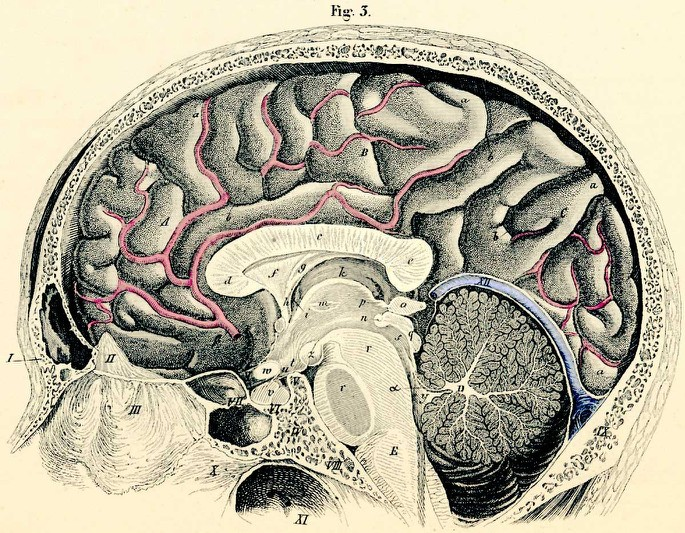

# pineal-gland — figure1（supplement）

> （《pineal-gland》词条补充材料，源：plato.stanford.edu/entries/pineal-gland/figure1.html）

#### Supplement to Descartes and the Pineal Gland

## Figure 1

**Figure 1**. The Pineal Gland. Sagittal section of brain, view from the left, the surface of the medial half of the right side is seen. Source: Professor Dr. Carl Ernest Bock, *Handbuch der Anatomie des Menschen*, Leipzig 1841. From a scan originally published at: [Anatomy Atlases](http://www.anatomyatlases.org/atlasofanatomy/plate24/03sagmedialr.shtml) (edited).

1. Frontal bone (with frontal sinus).
2. Crista galli (of ethmoidal bone).
3. Perpendicular lamina of the ethmoid bone.
4. Body of the ethmoid bone.
5. Back of the sella turcica (posterior clinoid process).
6. Sella turcica.
7. Sphenoid sinus.
8. Basilar part of the occipital bone (with the fossa for medulla oblongata).
9. Vomer.
10. Pharynx.
11. Tentorium cerebelli (with confluence of sinuses and opened great cerebral vein of Galen).

| A. | Anterior (Frontal) cerebral lobe. |
| --- | --- |
| B. | Middle (Parietal) cerebral lobe. |
| C. | Posterior (Parietal) cerebral lobe. |
| D. | Medulla oblongata. |
|   |   |
| a. | gyri. |
| b. | sulci (furrow between gyri). |
| c. | corpus callosum (body). |
| d. | genu of corpus callosum. |
| e. | corpus callosum, splenium. |
| f. | septum pellucidum. |
| g. | fornix (body). |
| h. | fornix column. |
| i. | foramen of Munro. |
| k. | thalamus (optic thalamus). |
| l. | anterior commissure. |
| m. | interthalamic adhesion. |
| n. | posterior commissure. |
| o. | **pineal gland**. |
| p. | stalk of pineal gland (crus glandulae pinealis). |
| q. | corpora quadrigemina. |
| r. | pons Varoli. |
| s. | aqueduct of Sylvius. |
| t. | tuber cinereum. |
| u. | infundibulum. |
| v. | pituitary gland (hypophysis). |
| w. | optic chiasm. |
| x. | optic nerve. |
| y. | fourth ventricle. |
| z. | mamillary body. |
|   |   |
| α) | anterior cerebellar valvule. |
| β) | anterior cerebral artery. |

Return to text
