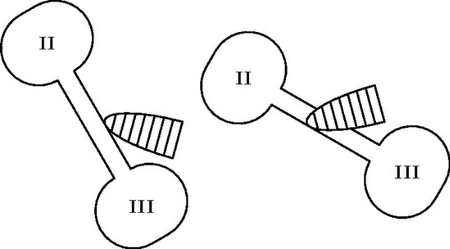

# pineal-gland — figure2（supplement）

> （《pineal-gland》词条补充材料，源：plato.stanford.edu/entries/pineal-gland/figure2.html）

#### Supplement to Descartes and the Pineal Gland

## Figure 2

**Figure 2**. Qusta ibn Luqa's Theory (modern schematic reconstruction, view from the left). Thinking is associated with the animal spirit in the middle ventricle (II), memories are stored in the posterior ventricle (III). Left: people who want to remember look up because this raises the worm-like obstacle and enables the passage of memories from the posterior to the middle ventricle. Right: people who want to think look down because this depresses the worm-like obstacle and isolates the middle ventricle from the contents of the posterior ventricle.

Return to text.
