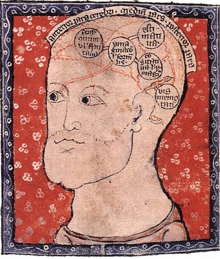

# pineal-gland — figure3（supplement）

> （《pineal-gland》词条补充材料，源：plato.stanford.edu/entries/pineal-gland/figure3.html）

#### Supplement to Descartes and the Pineal Gland

## Figure 3

**Figure 3**. The Worm-Like Obstacle. This illumination from ca. 1300 shows how the worm guards the entrance of the posterior ventricle (University Library, Cambridge, ms Gr.g.1.1; Source: [Web Gallery of Art](http://www.wga.hu/html/zgothic/miniatur/1301-350/05e_1301.html)).

Return to text.
