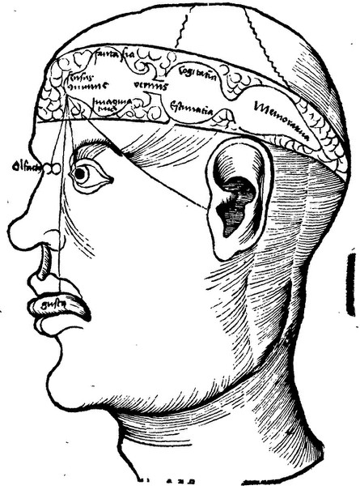

# pineal-gland — figure4（supplement）

> （《pineal-gland》词条补充材料，源：plato.stanford.edu/entries/pineal-gland/figure4.html）

#### Supplement to Descartes and the Pineal Gland

## Figure 4

**Figure 4**.. The Worm According to Mondino (view from the left). In this diagram, there is a “worm” (“*vermis*”) between the anterior and middle ventricles, in conformity with Mondino's *Anothomia* (Reisch 1535, p. 883).

Return to text.
