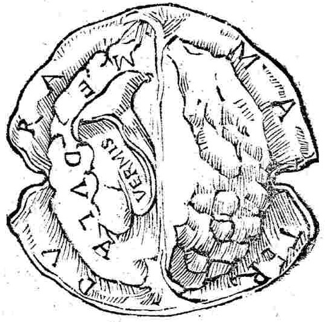

# pineal-gland — figure5（supplement）

> （《pineal-gland》词条补充材料，源：plato.stanford.edu/entries/pineal-gland/figure5.html）

#### Supplement to Descartes and the Pineal Gland

## Figure 5

**Figure 5**. The Worm According to Mondino (view from above). In this view of the brain from above, the label “worm” (“*vermis*”) is applied to the choroid plexus in the lateral and third ventricles, just as in Mondino's *Anothomia* (Berengario da Carpi 1530, fol. O3r).

Return to text.
