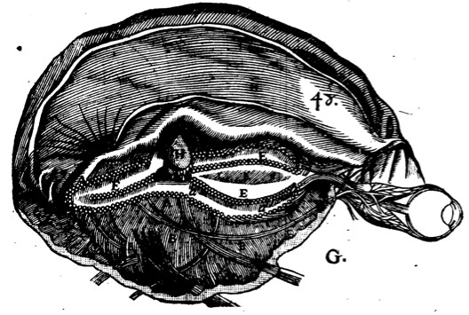

# pineal-gland — figure6（supplement）

> （《pineal-gland》词条补充材料，源：plato.stanford.edu/entries/pineal-gland/figure6.html）

#### Supplement to Descartes and the Pineal Gland

## Figure 6

**Figure 6**. The Pineal Gland According to Descartes. This image from the 1664 edition of the *Treatise of man* illustrates Descartes' view that the pineal gland (H) is suspended in the middle of the ventricles (Descartes 1664, p. 63).

Return to text.
