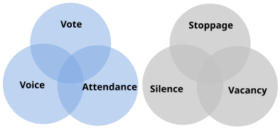

# Political Representation
**First published Mon Jan 2, 2006; substantive revision Fri Jun 5, 2026**

*Dovi, Suzanne, Salkin, Wendy*

The concept of political representation is misleadingly simple: everyone seems to know what it is, yet few can agree on any particular definition. In fact, there is an extensive literature that offers many different definitions of this elusive concept. (Classic treatments of the concept of political representation within this literature include Pennock & Chapman 1968; Pitkin 1967; Schwartz 1988.)[^pennock-1968][^pitkin-1967][^schwartz-1988] Hanna Pitkin (1967) provides perhaps one of the most straightforward definitions: to represent is simply to “make present again”. On this definition, political representation is the activity of making citizens’ voices, opinions, and perspectives “present” in public policy-making processes. Political representation occurs when political actors speak, advocate, symbolize, or act on the behalf of others in the political arena in ways responsive to what the represented want.

Pitkin’s seemingly straightforward definition, however, is not adequate as it stands. For it leaves the concept of political representation underspecified. Indeed, as we will see, the concept of political representation has different and, sometimes, contradictory dimensions. As a result, the literature on political representation offers a variety of possible and even conflicting descriptions of what political representation is as well as conceptions of how political representatives should represent.

Scholars’ conceptions of political representation have also shifted over time in at least the following two respects: first, descriptive characterizations of what political representation *is* have changed in response to changing political realities and practices; second, these changing descriptive accounts have, in turn, informed shifts in normative theories of how representation ought to be carried out. Throughout this article, where possible we identify and distinguish descriptive debates concerning what political representation is from normative debates concerning what political representatives should do or who political representatives should be. However, distinguishing between the descriptive questions and the normative questions is a complex undertaking, and the questions are not always easily separated. As an example: some theorists treat the normative question “what does it mean to be a good representative?” as distinguishable from the descriptive question “what is a political representative?” Yet others treat *political representation* as a normative concept from the outset, whereby the question “what is political representation?” must be answered at least partly in terms of what representatives should do.

This article has several related aims. The first is to provide a general overview of the various conceptions of political representation, identifying the key components of these conceptions. The second is to highlight key debates about political representation and its components and thereby showcase how changing political realities have generated new and competing conceptions of political representation. Notably, many new conceptions concern forms of political representation that occur outside of familiar formal and institutional contexts, in which representation is thought to be a relationship between an elected representative and a determinate constituency. By accommodating other contexts of representation and expanding the meaning of different components of representation, new descriptive conceptions of what political representation is and new normative conceptions of what political representatives should be doing have emerged. These new conceptions also offer different ways of envisioning the relationship between normative and descriptive accounts of representation. The final aim is to identify areas of future research.

## 1. Key Components of Political Representation

Political representation, on almost any account, will exhibit the following seven components:

1. *a representing party* (e.g., the representative, an organization, movement, state agency);
2. *a represented party* (e.g., the constituents, the clients, the voters);
3. *something that is being represented* (e.g., opinions, perspectives, preferences, interests, needs, claims, discourses);
4. *the main activity of a representative* (e.g., constructing claims, building constituencies, mobilizing, advocating);
5. *a setting in which the representation occurs*;
6. *an audience before which the representation occurs*; and
7. *something that is left out* (e.g., the opinions, interests, and perspectives not voiced).

Theories of political representation often begin by specifying the terms for the first six components. For instance, historically, democratic theorists have focused primarily on formal representatives—that is, on representatives who hold elected or appointed public offices. Their accounts tend to emphasize the essential role that authorization and accountability mechanisms play in making someone a representative. Other theorists instead focus their discussions on informal representatives (e.g., Montanaro 2012; Salkin 2024)[^montanaro-2012][^salkin-2024]. Because theories of political representation can focus on different kinds of political actors and different political contexts, a fully general concept of political representation remains elusive (but see Rehfeld (2006) who offers a general theory of representation which simply identifies representation by reference to a relevant audience accepting a person as a representative). The seventh component—something that is left out—can be inferred or explicitly identified (Dovi 2020)[^dovi-2020][^dovi-2020-2].

As discussed throughout this article, a rich literature on representation has developed that offers insightful and innovative descriptions of these various components. Nevertheless, a common starting point for discussions of representation is Hanna Pitkin’s *The Concept of Representation* (1967).

Pitkin offers one of the most comprehensive and influential discussions of the concept of political representation (for a discussion of her influence, see Dovi 2015)[^dovi-2015]. Pitkin provides an ordinary language conceptual analysis of different conceptions of political representation, maintaining that to understand the concept of political representation, one must consider the different ways the term *representation* is used. Each use of *representation* provides what Pitkin calls a “view” of the concept of representation. For Pitkin, the four different views of representation are formalistic representation, descriptive representation, symbolic representation, and substantive representation. For a brief description of each of these views, see the following chart.

1. **Formalistic Representation**:
2. *Brief Description*. Concerns the institutional arrangements that precede and initiate representation. Formal representation has two dimensions: authorization and accountability.
3. *Main Research Question*. What is the institutional position of a representative?
4. *Implicit Standards for Evaluating Representatives*. None.
5. **Authorization:**
6. *Brief Description*. The means by which a representative obtains their standing, status, position, or office.
7. *Main Research Questions*. What is the process by which a representative gains power (e.g., elections or appointment) and how does a representative enforce their decisions?
8. *Implicit Standards for Evaluating Representatives*. No standards for assessing how well a representative behaves. One can merely assess whether a representative legitimately holds their position.
9. **Accountability:**
10. *Brief Description*. The ability of constituents to punish their representative for failing to act in accordance with their wishes (e.g., voting an elected official out of office) or the responsiveness of the representative to the constituents.
11. *Main Research Questions*. What are the sanctioning mechanisms available to constituents? Is the representative responsive to their constituents’ preferences? Does the representative justify their actions to the represented?
12. *Implicit Standards for Evaluating Representatives*. No standards for assessing how well a representative behaves. One can merely determine whether a representative can be sanctioned or has been responsive.
13. **Symbolic Representation:**
14. *Brief Description*. The ways a representative “stands for” the represented—that is, the emblematic meaning that a representative has for those being represented.
15. *Main Research Question*. What kind of response is invoked by the representative in those being represented?
16. *Implicit Standards for Evaluating Representatives*. A representative is assessed in terms of the degree of acceptance that the representative has among the represented.
17. **Descriptive Representation:**
18. *Brief Description*. The extent to which a representative resembles those being represented.
19. *Main Research Question*. Does the representative look like, have common interests with, or share certain experiences with the represented?
20. *Implicit Standards for Evaluating Representatives*. A representative is assessed by the accuracy of the resemblance between the representative and the represented.
21. **Substantive Representation:**
22. *Brief Description*. The activity of representatives—that is, the actions taken on behalf of, in the interest of, as an agent of, and as a substitute for the represented.
23. *Main Research Question*. Does the representative advance policy preferences that serve the interests of the represented?
24. *Implicit Standards for Evaluating Representatives*. A representative is assessed by the extent to which policy outcomes they advance serve the best interests of their constituents. Some understand best interests in terms of constituents’ expressed preferences while others invoke objective standards to identify best interests.

However, Pitkin never explains how these different views of political representation fit together. At times, she suggests that the concept of representation is unified. For instance, she compares the concept of representation “to a rather complicated, convoluted three dimensional structure in the middle of a dark enclosure” (1967: 10). The different views of representation are “unified” to the extent that they share an underlying structure.

At other times, Pitkin emphasizes the conflicts between these views—noting, for instance, how descriptive representation is in tension with accountability (see Section 3.5). Such tensions suggest that the concept of representation can be internally incoherent. Indeed, Pitkin describes the concept as “paradoxical” because the different views of representation can demand contradictory actions from an individual representative. (On this point, see our discussion of the delegate/trustee debate in Section 3.1.1.)

These views also provide different standards for assessing representatives. For instance, assessing symbolic representation requires determining if the representative is accepted by the represented, whereas assessing descriptive representation involves determining the accuracy of the resemblance between representative and represented. For Pitkin, with the exception of formal representation, each view of representation is associated with a different normative standard for evaluating representatives. As a result, disagreements about what representatives ought to do are aggravated by people adopting different views of representation or misapplying the relevant standards for a particular view. Pitkin suggests that such disagreements can be reconciled partly by clarifying which view of representation is being invoked.

Pitkin’s schematic overview of the concept has in many ways set the terms of contemporary debate. In particular, she describes the concept of representation as a principal-agent problem that is structured around formal mechanisms of authorization and accountability. The principal/ represented authorizes the agent/representative to act in their name and the agent/representative is held accountable to the principal/represented by sanctioning mechanisms. (A more detailed discussion of the principal-agent problem can be found in Section 3.2.) As can be seen, Pitkin’s focus on authorization and accountability, especially as they are found in elections, explains why discussions about political representation frequently collapse into discussions of democracy. (On the relationship between democracy and representation, see Section 3.6.)

However, one of Pitkin’s most important insights is that the contemporary usage of the term “representation” can significantly change its meaning. (For an informative discussion of the history of the concept of representation, see Mónica Brito Vieira and David Runciman’s *Representation*, 2008.)[^brito-2008]

## 2. Contemporary Advances

Recent discussions about political representation reflect and respond to changing political realities. For instance, Nadia Urbinati and Mark Warren (2008: 387) list three changes that have shaped contemporary accounts of political representation: “(*a*) a political landscape within which electoral representation now competes with new and informal kinds of representation; (*b*) interest in the fairness of electoral representation, particularly for minorities and women; … (*d*) a new appreciation that participation and representation are complementary forms of citizenship”. Together these changes have shifted how we understand the proper way to authorize and to hold representatives

### 2.1 Authorization

Some representatives have the capacity to act on behalf of others. Authorization is the set of processes by which representatives acquire that capacity. Traditionally, theoretical accounts of political representation (including and especially Hanna Pitkin’s) have focused almost exclusively on formal procedures of authorization and accountability within nation states. In particular, they focused on electoral authorization: authorization was understood as voting a representative in and accountability was (primarily) understood as those who authorized the representative retrospectively evaluating and perhaps sanctioning that person by voting him out if he failed to attend sufficiently to their interests or preferences. So conceived, authorization and accountability are two sides of the same coin. Others focus on sortition or the use of lottery-like methods of authorization (e.g., Guerrero 2024; Malleson 2018; Rehfeld 2005)[^guerrero-2024][^malleson-2018][^rehfeld-2005].

The focus on formal authorization procedures, though, is no longer sufficient for describing political representation due to changes in how representation occurs in domestic and international arenas. Increasingly, international, transnational, and non-governmental actors, such as NGOs, multilateral organizations, multinational corporations, and transgovernmental networks, play an important role in advancing public policies on behalf of democratic citizens—that is, acting as representatives for those citizens. Such actors speak for, act for, and can even stand for others although they are neither elected to nor hold any public office. These actors even perform the traditional activities of elected representatives. Consider how lobbyists have been found to write “word for word” legislative acts, e.g., the Dodd-Frank bill that rolled back 2010 financial reforms (Chang 2013)[^chang-2013] or the extent to which the United States “contracts out” important responsibilities, such as environmental regulation, to non-state actors. (For extensive discussion of these international and domestic changes, see Warren and Castiglione 2004.)[^warren-2004]

### 2.2 Accountability

Pitkin (1967: 55) dismisses “the accountability view” of representation as “not an important strand in the literature of representation”. Per Pitkin, accountability theorists understand a representative to be someone “who is held to account”. For Pitkin, what it is for a representative to be accountable to constituents just is for there to be an institutional mechanism of accountability—for instance, sanctioning the representative by voting that representative out of office and thereby incentivizing responsiveness. She writes “the formalistic theorist allowed of no limits on, or standards for, the conduct of a representative, qua representative” (1967: 114). But Pitkin never examines the different possible meanings of *accountability* in the same detail that she does when discussing the other views of representation.

Jane Mansbridge (2014) identifies two distinct meanings of *accountability*. The first stresses the meaning of *accountability* as “giving an account” (56). On this first sense, accountability occurs when representatives give an explanation of what they have done and why. By contrast, the second meaning of *accountability* emphasizes sanctioning for wrongdoing. Przeworski, Stokes, and Manin (1999: 10) capture this second meaning: “Governments are ‘accountable’ if citizens … can sanction them appropriately, retaining in office those incumbents who perform well and ousting from office those who do not”.

Mansbridge discusses how the literature on representation tends to present sanctioning mechanisms as the means by which representatives are incentivized to be responsive to the represented. This preoccupation is worrisome because sanctioning mechanisms often do not work. Consequently, Mansbridge (2009) rejects relying exclusively on what she calls “the sanctions model” of principal-agent relations on which “the interests of the principals (in politics, the constituents) are assumed to conflict with the interests of their agent (the representative)” and “the principals must … monitor the agent closely, rewarding the good behavior and punishing the bad” (2009: 369).

Mansbridge offers an alternative model of principal-agent relations: “the selection model”, which “works only when a potential agent already has self-motivated, exogenous reasons for doing what the principal wants”, meaning that “the principal and agent … have similar objectives even in the absence of the principal’s sanctions” (2009: 369). Under such conditions, it is “more efficient … for the principal to invest resources *ex ante* in selecting the required type [of agent] rather than investing *ex post* in monitoring and sanctioning” (2009: 369). This does not, however, mean that there is no need for accountability on the selection model of principal-agent relations, but instead that the “*accountability as sanction*” notion is inapt. Accordingly, the selection model enlists “an earlier understanding of accountability [that] stresses ‘giving an account’” (2009: 384): “the representative’s accountability to the constituent will typically take the form of *narrative* and even *deliberative* accountability rather than accountability based on monitoring and sanctions”. 369–370). Both *narrative* and *deliberative accountability* require the representative to “explain[] the reasons for her actions” (2009: 370). Yet whereas narrative accountability is unidirectional (from representative to constituent—Mansbridge provides the example of “opinions of the U.S. Supreme Court” as examples of “pure narrative accountability” (2009: 384n57)), deliberative accountability is bidirectional: “In deliberative accountability principal and agent both ask questions and give answers, exploring whether or not they remain mutually aligned and whether the grounds of their alignment might have changed” (2009: 384n57).

Mansbridge acknowledges that “in practice both selection and sanctions are always at work” and “the sanction and selection models are always mixed”, and so proposes that “it helps to think of the selection model as having selection at its core and sanctions at its periphery” (2009: 370).

Contemporary work in political science and political theory has also provided important insights into the meaning of *accountability* (e.g., Bovens 2010; Day and Klein 1987; Mulgan 2003; Przeworski, Stokes, and Manin 1999; and Schedler 1999)[^bovens-2010][^day-1987][^mulgan-2003][^przeworski-1999][^schedler-1999][^schedler-1999-2]. This literature offers various typologies of different kinds of accountability mechanisms. For instance, some classify different types of accountability according to their direction: horizontal accountability involves government agencies holding other government agencies accountable, and vertical accountability involves principals holding agents accountable (see O’Donnell 1998, 2003; Schedler, Diamond, and Plattner 1999; and Goetz and Jenkins 2001)[^goetz-2001][^o’donnell-1998][^o’donnell-2003][^schedler-1999][^schedler-1999-2].

In contrast, Ruth Grant and Robert Keohane (2005) identify seven mechanisms for holding international representatives accountable: hierarchical accountability, supervisory accountability, fiscal accountability, legal accountability, market accountability, peer accountability, and public reputational accountability. These forms of accountability are understood as constraining devices, as opposed to strictly sanctioning mechanisms. For example, *hierarchical accountability* is a characteristic of bureaucracies that allows superiors to remove subordinates from office, constrain their tasks and room for discretion, and adjust their financial compensation. *Supervisory accountability* refers to “relations between organizations where one organization acts as principal with respect to specified agents” (2005: 36). For instance, the World Bank and IMF are subject to supervision by states and by state institutions like courts. *Fiscal accountability* refers to funding agencies’ capacities to impose budgetary restrictions or withhold money to punish abusive international organizations. *Legal accountability* occurs when courts impose criminal penalties on state agents who violate international human rights. *Peer accountability* refers to organizations’ processes of mutual evaluation with their counterparts, e.g., when one NGO assesses the quality of information it receives from another. *Public reputational accountability* uses an organization’s fear of hurting its reputation as a method of constraining its actions. *Market accountability* refers to limits on international actors’ behavior generated by investors’ and consumers’ actions, “whose influence is exercised…through markets” (2005: 37). Grant and Keohane’s seven mechanisms provide alternative conceptions of accountability and illuminate institutional incentives that can prevent representatives from abusing positions of power. They expand the concept of accountability beyond a view that relies exclusively on voting a representative out of office.

David Plotke (1997) offers an important insight into how changing political realities may affect our understanding of authorization and accountability. Plotke notes that the emphasis on mechanisms of authorization and accountability—specifically, on treating *competitive* elections as distinctive of democratic governance (Schumpeter 1942)[^schumpeter-1942]—can be ideologically motivated. For Plotke, this emphasis provided conceptual grounds for differentiating Western liberal democracies from the Soviet Union and Eastern Bloc nations during the Cold War. According to this way of classifying representative systems, the Soviet Union and Eastern Bloc nations were not real representative, let alone democratic, systems of governance because they did not hold competitive elections. (They only had one political party, namely the Communist Party.) Nowadays, the distinction between competitive and non-competitive representative systems is less useful because of new forms of authoritarianism. For example, Steven Levitsky and Lucan Way (2010: 53) note how competitive authoritarian regimes hold regular elections that are generally free of massive fraud; however, “incumbents routinely abuse state resources, deny the opposition adequate media coverage, harass opposition candidates and their supporters, and in some cases manipulate electoral results”. Having competitive elections with more than one political party is no longer distinctive of democratic governance.

Plotke’s insight that descriptive accounts of representation can be ideologically motivated should caution contemporary theorists of representation. The explanatory value of theoretical distinctions is often tied to the historical context from which those distinctions emerge. Consequently, it is worth (1) investigating the political motivations for relying on certain accounts of representation as opposed to others, and (2) revisiting these distinctions regularly to test them against new political realities.

Two additional innovations are worth mentioning: the importance of audiences in conferring representative status and the role of absences in representation.

### 2.3 Representative as Status Conferred by Audiences

Recently, Wendy Salkin (2024: 33–76) has identified a new process by which parties become informal representatives, namely *audience conferral*. An informal representative is a party who is treated by an audience as speaking or acting for a group in a context despite having been neither elected nor selected by a systematized procedure. Audiences confer the status of informal representative by treating the party in certain ways (*conferral actions*), including (1) treating the party’s statements or actions as though made or taken by the group or its members (*ascription*); (2) treating the party as a credible source of information about the group’s or its members’ values, interests, or preferences (*credibility conferral*); (3) relying on the party’s testimony when attempting to understand what the group’s members want, value, or prefer; and (4) inviting the party to stand in for the group or its members when the group’s members’ interests are at stake in a given forum (*invitation*).

Salkin’s audience conferral account makes conceptual space for the possibility of *conscripted* informal representatives (2024: 77–108)—that is, parties who are treated by audiences as speaking or acting for some group, but who either do not know that they are so treated (*unwitting representatives*) or know but do not want to be so treated (*unwilling representatives*). To aid audiences in determining when it is reasonable and permissible to confer the status of informal representative on a given party, Salkin offers an *audience conferral permissibility test*, detailed in Section 3.7.1.

Salkin clarifies that “audience conferral is not a form of authorization. Authorization requires the conscious, if not intentional, granting of discretionary and sometimes normative power to the authorized party. By contrast, audience conferral is a fact that makes it the case that a party comes to have the power to influence an audience—a fact that can be realized in a variety of ways, some conscious and others not, some intentional and others not” (Salkin 2024: 296n14)[^salkin-2024]. For Salkin, authorization is not required for a party to be conferred the de facto social status of informal political representative—audience conferral is sufficient.

### 2.4 Representation as Making Absences

Many descriptive accounts of political representation emphasize what representatives say and do for others in politics. In contrast, Suzanne Dovi (2020) argues that any adequate description, let alone normative assessment, of political representation must attend not only to how representatives make groups present but also to how representatives make groups absent in politics. For her, representation functions like a filter. Hence, Dovi conceptualizes “representation as a dynamic, iterative process constituted by different combinations and patterns of presence as well as absence” (2020: 560). To identify these combinations and patterns, Dovi offers a typology that identifies the key parts of both presence and absence. In particular, she recommends differentiating three parts of presence (attendance, voice, and voting) from three parts of absences (vacancies, silences, and stoppages) (see Figure 1). For Dovi, *attendance* “refers to physically turning out, showing up at, and participating in representative processes” (2020: 562). While *attendance* designates sitting at the political table, *voice* is the communication of perspectives, opinions, and interests, including, crucially, policy preferences. *Voting* is “having an institutional say”—that is, having “the authority derived from their institutional positions to determine outcomes within representative processes” (2020: 562). Dovi then distinguishes three different kinds of absences. The first kind, what she calls a *vacancy*, refers to being physically missing from representative processes. By contrast, the second kind of absence, *silence*, occurs when verbal communication is withheld. The third kind of absence, *stoppage*, occurs “when representatives do not exercise their institutional authority to determine the outcomes of representative processes” (2020: 566–567).

According to Dovi, the quality of a group’s representation depends on how the three different kinds of absence intersect and interact with the corresponding three kinds of presence. Representatives can advance the preferences and interests of their constituents through their absence as well as through their presence. In contrast to those who see exclusion as merely a problem for representation (e.g., Williams 1998)[^williams-1998], Dovi (2009) reconceptualizes political representation as both an inclusionary *and* an exclusionary political process.

*Figure 1.* Three Fundamental Parts of Presence (left) and Absence (right)

## 3. Key Debates

Debates have arisen regarding how best to understand the main components of political representation. Here we survey several persistent debates.

### 3.1 What is the Main Activity of Representation?

Political thinkers disagree about what representatives do and, as a result, who counts as a representative. Some view representatives as delegates while others view them as trustees (§3.1.1); still others claim that representation is instead better conceived as claim-making (§3.1.2), advocacy (§3.1.3), or mediation (§3.1.4).

#### 3.1.1 Delegate vs. Trustee

The historical debate concerning whether representatives should act as *delegates* or as *trustees* concerns how a representative should act in relation to the preferences of the represented. (Hanna Pitkin labels this debate “The Mandate-Independence Controversy”.)

Delegates follow the expressed preferences (or mandates) of their constituents. Representatives are delegates when they act as “mere” agents, servants, or subordinate substitutes for those who sent them (Pitkin 1967: 146)[^pitkin-1967]. The thinker most strongly associated with the delegate position is James Madison, who describes representative government as “the delegation of the government…to a small number of citizens elected by the rest” (Madison, Hamilton, & Jay 1787–8)[^madison-1787]. Madison recognized that “enlightened statesmen will not always be at the helm”. For Madison, having a diverse and large population was a way to dilute the problems with bad representation: having representatives responsive to the varied preferences of the represented can partially safeguard against the problems of faction.

By contrast, representatives are trustees when they follow their own understanding of the best action to pursue. They are understood as acting “independently”, meaning they act as free agents who are best left alone to do their work (Pitkin 1967: 147)[^pitkin-1967]. Edmund Burke famously argued that

> Certainly, gentlemen, it ought to be the happiness and glory of a representative to live in the strictest union, the closest correspondence, and the most unreserved communication with his constituents. Their wishes ought to have great weight with him; their opinion, high respect; their business, unremitted attention. It is his duty to sacrifice his repose, his pleasures, his satisfactions, to theirs; and above all, ever, and in all cases, to prefer their interest to his own. But his unbiassed opinion, his mature judgment, his enlightened conscience, he ought not to sacrifice to you, to any man, or to any set of men living. … Your representative owes you, not his industry only, but his judgment; and he betrays, instead of serving you, if he sacrifices it to your opinion. …
>
> Parliament is not a congress of ambassadors from different and hostile interests, which interest each must maintain, as an agent and advocate, against other agents and advocates; but Parliament is a deliberative assembly of one nation, with one interest, that of the whole… You choose a member, indeed; but when you have chosen him he is not a member of Bristol, but he is a member of Parliament. (Burke 1774 [1887: 95–96)[^burke-1774]

The delegate and trustee conceptions of political representation place competing and in some cases contradictory demands on the behavior of representatives. (On the similarities and differences between Madison’s and Burke’s conceptions of representation, see Pitkin 1967: 191–192.)[^pitkin-1967] Delegate conceptions of representation require representatives to follow their constituents’ preferences, while trustee conceptions require representatives to follow their own judgment about the proper course of action, which is often understood as the national interest. Any adequate theory of representation must grapple with these competing demands. According to Pitkin, “insofar as the mandate-independence controversy contains a conceptual dispute based on the meaning of representation, both sides are right. The seemingly paradoxical meaning of representation is perpetuated in our requirements for the activity of representing: the represented must be both present and not present. The representative must really act, be independent; yet the represented must be in some sense acting through him. Hence there must be no serious persistent conflict between them. Thus one might suppose that the best examples of representation as an activity would be found where absolutely no conflict could occur between the representative and represented” (1967: 154). Pitkin’s description of representation seems to assume that the preferences of the representative and the represented should converge.

Yet Pitkin also acknowledges that sometimes a representative’s own judgment of the proper course of action will conflict with their constituents’ preferences. Under such circumstances, if the representative acts in accordance with their own judgment, they fail to be a good delegate. If they act in ways consistent with their constituents’ preferences, they fail to be a good trustee. This situation exemplifies the “paradoxical meaning of representation” (1967: 154).

However, Pitkin recommends preserving this so-called “paradox”:

> The substance of the activity of representation seems to consist in promoting the interest of the represented in a context where the latter is conceived as capable of action and judgment, but in such a way that he does not object to what is done in his name. *What* the representative does must be in his principal’s interest, but *the way* he does it must be responsive to the principal’s wishes. He need not actually and literally act in response to the principal’s wishes, but the principal’s wishes must be potentially there and potentially relevant. (1967: 155)

Pitkin preserves the “paradoxical meaning of representation” by emphasizing different ways of being responsive to the represented’s preferences.

For Andrew Rehfeld (2009), the traditional way of understanding the delegate/trustee distinction collapses three important distinctions—aims, source of judgment, and responsiveness. The resulting conflation of these distinctions “obscures the complexity of representation” (2009: 214). *Aims* concern “whether the representative-lawmaker aims at the good of all or the good of a part” while the *source of judgment* concerns “whether the representative-lawmaker relies on his or her own judgment or the judgment of a third party”. Finally, *responsiveness* is “the degree to which the representative-lawmaker is responsive to sanctions (usually, but not necessarily, the prospect of reelection)” (2009: 215). Rehfeld’s distinctions allow for the possibility that a representative may act like a delegate in certain respects but as a trustee in others.

#### 3.1.2 Representation as Claim-making: The Constructivist Turn

Dating back to Thomas Hobbes (1651), the constructivist tradition offers a variety of accounts of the main activity of representation (see Ankersmit 1996; Bourdieu 1982 [1991]; Lefort 1986 [1988])[^ankersmit-1996][^bourdieu-1982][^lefort-1986]. Typically, the constructivist tradition emphasizes the representative’s role in creating and framing the identities as well as the preferences of the represented. According to Thomas Fossen (2019: 824), constructivists hold that “the identity, interests, or preferences of the represented are not given prior to representation but shaped through being represented”.

The leading proponent of constructivism is Michael Saward. His groundbreaking *The Representative Claim* describes the activity of representation as a form of claim-making. Saward defines claim-making as a series of relationships: “A maker of representations (M) puts forward a subject (S) which stands for an object (O) which is related to a referent (R) and is offered to an audience (A)” (2006: 302). For Saward, the represented do not have pre-existing interests that representatives “bring into” the political arena. Rather, would-be representatives advance claims that then may or may not resonate with various audiences. Audiences bring representation into existence when they accept their representatives’ claims.

Not everyone agrees that constructivism must reject all pre-existing identities, interests, and preferences. For example, Fossen (2019: 824) has disaggregated different conceptions of representation in order to show how the represented “can be *both* prior to representation *and* constituted by it”. Fossen identifies two politically salient senses of “representation”. The first involves the “sense in which someone acts for someone in the capacity of a representative, as the elected may be said to represent their voters”, while the second sense occurs when “a picture represents what it is a picture of”. He calls the former *acting-for-others* (or representative agency) and the latter *portraying-something-as-something* (or representation-as). Using this distinction, Fossen hopes to recover Pitkin’s idea that representatives ought to be “responsive” to a pre-existing represented group, not simply creating claims and representative identities that are accepted by the represented.

#### 3.1.3 Representation as Advocacy

Nadia Urbinati (2000, 2002) proposes understanding representation as advocacy. For her, the main activity of representatives is to disagree on their constituents’ behalf, not to aggregate their interests. For her, the function of the representative is to actively engage with, listen to, and advance constituents’ interests in policymaking in a manner consistent with pluralism. Urbinati understands disagreements among constituents as necessary for preserving liberty and therefore a vital part of democratic politics. Per Urbinati, parties act as representatives when they acknowledge the complexities of political views and address the different perspectives of the community. Urbinati’s account exemplifies how a descriptive account of what representation is can incorporate normative standards concerning what representatives should do.

Urbinati identifies two main features of advocacy: the representative’s passionate link to the electors’ cause and the representative’s relative autonomy of judgment. Urbinati emphasizes the importance of the former for motivating representatives to deliberate with each other and on behalf of their constituents. For Urbinati, the benefit of conceptualizing representation as advocacy is that it improves our understanding of and ability to evaluate deliberative democracy. Urbinati criticizes contemporary deliberative democrats for focusing merely on the fairness of formal procedures of deliberation at the expense of examining the sources of inequality that exist outside of formal political institutions, e.g., the market. In contrast, Urbinati emphasizes the important role of opinion and consent formation, processes that exist within civil society in determining the outcomes of representative processes. Urbinati’s account of political representation thus expands the scope of theoretical discussions of representation away from formal procedures of authorization to the deliberative and expressive dimensions of representative institutions.

#### 3.1.4 Representation as Mediation

Melissa Williams (1998) offers another account of the constitutive activity of representation, *representation as mediation*. Williams explains “representation as mediation” in terms of how “the different institutions and practices of any scheme of representation operate to shape and transform individual citizens’ political concerns and interests into governmental decisions and policies” (1998: 23). On this view, representation converts citizens’ values and concerns into policy preferences.

Williams identifies three dimensions of representation that affect how this conversion takes place: (1) legislative decision-making dynamics, (2) legislator-constituent relations, and (3) the basis for aggregating citizens into representable constituencies. Williams supports her claim that these three dimensions of representation are valuable for transforming preferences correctly by drawing on the experiences of marginalized groups in the United States.

Williams further identifies three requirements for proper mediation (voice, trust, and memory) and for justifying the presence of marginalized groups in politics:

1. *Voice*: Drawing on the experiences of American women trying to gain equal citizenship, Williams argues that historically disadvantaged groups need a voice in legislative decision-making. The deliberative quality of legislative institutions requires individuals who have been politically excluded to be present.
2. *Trust:* Trust is necessary for representatives to properly mediate the legislator-constituent relationship. Given the consistent patterns of betrayal of African Americans by privileged white citizens, African Americans have good reason to distrust white representatives and the institutions themselves. Accordingly, Williams recommends that relationships of distrust can be “at least partially mended if the disadvantaged group is represented by its own members” (1998: 14).
3. *Memory*: Finally, Williams shows how the aggregation of citizens into representable constituencies must be mediated in light of memory. In particular, she argues that the boundaries of collective political identities are partially determined by past experiences of the group—what Williams calls “memory”. Certain persistent and recurring patterns of marginalization can justify having institutional mechanisms that guarantee certain oppressed populations presence in decision-making bodies and influence on public policy outcomes.

Williams advances the *representation as mediation* account because she found existing descriptive and normative accounts of liberal representation lacking. Williams identifies two strands in liberal representation: first, the “ideal of fair representation as an outcome of free and open elections in which every citizen has an equally weighted vote” (1998: 57); second, interest group pluralism, which Williams describes as the “theory of the organization of shared social interests with the purpose of securing the equitable representation … of those groups in public policies” (1998: 57). Together, the two strands are thought to provide sufficient grounds for fair representation. However, the unjust treatment of marginalized groups in the United States reveals how liberal representation does not adequately transform the values and concerns of certain groups into public policies. Accordingly, Williams designed her conception of representation as mediation to supplement existing accounts of liberal representation. Her work thereby expands the main question of representation beyond that of institutional design and challenges those who understand representation simply as matters of formal procedures of authorization and accountability.

### 3.2 Is Political Representation a Principal-Agent Relationship?

As discussed, Hanna Pitkin understands representation as primarily a principal-agent relationship. Her influence partly accounts for the historic focus on formal procedures of authorization and accountability (what she called “formalistic representation”) in the study of political representation. For example, a lot of theoretical attention has been paid to the proper design of representative institutions (e.g., Amy 1993; K. Barber 2000; Christiano 1996; Guinier 1994; Guerrero 2024)[^amy-1993][^barber-2000][^christiano-1996][^guerrero-2024][^guinier-1994]. This focus on how principals authorize agents and hold them accountable makes sense, since one way to resolve the disputes about what representatives should do is to “let the people decide”. Establishing fair procedures for resolving political disagreements about policies can also in the process settle disagreements about how representatives should behave.

However, the contemporary literature on representation has called into question the value of understanding representation as a principal-agent relationship. Notably, in light of recent empirical research and changing political practices, Jane Mansbridge (2003) identifies four forms of representation in modern democracies: promissory, anticipatory, gyroscopic, and surrogacy. *Promissory representation* is a form of representation in which representatives are to be evaluated by the promises they make to constituents during campaigns. Promissory representation strongly resembles Pitkin’s formalistic representation. However, Mansbridge identifies three additional forms of representation that do not rely on the representative being responsive to the principal’s existing preferences. In *anticipatory representation*, representatives focus on what they think constituents will reward in the next election, not on what they promised during the previous election’s campaign. To the extent that the principal’s preferences can change from election to election, it is wrong to think that the principal’s expressed preferences of the past should dictate the representative’s behavior. Anticipatory representation challenges the view that accountability is primarily retrospective. In *gyroscopic representation*, representatives “look within” to derive from their own thoughts and experience how they should act (Mansbridge 2003: 520)[^mansbridge-2003]. Selecting a representative who shares the principal’s political commitments, as opposed to a representative who responds to the principal’s expressed preferences, allows the represented to choose a representative who is more likely to act as the represented would like them to. Finally, *surrogate representation* occurs when a legislator represents constituents outside of their districts. Despite the absence of “any formal accountability, surrogate representatives sometimes *feel* responsible to their surrogate constituents in other districts” (2003: 523). While all four forms of representation are ways that citizens can be legitimately represented, none of the latter three forms of representation rely on formal mechanisms of authorization and accountability and therefore should not be understood as principal-agent relations.

Mansbridge’s rethinking of representation holds at least two important insights for contemporary discussions. First, political representation can occur even in the absence of a principal-agent relationship. Second, and more generally, political representation should not be conceived as a monolithic concept. Instead, we should countenance multiple forms of political representation.

Similarly, Michael Saward argues that representation does not start with a principal (a “what” or “who” that needs to be made present) but with a “would-be representative” who advances a claim that an audience endorses or rejects. Per Saward, “the represented play a role in choosing representatives, and representatives ‘choose’ their constituents in the sense of portraying them or framing them in particular, contestable ways” (2006: 302–303). The representative’s claims construct the collective political identities of the principal and thereby influence the principal’s self-understandings of who they are and what they want.

### 3.3 What is Being Represented?

Political philosophers and theorists often disagree about what is being represented. Some emphasize the opinions and expressed preferences of constituents while others stress the interests and welfare of constituents. Iris Marion Young (2000) lists “opinions, perspectives, and interests” as what representatives represent, where *interests* are what determine the life prospects of individuals (e.g., material resources); *opinions* are individuals’ values, principles, and priorities; and *perspectives* are particular kinds of social meanings, apparent in the types of questions being asked during public deliberations.

Others disagree about the proper way of organizing the represented. For instance, Andrew Rehfeld (2005) denies that constituencies should be constructed based on where citizens live, e.g., electoral districts, contending that political representation should no longer be territorially based. How constituencies are organized affects whether and if so how collective identities form within those constituencies.

In this section, we discuss three leading debates about what is represented: interests, claims, and discourses.

#### 3.3.1 Interests

Hanna Pitkin argues that “representing…means acting in the interest of the represented, in a manner responsive to them” (1967: 209). Pitkin acknowledges that the term *interest* has different senses (1967: 155–167). For instance, interests may be subjective (that is, based on what a person in fact wants) or objective (“things that are good for [people]—quite apart from what they happen to want” (1967: 159)). There is substantial theoretical discussion about how to define *interests* and who gets to decide what is in a group’s interest (see, e.g., Barry 1965; Connolly 1972; Sapiro 1981)[^barry-1965][^connolly-1972][^sapiro-1981]. For instance, Brian Barry (Barry & Rees 1964: 4)[^barry-1964] claims that “a policy, law, or institution is in someone’s interest if it increases his opportunities to get what he wants—whatever that may be”. Others, such as Pollak (2013) and Soma and Vatn (2014), hold that representatives should advance “the common good”. (On the varied meanings of *interest*, see the entry on the common good.) To date, the literature on political representation lacks an agreed-upon understanding of interests, let alone objective interests, that can be operationalized. Such problems have led political scientists to set aside the issue of interests and to focus instead on the expressed preferences of constituents (Achen 1975)[^achen-1975].

#### 3.3.2 Claims

As discussed in Section 3.1.2, Michael Saward argues that “representation is an ongoing process of making and receiving, accepting and rejecting claims—in, between, and outside electoral cycles”. He defines “a representative claim” specifically as “a claim to represent or to know what represents the interests of someone or something” (Saward 2010: 38)[^saward-2010]. He describes claims generally as three-place relations between a subject, an object, and a referent: “Subjects (or signifiers) and objects (or signifieds) are not just ‘out there,’ in a certain number and of a certain type. There are ‘makers’—spin doctors are a clear enough political example but there are many more—of claims about them, claims that generate and energize specific senses of subject and object (and which generate and focus upon specific would-be ‘audiences’)” (Saward 2006: 302)[^saward-2006]. For Saward, claims are not merely assertions and can also be actions. Claims convey and possess symbolic meaning, and their meanings shape political preferences as well as the identity formation of audiences.

#### 3.3.3 Discourses

Many traditional accounts of representation focus on the representation of people—specifically, the interests, preferences, or claims of people. John Dryzek and Simon Niemeyer (2008) suggest that sometimes it is not people but discourses that are represented. Dryzek and Niemeyer define *discourse* as “a set of categories and concepts embodying specific assumptions, judgments, contentions, dispositions, and capabilities”. Drawing on examples of transnational actors like the World Trade Organization, they develop the concept of *discursive representation*. Because international organizations represent so many people, and are not legitimated by elections, Dryzek and Niemeyer argue that it is more accurate to describe deliberations in these organizations as representing discourses, not actual individuals. It would be infeasible to assume that all those affected by a collective decision could be included in these organizations’ deliberations. Accordingly, it is more accurate to say these organizations represent discourses.

### 3.4 Citizen Representatives

Domestic transformations also reveal the need to update contemporary understandings of political representation. Associational life—social movements, interest groups, and civic associations—is increasingly recognized as important for the survival of representative democracies. Formal representative institutions do not function independently of nor are they clearly distinguishable from the informal representative bodies or mechanisms on which they often depend. The fluid relationship between the career paths of formal and informal representatives also suggests that contemporary realities do not justify focusing exclusively on formal representatives. Mark Warren (2008) introduces the concept of citizen representatives to explore how citizens are increasingly asked to represent themselves in political processes, e.g., deliberative forums. Warren gives two examples of how citizens act as representatives: “the first involves citizen participation in government or other formalized decision making, on the assumption that citizens represent themselves within these processes. The second involves citizens themselves serving in representative capacities: lay citizens represent other citizens” (2008: 50). To illustrate this second example, Warren discusses British Columbia Citizens’ Assembly (CA), which was a political body of “non-elected” (2008: 66) and “nonprofessional” (2008: 52) citizens who would represent other citizens and were tasked with assessing and designing an electoral system for British Columbia. Warren claims that citizen representatives are increasingly common and have been undertheorized. He notes that “the idea that citizens are best represented by other lay citizens serving as representatives is an old democratic ideal” (2008: 50) and underlies political practices like paying representatives so ordinary citizens can afford to participate equally.

### 3.5 Descriptive Representatives

A key theoretical debate concerns who can represent whom. A common view is that “real” representatives should be descriptively similar to—that is, resemble or share relevant experiences or interests with—those they represent. This type of representation is called *descriptive representation*; although some call it *group representation* (Williams 2000)[^williams-2000] or *a politics of presence* (Phillips 1995)[^phillips-1995].

Not everyone agrees that descriptive representation is desirable or necessary for political representation. Hanna Pitkin famously holds that constituents should select their representatives based on what they do, not what they look like. Pitkin further claims (1967: 89) that descriptive representation left “no room for representation as accountability”.

Others recognize its problems and limitations too. For instance, some descriptive representatives can betray the least well off (see, e.g., Strolovitch 2006, 2008)[^strolovitch-2006] and not every descriptive representative is a preferable one—that is, satisfies the arguments for why descriptive representation is necessary (Dovi 2002; see also Salkin 2024: 234–236)[^dovi-2002][^salkin-2024]. Despite these contributions, Pitkin’s initial treatment of descriptive representation has in many ways set the terms of debate over its desirability and purpose.

Consider how in response to Pitkin’s criticism of descriptive representation, Anne Phillips (1998: 228) offers four arguments about why descriptive representation matters:

1. In her “role model argument”, Phillips claims that members of historically disadvantaged groups benefit from seeing members of their group in positions of representation. Their presence inspires imitation. As a result, having a woman in office can increase other women’s self-esteem and their capacity to assume leadership roles.
2. In her “justice argument”, Phillips maintains that descriptive representatives are needed to compensate for past and continued injustices toward certain groups. Past and present betrayals by privileged groups create a belief that trust can be given only to descriptive representatives. The presence of descriptive representatives can also partially compensate for those betrayals. The justice argument examines patterns of inequality to reveal the need for descriptive representation.
3. Her third argument focuses on “overlooked interests”. Descriptive representation allows historically excluded groups to get onto the political agenda their previously ignored perspectives, issues, and interests. Deliberations about public policy will be improved by having a more diverse set of representatives whose experiences allow them to identify what is missing in current policy debates.
4. Finally, Phillips advances the “revitalized democracy” argument, which asserts that a commitment to diverse representation is necessary for increasing political participation and strengthening the legitimacy of democratic institutions. (For an updated discussion of arguments for descriptive representation, see Dovi 2007a.)[^dovi-2007a]

Iris Marion Young (1986, 2000) offers an alternative account of descriptive representation. Young stresses that attempts to include more voices in the political arena can suppress other voices. She illustrates this point using the example of a Latino representative who might inadvertently represent straight Latinos at the expense of gay and lesbian Latinos (1986: 350). For Young, the suppression of differences is a problem for *all* representation (1986: 351) arising from the general difficulty of one person representing many. Hence, it is unreasonable to assume that representation should be characterized by a “relation of identity” (1986: 351, 354–355, 357). The legitimacy of a representative is not primarily a function of their similarities to the represented.

Instead, Young recommends understanding political representation generally and descriptive representation in particular as *a differentiated relationship* (2000: 125–127; 1986: 357). This understanding draws on the Derridian concept of “*différance*”, according to which “things take their being and signs take their meaning from their place in a process of differentiated relationships. Things are similar without being identical, and different without being contrary, depending on the point of reference and the moment in a process. As emphasizing process and relationship more than substance, *différance* foregrounds intervals of space and time” (2000: 127). Because representatives can never represent every aspect of their constituents, it is more accurate to think of representation in terms of *différance,* which leaves the represented “in their plurality without requiring their collection into a common identity” (2000: 127). The language of *différance* should replace the terminology of *presence*, e.g., the language Pitkin uses to define representation as “making present”, because it tends to “reduce the many to one identity” (2000: 127). Although Young’s explanation of a differentiated relationship is vague, her conception of descriptive representation as a differentiated relationship helpfully emphasizes both how the represented can disagree about what a representative should say and do, and the distance between what a representative says and does and what the represented want. Moreover, her understanding of political representation encourages us to recognize the diversity within represented groups. A representative who expresses some constituents’ interests and preferences may still exclude others’ interests and preferences. Citizens must remain vigilant about how providing representation for some groups comes at the expense of excluding others. Building on Young’s insight, Suzanne Dovi (2009) argues that we should not conceptualize political representation generally or descriptive representation in particular simply in terms of how to include marginalized groups in democratic politics; it is also important to consider how to decrease the influence and power of overrepresented privileged groups.

Jane Mansbridge argues that descriptive representation is “a contingent good”, needed only in certain contexts to fulfill certain functions. Mansbridge (1999a: 628) specifies four functions and corresponding contexts in which disadvantaged groups would want to be represented by someone who belongs to their group. Those four functions are “(1) adequate communication in contexts of mistrust, … (2) innovative thinking in contexts of uncrystallized, not fully articulated, interests, … [3] creating a social meaning of ‘ability to rule’ for members of a group in historical contexts where that ability has been seriously questioned, and [4] increasing the polity’s de facto legitimacy in contexts of past discrimination”. Mansbridge suggests that standards for evaluating political representation, and descriptive representation in particular, are multiple and context-dependent.

In her discussion of informal representation, Wendy Salkin (2024: 203) observes that many arguments for descriptive representation are specific to contexts of formal political representation—particularly, representation in legislatures—and less well suited to justify the descriptive representation in informal political representative contexts. She distinguishes between and critically examines five different types of arguments commonly advanced in support of descriptive representation, including *understanding arguments*, according to which descriptive representatives are better at representing a given group by virtue of having a better understanding of the group (2024: 206–215); *credibility arguments*, according to which descriptive representatives are more likely to be regarded by audiences to be credible sources of information concerning the represented than nondescriptive representatives would be (2024: 215–216); *trust arguments*, according to which the represented are more likely to trust those who are like them (2024: 216–217); *self-determination arguments*, according to which represented group members have constitutive interests in being represented by fellow group members (2024: 217–220); and *displacement arguments*, according to which nondescriptive representatives may displace descriptive representatives (2024: 220–221). She observes overlooked implications of these arguments. For instance, some stronger versions of understanding arguments appear to rely on the claim that first-person access is required not merely for discovering a group’s members’ values, interests, preferences, and perspectives but for having access to these at all. If this is true, then no one (descriptively similar representative or otherwise) can effectively communicate the group’s members values, interests, preferences, or perspectives to descriptively dissimilar audiences—not because of any shortcoming in the representative’s abilities but because descriptively dissimilar audiences simply cannot understand (2024: 209).

After revealing the limitations and problems with these arguments for descriptive informal political representatives, Salkin (2024: 223–234) argues that informal political representation by *nondescriptive representatives*—that is, representatives “who share[] neither characteristic nor experience nor background with a given group’s members”—“may be permissible in contexts in which (1) descriptive informal political representation is unavailable or inadvisable but (2) informal political representation of some sort would benefit the represented group or even be necessary for them to receive some political good” (2024: 223). Salkin identifies “five contexts in which there are compelling, though not necessarily dispositive, reasons to allow for nondescriptive [informal political representatives]”:

1. *restricted access*: in fora from which descriptive informal political representatives are excluded;
2. *burden*: when it would be objectionably burdensome for descriptive informal political representatives to represent;
3. *discounting*: when it is reasonably foreseeable that a given audience is likely to regard a descriptive informal political representative to be less credible than a nondescriptive informal political representative as a source of information about a represented group;
4. *explicit request*: when a represented group’s members explicitly request representation by nondescriptive informal political representatives; and
5. *risk of exposure*: when serving as descriptive informal political representatives would require representatives to publicly disclose their relationship to or membership in the represented group in a manner that would render them vulnerable to serious harm.

### 3.6 What is the Relationship Between Democracy and Representation?

To the extent that conceptions of representation are often associated with competitive elections, it is no wonder that the concepts of democracy and representation are often confused and conflated.

However, recently, thinkers disagree about not only what democratic representation is but also what the relationship between democracy and representation is. Historically, representation was considered to be in opposition to democracy (see Dahl 1989 for a historical overview of the concept of representation)[^dahl-1989]. When compared to direct forms of democracy found in the ancient city-states, notably Athens, representative institutions appear to be poor substitutes for the ways that citizens actively ruled themselves. In fact, representative institutions were thought to be the institutions of oligarchs because votes could be bought. Benjamin Barber (1984) famously argues that representative institutions were oligarchic, and therefore opposed to strong democracy. In contrast, almost everyone now agrees that representative political institutions can be democratic. (See Urbinati 2006 for arguments about the distinctive democratic benefits of representative institutions.)[^urbinati-2006][^urbinati-2006-2] However, there are some important qualifications to this claim.

The first comes from Bernard Manin (1995 [1997]) who reminds us that the Athenian Assembly, which is often used to exemplify direct forms of democracy, had only limited powers. According to Manin, the practice of selecting magistrates by lottery is what separates representative democracies from so-called “direct democracies”. Consequently, Manin argues that the methods of selecting public officials are crucial to understanding what makes representative governments democratic. He identifies four principles distinctive of representative government: (1) those who govern are appointed by election at regular intervals; (2) the decision-making of those who govern retains a degree of independence from the wishes of the electorate; (3) those who are governed may give expression to their opinions and political wishes without these being subject to the control of those who govern; and (4) public decisions undergo the trial of debate (Manin 1995 [1997: 6])[^manin-1995]. For Manin, historical democratic practices hold important lessons for determining whether contemporary representative institutions are democratic.

However, contemporary technological advancements may also allow for new forms of democratic representation, e.g., innovative forms of digital representation. (See Deseriis 2021 on different groups’ use of technology for representation online.)[^deseriis-2021] Such innovations could allow elected representatives to monitor and consult constituents and allow constituents to organize and represent their own interests directly. Stephen Coleman (2005) argues that digital technology can help us reconceptualize democratic representation based upon new notions of accountability and plurality in ways that relieve the existing strain on and disillusionment with existing forms of democratic governance. For example, digitally mediated forms of representation could provide a more dialogical and deliberative form of representative democracy. In contrast, others argue that new forms of social media and technology and their modes of representing citizens have contributed to democratic backsliding (e.g., Haggard & Kaufman 2021)[^haggard-2021].

Not all acts of representation within a representative democracy are necessarily instances of democratic representation. Henry Richardson (2002) has explored the undemocratic ways that members of the bureaucracy can represent citizens. (On nondemocratic forms of representation, see Apter 1968; Dovi 2025.)[^apter-1968][^dovi-2025] Saward (2008) and Guerrero (2024) also discuss how existing systems of political representation do not necessarily serve democracy.

In contrast, Iris Marion Young envisions democratic representation as a dynamic process, one that moves between moments of authorization and moments of accountability (2000: 129). It is the movement between these moments that makes the process “democratic”. This fluctuation allows citizens to authorize their representatives and for “traces” of that authorization to be evident in what representatives do and how representatives are held accountable. For this reason, Young maintains that evaluations of democratic representation must be continuously “deferred”, meaning that we must assess representation in light of the overall impact of any action or policy on the processes of authorization and accountability of representatives. Time will tell whether a particular action or policy has negative or positive impacts on the representative processes of a democracy.

### 3.7 The Ethics of Political Representation

The literature on the ethics of representation is also changing. Here we address two of the most influential approaches to assessing the ethics of political representation—the first democratic, the second constructivist.

#### 3.7.1 Democratic Ethics of Representation

Increasingly, ethical accounts of representation draw on democratic values. Some democratic ethical accounts of representation are pluralistic, meaning they draw on a variety of norms and principles. For instance, instead of arguing for universal ethical principles that apply to all representatives in a democratic polity, Andrew Sabl (2002) argues that the proper behavior of a given representative depends on their particular office. Sabl identifies the habits of governance that are proper to three different offices: the United States senator, the moral activist, and the organizer. According to Sabl, the senator is mainly concerned about governance whereas the moral activist is responsible for articulating “high public principles” and the organizer is the “builder of movements and assembler of pressure on the basis of interest” (2002: 2).

Per Sabl, representatives’ duties depend on the function of their office. For example, senators have two distinct functions: deliberation, which “requires that senators force a second look at proposals that are politically popular but perhaps unwise or badly formulated”, and interest mediation, which “requires that senators find some way to reconcile both the objective interests of their own states and the deeper fears and concerns of the states’ voters (not necessarily the same thing, but both necessary for legitimacy and stability) with the interests of other states and the concerns of other voters” (2002: 12). Given these functions, good senators “will frustrate … unwise or evil public passions while seeking to articulate and address the legitimate concerns and fears that promote these passions” and look for policies concordant with the electorate’s “long-term aims”, even if they neither feel strongly about nor understand them now.

By contrast, both the moral activist and organizer have “duties to improve the quality of public desires and demands in ways consistent with democracy, and to limit their ambitions for themselves and their offices lest they become new sources of coercive rule” (2002: 12). Even so, their offices are further distinguished by different ways they satisfy these duties: Whereas “the moral activist seeks to achieve social reform primarily by making public appeals … to widely shared public values”, the organizer “as distinct from the activist, displays little interest in the question of shared values and in the method of moral appeal. An organizer’s function is to exert pressure on the political process (or on private organizations) in order to promote the interests and civic activity of a class, neighborhood, or social group. She does this by enlisting the allegiance and participation of that group” (2002: 13). Sabl rejects trying to identify a universal ethical framework for assessing all democratic representatives. Instead, assessments depend on the function of parties’ particular public office.

One question for theorists who adopt a pluralistic approach is how to understand the relationship among these standards. For instance, how do the standards that Mansbridge (2003) identifies in the four forms of representation relate to each other? Does it matter if promissory forms of representation are completely replaced by surrogate forms? Although the fact of pluralism provides justification for democratic institutions, as Tom Christiano (1996) has argued, pluralism alone does not guarantee that a particular form of representation is democratic. New forms of authoritarianism, e.g., competitive authoritarianism, and the rise of populist extremism suggest that political representation can support anti-democratic forms of governance. Representative institutions and individual representatives can also be threats to democratic governance. After all, representatives can take actions that weaken or even dissolve democratic institutions.

Some normative theorists of democratic representation (e.g., Saward 2006, 2010; Disch 2011, 2015, 2021)[^disch-2011][^disch-2015][^disch-2021][^saward-2006][^saward-2010] have responded by focusing on the institutional conditions of representation, e.g., contestation and agonism in deliberative forums. Often, fair representative processes are used to settle disputes about how democratic representatives should behave.

By contrast, others consider how individual representatives should act in order to make their representation democratic. For instance, Suzanne Dovi (2007a) argues that representatives should not be evaluated strictly by their moral character but by their ability to settle political conflicts fairly and peacefully. Accordingly, she identifies three criteria that democratic citizens should use to assess whether their representative is representing democratically: they must be fair-minded, build critical trust, and be good gatekeepers. To be *fair-minded*, representatives must exhibit concern for the impact of public policies not only on their constituents, but also on the democratic citizenry as a whole, and specifically, its impact on the legitimacy of democratic institutions. The preservation of civic equality is crucial for preserving the legitimacy of democratic institutions. In contrast, the virtue of *critical trust building* requires a representative to foster citizens’ capacity for self-governance not only by providing them with all the resources they need for full citizenship in a democratic polity, but also by nurturing in them the qualities, talents, and skills necessary for this full citizenship. This second virtue has an educative function: the “characteristic work of democratic representatives includes ‘teaching’ citizens through deliberating on their behalf, offering descriptions of, and prescriptions regarding, political issues.…Through these pedagogic functions, good democratic representatives can preserve and develop the capacities of citizens to be self-governing” (2007a: 135). The virtue of *good gatekeeping* requires democratic representatives to open doors. More specifically, they must expand the scope of their mutual relations beyond their supporters or political base, “with the aim of encompassing all democratic citizens, so as to provide all citizens entry to the political arena” (2007a: 161).

Others offer normative standards for evaluating representation that are a response to changing political contexts. For example, Russell Hardin (2004) considers how we should evaluate representatives given the ignorance of most voters. In particular, Hardin denies that a representative should simply poll citizens to determine how they should behave. Instead, Hardin proposes treating “the class of elected officials as a profession, so that their morality is a role morality and it is functionally determined. If we conceive the role morality of legislators to be analogous to the ethics of other professions, then this morality must be functionally defined by the purpose that legislators are to fulfill once in office” (2004: 76). Like Sabl, Hardin proposes that representatives’ duties should be “derived from their roles” (2004: 93) and those roles’ particular functions.

Wendy Salkin (2024) offers an account of the ethics of informal political representation. One consequence of her audience conferral account of informal representative emergence, discussed in Section 2.3, is that some informal representatives can be unwitting or unwilling parties and thereby “conscripted” (2024: 77–80). In response to this worrisome audience tendency, Salkin provides an account of the duties of conferring audiences (2024: 83–86), which culminates in *the audience conferral permissibility test*: an audience may not treat a given party, *R*, as speaking or acting for a given group in a context unless that audience has concluded that (1) it is reasonable to believe that *R* has requisite knowledge to speak or act for the group in the context (the *reasonableness condition*), (2) *R* is willing to speak or act for the group (the *self-appointment prong*), (3) *R* has or would have the authorization of the group for whom the audience would treat them as speaking or acting (the *group authorization prong*), and (4) there is no presumption against audience conferral to be rebutted or, if there is, the presumption has been successfully rebutted (the *rebuttable presumption prong*) (2024: 86). Salkin notes that these four conditions are difficult conditions to meet.

Salkin (2024: 147–161) further provides an account of the duties of informal political representatives, especially for those who represent oppressed or marginalized groups. Informal political representation is subject to skeptical challenges on grounds that informal political representatives cannot be reliably authorized or held accountable and may stand in inegalitarian and oppressive relationships with those they represent. Salkin argues that, to meet these challenges, informal political representatives must satisfy two sets of duties: (1) *democracy within* duties, which require representatives to build deliberative social practices like consultation, transparency, welcoming criticism, and tolerating dissent into their relationships with the groups they represent, and (2) *justice without* duties, which provide substantive guidelines to representatives concerning how, when, where, and before which audiences representatives should speak and act on represented groups’ behalf.

#### 3.7.2 Constructivist Ethics of Representation

Michael Saward’s constructivist account of representation as claim-making, discussed in Section 3.1.2, also offers an innovative way to normatively assess political representation. Saward denies that theorists should evaluate representatives by the extent to which they advance the preferences or interests of the represented because theorists cannot know what the preferences or interests of the represented are independent of their representatives’ claims. Instead, Saward (2009) advances three normative criteria for evaluating representatives: the connecting criteria, the confirming criteria, and the untaintedness criteria. *Connecting* criteria examine “the positioning of claimants within certain formal and informal structures, which ‘connect’ them to institutions in a way that may bolster a sense that they are authorized actors” (Saward 2010: 104)[^saward-2010]. In contrast, *confirming* criteria concern “whether ‘constituencies’ of varied kinds do or can accept claims in a way that lends them some democratic credibility” (Saward 2009: 16)[^saward-2009]. Finally, *untaintedness* criteria concern whether the “claimant looks (is perceived as) independent—unbeholden to other interests, genuine in their convictions, and owing nothing troubling in terms of money or backing to others”, for instance, in the case of unelected representatives, “because they do not participate in government or state institutions and procedures” (Saward 2010: 106–107)[^saward-2010].

Unlike the approaches discussed in Section 3.7.1, which tend to focus on the activities of particular representatives, theorists working in the constructivist tradition tend to assess representation in terms of the institutional and collective conditions in which claim-making takes place. Hence, Saward concludes that “provisionally acceptable claims to democratic legitimacy across society are those for which there is evidence of sufficient acceptance of claims by appropriate constituencies under reasonable conditions of judgment” (2010: 145, italics removed). Instead of presuming that the represented have a pre-existing set of interests or preferences that representatives “bring into” the political arena, Saward stresses how representative claim-making is a “deeply culturally inflected practice[]” (2010: 147) while insisting that the represented should have the ultimate say in judging the claims of the representative.

Some have accused constructivism of being a “normative dead end” because it denies that representatives have an obligation to protect the interests or even the rights of the represented (on this, see especially Disch 2015)[^disch-2015]. After all, if the represented’s preferences are in fact a *product* of representation, then representatives should not understand their purpose as being responsive to those preferences (which the representatives themselves in some sense produced). This is thought to be a “normative dead end” insofar as the opinions of the represented no longer have moral weight. In response, many constructivists have responded by shifting the focus of normative evaluation away from what individual representatives do or say to “the general conditions” of claim-making and concomitant deliberations about those claims.

Lisa Disch (2015) denies that the constructivist turn is a “normative dead end” by arguing that citizens need to be more self-reflexive about how they acquire their preferences and political identities. She recommends adopting what she calls “the citizen standpoint”. This standpoint is understood as a reference point that can be used for evaluating the conditions that produce citizens’ preferences. According to Disch (2015: 488), “the theorist who takes up the citizen standpoint does not aim to rule on constituencies’ judgments but to examine the ‘conditions that have enabled’ them”. Disch recommends theorists ask questions like these: “Who is more likely to make claims? From what discursive resources are they constructed? Whom do they target? How are they made public? What opportunities do their constituencies and audiences have to respond?” and suggests that these questions may “facilitate critical judgments about relations of power in a representative system” (2015: 488). These questions generate criteria for assessing the deliberative context in which claim-making takes place. In other words, citizens need to assess the conditions under which their preferences are formed and to determine whether citizens are being mobilized properly. For Disch, the degree of self-reflexivity about the formation of one’s preferences should be a measure of democratic legitimacy. Thus, Disch’s mobilization conception of representation “invites a broad reconsideration of how and whether political representation serves mass democracy” (2021: 1). For Disch and arguably constructivists generally, normative assessments of representation are no longer structured around the principal-agent relationship, let alone ethical evaluations of certain individual representatives. Rather, theorists in the constructivist tradition emphasize the conditions in which claims are constructed and contested. (For additional critical engagements with Saward’s work, see Schaap et al. 2012 and Näsström 2011.)[^näsström-2011][^schaap-2012]

## 4. Future Areas of Study

The literature on political representation seems to be experiencing a renaissance in responding to changing political realities and the development of novel descriptive and normative theories. Nevertheless, certain persistent problems associated with political representation remain. Each of these problems offers a future area of study. The first problem concerns the proper design of representative institutions within democratic polities. The theoretical literature on political representation has paid a lot of attention to the institutional design of democracies. Questions persist about the legitimacy of the electoral college in the United States or the federalist structure of the European Union. Political theorists have responded to the problems facing representative institutions by recommending everything from proportional representation (e.g., Guinier 1994; Christiano 1996)[^christiano-1996][^guinier-1994] to citizen juries (Fishkin 1995)[^fishkin-1995] to lottocratic alternatives (Guerrero 2024; Landemore 2020, 2026)[^guerrero-2024][^landemore-2020][^landemore-2026]. However, with the growing number of democratic states, we are likely to witness more variation among the different forms of political representation. In particular, it is important to be aware of how non-democratic and hybrid regimes can adopt representative institutions to consolidate their power over their citizens. There is likely to be much debate about the advantages and disadvantages of adopting representative institutions, as well as the proper ways to mitigate the threats that representative processes can pose to democratic governance.

This leads to a second future line of inquiry—ways that representative processes and practices can contribute to injustice. Of course, some have discussed how interest groups, associations, and individual representatives can betray the least well off (e.g., Strolovitch 2006, 2008)[^strolovitch-2006]. Some worry that the alienation and marginalization of citizens from their representative institutions has contributed to political extremism and populism. Thus, another future line of research is examining the ways that representative institutions marginalize the interests, opinions, and perspectives of certain groups and thereby facilitate authoritarian and fascist forms of government.

In addition to these lines of inquiry, Salkin (2024: 265–275) identifies a wide variety of open theoretical and empirical questions about informal political representation, in particular.

## References（引用注释）

> 原文参考文献已转为脚注引用：文内“作者-年份”引用组后附 [^key] 标记，完整条目见本文末脚注定义。

### Cited Works

### Further Reading

## Academic Tools

> |   | [How to cite this entry](https://plato.stanford.edu/cgi-bin/encyclopedia/archinfo.cgi?entry=political-representation). |
> | --- | --- |
> |   | [Preview the PDF version of this entry](https://leibniz.stanford.edu/friends/preview/political-representation/) at the [Friends of the SEP Society](https://leibniz.stanford.edu/friends/). |
> |   | [Look up topics and thinkers related to this entry](https://www.inphoproject.org/entity?sep=political-representation&redirect=True) at the Internet Philosophy Ontology Project (InPhO). |
> |   | [Enhanced bibliography for this entry](https://philpapers.org/sep/political-representation/) at [PhilPapers](https://philpapers.org/), with links to its database. |

## Other Internet Resources

- Baldonado, Ann Marie, “[Representation](https://scholarblogs.emory.edu/postcolonialstudies/2014/06/21/representation/)”, Fall 1996, at [Postcolonial Studies blog](https://scholarblogs.emory.edu/postcolonialstudies/)
- [FairVote Program for Representative Government](https://fairvote.org/)
- [Resources for Proportional Representation](https://www.prvoting.com/) provides readings on proportional representation elections. By Howie Fain.
- [Participedia: Centre for Democratic Innovation](https://participedia.org/) is “a global community for democratic innovations research and practice”.

## Related Entries

Burke, Edmund | common good | democracy | legitimacy, political

[^achen-1975]: Achen, Christopher H., 1975, “Mass Political Attitudes and the Survey Response”, *American Political Science Review*, 69(4): 1218–1231. doi:10.2307/1955282

[^amy-1993]: Amy, Douglas J., 1993, *Real Choices/New Voices: The Case for Proportional Representation Elections in the United States*, New York: Columbia University Press.

[^ankersmit-1996]: Ankersmit, Frank R., 1996, *Aesthetic Politics: Political Philosophy beyond Fact and Value* (Mestizo Spaces), Stanford, CA: Stanford University Press.

[^apter-1968]: Apter, David, 1968, “Notes for a Theory of Nondemocratic Representation”, in *Representation* (Nomos 10), J. Roland Pennock and John W. Chapman (eds), New York: Atherton Press, 278–317.

[^barber-1984]: Barber, Benjamin R., 1984, *Strong Democracy: Participatory Politics for a New Age*, Berkeley, CA: University of California Press.

[^barber-2000]: Barber, Kathleen L., 2000, *A Right to Representation: Proportional Election Systems for the Twenty-First Century* (Urban Life and Urban Landscape Series), Columbus, OH: Ohio State University Press.

[^barry-1965]: Barry, Brian, 1965, *Political Argument* (International Library of Philosophy and Scientific Method), New York: Humanities Press.

[^barry-1964]: Barry, Brian M. and W. J. Rees, 1964, “Symposium: The Public Interest”, *Aristotelian Society Supplementary Volume*, 38: 1–38. doi:10.1093/aristoteliansupp/38.1.1

[^bourdieu-1982]: Bourdieu, Pierre, 1982 [1991], *Ce que parler veut dire: l’économie des échanges linguistiques*, Paris: Fayard. Translated as *Language and Symbolic Power*, John B. Thompson (ed.), Gino Raymond and Matthew Adamson (trans), Cambridge, MA: Harvard University Press.

[^bovens-2010]: Bovens, Mark, 2010, “Two Concepts of Accountability: Accountability as a Virtue and as a Mechanism”, *West European Politics*, 33(5): 946–967. doi:10.1080/01402382.2010.486119

[^brito-2008]: Brito Vieira, Mónica and David Runciman, 2008, *Representation* (Key Concepts), Cambridge, UK/Malden, MA: Polity.

[^burke-1774]: Burke, Edmund, 1774 [1887], “Speech to the Electors of Bristol, 3 November 1774”, collected in *The Works of the Right Honourable Edmund Burke*, 12 volumes, London: John C. Nimmo, 1887, volume 2: 89–98. [[Burke 1774 [1887] available online](https://www.gutenberg.org/files/15198/15198-h/15198-h.htm#ELECTORS_OF_BRISTOL)]

[^chang-2013]: Chang, Ailsa, 2013, “When Lobbyists Literally Write The Bill”, on *All Things Considered*, NPR, 11 November 2013, [[Chang 2013 transcript available online](https://www.npr.org/sections/itsallpolitics/2013/11/11/243973620/when-lobbyists-literally-write-the-bill)].

[^christiano-1996]: Christiano, Thomas, 1996, *The Rule of the Many: Fundamental Issues in Democractic Theory*, Boulder, CO: Westview Press.

[^coleman-2005]: Coleman, Stephen, 2005, “New Mediation and Direct Representation: Reconceptualizing Representation in the Digital Age”, *New Media & Society*, 7(2): 177–198. doi:10.1177/1461444805050745

[^connolly-1972]: Connolly, William E., 1972, “On ‘Interests’ in Politics”, *Politics & Society*, 2(4), 459–477. doi:10.1177/003232927200200405

[^dahl-1989]: Dahl, Robert A., 1989, *Democracy and Its Critics*, New Haven, CT: Yale University Press.

[^day-1987]: Day, Patricia and Rudolf Klein, 1987, *Accountabilities: Five Public Services*, London/New York: Tavistock.

[^deseriis-2021]: Deseriis, Marco, 2021, “Rethinking the Digital Democratic Affordance and Its Impact on Political Representation: Toward a New Framework”, *New Media & Society*, 23(8): 2452–2473.doi:10.1177/1461444820929678

[^disch-2011]: Disch, Lisa, 2011, “Toward a Mobilization Conception ofDemocratic Representation”, *American Political ScienceReview*, 105(1): 100–114. doi:10.1017/S0003055410000602

[^disch-2015]: –––, 2015, “The ‘Constructivist Turn’ in Democratic Representation: A Normative Dead‐End?”, *Constellations*, 22(4): 487–499. doi:10.1111/1467-8675.12201

[^disch-2021]: –––, 2021, *Making Constituencies: Representation as Mobilization in Mass Democracy*, Chicago: The University of Chicago Press.

[^dovi-2002]: Dovi, Suzanne, 2002, “Preferable Descriptive Representatives: Will Just Any Woman, Black, or Latino Do?”, *American Political Science Review*, 96(4): 729–743. doi:10.1017/S0003055402000412

[^dovi-2007a]: –––, 2007a, *The Good Representative*, Malden, MA: Blackwell.

[^dovi-2009]: –––, 2009, “In Praise of Exclusion”, *The Journal of Politics*, 71(3): 1172–1186. doi:10.1017/S0022381609090951

[^dovi-2015]: –––, 2015, “Hanna Pitkin, *The Concept of Representation*”, in *The Oxford Handbook of Classics in Contemporary Political Theory*, Jacob T. Levy (ed.), Oxford: Oxford University Press. [Book is forthcoming but article is published online.] doi:10.1093/oxfordhb/9780198717133.013.24

[^dovi-2020]: –––, 2020, “What’s Missing? A Typology of Political Absence”, *The Journal of Politics*, 82(2): 559–571. doi:10.1086/706979

[^dovi-2025]: –––, 2025, “On Political Misogyny”, *American Political Science Review*, 119(2): 1054–1067. doi:10.1017/S0003055424000777

[^dryzek-2008]: Dryzek, John S. and Simon Niemeyer, 2008, “Discursive Representation”, *American Political Science Review*, 102(4): 481–493. doi:10.1017/S0003055408080325

[^fishkin-1995]: Fishkin, James S., 1995, *The Voice of the People: Public Opinion and Democracy*, New Haven, CT: Yale University Press.

[^fossen-2019]: Fossen, Thomas, 2019, “Constructivism and the Logic of Political Representation”, *American Political Science Review*, 113(3): 824–837. doi:10.1017/S0003055419000273

[^goetz-2001]: Goetz, Anne Marie and Rob Jenkins, 2001, “Hybrid Forms Of Accountability: Citizen Engagement in Institutions of Public-Sector Oversight in India”, *Public Management Review*, 3(3): 363–383. doi:10.1080/14616670110051957

[^grant-2005]: Grant, Ruth W. and Robert O. Keohane, 2005, “Accountability and Abuses of Power in World Politics”, *American Political Science Review*, 99(1): 29–43. doi:10.1017/S0003055405051476

[^guerrero-2024]: Guerrero, Alexander, 2024, *Lottocracy: Democracy without Elections*, Oxford: Oxford University Press. doi:10.1093/oso/9780198856368.001.0001

[^guinier-1994]: Guinier, Lani, 1994, *The Tyranny of the Majority: Fundamental Fairness in Representative Democracy*, New York: Free Press.

[^haggard-2021]: Haggard, Stephan and Robert R. Kaufman, 2021, *Backsliding: Democratic Regress in the Contemporary World* (Cambridge Elements. Elements in Political Economy), Cambridge: Cambridge University Press. doi:10.1017/9781108957809

[^hardin-2004]: Hardin, Russell, 2004, “Representing Ignorance”, *Social Philosophy and Policy*, 21(1): 76–99. doi:10.1017/S0265052504211049

[^hobbes-1651]: Hobbes, Thomas, 1651, *Leviathan*, London: Crooke. Reprinted as *Leviathan: The English and Latin Texts* (The Clarendon Edition of the Works of Thomas Hobbes 4), Noel Malcolm (ed.), Oxford: Oxford University Press, 2012. doi:10.1093/actrade/9780199602643.book.1

[^hussain-2024]: Hussain, Waheed and Margaret Kohn, 2024, “The Common Good”, in *The Stanford Encyclopedia of Philosophy* (Fall 2024), Edward N. Zalta and Uri Nodelman (eds), URL = <[https://plato.stanford.edu/archives/fall2024/entries/common-good/](https://plato.stanford.edu/archives/fall2024/entries/common-good/)>.

[^landemore-2020]: Landemore, Hélène, 2020, *Open Democracy: Reinventing Popular Rule for the Twenty-First Century*, Princeton, NJ: Princeton University Press.

[^landemore-2026]: –––, 2026, *Politics without Politicians: The Case for Citizen Rule*, New York: Penguin Random House.

[^lefort-1986]: Lefort, Claude, 1986 [1988], *Essais sur le politique (XIXe–XXe siècles)* (Collection Esprit), Paris: Seuil. Translated as *Democracy and Political Theory*, David Macey (trans.), Cambridge, UK: Polity Press, 1988.

[^levitsky-2010]: Levitsky, Steven and Lucan Way, 2010, *Competitive Authoritarianism: Hybrid Regimes after the Cold War* (Problems of International Politics), Cambridge/New York: Cambridge University Press.

[^madison-1787]: Madison, James, Alexander Hamilton, and John Jay, 1787–8 [1987]. *The Federalist Papers*. Reprinted Isaac Kramnick (ed.), Harmondsworth: Penguin, 1987.

[^malleson-2018]: Malleson, Tom, 2018, “Should Democracy Work through Elections or Sortition?”, *Politics & Society*, 46(3): 401–417. doi:10.1177/0032329218789891

[^manin-1995]: Manin, Bernard, 1995 [1997], *Principes du gouvernement représentatif*, Paris: Calmann-Lévy. Translated by the author as *The Principles of Representative Government* (Themes in the Social Sciences), Cambridge/New York: Cambridge University Press. doi:10.1017/CBO9780511659935

[^mansbridge-1999a]: Mansbridge, Jane, 1999a, “Should Blacks Represent Blacks and Women Represent Women? A Contingent ‘Yes’”, *The Journal of Politics*, 61(3): 628–657. doi:10.2307/2647821

[^mansbridge-2003]: –––, 2003, “Rethinking Representation”, *American Political Science Review*, 97(4): 515–528. doi:10.1017/S0003055403000856

[^mansbridge-2009]: –––, 2009, “A ‘Selection Model’ of Political Representation”, *Journal of Political Philosophy*, 17(4): 369–398. doi:10.1111/j.1467-9760.2009.00337.x

[^mansbridge-2014]: –––, 2014, “A Contingency Theory of Accountability”, in *The Oxford Handbook of Public Accountability*, Mark Bovens, Robert E. Goodin, and Thomas Schillemans (eds), Oxford: Oxford University Press, 55–68 (ch. 4). doi:10.1093/oxfordhb/9780199641253.013.0019

[^montanaro-2012]: Montanaro, Laura, 2012, “The Democratic Legitimacy of Self-Appointed Representatives”, *The Journal of Politics*, 74(4): 1094–1107. doi:10.1017/S0022381612000515

[^mulgan-2003]: Mulgan, Richard G., 2003, *Holding Power to Account: Accountability in Modern Democracies*, New York: Palgrave Macmillan. doi:10.1057/9781403943835

[^näsström-2011]: Näsström, Sofia, 2011, “Where Is the Representative Turn Going?”, *European Journal of Political Theory*, 10(4): 501–510. doi:10.1177/1474885111417783

[^o’donnell-1998]: O’Donnell, Guillermo A, 1998, “Horizontal Accountability in New Democracies”, *Journal of Democracy*, 9(3): 112–126.

[^o’donnell-2003]: –––, 2003, “Horizontal Accountability: The Legal Institutionalization of Mistrust”, in *Democratic Accountability in Latin America*, Scott Mainwaring and Christoper Welna (eds), Oxford: Oxford University Press, 34–54. doi:10.1093/0199256373.003.0002

[^pennock-1968]: Pennock, J. Roland and John W. Chapman (eds), 1968, *Representation* (Nomos 10), New York: Atherton Press.

[^phillips-1995]: Phillips, Anne, 1995, *The Politics of Presence* (Oxford Political Theory), Oxford/New York: Oxford University Press. doi:10.1093/0198294158.001.0001

[^phillips-1998]: –––, 1998, “Democracy and Representation: Or, Why Should It Matter Who Our Representatives Are?”, in *Feminism And Politics*, Anne Phillips (ed.), New York: Oxford University Press, 224–239. doi:10.1093/oso/9780198782063.003.0011

[^pitkin-1967]: Pitkin, Hanna Fenichel, 1967, *The Concept of Representation*, Berkeley, CA: University of California Press.

[^plotke-1997]: Plotke, David, 1997, “Representation Is Democracy”, *Constellations*, 4(1): 19–34. doi:10.1111/1467-8675.00033

[^pollak-2013]: Pollak, Johannes, 2013, “Political Representation and the Common Good: A Fragile Relationship”, in *Is There a European Common Good?* (Salzburg European Union Studies 1), Sonja Puntscher Riekmann, Alexander Somek, and Doris Wydra (eds), Baden-Baden: Nomos, 156–173.

[^przeworski-1999]: Przeworski, Adam, Susan Carol Stokes, and Bernard Manin (eds), 1999, *Democracy, Accountability, and Representation* (Cambridge Studies in the Theory of Democracy), New York: Cambridge University Press. doi:10.1017/CBO9781139175104

[^rehfeld-2005]: Rehfeld, Andrew, 2005, *The Concept of Constituency: Political Representation, Democratic Legitimacy, and Institutional Design*, Cambridge/New York: Cambridge University Press. doi:10.1017/CBO9780511509674

[^rehfeld-2006]: –––, 2006, “Towards a General Theory of Political Representation”, *The Journal of Politics*, 68(1): 1–21. doi:10.1111/j.1468-2508.2006.00365.x

[^rehfeld-2009]: –––, 2009, “Representation Rethought: On Trustees, Delegates, and Gyroscopes in the Study of Political Representation and Democracy”, *American Political Science Review*, 103(2): 214–230. doi:10.1017/S0003055409090261

[^richardson-2002]: Richardson, Henry S, 2002, “Representative Government”, in his *Democratic Autonomy: Public Reasoning about the Ends of Policy*, New York: Oxford University Press, 193–202 (ch. 14). doi:10.1093/oso/9780195150902.003.0014

[^sabl-2002]: Sabl, Andrew, 2002, *Ruling Passions: Political Offices and Democratic Ethics*, Princeton, NJ: Princeton University Press.

[^salkin-2024]: Salkin, Wendy, 2024, *Speaking for Others: The Ethics of Informal Political Representation*, Cambridge, MA: Harvard University Press. doi:10.4159/9780674296985

[^sapiro-1981]: Sapiro, Virginia, 1981, “Research Frontier Essay: When Are Interests Interesting? The Problem of Political Representation of Women”, *American Political Science Review*, 75(3): 701–716. doi:10.2307/1960962

[^saward-2006]: Saward, Michael, 2006, “The Representative Claim”, *Contemporary Political Theory*, 5(3): 297–318. doi:10.1057/palgrave.cpt.9300234

[^saward-2008]: –––, 2008, “Representation and Democracy: Revisions and Possibilities”, *Sociology Compass*, 2(3): 1000–1013. doi:10.1111/j.1751-9020.2008.00102.x

[^saward-2009]: –––, 2009, “Authorisation and Authenticity: Representation and the Unelected”, *Journal of Political Philosophy*, 17(1): 1–22. doi:10.1111/j.1467-9760.2008.00309.x

[^saward-2010]: –––, 2010, *The Representative Claim*, Oxford/New York: Oxford University Press. doi:10.1093/acprof:oso/9780199579389.001.0001

[^schaap-2012]: Schaap, Andrew, Simon Thompson, Lisa Disch, Dario Castiglione, and Michael Saward, 2012, “Critical Exchange on Michael Saward’s The Representative Claim”, *Contemporary Political Theory*, 11(1): 109–127. doi:10.1057/cpt.2011.42

[^schedler-1999]: Schedler, Andreas, 1999, “Conceptualizing Accountability”, in *The Self-Restraining State: Power and Accountability in New Democracies*, Andreas Schedler, Larry Diamond, and Marc F. Plattner (eds), Boulder, CO: Lynne Rienner Publishers.

[^schedler-1999-2]: Schedler, Andreas, Larry Jay Diamond, and Marc F. Plattner (eds), 1999, *The Self-Restraining State: Power and Accountability in New Democracies*, Boulder, CO: Lynne Rienner Publishers.

[^schumpeter-1942]: Schumpeter, Joseph Alois, 1942, *Capitalism, Socialism, and Democracy*, New York: Harper.

[^schwartz-1988]: Schwartz, Nancy Lou, 1988, *The Blue Guitar: Political Representation and Community*, Chicago: University of Chicago Press.

[^soma-2014]: Soma, Katrine and Arild Vatn, 2014, “Representing the Common Goods: Stakeholders vs. Citizens”, *Land Use Policy*, 41: 325–333. doi:10.1016/j.landusepol.2014.06.015

[^strolovitch-2006]: Strolovitch, Dara Z., 2006, “Do Interest Groups Represent the Disadvantaged? Advocacy at the Intersections of Race, Class, and Gender”, *The Journal of Politics*, 68(4): 894–910. doi:10.1111/j.1468-2508.2006.00478.x

[^strolovitch-2007]: –––, 2007, *Affirmative Advocacy: Race, Class, and Gender in Interest Group Politics*, Chicago: University of Chicago Press.

[^urbinati-2000]: Urbinati, Nadia, 2000, “Representation as Advocacy: A Study of Democratic Deliberation”, *Political Theory*, 28(6): 758–786. doi:10.1177/0090591700028006003

[^urbinati-2002]: –––, 2002, *Mill on Democracy: From the Athenian Polis to Representative Government*, Chicago: University of Chicago Press.

[^urbinati-2006]: –––, 2006, *Representative Democracy: Principles and Genealogy*, Chicago: University of Chicago Press. doi:10.7208/9780226842806

[^urbinati-2008]: Urbinati, Nadia and Mark E. Warren, 2008, “The Concept of Representation in Contemporary Democratic Theory”, *Annual Review of Political Science*, 11: 387–412. doi:10.1146/annurev.polisci.11.053006.190533

[^warren-2008]: Warren, Mark E., 2008, “Citizen Representatives”, in *Designing Deliberative Democracy: The British Columbia Citizens’ Assembly*, Mark E. Warren and Hilary Pearse (eds), Cambridge: Cambridge University Press, 50–69 (ch. 2). doi:10.1017/CBO9780511491177.004

[^warren-2004]: Warren, Mark and Dario Castiglione, 2004, “The Transformation of Democratic Representation”, *Democracy and Society*, 2(1), Center for Democracy and the Third Sector, Georgetown University: 5, 20–22. [[Warren and Castiglione 2004 available online](https://web.archive.org/web/20150106013002/http://www.democracyandsociety.com/blog/wp-content/uploads/2009/12/DSFall2004.pdf)]

[^williams-1998]: Williams, Melissa S., 1998, *Voice, Trust, and Memory: Marginalized Groups and the Failings of Liberal Representation*, Princeton, NJ: Princeton University Press.

[^williams-2000]: Williams, Melissa S., 2000, “The Uneasy Alliance of Group Representation and Deliberative Democracy”, in *Citizenship in Diverse Societies*, Will Kymlicka and Wayne Norman (eds), Oxford/New York: Oxford University Press, 124–152 (ch. 5). doi:10.1093/019829770X.003.0005

[^young-1986]: Young, Iris Marion, 1986, “Deferring Group Representation,” in *Ethnicity and Group Rights* (Nomos 39), Ian Shapiro and Will Kymlicka (eds), New York: New York University Press, 349–376.

[^young-2000]: –––, 2000, *Inclusion and Democracy* (Oxford Political Theory), Oxford/New York: Oxford University Press. doi:10.1093/0198297556.001.0001

[^alcoff-1991]: Alcoff, Linda, 1991, “The Problem of Speaking for Others”, *Cultural Critique*, 20: 5–32. doi:10.2307/1354221

[^alonso-2011]: Alonso, Sonia, John Keane, and Wolfgang Merkel (eds), 2011, *The Future of Representative Democracy*, Cambridge/New York: Cambridge University Press. doi:10.1017/CBO9780511770883

[^andeweg-2005]: Andeweg, Rudy B. and Jacques J.A. Thomassen, 2005, “Modes of Political Representation: Toward a New Typology”, *Legislative Studies Quarterly*, 30(4): 507–528. doi:10.3162/036298005X201653

[^ankersmit-2001]: Ankersmit, Frank R., 2001, *Historical Representation* (Cultural Memory in the Present), Stanford, CA: Stanford University Press.

[^ankersmit-2002]: –––, 2002, *Political Representation* (Cultural Memory in the Present), Stanford, CA: Stanford University Press.

[^bartels-2008]: Bartels, Larry M., 2008, *Unequal Democracy: The Political Economy of the New Gilded Age*, New York: Russell Sage Foundation and Princeton, NJ: Princeton University Press.

[^beitz-1989]: Beitz, Charles R., 1989, *Political Equality: An Essay in Democratic Theory*, Princeton, NJ: Princeton University Press. [Chapter 6 is on ‘Representation’]

[^beitz-2024]: –––, 2024, *For the People? Democratic Representation in America* (The Berkeley Tanner Lectures), Henry E. Brady (ed.), New York, NY: Oxford University Press. doi:10.1093/9780197780466.001.0001

[^beltrán-2010]: Beltrán, Cristina, 2010, *The Trouble with Unity: Latino Politics and the Creation of Identity*, Oxford/New York: Oxford University Press.

[^brennan-1999]: Brennan, Geoffrey and Alan Hamlin, 1999, “On Political Representation”, *British Journal of Political Science*, 29(1): 109–127. doi:10.1017/S0007123499000058

[^brito-2017]: Brito Vieira, Mónica (ed.), 2017, *Reclaiming Representation: Contemporary Advances in the Theory of Political Representation* (Routledge Advances in Democratic Theory 7), New York: Routledge. doi:10.4324/9781315681696

[^brown-2006]: Brown, Mark B., 2006, “Survey Article: Citizen Panels and the Concept of Representation”, *Journal of Political Philosophy*, 14(2): 203–225. doi:10.1111/j.1467-9760.2006.00245.x

[^brown-2018]: –––, 2018, “Deliberation and Representation”, in *The Oxford Handbook of Deliberative Democracy*, Andre Bächtiger, John S. Dryzek, Jane Mansbridge, and Mark D. Warren (eds), Oxford/New York: Oxford University Press, 171–186 (ch. 11). doi:10.1093/oxfordhb/9780198747369.013.58

[^cammack-2021]: Cammack, Daniela, 2021, “Representation in Ancient Greek Democracy”, *History of Political Thought*, 42(4): 567–601.

[^cammack-nd]: –––, forthcoming, *Demos: How the People Ruled Athens*, Princeton, NJ: Princeton University Press.

[^canon-1999]: Canon, David T., 1999, *Race, Redistricting, and Representation: The Unintended Consequences of Black Majority Districts* (American Politics and Political Economy), Chicago: University of Chicago Press.

[^castiglione-2015]: Castiglione, Dario, 2015, “Trajectories and Transformations of the Democratic Representative System”, *Global Policy*, 6(S1): 8–16. doi:10.1111/1758-5899.12223

[^castiglione-2019]: Castiglione, Dario and Johannes Pollak, 2019, “Introduction”, in *Creating Political Presence: The New Politics of Democratic Representation*, Dario Castiglione and Johannes Pollak (eds), Chicago/London: The University of Chicago Press, 1–15.

[^celis-2020]: Celis, Karen and Sarah Childs, 2020, *Feminist Democratic Representation: Theory, Practice, and Institutional Design*, Oxford: Oxford University Press. doi:10.1093/oso/9780190087722.001.0001

[^celis-2008]: Celis, Karen, Sarah Childs, Johanna Kantola, and Mona Lena Krook, 2008, “Rethinking Women’s Substantive Representation”, *Representation*, 44(2): 99–110. doi:10.1080/00344890802079573

[^childs-2008]: Childs, Sarah, 2008, *Women and British Party Politics: Descriptive, Substantive and Symbolic Representation* (Routledge Advances in European Politics 51), London/New York: Routledge. doi:10.4324/9780203019443

[^cohen-1995]: Cohen, Joshua and Joel Rogers, 1995, *Associations and Democracy* (The Real Utopias Project, Volume 1), Erik Olin Wright (ed.), London/New York: Verso.

[^cotta-2007]: Cotta, Maurizio and Heinrich Best (eds), 2007, *Democratic Representation in Europe: Diversity, Change, and Convergence* (Comparative Politics), Oxford/New York: Oxford University Press. doi:10.1093/oso/9780199234202.001.0001

[^dalton-2000]: Dalton, Russell J. and Martin P. Wattenberg (eds), 2000, *Parties without Partisans: Political Change in Advanced Industrial Democracies* (Comparative Politics), Oxford ; New York: Oxford University Press. doi:10.1093/0199253099.001.0001

[^derrida-1982]: Derrida, Jacques, 1982, “Sending: On Representation”, Peter Caws and Mary Ann Caws (trans), *Social Research*, 49(2): 294–326.

[^disch-2012]: Disch, Lisa, 2012, “Democratic Representation and the Constituency Paradox”, *Perspectives on Politics*, 10(3): 599–616. doi:10.1017/S1537592712001636

[^disch-2019]: Disch, Lisa Jane, Mathijs van de Sande, and Nadia Urbinati (eds), 2019, *The Constructivist Turn in Political Representation*, Edinburgh: Edinburgh University Press.

[^dovi-2007b]: Dovi, Suzanne, 2007b, “Theorizing Women’s Representation in the United States”, *Politics & Gender*, 3(3): 297–319. doi:10.1017/S1743923X07000281

[^dovi-2016]: –––, 2016, “Measuring Representation: Rethinking the Role of Exclusion”, in *Political Representation: Roles, Representatives and the Represented*, Marc Bühlmann and Jan Fivaz (eds), London: Routledge.

[^dovi-2020-2]: Dovi, Suzanne and Francy Luna, 2020, “Women ‘Doing’ the Judiciary: Rethinking the Justice Argument for Descriptive Representation”, *Politics, Groups, and Identities*, 8(4): 790–802. doi:10.1080/21565503.2020.1789882

[^downs-1957]: Downs, Anthony, 1957, *An Economic Theory of Democracy*, New York: Harper.

[^dryzek-1996]: Dryzek, John S., 1996, “Political Inclusion and the Dynamics of Democratization”, *American Political Science Review*, 90(3): 475–487. doi:10.2307/2082603

[^elstub-2019]: Elstub, Stephen and Oliver Escobar, 2019, “Defining and Typologising Democratic Innovations”, in *Handbook of Democratic Innovation and Governance*, Stephen Elstub and Oliver Escobar (eds), Cheltenham, UK: Edward Elgar Publishing, 11–31 (ch. 1). doi:10.4337/9781786433862.00009

[^fenno-2003]: Fenno, Richard F., 2003, *Going Home: Black Representatives and Their Constituents*, Chicago: University of Chicago Press.

[^filippov-2004]: Filippov, Mikhail, Olga Shvetsova, and Peter C. Ordeshook, 2004, “Representation”, in their *Designing Federalism: A Theory of Self-Sustainable Federal Institutions*, Cambridge: Cambridge University Press, 111–141 (ch. 4). doi:10.1017/CBO9780511610875.005

[^gay-2002]: Gay, Claudine, 2002, “Spirals of Trust? The Effect of Descriptive Representation on the Relationship between Citizens and Their Government”, *American Journal of Political Science*, 46(4): 717–732. doi:10.2307/3088429

[^gould-1996]: Gould, Carol C., 1996, “Diversity and Democracy: Representing Differences”, in *Democracy and Difference: Contesting the Boundaries of the Political*, Seyla Benhabib (ed.), Princeton, NJ: Princeton University Press, 171–186 (ch. 9).

[^guerrero-2014]: Guerrero, Alexander A., 2014, “Against Elections: The Lottocratic Alternative”, *Philosophy & Public Affairs*, 42(2): 135–178. doi:10.1111/papa.12029

[^gutmann-2004]: Gutmann, Amy and Dennis Thompson, 2004, *Why Deliberative Democracy?*, Princeton, NJ: Princeton University Press.

[^harder-2020]: Harder, Mette Marie Staehr, 2020, “Pitkin’s Second Way: Freeing Representation Theory from Identity”, *Representation*, 56(1): 1–12. doi:10.1080/00344893.2019.1636853

[^hibbing-2002]: Hibbing, John R. and Elizabeth Theiss-Morse, 2002, *Stealth Democracy: Americans’ Beliefs about How Government Should Work* (Cambridge Studies in Political Psychology and Public Opinion), Cambridge/New York: Cambridge University Press. doi:10.1017/CBO9780511613722

[^hofmann-1974]: Hofmann, Hasso, 1974, *Repräsentation: Studien zur Wort- und Begriffsgeschichte von der Antike bis ins 19. Jahrhundert* (Schriften zur Verfassungsgeschichte, Bd. 22), Berlin: Duncker & Humblot.

[^htun-2004]: Htun, Mala, 2004, “Is Gender like Ethnicity? The Political Representation of Identity Groups”, *Perspectives on Politics*, 2(3): 439–458. doi:10.1017/S1537592704040241

[^hume-1748]: Hume, David, 1748, “Of the Original Contract”, in *Three Essays, Moral and Political*. Reprinted in his *Political Essays*, 1752. [[Hume “Of the Original Contract” available online](https://davidhume.org/texts/empl2/oc)].

[^jacobs-2000]: Jacobs, Lawrence R. and Robert Y. Shapiro, 2000, *Politicians Don’t Pander: Political Manipulation and the Loss of Democratic Responsiveness* (Studies in Communication, Media, and Public Opinion), Chicago: University of Chicago Press.

[^kioupkiolis-2017]: Kioupkiolis, Alexandros, 2017, “Common Democracy: Political Representation beyond Representative Democracy”, *Democratic Theory*, 4(1): 35–58. doi:10.3167/dt.2017.040103

[^kirkland-2022]: Kirkland, Justin H. and Jeffrey J. Harden, 2022, *The Illusion of Accountability: Transparency and Representation in American Legislatures*, Cambridge, United Kingdom ; New York, NY: Cambridge University Press. doi:10.1017/9781009219624

[^kuyper-2016]: Kuyper, Jonathan W., 2016, “Systemic Representation: Democracy, Deliberation, and Nonelectoral Representatives”, *American Political Science Review*, 110(2): 308–324. doi:10.1017/S0003055416000095

[^locke-1689]: Locke, John, 1689. *Second Treatise of Government*, sections 157–158, in *The Founders’ Constitution*, Chicago: University of Chicago Press, [Representation: John Locke, Second Treatise, §§157–58](https://press-pubs.uchicago.edu/founders/documents/v1ch13s2.html)

[^lublin-1997]: Lublin, David, 1997, *The Paradox of Representation: Racial Gerrymandering and Minority Interests in Congress*, Princeton, NJ: Princeton University Press.

[^lupu-2022]: Lupu, Noam and Zach Warner, 2022, “Affluence and Congruence: Unequal Representation around the World”, *The Journal of Politics*, 84(1): 276–290. doi:10.1086/714930

[^mansbridge-1999b]: Mansbridge, Jane, 1999b, “Everyday Talk in the Deliberative System”, in *Deliberative Politics: Essays on Democracy and Disagreement*, Stephen Macedo (ed.), New York: Oxford University Press, 211–239 (ch. 15). doi:10.1093/oso/9780195131918.003.0016

[^mansbridge-2004]: –––, 2004, “Representation Revisited: Introduction to the Case Against Electoral Accountability”, *Democracy and Society*, 2(1), Center for Democracy and the Third Sector, Georgetown University: 1, 12–13. [[Mansbridge 2004 available online](https://web.archive.org/web/20150106013002/http://www.democracyandsociety.com/blog/wp-content/uploads/2009/12/DSFall2004.pdf)]

[^mccrone-1979]: McCrone, Donald J. and James H. Kuklinski, 1979, “The Delegate Theory of Representation”, *American Journal of Political Science*, 23(2): 278–300. doi:10.2307/2111003

[^montanaro-2017]: Montanaro, Laura, 2017, *Who Elected Oxfam? A Democratic Defense of Self-Appointed Representatives*, Cambridge: Cambridge University Press. doi:10.1017/9781108297721

[^muirhead-2020]: Muirhead, Russell and Nancy L. Rosenblum, 2020, “The Political Theory of Parties and Partisanship: Catching Up”, *Annual Review of Political Science*, 23: 95–110. doi:10.1146/annurev-polisci-041916-020727

[^näsström-2006]: Näsström, Sofia, 2006, “Representative Democracy as Tautology: Ankersmit and Lefort on Representation”, *European Journal of Political Theory*, 5(3): 321–342. doi:10.1177/1474885106064664

[^pateman-1970]: Pateman, Carole, 1970, *Participation and Democratic Theory*, Cambridge: Cambridge University Press. doi:10.1017/CBO9780511720444

[^pettit-2010]: Pettit, Philip, 2010, “Representation, Responsive and Indicative”, *Constellations*, 17(3): 426–434. doi:10.1111/j.1467-8675.2010.00603.x

[^pukelsheim-2017]: Pukelsheim, Friedrich, 2017, *Proportional Representation: Apportionment Methods and Their Applications*, second edition, Cham: Springer. doi:10.1007/978-3-319-64707-4

[^rosenstone-1993]: Rosenstone, Steven J. and John Mark Hansen, 1993, *Mobilization, Participation, and Democracy in America* (New Topics in Politics), New York: Macmillan.

[^rousseau-1762]: Rousseau, Jean-Jacques, 1762, *Du contrat social ou Principes du droit politique*, Amsterdam: Chez Marc Michel Rey. Translated in *On the Social Contract, with Geneva Manuscript and Political Economy*, Roger D. Masters (ed.), Judith R. Masters (trans.), New York: St. Martin’s Press, 1978.

[^runciman-2007]: Runciman, David, 2007, “The Paradox of Political Representation”, *Journal of Political Philosophy*, 15(1): 93–114. doi:10.1111/j.1467-9760.2007.00266.x

[^runciman-2009]: Runciman, David, 2009, “Hobbes’s Theory of Representation: Anti-Democratic or Proto-Democratic?”, in *Political Representation*, Ian Shapiro, Susan C. Stokes, Elisabeth Jean Wood, and Alexander S. Kirshner (eds), Cambridge/New York: Cambridge University Press, 15–34 (ch. 1). doi:10.1017/CBO9780511813146.003

[^ryden-1996]: Ryden, David K., 1996, *Representation in Crisis: The Constitution, Interest Groups, and Political Parties* (SUNY Series in Political Party Development), Albany, NY: State University of New York Press.

[^salkin-2021]: Salkin, Wendy, 2021, “The Conscription of Informal Political Representatives”, *Journal of Political Philosophy*, 29(4): 429–455. doi:10.1111/jopp.12246

[^salkin-2022]: –––, 2022, “Democracy within, Justice without: The Duties of Informal Political Representatives”, *Noûs*, 56(4): 940–971. doi:10.1111/nous.12391

[^salkin-2023]: –––, 2023, “Speaking for Others from the Bench”, *Legal Theory*, 29(2): 151–184. doi:10.1017/S1352325223000083

[^saward-2000]: Saward, Michael (ed.), 2000, *Democratic Innovation: Deliberation, Representation and Association* (Routledge/ECPR Studies in European Political Science 17), London/New York: Routledge/ECPR. doi:10.4324/9780203165485

[^saward-2014]: –––, 2014, “Shape-Shifting Representation”, *American Political Science Review*, 108(4): 723–736. doi:10.1017/S0003055414000471

[^saward-2019]: –––, 2019, “Liminal Representation”, in *Creating Political Presence: The New Politics of Democratic Representation*, Dario Castiglione and Johannes Pollak (eds), Chicago: University of Chicago Press, 276–297 (ch. 12).

[^saward-2020]: –––, 2020, *Making Representations: Claim, Counterclaim and the Politics of Acting for Others*, Lanham, MD: Rowman & Littlefield.

[^schattschneider-1960]: Schattschneider, E. E., 1960, *The Semisovereign People: A Realist’s View of Democracy in America*, New York: Holt, Rinehart and Winston.

[^schmitter-2000]: Schmitter, Philippe C., 2000, “Representation”, in his *How to Democratize the European Union...and Why Bother?* (Governance in Europe), Lanham: Rowman & Littlefield, 53–74 (ch. 3).

[^severs-2010]: Severs, Eline, 2010, “Representation as Claims‐making: Quid Responsiveness?”, *Representation*, 46(4): 411–423. doi:10.1080/00344893.2010.518081

[^shapiro-2009]: Shapiro, Ian, Susan C. Stokes, Elisabeth Jean Wood, and Alexander S. Kirshner (eds), 2009, *Political Representation*, Cambridge/New York: Cambridge University Press. doi:10.1017/CBO9780511813146

[^steunenberg-2002]: Steunenberg, Bernard and J. J. A. Thomassen (eds.), 2002, *The European Parliament: Moving toward Democracy in the EU* (Governance in Europe), Lanham, MD: Rowman & Littlefield.

[^street-2004]: Street, John, 2004, “Celebrity Politicians: Popular Culture and Political Representation”, *The British Journal of Politics and International Relations*, 6(4): 435–452. doi:10.1111/j.1467-856X.2004.00149.x

[^swain-1993]: Swain, Carol M., 1993, *Black Faces, Black Interests: The Representation of African Americans in Congress*, Cambridge, MA: Harvard University Press.

[^teivainen-2016]: Teivainen, Teivo, 2016, “Occupy Representation and Democratise Prefiguration: Speaking for Others in Global Justice Movements”, *Capital & Class*, 40(1): 19–36. doi:10.1177/0309816815627387

[^thomas-1991]: Thomas, Sue, 1991, “The Impact of Women on State Legislative Policies”, *The Journal of Politics*, 53(4): 958–976. doi:10.2307/2131862

[^thomas-1994]: –––, 1994, *How Women Legislate*, New York: Oxford University Press.

[^thompson-2002]: Thompson, Dennis F., 2002, *Just Elections: Creating a Fair Electoral Process in the United States*, Chicago: University of Chicago Press.

[^tormey-2012]: Tormey, Simon, 2012, “Occupy Wall Street: From Representation to Post-Representation”, *Journal of Critical Globalisation Studies*, 5: 132–137.

[^tormey-2015]: –––, 2015, *The End of Representative Politics*, Cambridge, UK/Malden, MA: Polity Press.

[^truman-1951]: Truman, David B., 1951, *The Governmental Process: Political Interests and Public Opinion* (Borzoi Books in Political Science), New York: Knopf.

[^urbinati-2006-2]: Urbinati, Nadia, 2006, “Political Representation as a Democratic Process”, *Redescriptions: Political Thought, Conceptual History and Feminist Theory*, 10: 18–40. doi:10.7227/R.10.1.3

[^warren-2001]: Warren, Mark, 2001, *Democracy and Association*, Princeton: Princeton University Press.

[^weldon-2002]: Weldon, S. Laurel, 2002, “Beyond Bodies: Institutional Sources of Representation for Women in Democratic Policymaking”, *The Journal of Politics*, 64(4): 1153–1174. doi:10.1111/1468-2508.00167

[^wolkenstein-2024]: Wolkenstein, Fabio, 2024, “Revisiting the Constructivist Turn in Political Representation”, *European Journal of Political Theory*, 23(2): 277–287. doi:10.1177/14748851211055951

[^young-1990]: Young, Iris Marion, 1990, *Justice and the Politics of Difference*, Princeton, NJ: Princeton University Press.

[^young-1999]: –––, 1999, “Justice, Inclusion, and Deliberative Democracy”, in *Deliberative Politics: Essays on Democracy and Disagreement*, Stephen Macedo (ed.), New York: Oxford University Press, 151–158 (ch. 10). doi:10.1093/oso/9780195131918.003.0011
