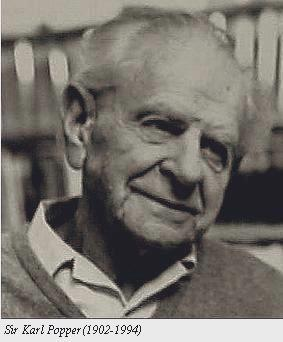

# Karl Popper

*Thornton, Stephen*

# Karl Popper
**First published Thu Nov 13, 1997; substantive revision Fri Jul 31, 2026**

Karl Popper is generally regarded as one of the greatest philosophers of science of the twentieth century. He was also a social and political philosopher of considerable stature, a self-professed critical-rationalist, a dedicated opponent of all forms of scepticism and relativism in science and in human affairs generally and a committed advocate and staunch defender of the “Open Society”. One of the many remarkable features of Popper’s thought is the scope of his intellectual influence: he was lauded by Bertrand Russell, taught Imre Lakatos, Paul Feyerabend and philanthropist George Soros at the London School of Economics, numbered David Miller, Joseph Agassi, Alan Musgrave and Jeremy Shearmur amongst his research assistants, was counted by Thomas Szasz as “among my foremost teachers” and had close ties with the economist Friedrich Hayek and the art historian Ernst Gombrich. Additionally, Peter Medawar, John Eccles and Hermann Bondi are amongst the distinguished scientists who have acknowledged their intellectual indebtedness to his work, the latter declaring that “There is no more to science than its method, and there is no more to its method than Popper has said”.

## 1. Life

Karl Raimund Popper was born on 28 July 1902 in Vienna. His parents, who were of Jewish origin, brought him up in an atmosphere which he was later to describe as “decidedly bookish”. His father was a lawyer by profession, but he also took a keen interest in the classics and in philosophy, and communicated to his son an interest in social and political issues. His mother inculcated in him such a passion for music that for a time he contemplated taking it up as a career; he initially chose the history of music as a second subject for his Ph.D. examination. Subsequently, his love for music became one of the inspirational forces in the development of his thought, and manifested itself in his highly original interpretation of the relationship between dogmatic and critical thinking, in his account of the distinction between objectivity and subjectivity, and, most importantly, in the growth of his hostility towards all forms of historicism, including historicist ideas about the nature of the “progressive” in music. The young Karl attended the local *Realgymnasium*, where he was unhappy with the standards of the teaching, and, after an illness he left to attend the University of Vienna in 1918, matriculating four years later. In 1919 he became heavily involved in left-wing politics and became for a time a Marxist. However, he was quickly disillusioned with the doctrinaire character of the latter, and soon abandoned it entirely. He also discovered the psychoanalytic theories of Freud and Adler (he served briefly as a voluntary social worker with deprived children in one of the latter’s clinics in the 1920s), and heard Einstein lecture on relativity theory. The dominance of the critical spirit in Einstein, and its total absence in Marx, Freud and Adler, struck Popper as being of fundamental importance: the pioneers of psychoanalysis, he came to think, couched their theories in terms which made them amenable only to confirmation, while Einstein’s theory, crucially, had testable implications which, if false, would have falsified the theory itself.

Popper took some time to settle on a career; he trained as a cabinetmaker, obtained a primary school teaching diploma in 1925 and qualified to teach mathematics and physics in secondary school in 1929. He undertook a doctoral programme with the department of psychology at the University of Vienna, then under the supervision of Karl Bühler, one of the founder members of the Würzburg school of experimental psychology. Popper’s project was initially designed as a psychological investigation of human memory, on which he conducted initial research. However, the subject matter of a planned introductory chapter on methodology assumed a position of increasing pre-eminence and this resonated with Bühler, who, as a Kant scholar (a professor of philosophy and psychology), had famously addressed the issue of the contemporary “crisis in psychology”. This “crisis”, for Bühler, related to the question of the unity of psychology and had been generated by the proliferation of then competing paradigms within the discipline which had undermined the hitherto dominant associationist one and problematized the question of method. Accordingly, under Bühler’s direction, Popper switched his topic to the methodological problem of cognitive psychology and received his doctorate in 1928 for his dissertation “Zur Methodenfrage der Denkpsychologie”. In extending Bühler’s Kantian approach to the crisis in the dissertation, Popper critiqued Moritz Schlick’s neutral monist programme to make psychology scientific by transforming it into a science of brain processes. This latter ideal, Popper argued, was misconceived, but the issues raised by it ultimately had the effect of refocusing Popper’s attention away from Bühler’s question of the unity of psychology to that of its scientificity. This philosophical focus on questions of method, objectivity and claims to scientific status was to become a principal life-long concern, bringing the orientation of Popper’s thought into line with that of such contemporary “analytic” philosophers as Frege and Russell as well as that of many members of the Vienna Circle.

Popper married Josephine Anna Henninger (“Hennie”) in 1930, and she also served as his amanuensis until her death in 1985. At an early stage of their marriage they decided that they would never have children. In 1937 he took up a position teaching philosophy at the University of Canterbury in New Zealand, where he was to remain for the duration of the Second World War.

The annexation of Austria in 1938 became the catalyst which prompted Popper to refocus his writings on social and political philosophy. He published *The Open Society and Its Enemies*, his critique of totalitarianism, in 1945. In 1946 he moved to England to teach at the London School of Economics, and became professor of logic and scientific method at the University of London in 1949. From this point on his reputation and stature as a philosopher of science and social thinker grew, and he continued to write prolifically—a number of his works, particularly *The Logic of Scientific Discovery* (1959), are now widely seen as pioneering classics in the field. However, he combined a combative personality with a zeal for self-aggrandisement that did little to endear him to professional colleagues. He was ill-at-ease in the philosophical milieu of post-war Britain which was, as he saw it, fixated with trivial linguistic concerns dictated by Wittgenstein, whom he considered his nemesis. Popper’s commitment to the primacy of rational criticism was counterpointed by hostility towards anything that amounted to less than total acceptance of his own thought, and in Britain—as had been the case in Vienna—he increasingly became an isolated figure, though his ideas continued to inspire admiration.

In later years Popper came under philosophical criticism for his prescriptive approach to science and his emphasis on the logic of falsification. This was superseded in the eyes of many by the socio-historical approach taken by Thomas Kuhn in *The Structure of Scientific Revolutions* (1962). In that work, Kuhn, who argued for the incommensurability of rival scientific paradigms, denied that science grows linearly through the accumulation of truths.

Popper was knighted in 1965, and retired from the University of London in 1969, remaining active as a writer, broadcaster and lecturer until his death in 1994. (For more detail on Popper’s life, see his *Unended Quest* [1976]).

## 2. Backdrop to Popper’s Thought

A number of biographical features may be identified as having a particular influence upon Popper’s thought. His teenage flirtation with Marxism left him thoroughly familiar with the Marxian dialectical view of economics, class-war, and history. But he was appalled by the failure of the democratic parties to stem the rising tide of fascism in Austria in the 1920s and 1930s, and the effective welcome extended to it by the Marxists, who regarded fascism as a necessary dialectical step towards the implosion of capitalism and the ultimate victory of communism. *The Poverty of Historicism* (1944; 1957) and *The Open Society and Its Enemies* (1945), Popper’s most impassioned and influential social works, are powerful defences of democratic liberalism, and strident critiques of philosophical presuppositions underpinning all forms of totalitarianism.

Popper was also profoundly impressed by the differences between the allegedly “scientific” theories of Freud and Adler and the revolution effected by Einstein’s theory of Relativity in physics in the first two decades of the twentieth century. The main difference between them, as Popper saw it, was that while Einstein’s theory was highly “risky”, in the sense that it was possible to deduce consequences from it which were, in the light of the then dominant Newtonian physics, highly improbable (e.g., that light is deflected towards solid bodies—confirmed by Eddington’s experiments in 1919), and which would, if they turned out to be false, falsify the whole theory, nothing could, even *in principle*, falsify psychoanalytic theories. They were, Popper argues, “simply non-testable, irrefutable. There was no conceivable human behaviour which could contradict them” (1963: 37). As such, they have more in common with myths than with genuine science; “They contain most interesting psychological suggestions, but not in a testable form” (1963: 38). What is apparently the chief source of strength of psychoanalysis, he concluded, viz. its capability to accommodate and explain every possible form of human behaviour, is in fact a critical weakness, for it entails that it is not, and could not be, genuinely predictive. To those who would respond that psychoanalytic theory is supported by clinical observations, Popper points out that

> … real support can be obtained only from observations undertaken as tests (by ‘attempted refutations’); and for this purpose *criteria of refutation* have to be laid down beforehand: it must be agree which observable situations, if actually observed, mean that the theory is refuted. (1963: 38, footnote 3)

Popper also considers that contemporary Marxism also lacks scientific status. Unlike psychoanalysis, he argues, Marxism had been initially scientific, in that it was genuinely predictive. However, when these predictions were not in fact borne out, the theory was saved from falsification by the addition of *ad hoc* hypotheses which made it compatible with the facts. By this means, Popper asserts, a theory which was initially genuinely scientific degenerated into pseudo-scientific dogma. As he sees it, the Hegelian dialectic was adopted by Marxists not to oppose dogmatism but to accommodate it to their cause by eliminating the possibility of contradictory evidence. It has thus become what Popper terms “reinforced dogmatism” (1963: 334).

These factors combined to make Popper take *falsifiability* as his criterion for demarcating science from non-science: if a theory is incompatible with possible empirical observations it is scientific; conversely, a theory which is compatible with all such observations, either because, as in the case of Marxism, it has been modified solely to accommodate such observations, or because, as in the case of psychoanalytic theories, it is consistent with all possible observations, is unscientific. However, Popper is not a positivist and acknowledges that unscientific theories may be enlightening and that even purely mythogenic explanations have performed a valuable function in the past in expediting our understanding of the nature of reality.

## 3. The Problem of Demarcation

For Popper the central problem in the philosophy of science is that of demarcation, i.e., of distinguishing between science and what he terms “non-science” (e.g., logic, metaphysics, psychoanalysis, and Adler’s individual psychology). Popper is unusual amongst contemporary philosophers in that he *accepts* the validity of the Humean critique of induction, and indeed, goes beyond it in arguing that induction is never actually used in science. However, he does not concede that this entails scepticism and argues that the Baconian/Newtonian insistence on the primacy of “pure” observation, as the initial step in the formation of theories, is completely misguided: all observation is selective and theory-laden and there are no pure or theory-free observations. In this way he destabilises the traditional view that science can be distinguished from non-science on the basis of its inductive methodology. In contradistinction to this, Popper holds that there is no unique methodology specific to science; rather, science, like virtually every other organic activity, consists largely of problem-solving.

Popper accordingly rejects the view that induction is the characteristic method of scientific investigation and inference, substituting *falsifiability* in its place. It is easy, he argues, to obtain evidence in favour of virtually any theory, and he consequently holds that such “corroboration”, as he terms it, should count scientifically only if it is the positive result of a genuinely “risky” prediction, which might conceivably have been false. In a critical sense, Popper’s theory of demarcation is based upon his perception of the asymmetry which, at the level of logic, holds between verification and falsification: it is logically impossible to verify a universal proposition by reference to experience (as Hume saw clearly), but a single genuine counter-instance falsifies the corresponding universal law. In a word, an exception, far from “proving” a rule, conclusively refutes it.

Every genuine scientific theory then, in Popper’s view, is *prohibitive*, because the theories of natural science take the form of universal statements. “All *A*s are *X*” is equivalent to “No *A* is not-*X*” which is falsified if “Some *A* is not-*X*” turns out to be true. For example, the law of the conservation of energy can be expressed as “There is no perpetual motion machine”.

However, the universality of such laws, he argues, does rule out the possibility of their verification. Thus, a theory that has withstood rigorous testing should be deemed to have received a high measure of corroboration. and may be retained provisionally as the best available theory until it is finally falsified and/or is superseded by a better theory.

Popper stresses in particular that there is no unique way, no single method such as induction, which functions as the route to scientific theory, and approvingly cites Einstein on that point:

> There is no logical path leading to [the highly universal laws of science]. They can only be reached by intuition, based upon something like an intellectual love of the objects of experience. (2002: 8–9)

Science, in Popper’s view, starts with problems rather than with observations—it is, indeed, precisely in the context of grappling with a problem that the scientist makes observations in the first instance: his observations are selectively designed to test the extent to which a given theory functions as a satisfactory solution to a given problem.

On this criterion of demarcation physics, chemistry, and (non-introspective) psychology, amongst others, are classified as sciences, psychoanalysis is a pre-science and astrology and phrenology are pseudo-sciences.

## 4. Basic Statements, Falsifiability and Convention

Popper draws a clear distinction between the *logic* of falsifiability and its *applied methodology*. The logic of his theory is utterly simple: a universal statement is falsified by a single genuine counter-instance. Methodologically, however, the situation is complex: decisions about whether to accept an apparently falsifying observation as an actual falsification can be problematic, as observational bias and measurement error, for example, can yield results which are only apparently incompatible with the theory under scrutiny.

Thus, while advocating falsifiability as the criterion of demarcation for science, Popper explicitly allows for the fact that in practice a single conflicting or counter-instance is never sufficient methodologically for falsification, and that scientific theories are often retained even though much of the available evidence conflicts with them, or is anomalous with respect to them.

In this connection, in the *Logic of Scientific Discovery* Popper introduces the technical concept of a “basic statement” or “basic proposition”, which he defines as a statement which can serve as a premise in an empirical falsification and which takes the singular existential form “There is an *X* at *Y*”. Basic statements are important because they can formally *contradict* universal statements, and accordingly play the role of potential falsifiers. To take an example, the (putative) basic statement “In space-time region *k* there is an apparatus which is a perpetual motion machine” contradicts the law of the conservation of energy, and would, if true, falsify it (2002: 48). Accordingly, Popper holds that basic statements are objective and are governed by two requirements: (a) the formal, that they must be both *singular* and *existential* and (b) the material, that they must be intersubjectively testable.

In essence, basic statements are for Popper logical constructs which embrace and include ‘observation statements’, but for methodological reasons he seeks to avoid that terminology, as it suggests that they are derived directly from, and known by, experience (2002: 12, footnote 2), which would conflate them with the “protocol” statements of logical positivism and reintroduce the empiricist idea that certain kinds of experiential reports are incorrigible. The “objectivity” requirement in Popper’s account of basic statements, by contrast, amounts to a rejection of the view that the truth of scientific statements can ever be reduced to individual or collective human experience. (2002: 25).

Popper therefore argues that there are no statements in science which cannot be interrogated: basic statements, which are used to test the universal theories of science, must themselves be inter-subjectively testable and are therefore open to the possibility of refutation. He acknowledges that this seems to present a practical difficulty, in that it appears to suggest that testability must occur *ad infinitum*, which he acknowledges is an operational absurdity: sooner or later all testing must come to an end. Where testing ends, he argues, is in a convention-based decision to accept a basic statement or statements; it is at that point that convention and intersubjective human agreement play an indispensable role in science:

> Every test of a theory, whether resulting in its corroboration or falsification, must stop at some basic statement or other which we *decide to accept*. If we do not come to any decision, and do not accept some basic statement or other, then the test will have led nowhere. (2002: 86)

However, Popper contends that while such a decision is usually *causally related* to perceptual experience, it is not and cannot be *justified* by such experience; basic statements are experientially underdetermined.

> Experiences can *motivate* a decision, and hence an acceptance or a rejection of a statement, but a basic statement cannot be *justified* by them—no more than by thumping the table. (2002: 87–88)

Statements can be justified only by other statements, and therefore testing comes to an end, not in the establishment of a correlation between propositional content and observable reality, as empiricism would hold, but by means of the conventional, inter-subjective acceptance of the truth of certain basic statements by the research community.

The acceptance of basic statements is compared by Popper to trial by jury: the verdict of the jury will be an agreement in accordance with the prevailing legal code and on the basis of the evidence presented, and is analogous to the acceptance of a basic statement by the research community:

> By its decision, the jury accepts, by agreement, a statement about a factual occurrence—a basic statement, as it were. (2002: 92)

The jury’s verdict is conventional in arising out of a procedure governed by clear rules, and is an application of the legal system as a whole as it applies to the case in question. The verdict is accordingly represented as a true statement of fact, but, as miscarriages of justice demonstrate all too clearly,

> the statement need not be true merely because the jury has accepted it. This … is acknowledged in the rule allowing a verdict to be quashed or revised. (2002: 92)

This is comparable, he argues, to the case of basic statements: their acceptance-as-true is also by agreement and, as such, it also constitutes an application of a theoretical system, and

> it is only this application which makes any further applications of the theoretical system possible. (2002: 93)

However, the agreed acceptance of basic statements, like that of judicial verdicts, remain perennially susceptible to the requirement for further interrogation. Popper terms this “the relativity of basic statements” (2002: 86), which is reflective of the provisional nature of the entire corpus of scientific knowledge itself. Science does not, he maintains, rest upon any foundational bedrock. Rather, the theoretical systems of science are akin to buildings in swampy ground constructed with the support of piles:

> The piles are driven down from above into the swamp, but not down to any natural or “given” base; and if we stop driving the piles deeper, it is not because we have reached firm ground. We simply stop when we are satisfied that the piles are firm enough to carry the structure, at least for the time being. (2002: 94)

## 5. The Growth of Human Knowledge

For Popper, the growth of human knowledge proceeds from our problems and from our attempts to solve them. These attempts involve the formulation of theories which must go beyond existing knowledge and therefore require a leap of the imagination. For this reason, he places special emphasis on the role played by the creative imagination in theory formulation. The priority of *problems* in Popper’s account of science is paramount, and it is this which leads him to characterise scientists as “problem-solvers”. Further, since the scientist begins with problems rather than with observations or “bare facts”, he argues that the only logical technique which is an integral part of scientific method is that of the deductive testing of theories which are not themselves the product of any logical operation. In this deductive procedure conclusions are inferred from a tentative hypothesis and are then compared with one another and with other relevant statements to determine whether they falsify or corroborate the hypothesis. Such conclusions are not directly compared with the facts, Popper stresses, simply because there are no “pure” facts available; all observation-statements are theory-laden, and are as much a function of purely subjective factors (interests, expectations, wishes, etc.) as they are a function of what is objectively real.

How then does the deductive procedure work? Popper specifies four steps (2002: 9):

1. The first is *formal*, a testing of the internal consistency of the theoretical system to see if it involves any contradictions.
2. The second step is *semi-formal*, “the investigation of the logical form of the theory, with the object of determining whether it has the character of an empirical or scientific theory, or whether it is, for example, tautological” (2002: 9).
3. The third step is the comparing of the new theory with existing ones to determine whether it constitutes an advance upon them. If its explanatory success matches that of the existing theories, and it additionally explains some hitherto anomalous phenomenon or solves some hitherto unsolvable problems, it will be adopted as constituting an advance upon the existing theories. In that sense, science involves theoretical progress: on this account, a theory *X* is better than a “rival” theory *Y* if *X* has *greater empirical content*, and hence *greater predictive power*, than *Y*.
4. The fourth and final step is the testing of a theory by the empirical application of the conclusions derived from it. If such conclusions are shown to be true, the theory is corroborated (but never verified). If the conclusion is shown to be false, then this is taken as a signal that the theory cannot be completely correct (logically the theory is falsified), and the scientist begins his quest for a better theory. He does not, however, *abandon* the present theory until such time as he has a better one to substitute for it.

The general picture of Popper’s philosophy of science, then is this: Hume’s philosophy demonstrates that there is a contradiction implicit in traditional empiricism, which holds that universal scientific laws are in some way finally confirmable by experience, despite the open-ended nature of the latter being acknowledged. Popper eliminates the contradiction by removing the demand for empirical verification in favour of empirical falsification or corroboration. Scientific theories, for him, are not inductively inferred from experience, nor is scientific experimentation carried out with a view to verifying or finally establishing the truth of theories; rather, *all knowledge is provisional, conjectural, hypothetical*—the universal theories of science can never be conclusively established. Hence Popper’s emphasis on the importance of the critical spirit to science—for him critical thinking is the very essence of rationality. For it is only by critical thought that we can eliminate false theories and determine which of the remaining theories is the best available one, in the sense of possessing the highest level of explanatory force and predictive power.

## 6. Probability, Knowledge and Verisimilitude

In the view of many social scientists, the more probable a theory is, the *better* it is, and if we have to choose between two theories which differ only in that one is probable and the other is improbable, then we should choose the former. Popper rejects this. Science values theories with a high informative content, because they possess a high predictive power and are consequently highly testable. For that reason, the more *improbable* a theory is the better it is scientifically, because the probability and informative content of a theory vary inversely—the higher the informative content of a theory the lower will be its probability. Thus, the statements which are of special interest to science are those with a high informative content and (consequentially) a low probability, which *nevertheless come close to the truth*. Informative content, which is in inverse proportion to probability, is in direct proportion to testability. As a result, the severity of the test to which a theory can be subjected, and by means of which it is falsified or corroborated, is of fundamental importance.

Popper also argues that all scientific criticism must be piecemeal, i.e., he holds that it is not possible to question every aspect of a theory at once, as certain items of what he terms “background knowledge” must be taken for granted. But that is *not* knowledge in the sense of being conclusively established; it may be challenged at any time, especially if it is suspected that its uncritical acceptance may be responsible for difficulties which are subsequently encountered.

How then can one be certain that one is questioning the right thing? The Popperian answer is that we cannot have absolute certainty here, but repeated tests usually show where the trouble lies. As we saw, for Popper even observation statements are corrigible and open to review, and science in his view is not a quest for certain knowledge, but an evolutionary process in which hypotheses or conjectures are imaginatively proposed and tested in order to explain facts or to solve problems. For that reason, he emphasises both the importance of questioning the background knowledge when the need arises, and the significance of the fact that observation-statements are theory-laden and corrigible.

Popper was initially uneasy with the concept of truth, and in his earliest writings he avoided asserting that a theory which is corroborated is true—for clearly if every theory is an open-ended hypothesis, then *ipso facto* it has to be at least potentially false. However, he came to accept Tarski’s reformulation of the correspondence theory of truth, and in *Conjectures and Refutations* (1963) he integrates the concepts of truth and content to frame the metalogical concept of “truthlikeness” or “*verisimilitude*”. A “good” scientific theory, Popper argues in that work, has a higher level of verisimilitude than its rivals, and he explicates this concept by reference to the logical consequences of theories. A theory’s content is the totality of its logical consequences, which can be divided into two classes:

1. the “*truth-content*”, which is the class of true propositions which may be derived from it, and
2. the “*falsity-content*” of a theory, which is the class of the theory’s false consequences (which may be empty, and in the case of a theory which is true is necessarily empty).

Popper offers two accounts of how rival theories can be compared in terms of their levels of verisimilitude; these are the qualitative and quantitative definitions. On the qualitative account, verisimilitude is defined in terms of subclass relationships: a theory $t_2$ has a higher level of verisimilitude than $t_1$ if and only if their truth- and falsity-contents are comparable through subclass relationships, and *either*

1. $t_2$’s truth-content includes $t_1$’s and $t_2$’s falsity-content, if it exists, is included in, or is the same as, $t_1$’s, or
2. $t_2$’s truth-content includes or is the same as $t_1$’s and $t_2$’s falsity-content, if it exists, is included in $t_1$’s.

On the quantitative account, verisimilitude is defined by assigning quantities to contents, where the index of the content of a given theory is its logical improbability, given again that content and probability vary inversely (1963: 233–4). The utilisation of either method of computing verisimilitude shows, Popper argues, that even if a theory $t_2$ with a higher content than a rival theory $t_1$ is subsequently falsified, it can still legitimately be regarded as a better theory than $t_1$, and “better” is here now understood to mean $t_2$ is *closer to the truth* than $t_1$ (1963: 235).

Thus, scientific progress involves, on this view, the abandonment of partially true, but falsified, theories, for theories with a higher level of verisimilitude, i.e., which approach more closely to the truth. In this way, verisimilitude allowed Popper to mitigate what some saw as the pessimism of an anti-inductivist philosophy of science. With the introduction of the concept, Popper was able to represent his account as an essentially realistic position in terms of which scientific progress can be seen as progress *towards* the truth, and experimental corroboration can be viewed as an *indicator* of verisimilitude.

However, subsequent research revealed defects in Popper’s formal definitions of verisimilitude. The concept is most important in his system because of its application to theories which are approximations (which are common in the social sciences) and thus known to be *false*. In this connection, Popper had written:

> Ultimately, the idea of verisimilitude is most important in cases where we know that we have to work with theories which are *at best* approximations—that is to say, theories of which we know that they cannot be true… In these cases we can still speak of better or worse approximations to the truth (and we therefore do not need to interpret these cases in an instrumentalist sense). (1963: 235)

In 1974, David Miller and Pavel Tichý, working independently, demonstrated that the conditions specified by Popper in his accounts of both qualitative and quantitative verisimilitude for comparing the truth- and falsity-contents of theories can be satisfied only when the theories are *true*. In the crucially important case of false theories, Popper’s definitions are formally defective: for with regard to a false theory $t_2$ which has excess content over a rival theory $t_1$, *both* the truth-content *and* the falsity-content of $t_2$ will exceed that of $t_1$. With respect to theories which are false then, Popper’s conditions for comparing levels of verisimilitude, whether in quantitative and qualitative terms, can never be met.

Popper’s response was two-fold. In the first place, he acknowledges the deficiencies in his own formal account:

> “…my main mistake was the failure to see at once that my ’A Theorem on Truth-Content’ [1966], could be extended to falsity content: if the content of a false statement *a* exceeds that of a statement *b*, then the truth content of *a* exceeds the truth content of *b*, and the same holds of their falsity contents.” (1979, 371)

But he argues that

> “I do think that we should not conclude from the failure of my attempts to solve the problem that the problem cannot be solved. Perhaps it cannot be solved by purely logical means but only by a relativization to relevant problems or even by bringing in the historical problem situation” (1979, 372).

This suggestion was to precipitate a great deal of important technical research in the field. He additionally moves the task of formally defining the concept from centre-stage in his philosophy of science by protesting that he had never intended to imply

> that degrees of verisimilitude … can ever be numerically determined, except in certain limiting cases. (1979: 59)

Instead, he argues, the chief value of the concept is heuristic, in which the absence of an adequate formal definition is not an insuperable impediment to its utilisation in the actual appraisal of theories relativised to problems in which we have an interest.

Many see the thrust of this latter strategy as genuinely reflecting the significance of the concept of verisimilitude in Popper’s system, but it has not satisfied all of his critics.

## 7. Objective Knowledge and The Three Worlds Ontology

Popper’s hostility to psychologistic approaches to epistemology is evident from his earliest works. Questions relating to the origins of convictions, feelings of certainty and the like, he argues, are properly considered the province of psychology; their attempted use in epistemology, which has been characteristic in particular of some schools of empiricism, can lead only to confusion and ultimately to scepticism. Against it, he repeatedly insists on the objectivity of scientific knowledge and sees it as the principal task of epistemology to engage with the questions of justification and validity in that connection (2002: 7).

In some of his later works in the field, particularly his “Epistemology Without a Knowing Subject” (1967, republished in *Objective Knowledge* [1972]) and in his lecture “Three Worlds” in the Tanner Lectures on Human Values delivered in 1978 (published 1980), Popper develops the notion of objectivity further in a novel but controversial way by seeking to free it completely from all psychological constraints. What is central to epistemology, he reaffirms, is the concept of objectivity, which he seeks to show requires neither the notions of subjective mental states nor even that of a subject “possessing” knowledge: knowledge in its full objective sense, he argues, is knowledge “without a knowing subject”.

Popper’s angle of approach here is to situate the development of knowledge in the context of animal and human evolution. It is characteristic of evolutionary processes, he points out, that they come to take place in an environment which is itself in part fashioned by the species in question. Examples of this abound, such as the reefs built by corals, the hives built by bees, the dams built by beavers and the atmospheric effects yielded by plants. This, Popper contends, is also true of human beings: we too have created new kinds of products, “intellectual products”, which shape our environment. These are our myths, our ideas, our art works and our scientific theories about the world in which we live. When placed in an evolutionary context, he suggests, such products must be viewed instrumentally, as exosomatic artefacts. Chief amongst them is knowledge

> in the objective or impersonal sense, in which it may be said to be contained in a book; or stored in a library; or taught in a university. (1979: 286)

On this view, termed “evolutionary epistemology”, the growth of human knowledge is an objective evolutionary process which involves the creation and promulgation of new problem-solving theories, which are then subjected to the challenge of criticism, modification, elimination and replacement. These latter activities are seen by Popper as growth-promoting in the evolution of knowledge, which he represents by means of a tetradic schema (1979: 287):

$$ P_1 \rightarrow \textit{TT} \rightarrow \textit{EE} \rightarrow P_2. $$

Here “$P_1$” stands for the “initial problem”; “*TT*” stands for “tentative theory” designed to solve it, “*EE*” stands for “attempts at error-elimination”, and “$P_2$” represents further problems that arise out of the critical process.

This kind of knowledge development, Popper argues, cannot be explained either by physicalism, which seeks to reduce all mental processes and states to material ones, or by dualism, which usually seeks to explicate knowledge by means of psychological categories such as thought, perception and belief. Consequently, he proposes a novel form of pluralistic realism, a “Three Worlds” ontology, which, while accommodating both the world of physical states and processes (world 1) and the mental world of psychological processes (world 2), represents knowledge in its objective sense as belonging to world 3, a third, objectively real ontological category. That world is the world

> of the products of the human mind, such as languages; tales and stories and religious myths; scientific conjectures or theories, and mathematical constructions; songs and symphonies; paintings and sculptures. (1980: 144)

In short, world 3 is the world of human cultural artifacts, which are products of world 2 mental processes, usually instantiated in the physical world 1 environment.

Popper proceeds to explicate his distinction between the subjective and objective senses of knowledge by reference to this ontology. The subjective sense of knowledge relates to psychological processes and states, mental dispositions, beliefs and expectations, which may generically be termed “thought processes” and which belong to world 2. Knowledge in the objective sense, by contrast, consists not of thought processes but of *thought contents*, that is to say, the content of propositionalised theories: it is

> the content which can be, at least approximately, translated from one language into another. The objective thought content is that which remains invariant in a reasonably good translation. (1980: 156)

And it is that thought content, when linguistically codified in texts, works of art, log tables, mathematical formulae, which constitutes world 3, to which objective knowledge relates.

For those who would suggest that such objects are mere abstractions from world 2 thought processes, Popper counters that world 3 objects are necessarily more than the thought processes which have led to their creation. Theories, for example, usually have logical implications beyond anything considered by their original author, as instanced in the case of Einstein’s Special Theory of Relativity. Moreover, what is most characteristic about such objects is that, unlike world 2 mental processes, they can stand in logical relationships to each other, such as equivalence, deducibility and compatibility, which makes them amenable to the kind of critical rational analysis and development that is one of the hallmarks of science. As he puts it,

> Criticism of world 3 objects is of the greatest importance, both in art and especially in science. Science can be said to be largely the result of the critical examination and selection of conjectures, of thought contents. (1980: 160)

Popper takes Michelangelo’s sculpture *The Dying Slave* as an illustrative example of a world 3 object, embodied in a world 1 block of marble. Other examples given include memory engrams in the brain, the American Constitution, Shakespeare’s tragedies, Beethoven’s Fifth Symphony and Newton’s theory of gravitation. Each one of these, he contends, is a world 3 object that transcends both its physical, world 1 embodiments and its world 2 cognitive origins (1980: 145).

Popper was aware that he would be accused of hypostatising abstractions in asserting the reality and objectivity of world 3 objects. In response, he indicates strongly that he has no interest in what he regards as pointless terminological disputes over the meaning of the term “world” or “real”. He is therefore content, if required, to express his account of objective knowledge in more familiar and perhaps more mundane terms: world 3 objects are *abstract* objects while their physical embodiments are *concrete* objects. But that should not be allowed to disguise the fact that he saw the relationships between the three categories of his ontology as of enormous importance in understanding the role of science as an element of culture:

> my thesis is that our world 3 theories and our world 3 plans causally influence the physical objects of world 1; that they have a causal action upon world 1. (1980: 164)

In the final analysis it is the causal interaction between the worlds that ultimately matters in Popper’s objectivist epistemology: it allows him to represent the growth of human knowledge as an evolutionary process of exosomatic adaptations, which is ultimately a function of the interplay of relations between the physical and mental worlds and the world of objective knowledge or thought content.

## 8. Social and Political Thought—The Critique of Historicism and Holism

Given Popper’s personal history and background, it is hardly surprising that he developed a deep and abiding interest in social and political philosophy. He understood holism as the view that human social groupings are greater than the sum of their members, that they act on their human members and shape their destinies and that they are subject to their own independent laws of development. Historicism he identified as the belief that history develops inexorably and necessarily according to certain principles or rules towards a determinate end (as for example in the Marx’s dialectical materialism). The link between them is that holism holds that individuals are essentially formed by the social groupings to which they belong, while historicism suggests that we can understand such a social grouping only in terms of the internal principles which determine its development.

These lead to what Popper calls “The Historicist Doctrine of the Social Sciences”, the views (a) that the principal task of the social sciences is to make predictions about the social and political development of man, and (b) that the task of politics, once the key predictions have been made, is, in Marx’s words, to lessen the “birth pangs” of future social and political developments. Popper thinks that this view of the social sciences is both theoretically misconceived and socially dangerous, as it can give rise to totalitarianism and authoritarianism—to centralised governmental control of the individual and the attempted imposition of large-scale social planning. Against this, he advances the view that any human social grouping is no more (or less) than the sum of its individual members, that what happens in history is the (largely unforeseeable) result of the actions of such individuals, and that large scale social planning to an antecedently conceived blueprint is inherently misconceived—and inevitably disastrous—precisely because human actions have consequences which cannot be foreseen. Popper, then, is an historical *indeterminist*, insofar as he holds that history does not evolve in accordance with intrinsic laws or principles, that in the absence of such laws and principles unconditional prediction in the social sciences is an impossibility, and that there is no such thing as historical necessity.

The link between Popper’s theory of knowledge and his social philosophy is his fallibilism. We make theoretical progress in science by subjecting our theories to critical scrutiny, and abandoning those which have been falsified. So too in an open society the rights of the individual to criticise administrative policies will be safeguarded and upheld, undesirable policies will be eliminated in a manner analogous to the elimination of falsified scientific theories, and political differences will be resolved by critical discussion and argument rather than by coercion. The open society as thus conceived of by Popper may be defined as

> an association of free individuals respecting each other’s rights within the framework of mutual protection supplied by the state, and achieving, through the making of responsible, rational decisions, a growing measure of humane and enlightened life. (R. B. Levinson 1953: 17)[^levinson-1953]

Such as society is not a utopian ideal, Popper argues, but an empirically realised form of social organisation which is in every respect superior to its (real or potential) totalitarian rivals. His strategy, however, is not merely to engage in a moral defence of the ideology of liberalism, but rather to show that totalitarianism is typically based upon historicist and holist presuppositions, and of demonstrating that these presuppositions are fundamentally incoherent.

## 9. Scientific Knowledge, History, and Prediction

Historicism and holism, Popper argues, have their origins in what he terms

> one of the oldest dreams of mankind—the dream of prophecy, the idea that we can know what the future has in store for us, and that we can profit from such knowledge by adjusting our policy to it. (1963: 338)

This dream was given impetus, he suggests, by the emergence of a genuine predictive capability regarding solar and lunar eclipses at an early stage in human civilisation, which became refined with the development of the natural sciences. Historicism derives a superficial plausibility from the suggestion that, just as the application of the laws of the natural sciences can lead to the prediction of such events as eclipses, knowledge of “the laws of history” as yielded by a social science or sciences can and should lead to the prediction of future social phenomena. Why should we not conceive of a social science which would function as the theoretical natural sciences function and yield precise unconditional predictions in the appropriate sphere of application? Popper seeks to show that this idea is based upon a series of misconceptions about the nature of science, and about the relationship between scientific laws and scientific prediction.

In relation to the critically important concept of prediction, Popper makes a distinction between what he terms “conditional scientific predictions”, which have the form “If *X* takes place, then *Y* will take place”, and “unconditional scientific prophecies”, which have the form “*Y* will take place”. Contrary to popular belief, it is the former rather than the latter which are typical of the natural sciences, which means that typically prediction in natural science is conditional and limited in scope—it takes the form of hypothetical assertions stating that certain specified changes will come about if and only if particular specified events antecedently take place. This is not to deny that “unconditional scientific prophecies”, such as the prediction of eclipses, for example, do take place in science, and that the theoretical natural sciences make them possible. However, Popper argues that (a) these unconditional prophecies are not *characteristic* of the natural sciences, and (b) that the mechanism whereby they occur, in the very limited way in which they do, is not understood by the historicist.

What is the mechanism which makes “unconditional scientific prophecies” possible? Popper’s answer is that they are possible because they are derived from a combination of conditional predictions (themselves derived from scientific laws) *and* existential statements specifying that the conditions in relation to the system being investigated are fulfilled.

Given that this is the mechanism which generates unconditional scientific prophecies, Popper makes two related claims about historicism:

> The first is that the historicist does not, as a matter of fact, derive his historical prophecies from conditional scientific predictions. The second … is that he cannot possibly do so because long term prophecies can be derived from scientific conditional predictions only if they apply to systems which can be described as well isolated, stationary, and recurrent. These systems are very rare in nature; and modern society is surely not one of them. (1963: 339)

Popper accordingly argues that it is a fundamental mistake for the historicist to take the unconditional scientific prophecies of eclipses as being typical and characteristic of the predictions of natural science; they are possible only because our solar system is a stationary and repetitive system which is isolated from other such systems by immense expanses of empty space. Human society and human history are *not* isolated systems and are continually undergoing rapid, non-repetitive development. In the most fundamental sense possible, every event in human history is discrete, novel, quite unique, and ontologically distinct from every other historical event. For this reason, it is impossible in principle that unconditional scientific prophecies could be made in relation to human history—the idea that the successful unconditional prediction of eclipses provides us with reasonable grounds for the hope of successful unconditional prediction regarding the evolution of human history turns out to be based upon a gross misconception. As Popper succinctly concludes, “The fact that we predict eclipses does not, therefore, provide a valid reason for expecting that we can predict revolutions” (1963: 340).

## 10. Immutable Laws and Contingent Trends

An additional mistake which Popper discerns in historicism is the failure of the historicist to distinguish between scientific *laws* and *trends*. This makes him think it possible to explain change by discovering trends running through past history, and to anticipate and predict future occurrences on the basis of such observations. Here Popper points out that there is a critical difference between a trend and a scientific law: the latter is universal in form, while a trend can be expressed only as a singular existential statement. This logical difference is crucial: neither conditional nor unconditional predictions can be based upon trends, because trends may change or be reversed with a change in the conditions which gave rise to them in the first instance. As Popper puts it, there can be no doubt that

> the habit of confusing trends with laws, together with the intuitive observation of trends such as technical progress, inspired the central doctrines of … historicism. (1957: 106)

He does not, of course, dispute the existence of trends or deny that observing them can be of practical utility value. But the essential point is that a trend is something which *itself* ultimately stands in need of scientific explanation, and it cannot therefore function as the frame of reference in terms of which an unconditional prediction can be based.

A point which connects with this has to do with the role which the evolution of human knowledge has played in the historical development of human society. Human history has, Popper points out, been strongly influenced by *the growth of human knowledge*, and it is extremely likely that this will continue to be the case—all the empirical evidence suggests that the link between the two is progressively consolidating. However, this gives rise to a further problem for the historicist: no scientific predictor, human or otherwise, can possibly predict its own future results. From this it follows, he holds, that no society can predict, scientifically, its own future states of knowledge. Thus, while the future evolution of human history is extremely likely to be influenced by new developments in human knowledge, we cannot now scientifically determine what such knowledge will be.

From this it follows that if the future holds any new discoveries or any new developments in the growth of our knowledge, then it is impossible for us to predict them now, and it is therefore impossible for us to predict the future development of human history now, given that the latter will, at least in part, be determined by the future growth of our knowledge. Thus, once again historicism collapses—the dream of a theoretical, predictive science of history is unrealisable, because it is an impossible dream.

Popper’s argues against the propriety of large-scale planning of social structures on the basis of this demonstration of the logical shortcomings of historicism. It is, he argues, theoretically as well as practically misguided, because, again, part of what we are planning for is our future knowledge, and our future knowledge is not something which we can in principle now possess—we cannot adequately plan for unexpected advances in our future knowledge, or for the effects which such advances will have upon society as a whole. For him, this necessitates the acceptance of historical indeterminism as the only philosophy of history which is commensurate with a proper understanding of the provisional and incomplete nature of human knowledge.

This critique of historicism and holism is balanced, on the positive side, by Popper’s affirmation of the ideals of individualism and market economics and his strong defence of the open society—the view that a society is equivalent to the sum of its members, that the actions of the members of society serve to fashion and to shape it, and that the social consequences of intentional actions are very often, and very largely, unintentional. This part of his social philosophy was influenced by the economist Friedrich Hayek, who worked with him at the London School of Economics and who was a life-long friend. Popper advocates what he (rather unfortunately) terms “piecemeal social engineering” as the central mechanism for social planning: in utilising this mechanism, intentional actions are directed to the achievement of one specific goal at a time, which makes it possible to determine whether adverse unintended effects of intentional actions occur, in order to correct and readjust when this proves necessary. This, of course, parallels precisely the critical testing of theories in scientific investigation. This approach to social planning (which is explicitly based upon the premise that we do not, because we cannot, know what the future will be like) encourages attempts to put right what is problematic in society—generally-acknowledged social ills—rather than attempts to impose some preconceived idea of the “good” upon society as a whole. For Popper, in a genuinely open society piecemeal social engineering goes hand-in-hand with *negative* utilitarianism, the attempt to minimise the amount of suffering and misery, rather than, as with positive utilitarianism, the attempt to maximise the amount of happiness. The state, he holds, should concern itself with the task of progressively formulating and implementing policies designed to deal with the social problems which actually confront it, with the goal of mitigating human misery and suffering to the greatest possible degree. The positive task of increasing social and personal happiness, by contrast, can and should be left to individual citizens, who may, of course, act collectively to that end. “My thesis”, Popper states, is that

> human misery is the most urgent problem of a rational public policy and that happiness is not such a problem. The attainment of happiness should be left to our private endeavours. (1963: 361)

Thus, for Popper, in the final analysis the activity of problem-solving is as definitive of our humanity at the level of social and political organisation as it is at the level of science, and it is this key insight which unifies and integrates the broad spectrum of his thought.

## 11. Logical Writings

Formal logic occupies a lesser known dimension of Popper’s thought, but has attracted interest recently with the publication of the anthology *The Logical Writings of Karl Popper*, edited by D. Binder, T. Piecha, and P. Schroeder-Heister (2022) and consisting of Popper's contributions to the field of deductive logic. In this anthology, one finds that Popper assumed a decidedly foundational approach to proof theory. The volume contains Popper’s published papers in the area from 1947 to 1949, with contemporary reviews and the editors’ critical commentary, together with a significant amount of unpublished material from the Popper Archives. Not alone are these of considerable historical interest, they also show that the proof-theoretic framework which Popper offered as sufficient to provide the foundations for logic was in some respects very prescient. However, perhaps for that very reason, at the time of their publication his logical writings received little critical attention, and his subsequent immersion in debates and controversies in philosophy of science pushed his logical interests into the background. As the editors put it,

> … there were so many important debates in philosophy of science in the late 1960s in which Popper [became] involved, such that contributing to the debate on the foundational role of proof theory (Dummett, 1975; Kreisel, 1971; Prawitz, 1971) was way beyond his interests at that time. (Binder, Piecha, and Schroeder-Heister (eds.) 2022, p. 2)

The edited volume is historically significant in that it also includes correspondence between Popper and some of the leading figures in late 20th century logic, including Paul Bernays, Rudolf Carnap, Alonzo Church and Willard Van Ormon Quine, demonstrating that his interest in the field was serious and passionate, deriving in part from the influence of Alfred Tarski, whose semantic theory of truth Popper admired enormously.

## 12. Critical Evaluation

While it cannot be said that Popper was modest, he took criticism of his theories very seriously, and spent much of his time in his later years in addressing them. The following is a summary of some of the main ones which he had to address. (For Popper’s responses to critical commentary, see his “Replies to My Critics” (1974) and his *Realism and the Aim of Science* (1983).

First, Popper claims to be a realist and rejects conventionalist and instrumentalist accounts of science. But his account in the *Logic of Scientific Discovery* of the role played by basic statements in the methodology of falsification seems to sit uneasily with that. As we have seen, he follows Kant in rejecting the positivist/empiricist view that observation statements are incorrigible, and argues that they are descriptions of what is observed as interpreted by the observer with reference to a determinate conceptual and theoretical framework. He accordingly asserts that while basic statements may have a causal relationship to experience, they are neither determined nor justified by it.

However, this would seem to pose a difficulty: if a theory is to be genuinely testable, it must be possible to determine, at least in principle, whether the basic statements which are its potential falsifiers are actually true or false. But how can this be known, if basic statements cannot be justified by experience? As we have seen, Popper’s answer is that the acceptance or rejection of basic statements depends upon a convention-based decision on the part of the scientific community.

> From a logical point of view, the testing of a theory depends upon basic statements whose acceptance or rejection, in its turn, depends upon our decisions. Thus it is decisions which settle the fate of theories. (2002: 91)

Traditional conventionalism, as exemplified in the work of Mach, Poincaré and Milhaud amongst others, holds that a “successful” science is one in which universal theories have assumed such explanatory critical mass that a convention emerges to pre-empt the possibility of their empirical refutation. This is strongly rejected by Popper, who differentiates his position from it by arguing that it is the acceptance of basic statements, rather than that universal theory, which is determined by convention and intersubjective agreement. For him, the acceptance or rejection of theory occurs only indirectly and at a higher investigative level, through critical tests made possible by the conventional acceptance of basic statements. As he puts it, “I differ from the conventionalist in holding that the statements decided by agreement are not universal but singular” (2002: 92). Simultaneously, however, he rejects any suggestion that basic statements are justifiable by direct experience:

> I differ from the positivist in holding that basic statements are not justifiable by our immediate experiences, but are, from the logical point of view, accepted by an act, by a free decision. (2002: 92)

It is thus evident that Popper saw his account of basic statements as steering a course between the Scylla of orthodox conventionalism and the Charybdis of positivism/empiricism. However, while it is both coherent and consistent in that regard, there can be little doubt but that it constitutes a form of conventionalism in its own right. And it is not clear that it is compatible with scientific realism, understood as the view that scientific theories give true or approximately true descriptions of elements of a mind-independent world. As Lakatos puts it,

> If a theory is falsified, it is proven false; if it is “falsified” [in Popper’s conventionalist sense], it may still be true. If we follow up this sort of “falsification” by the actual “elimination” of a theory, we may well end up by eliminating a true, and accepting a false, theory. (Lakatos 1978: 24)[^lakatos-1978]

Second, Popper’s theory of demarcation hinges quite fundamentally on the assumption that there are such things as critical tests, which either falsify a theory, or give it a strong measure of corroboration. Popper himself is fond of citing, as an example of such a critical test, the resolution, by Adams and Leverrier, of the problem which the anomalous orbit of Uranus posed for nineteenth century astronomers. They independently came to the conclusion that, assuming Newtonian mechanics to be precisely correct, the observed divergence in the elliptical orbit of Uranus could be explained if the existence of a seventh, as yet unobserved outer planet was posited. Further, they were able, again within the framework of Newtonian mechanics, to calculate the precise position of the “new” planet. Thus when subsequent research by Galle at the Berlin observatory revealed that such a planet (Neptune) did in fact exist, and was situated precisely where Adams and Leverrier had calculated, this was hailed as by all and sundry as a magnificent triumph for Newtonian physics: in Popperian terms, Newton’s theory had been subjected to a critical test, and had passed with flying colours.

Yet Lakatos flatly denies that there are critical tests, in the Popperian sense, in science, and argues the point convincingly by turning the above example of an alleged critical test on its head. What, he asks, would have happened if Galle had *not* found the planet Neptune? Would Newtonian physics have been abandoned, or would Newton’s theory have been falsified? The answer is clearly not, for Galle’s failure could have been attributed to any number of causes other than the falsity of Newtonian physics (e.g., the interference of the earth’s atmosphere with the telescope, the existence of an asteroid belt which hides the new planet from the earth, etc). The suggestion is that the “falsification/corroboration” disjunction offered by Popper is unjustifiable binary: non-corroboration is not necessarily falsification, and falsification of a high-level scientific theory is never brought about by an isolated observation or set of observations. Such theories are, it is now widely accepted, highly resistant to falsification; they are “tenaciously protected from refutation by a vast ‘protective belt’ of auxiliary hypotheses” (Lakatos 1978: 4)[^lakatos-1978] and so are falsified, if at all, not by Popperian critical tests, but rather within the elaborate context of the research programmes associated with them gradually grinding to a halt. Popper’s distinction between the logic of falsifiability and its applied methodology does not in the end do full justice to the fact that all high-level theories grow and live despite the existence of anomalies (i.e., events/phenomena which are incompatible with them). These, Lakatos suggests, are not usually taken by the working scientist as an indication that the theory in question is false. On the contrary, in the context of a progressive research programme he or she will necessarily assume that the auxiliary hypotheses which are associated with the theory can in time be modified to incorporate, and thereby explain, recalcitrant phenomena.

Third, Popper’s critique of Marxism has not, of course, gone unchallenged. The debate arising from, however, has in many cases tended to revolve around ideological rather than philosophical issues, which will be passed over here. However, there have also been some trenchant philosophical responses. Cornforth sees Marxism as a rational scientific discipline and Marxian thinking as “a rational and scientific approach to social problems” (Cornforth 1968: 6)[^cornforth-1968] of the kind which both Marx and Popper consider important. Consequently, he takes Popper to task for representing Marxism as a system of dogmas designed to close minds or pre-empt the operation of our rational faculties in addressing social issues. Against that view, he argues that it constitutes a way of thinking designed to open minds to the real possibilities of human life, and sees it as the philosophy best calculated to promote the ideals of the open society to which he, like Popper, subscribes. Hudelson (1980) argues that Marxian economics survives the Popperian critique of historicism and that, in any case, Marx did not hold many of the tenets of historicism identified by Popper. He also contends that Popper fails to show that there cannot be, and that we cannot know, laws of social development and that Marx did not in fact confuse trends and laws in the way that Popper suggests.

Fourth, In the case of Freudian psychoanalysis, the adequacy of Popper’s critique has been challenged on philosophical grounds by a number of commentators, particularly Adolf Grünbaum (1984). Grünbaum is highly critical, indeed scornful, of Popper’s dismissal of the claims of psychoanalysis to be scientific and argues that Freud showed “a keen appreciation of methodological pitfalls that are commonly laid at his door by critics” (Grünbaum 1984: 168)[^grünbaum-1984] such as Popper. He argues that Freud was sensitive to the question of the logic of the confirmation and disconfirmation of psychoanalytic interpretations and cites Freud’s use of the concept of consilience, the convergence of evidence from disparate sources, as a serious and explicit attempt to meet the requirements of that logic. For Grünbaum, Popper’s critique of Freud amounts a veritable parody of the pioneering thinker who established the discipline of psychoanalysis, and he attributes that to Popper’s “obliviousness to Freud’s actual writings” (1984: 124). He points out, for example, that the case of the drowning child which Popper uses in *Conjectures and Refutations* (Popper 1963: 35), upon which he rests part of his case against psychoanalysis, is contrived and not in any way derived from Freud’s actual clinical texts.

Grünbaum contends that there are instances in Freud’s writings where he shows himself to be “a sophisticated scientific methodologist” (Grünbaum 1984: 128)[^grünbaum-1984], keenly aware of the need for his theoretical system to meet the requirement of testability. One such occurs when Freud, in his assessment that anxiety neuroses are due to disturbances in sexual life, explicitly refers to the notion of falsifiability: “My theory can only be refuted when I have been shown phobias where sexual life is normal” (Freud 1895 [1962: 134])[^freud-1895]. Another occurs in Freud’s 1915 paper “A Case of Paranoia Running Counter to the Psycho-Analytic Theory of the Disease”, in which, as the title suggests, he saw the patient’s collection of symptoms as potentially falsifying the theory. Moreover, Freud’s entire account of paranoia as being due to an underlying repressed homosexuality is open to empirical refutation, Grünbaum argues, since it has the testable implication that a reduction in rates of paranoia should result from a removal or loosening of social sanctions against same-sex relationships (1984: 111).

Grünbaum accordingly holds that Freudian theory should be considered falsifiable and therefore genuinely scientific—albeit, in his view, ultimately unsuccessful, because the clinical evidence offered in its favour is contaminated by suggestion on the part of the analyst and cannot therefore support its conceptual weight. That is a verdict very different to what Grünbaum sees as the reductive dismissal of Freud offered by Popper: “the inability of certain philosophers of science to have discerned any testable consequences of Freud’s theory”, he concludes, “betokens their insufficient command or scrutiny of its logical content rather than a scientific liability of psychoanalysis” (1984: 113).

There can be little doubt of the seriousness of this challenge to Popper’s critique of the claims of psychoanalytic theory to scientific status. Further, the unparalleled cultural impact of Freudianism upon contemporary life can scarcely be denied, and even a cursory examination of the vast corpus of Freud’s works reveals a thinker of quite extraordinary theoretical power and imagination whose claims to scientific validity cannot be dismissed lightly.

However, while the detail of this psychoanalytic response to Popper is contestable, what is perhaps most striking and important about it is that, as articulated by Grünbaum, it is itself couched in broad terms of an acceptance of a Popperian account of science. That is to say, in rejecting the claim that psychoanalysis fails to meet the standard of falsifiability specified by Popper, Grünbaum—who also rejects the hermeneutic interpretation of Freud offered by thinkers such as Paul Ricoeur and Jurgen Habermas—nonetheless implicitly accepts that very standard, and with it the broad sweep of Popper’s theory of demarcation. For that reason alone, it seems clear that Popper’s work will continue to function as a critical reference point in the ongoing debate regarding the scientific status of Freudian thought.

Fifth, scientific laws are usually expressed by universal statements (i.e., they take the logical form “All *A*s are *X*”, or some equivalent) which are therefore concealed conditionals—they have to be understood as hypothetical statements asserting what would be the case under certain ideal conditions. In themselves they are not existential in nature. Thus “All *A*s are *X*” means “If anything is an *A*, then it is *X*”. Since scientific laws are non-existential in nature, they logically cannot in themselves imply any basic statements, since the latter are explicitly existential. The question arises, then, as to how any basic statement can falsify a scientific law, given that basic statements are not deducible from scientific laws in themselves? Popper answers that scientific laws are always taken in conjunction with statements outlining the “initial conditions” of the system under investigation; these latter, which are singular existential statements, yield hard and fast implications when combined with the scientific law.

This reply is adequate only if it is true, as Popper assumes, that singular existential statements will always do the work of bridging the gap between a universal theory and a prediction. Hilary Putnam in particular has argued that this assumption is false, in that in some cases at least the statements required to bridge this gap (which he calls “auxiliary hypotheses”) are general rather than particular, and consequently that when the prediction turns out to be false we have no way of knowing whether this is due to the falsity of the scientific law or the falsity of the auxiliary hypotheses. The working scientist, Putnam argues (Putnam 1974; see also the 1991 reprinting with its retrospective note)[^putnam-1974], always initially assumes that it is the latter, which shows not only that, but also why, scientific laws are, *contra* Popper, highly resistant to falsification, as Kuhn (1962) and Lakatos (1970, 1978) have also argued.

Popper’s final position is that he acknowledges that it is impossible to discriminate science from non-science on the basis of the falsifiability of the scientific statements alone; he recognises that scientific theories are predictive, and consequently prohibitive, only when taken in conjunction with auxiliary hypotheses, and he also recognises that readjustment or modification of the latter is an integral part of scientific practice. Hence his final concern is to outline conditions which indicate when such modification is genuinely scientific, and when it is merely *ad hoc*. This is itself clearly a major alteration in his position, and arguably represents a substantial retraction on his part: Marxism can no longer be dismissed as “unscientific” simply because its advocates preserved the theory from falsification by modifying it—for in general terms, such a procedure, it transpires, is perfectly respectable scientific practice. It is now condemned as unscientific by Popper because the only rationale for the modifications which were made to the original theory was to ensure that it evaded falsification, and so such modifications were *ad hoc*, rather than scientific. This contention—though not at all implausible—has, to hostile eyes, a somewhat contrived air about it, and is unlikely to worry the convinced Marxist. On the other hand, the shift in Popper’s own basic position is taken by some critics as an indicator that falsificationism, for all its apparent merits, fares no better in the final analysis than verificationism.

## References（引用注释）

> 原文参考文献已转为脚注引用：文内“作者-年份”引用组后附 [^key] 标记，完整条目见本文末脚注定义。

### Primary Literature

#### Works by Popper

#### Recent Collections of Works by Popper

### Secondary Literature/Other Sources

## Academic Tools

> |   | [How to cite this entry](https://plato.stanford.edu/cgi-bin/encyclopedia/archinfo.cgi?entry=popper). |
> | --- | --- |
> |   | [Preview the PDF version of this entry](https://leibniz.stanford.edu/friends/preview/popper/) at the [Friends of the SEP Society](https://leibniz.stanford.edu/friends/). |
> |   | [Look up topics and thinkers related to this entry](https://www.inphoproject.org/entity?sep=popper&redirect=True) at the Internet Philosophy Ontology Project (InPhO). |
> |   | [Enhanced bibliography for this entry](https://philpapers.org/sep/popper/) at [PhilPapers](https://philpapers.org/), with links to its database. |

## Other Internet Resources

- [The Karl Popper Web](http://www.tkpw.net/).
- [Open Universe of the Japan Popper Society](http://www.law.keio.ac.jp/~popper/popperindex-e.html).
- [The Karl Popper Archives – University Library Klagenfurt, AAU](https://www.aau.at/en/university-library-klagenfurt/karl-popper-archives/)
- [Karl Popper Foundation – Universität Klagenfurt (aau.at)](https://www.aau.at/kpf/)

## Related Entries

confirmation | convention | Feyerabend, Paul | Hume, David | induction: problem of | Kuhn, Thomas | Lakatos, Imre | science: and pseudo-science | scientific method | scientific progress | scientific realism | truthlikeness | Vienna Circle

[^after-2012]: *After the Open Society: Selected Social and Political Writings*, Jeremy Shearmur and Piers Norris Turner (eds.), London and New York: Routledge, 2012.

[^feyerabend-popper-1948]: “The Feyerabend-Popper Correspondence (1948–1967)”, in *Feyerabend’s Formative Years*: *Volume 1: Feyerabend and Popper* (Vienna Circle Institute Library 5), Matteo Collodel and Eric Oberheim (eds.), Cham: Springer International Publishing, 2020, 59–420. doi:10.1007/978-3-030-00961-8_4

[^logical-2022]: *The Logical Writings of Karl Popper*, D. Binder, T. Piecha, and P. Schroeder-Heister (eds.), 2022, , Cham: Springer. [[*The Logical Writings of Karl Popper available online*](https://link.springer.com/book/10.1007/978-3-030-94926-6)]

[^ackermann-1976]: Ackermann, Robert, 1976, *The Philosophy of Karl Popper*, Amherst, MA: University of Massachusetts Press.

[^agassi-2014]: Agassi, Joseph, 2014, *Popper and His Popular Critics: Thomas Kuhn, Paul Feyerabend and Imre Lakatos* (SpringerBriefs in Philosophy), Cham: Springer International Publishing. doi:10.1007/978-3-319-06587-8.

[^akinci-2004]: Akinci, Semiha, 2004, “Popper’ s Conventionalism”, in Catton and Macdonald 2004: 28–49.

[^alamuiti-2021]: Alamuiti, M. M., 2021, *Critical Rationalism and the Theory of Society: Critical Rationalism and the Open Society* (Volume 1), London: Routledge.

[^bambrough-1967]: Bambrough, Renford (ed.), 1967, *Plato, Popper, and Politics: Some Contributions to a Modern Controversy*, New York: Barnes and Noble.

[^baudoin-1989]: Baudoin, Jean, 1989, *Karl Popper*, Paris: Presses Universitaires de France.

[^brink-1989]: Brink, Chris, 1989, “Verisimilitude: Views and Reviews”, *History and Philosophy of Logic*, 10(2): 181–201. doi:10.1080/014453408908837149

[^brink-1987]: Brink, Chris and Johannes Heidema, 1987, “A Verisimilar Ordering of Theories Phrased in a Propositional Language”, *The British Journal for the Philosophy of Science*, 38(4): 533–549. doi:10.1093/bjps/38.4.533

[^briskman-2020]: Briskman, Laurence Barry, 2020, *A Sceptical Theory of Scientific Inquiry: Problems and Their Progress*, Jeremy Shearmur (ed.), Leiden: Brill.

[^britz-1995]: Britz, Katarina and Chris Brink, 1995, “Computing Verisimilitude”, *Notre Dame Journal of Formal Logic*, 36(1): 30–43. doi:10.1305/ndjfl/1040308827

[^bunge-1964]: Bunge, Mario (ed.), 1964, *The Critical Approach to Science and Philosophy*, London & New York: The Free Press.

[^burke-1983]: Burke, T.E., 1983, *The Philosophy of Popper*, Manchester: Manchester University Press.

[^carnap-1966]: Carnap, Rudolf, 1966 [1995], *Philosophical Foundations of Physics: An Introduction to the Philosophy of Science*, New York: Basic Books. New edition entitled *An Introduction to the Philosophy of Science*, New York: Dover, 1995.

[^catton-2004]: Catton, Philip and Graham MacDonald (eds.), 2004, *Karl Popper: Critical Appraisals*, New York: Routledge. doi:10.4324/9780203326886

[^cornforth-1968]: Cornforth, Maurice, 1968., *The Open Philosophy and the Open Society: A Reply to Dr. Popper’s Refutations of Marxism*, London: Lawrence & Wishart.

[^corvi-1993]: Corvi, Roberta, 1993 [1997], *Invito al pensiero di Karl Popper*, Milan: Gruppo Ugo Mursia S.P.A. Translated as *An Introduction to the Thought of Karl Popper*, Patrick Camiller (trans), London & New York: Routledge, 1997.

[^currie-1985]: Currie, Gregory and Alan Musgrave (eds.), 1985, *Popper and the Human Sciences*, Dordrecht: Nijhoff.

[^del-2022]: Del Santo, F. 2022. “Beyond Method: The Diatribe Between Feyerabend and Popper Over the Foundations of Quantum Mechanics”, *International Studies in the Philosophy of Science*, Vol. 35, 2022, 5–22. Taylor&Francis Online. doi:10.1080/02698595.2022.2031430

[^edmonds-2001]: Edmonds, David and John Eidinow, 2001, *Wittgenstein’s Poker: The Story of a Ten-Minute Argument Between Two Great Philosophers*, New York: Harper & Collins.

[^eyre-2025]: Eyre, John, 2025, “Corroboration and Uncertainty”. *Synthese*, 205(2):1–20.

[^feyerabend-1975]: Feyerabend, Paul, 1975, *Against Method*, London: New Left Books.

[^freud-1895]: Freud, Sigmund, 1895 [1962], “Zur Kritik Der ‘Angstneurose’”, *Wiener klinische Wochenschrift*, 9(27): 417–19, 9(28): 435–7, and 9(29): 451–2; translated as “A Reply to Criticisms of My Paper on Anxiety Neurosis”, in the *Standard Edition of the Complete Psychological Works of Sigmund Freud*, James Strackey (ed.), London: Hogarth, 1962, 3: 121–140.

[^freud-1915]: –––, 1915 [1957], “Mitteilung eines der psychoanalytischen Theorie widersprechenden Falles von Paranoia”, *Internationale Zeitschrift für Psychoanalyse*, 3(6): 321–329; translated as “A Case of Paranoia Running Counter to the Psycho-Analytic Theory of the Disease”, in the *Standard Edition of the Complete Psychological Works of Sigmund Freud*, James Strackey (ed.), London: Hogarth, 1957, 14: 263–272.

[^fuller-2004]: Fuller, Steve, 2004, *Kuhn vs. Popper: The Struggle for the Soul of Science*, New York: Columbia University Press.

[^galbraith-2022]: Galbraith, D., 2022, “Pigden Revisited, or In Defence of Popper’s Critique of the Conspiracy Theory of Society”, in *Philosophy of the Social Sciences*, 52(4): 235–257.

[^gattei-2010]: Gattei, Stefano, 2010, *Karl Popper’s Philosophy of Science: Rationality without Foundations*, New York: Routledge.

[^grünbaum-1976]: Grünbaum, Adolf, 1976, “Is the Method of Bold Conjectures and Attempted Refutations *Justifiably* the Method of Science?”, *The British Journal for the Philosophy of Science*, 27(2): 105–136. doi:10.1093/bjps/27.2.105

[^grünbaum-1984]: –––, 1984, *The Foundations of Psycho-analysis: A Philosophical Critique*, Berkeley, CA: University of California Press.

[^hacohen-2000]: Hacohen, Malachi Haim, 2000, *Karl Popper—The Formative Years, 1902–1945: Politics and Philosophy in Interwar Vienna*, Cambridge: Cambridge University Press.

[^harris-1974]: Harris, John H., 1974, “Popper’s Definitions of ‘Verisimilitude’”, *The British Journal for the Philosophy of Science*, 25(2): 160–166. doi:10.1093/bjps/25.2.160

[^howson-1984]: Howson, Colin, 1984, “Popper’s Solution to the Problem of Induction”, *The Philosophical Quarterly*, 34(135): 143–147. doi:10.2307/2219507

[^hudelson-1980]: Hudelson, Richard, 1980, “Popper’s Critique of Marx”, *Philosophical Studies: An International Journal for Philosophy in the Analytic Tradition*, 37(3): 259–70.

[^hume-1739]: Hume, David, 1739–40, *A Treatise of Human Nature*, London; reprinted in his *The Philosophical Works*, T.H. Green & T.H. Grose (eds), 4 vols., Darmstadt: Scientia Verlag Aalen, 1964 (reprint of 1886 edition).

[^jacobs-1991]: Jacobs, Struan, 1991, *Science and British Liberalism: Locke, Bentham, Mill and Popper*, Aldershot: Avebury.

[^james-1980]: James, Roger, 1980, *Return to Reason: Popper’s Thought in Public Life*, Shepton Mallet: Open Books.

[^jarvie-2001]: Jarvie, Ian C. 2001, *The Republic of Science: The Emergence of Popper’s Social View of Science 1935–1945*, Amsterdam: Brill | Rodopi

[^johansson-1975]: Johansson, Ingvar, 1975, *A Critique of Karl Popper’s Methodology*, Stockholm: Scandinavian University Books.

[^kekes-1977]: Kekes, John, 1977, “Popper in Perspective”, *Metaphilosophy*, 8(1): 36–61. doi:10.1111/j.1467-9973.1977.tb00261.x

[^keuth-1976]: Keuth, Herbert, 1976, “Verisimilitude or the Approach to the Whole Truth”, *Philosophy of Science*, 43(3): 311–336. doi:10.1086/288691

[^keuth-2000]: Keuth, Herbert, 2000 [2004], *Die Philosophie Karl Popper*, Tübingen: Mohr Siebeck. Translated by the author as *The Philosophy of Karl Popper*, New York: Cambridge University Press, 2004.

[^kuhn-1962]: Kuhn, Thomas S., 1962, *The Structure of Scientific Revolutions*, Chicago and London: University of Chicago Press.

[^kuipers-1982]: Kuipers, Theo A.F., 1982, “Approaching Descriptive and Theoretical Truth”, *Erkenntnis*, 18(3): 343–378. doi:10.1007/BF00205277

[^kuipers-1987]: ––– (ed.), 1987, *What is Closer-to-the-Truth?*, Amsterdam: Rodopi.

[^lakatos-1970]: Lakatos, Imre, 1970, “Falsification and the Methodology of Scientific Research Programmes”, in Lakatos and Musgrave 1970: 91–196. doi:10.1017/CBO9781139171434.009

[^lakatos-1978]: –––, 1978, *The Methodology of Scientific Research Programmes*, J. Worrel and G. Currie (eds.), Cambridge: Cambridge University Press.

[^lakatos-1970-2]: Lakatos, Imre and Alan Musgrave (eds.), 1970, *Criticism and the Growth of Knowledge: Proceedings of the International Colloquium in the Philosophy of Science, London*, 1965, Cambridge: Cambridge University Press. doi:10.1017/CBO9781139171434

[^laudan-1977]: Laudan, Larry, 1977, *Progress and Its Problems: Towards a Theory of Scientific Growth*, Berkeley, CA: University of California Press.

[^leplin-2007]: Leplin, Jarrett, 2007, “Enlisting Popper in the Case for Scientific Realism”, *Philosophia Scientae*, 11(1): 71–97. doi:10.4000/philosophiascientiae.323 [[Leplin 2007 available online](https://journals.openedition.org/philosophiascientiae/323)]

[^levinson-1982]: Levinson, Paul (ed.), 1982, *In Pursuit of Truth: Essays in Honour of Karl Popper on the Occasion of his 80th Birthday*, Atlantic Highlands, NJ: Humanities Press.

[^levinson-1953]: Levinson, Ronald B., 1953, *In Defense of Plato*, Cambridge, MA: Harvard University Press.

[^magee-1973]: Magee, Bryan, 1973, *Karl Popper*, London: Penguin.

[^maxwell-2002]: Maxwell, N., 2002, “Karl Raimund Popper”, in *British Philosophers, 1800–2000* (*Dictionary of Literary Biography*: 262), P. Dematteis, P. Fosl and L. McHenry (eds.), Detroit: Gale Research Inc., pp. 176–194

[^maxwell-2017]: –––, 2017, *Karl Popper, Science and Enlightenment*, London: University College London Press.

[^maxwell-2020]: –––, 2020, “Aim-Oriented Empiricism and the Metaphysics of Science”, *Philosophia*, 48: 347–364.

[^mckenzie-2024]: McKenzie, A. J., 2024, *The Open Society as an Enemy. A critique of how free societies turned against themselves*, London: London School of Economics Press.

[^mellor-1977]: Mellor, D. H., 1977, “The Popper Phenomenon”, *Philosophy*, 52(200): 195–202. doi:10.1017/S0031819100023135

[^messina-2025]: Messina, J. P. , 2025, “The open society and the future of political philosophy”, *The Philosophical Quarterly*, 75(3): 1049–1070.

[^milkov-2012]: Milkov, Nikolay, 2012, “Karl Popper’s Debt to Leonard Nelson”, *Grazer Philosophische Studien*, 86(1): 137–156. doi:10.1163/9789401209182_009

[^miller-1974a]: Miller, David, 1974a, “On the Comparison of False Theories by Their Bases”, *The British Journal for the Philosophy of Science*, 25(2): 178–188. doi:10.1093/bjps/25.2.178

[^miller-1974b]: –––, 1974b, “Popper’s Qualitative Theory of Verisimilitude”, *The British Journal for the Philosophy of Science*, 25(2): 166–177. doi:10.1093/bjps/25.2.166

[^miller-1994]: –––, 1994, *Critical Rationalism: A Restatement and Defence*, Chicago: Open Court.

[^mulkay-1981]: Mulkay, Michael and G. Nigel Gilbert, 1981, “Putting Philosophy to Work: Karl Popper’s Influence on Scientific Practice”, *Philosophy of the Social Sciences*, 11(3): 389–407. doi:10.1177/004839318101100306

[^munz-1985]: Munz, Peter, 1985, *Our Knowledge of the Growth of Knowledge: Popper or Wittgenstein?*, London: Routledge.

[^naydler-1982]: Naydler, Jeremy, 1982, “The Poverty of Popperism”, *The Thomist: A Speculative Quarterly Review*, 46(1): 92–107. doi:10.1353/tho.1982.0048

[^niiniluoto-1987]: Niiniluoto, Ilkka, 1987, *Truthlikeness*, Dordrecht: D. Reidel.

[^oddie-1986]: Oddie, Graham, 1986, *Likeness to Truth*, Dordrecht: D. Reidel.

[^o’hear-1980]: O’Hear, Anthony, 1980, *Karl Popper*, London: Routledge.

[^o’hear-1995]: ––– (ed.), 1995, *Karl Popper: Philosophy and Problems*, Cambridge & New York: Cambridge University Press. doi:10.1017/CBO9780511563751

[^palacio-vera-2025]: Palacio-Vera, A., 2025, *Karl Popper and Situational Analysis. Theory and Method for Contemporary Economics and Sociology*. Oxon/New York: Routledge.

[^parusniková-2021]: Parusniková, Z. & Merritt, D. (eds.), 2021, *Karl Popper’s Science and Philosophy*, Cham: Springer, ebook. doi:10.1007/978-3-030-67036-8

[^putnam-1974]: Putnam, Hilary, 1974 [1991], “The ‘Corroboration’ of Theories”, in Schilpp 1974: vol. 1: 221–240; republished with Retrospective Note in *The Philosophy of Science*, Richard Boyd, Philip Gasper, and J. D. Trout (eds.), Cambridge, MA: MIT Press, 1991, 121–138.

[^quinton-1967]: Quinton, Anthony, 1967, “Popper, Karl Raimund”, in *Encyclopedia of Philosophy* (Volume 6), Paul Edwards (ed.), New York: Collier Macmillan: 398–401.

[^radnitzky-1978]: Radnitzky, Gerard and Gunnar Andersson (eds.), 1978, *Progress and Rationality in Science*, Dordrecht: D. Reidel.

[^radnitzky-1987]: Radnitzky, Gerard and W. W. Bartley (eds.), 1987, *Evolutionary Epistemology, Rationality, and the Sociology of Knowledge*, La Salle, IL: Open Court.

[^richmond-1994]: Richmond, Sheldon, 1994, *Aesthetic Criteria: Gombrich and the Philosophies of Science of Popper and Polanyi*, Amsterdam/Atlanta, GA: Rodopi.

[^rowbottom-2010]: Rowbottom, Darrell P., 2010, *Popper’s Critical Rationalism: A Philosophical Investigation*, New York: Routledge. doi:10.4324/9780203836187

[^salmon-1967]: Salmon, Wesley C., 1967, *The Foundations of Scientific Inference*, Pittsburgh: University of Pittsburgh Press.

[^royer-2023]: Royer, C., Matei, L. (eds.), 2023, Open Society Unresolved. The Contemporary Relevance of a Contested Idea. Budapest, Vienna, New York: Central European University Press.

[^sassower-2019]: Sassower, Raphael and Nathaniel Laor (eds.), 2019, *The Impact of Critical Rationalism: Expanding the Popperian Legacy through the Works of Ian C. Jarvie*, Cham: Springer International Publishing. doi:10.1007/978-3-319-90826-7

[^schilpp-1974]: Schilpp, Paul Arthur (ed.), 1974, *The Philosophy of Karl Popper*, 2 volumes, La Salle, IL: Open Court Press.

[^shearmur-1996]: Shearmur, Jeremy, 1996, *Political Thought of Karl Popper*, London & New York: Routledge.

[^simkin-1993]: Simkin, C. G. F., 1993, *Popper’s Views on Natural and Social Science*, Leiden: Brill.

[^stokes-1998]: Stokes, Geoffrey, 1998, *Popper: Philosophy, Politics and Scientific Method*, New York: Wiley & Sons.

[^stove-1982]: Stove, D. C., 1982, *Popper and After: Four Modern Irrationalists*, Oxford: Pergamon Press.

[^sturm-2012]: Sturm, Thomas, 2012, “Bühler and Popper: Kantian Therapies for the Crisis in Psychology”, *Studies in History and Philosophy of Science Part C: Studies in History and Philosophy of Biological and Biomedical Sciences*, 43(2): 462–472. doi:10.1016/j.shpsc.2011.11.006

[^tichý-1974]: Tichý, Pavel, 1974, “On Popper’s Definitions of Verisimilitude”, *The British Journal for the Philosophy of Science*, 25(2): 155–160. doi:10.1093/bjps/25.2.155

[^tichý-1978]: –––, 1978, “Verisimilitude Revisited”, *Synthese*, 38(2): 175–196. doi:10.1007/BF00486149

[^thomas-2019]: Thomas, Allan James, 2019, “Thought Without a Thinking Subject: or Karl Popper as Film-Philosopher”, *Screen Thought Journal*, 3(1): 1–13.

[^vetter-1977]: Vetter, Hermann, 1977, “A New Concept of Verisimilitude”, *Theory and Decision*, 8(4): 369–375. doi:10.1007/BF00141535

[^watkins-1984]: Watkins, John W. N., 1984, *Science and Scepticism*, Princeton, NJ: Princeton University Press and London: Hutchinson.

[^watkins-1997]: –––, 1997. “Popperian Ideas on Progress and Rationality in Science”, *The Critical Rationalist*, 2(2). [[Watkins 1997 available online](http://www.tkpw.net/tcr/volume-02/number-02/v02n02.html)].

[^wilkins-1978]: Wilkins, Burleigh Taylor, 1978, *Has History Any Meaning? A Critique of Popper’s Philosophy of History*, Ithaca, NY: Cornell University Press.

[^williams-1989]: Williams, Douglas E., 1989, *Truth, Hope and Power: The Thought of Karl Popper*, Toronto: University of Toronto Press.

[^wuketits-1984]: Wuketits, Franz M., 1984, *Concepts and Approaches in Evolutionary Epistemology: Towards an Evolutionary Theory of Knowledge*, Dordrecht: D. Reidel.

[^xiao-2023]: Xiao, H., 2023, “On Popper’s Shifting Appraisal of Scientific Status of Darwinian Theory”, *Academic Journal of Humanities & Social Sciences*, 6(3): 23–30.
