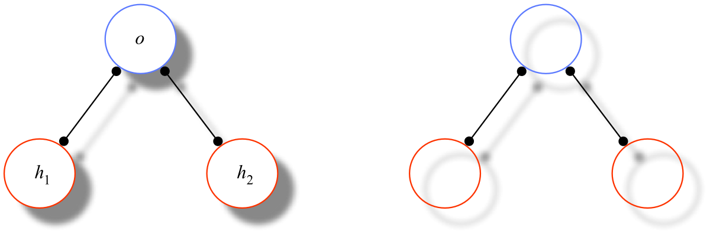
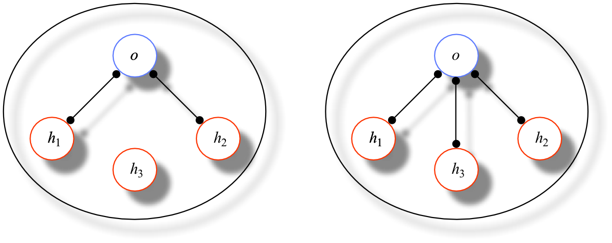

# Possible Worlds
**First published Fri Oct 18, 2013; substantive revision Mon Feb 8, 2016**

*Menzel, Christopher*

Anne is working at her desk. While she is directly aware only of her immediate situation — her being seated in front of her computer, the music playing in the background, the sound of her husband's voice on the phone in the next room, and so on — she is quite certain that this situation is only part of a series of increasingly more inclusive, albeit less immediate, situations: the situation in her house as a whole, the one in her neighborhood, the city she lives in, the state, the North American continent, the Earth, the solar system, the galaxy, and so on. On the face of it, anyway, it seems quite reasonable to believe that this series has a *limit*, that is, that there is a maximally inclusive situation encompassing all others: *things, as a whole* or, more succinctly, *the actual world*.

Most of us also believe that things, as a whole, needn't have been just as they are. Rather, things might have been different in countless ways, both trivial and profound. History, from the very beginning, could have unfolded quite other than it did in fact: the matter constituting a distant star might never have organized well enough to give light; species that survived might just as well have died off; battles won might have been lost; children born might never have been conceived and children never conceived might otherwise have been born. In any case, no matter how things had gone they would still have been part of a single, maximally inclusive, all-encompassing situation, a single world. Intuitively, then, the actual world is only one among many *possible worlds*.

The idea of possible worlds is evocative and appealing. However, possible worlds failed to gain any real traction among philosophers until the 1960s when they were invoked to provide the conceptual underpinnings of some powerful developments in modal logic. Only then did questions of their nature become a matter of the highest philosophical importance. Accordingly, Part 1 of this article will provide an overview of the role of possible worlds in the development of modal logic. Part 2 explores three prominent philosophical approaches to the nature of possible worlds.[^note-1] Although many of the finer philosophical points of Part 2 do presuppose the technical background of Part 1, the general philosophical landscape laid out in Part 2 can be appreciated independently of Part 1.

## 1. Possible Worlds and Modal Logic

Although ‘possible world’ has been part of the philosophical lexicon at least since Leibniz, the notion became firmly entrenched in contemporary philosophy with the development of *possible world semantics* for the languages of propositional and first-order modal logic. In addition to the usual sentence operators of classical logic such as ‘and’ (‘∧’), ‘or’ (‘∨’), ‘not’ (‘¬’), ‘if...then’ (‘→’), and, in the first-order case, the quantifiers ‘all’ (‘∀’) and ‘some’ (‘∃’), these languages contain operators intended to represent the modal adverbs ‘necessarily’ (‘□’) and ‘possibly’ (‘◇’). Although a prominent aspect of logic in both Aristotle's work and the work of many medieval philosophers, modal logic was largely ignored from the modern period to the mid-20th century. And even though a variety of modal deductive systems had in fact been rigorously developed in the early 20th century, notably by Lewis and Langford (1932), there was for the languages of those systems nothing comparable to the elegant semantics that Tarski had provided for the languages of classical first-order logic. Consequently, there was no rigorous account of what it means for a sentence in those languages to be *true* and, hence, no account of the critical semantic notions of validity and logical consequence to underwrite the corresponding deductive notions of theoremhood and provability. A concomitant philosophical consequence of this void in modal logic was a deep skepticism, voiced most prominently by Quine, toward any appeal to modal notions in metaphysics generally, notably, the notion of an essential property. (See Quine 1953 and 1956, and the appendix to Plantinga 1974.)[^plantinga-1974][^quine-1953][^quine-1956] The purpose of the following two subsections is to provide a simple and largely ahistorical overview of how possible world semantics fills this void; the final subsection presents two important applications of the semantics. (Readers familiar with basic possible world semantics can skip to §2 with no significant loss of continuity.)

### 1.1 Extensionality Lost

Since the middle ages at least, philosophers have recognized a semantical distinction between *extension* and *intension*. The extension of a denoting expression, or *term*, such as a name or a definite description is its referent, the thing that it refers to; the extension of a predicate is the set of things it applies to; and the extension of a sentence is its truth value. By contrast, the intension of an expression is something rather less definite — its *sense*, or *meaning*, the semantical aspect of the expression that determines its extension. For purposes here, let us say that a *logic* is a formal language together with a semantic theory for the language, that is, a theory that provides rigorous definitions of truth, validity, and logical consequence for the language.[^note-2] A logic is *extensional* if the truth value of every sentence of the logic is determined entirely by its form and the extensions of its component sentences, predicates, and terms. An extensional logic will thus typically feature a variety of valid *substitutivity principles*. A substitutivity principle says that, if two expressions are coextensional, that is, if they have the same extension, then (subject perhaps to some reasonable conditions) either can be substituted for the other in any sentence *salva veritate*, that is, without altering the original sentence's truth value. In an *intensional* logic, the truth values of some sentences are determined by something over and above their forms and the extensions of their components and, as a consequence, at least one classical substitutivity principle is typically rendered invalid.

Extensionality is a well known and generally cherished feature of classical propositional and predicate logic. Modal logic, by contrast, is intensional. To illustrate: the substitutivity principle for sentences tells us that sentences with the same truth value can be substituted for one another *salva veritate*. So suppose that John's only pets are two dogs, Algol and BASIC, say, and consider two simple sentences and their formalizations (the predicates in question indicating the obvious English counterparts):

|   |   | All John's dogs are mammals: ∀*x*(*Dx* → *Mx*). |
| --- | --- | --- |

|   |   | All John's pets are mammals: ∀*x*(*Px* → *Mx*) |
| --- | --- | --- |

As both sentences are true, they have the same extension. Hence, in accordance with the classical substitutivity principle for sentences, we can replace the occurrence of (1) with (2) in the false sentence

|   |   | Not all John's dogs are mammals: ¬∀*x*(*Dx* → *Mx*) |
| --- | --- | --- |

and the result is the equally false sentence

|   |   | Not all John's pets are mammals: ¬∀*x*(*Px* → *Mx*). |
| --- | --- | --- |

However, when we make the same substitution in the true sentence

|   |   | Necessarily, all John's dogs are mammals: □∀*x*(*Dx* → *Mx*), |
| --- | --- | --- |

the result is the sentence

|   |   | Necessarily, all John's pets are mammals: □∀*x*(*Px* → *Mx*), |
| --- | --- | --- |

which is intuitively false, as John surely could have had a non-mammalian pet. In a modal logic that accurately represents the logic of the necessity operator, therefore, the substitutivity principle for sentences will have to fail.

The same example illustrates that the substitutivity principle for predicates will have to fail in modal logic as well. For, according to our example, the predicates ‘*D*’ and ‘*P*’ that are true of John's dogs and of John's pets, respectively, are coextensional, i.e., ∀*x*(*Dx* ↔ *Px*). However, while substituting the latter predicate for the former in (3) results in a sentence with the same truth value, the same substitution in (5) does not.

Modal logic, therefore, is intensional: in general, the truth value of a sentence is determined by something over and above its form and the extensions of its components. Absent a rigorous semantic theory to identify the source of its intensionality and to systematize intuitions about modal truth, validity, and logical consequence, there was little hope for the widespread acceptance of modal logic.

### 1.2 Extensionality Regained

The idea of possible worlds raised the prospect of extensional respectability for modal logic, not by rendering modal logic itself extensional, but by endowing it with an extensional semantic theory — one whose own logical foundation is that of classical predicate logic and, hence, one on which possibility and necessity can ultimately be understood along classical Tarskian lines. Specifically, in *possible world semantics*, the modal operators are interpreted as *quantifiers* over possible worlds, as expressed informally in the following two general principles:

| **Nec** |   | A sentence of the form ^{⌈}Necessarily, φ^{⌉} (^{⌈}◻φ^{⌉}) is true if and only if φ is true in every possible world.[^note-3] |
| --- | --- | --- |

| **Poss** |   | A sentence of the form ^{⌈}Possibly, φ^{⌉} (^{⌈}◇φ^{⌉}) is true if and only if φ is true in some possible world. |
| --- | --- | --- |

Given this, the failures of the classical substitutivity principles can be traced to the fact that modal operators, so interpreted, introduce contexts that require subtler notions of meaning for sentences and their component parts than are provided in classical logic; in particular, a subtler notion (to be clarified shortly) is required for predicates than that of the set of things they happen to apply to.

**Tarskian Semantics.** Standard model theoretic semantics for the languages of predicate logic deriving from the work of Tarski (1933, 1944) is the paradigmatic semantic theory for extensional logics. Given a standard first-order language ℒ, a Tarskian *interpretation* **I** *for* ℒ specifies a set **D** for the quantifiers of ℒ to range over (typically, some set of things that ℒ has been designed to describe) and assigns, to each term (constant or variable) τ of ℒ, a referent **a**_{τ} ∈ **D** and, to each *n*-place predicate π of ℒ, an appropriate extension **E**_{π} — a truth value (TRUE or FALSE) if *n* = 0, a subset of **D** if *n* = 1, and a set of *n*-tuples of members of **D** if *n* > 1. Given these assignments, sentences are evaluated as true under the interpretation **I** — true_{**I**}, for short — according to a more or less familiar set of clauses. To facilitate the definition, let **I**[ν/**a**] be the interpretation that assigns the individual **a** to the variable ν and is otherwise exactly like **I**. Then we have:

- An atomic sentence ^{⌈}πτ₁...τ_{*n*}^{⌉} (of ℒ) is *true*_{**I**} if and only if
- *n* = 0 (i.e., π is a sentence letter) and the extension of π is the truth value TRUE; or
- *n* = 1 and **a**_{τ1} is in the extension of π; or
- *n* > 1 and ⟨**a**_{τ1}, ..., **a**_{τ*n*}⟩ is in the extension of π.
- A negation ^{⌈}¬ψ^{⌉} is true_{**I**} if and only if ψ is not true_{**I**}.
- A material conditional^{⌈}ψ → θ^{⌉} is true_{**I**} iff, if ψ is true_{**I**}, then θ is true_{**I**}.
- A universally quantified sentence ^{⌈}∀νψ^{⌉} is true_{**I**} if and only if, for all individuals **a** ∈ **D**, ψ is true_{**I**[ν/**a**]}.[^note-4]

Clauses for the other standard Boolean operators and the existential quantifier under their usual definitions follow straightaway from these clauses. In particular, where

|   |   | ∃νφ =_{*def*} ¬∀ν¬φ |
| --- | --- | --- |

it follows that:

- An existentially quantified sentence ^{⌈}∃νψ^{⌉} is is true_{**I**} if and only if, for some individual **a** ∈ **D**, ψ is true_{**I**[ν/**a**]}.

It is easy to verify that, in each of the above cases, replacing one coextensional term, predicate, or sentence for another has no effect on the truth values rendered by the above clauses, thus guaranteeing the validity of the classical substitutivity principles and, hence, the extensionality of first-order logic with a Tarskian semantics.

**From Tarskian to Possible World Semantics.** The truth conditional clauses for the three logical operators directly reflect the meanings of the natural language expressions they symbolize: ‘¬’ means *not*; ‘→’ means *if...then*; ‘∀’ means *all*. It is easy to see, however, that we cannot expect to add an equally simple clause for sentences containing an operator that symbolizes necessity. For a Tarskian interpretation *fixes* the domain of quantification and the extensions of all the predicates. Pretty clearly, however, to capture necessity and possibility, one must be able to consider alternative “possible” domains of quantification and alternative “possible” extensions for predicates as well. For, intuitively, under different circumstances, fewer, more, or other things might have existed and things that actually exist might, in those circumstances, have had very different properties. (6), for example, is false because John could have had non-mammalian pets: a canary, say, or a turtle, or, under *very* different circumstances, a dragon. A bit more formally put: Both the domain of quantification and the extension of the predicate ‘*P*’ could, in some sense or other, have been different.

Possible world semantics, of course, uses the concept of a possible world to give substance to the idea of alternative extensions and alternative domains of quantification. (Possible world semantics can be traced most clearly back to the work of Carnap (1947), its basic development culminating in the work of Hintikka (1957, 1961), Bayart (1958, 1959), and Kripke (1959, 1963a, 1963b).[^note-5]) Similar to Tarskian semantics, a possible world interpretation **M** of a modal language ℒ specifies a nonempty set **D**, although thought of now as the set of “possible individuals” of **M**. Also as in Tarskian semantics, **M** assigns each term τ of ℒ a referent **a**_{τ} in **D**.[^note-6] Additionally however, **M** specifies a set **W**, the set of “possible worlds” of **M**, one of which is designated its “actual world”, and each world **w** in **W** is assigned its own domain of quantification, **d**(**w**) ⊆ **D**, intuitively, the set of individuals that exist in **w**.[^note-7] To capture the idea of both the actual and possible extensions of a predicate, **M** assigns to each *n*-place predicate π a function **M**_{π} — the *intension* of π — that, for each possible world **w**, returns the *ex*tension **M**_{π}(**w**) of π *at* **w**: a truth value, if *n* = 0; a set of individuals, if *n* = 1; and a set of *n*-tuples of individuals, if *n* > 1.[^note-8] We can thus rigorously define a “possible extension” of a predicate π to be any of its **w**-extensions **M**_{π}(**w**), for any world **w**.

The Tarskian truth conditions above are now generalized by relativizing them to worlds as follows: for any possible world **w** (the *world of evaluation*):

- An atomic sentence ^{⌈}πτ₁...τ_{*n*}^{⌉} (of ℒ) is *true*_{**M**} *at* **w** if and only if:
- *n* = 0 and the **w**-extension of π is the truth value TRUE; or
- *n* = 1 and *a*_{τ1} is in the **w**-extension of π; or
- *n* > 1 and ⟨**a**_{τ1},..., **a**_{τ*n*}⟩ is in the **w**-extension of π.
- A negation ^{⌈}¬ψ^{⌉} is true_{**M**} at **w** if and only ψ is not true_{**M**} in **w**.
- A material conditional^{⌈}ψ→θ^{⌉} is true_{**M**} at **w** iff, if ψ is true_{**M**} at **w**, then θ is true_{**M**} at **w**.
- A quantified sentence ^{⌈}∀νψ^{⌉} is true_{**M**} at **w** if and only if, for all individuals **a** that exist in **w**, ψ is true_{**M**[ν/**a**]}.

And to these, of course, is added the critical modal case that explicitly interprets the modal operator to be a quantifier over worlds, as we'd initially anticipated informally in our principle **Nec**:

- A necessitation ^{⌈}◻ψ^{⌉} is true_{**M**} at **w** if and only if, for all possible worlds **u** of **M**, ψ is true_{**M**} at **u**.[^note-9]

A sentence φ is *false*_{**M**} at **w** just in case it is not true_{**M**} at **w**, and φ is said to be *true*_{**M**} just in case φ is true_{**M**} at the actual world of **M**.

On the assumption that there is a (nonempty) set of all possible worlds and a set of all possible individuals, we can define “objective” notions of truth at a world and of truth *simpliciter*, that is, notions that are not simply relative to formal, mathematical interpretations but, rather, correspond to objective reality in all its modal glory. Let ℒ be a modal language whose names and predicates represent those in some fragment of ordinary language (as in our examples (5) and (6) above). Say that **M** is the “intended” interpretation of ℒ if (i) its set **W** of “possible worlds” is in fact the set of all possible worlds, (ii) its designated “actual world” is in fact the actual world, (iii) its set **D** of “possible individuals” is in fact the set of all possible individuals, and (iv) the referents assigned to the names of ℒ and the intensions assigned to the predicates of ℒ are the ones they in fact have. Then, where **M** is the intended interpretation of ℒ, we can say that a sentence φ of ℒ is *true at* a possible world **w** just in case φ is true_{**M**} at **w**, and that φ is *true* just in case it is true_{**M**} at the actual world. (Falsity at **w** and falsity, *simpliciter*, are defined accordingly.) Under the assumption in question, then, the modal clause above takes on pretty much the exact form of our informal principle **Nec**.

Call the above *basic* possible world semantics. Spelling out the truth conditions for (6) (relative to the intended interpretation of its language), basic possible world semantics tells us that (6) is true if and only if

|   |   | For all possible worlds **w**, ‘∀*x*(*Px* → *Mx*)’ is true at **w**. |
| --- | --- | --- |

And by unpacking (8) in terms of the quantificational, material conditional, and atomic clauses above we have that (6) is true if and only if

|   |   | For all possible worlds **w**, and for all possible individuals **a** that exist in **w**, if **a** is in the **w**-extension of ‘*P*’ then **a** is in the **w**-extension of ‘*M*’. |
| --- | --- | --- |

Since we are evaluating (6) with regard to the intended interpretation of its language, the **w**-extension of ‘*P*’ that is returned by its intension, for any world **w**, is the (perhaps empty) set of John's pets in **w** and that of ‘*M*’ is the set of mammals in **w**. Hence, if **w** is a world where John has a pet canary — COBOL, say — COBOL is in the **w**-extension of ‘*P*’ but not that of ‘*M*’ , i.e., ‘∀*x*(*Px* → *Mx*)’ is false at **w** and, hence, by the truth condition (9), (6) is false at the actual world — that is, (6) is false *simpliciter*, as it should be.

Note that interpreting modal operators as quantifiers over possible worlds provides a nice theoretical justification for the usual definition of the possibility operator in terms of necessity, specifically:

|   |   | ^{⌈}◇φ^{⌉} =_{*def*} ^{⌈}¬◻¬φ^{⌉}. |
| --- | --- | --- |

That is, a sentence is possible just in case its negation isn't necessary. Since, semantically speaking, the necessity operator is *literally* a universal quantifier, the definition corresponds exactly to the definition (7) of the existential quantifier. For, unpacking the right side of definition (10) according to the negation and necessitation clauses above (and invoking the definitions of truth and truth at a world *simpliciter*), we have:

|   |   | ^{⌈}◇φ^{⌉} is true iff it is not the case that, for all possible worlds **w**, φ is not true at **w**. |
| --- | --- | --- |

Clearly, however, if it is not the case that φ fails to be true at all possible worlds, then it must be true at some world; hence:

|   |   | ^{⌈}◇φ^{⌉} is true iff, for some possible world **w**, φ is true at **w**. |
| --- | --- | --- |

And that corresponds exactly to our intuitive truth condition **Poss** above. Thus, spelling out the negation ‘¬□∀*x*(*Px* → *Mx*)’ of our false sentence (6) above in accordance with definition (10) (and the standard definition of conjunction ∧), we have:

|   |   | Possibly, one of John's pets is not a mammal: ◇∃*x*(*Px* ∧ ¬*Mx*), |
| --- | --- | --- |

for which (12) and the possible world truth conditions for quantified, Boolean, and atomic sentences yield the correct truth condition:

|   |   | There is a possible world **w** and an individual **a** existing in **w** that is in the **w**-extension of ‘*P*’ but not that of ‘*M*’, |
| --- | --- | --- |

that is, less stuffily, there is a possible world in which, among John's pets, at least one is not a mammal.

**Summary: Intensionality and Possible Worlds.** Analyzed in terms of possible world semantics, then, the general failure of classical substitutivity principles in modal logic is due, not to an irreducibly intensional element in the meanings of the modal operators, but rather to a sort of mismatch between the surface syntax of those operators and their semantics: syntactically, they are unary sentence operators like negation; but semantically, they are, quite literally, quantifiers. Their syntactic similarity to negation suggests that, like negation, the truth values of ^{⌈}□φ^{⌉} and ^{⌈}◇φ^{⌉}, insofar as they are determinable at all, must be determined by the truth value of φ. That they are not (in general) so determined leads to the distinctive substitutivity failures noted above. The possible worlds analysis of the modal operators as quantifiers over worlds reveals that the unary syntactic form of the modal operators obscures a semantically relevant parameter. When the modal operators are interpreted as quantifiers, this parameter becomes explicit and the reason underlying the failure of extensionality in modal logic becomes clear: That the truth values of ^{⌈}□φ^{⌉} and ^{⌈}◇φ^{⌉} are not in general determined by the truth value of φ at the world of evaluation is, semantically speaking, nothing more than the fact that the truth values of ‘∀*xFx*’ and ‘∃*xFx*’ are not in general determined by the truth value of ‘*Fx*’, for any particular value of ‘*x*’. Possible world semantics, therefore, *explains* the intensionality of modal logic by revealing that the syntax of the modal operators prevents an adequate expression of the meanings of the sentences in which they occur. Spelled out as possible world truth conditions, those meanings can be expressed in a wholly extensional fashion. (For a more formal exposition of this point, see the supplemental article [The Extensionality of Possible World Semantics](possible-worlds.semantics-extensionality.md).)

### 1.3 Two Applications: The Analysis of Intensions and the *De Re* / *De Dicto* Distinction

As noted, the focus of the present article is on the metaphysics of possible worlds rather than applications. Of course, the semantics of modal languages is itself an application, but one that is of singular importance, both for historical reasons and because most applications are in fact themselves applications of (often extended or modified versions of) the semantical apparatus. Two particularly important examples are the analysis of intensions and a concomitant explication of the *de re*/*de dicto* distinction.[^note-10]

**The Analysis of Intensions.** As much a barrier to the acceptance of modal logic as intensionality itself was the need to appeal to intensions *per se* — properties, relations, propositions, and the like — in semantical explanations. Intensional entities have of course featured prominently in the history of philosophy since Plato and, in particular, have played natural explanatory roles in the analysis of intentional attitudes like belief and mental content. For all their prominence and importance, however, the nature of these entities has often been obscure and controversial and, indeed, as a consequence, they were easily dismissed as ill-understood and metaphysically suspect “creatures of darkness” (Quine 1956, 180)[^quine-1956] by the naturalistically oriented philosophers of the early- to mid-20th century. It is a virtue of possible world semantics that it yields rigorous *definitions* for intensional entities. More specifically, as described above, possible world semantics assigns to each *n*-place predicate π a certain function **I**_{π} — π's intension — that, for each possible world **w**, returns the extension **I**_{π}(**w**) of π at **w**. We can define an intension *per se*, independent of any language, to be any such function on worlds. More specifically:

- A *proposition* is any function from worlds to truth values.
- A *property* is any function from worlds to sets of individuals.
- An *n*-place relation (*n* > 1) is any function from worlds to sets of *n*-tuples of individuals.

The adequacy of this analysis is a matter of lively debate that focuses chiefly upon whether or not intensions, so defined, are too “coarse-grained” to serve their intended purposes. (See, e.g., Stalnaker 1987 and 2012 for a strong defense of the analysis.)[^stalnaker-1987][^stalnaker-2012] However, Lewis (1986, §1.5) argues that, even if the above analysis fails for certain purposes, it does not follow that intensions cannot be analyzed in terms of possible worlds, but only that more subtle constructions might be required. This reply appears to side-step the objections from granularity while preserving the great advantage of the possible worlds analysis of intensions, viz., the rigorous definability of these philosophically significant notions.

The *De Re* / *De Dicto* Distinction. A particularly rich application of the possible world analysis of intensions concerns the analysis of the venerable distinction between *de re* and *de dicto* modality.[^note-11] Among the strongest modal intuitions is that the possession of a property has a modal character — that things exemplify, or fail to exemplify, some properties *necessarily*, or *essentially*, and others only *accidentally*. Thus, for example, intuitively, John's dog Algol is a pet accidentally; under less fortunate circumstances, she might have been, say, a stray that no one ever adopted. But she is a dog essentially; she couldn't have been a flower, a musical performance, a crocodile or any other kind of thing.

Spelling out this understanding in terms of worlds and the preceding analysis of intensions, we can say that an individual **a** has a property **F** essentially if **a** has **F** in every world in which it exists, that is, if, for all worlds **w** in which **a** exists, **a** ∈ **F**(**w**). Likewise, **a** has **F** accidentally if **a** has **F** in the actual world @ but lacks it in some other world, that is, if **a** ∈ **F**(@) but, for some world **w** in which **a** exists, **a** ∉ **F**(**w**). Thus, let ‘*G*’ and ‘*T*’ symbolize ‘is a dog’ and ‘is someone's pet’, respectively; then, where ‘*E!x*’ is short for ‘∃*y*(*x*=*y*)’ (and, hence, expresses that *x* exists), we have:

|   |   | Algol is a dog essentially: □(*E!a* → *Ga*) |
| --- | --- | --- |

|   |   | Algol is a pet accidentally: *Ta* ∧ ◇(*E!a* ∧ ¬*Ta*) |
| --- | --- | --- |

More generally, sentences like (15) and (16) in which properties are ascribed to a specific individual in a modal context — signaled formally by the occurrence of a name or the free occurrence of a variable in the scope of a modal operator — are said to exhibit modality *de re*[^note-12] (modality *of the thing*). Modal sentences that do not, like

|   |   | Necessarily, all dogs are mammals: □∀*x*(*Gx* → *Mx*) |
| --- | --- | --- |

are said to exhibit modality *de dicto* (roughly, modality *of the* *proposition*). Possible world semantics provides an illuminating analysis of the key difference between the two: The truth conditions for both modalities involve a commitment to possible worlds; however, the truth conditions for sentences exhibiting modality *de re* involve in addition a commitment to the meaningfulness of *transworld identity*, the thesis that, necessarily, every individual (typically, at any rate) exists and exemplifies (often very different) properties in many different possible worlds. More specifically, basic possible world semantics yields intuitively correct truth values for sentences of the latter sort by (i) permitting world domains to overlap and (ii) assigning intensions to predicates, thereby, in effect, relativizing predicate extensions to worlds. In this way, one and the same individual can be in the extension of a given predicate at all worlds in which they exist, at some such worlds only, or at none at all. (For further discussion, see the entry on essential vs. accidental properties.)

## 2. Three Philosophical Conceptions of Possible Worlds

The power and appeal of basic possible world semantics is undeniable. In addition to providing a clear, extensional formal semantics for a formerly somewhat opaque, intensional notion, cashing possibility as truth in some possible world and necessity as truth in every such world seems to tap into very deep intuitions about the nature of modality and the meaning of our modal discourse. Unfortunately, the semantics leaves the most interesting — and difficult — philosophical questions largely unanswered. Two arise with particular force:

| **QW** |   | What, exactly, is a possible world? |
| --- | --- | --- |

And, given **QW**:

| **QE** |   | What is it for something to exist in a possible world? |
| --- | --- | --- |

In this section we will concern ourselves with, broadly speaking, the three most prominent philosophical approaches to these questions.[^note-13]

### 2.1 Concretism

Recall the informal picture that we began with: a world is, so to say, the “limit” of a series of increasingly more inclusive situations. Fleshed out philosophical accounts of this informal idea generally spring from rather different intuitions about what one takes the “situations” in the informal picture to be. A particularly powerful intuition is that situations are simply structured collections of physical objects: the immediate situation of our initial example above, for instance, consists of, among other things, the objects in Anne's office — notably Anne herself, her desk and her computer, with her seated at the former and typing on the latter — and at least some of the things in the next room — notably, her husband and the phone he is talking on. On this view, for one situation **s** to include another **r** is simply for **r** to be a (perhaps rather complex and distributed) physical part of **s**. The actual world, then, as the limit of a series of increasingly more inclusive situations in this sense, is simply the entire physical universe: all the things that are some spatiotemporal distance from the objects in some arbitrary initial situation, structured as they in fact are; and other possible worlds are things of exactly the same sort. Call this the *concretist* intuition, as possible worlds are understood to be concrete physical situations of a special sort.

#### 2.1.1 Concrete Worlds and Existence Therein

The originator and, by far, the best known proponent of concretism is David Lewis. For Lewis and, as noted, concretists generally, the actual world is the concrete physical universe as it is, stretched out in space-time. As he rather poetically expresses it (1986, 1):

> The world we live in is a very inclusive thing....There is nothing so far away from us as not to be part of our world. Anything at any distance is to be included. Likewise the world is inclusive in time. No long-gone ancient Romans, no long-gone pterodactyls, no long-gone primordial clouds of plasma are too far in the past, nor are the dead dark stars too far in the future, to be part of this same world....[N]othing is so alien in kind as not to be part of our world, provided only that it does exist at some distance and direction from here, or at some time before or after or simultaneous with now.

The actual world provides us with our most salient example of what a possible world is. But, for the concretist, other possible worlds are no different in kind from the actual world (*ibid.*, 2):

> There are countless other worlds, other very inclusive things. Our world consists of us and all our surroundings, however, remote in time and space; just as it is one big thing having lesser things as parts, so likewise do other worlds have lesser other-worldly things as parts.

It is clear that spatiotemporal relations play a critical role in Lewis's conception. However, it is important to note that Lewis understands such relations in a very broad and flexible way so as to allow, in particular, for the possibility of spirits and other entities that are typically thought of as non-spatial; so long as they are located in time, Lewis writes, “that is good enough” (*ibid.*, 73). So with this caveat, let us say that that an object **a** is *connected* if any two of its parts bear some spatiotemporal relation to each other,[^note-14] and that **a** is *maximal* if none of its parts is spatiotemporally related to anything that is not also one of its parts. Then we have the following concretist answers to our questions:

| **AW1** |   | **w** is a possible world =_{*def*} **w** is a maximal connected object.[^note-15] |
| --- | --- | --- |

And, hence, to exist in a world is simply to be a part of it:

| **AE1** |   | Individual **a** exists in world **w** =_{*def*} **a** is a part of **w**. |
| --- | --- | --- |

It follows from **AW1** (and reasonable assumptions) that distinct worlds do not overlap, spatiotemporally; that no spatiotemporal part of one world is part of another.[^note-16] Moreover, given Lewis's counterfactual analysis of causation, it follows from this that objects in distinct worlds bear no causal relations to one another; nothing that occurs in one world has any causal impact on anything that occurs in any other world.

#### 2.1.2 Actuality

Critically, for Lewis, worlds and their denizens do not differ in the *manner* in which they exist. The actual world does not enjoy a kind of privileged existence that sets it apart from other worlds. Rather, what makes the actual world actual is simply that it is *our* world, the world that we happen to inhabit. Other worlds and their inhabitants exist just as robustly as we do, and in precisely the same sense; all worlds and all of their denizens are equally *real*.[^note-17] A significant semantic corollary of this thesis for Lewis is that the word ‘actual’ in the phrase ‘the actual world’ does not indicate any special *property* of the actual world that distinguishes it from all other worlds; likewise, an assertion of the form ‘**a** is actual’ does not indicate any special property of the individual **a** that distinguishes it from the objects existing in other worlds. Rather, ‘actual’ is simply an *indexical* whose extension is determined by the context of utterance. Thus, the referent of ‘the actual world’ in a given utterance is simply the world of the speaker, just as the referent of an utterance of ‘the present moment’ is the moment of the utterance; likewise, an utterance of the form ‘**a** is actual’ indicates only that **a** shares the same world as the speaker. The speaker thereby ascribes no special property to **a** but, essentially, expresses no more than when she utters ‘**a** is *here*’, understood in the broadest possible sense. By the same token, when we speak of non-actual *possibilia* — Lewis's preferred label for the denizens of possible worlds — we simply pick out those objects that are *not* here in the broadest sense. In the mouth of an other-worldly metaphysician, we here are all among the non-actual *possibilia* of which she speaks in her lectures on *de re* modality.

#### 2.1.3 Modal Reductionism, Counterparts, and the Analysis of Intensions

**Modal Reductionism and Counterparts.** Lewis parted ways dramatically with his mentor W. V. O. Quine on modality. Quine (1960, §41) stands in a long line of philosophers dating back at least to David Hume who are skeptical, at best, of the idea that modality is an objective feature of reality and, consequently, who question whether modal assertions in general can be objectively true or false, or even coherent. Lewis, by contrast, wholly embraces the objectivity of modality and the coherence of our modal discourse. What he denies, however, is that modality is a fundamentally *irreducible* feature of the world. Lewis, that is, is a *modal reductionist*. For Lewis, modal notions are not primitive. Rather, truth conditions for modal sentences can be given in terms of worlds and their parts; and worlds themselves, Lewis claims, are defined entirely in non-modal terms. The earliest presentation of Lewis's theory of modality (Lewis 1968)[^lewis-1968] — reflecting Quine's method of regimentation — offers, rather than a possible world semantics, a scheme for *translating* sentences in the language of modal predicate logic into sentences of ordinary first-order logic in which the modal operators are replaced by explicit quantifiers over worlds.[^note-18] The mature account of Lewis 1986 is much more semantic in orientation: it avoids any talk of translation and offers instead a (somewhat informal) account of concretist possible world truth conditions for a variety of modal assertions. Nonetheless, it is useful to express the logical forms of these truth conditions explicitly in terms of worlds, existence in a world (in the sense of **AE1**, of course), and the *counterpart* relation, which will be discussed shortly:

| *Wx*: |   | *x* is a *world* |
| --- | --- | --- |
| *Ixy*: |   | *x* *exists in* world *y* |
| *Cxy*: |   | *x* is a *counterpart* of *y* |

For sentences like (17) involving only *de dicto* modalities, Lewis's truth conditions are similar in form to the truth conditions generated by the modal clauses of basic possible world semantics; specifically, for (17):

|   |   | For every world **w**, every individual **x** in **w** that is a dog is a mammal: ∀*w*(*Ww* → ∀*x*(*Ixw* → (*Gx* → *Mx*))). |
| --- | --- | --- |

As in possible world semantics, the modal operators ‘□’ and ‘◇’ “turn into” quantifiers over worlds in concretist truth conditions (1986, 5). Also as in possible world semantics, a quantifier (in effect) ranging over individuals that occurs in the scope of a quantifier (in effect) ranging over worlds — ‘∀*x*’ and ‘∀*w*’, respectively, in (18) — is, for each value **w** of the bound world variable, restricted to the objects existing in **w**. However, unlike possible world semantics, predicates are not to be thought of as having different extensions at different worlds. Rather, for Lewis, each (*n*-place) predicate has a single extension that can contain (*n*-tuples of) objects across many different worlds — intuitively, all of the objects that have the property (or *n*-tuples of objects that stand in the relation) expressed by the predicate across all possible worlds. Thus, in particular, the predicate ‘*G*’ picks out, not just this-worldly dogs but other-worldly canines as well. Likewise, the pet predicate ‘*T*’ picks out both actual and other-worldly pets. Such a move is not feasible in basic possible world semantics, which is designed for a metaphysics in which one and the same individual can exemplify a given property in some worlds in which they exist but not others. Hence, a typical predicate will be true of an individual with respect to some worlds and false of it with respect to others. But, for Lewis, as we've seen, distinct possible worlds do not overlap and, hence, objects are worldbound, thereby eliminating the need to relativize predicate extensions to worlds.

However, this very feature of Lewis's account — worldboundedness — might appear to threaten its coherence. For example, since Algol is in fact a pet, given worldboundedness and the definition **AE1** of existence in a world **w**, we have:

|   |   | There is no world **w** such that Algol exists in **w** and fails to be someone's pet: ¬∃*w*(*Iaw* ∧ ¬*Ta*), |
| --- | --- | --- |

But, according to Lewis's analysis, the modal operators ‘□’ and ‘◇’, semantically, are quantifiers over worlds. Hence, (19) might appear to be exactly the concretist truth condition for the denial of (the right conjunct of) (16), i.e., it might appear that, on Lewis's analysis, Algol is not a pet accidentally but essentially; likewise, more generally, any individual and any intuitively accidental property of that individual.

In fact, Lewis whole-heartedly accepts that things have accidental properties and, indeed, would accept that (16) is robustly true. His explanation involves one of the most interesting and provocative elements of his theory: the doctrine of *counterparts*. Roughly, an object **y** in a world **w**₂ is a counterpart of an object **x** in **w**₁ if **y** resembles **x** and nothing else in **w**₂ resembles **x** more than **y**.[^note-19] Each object is thus its own (not necessarily unique) counterpart in the world it inhabits but will typically differ in important ways from its other-wordly counterparts. A typical other-worldly counterpart of Algol, for example, might resemble her very closely up to some point in her history — a point, say, after which she continued to live out her life as a stray instead of being brought home by our kindly dog-lover John. Hence, sentences making *de re* assertions about what *Algol* might have done or what *she* could or could not have been are unpacked, semantically, as sentences about her *counterparts* in other possible worlds. Thus, when we analyze (16) accordingly, we have the entirely unproblematic concretist truth condition:

|   |   | Algol is a pet, but there is a world in which exists a counterpart of hers that is not: *Ta* ∧ ∃*w*(*Ww* ∧ ∃*x*(*Ixw* ∧ *Cxa* ∧ ¬*Tx*)). |
| --- | --- | --- |

Ascriptions of essential properties, as in (15), are likewise unpacked in terms of counterparts: to say that Algol is a dog essentially is to say that

|   |   | All of Algol's counterparts in any world are dogs: ∀*w*(*Ww* → ∀*x*((*Ixw* ∧ *Cxa*) → *Gx*)). |
| --- | --- | --- |

**The Analysis of Intensions.** Lewis's possible world truth conditions are expressed in classical non-modal logic and, hence, they are to be interpreted by means of standard Tarskian semantics. Thus, *n*-place predicates π are assigned extensions **E**_{π} — in particular, for 1-place predicates, sets of individuals — as their semantic values, as described in the exposition in §1.2 above. However, given worldboundedness and the fact that predicate extensions are drawn not simply from the actual world but from all possible worlds, these extensions are able to serve as *in*tensions in Lewis's theory. As in basic possible world semantics, intensional entities in general can be defined in terms of the basic ontology of the theory independent of the linguistic roles they can play as the intensions of predicates. And because individuals are worldbound, Lewis is able to simplify the definitions given in §1.3 by defining intensions as sets rather than functions:

- A *proposition* is any set of worlds.
- A *property* is any set of individuals.
- An *n*-place relation (*n* > 1) is any set of *n*-tuples of individuals.[^note-20]

Thus, on this analysis, a proposition **p** is *true in* a world **w** just in case **w** ∈ **p** and an individual **a** has a property **P** just in case **a** ∈ **P**. (Note that propositions are thus simply properties of worlds on these definitions.) **a** has **P** *accidentally* just in case **a** ∈ **P** but **b** ∉ **P** for some other-worldly counterpart of **b** of **a**; and **a** has **P** *essentially* if **b** ∈ **P** for every counterpart **b** of **a**.

In Lewis's theory of modality, then, modal operators are understood semantically to be quantifiers over concrete worlds, predicates denote intensions understood as sets of (*n*-tuples of) parts of those worlds, and sentences involving *de re* modalities are understood in terms of counterparts. To the extent that these notions are free of modality, Lewis has arguably reduced modal notions to non-modal.

#### 2.1.4 Plenitude and Recombination

That Lewis's truth conditions for modal statements are themselves free of modality and, hence, that his theory counts as a genuine reduction of modal notions to non-modal is not terribly controversial (albeit not undisputed — see Lycan 1991, 224–27; Divers and Melia 2002, 22–24)[^divers-2002][^divers-2002-2][^lycan-1991]. Significantly more controversial, and perhaps far more critical to the project, is whether or not his account is *complete*, that is, whether or not, for all modal statements φ, (i) if φ is intuitively true, then its Lewisian truth condition holds (ii) if φ is intuitively false, then its Lewisian truth condition fails.[^note-21] The challenge to Lewis, then, is that his account can be considered *successful* only if it is complete in this sense.

The chief question Lewis faces in this regard is whether there are *enough* worlds to do the job. The truth condition (20) for the intuitively true (16) says that there exists a possible world in which a counterpart of Algol is no one's pet. By virtue of what in Lewis's theory does such a world exist? The ideal answer for Lewis would be that some principle in his theory guarantees a *plenitude* of worlds, a maximally abundant array of worlds that leaves “no gaps in logical space; no vacancies where a world might have been, but isn't” (Lewis 1986, 86)[^lewis-1986]. From this it would follow that the worlds required by the concretist truth condition for any intuitive modal truth exist. Toward this end, Lewis initially considers the evocative principle:

| **Ways** |   | Absolutely every way that a world could be is a way that some world is. |
| --- | --- | --- |

Since, in particular, a world satisfying (20) seems quite obviously to be a way a world could be, by **Ways** such a world exists. But there is a fatal flaw here: Lewis himself (1973, 84) identifies *ways* that a world could be with worlds themselves. So understood, **Ways** collapses into the triviality that every world is identical to some world.[^note-22]

Lewis finds a replacement for **Ways** in a principle of *recombination* whereby “patching together parts of different possible worlds yields another possible world” (1986, 87–88). The principle has two aspects. The first is the principle that “anything can coexist with anything”. For “if there could be a dragon, and there could be a unicorn,” Lewis writes, “but there couldn't be a dragon and a unicorn side by side, that would be ... a failure of plenitude” (*ibid*., 88). Given that individuals are worldbound, however, the principle is expressed more rigorously (and more generally) in terms of other-worldly *duplicates*:

| **R1** |   | For any (finite or infinite) number of objects **a**₁, **a**₂, ..., there is a world containing any number of duplicates of each of those objects in any spatiotemporal arrangement (size and shape permitting). |
| --- | --- | --- |

The second aspect of the principle expresses “the Humean denial of necessary connections” (*ibid*., 87), that is, the idea that anything can *fail* to coexist with anything else. For “if there could be a talking head contiguous to the rest of a living human body, but there couldn't be a talking head separate from the rest of a human body, that too would be a failure of plenitude” (*ibid*). To express this a bit more rigorously, say that objects **a**₁, **a**₂, ..., are *independent of* objects **b**₁, **b**₂, ..., if no sum of any parts of the former are parts or duplicates of any sum of any parts of the latter and vice versa; then we have:

| **R2** |   | For any world **w** any (finite or infinite number of) objects **a**₁, **a**₂, ..., in **w** and any objects **b**₁, **b**₂, ..., in **w** that are independent of **a**₁, **a**₂, ..., there is a world containing duplicates of **a**₁, **a**₂, ..., and no duplicates of **b**₁, **b**₂, ... . |
| --- | --- | --- |

Worlds that satisfy the concretist truth conditions for workaday possibilities like (16) are easily conceived as consisting of duplicates of relevant parts of the actual world — suitably organized to retain their actual properties, or not, as needed. Hence, the existence of such worlds does indeed appear to follow from the existence of the actual world by recombination. Worlds containing talking donkeys, exotic species resulting from a wholly different evolutionary history, worlds with silicon-based life forms, and so on present a bigger challenge to the view. Nonetheless, it is not entirely implausible to think such worlds exist given suitable duplication and reorganization of microphysical objects.[^note-23]

Whether recombination completely captures our modal intuitions regarding plenitude is still a matter of some dispute.[^note-24] However, even if it doesn't, it is less than clear whether this counts against the success of Lewis's reductionist project. For, as a realist about worlds, Lewis does not seem to be under any obligation to “derive” plenitude from more fundamental principles. Hence, there is no obvious reason why he cannot respond to charges of incompleteness by saying that it is simply a presupposition of his theory that logical space has no gaps, that there are always enough worlds to satisfy the concretist truth condition for any intuitive modal truth.[^note-25] So understood, the role of recombination for a realist about worlds like Lewis is something like the role of such axioms as powerset and replacement for a realist about sets: given some sets, these principles provide us with a detailed — but always less than complete — characterization of what further sets there are. Their role, therefore, is to give us insight into the richness and diversity of set theoretic space, not a complete mechanism for proving which particular sets do or do not exist. Likewise recombination vis-à-vis worlds and logical space.

#### 2.1.5 A Brief Assessment of Concretism

Lewis's theory is particularly commendable for its striking originality and ingenuity and for the simple and straightforward answers **AW1** and **AE1** that it provides to our two questions **QW** and **QE** above. Furthermore, because worlds are (plausibly) defined entirely in nonmodal terms, the truth conditions provided by Lewis's translation scheme themselves appear to be free of any implicit modality. Hence, unlike many other popular accounts of possible worlds (notably, the abstractionist accounts discussed in the following section), Lewis's promises to provide a genuine *analysis* of the modal operators.

Perhaps the biggest — if not the most philosophically sophisticated — challenge to Lewis's theory is “the incredulous stare”, i.e., less colorfully put, the fact that its ontology is wildly at variance with common sense. Lewis faces this objection head on: His theory of worlds, he acknowledges, “*does* disagree, to an extreme extent, with firm common sense opinion about what there is” (1986, 133). However, Lewis argues that no other theory explains so much so economically. With worlds in one's philosophical toolkit, one is able to provide elegant explanations of a wide variety of metaphysical, semantical, and intentional phenomena. As high as the intuitive cost is, Lewis (135) concludes, the existence of worlds “ought to be accepted as true. The theoretical benefits are worth it.”

Additional discussion of, and objections to, concretism can be found in the supplemental document [Further Problems for Concretism](possible-worlds.problems-concretism.md).

### 2.2 Abstractionism

A rather different set of intuitions about situations is that they are *abstract* entities of a certain sort: They are *states* or *conditions*, of varying detail and complexity, that a concrete world could be in — they are *ways* that things, as a whole, could be.[^note-26] Thus, returning to our original example, one very simple way things could be is for our philosopher Anne to be in her office. We can now imagine, as in our example, further detail being successively added to that description to yield more complex ways things could be: Anne working at her desk in her office; music being in the background; her husband being on the phone in the next room; her neighbor mowing the lawn next door; and so on. Roughly speaking, then, a possible world for an abstractionist is the *limit* of such a “process” of consistently extending and adding detail to some initial state of the world; it is a *total* way things could be, a consistent state of the world that settles every possibility; a consistent state to which no further detail could be added without rendering it inconsistent.

#### 2.2.1 Abstract Possible Worlds and Existence Therein

To give the notion of a state, or condition, of the world a little more metaphysical substance, abstractionists typically appeal to more traditional ontological categories. Thus, for example, that things could be in the simple state described above might be spelled out in one of the following ways:

- The *proposition* **that Anne is in her office and at her desk** is possibly true.
- The *set of propositions* {**that Anne is in her office**, **that Anne is at her desk**} is such that, possibly, all of its members are true.
- The *property* **being such that Anne is in her office and at her desk** is possibly exemplified (by “things as a whole”).

Possible worlds are then defined as special cases of the type of entity in question that are in some relevant sense *total*. Adams (1974), for example, defines possible worlds to be consistent sets of propositions that are total in the sense of containing, for every proposition **p**, either **p** or its negation; Fine (1977), fleshing out ideas of Prior, defines a possible world to be a consistent proposition **w** that is total in the sense that, for every proposition **p**, **w** entails either **p** or its negation. For purposes here, however, we will sketch the fundamentals of the abstractionist view in terms of *states of affairs*, following the basic features of the account developed by Plantinga (1974, 1976), an account that, in the literature, frequently serves as a particularly trenchant abstractionist counterpoint to Lewis's concretism.[^note-27]

States of affairs (SOAs) are abstract, intensional entities typically signified by sentential gerundives like “Algol's being John's pet” and “There being more than ten solar planets”. Importantly, SOAs constitute a primitive ontological category for the abstractionist; they are not defined in terms of possible worlds in the manner that propositions are in §1.3. Just as some propositions are true and others are not, some SOAs are *actual* and others are not.[^note-28] Note, then, that to say an SOA is non-actual is *not* to say that it does not actually *exist*. It is simply to say that it is not, in fact, a condition, or state, that the concrete world is actually in. However, because ‘____ is actual’ is often used simply to mean ‘____ exists’, there is considerable potential for confusion here. So, henceforth, to express that an SOA is actual we will usually say that it *obtains*.

An SOA is said to be *possible* (*necessary*, *impossible*) insofar as it is possible (necessary, impossible) that it obtain. One SOA **s** is said to *include* another **t** if, necessarily, **s** obtains only if **t** does; **s** *precludes* **t** if, necessarily, **s** obtains only if **t** doesn't. So, for example, **Algol's being John's pet** includes **Algol's being someone's pet** and precludes **there being no pets**. Thus, on the abstractionist's understanding of a situation as a state or condition of the physical world rather than a concrete, structured piece of it, the inclusion of one situation in another is a purely *logical* relation, not a mereological one. Finally, say that an SOA **s** is *total* if, for every SOA **t**, **s** either includes or precludes **t**. (Abstractionists often use ‘maximal’ instead of ‘total’, but we have already introduced this term in the context of concretism.) Abstractionist possible worlds are now definable straightaway:

| **AW2** |   | **w** is a possible world =_{*def*} **w** is an SOA that is both possible and total.[^note-29] |
| --- | --- | --- |

It is easy to see that this definition covers the more intuitive characterizations of abstract possible worlds above: they are consistent — i.e., possible — states of the world that settle every possibility, consistent states to which no further detail could be added without rendering them inconsistent. Note also that, for the abstractionist, as for the concretist, the actual world is no different in kind from any other possible world; all possible worlds exist, and in precisely the same sense as the actual world. The actual world is simply the total possible SOA that, in fact, obtains. And non-actual worlds are simply those total possible SOAs that do not.

What of existence in such worlds? As we've seen, on Lewis's account, to exist in a concrete world **w** is literally to exist in **w**, that is, within the spatiotemporal boundaries of **w**. Clearly, because SOAs are abstract, individuals cannot exist in abstractionist worlds in anything like the same literal, mereological sense. Accordingly, the abstractionist defines existence in a world simply to be a special case of the inclusion relation:

| **AE2** |   | Individual **a** *exists in* possible world **w** =_{*def*} **w** includes **a**'s existing. |
| --- | --- | --- |

Unlike concretism, then, abstractionism does not entail that individuals are worldbound; there is no inconsistency whatever in the idea that many distinct worlds can include the existence of one and the same individual. Indeed, typically, abstractionists are staunchly committed to transworld identity and hold that most any given individual exists in many possible worlds and, moreover, that contingent individuals, at least, can exemplify very different properties from world to world. Abstractionists, therefore, have no need to appeal to counterparts to understand *de re* modalities and can therefore accept the truth conditions for such modalities given by basic possible world semantics (spelled out, of course, in terms of their definitions **AW2** and **AE2**). In particular, they can take the standard possible world truth condition for, e.g., the right conjunct of (16) at face value: ‘◇(*E!a* ∧ ¬*Ta*)’ is true on the abstractionist's approach if and only if there is a world in which Algol herself, rather than some counterpart of hers, exists but fails to be anyone's pet.

#### 2.2.2 Irreducible Modality and Intensional Entities

It is important to note that the possible worlds of abstractionism do not yield a reductive analysis of modality. The reason for this is clear: abstract possible worlds are defined in irreducibly modal terms — a possible world is an SOA that (among other things) *possibly* obtains; or a set of propositions such that it is *possible* that all of its members are true; or a property that is *possibly* exemplified; and so on. Hence, unpacked in terms of the abstractionist's definitions, the possible world truth conditions for modal propositions are themselves irreducibly modal. For example, when we unpack Plantinga's definition of a possible world in the semantic clause for sentences of the form ^{⌈}◻ψ^{⌉} in order to derive the truth condition for (17), ‘□∀*x*(*Gx* → *Mx*)’, we end up with this:

|   |   | For all SOAs **w**, if (i) *possibly*, **w** obtains and (ii) for all SOAs **s**, either (a) *necessarily*, **w** obtains only if **s** does or (b) *necessarily*, **w** obtains only if **s** doesn't, then, ‘∀*x*(*Gx* → *Mx*)’ is true at **w**. |
| --- | --- | --- |

If we now unpack the modal operators in (22) using the corresponding truth conditional clauses of standard possible world semantics, the result will contain further world quantifiers. And spelling out those world quantifiers in turn using Plantinga’s definition will re-introduce those same modal operators yet again.

More generally, and a bit more exactly, put: As noted above, the logical framework of basic possible world semantics is classical predicate logic. The logical framework of abstractionism is modal predicate logic. Hence, if possible world semantics is supplemented with abstractionist definitions of possible worlds, then the logical framework of possible world semantics becomes modal predicate logic as well and, as a consequence, the extensionality of the semantics is lost once again. (This point is expressed somewhat more formally in the supplemental document [The Intensionality of Abstractionist Possible World Semantics](possible-worlds.semantics-abstractionist-intensionality.md).) Since, as noted above, the central motivation for possible world semantics was to deliver an extensional semantics for modal languages, any motivation for abstractionism as a semantic theory is arguably undermined.[^note-30]

However, it is not entirely clear that this observation constitutes an objection to abstractionism. For abstractionists can argue that the goal of their analysis is the converse of the reductionist's goal: The reductionist wants to understand modality in terms of worlds; the abstractionist, by contrast, wants to understand worlds in terms of modality. That is, abstractionists can argue that we begin with a primitive notion of modality and, typically upon a certain amount of philosophical reflection, we subsequently discover an intimate connection to the notion of a possible world, as revealed in the principles **Nec** and **Poss**. The analysis that abstractionists provide is designed to make this connection explicit, ideally, in such a way that **Nec** and **Poss** fall out as theorems of their theory (see, e.g., Plantinga 1985 and Menzel and Zalta 2014)[^menzel-2014][^plantinga-1985].

Hand in glove with the irreducible nature of modality is the nature of intensional entities. Concretists define intensional entities in terms of worlds, as described in §2.1.3. Abstractionists, by contrast, define worlds in terms of intensional entities. This divergence in their choice of ontological primitives reflects, not only their differing stances toward modality, but also an important methodological difference with regard to metaphysical inquiry. The concretist is far more pragmatic; notions of *property*, *relation*, *proposition*, and the like play certain roles in our theorizing and are subject to a “jumble of conflicting *desiderata*” (Lewis 1986, 54)[^lewis-1986]. Within a given theory, any entities that can play those roles fruitfully for the purposes at hand are justifiably identified with those notions — regardless of how well they comport with pre-theoretic intuitions. Thus, Lewis finds it to be a strength of his position that he is able to adopt the set theoretic definitions in §2.1.3. By contrast, at least some abstractionists — Plantinga (1987) perhaps most notably — believe that we have intuitive, pre-theoretic knowledge of intensional entities that precludes their being identified with set theoretic constructions of any sort.[^note-31] (See Stalnaker 1976 for a particularly illuminating discussion of the contrast between concretism and abstractionism with respect to the treatment intensional entities.)[^stalnaker-1976]

#### 2.2.3 Actuality and Actualism

As was noted in §2.1.2, for the concretist, there is no special property of the actual world — *actuality* — that distinguishes it, in any absolute sense, from all of the others; it is simply the world that *we* inhabit. For abstractionists, however, actuality *is* a special property that distinguishes exactly one possible world from all others — the actual world is the only world that happens to *obtain*; it is the one and only way things could be that is the way things as a whole, in fact, *are*. However, for most abstractionists, the distinctiveness of the actual world does not lie simply in its actuality but in its ontological comprehensiveness: the actual world encompasses all that there is. In a word: most abstractionists are *actualists*.

Actualism is the thesis that everything that there is, everything that has *being* in any sense, is actual. In terms of possible worlds: Everything that exists in any world exists in the actual world.[^note-32] Possibilism, by contrast, is the denial of actualism; it is the thesis that there are *mere possibilia*, i.e., things that are not actual, things that exist in other possible worlds but fail to exist in the actual world. Concretists are obviously not actualists (on their understanding of ‘actual’, at any rate).[^note-33] Indeed, for the concretist, since individuals are worldbound, everything that exists in any nonactual possible world is distinct from everything in the actual world. However, although possibilism and abstractionism are entirely compatible — Zalta (1983), for example, embraces both positions — abstractionists *tend* to be actualists. The reason for this is clear: Basic possible world semantics appears to be committed to possibilism and abstractionism promises a way of avoiding that commitment.

The specter of possibilism first arises with regard to *non-actual* possible worlds, which would seem by definition to be prime examples of mere *possibilia*. However, we have just seen that the abstractionist can avoid this apparent commitment to possibilism by defining possible worlds to be SOAs of a certain sort. So defined, non-actual worlds, i.e., worlds that fail to obtain, can still actually exist. Hence, the commitment of basic possible world semantics to non-actual worlds does not in itself threaten the actualist's ontological scruples.

However, the specter of possibilism is not so easily exorcised. For non-actual worlds are not the only, or even the most compelling, examples of mere *possibilia* that seem to emerge out of basic possible world semantics. For instance, it is quite reasonable to think that evolution could have taken a very different course (or, if you like, that God could have made very different creative choices) and that there could have been individuals — call them *Exotics* — that are biologically very different from all actually existing individuals; so different, in fact, that no actually existing thing could possibly have been an Exotic. According to basic possible world semantics, the sentence ‘There could have been Exotics’ or, more formally,

|   |   | ◇∃*xEx* |
| --- | --- | --- |

is true just in case there is a world in which ‘∃*xEx*’ is true, i.e., when all is said and done, just in case:

|   |   | There is a possible world **w** and an individual **a** in **w** such that **a** is an Exotic in **w**, |
| --- | --- | --- |

which, a bit less formally, is simply to say that

|   |   | Some individual is an Exotic in some possible world. |
| --- | --- | --- |

However, since no actually existing thing could have been an Exotic, anything that is an Exotic in some possible world cannot be among the things that exist in the actual world. Thus, the truth conditions that basic possible world semantics assigns to some of our intuitive modal beliefs appear to entail that there are non-actual individuals as well as non-actual possible worlds. Defining possible worlds as SOAs provided a way for the actualist to embrace non-actual worlds without compromising her actualism. But how is the actualist to understand the apparent commitment to non-actual *individuals* in such truth conditions as (25)?

Answers that have been given to this question represent a rather deep divide between actualist abstractionists. On the one hand, “trace” actualists introduce actually existing entities into their ontologies that can play the role of mere *possibilia* in (25) and its like. Trace actualists come in two varieties: *new* actualists and *haecceitists*. New actualists like Linsky and Zalta (1996) and Williamson (1998, 2000, 2013) argue that, in fact, all individuals are actually existing, necessary beings but not all of them are necessarily *concrete*. Some concrete individuals — those traditionally (mis-)categorized as contingent beings — are only contingently concrete. Likewise, some non-concrete individuals — those, like possible Exotics, traditionally (mis-)categorized as contingently non-actual mere *possibilia* — are only contingently non-concrete.[^note-34]

This novel take on modal metaphysics allows the new actualist to reinterpret possible world semantics so as to avoid possibilism. Notably, the domain **d**(**w**) of a world **w** is understood not as the set of things that exist in **w** — for all individuals exist in all worlds — but the set of things that are *concrete* in **w**.[^note-35] Hence, for the new actualist, the correct truth condition for (23) is:

|   |   | There is a possible world **w** and an individual **a** that is (i) concrete in **w** and (ii) an Exotic in **w**. |
| --- | --- | --- |

On the other hand, haecceitists like Plantinga introduce special properties — haecceities — to similar ends. The haecceity of an individual **a** is the property of being *that very individual*, the property being **a**. A property is a *haecceity*, then, just in case it is possible that it is the haecceity of some individual.[^note-36] It is a necessary truth that everything has a haecceity. More importantly, for haecceitists, haecceities are necessary beings. Thus, not only is it the case that, had any particular individual **a** failed to exist, its haecceity **hₐ** would still have existed, it is also the case that, for any “merely possible” individual **a**, there is an actually existing haecceity that would have been **a**'s haecceity had **a** existed. More generally (and more carefully) put: Necessarily, for any individual **a**, (i) **a** has a haecceity **h** and (ii) necessarily, **h** exists.

Like the new actualists, then, the metaphysics of the haecceitists enables them to systematically reinterpret possible world semantics in such a way that the truth conditions of modal discourse are expressed solely in term of actually existing entities of some sort rather than actual and non-actual individuals. More specifically, for the haecceitist, the domain **d**(**w**) of a world **w** is taken to be the set of haecceities that are *exemplified* in **w**, that is, the set of haecceities **h** such that **w** includes **h**'s being exemplified. Likewise, the **w**-extension of a (1-place) predicate π is taken to be a *set* of haecceities — intuitively, those haecceities that are coexemplified in **w** with the property expressed by π. So reinterpreted, the truth condition for (23) is:

|   |   | There is a possible world **w** and a haecceity **h** that is (i) exemplified in **w** and (ii) coexemplified with the property **being an Exotic** in **w**. |
| --- | --- | --- |

By contrast, “no-trace”, or *strict*, actualists like Prior (1957), Adams (1981), and Fitch (1996) hew closely to the intuition that, had a contingent individual **a** failed to exist, there would have been absolutely no trace, no metaphysical vestige, of **a** — neither **a** itself in some non-concrete state nor any abstract proxy for **a**. Hence, unlike trace actualism, there are no such vestiges in the actual world of objects that are not actual but only could have been. The logical consequences for no-trace actualists, however, appear to be severe; at the least they cannot provide a standard compositional semantics for modal languages, according to which (roughly) the meaning of a sentence is determined by its logical form and the meanings of its semantically significant constituents. In particular, if there is nothing to play the role of a “possible Exotic”, nothing that is, or represents, an Exotic in some other possible world — a mere *possibile*, a contingently non-concrete individual, an unexemplified haecceity — then the strict actualist cannot provide standard, compositional truth conditions for quantified propositions like (23) that yield the intuitively correct truth value. For, understood compositionally, (23) is true if and only if ‘∃*xEx*’ is true at some world **w**. And that, in turn, is true at **w** if and only if ‘*Ex*’ is true at **w** for some value of ‘*x*’. But, as just noted, for the strict actualist, there is no such value of ‘*x*’. Hence, for the strict actualist, ‘*Ex*’ is false at **w** for all values of ‘*x*’ and, hence, (23) is false as well. (These issues are explored in much greater detail in the entry on the possibilism-actualism debate.)

#### 2.2.4 A Brief Assessment of Abstractionism

Like concretism, abstractionism provides a reasonably clear and intuitive account of what worlds are and what it is to exist in them, albeit from a decidedly different perspective. Although, as noted in §2.2.2, the fact that modality is a primitive in abstractionist definitions of possible worlds arguably compromises its ability to provide semantically illuminating truth conditions for the modal operators, those definitions can be taken to illuminate the connection between our basic modality concepts and the evocative notion of a possible world that serves as such a powerful conceptual tool for constructing philosophical arguments and for analyzing and developing solutions to philosophical problems. In this regard, particularly noteworthy are: Plantinga's (1974) influential work on the ontological argument and the free will defense against the problem of evil; Adams' (1974, 1981) work on actualism and actuality; and Stalnaker's (1968, 1987) work on counterfactual conditionals and mental content.

A number of important objections have been voiced in regard to abstractionism. Some of these are addressed in the document [Problems with Abstractionism](possible-worlds.problems-abstractionism.md).

### 2.3 Combinatorialism

As its name might suggest, our third approach — *combinatorialism* — takes possible worlds to be recombinations, or rearrangements, of certain metaphysical simples. Both the nature of simples and the nature of recombination vary from theory to theory. Quine (1968) and Cresswell (1972), for example, suggest taking simples to be space-time points (modeled, perhaps, as triples of real numbers) and worlds themselves to be arbitrary sets of such points, each set thought of intuitively as a way that matter could be distributed throughout space-time. (A world *w*, so construed, then, is *actual* just in case a space-time point *p* is a member of *w* if and only if *p* is occupied by matter.) Alternatively, some philosophers define states a world could be in, and possible worlds themselves, simply to be maximally consistent sets of sentences[^note-37] in an expressively rich language — “recombinations”, certainly, of the sentences of the language. (Lewis refers to this view as *linguistic ersatzism*.[^note-38]) However, the predominant version of combinatorialism finds its origins in Russell's (1918/1919) theory of logical atomism and Wittgenstein's (1921, 1922, 1974) short but enormously influential *Tractatus Logico-Philosophicus*. A suggestive paper by Skyrms (1981) spelling out some of the ideas in the *Tractatus*, in turn, inspired a rich and sophisticated account that is developed and defended in great detail in an important series of books and articles by D. M. Armstrong (1978a, 1978b, 1986a, 1989, 1997, 2004b, 2004c). In this section, we present a somewhat simplified version of combinatorialism that draws primarily upon Armstrong's work. Unless otherwise noted, this is what we shall mean by ‘combinatorialism’ for the remainder.

#### 2.3.1 The Basic Ontology of Combinatorialism

Wittgenstein famously asserted that the world is the totality of *facts*, not of things (*ibid.*, §1.1). The combinatorialist spells out Wittgenstein's aphorism explicitly in terms of an ontology of objects (a.k.a., particulars), universals (a.k.a., properties and relations), and facts. Facts are either atomic or molecular. Every atomic fact — *Sachverhalt*, in the language of the *Tractatus* — is “constituted” by an *n*-place relation (= property, for *n*=1) and *n* objects that *stand in*, or *exemplify*, that relation. Thus, for example, suppose that John is 1.8 meters tall. Then, in addition to John and the property **being 1.8 meters tall**, there is for the combinatorialist the atomic fact of John's exemplifying that property. More generally, atomic facts exist according to the following principle:

| **AF** |   | Objects **a**₁, ..., **a**_{*n*} exemplify *n*-place relation **R** iff there is the fact a₁, ..., a_{*n*}'s exemplifying R ([**R**,**a**₁,...,**a**_{*n*}], for short). |
| --- | --- | --- |

Say that the **a**_{*i*} are the *constituent objects* of the fact in question and **R** its *constituent universal*, and that **R** and the **a**_{*i*} all *exist in* [**R**,**a**₁,...,**a**_{*n*}].

A fact is *monadic* if its constituent universal is a property. A *molecular* fact **f** is a conjunction of atomic facts. Its constituent objects and universals are exactly those of its conjuncts and an entity exists in **f** just in case it exists in one of its conjuncts. (For simplicity, we stipulate that an atomic fact has (only) itself as a conjunct and, hence, is “trivially” molecular.) One fact **f** *includes* another **g** if every conjunct of **g** is a conjunct of **f**. (Note, importantly, that inclusion, so defined, is quite different from the homonymous notion defined in the discussion of abstractionism above — most notably, combinatorial inclusion is not a *modal* notion.) For purposes below, say that an object **a** is a *bare particular in* a molecular fact **f** if there is no monadic conjunct of **f** of which **a** is the constituent object, no conjunct of the form **a exemplifies F**, for some property **F**. **a** is a *bare particular* if it is bare in every molecular fact. Intuitively, of course, a bare particular is an unpropertied object.

There is no upper bound on the “size” of a molecular fact and no restriction on which atomic facts can form a conjunction; for any atomic facts at all, there is a molecular fact whose conjuncts are exactly those facts. As a first cut, then, we can spell out Wittgenstein's characterization of the (actual) world as the totality of facts by defining the world to be the largest molecular fact, the molecular fact that includes all of the atomic facts.[^note-39]

Although objects and universals are typically included along with facts in the basic ontology of combinatorialism, facts are typically considered more fundamental. Indeed, taking his queue from the Tractarian thesis that the world consists of facts, not things, Armstrong (1986a, 577) argues that facts alone are ontologically basic and that objects and universals are simply “aspects of, abstractions from” facts. Accordingly, he calls the object constituent of a fact of the form [**P**,**a**] a “thin” particular, an object “considered in abstraction from all its [intrinsic] properties” (1993, 433); and where **N** is the conjunction of “all the non-relational properties of that particular (which would presumably include **P**), the atomic fact **a's exemplifying N** itself is the corresponding “thick” particular ” (*ibid*., 434 — we will occasionally use italics to distinguish a thin particular *a* from the corresponding thick particular **a**). Though not all combinatorialists of every stripe buy into Armstrong's “factualist” metaphysics (Bricker 2006)[^bricker-2006], they do generally agree that facts are more fundamental, at least to the extent that both the notion of a bare particular, i.e., an object exemplifying no properties, and that of an unexemplified property are considered incoherent; insofar as they exist at all, the existence of both particulars and universals depends on their “occurring” in some fact or other. Whatever their exact ontological status, it is an important combinatorialist thesis that exactly *what* objects and universals exist is ultimately a matter for natural science, not metaphysics, to decide.

Objects can be either simple or complex. An object is *simple* if it has no proper parts, and *complex* otherwise. Like objects, universals too divide into simple and complex. A universal is simple if it has no other universal as a constituent, and complex otherwise. Complex universals accordingly come in two varieties: conjunctive — the constituents of which are simply its conjuncts — and structural. A structural universal **U** is one that is exemplified by a complex object **O**, and its constituents are universals (distinct from **U**) exemplified by simple parts of **O** that are relevant to **O**'s being an instance of **U**.[^note-40] It is important to note that, for Armstrong, the constituency relation is not the mereological parthood relation. Rather, complex universals (hence also complex facts of which they are constituents) enjoy a “non-mereological mode of composition” (1997, 119–123) that, in particular, allows for a richer conception of their structure.[^note-41] (An assumption of our simplified account here will be that both the *proper part of* relation and the constituency relation are well-founded. It follows that (i) there is no *gunk*, i.e., that every complex object is composed, ultimately, entirely of simples and (ii) complex universals — hence the complex facts in which they are exemplified — are ultimately “grounded” in simple facts, i.e., that they cannot be infinitely decomposed into further complex universals/facts.[^note-42])

To illustrate the basic idea: in Figure 1, the left-hand diagram depicts a water molecule **W** comprising an oxygen atom **o** and two hydrogen atoms **h₁** and **h₂**. For the combinatorialist, “thick” particulars like the molecule itself as well as its constituent atoms are themselves facts: **o** is the fact [**O**,*o*] in which the universal **oxygen** (**O**) is exemplified by a thin particular *o*;[^note-43] likewise **h₁** and **h₂**. **W** in turn comprises those monadic facts and the relational facts [**B**,**o**,**h**₁], [**B**,**o**,**h**₂] wherein the covalent bonding relation **B** holds between the oxygen atom and the two hydrogen atoms. The structural universal **Water** itself, then, shares this structure — it is, so to say, an *isomorph* consisting of the monadic universals **O** and **H** and the binary relation **B**, structured as indicated in the right-hand diagram of Figure 1.[^note-44]

Figure 1: A Water Molecule **W** and the Structural Universal **Water**

#### 2.3.2 States of Affairs and Recombination

It should be clear from principle **AF** that all atomic facts *hold*; that is, all of them reflect actual exemplification relations. Obviously, however, possibility encompasses more than what is actual, that is, there are *possible* facts as well as actual facts; the world's universals might have been exemplified by its objects very differently. If they had — if the world's objects and universals had combined in a very different way — there would have been a very different set of atomic facts and, hence, a very different world.

To spell out the idea of a possible fact, the combinatorialist introduces the more general notion of an atomic *(combinatorial) state of affairs*, that is, an entity that simply has the *form* of an atomic fact — *n* objects exemplifying an *n*-place relation — but without any requirement that the exemplification relation in question actually holds between them. More exactly:

| **AS** |   | For any objects **a**₁, ..., **a**_{*n*} and any *n*-place relation **R**, there is an atomic (combinatorial) state of affairs **a**₁, ..., **a**_{*n*}'s exemplifying **R** (again, [**R**,**a**₁,...,**a**_{*n*}], for short). |
| --- | --- | --- |

Thus, even if the two hydrogen atoms **h**₁ and **h**₂ in a water molecule do not in fact stand in the covalent bonding relation **B**, there is nonetheless the (non-factual) state of affairs [**B**,**h**₁,**h**₂].

Combinatorialism takes facts to be literal, structured parts of the physical world. This suggests that a non-factual state of affairs — a merely *possible* fact — must be part of a merely possible physical world. This idea is at odds with the strong, scientifically-grounded form of actualism that typically motivates combinatorialism. Two options are available: The combinatorialist can follow the (actualist) abstractionists and define states of affairs to be philosophical or mathematical constructs consisting only of actual objects, properties, relations, and facts. For example, the state of affairs [**R**,**a**₁,...,**a**_{*n*}] can simply be identified with the ordered *n*-tuple ⟨**R**,**a**₁,...,**a**_{*n*}⟩. So long as the combinatorialist is willing to adopt the additional metaphysical or set theoretic machinery, this sort of approach offers a way of introducing non-factual states of affairs that does not involve any untoward ontological commitments to merely possible entities. Alternatively, following Armstrong (1989, 46–51; 1997, 172–4), the combinatorialist can refuse to grant non-factual states of affairs any genuine ontological status and adopt a form of modal fictionalism that nonetheless permits one to speak *as if* such states of affairs exist. The exposition to follow will remain largely neutral between these options.

Constituency for states of affairs is understood as for facts. Additionally, analogous to molecular facts, there are molecular states of affairs — conjunctions of atomic states of affairs. Inclusion between states of affairs is understood exactly as it is between facts and being a *bare particular* in a molecular state of affairs **s** is understood as for facts: **a** is a bare particular in **s** if there is no monadic conjunct of **s** of the form **a** exemplifies F. The notion of recombination is now definable straightaway:

|   |   | **s** is a *recombination* of a molecular state of affairs **f** =_{def} **s** is a molecular state of affairs whose constituent objects and constituent universals are exactly those of **f**. **s** is a *non-trivial* recombination of **f** if it does not include the same states of affairs as **f**. |
| --- | --- | --- |

Very roughly then, a *possible world* will be a certain sort of recombination of (some portion of) the *actual* world, the molecular fact that includes all of the atomic facts. This idea will be refined in the following sections.

#### 2.3.3 Structural States of Affairs and Supervenience

Say that a state of affairs is *structural* if it is atomic and its constituent universal is structural or it is molecular and includes a structural state of affairs; and say that it is *simple* otherwise. The difference between structural and simple universals and states of affairs is particularly significant with regard to the important concept of *supervenience* (Armstrong 1989, Ch 8)[^armstrong-1989].[^note-45] Entity or entities **S** supervene on entity or entities **R** if and only if the existence of **R** necessitates that of **S** (*ibid.*, 103). (Necessitation here is, of course, ultimately to be spelled out in terms of combinatorial possible worlds.) Non-structural states of affairs supervene directly on their atomic conjuncts.[^note-46] However, things are not in general quite so straightforward for structural states of affairs. For, although structural states of affairs are ultimately constituted entirely by simple states of affairs, unlike non-structural states of affairs, structural states of affairs typically supervene on more than the totality of their constituents. For, in many cases, whether or not a structural fact exists depends not only on the existence of its constituent facts but also on the *absence* of certain others (Armstrong 1997, 34ff)[^armstrong-1997]. For example, as noted in our example above, our water molecule **W** comprises two further facts in which two hydrogen atoms **h**₁ and **h**₂ both stand in the covalent binding relation with an oxygen atom **o**. However, if **o** were to bind with a further hydrogen atom **h**₃, then, despite the fact that the constituent facts of **W** would still hold, **W** would not be water; there would be no such fact as **W's being water**.[^note-47] Rather, **W** would exist only as a complex part of a hydronium ion; the new binding [**B**,**o**,**h**₃] would, so to say, “spoil” the instantiation of **Water**. Thus, more generally, whether or not a structural state of affairs **S** exists in a possible world typically requires something over and above its constituent states of affairs being “welded together” in the right sort of way (Armstrong, 1997, 36); it requires also that there be no relevant “spoilers” for **S**.[^note-48] Armstrong draws directly on the initial passages of the *Tractatus*[^note-49] for the necessary apparatus: a structural state of affairs **S** in any possible world **w**, supervenes, not simply on its constituent atomic states of affairs but on a certain *higher-order* state of affairs **T**_{**w**}, namely, the state of affairs that the (first-order) atomic states of affairs of **w** are *all the (first-order) atomic states of affairs* and, hence, that **w** includes no spoilers for **S**. Armstrong (*ibid.*, 35, 134–5, 196–201) calls **T_{w}** the *totality* state of affairs for the atomic states of affairs of **w**.[^note-50]

#### 2.3.4 Combinatorial Possible Worlds and Existence Therein

The idea of possibility being rooted in arbitrary recombinations of the actual world, rearrangements of its objects and universals, is intuitively appealing. Clearly, however, not just any such recombination can count as a possible world. Some states of affairs are intuitively impossible — [**being an elephant**, **e**], where **e** is an individual electron, say — and some pairs of states of affairs, while individually possible, are not *com*possible — the states of affairs [**having 1kg mass**, **a**] and [**having 2kg mass**, **a**] for a given object **a**, or, for a given mereological sum **m** of simples, the states of affairs [**being a baboon**, **m**] and [**being a hoolock**, **m**]. But nothing that has been said rules out the existence of recombinations of the actual world — rearrangements of its objects and universals — that include such states of affairs. Obviously, however, such recombinations cannot be thought to represent genuinely possible worlds. Of course, like the abstractionist, the combinatorialist could simply stipulate as part of the definition that all legitimate recombinations must be genuinely *possible* states of affairs of a certain sort, genuinely *possible* recombinations. But this will not do. For, like concretism, combinatorialism purports to be a *reductive* account of modality, an account of possible worlds that does not depend ultimately on modal notions (see Armstrong 1989, 33)[^armstrong-1989].[^note-51]

Here the distinction between simple and structural states of affairs together with the combinatorialist's strong notion of supervenience come to the fore. For, given that structural facts supervene on simple facts and the actual totality fact **T**_{@}, the actual world can be defined more parsimoniously as the molecular fact that includes all the *simple* atomic facts and the totality fact **T**_{@}. And at the level of simples, there are no limitations whatever on recombination (Wittgenstein 1921, 2.062-2.063)[^wittgenstein-1921]; hence, any recombination of simple objects and universals is by definition considered possible. Thus Armstrong (1986a, 579):

> The simple individuals, properties, and relations may be combined in *all* ways to yield possible [simple] atomic states of affairs, provided only that the form of atomic facts is respected. That is the combinatorial idea.

Worlds, in particular, can be defined as special cases of such recombinations, together with appropriate totality facts. To state this, we need a condition that ensures the existence of a unique actual world:

|   |   | States of affairs **s** and **t** are identical iff they include exactly the same states of affairs. |
| --- | --- | --- |

Given this, we have:

|   |   | The (combinatorial) actual world =_{*def*} the fact @ that includes exactly all the simple atomic facts and the totality state of affairs **T**_{@} for the conjunction of those facts. |
| --- | --- | --- |

| **AW3** |   | **w** is a (combinatorial) possible world =_{*def*} **w** is a recombination of the simple atomic facts of the actual world conjoined with the totality fact **T_{w}** for that recombination.[^note-52] |
| --- | --- | --- |

Armstrong's ontological commitments are notoriously rather slippery but, given **AW3**, a reasonably complete notion of existence in a world is forthcoming. First, let us note that, for Armstrong, the “combinatorial idea” yields a substantial metaphysical thesis, as well, viz., the *ontological free lunch* (1986, 12ff), i.e., the thesis that “[w]hat supervenes is no addition of being”; that “whatever supervenes ... is not something ontologically additional to the subvenient entity or entities.” Hence, for Armstrong, it appears that *simple* states of affairs and their constituents exist most fundamentally and that the existence of more complex entities is in a certain sense *derivative*. Thus:

|   |   | Entity **a** exists *fundamentally* in (combinatorial) possible world **w** =_{*def*} (i) **a** is a simple state of affairs that **w** includes or (ii) **a** is a constituent or conjunct of an entity that exists fundamentally in **w**. |
| --- | --- | --- |

Given this, existence in a world generally — both fundamental and derivative — both for simples and (*first-order*[^note-53]) non-simples alike, is definable as follows:

| **AE3** |   | Entity **a** exists in (combinatorial) possible world **w** =_{*def*} either (i) **a** exists fundamentally in **w** or (ii) **a** supervenes on entities that exist in **w**. |
| --- | --- | --- |

Semantics receives rather short shrift in Armstrong's version of combinatorialism — at least, semantics in the model theoretic sense of §1.2 — but, as it has played an important role in our discussion of concretism and abstractionism, we note briefly how the ontology of combinatorialism might be taken to populate a possible world interpretation of the language of modal predicate logic. Specifically, we can take the range of the modal operators — understood, semantically, as quantifiers — to be all of the combinatorial possible worlds in the sense of **AW3**. The domain **d**(**w**) of each world **w** is the set of all simple and complex objects that exist in **w** according to **AE3** and the **w**-extension **I**_{π}(**w**) of a predicate π expressing a simple or complex universal **R** is the set of all *n*-tuples, ⟨**a**₁, ..., **a**_{*n*}⟩ such that the atomic fact [**R**,**a**₁,...,**a**_{*n*}] exists in **w**.

#### 2.3.5 Analytic and Emergent Modalities; Essential Properties

There are, then, for the combinatorialist no intrinsically modal phenomena; there are just all of the various worlds that exist on unrestricted combinatorial grounds alone. Ultimately, all genuine possibilities, simple or not, are just states of affairs that exist in these combinatorial worlds in the sense of **AE3**. However, it is not immediately as clear how to understand many intuitive *necessities*/*impossibilities* involving complex structural universals, for example, the impossibilities noted in the previous section, viz., that something simultaneously have a mass of both 1kg and 2kg or simultaneously be both a baboon and a hoolock. Likewise, it is not entirely clear how combinatorialism accounts for intuitive facts about essential properties, such as that our water molecule **W** is essentially water or that Algol is essentially a dog. Combinatorialists argue that such modal facts can nevertheless be explained in terms that require no appeal to primitive modal features of the world (Armstrong 2004b, 15)[^armstrong-2004b].

**Analytic Modalities.**  Armstrong argues that many intuitive modal facts — notably, the impossibility of an object exemplifying more than one determinate of the same determinable — can be understood ultimately as logical, or analytic, modalities that are grounded in meaning rather than any primitive modal features of reality. For example, intuitively it is impossible that an object simultaneously exemplify the structural properties **having 2kg mass** and **having 1kg mass**. The combinatorial reason for this (cf. Armstrong 1989, 79)[^armstrong-1989] is that, for an object **a** to exemplify the former property is simply for there to be a division of **a** into two wholly distinct parts, both of which exemplify the latter property. Moreover, this division into parts is entirely arbitrary, that is, for *any* part **a**₁ of **a** exemplifying **having 1kg mass**, there is a (unique) part **a**₂ of **a** wholly distinct from **a**₁ that also exemplifies that property. It follows that, if our 2kg object **a** itself *also* exemplifies **having 1kg mass**, then, as **a** is a part of itself, there must be a 1kg part of **a** that is wholly distinct from **a**. And that is analytically false, false “solely by virtue of the meaning we attach to” the word ‘part’ (*ibid*., 80).[^note-54]

**Emergent Modalities.**   Combinatorialism purports to explain a further class of intuitive modal facts as features that simply “emerge” from facts about structural properties.[^note-55] The discussion of structural states of affairs and supervenience above provides an example. Let us suppose the actual world **w**₁ includes our water molecule **W** from Figure 1 plus a further hydrogen atom **h**₃. In this world, only **h**₁ and **h**₂ bind to **o**. Hence, this world includes the state of affairs **W's being water** but not the state of affairs **I's being hydronium** in which **o**, **h**₁, **h**₂, and **h**₃ are so bonded as to constitute a hydronium ion **I**. Conversely, however, given the unrestricted nature of recombination, there is a world **w**₂ that includes **W** structured as it actually is in **w**₁ but which also includes the spoiler [**B**,**o**,**h**₃] — where **o** and **h**₃ bond — and, hence, the structural state of affairs **I's being hydronium**. Thus, the absence of [**B**,**o**,**h**₃] in **w**₁ enables the emergence of **W's being water** and precludes **I's being hydronium** whilst its presence in **w₂** enables the emergence of the latter but precludes the former. As a consequence, it is impossible that the states of affairs **W's being water** and **I's being hydronium** coexist.[^note-56]

Figure 2: **W**'s being water and (given a bond between **o** and **h**₃) **I**'s being hydronium

Although more dramatic, large-scale examples of incompatible states of affairs — such as a thing's being simultaneously both a baboon and a hoolock — might be vastly more complex, there is no obvious reason why their impossibility could not have the same sort of combinatorial explanation.

**Essential Properties.**   It follows from the unrestricted nature of recombination that, for any simple object **a** and simple universal **P**, **a** recombines with **P** in some worlds and fails to recombine with **P** in others. Generalizing from this fact, it follows that no simple or sum of simples has any simple universal or conjunction of simple universals essentially. It also follows that no such object has any structural property essentially. For assume **o** is such an object and that it exemplifies a structural property **P**. Since **P** is structural, it supervenes on some set of simple states of affairs. But by the nature of recombination, there are combinatorial worlds in which those states of affairs do not exist and, hence, in which **P** doesn't but **o** — being a simple or a sum of simples — does.

Thick particulars like our water molecule **W** don't fare much better because of the possibility of spoilers. For Armstrong (1997, 35), **W** is simply the conjunction of its constituent states of affairs. As we've just seen, however, in the presence of spoilers, that conjunction would exist — hence, **W** would exist — without being **Water**. Hence, it would seem that at least some properties that, intuitively, are essential to their bearers turn out not to be for the combinatorialist. The problem is compounded by the fact that some intuitively non-essential properties of some thick particulars are arguably essential for the combinatorialist. The shape properties of a thick particular **A**, for example, would seem to be a function of its constituent states of affairs. Moreover, the exemplification of such properties are not obviously subject to spoilers the way that natural kind properties like **Water** are. Hence, as **A** is identical to the conjunction of its constituent states of affairs, it would seem that it will have the same shape in any world in which it exists, i.e., it will have that shape essentially.

That said, combinatorialism can arguably provide a reasonably robust analysis of intuitions about the essential properties of ordinary thick particulars like dogs or persons. Such objects can be taken to be temporal successions of sums of simples and each sum in the succession as its temporal parts. Sums in the same rough temporal neighborhood are composed of roughly the same simples and are structured in roughly the same way. Similarities between such objects across worlds in turn determine counterpart relations. Following Lewis, the essential properties of such objects can then be identified with those properties exemplified by (all of the temporal parts of) all of its counterparts in every world in which it exists (Armstrong 1997, 99–103, 169)[^armstrong-1997].[^note-57]

#### 2.3.6 Fewer Things and Other Things: Modified Combinatorialism

Since a possible world is a recombination of the actual world and every recombination includes states of affairs involving every simple individual and every simple universal, by **AE3**, every simple entity exists in every world. Hence, there could not have been fewer of them; nor could there have been simples other than the ones there actually are. In this section, we address this issue and the issue of contingent existence generally in combinatorialism.

**Fewer things.**  Combinatorialism as it stands has no problem accounting for the general intuition that there could have been fewer things. We have already noted in §2.3.3 and again in §2.3.5 how our water molecule **W**, as such, might not have existed. More generally, given the unrestricted nature of recombination, for any **a** involving a structural fact **S**, there are recombinations of the actual world wherein either (a) some of the relations among **a**'s constituents that are critical to **S**'s structure fail to be exemplified by those constituents, or (b) there are further states of affairs included by those recombinations that act as spoilers for **S**. Consequently, the combinatorialist seems to have no difficulty explaining how there might have been fewer water molecules, humans, etc.

Intuitively, however, there isn't anything in the idea of a simple that suggests that simples are necessary beings — especially if, as combinatorialists generally agree, simples are physical things of some sort and simple universals are properties of, and relations among, those things. For there is nothing in the nature of a simple object to suggest that any given simple had to have existed. Likewise, there is nothing in the nature of a simple universal to suggest it had to have been exemplified and, hence, on the combinatorialist's own conception of universals, that it had to exist. Otherwise put, as simples exist only insofar as they are constituents of facts, there seems no reason why there couldn't have been a very small number of facts, indeed, just a single simple, atomic, monadic fact and, hence, a lone simple object and a lone simple universal.

In fact, however, **AW3** can be easily modified to accommodate these intuitions without doing any serious violence to combinatorialist intuitions. Specifically, the combinatorialist can admit “contracted” worlds in which fewer simples exist by allowing any recombination of *any* simple fact — that is, equivalently, by allowing any state of affairs — to count as a possible world:

| **AW3′** |   | **w** is a (combinatorial) possible world =_{*def*} **w** is a recombination of some simple fact **f** conjoined with the totality state of affairs **T_{w}** for that recombination. |
| --- | --- | --- |

**AE3** requires no modification, as it was defined with sufficient generality above. Under **AW3′**, however, **AE3** entails that all entities alike — objects and universals, simple and structural — are contingent and, indeed, that every simple object is the sole constituent of some combinatorial possible world.

**Other things.**  Intuitively, not only could there have been fewer things, there could have been more things or, more generally, things *other* than those that actually exist. As above, combinatorialism as it stands seems able to account for many instances of this intuition: Figure 2 illustrates how a non-actual hydronium ion **I** might exist in another world. Likewise, there seems no reason to deny, e.g., that there are rearrangements **w** of the actual world's simples wherein exist all of the human beings that actually exist (at, say, 0000GMT 1 January 2013) and more besides that are composed of simples that, in fact, constitute things other than human beings (Armstrong 1997, 165)[^armstrong-1997].[^note-58] Combinatorialism also seems able to account for the possibility of conjunctive and structural universals that are simply rearrangements of actual simples. It is not implausible to think that such recombinations can give rise to, say, exotic biological kinds that have no actual instances (Armstrong 1989, 55–56)[^armstrong-1989]. Thus, in particular, combinatorialism seems quite able to provide the truth condition (24) for (23) and, hence, can account for some possibilities involving “missing” universals that, intuitively, ought to be possible.

However, it is far from clear that such possibilities exhaust the modal intuition that other things could have existed. Notably, intuitively, there could have been different *simple* universals distinct from any that actually exist — different fundamental properties of simples, for example. Likewise for simple objects. Either way, there seems to be nothing in the idea of a simple object or simple universal that suggests there couldn't have been simples other than, or in addition to, the simples there are in fact. But **AW3**′ does not allow for this; the simples of every possible world are a subset of the actual simples and there is no obvious way of modifying the principle to accommodate the intuition. Nor is there any obvious way of modifying the principle to accommodate the intuition in question.[^note-59]

The combinatorialist could of course abandon actualism and include merely possible simples into her ontology. Again, she could follow the new actualists and draw a division between actually concrete and non-actual, possibly concrete simples; or she could introduce Plantinga-style haecceities to go proxy for merely possible simples. But all of these options would be badly out of step with the strong, naturalist motivations for combinatorialism: There is but the one physical world comprising all of the facts; recombinations of (at least some of) those facts — arbitrary rearrangements of their simple objects and universals — determine the possible worlds. Mere *possibilia*, merely possible non-*concretia*, and non-qualitative haecceities have no real place in that picture.

The “purest” option for the combinatorialist is simply to brazen it out and argue that the actual simples are, in fact, all the simples there could be (Armstrong 1989, 54ff; Driggers 2011, 56–61)[^armstrong-1989][^driggers-2011]. A more robust option suggested by Skyrms (1981) makes some headway against the problem by introducing an “outer”, or “second-grade” realm of possibility, but at the cost of moving beyond the basic intuitions of combinatorialism (Armstrong 1989, 60; 1997, 165–167)[^armstrong-1989]. Finally, Sider (2005, 681) suggests that combinatorialists who (like Armstrong) are modal fictionalists can deal with the problem of missing entities simply by appealing to yet more fictionalism: As the combinatorialist fiction *already* includes non-actual states of affairs with actually existing constituents, there seems no reason not to extend the fiction to include non-actual states of affairs whose constituents include non-actual particulars and universals. Fictionalism itself, however, leaves the combinatorialist with the deep problems detailed by Kim (1986), Lycan (1993), and Rosen (1993).[^note-60]

#### 2.3.7 A Brief Assessment of Combinatorialism

As with concretism and abstractionism, combinatorialism provides reasonably clear definitions of possible worlds and existence in a world and is noteworthy for its attempt to avoid what might be thought of as the metaphysical excesses of the two competing views. In contrast to concretism, combinatorialism is staunchly actualist: instead of an infinity of alternative physical universes, each with its own unique inhabitants existing as robustly as the inhabitants of the actual world, the worlds of combinatorialism are simply rearrangements of the universals and particulars of the actual world; and commitment even to them might be avoided if some version of fictionalism is tenable. Likewise, in contrast to abstractionism's rather rich and unrestrained ontology of SOAs, combinatorialism's states of affairs are comparatively modest. Moreover, in contrast to nearly all versions of abstractionism, combinatorialism shares with concretism the virtue of a reductive theory of modality: Modal statements, ultimately, are true or false in virtue of how things stand with respect to worlds that are themselves defined in non-modal terms.

Combinatorialism's ontological modesty, however, is also a weakness. For, unlike, the two competing approaches, there are modal intuitions that the combinatorialist is not easily able to account for, notably, the intuition that there could have been other things. Additional difficulties are discussed in the supplemental document [Further Problems for Combinatorialism](possible-worlds.problems-combinatorialism.md).

## References（引用注释）

> 原文参考文献已转为脚注引用：文内“作者-年份”引用组后附 [^key] 标记，完整条目见本文末脚注定义。

## Academic Tools

> |   | [How to cite this entry](https://plato.stanford.edu/cgi-bin/encyclopedia/archinfo.cgi?entry=possible-worlds). |
> | --- | --- |
> |   | [Preview the PDF version of this entry](https://leibniz.stanford.edu/friends/preview/possible-worlds/) at the [Friends of the SEP Society](https://leibniz.stanford.edu/friends/). |
> |   | [Look up topics and thinkers related to this entry](https://www.inphoproject.org/entity?sep=possible-worlds&redirect=True) at the Internet Philosophy Ontology Project (InPhO). |
> |   | [Enhanced bibliography for this entry](https://philpapers.org/sep/possible-worlds/) at [PhilPapers](https://philpapers.org/), with links to its database. |

## Other Internet Resources

- Browse papers by related topics at Phil Papers:
- [actualism and possibilism](https://philpapers.org/browse/actualism)
- [counterpart theory](https://philpapers.org/browse/counterpart-theory)
- [essentialism and *de re* modality](https://philpapers.org/browse/essentialism-and-de-re-modality-misc)
- [essentialism and quantified modal logic](https://philpapers.org/browse/essentialism-and-quantified-modal-logic)
- [modal ersatzism](https://philpapers.org/browse/modal-ersatzism) (roughly what is referred to as abstractionism in this entry)
- [modal fictionalism](https://philpapers.org/browse/modal-fictionalism)
- [modal realism](https://philpapers.org/browse/modal-realism) (referred to as "concretism" in this entry)
- [possible worlds](https://philpapers.org/browse/possible-worlds-misc)
- [possible world semantics](https://philpapers.org/browse/possible-world-semantics)
- [Theories of modality](https://philpapers.org/browse/theories-of-modality-misc)
- [modal primitivism](https://philpapers.org/browse/modal-primitivism)
- [universals](https://philpapers.org/browse/universals)

## Related Entries

essential vs. accidental properties | identity: transworld | Lewis, David: metaphysics | logic, history of: modal logic | logic: classical | logic: intensional | logic: modal | modality: epistemology of | natural kinds | possibilism-actualism debate | possible objects | Prior, Arthur | rigid designators | states of affairs

### Acknowledgments

The author wishes to express his deep gratitude to Phillip Bricker and Max Cresswell for extensive comments on several drafts of this entry and for numerous illuminating discussions of its content and related topics. The entry is vastly better for their generous input. Errors and other infelicities that remain are of course the sole responsibility of the author. A great deal of this entry was written with the support of the Alexander von Humboldt Foundation while the author was a Visiting Fellow at the Munich Center for Mathematical Philosophy in 2011–12. Thanks are due to the Center's director, Professor Hannes Leitgeb, for making the author's stay at this remarkable venue possible. Finally, the author would like to express his thanks to the SEP Editors for their extraordinary patience in dealing with the very tardy author of a badly-needed entry.

## Notes（原文脚注）

[^note-1]: For important applications of possible worlds, see the SEP entries on supervenience, rigid designators, two-dimensional semantics, conditionals, the logic of belief revision, common knowledge, and belief. A particularly illustrative possible worlds analysis of the concept of prudence is found in Bricker 1980.

[^note-2]: A logic is often (quite legitimately) defined more generally to be a language together with *either* a semantic theory or some sort of deductive apparatus, as in the definition found in the *Encyclopedia* entry on classical logic. However, as the distinction between extensional and intensional logics drawn here is a purely semantic one, it is convenient for our purposes to use the more limited, semantically-oriented definition.

[^note-3]: A word about the corner quotes, or “quasi-quotes”, around the 2-element expressions ‘◇φ’ and ‘□φ’ here. **Poss** and **Nec** are *metalinguistic* statements, statements of a language — in this case, English enhanced with a bit of logical apparatus — made *about* the statements in (typically) some other language — in this case, the statements of some (unspecified) modal language ℒ. We need some type of quotation marks around ‘◇φ’ and ‘□φ’ in **Poss** and **Nec** because ‘◇’ is not itself a part of our English metalanguage; rather, we are referring to certain statements of ℒ that contain it, viz., those that begin with it. Ordinary single quotation marks will not do, as they create names for the very expressions they enclose and our intent here is to refer, not to the strings ‘□φ’ and ‘◇φ’ themselves but, rather, in each case, to sentences of ℒ that have the *forms* those expressions indicate. This is the purpose of the quasi-quotes. Thus, **Nec** can be read as follows: For any sentence φ of ℒ, the sentence that results from prefixing the symbol ‘□’ to φ is true if and only if φ is true in every possible world. Similarly for **Poss**. (Readers familiar with the programming language Lisp will recognize the similarity between quasi-quotes and the Lisp backquote operator.) For more on this topic, see Washington 1998 as well as the entry Quotation.

[^note-4]: Tarski's own early work on the semantics of predicate logic was much more informal than the account here, which for the most part reflects the development found in modern expositions that came to full flower in, notably, Kemeny 1956a and 1956b. The account here differs from both Tarski's approach and its typical modern incarnations in that interpretations assign values to variables directly, much as if they were names. On the more typical approach, interpretations do not assign values to variables; rather, variables can be assigned different values within one and the same interpretation. (See §4 of the entry on classical logic for details.) The chief advantage of the approach adopted here (which does not alter the critical notions of validity and logical consequence in any significant way) is that it enables one to define the notion of truth under an interpretation directly (and rather more simply). For Tarski's own approach, see §2 of the entry on Tarski and §2.1 of the entry on Tarski's truth definitions. See also the seminal work of Etchemendy (1990) for a more philosophical examination of Tarski's work.

[^note-5]: Bayart 1958 and 1959 are surprisingly unfamiliar to contemporary philosophers and logicians. In these papers, Bayart — working largely independently, it appears — developed a possible world semantics for first-order modal languages and proved the soundness and completeness of first-order S5. The articles are translated and given a very informative introduction by Cresswell (2015), whom the author thanks for introducing him to Bayart's work. See the entry Modern Origins of Modal Logic as well as Copeland 2002 and Goldblatt 2003 for a comprehensive overview of the historical development of possible world semantics in the 20th century.

[^note-6]: We follow Kripke (1963) in taking names to be “rigid”, i.e., to have a fixed denotation that is independent of worlds. A more general (but, for purposes here, needlessly more complicated) approach, following Carnap 1947, is to assign intensions, not only to predicates, but to names as well. See, e.g., ch. 13 of Garson 2006, esp. §13.2, as well as §3 of the entry on intensional logic, especially §§3.3–3.5. See §3.6 of the entry for a discussion of problems arising from the assumption that names are rigid.

[^note-7]: We again follow Kripke (1963) here and adopt a *variable domain* semantics for quantified modal logic to capture the intuition that, “under different circumstances, fewer, more, or other things might have existed”. A common alternative is simply to let the quantifiers range over the single *fixed* domain **D** of all “possible objects” and, instead, introduce a primitive existence predicate ‘*E!*’ whose extension varies from world to world. Aside from the fact that Kripke's treatment of the quantifiers arguably yields an intuitively more correct semantics of quantification in modal contexts, formally, unlike a fixed domain semantics, it prevents certain controversial modal principles — most notably, the so-called Barcan Formula ^{⌈}◇∃νφ → ∃ν◇φ^{⌉} (Barcan 1946)[^barcan-1946] — from being logical truths. See the articles on the possibilism-actualism debate (especially §3.2 and §4.1) and modal logic (especially §13) for detailed discussion.

[^note-8]: Some possible world semantic theories (e.g., Menzel 1991 and (in its own way) Jager 1982) impose the additional condition that **I**_{π}(**w**) contain only (*n*-tuples of) things that exist in **w**. This condition reflects the thesis of *serious actualism* that exemplification entails existence, i.e., that it is not possible to exemplify a property at a possible world without existing in that world. For more on serious actualism, see the entry on the possibilism-actualism debate, especially §4.1.1.

[^note-9]: In a more comprehensive exposition of possible world semantics, the definition of a possible world interpretation would include a binary *accessibility* relation **R** on the set **W** of worlds and the modal clause would say that ^{⌈}◻ψ^{⌉} is true at **w** if and only if ψ is true at all worlds **u** that are *accessible from* **w** i.e., all worlds **u** such that **Rwu**. (See §§7–8 of the entry on modal logic.) Our semantics here is essentially the special case of this approach where all worlds accessible to each other.

[^note-10]: For examples of the use of intensional entities in more sophisticated developments of possible world semantics, particularly with regard to the semantics of natural language, see, e.g., Lewis 1970, Montague 1974, Kaplan 1979, and Cresswell 1973, 1985a/b, 1988, 1990, 1994, 1996 as well as the *Encyclopedia* entry on intensional logic.

[^note-11]: The *de re*/*de dicto* distinction traces back to Aristotle (see Nortmann 2002)[^nortmann-2002] and was a matter of robust discussion in the medieval period (see the *Encyclopedia* entry on medieval theories of modality).

[^note-12]: More exactly, φ exhibits modality *de re* if there is a subformula of φ of the form ^{⌈}◻ψ^{⌉} or ^{⌈}◇ψ^{⌉} containing either an occurrence of a name or a free occurrence of a variable. Thus, for example, ‘◇∃*xFx* → ∃*x*◇*Fx*’ — an instance of the controversial Barcan Formula — is *de re* because ‘*x*’ occurs free in the subformula ‘◇*Fx*’. This definition corresponds to Fine's notion of modality *de re* in the *strict* sense (1978, 143). Sentences are *de re* in the *loose* sense if they simply contain a free variable in a modal context. As he notes, the strict sense is appropriate if names are understood semantically (as they are in this exposition) to be rigid designators. (Fine defines strictness and looseness for modality *de dicto*, but it amounts to the same thing.)

[^note-13]: This is of course not to deny that there are robust alternatives to these three. Two notable recent examples are found in McDaniel 2006 and Yagisawa 2010. Both develop detailed theories of worlds that bear important similarities to concretism but depart from it sharply on several counts, in particular in their answers to QW.

[^note-14]: Note that ‘part’ here does not mean ‘proper part’, nor does “any two parts” mean “any two *distinct* parts”. Even if there are (as Lewis seemed to hold) simple objects like spatiotemporal points that have no proper parts, they are still parts of themselves. Moreover, such objects bear spatio-temporal relations to themselves — **coexisting at some time**, for example — and hence are connected by the given definition.

[^note-15]: It is worth commenting on the fact that, the rubric “concretism” notwithstanding, the notion of concreteness is not actually part of the definition of a world. Lewis (1986, §1.7) himself acknowledges that his worlds are concrete according to several ways of understanding the notion, but is skeptical about whether the abstract/concrete distinction could be clearly made. Concrete objects, for example, are often defined to be objects whose parts all bear spatiotemporal relations to other parts. But there are conceptions of certain abstract objects (notably, sets of spatiotemporally located objects (Maddy 1980)[^maddy-1980] and physical universals (Armstrong 1986b)[^armstrong-1986b]) that arguably satisfy this description as well. Nonetheless, we are sticking with the “concretism” label for Lewis's view — albeit “advisedly” (Bricker 2008)[^bricker-2008] — because it still has a good bit of traction in the philosophical literature (due in large measure to the influential van Inwagen 1986)[^inwagen-1986].

[^note-16]: Let **Rxy** mean that **x** and **y** are spatiotemporally related and suppose **w**₁ and **w**₂ overlap, i.e., that they share a common part **c**. Let **a** be a part of **w**₁ and **b** a part of **w**₂. Then, as **w**₁ and **w**₂ are both connected, we have **Rca** and **Rcb**. Hence, on the reasonable assumption that **R** is Euclidean, **Rab**. Hence, by maximality, **b** is a part of **w**₁. A parallel argument shows that **a** must be a part of **w**₂. Hence, our two worlds have the same parts and, hence, by basic principles of mereology, they are identical.

[^note-17]: For this reason concretism is often referred to as *modal realism*. That rubric is avoided here for two reasons. First, it is arguably tendentious, insofar as it suggests that abstractionist (§2.2 below) and (some) combinatorial (§2.3 below) alternatives to concretism are somehow less than robust forms of realism about possible worlds. (Indeed, Lewis (1986, 136) labels such views “ersatz” modal realism; see notes 23 and 34 for more on ersatzism.) Second, the rubric is arguably misleading. Some uses of ‘realism’ are intended to indicate that the fundamental locutions in a relevant body of discourse are semantically primitive and, hence, cannot be reduced to more fundamental notions. Some forms of scientific realism, for example, hold that discourse about the theoretical entities of physics is not simply shorthand for discourse about, say, meter readings and patterns on cloud chamber photographs. As discussed in §2.1.3, however, Lewis is a *reductionist* about modal discourse — the modal operators, in particular, are not semantically primitive but, rather, are to be unpacked semantically in non-modal terms. See Plantinga 1987 for more on this point.

[^note-18]: In his well known 1968 paper, Lewis axiomatizes the three predicates below (and a fourth) that express the primitives of his translation scheme explicitly, and calls the result *counterpart theory*. Hazen (1979) raises several challenges to the theory against which Hunter and Seager (1981) mount a defense that is tightened up formally by Forbes (1982). Notable more recent critiques of counterpart theory are found in Merricks 2003, Cresswell 2004, Fara and Williamson 2005, and Fara 2009.

[^note-19]: It should be noted that, in Lewis's mature theory of 1986, resemblance relations are very fluid and contextually-dependent, and such relations can actually vary even within the semantics of a single sentence. See, for example, Lewis's response (*ibid.*, 254–5) to the “there but for the grace of God” examples of Feldman (1971) and others.

[^note-20]: These are of course *first-order* intensions. Lewis does in fact allow for higher-order intensions as well, e.g., properties of properties of individuals like **being a property possessed by every great general**. Egan (2004) argues, however, that Lewis cannot generalize the definitions here and define, e.g., a property to be any set but, instead, must take intensions generally to be functions from worlds to extensions, much like the original definition above.

[^note-21]: We use only the conditional rather than the biconditional here because there is no reason to think that every sentence φ* that is the translation of a modal sentence and happens to be true in Lewis's metaphysics should be the translation of an intuitive modal truth. Certain specifics of Lewis's metaphysics might well decide the truth values of sentences that are undecided by ordinary modal intuitions.

[^note-22]: Lewis (1986, 86) himself makes this point; van Inwagen (1986, 197), to whom Lewis credits the observation, makes the point as well.

[^note-23]: DeRosset (2009a, 1003) argues that “pushing down” to the microphysical level to account for possibilities that do not seem to be the product of macrophysical recombination still leaves possibilities at the micro-level that seem unaccounted for by **R**. For more on the question of the success of Lewis's reductionism, see e.g., Shalkowski 1994 and Bricker 2008.

[^note-24]: See Efird and Stoneham 2008 and Darby and Watson 2010 for a particularly interesting and sophisticated exchange.

[^note-25]: I am indebted to Phillip Bricker for suggesting this line of response.

[^note-26]: As noted already, Lewis (1973, 86) originally identified his concrete worlds with “ways things could have been” and realized later that the identification was vacuous. Even earlier, however, Stalnaker (1976, 68) had called him out about the use of ‘the way things are’ to indicate the concrete actual world: “If possible worlds are ways things might have been, then the actual world ought to be *the way things are* rather than *I and all my surroundings*. *The way things are* is a property or a state of the world, not the world itself.”

[^note-27]: See van Inwagen 1986 for an especially clear and illuminating comparison of the two approaches and Plantinga 1987 for his own rather more tendentious comparison. See Lewis 1986 (§3.4) for an extended critique of abstractionism. Lewis (no less tendentiously) refers to abstractionism as *magical ersatzism* — “ersatzism” because, in Lewis's view, concrete worlds constitute the most natural ontology for modality and abstractionists seek to replace them with (inferior) abstract *substitutes*; “magical” because it is mysterious exactly how these abstract entities, as understood by the abstractionist, manage to *represent* possible worlds at all.

[^note-28]: Indeed, Plantinga acknowledges that states of affairs might just *be* propositions, but finds it more natural to distinguish them. See Plantinga 1974, 45.

[^note-29]: Note that the qualification that a world be a *possible* SOA is required, as every impossible SOA satisfies the definition of totality. For suppose **s** is impossible and let **t** be any SOA. Then it is not possible that **s** obtain and, hence, trivially, it is not possible both that **s** obtain and **t** fail to obtain. Hence, **s** includes **t** and, hence, trivially, **s** either includes or precludes **t**, i.e., **s** is total.

[^note-30]: Merrill (1978) argues quite forcefully that the strict circularity of such analyses does not preclude their being semantically enlightening.

[^note-31]: Thus Plantinga (1987, 207):

> Clearly [Lewis] is partly right: there is much about the nature of propositions we don't pretheoretically know....But we do know *something* about the nature of propositions, prior to theory. Conceivably they could turn out to be idealized sentences or divine thoughts; but they couldn't turn out to be just *anything*—donkeys, or fleas, or tables, for example. We know that no propositions are donkeys, and we know that none are fleas.

The concretist would likely agree. But Plantinga (*ibid*., 208) continues:

> Even as we can see that a proposition can't be a donkey or a flea, so we can see that a proposition can't be the unit set of a flea, or any other set of fleas or donkeys,....or a set of concrete objects of any sort. The problem, fundamentally, is that sets, like donkeys, obviously lack the relevant intentional properties — the intentional properties propositions have.

Here the concretist would balk. The reason it seems obvious that donkeys or, for that matter, individual concrete worlds, are not propositions, or any other type of intensional entity, is that it is difficult imagine a coherent, let alone natural, theory in which concrete individuals play the sorts of philosophical and logical roles that propositions are often invoked to play — exhibiting closure under boolean operations, for example. By contrast, sets of worlds (and perhaps more elaborately structured sets built up from individuals generally) are able to play those roles. As to the charge that propositions so construed lack the relevant intentional properties, the concretist would likely argue that the charge is question-begging, insofar as (a) the properties in question are not available within the concretist framework and (b) are not obviously doing any genuine theoretical work. (Cf. the responses of Hazen (1979, 322ff) to similar arguments of Plantinga's against Lewis's analysis of *de re* modality.)

[^note-32]: Note, importantly, that actualism is *not* the thesis that there couldn't have been anything other than the things that are, in fact, actual. Most every actualist believes there could have been. For instance, assuming his lifelong chastity, the Pope (as of April 2013), Jorge Bergoglio, has no children. However, most actualists would agree that he could have had children, i.e., that there are possible worlds in which that is the case. What the actualist denies is that *there is* a definite (non-actual) *individual* **a** such that **a** could have been Bergoglio's child; that there is a possible world in which it is true that **a** is Bergoglio's child.

[^note-33]: This is an important qualification, as there is a clear sense in which concretists are not possibilists at all. One way to formulate actualism is say that there is no more general kind of being than that enjoyed by actually existing things. On this formulation, concretists are actualists. For, according to the concretist, all individuals in non-actual possible worlds exist in precisely the same way that individuals in the actual world do. They are simply not *here* (in the broadest possible sense). van Inwagen (2008, 40–41) makes essentially this point.

[^note-34]: For further details of the new actualist understanding of modal truth conditions, see §2.2 of the entry on the possibilism-actualism debate.

[^note-35]: In fact, new actualists generally tend to opt for fixed domain semantics for modal logic (as discussed briefly in note 6 above) and a modal language that contains a dedicated predicate ‘*C!*’ to express the property of concreteness. Thus, the intuition that there could have been something that does not actually exist is understood as the claim that there are non-concrete things that could have been concrete: ∃*x*(¬*C!x* ∧ ◇*C!x*).

[^note-36]: More exactly, a haecceity is a type of *individual essence*, i.e., a property **P** such that (i) **P** is possibly exemplified, (ii) necessarily, if an individual **s** exemplifies **P**, then **s** exemplifies **P** essentially and, moreover, (iii) necessarily, nothing other than **s** could exemplify **P**. (**s** exemplifies a property **P** *essentially* if it is not possible that **s** exist and fail to exemplify **P**.) That haecceities are considered individual essences is enough for them to play the role Plantinga intends for them but, intuitively, haecceities can be thought of as *purely non-qualitative* individual essences.

[^note-37]: A set Γ of sentences in the language ℒ of a logic is (semantically) *consistent* if it has a model, i.e., if there is an interpretation of ℒ under which every member of Γ is true. Γ is *maximally* consistent if it is consistent and no proper superset of Γ is consistent. Consistency is also often defined proof theoretically — Γ is (proof theoretically) consistent if there is no proof of a contradiction from Γ — but the definition above comports with the definition of a logic used in §1.1 simply as a language together with a semantics in which truth, validity, etc are definable.

[^note-38]: Lewis 1986, 142–165. See note 23 above for the explanation of ‘ersatzism’. Carnap's (1947) notion of a *state description* can be seen as an early version of linguistic ersatzism (see esp. §41). See Roy 1995 and Sider 2002 for particularly sophisticated developments of this approach. Bricker 1987 provides an illuminating account of linguistic ersatzism and a cogent assessment of its prospects.

[^note-39]: The use of “*the* complex fact” here assumes that facts with the same conjuncts are identical; nothing terribly important hangs on this principle, but it is a natural one for the combinatorialist and, hence, it will be introduced explicitly below (proposition (29).

[^note-40]: See Armstrong (1978b, 69ff). Note that, on this definition, “[s]tructural properties may or may not involve certain relations among the part of the particulars having the properties.” Thus, on this definition, properties of, e.g., the form **being exactly two Fs** appear to count as structural, even for simple universals F. Armstrong gives the example **being exactly two electrons**, although of course he does not claim that **being an electron** is a simple). However, in a later incarnation, Armstrong (1997, 32) suggests that, for a property **U** to count as structural, at least one of the universals constituting **U** must be a relation that at least two of the simpler parts of any instance of **U** bear to one another.

[^note-41]: Armstrong developed this notion of constituency in response to serious objections from Lewis (1986a, §2.3.1) in regard to the notion of a structural universal, understood “pictorially” as isomorphs of their instances in the manner laid out in §2.3.1. Lewis's strongest objection suggests that the notion is ultimately inconsistent. Consider the structural universal **Water** in Figure 1. As can be seen there, the **Water** involves the universal **hydrogen** two times over; likewise for the *bonded* relation **B**. Lewis then asks:

> But what can it mean for something to have a part [two] times over? What are there [two] of? There are not [two] of the universal **hydrogen**, or the universal **bonded**; there is only one. The pictorial conception...has many virtues, but consistency is not one of them.

Armstrong (1997, 119–123) argues in response that the objection presupposes that metaphysical complexity can only be mereological and, hence, that structural universals are simply sums of their constituent universals. To the contrary, as noted, structural universals enjoy a richer “non-mereological mode of composition”. Armstrong illustrates the idea chiefly by pointing to cases of distinct states of affairs with identical constituents. For example, there is obviously more to the state of affairs **a's loving b** than the sum of **a**, **b**, and the universal **loving**, lest it be identical to the state of affairs **b's loving a**. The states of affairs must therefore in general exhibit a richer sort of composition than the mere mereological composition of its constituents to explain this difference. As structural universals are simply abstractions from states of affairs, the argument presumably concludes, it is reasonable to appeal to this richer sort of composition to explain their structural complexity. The response is promising but, unfortunately, Armstrong does not develop the concept of non-mereological composition any further.

[^note-42]: This sense of ‘gunk’ originates in Lewis 1991, 19–21, 133–136. For reasons discussed in §2.3.3, structural facts cannot be *identified* with the sum or conjunction of the simple facts they are grounded in. Problems that arise when the assumption that the constituency relation is well-founded (and hence that structural facts cannot be infinitely decomposed) is lifted are discussed in the supplemental document [Further Problems with Combinatorialism](possible-worlds.problems-combinatorialism.md).

[^note-43]: That is, assuming **O** is the thin particular *o*'s only intrinsic property, the atom/fact **o** is a “thick“ particular, i.e., the thin particular *o* “considered along with all of its intrinsic...properties” (*ibid*., 434).

[^note-44]: The example illustrates the sort of thing Armstrong has in mind in suggesting that complex universals enjoy a “non-mereological mode of composition”. If the complexity of the structural universal **Water** were simple mereological complexity, there would only be just the one universal, hydrogen (**H**) and the one bonding relation (**B**) and, hence, the structure of the universal **Water** could not be isomorphic to that of our molecule **M**, in which **H** and **B** are exemplified twice. The “non-mereological” composition of the structural universal, by contrast, permits there to be, as it were, two “copies” of both **H** and **B** in **Water** so as to reflect accurately the structure of **M**.

[^note-45]: For Armstrong, supervenience has significant ontological heft: “[w]hat supervenes is no addition of being” (Armstrong 1997, 12)[^armstrong-1997]. That is, in particular, complex states of affairs — whether mere conjunctions of simple, atomic states of affairs or structural states of affairs like our water molecule **W** — are nothing, ontologically, over and above the states of affairs on which they supervene (see also *TLP* 2.032; Armstrong 1989, 113; Armstrong 1997, 44ff)[^armstrong-1989][^armstrong-1997]. Lewis (1992, 216) finds the claim difficult to understand in terms of a standard notion of ontology and, hence, proposes that “[Armstrong's] question is not: what is there? But rather: what does it take to provide truth-makers for all the truths. That way, it makes perfect sense to say that supervenient entities add nothing to our ontology. A supervenient entity is still an entity, but it is altogether superfluous as a truth-maker.”

[^note-46]: This claim is a bit ambiguous. Non-structural states of affairs do not supervene on their atomic conjuncts individually, but jointly, a claim that, it appears, must be understood via plural quantification: for any non-structural state of affairs *s*, there are some states of affairs such that (a) *s* supervenes on them and (b) something is one of them if and only if it is atomic and *s* includes it.

[^note-47]: The astute reader will have noticed that we have avoided displaying the exact form of the state of affairs **W's being water**. The grammatical form suggests that it has the form [**Water**,**W**], but that would not be correct, in light of the fact noted in §2.3.1 that the constituent object in states of affairs of this form are thin particulars, and **W** is, by assumption, thick. Armstrong himself is not terribly clear on this point but, extrapolating from Armstrong 1993 (433–434) and 1997 (34–35) (which are not obviously consistent), the most plausible form of **W's being water** is [**Water**,*w*], where *w* is the mereological sum *o*+*h*₁+*h*₂ of the thin particulars underlying the oxygen and hydrogen molecules **o**, **h₁**, and **h₂**. In fact, the notion of exemplification in constituent ontologies like Armstrong's — or, at least, like our simplified reconstruction here — is a rather tricky business. See, e.g., Moreland 2011 and Pickavance 2014.

[^note-48]: It is natural to understand spoilers in primitive modal terms, e.g., **a** is a spoiler for **S** just in case it is not possible that both **a** and **S** exist. But there does not seem to be any reason the combinatorialist cannot simply deny the primitiveness of the modality here and assert instead that it is just a fact about recombination that **a** and **S** do not co-exist in any combinatorial possible world, that a world in which **a** exists is not one where **S** does and that this non-modal fact is the truthmaker for the modal proposition above. Thus, a world in which a third hydrogen atom bonds to our the oxygen atom **o** in Figure 1 is simply not a world in which **W** exists; it is not a world in which **o**, **h**₁, and **h**₂, even bonded as they are in **W**, jointly constitute an instance of **Water**.

[^note-49]: Notably, §§1.11–1.12: “The world is determined by the facts, and by their being *all* the facts. For the totality of facts determines what is the case, and also whatever is not the case.”

[^note-50]: A bit more specifically, Armstrong (2004, 74) takes a totality state of affairs to be a higher-order atomic state of affairs of the form [**Tot**,**T**,**being a state of affairs**], where **T** is a sum of states of affairs — intuitively, the state of affairs that the sum in question is a totality with regard to the property in question. Heil (2007) argues cogently that the perceived need for totality states of affairs is a confusion based upon a “shady ‘linguisticizing’ tendency to conflate features of descriptions and features of what is described“ (*ibid*., 233). Keller (2007; 2009, 125–126) argues, more ominously, that the idea of a totality state of affairs is paradoxical and, hence, that such states of affairs simply cannot exist. However, the argument involves the assumption that if there are totality states of affairs, then they, too, form a totality. But, as Armstrong (2007) points out in a reply to Keller, it seems quite consistent to accept the existence of totality states of affairs and deny that they jointly constitute a further totality, much in the way that ZF set theory denies that the sets jointly constitute a further set.

[^note-51]: That said, Armstrong goes a bit soft on his commitment to modal reductionism in light of, especially, apparently irreducible modal properties of certain relations. See 1997, Ch. 9, esp. 147.

[^note-52]: Armstrong (1989, 47) adds a further condition on possible worlds: they must not include any (simple) bare particulars, but the requirement stems more from Armstrong's more global metaphysical views and does not seem essential to combinatorialism *per se*.

[^note-53]: Totality states of affairs and so-called law states of affairs, among others, are “higher-order” for Armstrong, insofar as they involve properties of, or relations among, properties. Law states of affairs in particular are causal relations between universals (Armstrong 1986, §15.2).

[^note-54]: As Armstrong (1997, 169) notes, on the combinatorialist picture, animal bodies and other large, complex, highly structured physical objects can only be “loosely” identified with similar objects in other possible worlds (or, for that matter, at other times (*ibid.*, 104–7)), as any difference in the internal structure of complex objects **o** and **o**′ entails that **o** ≠ **o**′. Cf. the discussion of loose and strict identity (*ibid.*, 14–17).

[^note-55]: Armstrong himself argues from more or less these premises to the conclusion that *O* must be identical to one of its proper parts but it is not entirely clear how to reconstruct the argument. Lewis (1992, 212) questions the reductive adequacy of Armstrong's account of analytic necessities and impossibilities, as the claim of analyticity seems to rest on the *modal* assumption “that a whole cannot share a universal with its part.” But, Lewis asks, why not? “If something has a mass of [two] kilograms by consisting of [two] one-kilogram parts, how does that prevent it from also having a mass of one kilogram?” See also Eddon 2007 for a detailed and incisive critique of Armstrong's analysis of quantitative properties.

[^note-56]: Somewhat surprisingly, Armstrong himself does not seem to avail himself of explanations of exactly the sort given in the paragraph containing the reference to this footnote. He does, however, explicitly appeal to the notion of emergence. (Indeed, he defines the notion of an emergent property as a non-structural “anomoeomerous” property, i.e., a non-structural property such that some particular that has it has a part that does not have it; see Armstrong 1978b, 69–71, 171.)[^armstrong-1978b] In his 1997 (152–3), he uses the notion of emergence with regard to the prospect of a *simple* property **Q** of a complex individual **a**+**b** that arises nomically from **a** and **b** having certain specific properties other than **Q** and standing in specific simple relations. (It is unclear exactly how such a **Q** is to be distinguished from a structural property whose constituents are those simple properties and relations, much like the properties **B** and **H** of Figure 1.) And in 2004b (14–15) Armstrong again appeals to the notion with regard to complex relations that are, e.g., asymmetric, and, hence, give rise to such impossibilities as: If **R** is necessarily asymmetric, there can be no state of affairs that includes both [**R**,**a**,**b**] and [**R**,**b**,**a**]. (Recall that, due to the unrestricted nature of recombination, no simple relation can be intrinsically asymmetric.) For more on emergence, see the *Encyclopedia* entry on emergent properties, especially §3.

[^note-57]: More complex real-world examples of incompatible states of affairs can be found in molecular biology. The misfolded prions responsible for the class of TSE diseases (Novakofski *et al.* 2005)[^novakofski-2005] constitute a particularly dramatic example of the impossibility of a given complex object simultaneously exemplifying structural properties that it can exemplify serially. Instances **p** of the normal prion protein, **PrP**, are routine on the surface of mammalian neurons and consist of a polypeptide sequence *s* folded into a certain structure. Thus, both the component amino acids of *s* and the structural relations they bear to one another are constitutive of that instance of the structural property **PrP**. If that structure is altered in a certain way, *s* ceases to be such a protein and transforms instead into a pathogenic **PrPSc** protein **p′** with very different causal properties. (The “Sc” suffix here derives from the TSE disease scrapie that affects sheep and goats.) The conjunction [**p** & **p′**] of the two component structural states of affairs, therefore, is impossible simply in virtue of the fact that the structure that defines either (and endows it with its particular causal properties) involves relations between the constituents of *s* that are not part of the structure that defines the other.

[^note-58]: As with **AW3**, Armstrong himself (1989, 61–5) adds a proscription against bare particulars. The continuation of the quote above in Armstrong 1989 (579) reflects the modifications of **AW3**′ that allow for contracted worlds: “Such possible atomic states of affairs may then be combined in *all* ways to yield possible molecular states of affairs. If such a possible molecular situation is thought of as the totality of being, then it is a *possible world*.”

[^note-59]: This is of course the problem of *alien universals* and *alien particulars* (Lewis 1986)[^lewis-1986], which is discussed in the context of concretism in the supplemental document Further Problems with Concretism. In a detailed discussion, Schneider (2001) argues that Armstrong (1997) plausibly meets the challenge of alien particulars but fails with regard to alien universals.

[^note-60]: The problem with possible world fictionalism identified in Rosen 1993 in particular led to the revised account in Armstrong 1997.

[^adams-1974]: Adams, R., 1974. ‘Theories of Actuality’, *Noûs*, 8: 211–31; reprinted in Loux (1979): 190–209

[^adams-1981]: –––, 1981. ‘Actualism and Thisness’, *Synthese*, 49: 3–41

[^armstrong-1978a]: Armstrong, D. M., 1978a, *Universals and Scientific Realism, Volume I: Nominalism and Realism*, Cambridge: Cambridge University Press.

[^armstrong-1978b]: –––, 1978b, *Universals and Scientific Realism, Volume II: A Theory of Universals*, Cambridge: Cambridge University Press.

[^armstrong-1986a]: –––, 1986a, ‘The Nature of Possibility’, *The Canadian Journal of Philosophy*, 16(4): 575–594.

[^armstrong-1986b]: –––, 1986b. ‘In Defense of Structural Universals’, *Australasian Journal of Philosophy*, 64(1): 85–88.

[^armstrong-1989]: –––, 1989. *A Combinatorial Theory of Possibility*, New York: Cambridge University Press.

[^armstrong-1993]: –––, 1993. ‘A World of States of Affairs’, in J. Tomberlin (ed.), *Philosophical Perspectives*, 7: 429–440.

[^armstrong-1997]: –––, 1997. *A World of States of Affairs*, New York: Cambridge University Press.

[^armstrong-2004a]: –––, 2004a. ‘Theorie Combinatoire Revue et Corrigée’, in J-M. Monnoyer (Ed.) *La Structure du Mond: Objets, Propriétés, États et Choses*, Paris: Vrin, 185–198.

[^armstrong-2004b]: –––, 2004b. ‘Combinatorialism Revisited’, translation (with minor corrections) of Armstrong 2004a, URL = [http://eprints.nottingham.ac.uk/716/](http://eprints.nottingham.ac.uk/716/), ISBN: 2-7116-1627-4.

[^armstrong-2004c]: –––, 2004c. *Truth and Truthmakers*, Cambridge: Cambridge University Press.

[^armstrong-2009]: –––, 2009. ‘Reply to Keller,’, in Monnoyer 2007, 157–162.

[^barcan-1946]: Barcan, R., 1946. ‘A Functional Calculus of First Order Based on Strict Implication’, *Journal of Symbolic Logic*, 11: 1–16.

[^bayart-1958]: Bayart, A., 1958, ‘La correction de la logique modale du premier et second ordre S5’, *Logique et Analyse*, 1: 28–44. Translated in Cresswell forthcoming.

[^bayart-1959]: –––, 1959, ‘Quasi-adéquation de la logique modale de second ordre S5 et adéquation de la logique modale de premier ordre S5’, *Logique et Analyse*, 2: 99–121.

[^beall-2000]: Beall, J., 2000. ‘A Neglected Response to the Grim result’, *Analysis*, 60(1): 38–41.

[^bigelow-1987]: Bigelow, J. and R. Pargetter, 1987. ‘Beyond the Blank Stare’, *Theoria*, 53: 97–114.

[^bradley-1989]: Bradley, R., 1989. ‘Possibility and Combinatorialism: Wittgenstein Versus Armstrong’, *Canadian Journal of Philosophy*, 19(1): 15–41.

[^bricker-1980]: Bricker, P., 1980. ‘Prudence’, *Journal of Philosophy*, 77(7): 381–401.

[^bricker-1987]: –––, 1987. ‘Reducing Possible Worlds to Language’, *Philosophical Studies*, 52(3): 331–355.

[^bricker-1996]: –––, 1996. ‘Isolation and Unification: The Realist Analysis of Possible Worlds’, *Philosophical Studies*, 84(2/3): 225–238.

[^bricker-2001]: –––, 2001. ‘Island Universes and the Analysis of Modality’, in G. Preyer, F. Siebelt (eds.), *Reality and Humean Supervenience: Essays on the Philosophy of David Lewis*, Rowman and Littlefield.

[^bricker-2006]: –––, 2006. ‘The Relation Between General and Particular: Supervenience vs. Entailment’, in D. Zimmerman (ed.), *Oxford Papers in Metaphysics*, vol. 3, Oxford: Oxford University Press, 251–287.

[^bricker-2008]: –––, 2008. ‘Concrete Possible Worlds’, in T. Sider, J. Hawthorne, and D. Zimmerman (eds.), *Contemporary Debates in Metaphysics* Blackwell Publishing, 111–134.

[^bringsjord-1985]: Bringsjord, S., 1985. ‘Are There Set Theoretic Possible Worlds?’, *Analysis*, 45(1): 64.

[^bueno-2014]: Bueno, O., C. Menzel, and E. Zalta, 2014. ‘Worlds and Propositions Set Free’, *Erkenntnis*, 79: 797–820.

[^carnap-1947]: Carnap, R., 1947. *Meaning and Necessity*. Chicago: The University of Chicago Press.

[^chihara-1998]: Chihara, C., 1998. *The Worlds of Possibility*, Oxford: Clarendon Press

[^copeland-2002]: Copeland, B. J., 2002. ‘The Genesis of Possible Worlds Semantics’, *Journal of Philosophical Logic*, 31: 99–137.

[^copeland-2006]: –––, 2006. ‘Meredith, Prior, and the History of Possible Worlds Semantics’, *Synthese*, 150(3): 373–397.

[^cresswell-1972]: Cresswell, M. J., 1972. ‘The World is Everything that is the Case’, *Journal of Philosophy*, 50: 1–13. Reprinted in Loux (1979), 129–145.

[^cresswell-1973]: –––, 1973. *Logics and Languages*, London, Methuen.

[^cresswell-1985a]: –––, 1985a. *Structured Meanings: The Semantics of Propositional Attitudes*, Bradford Books/MIT Press.

[^cresswell-1985b]: –––, 1985b. *Adverbial Modification*. Dordrecht, Reidel.

[^cresswell-1988]: –––, 1988. *Semantical Essays: PossibleWorlds and Their Rivals*. Dordrecht, Kluwer Academic Publishers.

[^cresswell-1990]: –––, 1990. *Entities and Indices*. Dordrecht, Kluwer.

[^cresswell-1994]: –––, 1994. *Language in the World*. Cambridge: Cambridge University Press.

[^cresswell-1996]: –––, 1996. *Semantic Indexicality*. Dordrecht: Kluwer.

[^cresswell-2004]: –––, 2004. ‘Adequacy Conditions for Counterpart Theory’, *Australasian Journal of Philosophy*, 82(1): 28–41.

[^cresswell-2015]: –––, 2015. ‘Arnould Bayart's Modal Completeness Theorems — Translated with an Introduction and Commentary’, *Logique et Analyse*, 229: 89–142.

[^darby-2010]: Darby G., and D. Watson, 2010. ‘Lewis's Principle of Recombination: Reply to Efird and Stoneham’, *Dialectica*, 64(3): 435–445.

[^davies-1981]: Davies, M., 1981. *Meaning, Quantification, Necessity: Themes in Philosophical Logic*, London: Routledge and Kegan Paul.

[^derosset-2009a]: DeRosset, L., 2009a. ‘Possible Worlds I: Modal Realism’, *Philosophy Compass*, 4(6): 998–1008.

[^derosset-2009b]: –––, 2009b. ‘Possible Worlds II: Non-reductive Theories of Possible Worlds’, *Philosophy Compass*, 4(6): 1009–1021.

[^divers-2002]: Divers, J., 2002. *Possible Worlds*, London: Routledge.

[^divers-2002-2]: Divers, J. and J. Melia, 2002. ‘The Analytic Limit of Genuine Modal Realism’, *Mind*, 111(441): 15–36.

[^driggers-2011]: Driggers, R. K., 2011. ‘M-Combinatorialism and the Semantics of SQML’, M.A. Thesis, Texas A&M University. URL = [http://hdl.handle.net/1969.1/ETD-TAMU-2011-05-9484](http://hdl.handle.net/1969.1/ETD-TAMU-2011-05-9484)

[^eddon-2007]: Eddon, M., 2007. ‘Armstrong on Quantities and Resemblance’, *Philosophical Studies*, 136(3): 385–404.

[^efird-2008]: Efird, D. and T. Stoneham, 2008. ‘What is the Principle of Recombination?’, *Dialectica*, 62(4): 483–494.

[^egan-2004]: Egan, A., 2004. ‘Second-order predication and the Metaphysics of Properties’, *Australasian Journal of Philosophy*, 82(1): 48–66.

[^etchemendy-1990]: Etchemendy, J., 1990. *The Concept of Logical Consequence*, Cambridge, MA: Harvard University Press. (Reissued by Stanford: CSLI Publications, 1999.)

[^feldman-1971]: Feldman, F., 1971. ‘Counterparts’, *Journal of Philosophy*, 68: 406–9.

[^fara-2009]: Fara, D. G., 2009. ‘Dear Haecceitism’, *Erkenntnis*, 70: 285–297.

[^fara-2005]: Fara, M. and T. Williamson, 2005. ‘Counterparts and Actuality’, *Mind*, 114(453): 1–30.

[^fine-1977]: Fine, K., 1977. ‘Postscript’, in Prior 1977, 116–161.

[^fine-1978]: –––, 1978. ‘Model Theory for Modal Logics: Part I — The *De Re*/*De Dicto* Distinction’, *Journal of Philosophical Logic*, 7: 125–56.

[^forbes-1985]: Forbes, G., 1985. *The Metaphysics of Modality*, Oxford: Clarendon Press.

[^forbes-1982]: –––, 1982. ‘Canonical Counterpart Theory’, *Analysis*, 42(1): 33–37.

[^fitch-1996]: Fitch, G. W., 1996, ‘In Defense of Aristotelian Actualism’, *Philosophical Perspectives*, 10: 53–71.

[^forrest-1984]: Forrest, P. and D. M. Armstrong, 1984. ‘An Argument against David Lewis's Theory of Possible Worlds’, *Australasian Journal of Philosophy*, 62: 164–168.

[^garson-2006]: Garson, J., 2006. *Modal Logic for Philosophers*. New York: Cambridge University Press.

[^goldblatt-2003]: Goldblatt, R., 2003. “Mathematical Modal Logic: A View of its Evolution”, in D. M. Gabbay and J. Woods (eds.), *Handbook of the History of Logic, Vol. 7: Logic and the Modalities in the Twentieth Century*. Amsterdam: Elsevier, pp. 1–98.

[^grim-1986]: Grim, P., 1986. ‘On Sets and Worlds: A Reply to Menzel’, *Analysis*, 46(4): 186–191.

[^hazen-1979]: Hazen, A., 1979. ‘Counterpart Theoretic Semantic for Modal logic’, *Journal of Philosophy*, 76: 319–338.

[^hunter-1981]: Hunter, G. and W. Seager, 1981. ‘The Discreet Charm of Counterpart Theory’, *Analysis*, 41(2): 73–76.

[^heil-2007]: Heil, J., 2007. ‘The Legacy of Linguisticism’, *Australasian Journal of Philosophy*, 84(2): 233–244.

[^hintikka-1957]: Hintikka, J., 1957. ‘Modality as referential multiplicity’, *Ajatus*, 20: 49–64.

[^hintikka-1961]: –––, 1961. ‘Modality and Quantification’, *Theoria*, 27: 119–28.

[^hughes-1968]: Hughes, G. and Cresswell, M., 1968. *An Introduction to Modal Logic*, London: Methuen.

[^jager-1982]: Jager, T., 1982. ‘An Actualist Semantics for Quantified Modal Logic’, *Notre Dame Journal of Formal Logic*, 23(3) (July): 335–49.

[^kanger-1957]: Kanger, S., 1957. *Provability in Logic*, Stockholm: Almqvist and Wiksell.

[^kaplan-1975]: Kaplan, D., 1975. ‘How to Russell a Frege-Church’, *Journal of Philosophy*, 72: 716–29; reprinted in Loux (1979), pp. 210–24.

[^kaplan-1979]: Kaplan, D., 1979. ‘Transworld Heir Lines’, in Loux (1979), pp. 88–109.

[^kaplan-1995]: –––, 1995. ‘A Problem in Possible World Semantics’, in W. Sinnott-Armstrong, D. Raffman, and N. Asher (eds.), *Modality, Morality and Belief: Essays in Honor of Ruth Barcan Marcus*, Cambridge: Cambridge University Press, 41–52.

[^keller-2007]: Keller, P., 2007. ‘A World of Truthmakers’, in Monnoyer 2007, 105–156.

[^keller-2009]: –––, 2009. ‘Review of D. M. Armstrong, Truth and Truthmakers’, *Mind*, 118(472): 1101–1105.

[^kemeny-1956a]: Kemeny, J. G., 1956a. ‘A New Approach to Semantics — Part I’, *The Journal of Symbolic Logic*, 21(1): 1–27.

[^kemeny-1956b]: –––, 1956b. ‘A New Approach to Semantics — Part II’, *The Journal of Symbolic Logic*, 21(2): 149–161.

[^kim-1986]: Kim, J., 1986. ‘Possible Worlds and Armstrong's Combinatorialism’, *Canadian Journal of Philosophy*, 16(4): 595–612.

[^kripke-1959]: Kripke, S., 1959. ‘A Completeness Theorem in Modal Logic’, *Journal of Symbolic Logic*, 24(1): 1–14.

[^kripke-1963a]: –––, 1963a. ‘Semantical Analysis of Modal Logic I: Normal Modal Propositional Calculi’, *Zeitschrift für Mathematische Logik und Grundlagen der Mathematik*, 9: 67–96.

[^kripke-1963b]: –––, 1963b. ‘Semantical Considerations on Modal Logic’, *Acta Philosophica Fennica*, 16: 83–94.

[^kripke-1972]: –––, 1972. ‘Naming and Necessity’, Cambridge, Massachusetts: Harvard, 1980.

[^lewis-1968]: Lewis, D., 1968. ‘Counterpart Theory and Quantified Modal Logic’, *Journal of Philosophy*, 65: 113–126.

[^lewis-1970]: –––, 1970. ‘General Semantics’, *Synthese*, 22: 18–67.

[^lewis-1973]: –––, 1973. *Counterfactuals*, Cambridge, Massachussetts: Harvard University Press.

[^lewis-1986]: –––, 1986. *On The Plurality of Worlds*, Oxford: Blackwell.

[^lewis-1986a]: –––, 1986a. ‘Against Structural Universals’, *Australasian Journal of Philosophy*, 64(1): 25–46.

[^lewis-1991]: –––, 1991. *Parts of Classes*, Oxford: Basil Blackwell Ltd.

[^lewis-1992]: –––, 1992, ‘Critical Notice: Armstrong, D. M., *A Combinatorial Theory of Possibility*’, *Australasian Journal of Philosophy*, 70(2): 211–224.

[^lewis-1932]: Lewis, C. I. and C. H. Langford, 1932. *Symbolic Logic*, New York: The Appleton-Century Company; reprinted in paperback by New York: Dover Publications, 1951.

[^linsky-1994]: Linsky, B. and E. Zalta, 1994. ‘In Defense of the Simplest Quantified Modal Logic’, in J. Tomberlin (ed.), *Philosophical Perspectives*, 8: 431–458.

[^linsky-1996]: –––, 1996. ‘In Defense of the Contingently Concrete’, *Philosophical Studies*, 84: 283–294.

[^loux-1979]: Loux, M. (ed.), 1979. *The Possible and the Actual*, Ithaca: Cornell.

[^lycan-1988]: Lycan, W., 1988. ‘On the Plurality of Worlds by David Lewis’, *The Journal of Philosophy*, 85(1): 42–47.

[^lycan-1991]: –––, 1991. ‘Two — No, Three — Concepts of Possible Worlds’, *Proceedings of the Aristotelian Society, New Series*, 91: 215–227.

[^lycan-1993]: –––, 1993. ‘Armstrong's New Combinatorial Theory of Modality’, in J. Bacon, K. Campbell, and L. Reinhardt (eds.), *Ontology, Causality, and Mind: Essays in Honour of D. M. Armstrong*, Cambridge: Cambridge University Press, 3–22.

[^maddy-1980]: Maddy, P., 1980. ‘Perception and Mathematical Intuition’, *The Philosophical Review*, 89(2): 163–196.

[^mates-1968]: Mates, B., 1968. ‘Leibniz on Possible Worlds’, in B. van Rootselaar and J. F. Staal (eds.), *Logic, Methodology and Philosophy of Science*, vol. 3, Amsterdam: North-Holland Publishing Company, 507–29; reprinted in H. Frankfurt (ed.), *Leibniz*, Notre Dame: University of Notre Dame Press (1972), 335–364.

[^marcus-1986]: Marcus, R., 1986. ‘Possibilia and Possible Worlds’, *Grazer Philosophische Studien*, 25/26 (1985/1986): 107–33.

[^mcdaniel-2006]: McDaniel, K., 2006. ‘Modal Realisms”, *Philosophical Perspectives*, 20: 303–331.

[^mcnamara-1993]: McNamara, P., 1993. ‘Does the Actual World Actually Exist?’, *Philosophical Studies*, 69: 59–81.

[^menzel-1986]: Menzel, C., 1986. ‘On Set Theoretic Possible Worlds’, *Analysis*, 46(2): 68–72.

[^menzel-1989]: –––, 1989. ‘On an Unsound Proof of the Existence of Possible Worlds’, *Notre Dame Journal of Formal Logic*, 30(4): 598–603.

[^menzel-1990]: –––, 1990. ‘Actualism, Ontological Commitment, and Possible Worlds Semantics’, *Synthese*, 85: 355–89.

[^menzel-1991]: –––, 1991. ‘The True Modal Logic’, *Journal of Philosophical Logic*, 20: 331–374.

[^menzel-2012]: –––, 2012. ‘Sets and Worlds Again’, *Analysis*, 72(2): 304–309.

[^menzel-2014]: Menzel, C., and E. Zalta, 2014, ‘The Fundamental Theorem of World Theory’, *Journal of Philosophical Logic*, 43(2): 333–363.

[^meredith-1956]: Meredith, C. and A. Prior, 1956. ‘Interpretations of Different Modal Logics in the “Property Calculus”’, in Copeland, B. (ed.) 1996, *Logic and Reality: Essays on the Legacy of Arthur Prior*, Oxford: Clarendon Press.

[^merricks-2003]: Merricks, T., 2003. ‘The End of Counterpart Theory ’, *The Journal of Philosophy*, 100(10): 521–549.

[^merrill-1978]: Merrill, G., 1978. ‘Formalization, Possible Worlds and the Foundations of Modal Logic’, *Erkenntnis*, 12: 305–327.

[^monnoyer-2007]: Monnoyer, J. (ed.), 2007. *Metaphysics and Truthmakers*, Frankfurt am Main: Ontos Verlag.

[^montague-1974]: Montague, R., 1974. *Formal Philosophy*, New Haven, CT: Yale University Press

[^moreland-2011]: Moreland, J. P., 2011. ‘Exemplification and Constituent Realism: A Clarification and Modest Defense’, *Axiomathes*, online. doi:10.1007/s10516-011-9148-x

[^nolan-1996]: Nolan, D., 1996. ‘Recombination Unbound’, *Philosophical Studies*, 84(2/3): 239–262.

[^nortmann-2002]: Nortmann, U., 2002. ‘The Logic of Necessity in Aristotle: An Outline of Approaches to the Modal Syllogistic, Together with a General Account of *de dicto*- and *de re*-Necessity’, *History and Philosophy of Logic*, 23: 253–265.

[^novakofski-2005]: Novakofski, J. M. S. Brewer, N. Mateus-Pinilla, J. Killefer, and R. H. McCusker, 2005. ‘Prion Biology Relevant to Bovine Spongiform Encephalopathy’, *Journal of Animal Science*, 83(6): 1455–1476. doi:10.2527/2005.8361455x

[^pickavance-2014]: Pickavance, T., 2014. ‘Bare Particulars and Exemplification’, *American Philosophical Quarterly*, 51(2): 95–108.

[^plantinga-1974]: Plantinga, A., 1974. *The Nature of Necessity*, Oxford: Oxford University Press.

[^plantinga-1976]: –––, 1976. ‘Actualism and Possible Worlds’, *Theoria*, 42: 139–60; reprinted in Loux (1979): 253–73.

[^plantinga-1985]: –––, 1985. ‘Replies’, in *Alvin Plantinga*, J. Tomberlin and P. van Inwagen (eds.), Dordrecht: D. Reidel: 313–96.

[^plantinga-1987]: –––, 1987. ‘Two Concepts of Modality: Realism and Modal Reductionism’, in J. Tomberlin (ed.), *Philosophical Perspectives*, 1: 189–231.

[^pollock-1985]: Pollock, J., 1985. ‘Plantinga on Possible Worlds’, in *Alvin Plantinga*, J. Tomberlin and P. van Inwagen (eds.), Dordrecht: D. Reidel, pp. 121–44.

[^prior-1952]: Prior, A. N., 1952. ‘Modality *de dicto* and modality *de re*, *Theoria*, 18(3): 174–180.

[^prior-1977]: –––, 1977. *Worlds, Times, and Selves*, Amherst: University of Massachusetts Press.

[^prior-1956]: –––, 1956. ‘Modality and Quantification in S5’, *Journal of Symbolic Logic*, 21: 60–2.

[^pruss-2001]: Pruss, A., 2001. ‘The Cardinality Objection to David Lewis's Modal Realism’, *Philosophical Studies*, 104: 169–178.

[^quine-1948]: Quine, W. V. O., 1948. ‘On What There Is’, in *From a Logical Point of View*, New York: Harper, 1953, 1–19.

[^quine-1953]: –––, 1953. ‘Three Grades of Modal Involvement’, *Proceedings of the XIth International Congress of Philosophy*, 14: 65–81.

[^quine-1956]: –––, 1956. ‘Quantifiers and Propositional Attitudes’, *The Journal of Philosophy*, 53: 177–187.

[^quine-1960]: –––, 1960. *Word and Object*, Cambridge, MA: MIT Press.

[^quine-1968]: –––, 1968. ‘Propositional Objects’, *Critica: Revista Hispanoamericana de Filosofia*, 2(5): 3–29. Reprinted in W. V. Quine, 1977, *Ontological Relativity*, Columbia University Press: 139–160.

[^rosen-1993]: Rosen, G., 1993. ‘A Problem for Fictionalism about Possible Worlds’, *Analysis*, 53(2): 71–81.

[^roy-1995]: Roy, T., 1995. ‘In Defense of Linguistic Ersatzism’, *Philosophical Studies*, 80(3): 217–242.

[^russell-1918]: Russell, B., 1918/1919. ‘The Philosophy of Logical Atomism’, *The Monist*, 28: 495–527; 29: 32–63, 190–222, 345–380. Reprinted in Russell 1956, 177–281 and published in book form as Russell 1985.

[^russell-1956]: –––, 1956. *Logic and Knowledge*, London: Allen and Unwin.

[^russell-1985]: –––, 1985. *The Philosophy of Logical Atomism*, with an introduction by D. Pears, London: Routledge.

[^salmon-1988]: Salmon, N., 1988. ‘Review of *On the Plurality of Worlds*, *Philosophical Review*, 97(2): 237–244.

[^shalkowski-1994]: Shalkowski, S., 1994. ‘The Ontological Ground of the Alethic Modality’, *The Philosophical Review*, 103(4): 669–688.

[^schneider-2001]: Schneider, S., 2001. ‘Alien Individuals, Alien Universals, and Armstrong's Combinatorial Theory of Possibility’, *The Southern Journal of Philosophy*, 39: 575–593.

[^sider-2002]: Sider, T., 2002. ‘The Ersatz Pluriverse’, *Journal of Philosophy*, 99(6): 279–315.

[^sider-2005]: –––, 2005. ‘Another Look at Armstrong's Combinatorialism’, *Noûs*, 39(4): 679–695.

[^skyrms-1981]: Skyrms, B., 1981. ‘Tractarian Nominalism’, *Philosophical Studies*, 40(2): 199–206.

[^stalnaker-1968]: Stalnaker, R., 1968. ‘A Theory of Conditionals’ in *Studies in Logical Theory*, *American Philosophical Quarterly* Monograph Series, 2. Oxford: Blackwell, pp. 98–112.

[^stalnaker-1976]: –––, 1976. ‘Possible Worlds’, *Noûs*, 10(1): 65–75.

[^stalnaker-1987]: –––, 1987. *Inquiry*, Boston: Bradford Books, MIT Press.

[^stalnaker-2012]: –––, 2012. *Mere Possibilities: Metaphysical Foundations of Modal Semantics*, Princeton: Princeton University Press.

[^tarski-1933]: Tarski, A., 1933. ‘The concept of truth in the languages of the deductive sciences’ (Polish), *Prace Towarzystwa Naukowego Warszawskiego, Wydzial III Nauk Matematyczno-Fizycznych*, 34, Warsaw; expanded English translation in Tarski (1983), 152–278.

[^tarski-1944]: –––, 1944. ‘The semantic conception of truth’, *Philosophy and Phenomenological Research*, 4: 13–47.

[^tarski-1983]: –––, 1983. *Logic, Semantics, Metamathematics, papers from 1923 to 1938*, edited by John Corcoran. Indianapolis: Hackett Publishing Company.

[^tomberlin-1985]: Tomberlin, J., and van Inwagen, P. (eds.), 1985. *Profiles: Alvin Plantinga*, Dordrecht: D. Reidel, pp. 121–44.

[^inwagen-1986]: van Inwagen, P., 1986. ‘Two Concepts of Possible Worlds’, in *Midwest Studies in Philosophy, XI*, P. French, T. Uehling, and H. Wettstein (eds.), Minneapolis: University of Minnesota Press, 185–213.

[^inwagen-2008]: –––, 2008. ‘McGinn on Existence’, *The Philosophical Quarterly*, 58(20): 36–58.

[^washington-1998]: Washington, C., 1998. ‘Use/Mention Distinction and Quotation’, in *Routledge Encyclopedia of Philosophy*, vol. 9, W. Craig (ed.), London and New York: Routledge.

[^williamson-1998]: Williamson, T., 1998. ‘Bare Possibilia’, *Erkenntnis*, 48: 257–273.

[^williamson-2000]: –––, 2000. ‘The Necessary Framework of Objects’, *Topoi*, 19: 201–208.

[^williamson-2013]: –––, 2013. *Modal Logic as Metaphysics*. Oxford: Oxford University Press.

[^wittgenstein-1921]: Wittgenstein, L., 1921. ‘Logisch-Philosophische Abhandlung’, with a forward by Bertrand Russell, *Annalen der Naturphilosophie*, 14, published by Wilhelm Ostwald, Leipzig: Verlag Unesma: 185–262. Also available online in HTML, PDF, and ePub formats in a side-by-side presentation with the translations Wittgenstein (1922) and Wittgenstein (1974) at [http://people.umass.edu/klement/tlp/](http://people.umass.edu/klement/tlp/).

[^wittgenstein-1922]: –––, 1922. *Tractatus Logico-Philosophicus*, trans. of Wittgenstein (1921) by C. K. Ogden, Routledge & Kegan Paul.

[^wittgenstein-1974]: –––, 1974. *Tractatus Logico-Philosophicus*, revised edition, trans. of Wittgenstein (1921) by D. F. Pears and B. F. McGuinness, New York and London: Routledge & Kegan Paul.

[^yagisawa-2010]: Yagisawa, T., 2010. *Worlds and Individuals, Possible and Otherwise*, Oxford: Oxford University Press.

[^zalta-1983]: Zalta, E., 1983. *Abstract Objects: An Introduction to Axiomatic Metaphysics*, Dordrecht: D. Reidel.

[^zalta-1993]: –––, 1993. ‘Twenty-Five Basic Theorems in Situation and World Theory’, *Journal of Philosophical Logic*, 22(4): 385–428.
